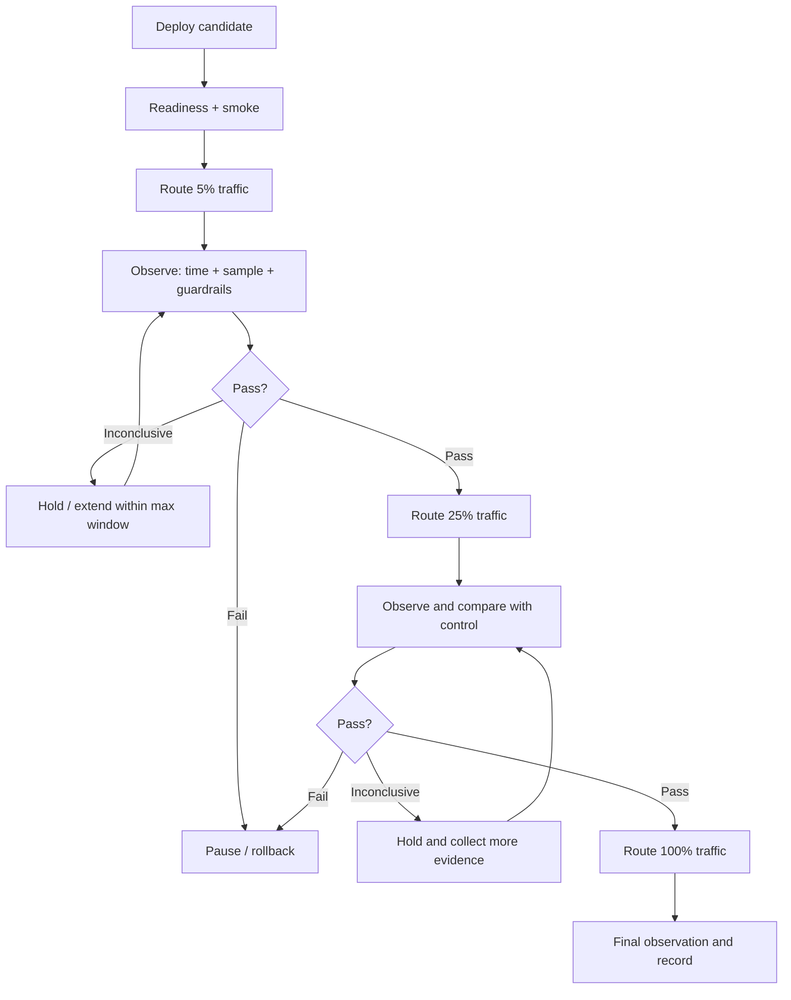

# Chọn khoảng quan sát và tiêu chí chấp nhận

Triển khai hoàn tất chỉ cho biết hệ thống đã nhận phiên bản mới. Nó chưa chứng minh phiên bản đó hoạt động tốt với lưu lượng, dữ liệu và dependency thực tế. Sau mỗi lần deploy, CI/CD cần có một khoảng quan sát (observation window) để thu thập tín hiệu vận hành, so sánh với baseline và quyết định tiếp tục rollout, tạm dừng hay quay lui.

Khoảng quan sát quá ngắn có thể bỏ lỡ lỗi chỉ xuất hiện khi đủ request, khi một batch chạy hoặc khi cache hết hạn. Khoảng quan sát quá dài lại giữ rollout ở trạng thái chờ, kéo dài thời gian phơi nhiễm với phiên bản chưa được xác minh. Vì vậy, thời lượng cần dựa trên loại thay đổi, lưu lượng, độ trễ xuất hiện lỗi, chu kỳ nghiệp vụ và chất lượng dữ liệu quan sát. Tiêu chí chấp nhận phải được xác định trước khi triển khai, có ngưỡng đo được và gắn với đúng revision đang chạy.

## 1. Mục tiêu của quan sát sau triển khai

Quan sát sau triển khai (post-deployment observation) là giai đoạn xác minh phiên bản mới trong môi trường đích sau khi rollout bắt đầu hoặc hoàn tất. Nó kết hợp kiểm tra chủ động như health check và smoke test với tín hiệu thụ động từ metrics, logs, traces và dữ liệu nghiệp vụ.

Mục tiêu gồm:

- Xác nhận workload đã khởi động, sẵn sàng và nhận đúng artifact/configuration.
- Phát hiện lỗi chức năng chỉ xuất hiện khi chạy trên môi trường thật.
- Phát hiện suy giảm latency, throughput, error rate hoặc mức sử dụng tài nguyên.
- Xác nhận các luồng nghiệp vụ quan trọng vẫn tạo ra kết quả đúng.
- Phát hiện lỗi tích hợp, queue backlog, retry storm hoặc dependency timeout.
- Kiểm tra thay đổi có ảnh hưởng tới SLO, error budget, bảo mật hoặc tính toàn vẹn dữ liệu không.
- Cung cấp bằng chứng để quyết định mở rộng rollout, giữ nguyên tỷ lệ, dừng hoặc rollback.

Một deployment có thể có trạng thái `succeeded` ở cấp công cụ triển khai nhưng vẫn thất bại ở cấp dịch vụ. Ví dụ, Kubernetes đã cập nhật đủ replica nhưng endpoint thanh toán trả lỗi, p99 latency tăng mạnh hoặc consumer không xử lý được message. Do đó, cần tách **deployment completion** khỏi **post-deployment acceptance**.

## 2. Xác định tín hiệu cần quan sát trước khi chọn thời lượng

Không nên chọn “quan sát 10 phút” trước rồi mới tìm metric phù hợp. Hãy bắt đầu từ rủi ro của thay đổi và xác định tín hiệu nào có thể chứng minh hệ thống vẫn hoạt động đúng.

| Nhóm tín hiệu | Cần trả lời | Ví dụ |
|---|---|---|
| Availability/readiness | Instance có sẵn sàng nhận traffic không? | Readiness probe, healthy target count, tỷ lệ request thành công |
| Functional correctness | Luồng nghiệp vụ có cho kết quả đúng không? | Smoke test, synthetic transaction, contract check, invariant |
| Reliability | Có lỗi, timeout hoặc retry tăng bất thường không? | 5xx rate, timeout rate, retry count, queue failure |
| Performance | Hệ thống có đáp ứng mục tiêu thời gian và tải không? | p50/p95/p99 latency, throughput, saturation |
| Dependency | Kết nối tới database, cache, broker và API ngoài có ổn định không? | Connection pool, query latency, consumer lag, dependency error |
| Business outcome | Hoạt động nghiệp vụ có tiếp tục diễn ra đúng không? | Đơn hàng hoàn tất, thanh toán thành công, tỷ lệ chuyển đổi |
| Data integrity | Dữ liệu có mất, trùng hoặc sai trạng thái không? | Reconciliation, duplicate count, migration validation |
| Security | Có hành vi truy cập hoặc lỗi bảo mật bất thường không? | Auth failure, denied access, policy violation, audit event |

Không phải dịch vụ nào cũng cần mọi tín hiệu với cùng trọng số. Một API đọc nội dung có thể ưu tiên availability và latency; hệ thống thanh toán cần thêm đối soát giao dịch, duplicate và tính toàn vẹn dữ liệu; worker xử lý nền cần theo dõi queue lag, tuổi message và tỷ lệ xử lý thành công.

### Chọn metric theo thay đổi

Hãy liên kết mỗi thay đổi với giả thuyết và guardrail tương ứng:

- Thay đổi query database: theo dõi query latency, connection pool, lock wait, timeout và error rate.
- Thay đổi cache: theo dõi hit ratio, miss rate, eviction, backend load và dữ liệu trả về.
- Thay đổi consumer: theo dõi lag, processing rate, retry, dead-letter queue và duplicate.
- Thay đổi authentication: theo dõi login success/failure, token validation, authorization denial và latency của identity provider.
- Thay đổi schema: theo dõi migration result, lỗi đọc/ghi giữa phiên bản cũ và mới, constraint violation và reconciliation.
- Thay đổi thuật toán hoặc luồng nghiệp vụ: theo dõi outcome, tỷ lệ hoàn tất, giá trị đầu ra và các invariant nghiệp vụ.

Metric phải có nhãn đủ để phân biệt revision mới với phiên bản đang ổn định, ví dụ `service`, `environment`, `version`, `revision`, `deployment_id` hoặc `release_id`. Nếu chỉ nhìn số liệu tổng của cả service, lỗi của canary có thể bị phiên bản cũ che khuất.

## 3. Chọn khoảng quan sát dựa trên thời gian lỗi có thể xuất hiện

Khoảng quan sát cần đủ dài để tín hiệu quan trọng có cơ hội xuất hiện và được thu thập. Một số lỗi xuất hiện ngay khi process khởi động; một số chỉ xuất hiện sau vài trăm request, khi cache được làm nóng, khi batch chạy hoặc khi lưu lượng đạt đỉnh.

Các yếu tố quyết định:

1. **Thời gian khởi động và warm-up:** ứng dụng, JIT, cache, connection pool hoặc autoscaler cần bao lâu để ổn định?
2. **Lưu lượng:** cần bao nhiêu request hoặc giao dịch để metric có ý nghĩa?
3. **Độ trễ telemetry:** metric/log/trace được cập nhật chậm bao lâu sau sự kiện?
4. **Chu kỳ nghiệp vụ:** tác vụ theo phút, giờ, ngày hoặc kỳ đối soát nào cần chạy qua?
5. **Tính chất lỗi:** lỗi xuất hiện tức thời, theo tải, theo thời gian hay theo dữ liệu đặc biệt?
6. **Blast radius:** nếu lỗi lọt qua, có bao nhiêu người dùng hoặc dữ liệu bị ảnh hưởng?
7. **Khả năng phục hồi:** có thể rollback nhanh không, hay cần dừng để xác minh dữ liệu trước?

### Các mốc quan sát tham khảo

| Giai đoạn | Khoảng thời gian tham khảo | Nội dung kiểm tra |
|---|---:|---|
| Khởi động/rollout | Vài giây đến vài phút | Pod/instance ready, crash loop, startup error, dependency connection |
| Smoke verification | Khoảng 1–5 phút sau khi sẵn sàng | Luồng đọc/ghi quan trọng, health endpoint, contract và synthetic transaction |
| Canary hold ngắn | Khoảng 5–15 phút với dịch vụ lưu lượng cao, ổn định | Error rate, latency percentile, throughput, saturation và business guardrail |
| Canary hold dài hơn | Khoảng 30–60 phút hoặc lâu hơn với lưu lượng thấp/biến động | Đủ sample, nhiều chu kỳ traffic, retry/queue và hành vi dependency |
| Soak/long-running validation | Vài giờ đến 24 giờ hoặc theo chu kỳ nghiệp vụ | Memory/resource leak, backlog, scheduled job, cache expiry và suy giảm theo thời gian |
| Data reconciliation | Theo khối lượng và chu kỳ xử lý; có thể nhiều giờ hoặc nhiều ngày | Đối soát record, duplicate, missing data và tính nhất quán sau migration |

Các mốc trên chỉ là điểm bắt đầu để lập kế hoạch, không phải SLA chung. Một dịch vụ có lưu lượng rất cao có thể đạt đủ mẫu trong vài phút; dịch vụ nội bộ ít request có thể cần hàng giờ hoặc phải dùng synthetic traffic. Một hệ thống xử lý lương theo tháng cần xác minh chu kỳ nghiệp vụ phù hợp, không thể kết luận chỉ sau 10 phút.

### Kết hợp thời gian với số lượng mẫu

Chỉ dùng thời lượng có thể gây kết luận sai. Ví dụ, một canary chạy 10 phút nhưng chỉ nhận 12 request thì tỷ lệ lỗi 0% chưa chứng minh độ tin cậy. Ngược lại, hàng triệu request trong vài giây có thể bộc lộ lỗi tải nhưng chưa kiểm tra được batch chạy theo giờ.

Nên định nghĩa đồng thời:

- Thời gian quan sát tối thiểu và tối đa.
- Số request/giao dịch tối thiểu cho từng nhóm metric.
- Số lượng hoặc tỷ lệ người dùng/traffic đã tiếp xúc với phiên bản mới.
- Số chu kỳ nghiệp vụ phải đi qua.
- Độ trễ tối đa cho phép của telemetry.

Nếu hết thời gian tối đa mà số mẫu chưa đủ, kết quả nên là `inconclusive` hoặc yêu cầu người có trách nhiệm quyết định theo policy; không tự động coi là đạt.

## 4. Thiết lập baseline để biết điều gì là bất thường

Metric sau deploy chỉ có ý nghĩa khi có điểm so sánh. Baseline có thể là phiên bản ổn định ngay trước deployment, SLO của dịch vụ, lịch sử cùng khung giờ hoặc một nhóm canary/control chạy song song.

Các cách so sánh:

- **Absolute threshold:** giá trị không được vượt ngưỡng cụ thể, ví dụ error rate dưới 1% hoặc p95 dưới 500 ms.
- **Relative change:** mức thay đổi so với baseline, ví dụ p95 không tăng quá 10% so với phiên bản ổn định.
- **SLO/error budget:** đánh giá tác động lên mục tiêu độ tin cậy và tốc độ tiêu thụ error budget.
- **Canary vs control:** so sánh revision mới với revision cũ trong cùng khoảng thời gian và điều kiện tải tương tự.
- **Business invariant:** kiểm tra quan hệ phải luôn đúng, ví dụ số tiền ghi nợ bằng số tiền ghi có tương ứng.

Không nên chỉ dùng ngưỡng tương đối. Nếu baseline vốn đã xấu, “không tệ hơn 5%” vẫn có thể không chấp nhận được. Cũng không nên chỉ dùng ngưỡng tuyệt đối nếu traffic thay đổi theo mùa hoặc giờ trong ngày. Thường cần kết hợp SLO tuyệt đối, thay đổi tương đối và business guardrail.

### So sánh công bằng

Khi so sánh baseline, cần xét:

- Cùng endpoint, loại request, region và phân bố dữ liệu.
- Cùng khung giờ hoặc điều chỉnh seasonality/weekday/weekend.
- Cùng điều kiện cache warm-up và autoscaling.
- Cùng cách tính histogram/percentile và cùng độ dài cửa sổ.
- Không gộp traffic của revision mới với revision cũ nếu mục tiêu là đánh giá canary.
- Ghi nhận các thay đổi ngoài deployment có thể ảnh hưởng kết quả, như dependency outage hoặc traffic campaign.

## 5. Đặt tiêu chí chấp nhận đo được

Tiêu chí chấp nhận (acceptance criteria) phải mô tả điều kiện để mở rộng rollout hoặc đánh dấu deployment đã được xác minh. Mỗi tiêu chí cần nêu metric, cách đo, ngưỡng, cửa sổ đánh giá, số mẫu tối thiểu và hành động khi không đạt.

Ví dụ một bộ guardrail cho API:

| Tín hiệu | Điều kiện đạt minh họa | Hành động nếu không đạt |
|---|---|---|
| Readiness | Tất cả replica mục tiêu sẵn sàng trong rollout deadline | Dừng rollout, kiểm tra startup/config/dependency |
| 5xx/error rate | Dưới 1% và không tăng quá 0,5 điểm phần trăm so với control trong cửa sổ 5 phút | Pause; nếu kéo dài qua cửa sổ xác nhận thì rollback |
| p95 latency | Dưới SLO 500 ms và không tăng quá 10% so với baseline | Giữ tỷ lệ canary, điều tra query/resource hoặc rollback theo mức vi phạm |
| p99 latency | Không vượt ngưỡng critical đã định nghĩa | Dừng rollout nếu ảnh hưởng luồng quan trọng |
| Saturation | CPU/RAM/connection pool không chạm ngưỡng nguy hiểm kéo dài | Pause hoặc rollback nếu có nguy cơ cạn tài nguyên |
| Functional smoke | 100% luồng bắt buộc đạt | Dừng rollout; không bỏ qua lỗi nghiệp vụ trọng yếu |
| Business outcome | Tỷ lệ hoàn tất không giảm vượt biên cho phép; không có invariant bị vi phạm | Dừng, kiểm tra dữ liệu và nghiệp vụ |
| Data integrity | Không có missing/duplicate/corruption vượt ngưỡng được phép | Dừng ghi hoặc kích hoạt quy trình phục hồi dữ liệu |

Các con số chỉ là ví dụ. Ngưỡng thật phải xuất phát từ SLO, baseline và mức chấp nhận rủi ro của dịch vụ. Đối với giao dịch tài chính, một lỗi dữ liệu có thể cần ngưỡng bằng 0 dù error rate tổng vẫn thấp.

### Phân loại pass, fail và inconclusive

Nên có ít nhất ba kết quả:

- **Pass:** đủ thời gian, đủ mẫu, telemetry hợp lệ và tất cả guardrail bắt buộc đạt.
- **Fail:** một guardrail quan trọng bị vi phạm, có lỗi chức năng nghiêm trọng hoặc phát hiện vấn đề toàn vẹn dữ liệu/bảo mật.
- **Inconclusive:** thiếu mẫu, telemetry gián đoạn, baseline không hợp lệ hoặc chưa đi qua chu kỳ nghiệp vụ cần thiết.

`Inconclusive` không đồng nghĩa với `pass`. Pipeline có thể giữ nguyên tỷ lệ rollout và kéo dài quan sát trong giới hạn, yêu cầu synthetic test hoặc chuyển cho người trực quyết định. Nếu không thể thu thập bằng chứng đáng tin cậy, không nên tự động mở rộng traffic.

## 6. Dùng SLI, SLO và error budget làm guardrail

SLI (Service Level Indicator) là chỉ số đo chất lượng dịch vụ, ví dụ tỷ lệ request thành công hoặc latency. SLO (Service Level Objective) là mục tiêu đặt cho SLI trong một khoảng thời gian. Error budget là phần sai lệch cho phép trước khi SLO bị vi phạm.

Ví dụ:

- SLI availability: tỷ lệ request hợp lệ được phục vụ thành công.
- SLO: 99,9% request thành công trong cửa sổ 30 ngày.
- Error budget: phần request lỗi tương ứng với 0,1% trong cửa sổ đó.

Sau deployment, có thể theo dõi error rate và burn rate để biết phiên bản mới có tiêu thụ error budget nhanh bất thường hay không. Không nên kết luận SLO 30 ngày chỉ từ một cửa sổ quan sát 10 phút; cửa sổ ngắn dùng để phát hiện regression nhanh, còn SLO dài hạn phản ánh độ tin cậy theo mục tiêu đã cam kết.

Một release gate có thể dùng:

- Ngưỡng nhanh: lỗi nghiêm trọng hoặc burn rate cao trong cửa sổ ngắn làm dừng rollout.
- Ngưỡng chậm: theo dõi xu hướng dài hơn để tránh rollback vì nhiễu ngắn hạn.
- Error budget còn lại: hạn chế release rủi ro cao khi dịch vụ đã tiêu thụ gần hết ngân sách lỗi.

Các ngưỡng và cửa sổ cần được định nghĩa theo SLO của từng service. Không dùng cùng một ngưỡng latency hoặc availability cho mọi endpoint.

## 7. Quan sát theo chiến lược rollout

Thời lượng và tiêu chí phải phù hợp với cách rollout.

### Rolling deployment

Phiên bản mới thay thế dần instance cũ. Cần quan sát readiness và lỗi trên từng batch, bảo đảm số instance healthy không giảm dưới mức tối thiểu, đồng thời theo dõi metric toàn service. Nếu các instance cũ và mới chạy đồng thời, API/schema cần tương thích trong giai đoạn chuyển tiếp.

### Canary deployment

Chỉ một tỷ lệ traffic nhỏ đi vào phiên bản mới trước. Mỗi bước tăng traffic nên có hold period và guardrail riêng. Ví dụ 5% → 25% → 50% → 100%; chỉ tăng khi đủ thời gian, đủ mẫu và các metric đạt. Nếu lưu lượng thấp, cần kéo dài hold hoặc tạo synthetic traffic đại diện.

### Blue-green deployment

Môi trường green được dựng song song rồi chuyển traffic từ blue sang green. Trước khi chuyển toàn bộ, cần xác minh green bằng smoke test, synthetic transaction và kiểm tra dependency. Sau khi chuyển traffic, tiếp tục quan sát vì lỗi có thể chỉ xuất hiện với dữ liệu hoặc người dùng thực tế. Giữ blue đủ lâu và có khả năng chuyển lại nếu rollback được hỗ trợ.

### Feature flag / progressive delivery

Artifact có thể đã triển khai nhưng tính năng mới chỉ bật cho một nhóm người dùng. Khi đó cần phân biệt deployment observation với feature observation: theo dõi revision của code và trạng thái flag, nhóm người dùng, tỷ lệ exposure cùng business metric. Tắt flag có thể là biện pháp giảm thiểu nhanh, nhưng không thay thế sửa lỗi hoặc rollback khi code nền gây rủi ro.

## 8. Quan sát kỹ thuật và xác minh nghiệp vụ

Metrics hệ thống không thể chứng minh mọi hành vi nghiệp vụ đúng. Một service có CPU thấp, latency tốt và không có 5xx vẫn có thể tính sai phí hoặc tạo đơn hàng trùng.

Nên kết hợp ba lớp:

1. **Technical health:** process, pod, dependency, latency, error, resource và queue.
2. **Functional probes:** gọi các luồng quan trọng với tài khoản/dữ liệu kiểm thử được kiểm soát; xác minh response và side effect.
3. **Business validation:** đối chiếu số lượng, trạng thái và invariant từ góc nhìn nghiệp vụ.

Ví dụ với dịch vụ đơn hàng:

- Technical: API orders sẵn sàng, database connection ổn định, consumer lag trong giới hạn.
- Functional: tạo đơn thử nghiệm, đọc lại đơn, hủy đơn theo luồng hợp lệ.
- Business: số đơn được tạo khớp số đơn hoàn tất, không phát sinh duplicate charge, tổng tiền và trạng thái đối soát đúng.

Synthetic transaction cần dùng dữ liệu và tài khoản riêng, được nhận diện rõ và có cleanup. Không tạo giao dịch giả trên hệ thống thanh toán thật nếu chưa có cơ chế sandbox hoặc quy trình được phê duyệt.

## 9. Xử lý telemetry trễ, thiếu hoặc nhiễu

Quyết định rollout phụ thuộc vào chất lượng dữ liệu. Một cửa sổ quan sát có thể bị sai lệch nếu metrics đến trễ, log mất mẫu, trace sampling thay đổi hoặc dashboard gộp nhầm revision.

Các biện pháp:

- Xác định telemetry lag và chỉ đánh giá cửa sổ đã hoàn tất sau thời gian trễ dự phòng.
- Gắn deployment ID/revision vào metric, log và trace.
- Kiểm tra sample count tối thiểu trước khi tính percentile hoặc tỷ lệ.
- Không coi metric không có dữ liệu là giá trị 0 hoặc trạng thái khỏe.
- Theo dõi lỗi của chính hệ thống monitoring/collector.
- Dùng cùng định nghĩa metric và histogram bucket khi so sánh baseline.
- Xác định cách xử lý outlier và traffic bất thường trước khi rollout.

Nếu dữ liệu quan sát bị thiếu trong khoảng quan trọng, trạng thái phải là `inconclusive`. Nếu mất telemetry đồng nghĩa mất khả năng phát hiện lỗi trong môi trường rủi ro cao, có thể cần pause rollout cho đến khi khôi phục được khả năng quan sát.

### Tránh kết luận từ sample quá nhỏ

Tỷ lệ lỗi 0% trên 10 request không có cùng ý nghĩa với 0% trên 100.000 request. Với tỷ lệ hiếm, cần đủ mẫu hoặc khoảng tin cậy phù hợp. Khi traffic không đủ, hãy kéo dài thời gian, dùng synthetic load đã được kiểm soát hoặc chờ chu kỳ nghiệp vụ tiếp theo. Không tăng traffic chỉ để đạt đủ sample nếu điều đó làm tăng rủi ro cho người dùng.

## 10. Xác định hành động khi tiêu chí bị vi phạm

Tiêu chí chấp nhận chỉ hữu ích khi gắn với hành động rõ ràng. Có thể chia thành ba mức:

| Mức | Điều kiện ví dụ | Hành động |
|---|---|---|
| Warning | Metric xấu đi nhẹ nhưng còn trong SLO và chưa kéo dài | Giữ nguyên tỷ lệ rollout, cảnh báo người trực và quan sát tiếp |
| Pause/hold | Metric gần ngưỡng, sample chưa đủ hoặc telemetry chưa ổn định | Không tăng traffic; kiểm tra log/trace, dependency và dữ liệu |
| Abort/rollback | Lỗi nghiêm trọng, SLO guardrail bị vi phạm kéo dài, security/data integrity failure | Dừng rollout, rollback hoặc tắt feature theo runbook; thông báo incident |

Một số điều kiện cần hành động ngay, không chờ hết observation window:

- Mất dữ liệu, ghi sai dữ liệu hoặc giao dịch trùng có tác động thật.
- Rò rỉ secret, bypass authorization hoặc lộ dữ liệu giữa tenant.
- Crash loop diện rộng hoặc availability giảm dưới ngưỡng critical.
- Queue backlog tăng không kiểm soát dẫn tới mất khả năng xử lý.
- Error rate/latency vượt ngưỡng khẩn cấp đã định nghĩa.

Với lỗi không nghiêm trọng, cần xác định thời gian duy trì vi phạm (for duration) hoặc số cửa sổ liên tiếp để tránh rollback do một spike ngắn. Nhưng không áp dụng thời gian chờ cho sự cố có nguy cơ mất dữ liệu hoặc vi phạm bảo mật nghiêm trọng.

## 11. Ví dụ cấu hình acceptance policy

Một policy có cấu trúc giúp pipeline và người vận hành hiểu cùng một tiêu chí. Ví dụ YAML dưới đây chỉ minh họa cách biểu diễn; schema và bộ đánh giá phải do dự án triển khai.

```yaml
postDeployment:
  service: orders
  environment: production
  revision: "sha256:abc123..."
  observation:
    minimumDuration: 15m
    maximumDuration: 45m
    telemetryGracePeriod: 2m
    minimumRequests: 5000
    minimumCanaryTrafficPercent: 5
  acceptance:
    readiness:
      allReplicasReady: true
      rolloutDeadline: 5m
    errors:
      max5xxRate: 0.01
      maxIncreaseVsControl: 0.005
      evaluationWindow: 5m
      consecutiveWindows: 2
    latency:
      p95MaxMs: 500
      maxIncreaseVsControlPercent: 10
      evaluationWindow: 5m
    business:
      criticalSmokeTests: all_pass
      duplicatePaymentCount: 0
    dataIntegrity:
      corruptionCount: 0
  onInconclusive: hold
  onCriticalFailure: abort_and_rollback
```

Trong ví dụ, hệ thống phải quan sát ít nhất 15 phút, không quá 45 phút, có ít nhất 5.000 request và chờ thêm 2 phút cho telemetry. Hai cửa sổ lỗi liên tiếp mới kích hoạt điều kiện tăng mức xử lý cho lỗi 5xx thông thường; duplicate payment hoặc corruption là điều kiện critical. Các con số phải được điều chỉnh theo service SLO, traffic và mức rủi ro.

## 12. Ví dụ truy vấn Prometheus để theo dõi canary

Giả sử metrics có label `service`, `environment` và `revision`. Có thể truy vấn tỷ lệ 5xx và p95 latency của revision mới:

```promql
sum(rate(http_requests_total{
  service="orders",
  environment="production",
  revision="candidate",
  status=~"5.."
}[5m]))
/
clamp_min(sum(rate(http_requests_total{
  service="orders",
  environment="production",
  revision="candidate"
}[5m])), 1e-9)
```

```promql
histogram_quantile(
  0.95,
  sum by (le) (rate(http_request_duration_seconds_bucket{
    service="orders",
    environment="production",
    revision="candidate"
  }[5m]))
)
```

Đây là ví dụ giả định metric và label tồn tại như mô tả. Mẫu số dùng `1e-9` để tránh chia cho 0 khi lưu lượng bằng 0; nếu không có request trong cửa sổ, kết quả vẫn không phải bằng chứng đủ mẫu và cần được coi là thiếu dữ liệu. Cần kiểm tra kiểu counter/histogram, label cardinality và cách instrument của ứng dụng. Truy vấn p95 trả về giây, vì vậy 500 ms tương ứng 0,5 giây. Cũng cần truy vấn revision control riêng để so sánh cùng cửa sổ.

## 13. Ví dụ triển khai canary với các bước hold

Một quy trình progressive delivery có thể chia traffic và đánh giá sau mỗi bước:



Mỗi bước tăng traffic cần có hold period riêng. Khi traffic tăng, sample và tác động tiềm tàng cũng tăng; có thể yêu cầu xác minh lại guardrail sau mỗi lần chuyển tỷ lệ. Không nên dùng một lần pass ở 5% để tự động bỏ qua quan sát sau khi lên 100%.

## 14. Lưu kết quả quan sát vào deployment record

Kết quả sau triển khai cần gắn với đúng lần deployment để phục vụ điều tra và so sánh release sau. Nên lưu:

- Deployment ID, release ID, service và environment.
- Artifact digest, commit SHA và configuration revision.
- Rollout strategy, các mốc traffic và thời điểm từng bước.
- Observation start/end, timezone và telemetry grace period.
- Baseline/control revision và cấu hình so sánh.
- Metric, threshold, sample count, percentile và kết quả từng cửa sổ.
- Smoke/synthetic test result và business validation.
- Trạng thái `pass`, `fail` hoặc `inconclusive` cùng lý do.
- Hành động đã thực hiện: continue, hold, pause, rollback hoặc feature disable.
- Người trực/approver và liên kết incident nếu có.

Không chỉ lưu ảnh chụp dashboard. Nên lưu kết quả có cấu trúc và liên kết tới nguồn metric/log/trace để có thể tái kiểm tra. Bản ghi cần tránh chứa secret hoặc dữ liệu cá nhân.

## 15. Những sai lầm thường gặp

- **Chọn một thời lượng cố định cho mọi dịch vụ:** bỏ qua traffic, batch cycle và đặc điểm lỗi.
- **Chỉ dựa vào readiness probe:** instance sẵn sàng không chứng minh nghiệp vụ đúng.
- **Chỉ dùng average latency:** che khuất p95/p99 và nhóm request chậm.
- **Đánh giá tỷ lệ lỗi với sample quá nhỏ:** dễ kết luận sai khi traffic thấp.
- **Không phân biệt revision:** metric phiên bản cũ che lấp lỗi canary.
- **Không có baseline:** không biết metric tăng là do deployment hay biến động bình thường.
- **Coi thiếu telemetry là khỏe:** mất khả năng quan sát nhưng pipeline vẫn mở rộng rollout.
- **Không theo dõi business invariant:** API trả 200 nhưng dữ liệu hoặc giao dịch sai.
- **Rollback vì một spike ngắn không nghiêm trọng:** tạo thêm biến động do phản ứng quá nhạy.
- **Chờ hết cửa sổ dù có lỗi critical:** kéo dài tác động của lỗi dữ liệu hoặc bảo mật.
- **Không quan sát lại sau khi tăng traffic:** lỗi chỉ xuất hiện ở tải lớn bị bỏ lỡ.
- **Không lưu policy và kết quả theo deployment:** không thể giải thích vì sao release được tiếp tục.

## 16. Checklist chọn observation window và acceptance criteria

Trước khi triển khai, hãy xác định:

1. Thay đổi có thể gây ra loại lỗi nào và lỗi có thể xuất hiện sau bao lâu?
2. Tín hiệu kỹ thuật, chức năng, nghiệp vụ, dữ liệu và bảo mật nào cần quan sát?
3. Baseline/control revision nào được dùng để so sánh?
4. Thời gian tối thiểu, tối đa và telemetry grace period là bao nhiêu?
5. Cần tối thiểu bao nhiêu request/giao dịch hoặc chu kỳ nghiệp vụ?
6. Có cần warm-up, synthetic traffic, batch run hoặc soak test không?
7. Ngưỡng absolute, relative, SLO và business invariant nào là bắt buộc?
8. Metric đã gắn revision/deployment ID để tách candidate khỏi control chưa?
9. Kết quả `pass`, `fail` và `inconclusive` được định nghĩa rõ chưa?
10. Điều kiện nào chỉ cảnh báo, điều kiện nào pause và điều kiện nào rollback ngay?
11. Ai nhận cảnh báo và ai có quyền quyết định khi dữ liệu không đủ?
12. Sau mỗi lần tăng traffic, có quan sát lại theo cửa sổ mới không?
13. Deployment record có lưu digest, config revision, sample, metric, threshold và quyết định không?
14. Có runbook phục hồi và cách xác minh sau rollback không?

Chọn khoảng quan sát là chọn thời gian và lượng bằng chứng cần thiết để phát hiện rủi ro của thay đổi. Tiêu chí chấp nhận phải đo được, gắn với đúng revision và phản ánh cả chất lượng kỹ thuật lẫn kết quả nghiệp vụ. Khi thiếu dữ liệu, hãy giữ rollout ở trạng thái chưa kết luận; khi có lỗi nghiêm trọng, hành động ngay theo runbook. Nhờ vậy, quyết định phát hành dựa trên bằng chứng thực tế thay vì chỉ dựa vào việc lệnh deploy đã kết thúc thành công.
