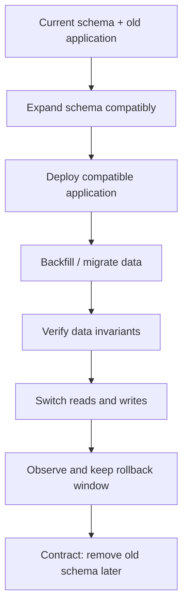

# Xác định điều kiện quay lui trước khi triển khai

## 1. Vì sao phải quyết định điều kiện quay lui trước release?

Rollback (quay lui) là việc đưa hệ thống về một trạng thái đã biết là ổn định sau khi thay đổi gây lỗi hoặc không đáp ứng điều kiện phát hành. Trong CI/CD, rollback thường được nhắc đến như một nút bấm sau khi deploy thất bại. Nhưng nếu chỉ bắt đầu nghĩ về rollback khi production đã gặp sự cố, nhóm có thể phát hiện rằng artifact cũ không còn, cấu hình cũ không tương thích, migration không thể đảo ngược hoặc không ai có quyền quyết định dừng rollout.

Điều kiện quay lui cần được xác định trước khi triển khai để mọi người biết:

- Tín hiệu nào cho thấy bản phát hành mới đang gây rủi ro.
- Ngưỡng nào cần dừng rollout hoặc khôi phục.
- Khoảng thời gian quan sát và lượng dữ liệu tối thiểu để quyết định.
- Ai có quyền kích hoạt rollback và ai chịu trách nhiệm điều phối.
- Trạng thái nào có thể khôi phục bằng rollback, trạng thái nào cần roll-forward hoặc sửa dữ liệu.
- Artifact, cấu hình, secret và dữ liệu nào cần giữ để phục hồi.
- Sau khi quay lui, cần kiểm tra điều gì trước khi mở traffic trở lại.

Một kế hoạch rollback tốt giảm thời gian ra quyết định trong sự cố, hạn chế tác động tới người dùng và tránh các thao tác khẩn cấp không có kiểm soát. Nó cũng giúp nhóm đánh giá trước xem một thay đổi có thật sự có thể đảo ngược hay không.

## 2. Phân biệt rollback, roll-forward, abort và recovery

Các thuật ngữ này có liên quan nhưng không phải cùng một hành động:

| Khái niệm | Ý nghĩa | Ví dụ |
|---|---|---|
| Abort rollout | Dừng quá trình triển khai đang diễn ra trước khi hoàn tất | Dừng tăng traffic cho canary khi error rate vượt ngưỡng |
| Rollback | Khôi phục phiên bản hoặc trạng thái trước đó đã biết là ổn định | Đưa workload về image digest của release trước |
| Roll-forward | Triển khai bản sửa tiếp theo để đưa hệ thống về trạng thái đúng | Phát hành bản vá tương thích khi migration không thể đảo ngược |
| Recovery | Tập hợp hoạt động đưa dịch vụ/dữ liệu về trạng thái vận hành chấp nhận được | Khôi phục backup, replay event, sửa dữ liệu và triển khai lại |

Rollback thường là một phần của recovery, nhưng recovery có thể cần nhiều bước hơn việc đổi image về bản cũ. Ví dụ, nếu release mới đã ghi dữ liệu theo schema mới, chỉ rollback ứng dụng có thể khiến phiên bản cũ không đọc được dữ liệu. Khi đó cần roll-forward, chuyển đổi dữ liệu hoặc khôi phục từ backup theo kế hoạch đã đánh giá.

Abort rollout cũng không đồng nghĩa rollback hoàn chỉnh. Dừng mở rộng canary có thể giữ một phần traffic trên phiên bản mới. Nếu phiên bản đó vẫn gây lỗi, cần chuyển traffic hoặc khôi phục workload theo runbook.

## 3. Xác định mục tiêu phục hồi và mức tác động chấp nhận được

Trước khi đặt ngưỡng rollback, cần hiểu mục tiêu dịch vụ và tác động của lỗi. Các câu hỏi nên được trả lời cùng product owner, operations và nhóm chịu trách nhiệm hệ thống:

- Lỗi nào ảnh hưởng trực tiếp tới người dùng hoặc nghiệp vụ?
- Bao nhiêu request thất bại hoặc bao nhiêu giao dịch lỗi là không thể chấp nhận?
- Dịch vụ có thể gián đoạn tối đa bao lâu khi phục hồi?
- Có dữ liệu nào có thể mất hoặc phải nhập lại không?
- Có thể chấp nhận trạng thái degraded tạm thời hay phải khôi phục đầy đủ?
- Hệ thống phụ thuộc nào sẽ bị ảnh hưởng nếu rollback?
- Mức độ ảnh hưởng nào yêu cầu thông báo incident hoặc kích hoạt người trực?

Hai khái niệm thường được dùng để đặt mục tiêu phục hồi:

- **RTO (Recovery Time Objective):** khoảng thời gian mục tiêu để khôi phục dịch vụ sau sự cố.
- **RPO (Recovery Point Objective):** mức mất dữ liệu tối đa có thể chấp nhận, thường biểu diễn bằng khoảng thời gian dữ liệu.

RTO/RPO là mục tiêu của hoạt động phục hồi tổng thể, không phải thời gian mặc định mà một lệnh rollback sẽ đạt được. Nếu RTO là 15 phút, nhóm cần tính cả phát hiện, quyết định, thao tác, xác minh và mở traffic. Nếu RPO bằng 0 cho giao dịch đã xác nhận, rollback ứng dụng không được làm mất dữ liệu giao dịch đã commit.

## 4. Xác định các tín hiệu kích hoạt rollback

Rollback nên dựa trên tín hiệu đo được, gắn với tác động và có thể thu thập trong quá trình rollout. Không nên chỉ dựa vào cảm nhận “ứng dụng có vẻ chậm”.

Các nhóm tín hiệu thường gặp:

| Nhóm | Ví dụ tín hiệu | Rủi ro cần phát hiện |
|---|---|---|
| Availability | Health/readiness thất bại, tỷ lệ request 5xx tăng | Dịch vụ không phục vụ được request |
| Reliability | Timeout, retry, connection failure tăng | Request không hoàn tất hoặc dependency không ổn định |
| Performance | Latency p95/p99 vượt guardrail | Trải nghiệm suy giảm hoặc hệ thống quá tải |
| Business | Tỷ lệ thanh toán/tạo đơn thành công giảm | Hành vi nghiệp vụ bị sai dù health kỹ thuật vẫn xanh |
| Data integrity | Sai lệch số dư, bản ghi trùng, invariant vi phạm | Dữ liệu bị hỏng hoặc giao dịch sai |
| Security | Quyền truy cập bị mở rộng ngoài dự kiến, secret lộ, policy bị vi phạm | Rủi ro bảo mật hoặc tuân thủ |
| Capacity | CPU/memory saturation, queue lag tăng nhanh | Không đáp ứng được tải hoặc backlog tích tụ |
| Deployment | Pod crash loop, instance không đúng digest, rollout không tiến triển | Bản phát hành không được áp dụng đúng hoặc không ổn định |

Không phải mọi cảnh báo đều cần rollback. Một spike ngắn có thể là nhiễu, lỗi có thể đến từ dependency bên ngoài hoặc traffic tăng đột biến không liên quan đến release. Chính sách nên xác định mức độ, thời gian kéo dài, số mẫu tối thiểu và cách đối chiếu với baseline trước khi quyết định.

## 5. Đặt ngưỡng và cửa sổ quan sát

Một điều kiện rollback cần định nghĩa ít nhất bốn yếu tố:

1. **Metric hoặc tín hiệu:** đo điều gì và từ nguồn nào.
2. **Ngưỡng:** giá trị nào được coi là vượt giới hạn.
3. **Cửa sổ quan sát:** điều kiện phải tồn tại bao lâu hoặc trên bao nhiêu mẫu.
4. **Phạm vi:** cohort, endpoint, region, tenant hoặc toàn bộ dịch vụ nào bị ảnh hưởng.

Ví dụ policy giả định:

| Tín hiệu | Điều kiện kích hoạt dừng/rollback | Lưu ý |
|---|---|---|
| HTTP 5xx | Tỷ lệ lỗi cao hơn baseline 2 điểm phần trăm trong 5 phút và có đủ request | Cần loại trừ lỗi do upstream không liên quan nếu có bằng chứng |
| Latency p95 | Vượt SLO đã định trong 10 phút liên tục | Xem theo endpoint quan trọng và lưu lượng thực tế |
| Payment success | Tỷ lệ thanh toán thành công giảm vượt ngưỡng nghiệp vụ đã duyệt | Có thể kích hoạt dừng ngay vì tác động tài chính |
| Crash loop | Tỷ lệ instance restart vượt giới hạn trong cửa sổ ngắn | Kiểm tra cấu hình và dependency |
| Data invariant | Phát hiện sai lệch dữ liệu nghiêm trọng đã xác nhận | Có thể cần dừng ghi trước khi quyết định rollback |

Các con số trong ví dụ không phải chuẩn chung. Ngưỡng thực tế cần dựa trên SLO, baseline, mức tải, độ nhạy nghiệp vụ và mức rủi ro chấp nhận. Với tín hiệu nghiêm trọng như truy cập trái phép hoặc ghi sai dữ liệu tài chính, policy có thể yêu cầu dừng rollout ngay mà không chờ hết cửa sổ thông thường.

Nếu lưu lượng quá thấp, metric có thể không đủ mẫu để kết luận. Trong trường hợp đó, trạng thái nên là `insufficient_evidence` hoặc `hold`, không tự động coi là đạt. Có thể bổ sung synthetic test hoặc quan sát lâu hơn theo kế hoạch.

## 6. Phân biệt điều kiện dừng rollout và điều kiện rollback

Hai quyết định này thường được kết hợp nhưng cần phân biệt:

- **Stop/hold:** ngừng mở rộng phiên bản mới, giữ rollout ở mức hiện tại để điều tra.
- **Rollback:** chuyển traffic hoặc workload về phiên bản trước.
- **Roll-forward:** triển khai bản sửa tiếp theo.

Ví dụ, canary đang nhận 5% traffic và latency p95 tăng nhẹ. Nếu chưa đủ mẫu, nhóm có thể giữ ở 5% để thu thập dữ liệu. Nếu error rate tăng nghiêm trọng và liên quan đến code mới, nhóm có thể dừng rollout rồi chuyển traffic về phiên bản ổn định. Nếu lỗi chỉ nằm trong một cấu hình có thể sửa an toàn, roll-forward cấu hình có thể phù hợp hơn.

Điều kiện dừng cần nhanh và ít rủi ro. Điều kiện rollback cần xem xét tính tương thích của dữ liệu, schema và dependency. Không phải lúc nào rollback cũng là hành động đầu tiên hoặc an toàn nhất.

## 7. Kiểm tra khả năng đảo ngược trước khi triển khai

Trước release, hãy đánh giá từng thay đổi theo khả năng quay lui:

| Thành phần thay đổi | Câu hỏi cần trả lời |
|---|---|
| Application artifact | Artifact cũ còn lưu, truy xuất được và có thể deploy lại không? |
| Runtime configuration | Có revision trước đó và có tương thích với artifact cũ không? |
| Database schema | Migration có đảo ngược an toàn không? Dữ liệu mới có làm bản cũ lỗi không? |
| Persistent data | Có backup/restore, replay hoặc repair procedure không? |
| Message/event schema | Consumer cũ có đọc được message mới không? Có cần giữ tương thích ngược không? |
| Secret/certificate | Credential cũ còn hiệu lực hay đã bị thu hồi? Có thể cấp lại an toàn không? |
| Infrastructure | Thay đổi network, IAM, storage hoặc resource có thể khôi phục không? |
| External integration | Đối tác hoặc hệ thống ngoài đã nhận side effect nào không thể thu hồi? |

Một thay đổi chỉ nên được gọi là reversible khi đã xác định rõ trạng thái trước, thao tác quay lui, giới hạn dữ liệu và cách xác minh. Nếu có thành phần không thể đảo ngược, cần ghi rõ và thiết kế phương án roll-forward hoặc repair thay thế.

## 8. Rollback ứng dụng không tự động rollback dữ liệu

Đổi image từ version mới về version cũ chỉ thay đổi code đang chạy. Nó không tự động hoàn tác:

- Bản ghi đã được tạo hoặc cập nhật.
- Giao dịch thanh toán hoặc thông báo đã gửi.
- Event đã publish vào message broker.
- File đã ghi lên object storage.
- Schema hoặc index database đã thay đổi.
- Dữ liệu đã được chuyển đổi hoặc xóa.

Ví dụ, release mới ghi thêm trường `discount_amount` và phát hành event theo schema mới. Nếu rollback ứng dụng về phiên bản cũ không hiểu trường/event đó, consumer có thể lỗi hoặc tính sai dữ liệu. Cần duy trì tương thích trong giai đoạn chuyển tiếp hoặc có kế hoạch xử lý dữ liệu.

Với side effect bên ngoài như thanh toán, gửi email hoặc tạo lệnh vận chuyển, không thể giả định rollback sẽ “xóa” hành động đã xảy ra. Cần dùng idempotency, compensating transaction hoặc quy trình nghiệp vụ để xử lý. Những hành động bù trừ phải được review và kiểm thử riêng.

## 9. Migration database và chiến lược expand-and-contract

Migration là một trong những yếu tố quyết định rollback có an toàn hay không. Các migration chỉ thêm cột nullable hoặc bảng mới thường dễ tương thích hơn thao tác xóa/đổi tên cột, đổi kiểu dữ liệu hoặc chuyển đổi dữ liệu phá hủy.

Chiến lược expand-and-contract chia thay đổi thành nhiều giai đoạn:

1. **Expand:** thêm cấu trúc mới nhưng vẫn giữ cấu trúc cũ để phiên bản đang chạy tiếp tục hoạt động.
2. **Compatible application:** triển khai code có thể đọc/ghi theo cả hai dạng hoặc hỗ trợ chuyển tiếp.
3. **Migrate data:** chuyển đổi dữ liệu có kiểm soát, theo dõi tiến độ và kiểm tra invariant.
4. **Switch usage:** chuyển luồng đọc/ghi sang cấu trúc mới.
5. **Contract:** chỉ xóa cấu trúc cũ sau khi không còn phiên bản hoặc consumer cần nó.



Nếu release thất bại trước bước contract, nhóm có thể có nhiều lựa chọn quay về ứng dụng cũ vì schema cũ vẫn còn. Sau khi contract đã xóa hoặc chuyển đổi dữ liệu không thể đảo ngược, rollback ứng dụng cũ có thể không còn an toàn.

Không chạy migration down một cách tự động chỉ vì deployment job thất bại. Cần hiểu dữ liệu đã được ghi trong khoảng thời gian đó và xác minh script down không làm mất dữ liệu hợp lệ.

## 10. Chuẩn bị artifact và cấu hình để quay lui

Một kế hoạch rollback cần chỉ rõ chính xác artifact và config revision sẽ được sử dụng. Không nên chỉ ghi “quay lại version trước”.

Trước triển khai, cần:

- Giữ artifact ổn định trước đó trong registry với digest bất biến.
- Xác minh artifact cũ vẫn tải được và có provenance phù hợp.
- Lưu config revision trước đó và schema version tương ứng.
- Ghi lại deployment manifest hiện tại.
- Kiểm tra secret reference/version cũ còn hiệu lực hoặc có phương án cấp lại.
- Lưu release notes và migration state.
- Xác định lệnh hoặc automation để chọn artifact/config cũ.
- Kiểm thử việc deploy lại artifact cũ trên môi trường phù hợp.

Rollback không nên dựa vào tag mutable như `latest` hoặc `stable` nếu tag có thể đã bị ghi đè. Dùng digest hoặc release ID đã ghi nhận. Nếu artifact cũ không còn, nhóm có thể phải tạo release mới từ source cũ và kiểm tra lại, điều này thường mất thời gian hơn và không đảm bảo tạo ra cùng payload.

## 11. Cấu hình và secret khi rollback

Artifact cũ có thể cần config schema hoặc secret khác với bản mới. Trước release, hãy xác định cặp tương thích:

| Release | Artifact | Config revision | Secret reference/version | Khả năng rollback |
|---|---|---|---|---|
| R-104 | `service@sha256:aaa...` | `cfg-31` | `payment-api:v8` | Bản ổn định trước đó |
| R-105 | `service@sha256:bbb...` | `cfg-32` | `payment-api:v9` | Bản đang triển khai |

Nếu secret v8 đã bị thu hồi vì lý do bảo mật, không được tự động khôi phục secret đó chỉ để chạy artifact cũ. Cần xác định cách cấp credential mới tương thích với ứng dụng cũ hoặc chọn roll-forward.

Với dynamic configuration, cần ghi nhận revision mà mỗi instance đang dùng. Nếu rollback artifact nhưng config service vẫn trả cấu hình mới, ứng dụng cũ có thể lỗi. Deployment manifest nên liên kết artifact digest và config revision trong cùng một release record.

## 12. Xác định rollback window và thời điểm hết khả năng quay lui

Rollback window là khoảng thời gian mà việc quay về trạng thái trước đó vẫn được xem là an toàn và có thể thực hiện theo runbook. Cửa sổ này có thể kết thúc khi:

- Migration contract đã xóa schema cũ.
- Dữ liệu mới không còn tương thích với ứng dụng cũ.
- Secret/certificate cũ bị thu hồi.
- Event hoặc message schema mới đã được phát hành rộng rãi và consumer cũ không xử lý được.
- Side effect bên ngoài đã xảy ra và không thể bù trừ đơn giản.
- Artifact/config cũ hết retention hoặc không còn được hỗ trợ.

Không phải rollback window lúc nào cũng là một số giờ cố định. Nó phụ thuộc vào dữ liệu và thay đổi cụ thể. Với một release chỉ thay CSS, khả năng quay lại có thể kéo dài miễn là artifact cũ còn. Với migration dữ liệu, cửa sổ có thể kết thúc ngay khi một bước contract hoặc ghi dữ liệu không tương thích bắt đầu.

Release plan cần ghi thời điểm hoặc điều kiện đóng rollback window, ai xác nhận và phương án thay thế sau thời điểm đó. Nếu không thể rollback sau một bước, cần có phương án roll-forward/repair đã chuẩn bị trước khi thực hiện bước đó.

## 13. Đặt điều kiện rollback theo chiến lược triển khai

Các chiến lược rollout tạo ra trạng thái và quyết định khác nhau:

| Chiến lược | Điều kiện dừng/rollback cần xác định |
|---|---|
| Recreate | Bản mới không khởi động/readiness; thời gian maintenance vượt giới hạn; khôi phục artifact/config trước đó có an toàn không |
| Rolling update | Tỷ lệ instance mới lỗi; rollout không tiến triển; capacity còn lại không đủ; cách dừng và đưa instance cũ trở lại |
| Blue-Green | Health của green không đạt; điều kiện chuyển traffic; cách chuyển route về blue; dữ liệu dùng chung có tương thích không |
| Canary | Metric vượt guardrail ở cohort; điều kiện giữ, giảm hoặc chuyển traffic về stable; số mẫu tối thiểu |
| Feature flag | Tín hiệu nào khiến tắt flag; fallback có tương thích dữ liệu và side effect không |
| Serverless revision | Revision nào nhận traffic; tỷ lệ traffic cần đưa về revision trước; trạng thái event/data có bị ảnh hưởng không |

Với Canary hoặc Blue-Green, rollback có thể chỉ là chuyển traffic về phiên bản ổn định trong khi giữ workload mới để điều tra. Tuy nhiên, nếu phiên bản mới đã ghi dữ liệu không tương thích, chuyển traffic về code cũ vẫn có thể gây lỗi. Cần xem cả traffic và data plane.

## 14. Xác định người có quyền quyết định và quy trình kích hoạt

Trong incident, nhiều người có thể tham gia: on-call engineer, service owner, release manager, incident commander, database owner và security team. Cần phân công trước để tránh tranh luận về thẩm quyền khi hệ thống đang bị ảnh hưởng.

Một ma trận trách nhiệm tham khảo:

| Vai trò | Trách nhiệm |
|---|---|
| On-call engineer | Phát hiện tín hiệu, xác minh sơ bộ, thực hiện hành động khẩn cấp đã được ủy quyền |
| Service owner | Đánh giá tác động ứng dụng, tương thích và lựa chọn rollback/roll-forward |
| Incident commander | Điều phối quyết định, thông tin và ưu tiên phục hồi khi incident nghiêm trọng |
| Release manager | Theo dõi release state, artifact, approval và deployment record |
| Database/data owner | Đánh giá migration, backup, restore và tính toàn vẹn dữ liệu |
| Security owner | Đánh giá sự cố bảo mật, credential, containment và yêu cầu thông báo |

Không phải mọi rollback cần một cuộc họp phê duyệt. Với điều kiện tự động đã được định nghĩa và kiểm thử, hệ thống có thể tự dừng rollout hoặc rollback. Với thao tác dữ liệu phá hủy hoặc có tác động rộng, cần yêu cầu người có thẩm quyền theo runbook.

Quy trình kích hoạt cần xác định kênh thông báo, người nhận, lệnh/automation được phép, điều kiện escalation và cách ghi lại quyết định. Không để một input tùy ý từ pull request có thể kích hoạt production rollback.

## 15. Tự động hóa rollback có guardrail

Rollback tự động có thể giảm thời gian phản ứng, nhưng chỉ nên áp dụng khi tín hiệu rõ, hành động có thể đảo ngược và hệ thống biết chính xác trạng thái trước đó.

Các guardrail cần có:

- Chỉ rollback release ID/digest đã được xác định là phiên bản ổn định.
- Xác minh artifact và config đích tồn tại trước khi bắt đầu.
- Kiểm tra compatibility với schema/database và secret hiện tại.
- Dừng rollout hoặc khóa các lần deploy cạnh tranh.
- Không tự động rollback migration/data nếu chưa có policy riêng.
- Có timeout, retry limit và trạng thái thất bại rõ ràng.
- Ghi audit record, lý do, metric kích hoạt và actor (system hoặc người).
- Sau rollback, chạy post-deployment verification trước khi kết thúc.
- Escalate cho người trực nếu rollback không đạt hoặc trạng thái không xác định.

Một automation không nên lặp rollback vô hạn nếu health check tiếp tục thất bại. Có thể bản cũ cũng bị ảnh hưởng bởi dependency bên ngoài hoặc dữ liệu đã thay đổi. Khi trạng thái không rõ, ưu tiên giữ traffic an toàn và chuyển sang quy trình incident.

## 16. Ví dụ policy rollback trước release

Một policy minh họa có thể mô tả trigger và hành động:

```yaml
rollbackPolicy:
  service: order-service
  release: R-105
  targetEnvironment: production
  expected:
    artifactDigest: sha256:bbb...
    configRevision: cfg-32
  stablePrevious:
    release: R-104
    artifactDigest: sha256:aaa...
    configRevision: cfg-31
  triggers:
    - metric: http_5xx_ratio
      operator: greater_than
      threshold: 0.03
      window: 5m
      minimumSamples: 1000
    - metric: payment_success_ratio
      operator: less_than
      threshold: 0.97
      window: 3m
      minimumSamples: 200
  actions:
    onTrigger: stop_rollout
    automaticRollback: true
    requireDataCompatibilityCheck: true
    verifyAfterRollback: true
  ownership:
    serviceOwner: order-platform
    onCall: payments-oncall
```

Đây là cấu trúc khái niệm, không phải schema của một nền tảng cụ thể. Các ngưỡng chỉ là ví dụ và phải được xác định từ SLO/baseline thực tế. `minimumSamples` và `window` giúp tránh kết luận từ dữ liệu quá ít; điều kiện nghiêm trọng như sai lệch dữ liệu có thể cần trigger riêng. `automaticRollback` chỉ an toàn nếu compatibility check và hành động phục hồi đã được kiểm thử.

Policy cần được review/version hóa. Khi thay ngưỡng, phải biết release nào chịu policy mới và cách xử lý rollout đang chạy.

## 17. Ví dụ: quyết định rollback cho một dịch vụ xử lý đơn hàng

Giả sử release `R-105` thay đổi logic tính giảm giá và được triển khai canary với 10% traffic. Trước release, nhóm đã định nghĩa:

- Dừng mở rộng nếu error rate vượt guardrail trong 5 phút với đủ số request.
- Rollback traffic nếu tỷ lệ tạo đơn thành công giảm đáng kể so với baseline.
- Dừng ngay nếu phát hiện tổng tiền hoặc dữ liệu giao dịch sai.
- Nếu database migration đã ghi trường mới, chỉ rollback code khi bản cũ vẫn tương thích.
- Service owner và on-call có quyền dừng rollout; incident commander điều phối nếu ảnh hưởng rộng.

Trong quá trình quan sát, error rate tăng nhẹ nhưng số request còn thấp. Nhóm giữ canary ở 10% để thu thập thêm dữ liệu. Sau đó synthetic test và metric nghiệp vụ xác nhận tổng tiền bị tính sai ở một nhóm đơn hàng. Điều kiện dữ liệu nghiêm trọng được kích hoạt: dừng rollout ngay, tắt feature flag hoặc chuyển traffic về phiên bản ổn định theo runbook, ngừng xử lý các giao dịch liên quan nếu cần và bắt đầu đối soát dữ liệu.

Nếu dữ liệu đã được ghi sai, rollback code không sửa các đơn hàng đã tạo. Nhóm cần quy trình repair/compensation có kiểm soát và xác minh số tiền trước khi tiếp tục xử lý. Đây là lý do điều kiện rollback phải bao gồm cả dữ liệu và nghiệp vụ, không chỉ health endpoint.

## 18. Chuẩn bị backup và kiểm tra khả năng restore

Backup chỉ hữu ích khi có thể khôi phục trong thời gian và mức mất dữ liệu chấp nhận được. Trước thay đổi có rủi ro dữ liệu, cần xác minh:

- Backup được tạo trước điểm thay đổi cần bảo vệ.
- Backup có phạm vi và tính nhất quán phù hợp (database, object storage, metadata, encryption keys nếu cần).
- Có quyền truy cập và khóa giải mã khi cần restore.
- Đã thử restore trên môi trường đại diện.
- Thời gian restore phù hợp RTO.
- Mức dữ liệu có thể mất phù hợp RPO.
- Có quy trình xác minh dữ liệu sau restore.
- Có quyết định rõ về ghi dữ liệu mới trong lúc restore và cách reconcile.

Không nên coi việc job backup báo thành công là bằng chứng restore sẽ thành công. Cần diễn tập restore định kỳ, lưu thời gian và kết quả. Với hệ thống phân tán, cần xem thứ tự và tính nhất quán giữa database, object storage, queue và các dịch vụ liên quan.

## 19. Runbook rollback cần có những gì?

Runbook là hướng dẫn thao tác khi điều kiện rollback được kích hoạt. Một runbook hữu ích nên gồm:

1. Tên dịch vụ, môi trường, owner và mức độ nghiêm trọng.
2. Trigger/metric, dashboard và cửa sổ quan sát.
3. Cách dừng rollout hoặc ngừng nhận traffic.
4. Artifact digest và config revision ổn định trước đó.
5. Kiểm tra tương thích database, message schema, secret và external side effects.
6. Các bước rollback/roll-forward được phép và quyền cần thiết.
7. Timeout, retry limit và điều kiện escalation.
8. Smoke test, health check và metric cần đạt sau phục hồi.
9. Cách xử lý dữ liệu/giao dịch phát sinh trong thời gian lỗi.
10. Cách ghi incident, deployment record và thông báo tới bên liên quan.

Runbook cần được kiểm tra trong diễn tập hoặc staging. Một tài liệu chỉ ghi “redeploy previous version” là chưa đủ nếu không chỉ rõ previous version là digest nào, config nào và cách xác minh trạng thái sau đó.

## 20. Diễn tập rollback và kiểm tra readiness phục hồi

Rollback nên được thử trước khi production cần dùng. Diễn tập giúp phát hiện thiếu quyền, artifact đã hết retention, config không còn tương thích hoặc runbook thiếu bước.

Các hình thức diễn tập:

- Rollback một release trong staging bằng đúng artifact digest cũ.
- Mô phỏng readiness fail và kiểm tra pipeline có dừng rollout.
- Kiểm tra chuyển traffic về stable trong canary/blue-green.
- Thử restore backup và đo thời gian thực tế.
- Kiểm tra migration/roll-forward trên bản sao dữ liệu phù hợp.
- Mô phỏng secret rotation để xác minh artifact cũ còn cách xác thực an toàn.
- Thử phục hồi khi registry hoặc config service tạm thời không khả dụng.
- Tổ chức game day có người trực, incident commander và nhóm phụ thuộc.

Không cần thử mọi kịch bản phá hủy trên production. Có thể dùng staging, test data và fault injection có kiểm soát. Mục tiêu là chứng minh quy trình, quyền và bằng chứng hoạt động trong giới hạn an toàn.

## 21. Những anti-pattern thường gặp

| Anti-pattern | Hệ quả | Cách cải thiện |
|---|---|---|
| Chỉ nghĩ về rollback sau khi production lỗi | Thiếu artifact, quyền và quyết định đã thống nhất | Định nghĩa trigger, owner và recovery plan trước release |
| Chỉ dùng health check làm trigger | Bỏ sót lỗi nghiệp vụ và dữ liệu | Kết hợp SLI kỹ thuật, metric nghiệp vụ và invariant dữ liệu |
| Rollback ứng dụng nhưng bỏ qua migration | Phiên bản cũ không đọc được schema/dữ liệu mới | Đánh giá compatibility và expand-and-contract |
| Dùng tag `latest` làm bản ổn định trước | Tag có thể đã bị ghi đè | Lưu release ID và digest bất biến |
| Rollback tự động không giới hạn | Có thể tạo vòng lặp hoặc làm trạng thái tệ hơn | Timeout, retry limit, guardrail và escalation |
| Coi backup thành công là restore sẵn sàng | Có thể không giải mã/khôi phục được hoặc vượt RTO | Diễn tập restore và đo RTO/RPO |
| Tắt feature flag được xem là phục hồi dữ liệu | Side effect đã xảy ra vẫn tồn tại | Có quy trình đối soát/compensation |
| Không ghi rollback window | Quay lui sau migration/contract có thể nguy hiểm | Xác định điều kiện kết thúc khả năng rollback |
| Không kiểm tra sau rollback | Bản cũ có thể vẫn lỗi hoặc traffic chưa chuyển | Chạy lại version, health, data và traffic verification |
| Runbook chỉ có một lệnh redeploy | Thiếu quyết định, tương thích và xác minh | Ghi đầy đủ trigger, owner, artifact/config và post-check |

## 22. Checklist xác định điều kiện quay lui trước triển khai

Trước khi mở cửa sổ release, hãy kiểm tra:

- [ ] Mục tiêu RTO/RPO và tác động nghiệp vụ đã được hiểu.
- [ ] Trigger rollback có metric, ngưỡng, cửa sổ và phạm vi rõ ràng.
- [ ] Điều kiện dừng rollout được phân biệt với điều kiện rollback.
- [ ] Có baseline và số mẫu tối thiểu để đánh giá tín hiệu.
- [ ] Artifact ổn định trước đó còn tồn tại, có digest và tải được.
- [ ] Config revision trước đó và schema tương thích đã được xác định.
- [ ] Secret/certificate cũ còn hiệu lực hoặc có phương án cấp lại an toàn.
- [ ] Migration, dữ liệu, event và external side effect đã được đánh giá về khả năng đảo ngược.
- [ ] Rollback window và điều kiện kết thúc đã được ghi nhận.
- [ ] Backup có tính nhất quán và đã thử restore khi thay đổi dữ liệu yêu cầu.
- [ ] Người có quyền dừng, rollback, roll-forward và escalation đã được phân công.
- [ ] Automation có timeout, retry limit, guardrail và audit record.
- [ ] Runbook có lệnh/thao tác, artifact/config, kiểm tra và điều kiện kết thúc cụ thể.
- [ ] Đã diễn tập rollback hoặc recovery trên môi trường đại diện.
- [ ] Post-rollback verification và thông tin liên lạc incident đã sẵn sàng.

## 23. Nguyên tắc thực hành cốt lõi

1. Xác định trigger, ngưỡng và người quyết định rollback trước khi bắt đầu triển khai.
2. Dùng metric kỹ thuật, tín hiệu nghiệp vụ và invariant dữ liệu; không chỉ dựa vào trạng thái process.
3. Phân biệt abort, hold, rollback, roll-forward và recovery.
4. Đánh giá khả năng đảo ngược của artifact, config, schema, dữ liệu, secret và side effect bên ngoài.
5. Lưu artifact/config ổn định bằng định danh bất biến và xác minh khả năng truy xuất.
6. Xác định rollback window; chuẩn bị roll-forward/repair khi không thể quay lại an toàn.
7. Đặt RTO/RPO theo yêu cầu dịch vụ và tính cả phát hiện, quyết định, thao tác, xác minh.
8. Giới hạn rollback automation bằng compatibility check, timeout, retry limit và escalation.
9. Diễn tập rollback, restore và post-recovery verification trước khi cần dùng trong incident.
10. Sau phục hồi, xác minh lại version, config, traffic, health và dữ liệu; ghi nhận kết quả vào deployment/incident record.

Điều kiện quay lui là một phần của thiết kế release, không phải quyết định ngẫu hứng sau khi có lỗi. Khi trigger, artifact, cấu hình, dữ liệu, thẩm quyền và cách xác minh đã được xác định trước, nhóm có thể phản ứng nhanh hơn mà vẫn tránh một lần rollback gây ra sự cố thứ hai.
