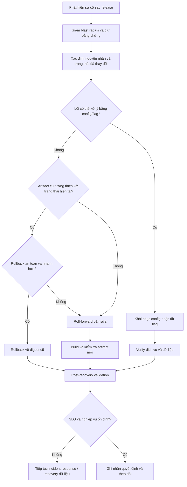

# Chọn quay về artifact cũ hoặc sửa tiến về phiên bản mới

Khi một bản phát hành gây lỗi production, nhóm cần quyết định cách đưa dịch vụ trở lại trạng thái an toàn. Hai hướng xử lý thường gặp là **rollback** về artifact đã biết hoạt động tốt và **roll-forward** bằng một phiên bản mới sửa nguyên nhân. Rollback có thể khôi phục nhanh nếu phiên bản cũ vẫn tương thích với dữ liệu, schema, message và cấu hình hiện tại. Roll-forward phù hợp hơn khi trạng thái hệ thống đã thay đổi theo cách phiên bản cũ không thể xử lý, hoặc khi bản sửa mới an toàn và nhanh hơn việc đảo ngược.

Không nên chọn hướng xử lý chỉ dựa trên việc bản deploy gần nhất có lỗi hay không. Cần xác định lỗi nằm ở artifact, cấu hình, hạ tầng hay dữ liệu; phạm vi ảnh hưởng; trạng thái đã thay đổi; khả năng đảo ngược; và thời gian đưa hệ thống về trạng thái ổn định. Rollback artifact không tự động hoàn tác database migration, message đã phát, giao dịch đã thực hiện hoặc thay đổi ở hệ thống bên ngoài.

## 1. Phân biệt rollback, roll-forward và recovery

Ba thuật ngữ thường đi cùng nhau nhưng không cùng ý nghĩa:

- **Rollback:** quay lại một phiên bản, cấu hình hoặc trạng thái trước đó đã được xác định. Trong CI/CD, thường là triển khai lại artifact cũ theo digest/version đã lưu.
- **Roll-forward:** tạo và triển khai phiên bản mới sửa lỗi hoặc tương thích với trạng thái hiện tại. Hướng này tiến về phía trước thay vì khôi phục binary cũ.
- **Recovery (phục hồi):** khôi phục dịch vụ hoặc dữ liệu sau sự cố. Recovery có thể bao gồm rollback ứng dụng, roll-forward, restore backup, point-in-time recovery (PITR), replay event, rebuild index hoặc thao tác thủ công có kiểm soát.

Ví dụ: phiên bản `v2` làm API trả lỗi 500. Nếu schema vẫn tương thích với `v1`, có thể rollback application về `v1`. Nếu `v2` đã ghi dữ liệu theo format mà `v1` không đọc được, rollback binary có thể làm lỗi nặng hơn; khi đó cần roll-forward một bản `v2.0.1` có thể đọc cả dữ liệu cũ và mới, hoặc thực hiện recovery dữ liệu trước khi quay lại phiên bản cũ.

| Hướng | Thay đổi chính | Khi phù hợp | Câu hỏi phải trả lời |
|---|---|---|---|
| Rollback artifact | Đổi ứng dụng về artifact cũ | Artifact mới gây lỗi và trạng thái hiện tại vẫn tương thích với artifact cũ | Phiên bản cũ có chạy an toàn với schema, dữ liệu, message và config hiện tại không? |
| Rollback config/flag | Khôi phục cấu hình hoặc tắt tính năng | Lỗi do config, routing hoặc tính năng có thể vô hiệu hóa độc lập | Có thể giảm ảnh hưởng mà không đổi artifact không? |
| Roll-forward | Build/deploy artifact mới sửa lỗi | Artifact cũ không tương thích hoặc bản sửa mới giảm rủi ro nhanh hơn | Bản sửa có đủ nhỏ, đã kiểm tra và tương thích với trạng thái hiện tại không? |
| Data recovery | Khôi phục hoặc sửa dữ liệu | Dữ liệu bị mất, hỏng hoặc ghi sai | Cần phục hồi đến thời điểm nào và tác động đến giao dịch hợp lệ sau đó ra sao? |



## 2. Trước tiên phải giảm ảnh hưởng và xác định tình trạng

Khi phát hiện release có vấn đề, bước đầu thường là hạn chế tác động trong lúc điều tra. Không cần chờ xác định nguyên nhân hoàn chỉnh mới giảm blast radius nếu có dấu hiệu người dùng hoặc dữ liệu đang bị ảnh hưởng.

Các hành động ban đầu có thể gồm:

- Pause rollout hoặc ngừng tăng tỷ lệ traffic đến phiên bản mới.
- Tắt feature flag có vấn đề nếu có thể làm an toàn.
- Giới hạn cohort, tenant, region hoặc loại giao dịch đang bị ảnh hưởng.
- Dừng job nền hoặc consumer đang ghi dữ liệu sai, nếu việc dừng không làm mất message.
- Giữ log, trace, metrics, deployment manifest, artifact digest và audit event.
- Thông báo incident commander, owner dịch vụ và nhóm phụ thuộc theo quy trình.
- Xác định có cần chặn giao dịch mới để tránh làm dữ liệu sai thêm hay không.

Không vội xóa Pod, runner, queue hoặc artifact liên quan trước khi giữ bằng chứng cần thiết. Đồng thời không để một workload nghi bị xâm nhập tiếp tục có quyền truy cập tài nguyên nhạy cảm; containment và evidence preservation cần được phối hợp.

### 2.1. Xác định điều gì thực sự thay đổi

Thu thập tối thiểu:

- Release ID, commit SHA, artifact digest và thời điểm deploy.
- Phiên bản ngay trước release và artifact digest có thể khôi phục.
- Cấu hình, feature flag, secret reference/version và environment thay đổi.
- Database migration, data backfill và trạng thái schema.
- Message/event đã phát, queue backlog, consumer version và dead-letter count.
- Các API hoặc hệ thống ngoài đã nhận side effect.
- Error rate, latency, throughput, saturation và business metrics trước/sau deploy.
- Người/workload principal đã triển khai và approval liên quan.

Chỉ so sánh commit SHA là chưa đủ. Cần xác minh digest đang chạy và digest định rollback; cùng commit nhưng build lại có thể tạo artifact khác.

## 3. Tiêu chí chọn rollback artifact cũ

Rollback thường là lựa chọn tốt khi tất cả điều kiện quan trọng sau được thỏa mãn:

1. **Có artifact cũ đáng tin:** artifact còn trong registry, digest/checksum xác minh được, chữ ký/provenance hợp lệ và đã từng chạy ổn định.
2. **Tương thích trạng thái hiện tại:** phiên bản cũ đọc được schema, dữ liệu, message, session, cache và cấu hình hiện tại.
3. **Không tạo side effect mới:** quay lại không làm lặp giao dịch, gửi trùng message, hoàn tiền sai hoặc chạy migration phá hủy.
4. **Rollback giảm rủi ro nhanh:** thời gian đưa hệ thống về trạng thái ổn định ngắn hơn và ít rủi ro hơn bản sửa tiến.
5. **Có thể xác minh:** biết chính xác digest, cấu hình, môi trường và các kiểm tra sau rollback.

Các dấu hiệu thường nghiêng về rollback:

- Lỗi bắt đầu ngay sau deploy và liên quan rõ đến code mới.
- Schema và dữ liệu chưa có thay đổi không tương thích.
- Phiên bản cũ vẫn tương thích với dependency và external API hiện tại.
- Có thể khôi phục nhanh bằng digest đã lưu, không cần rebuild.
- Bản sửa mới chưa đủ thời gian kiểm thử, trong khi rollback đã được diễn tập.

Rollback không nhất thiết là đưa toàn bộ hệ thống về mọi thành phần cũ. Có thể chỉ rollback một service, một region, một cohort hoặc một cấu hình nếu các ranh giới tương thích cho phép.

## 4. Tiêu chí chọn roll-forward bằng phiên bản mới

Roll-forward thường phù hợp hơn khi:

- Phiên bản cũ không đọc được dữ liệu hoặc schema đã được phiên bản mới tạo ra.
- Migration đã thực hiện bước không thể đảo ngược an toàn.
- Message mới đã được phát và consumer cũ không thể xử lý.
- Hệ thống bên ngoài đã nhận giao dịch hoặc trạng thái mà rollback không thể thu hồi.
- Lỗi nằm ở artifact cũ hoặc dependency cũ đã bị phát hiện có lỗ hổng.
- Bản sửa nhỏ, rõ nguyên nhân và có thể được kiểm thử nhanh hơn quy trình recovery.
- Rollback sẽ làm mất dữ liệu hợp lệ phát sinh sau deploy.

Roll-forward không có nghĩa bỏ qua kiểm thử. Artifact mới phải có commit, version/digest, build provenance và bằng chứng test riêng. Có thể rút gọn phạm vi kiểm thử theo quy trình emergency release, nhưng không nên bỏ các kiểm tra cần thiết để tránh mở rộng sự cố.

### 4.1. Bản sửa tối thiểu

Trong incident, ưu tiên một bản sửa nhỏ, dễ review và chỉ thay đổi phần cần thiết. Tránh gộp refactor, dependency upgrade không liên quan hoặc thay đổi kiến trúc lớn vào hotfix. Bản sửa nên có:

- Regression test tái hiện lỗi.
- Kiểm tra tương thích với trạng thái dữ liệu hiện tại.
- Phân tích side effect và khả năng retry.
- Artifact mới có digest riêng.
- Kế hoạch dừng rollout và quay lại nếu hotfix thất bại.

## 5. Ma trận quyết định rollback hay roll-forward

| Tình huống | Hướng thường phù hợp | Lý do và điều kiện |
|---|---|---|
| Lỗi UI hoặc logic mới, không đổi schema/data | Rollback artifact hoặc tắt flag | Phiên bản cũ thường còn tương thích; xác minh digest và traffic |
| Cấu hình sai, binary vẫn tốt | Rollback config | Tránh thay đổi artifact không cần thiết; kiểm tra config version và secret reference |
| Phiên bản mới ghi dữ liệu theo format mới | Roll-forward hoặc phục hồi dữ liệu có kiểm soát | Phiên bản cũ có thể không đọc được dữ liệu đã ghi |
| Migration thêm cột nullable, chưa bỏ cấu trúc cũ | Có thể rollback app | Chỉ khi app cũ tương thích schema đã expand và dữ liệu |
| Migration đã drop/transform dữ liệu không thể đảo ngược | Thường roll-forward | Cần bản code tương thích trạng thái hiện tại hoặc data recovery riêng |
| Message mới đã vào queue, consumer cũ không hiểu | Roll-forward consumer hoặc chuyển đổi message | Không deploy consumer cũ vào queue chứa payload không tương thích |
| External payment/email/partner đã nhận side effect | Roll-forward/compensating action | Rollback code không thể thu hồi hành động đã xảy ra ở hệ thống ngoài |
| Artifact mới chứa lỗ hổng nghiêm trọng, artifact cũ an toàn và tương thích | Rollback nhanh, sau đó phát hành bản vá | Kiểm tra cả dependency và dữ liệu đã thay đổi |
| Artifact cũ cũng có lỗ hổng hoặc không còn hỗ trợ | Roll-forward | Không khôi phục trạng thái có rủi ro đã biết |
| Chưa rõ nguyên nhân và có nguy cơ mất dữ liệu | Pause/contain trước, sau đó chọn recovery | Không thay đổi thêm trạng thái trước khi bảo toàn bằng chứng |

Ma trận chỉ định hướng. Quyết định thực tế cần dựa trên dữ liệu và kiến trúc cụ thể; cùng một loại lỗi có thể yêu cầu hướng khác nhau tùy migration, side effect và mức tương thích.

## 6. Khả năng tương thích là điều kiện quyết định

Rollback ứng dụng chỉ an toàn nếu phiên bản cũ có thể chạy với trạng thái hiện tại của mọi thành phần liên quan. Cần xem xét:

| Thành phần | Câu hỏi trước khi rollback |
|---|---|
| Database schema | Cột, bảng, index, constraint và kiểu dữ liệu có còn tương thích với code cũ không? |
| Database data | Dữ liệu mới đã được ghi theo format hoặc invariant mà code cũ không hiểu chưa? |
| Event/message | Queue còn message mới mà consumer cũ không parse hoặc xử lý đúng không? |
| Cache | Key/value hoặc serialization format có thay đổi không? |
| Session/cookie/token | Phiên bản cũ có xác minh/đọc được session và token mới không? |
| File/object storage | File format, metadata hoặc encryption key có thay đổi không? |
| API bên ngoài | Đối tác hoặc client đã chuyển sang hợp đồng mới chưa? |
| Configuration | Key, default, feature flag hoặc secret version có tương thích không? |
| Background job | Job mới đã cập nhật trạng thái hoặc dữ liệu mà worker cũ không hiểu chưa? |

### 6.1. Expand-and-contract giúp giữ đường rollback

Với database migration, chiến lược expand-and-contract tạo khoảng tương thích giữa phiên bản cũ và mới:

1. Expand schema bằng cách thêm cấu trúc mới nhưng giữ cấu trúc cũ.
2. Deploy code tương thích với cả hai cấu trúc.
3. Backfill dữ liệu và xác minh.
4. Chuyển dần việc đọc/ghi sang cấu trúc mới.
5. Chỉ contract, xóa cấu trúc cũ sau khi cửa sổ rollback đã đóng và không còn consumer cũ.

Nếu đang ở các pha expand hoặc compatible deployment, rollback application có thể khả thi. Sau contract, quay về binary cũ có thể không còn an toàn. Không chạy down migration tự động chỉ vì application rollback.

### 6.2. Dữ liệu mới đã được ghi

Một binary cũ có thể chạy được trên schema mới nhưng vẫn không hiểu dữ liệu mới. Ví dụ phiên bản mới ghi trạng thái đơn hàng `AWAITING_COURIER`, trong khi phiên bản cũ chỉ biết `CREATED`, `PAID`, `SHIPPED`. Khi đọc giá trị mới, code cũ có thể lỗi hoặc xử lý sai nghiệp vụ.

Trước rollback cần xác định:

- Có bao nhiêu bản ghi mang giá trị/format mới?
- Phiên bản cũ có bỏ qua hoặc xử lý an toàn giá trị đó không?
- Có thể chuyển đổi ngược mà không mất ý nghĩa nghiệp vụ không?
- Có thể cô lập các bản ghi mới và để phiên bản cũ phục vụ phần còn lại không?

Nếu chưa có câu trả lời, không nên giả định rollback an toàn chỉ vì schema migration là additive.

## 7. Rollback ứng dụng không phải rollback dữ liệu

Ứng dụng, schema và dữ liệu có vòng đời khác nhau. Khôi phục image cũ không đưa database về trạng thái cũ. Database restore có thể xóa các giao dịch hợp lệ được tạo sau thời điểm backup. Vì vậy cần phân biệt:

- **Application rollback:** deploy artifact cũ.
- **Schema rollback:** đảo ngược thay đổi cấu trúc database nếu có thể và an toàn.
- **Data correction:** sửa các bản ghi sai bằng migration/compensating script có kiểm soát.
- **Data restore:** khôi phục từ backup hoặc PITR về một thời điểm.
- **Event replay:** phát lại sự kiện đã lưu để tái tạo trạng thái trong hệ thống đích.

Không gộp các thao tác này thành một lệnh rollback chung. Mỗi thao tác có phạm vi, rủi ro, quyền và bằng chứng riêng.

### 7.1. Khi nào cần restore hoặc PITR?

Nếu release gây ghi sai hoặc xóa dữ liệu, có thể cần phục hồi dữ liệu. Trước khi restore, đánh giá:

- Thời điểm dữ liệu bắt đầu sai và thời điểm gần nhất được xác minh đúng.
- Recovery Point Objective (RPO): mức mất dữ liệu tối đa có thể chấp nhận.
- Recovery Time Objective (RTO): thời gian mục tiêu để khôi phục dịch vụ.
- Giao dịch hợp lệ phát sinh sau thời điểm restore sẽ được xử lý thế nào.
- Có thể restore vào database mới, kiểm tra rồi chuyển traffic không.
- Có cần replay event hoặc đối soát giao dịch sau restore không.

Restore toàn bộ production database có thể làm mất dữ liệu hợp lệ sau mốc backup. Khi có thể, cân nhắc restore sang môi trường riêng, chọn lọc dữ liệu hoặc PITR theo kế hoạch được phê duyệt.

## 8. Side effect bên ngoài và compensating action

Một số hành động không thể hoàn tác bằng cách deploy artifact cũ:

- Thanh toán đã được cổng thanh toán chấp nhận.
- Email/SMS đã gửi cho khách hàng.
- Webhook đã được đối tác xử lý.
- Hàng hóa đã được xuất kho hoặc giao cho đơn vị vận chuyển.
- File đã được chia sẻ hoặc dữ liệu đã được gửi sang hệ thống khác.
- Message đã được consumer xử lý và kích hoạt hành động tiếp theo.

Với các tình huống này, cần compensating action (hành động bù) theo quy tắc nghiệp vụ: hoàn tiền, hủy vận đơn, gửi thông báo đính chính, tạo bản ghi điều chỉnh hoặc yêu cầu đối tác đồng bộ lại. Compensating action không xóa lịch sử sự kiện đã xảy ra; nó tạo một hành động mới để đưa trạng thái nghiệp vụ về kết quả chấp nhận được.

Thiết kế side effect nên hỗ trợ:

- Idempotency key để retry không tạo giao dịch trùng.
- Outbox/inbox hoặc event ledger để biết event nào đã phát và đã xử lý.
- Correlation ID nối request, event và giao dịch bên ngoài.
- Trạng thái xử lý rõ ràng: pending, succeeded, failed, compensated.
- Quy trình đối soát và retry có giới hạn.

## 9. Quy trình rollback artifact có kiểm soát

Khi đã xác định rollback an toàn, thực hiện theo một trình tự có thể kiểm toán:

1. **Pause rollout:** dừng tăng traffic và ngăn job deploy tiếp tục tự động.
2. **Chọn release tốt gần nhất:** lấy release record, commit và digest đã được xác minh.
3. **Kiểm tra tương thích:** schema, data, message, cache, session, config và external dependencies.
4. **Xác minh artifact:** kiểm tra registry, digest, signature/provenance và quyền truy cập.
5. **Quyết định phạm vi:** toàn bộ service, một region, một cohort hay chỉ một component.
6. **Triển khai lại digest cũ:** dùng quy trình deploy chuẩn, không rebuild từ source cũ nếu mục tiêu là khôi phục đúng artifact đã chạy.
7. **Xác minh runtime:** kiểm tra instance thực sự chạy digest mục tiêu và rollout hoàn tất.
8. **Post-rollback validation:** smoke test, health, metrics, business transactions và dependency.
9. **Theo dõi:** giữ tăng cường monitoring trong cửa sổ ổn định và xác nhận không còn lỗi tái diễn.
10. **Ghi release/incident record:** lý do, approver, digest trước/sau, config, thời điểm và kết quả.

### 9.1. Ví dụ với Kubernetes

Có thể xem lịch sử rollout và trạng thái Deployment:

```bash
kubectl rollout history deployment/orders
kubectl rollout status deployment/orders --timeout=10m
kubectl get deployment orders -o wide
```

Nếu revision trước đã được xác định và tương thích, Kubernetes hỗ trợ rollback về revision trước:

```bash
kubectl rollout undo deployment/orders --to-revision=12
kubectl rollout status deployment/orders --timeout=10m
```

Revision `12` chỉ là ví dụ. Trong hệ thống dùng GitOps hoặc Helm, nên thực hiện rollback qua nguồn quản lý phát hành chuẩn để tránh controller tự đồng bộ ngược lại. Với GitOps, revert commit cấu hình về digest cũ rồi để controller reconcile; với Helm, dùng release history và rollback đúng revision theo quy trình của nhóm. Dù dùng công cụ nào, phải xác minh digest thực tế đang chạy.

Không dùng `kubectl rollout undo` như bằng chứng duy nhất rằng mọi thứ đã phục hồi. Lệnh này chỉ thay đổi Pod template của Deployment; nó không tự hoàn tác database, queue, secret, service ngoài hoặc mọi tài nguyên khác trong release.

## 10. Quy trình roll-forward bằng hotfix

Khi rollback không an toàn hoặc không phải hướng giảm rủi ro tốt nhất:

1. Pause rollout và giới hạn ảnh hưởng hiện tại.
2. Xác định nguyên nhân gốc hoặc tạo giả thuyết đủ rõ để sửa có kiểm soát.
3. Viết regression test tái hiện lỗi.
4. Tạo thay đổi nhỏ nhất có thể; giữ nguyên compatibility với trạng thái dữ liệu đang tồn tại.
5. Build artifact mới từ commit SHA xác định, tạo digest mới và provenance.
6. Chạy các kiểm tra bắt buộc: build, test, scan, migration/data compatibility và smoke test.
7. Deploy canary hoặc cohort nhỏ trước, quan sát metrics và business signals.
8. Mở rộng khi đạt ngưỡng; nếu không đạt, dừng và đánh giá lại.
9. Ghi nhận artifact mới thay thế artifact lỗi và liên kết với incident.

Roll-forward có thể nhanh hơn rollback nếu lỗi nằm trong một nhánh logic nhỏ và dữ liệu đã chuyển sang format mới. Nhưng nếu chưa hiểu nguyên nhân, hotfix liên tiếp có thể làm trạng thái phức tạp hơn. Khi chưa đủ bằng chứng, ưu tiên containment, disable feature hoặc giới hạn giao dịch trước khi phát hành thêm thay đổi.

### 10.1. Ví dụ hotfix

Phiên bản `v2.4.0` thêm trạng thái đơn hàng `AWAITING_COURIER`, đồng thời cập nhật schema. Sau deploy, một endpoint cũ lỗi khi gặp trạng thái này. `v2.3.2` không hiểu trạng thái mới nên rollback sẽ làm lỗi đọc dữ liệu đã ghi. Nhóm tạo `v2.4.1` với parser xử lý trạng thái mới và giữ nguyên schema. Regression test được bổ sung cho cả trạng thái cũ/mới; artifact mới được deploy canary và mở rộng sau khi metrics ổn định.

## 11. Rollback config hoặc feature flag trước khi đổi artifact

Không phải mọi sự cố sau deploy đều cần rollback binary. Nếu nguyên nhân là một flag hoặc cấu hình có thể tắt an toàn, khôi phục giá trị đó thường ít thay đổi hơn.

Ví dụ:

- Tắt tính năng mới nhưng giữ artifact đã deploy.
- Chuyển routing về backend ổn định.
- Khôi phục timeout, pool size hoặc rate limit trước đó.
- Thu hồi một integration chưa sẵn sàng.
- Giảm cohort hoặc traffic percentage.

Trước khi đổi config, xác minh config version hiện tại, phạm vi ảnh hưởng, cache/refresh behavior và khả năng các instance nhận cấu hình đồng thời. Cấu hình cũng cần được version hóa và audit; không sửa trực tiếp mà không lưu release record.

Feature flag không thay thế rollback cho mọi loại lỗi. Nếu code mới làm hỏng startup trước khi flag được đọc, tắt flag ở runtime có thể không đủ. Nếu migration đã ghi dữ liệu không tương thích, tắt flag không tự sửa dữ liệu. Cần biết flag kiểm soát chính xác phần nào của luồng.

## 12. Canary và rollback theo phạm vi

Với rollout theo cohort, có thể rollback phần traffic đã chuyển sang phiên bản mới thay vì tác động toàn hệ thống. Tuy nhiên, chỉ làm vậy nếu dữ liệu và trạng thái dùng chung tương thích giữa các phiên bản.

Các lựa chọn:

- Chuyển traffic của cohort về backend cũ.
- Tắt flag cho nhóm người dùng bị ảnh hưởng.
- Rollback một region hoặc cluster trước, giữ các region khác nếu chúng chưa bị tác động.
- Dừng một worker pool hoặc consumer version gây lỗi.
- Chuyển read traffic về phiên bản cũ trong khi giữ write path theo cơ chế an toàn đã thiết kế.

Rollback một phần có thể tạo ra trạng thái mixed-version kéo dài. Cần theo dõi tương thích API, schema, cache, event và session; không giả định cô lập traffic đồng nghĩa cô lập dữ liệu.

## 13. Bằng chứng và quyền phê duyệt trong incident

Quyết định rollback hoặc roll-forward cần được ghi lại để người khác hiểu tại sao chọn hướng đó và có thể tiếp tục xử lý nếu incident commander thay ca.

Một decision record nên có:

- Incident ID, mức độ nghiêm trọng và thời điểm phát hiện.
- Triệu chứng, phạm vi khách hàng/region/tenant và business impact.
- Artifact digest hiện tại, digest mục tiêu và release record.
- Trạng thái schema/data/message/config và các side effect đã xảy ra.
- Các lựa chọn đã cân nhắc, rủi ro và lý do loại bỏ.
- Hướng được chọn: config rollback, artifact rollback, roll-forward hay data recovery.
- Người quyết định, người thực hiện, approver và thời điểm.
- Các bước xác minh, tiêu chí thành công và điều kiện dừng.
- Kết quả sau xử lý và việc cần làm tiếp theo.

Trong tình huống khẩn cấp, quy trình có thể cho phép một số approval được thực hiện theo cơ chế emergency change. Ngoại lệ phải có người có thẩm quyền, lý do, phạm vi, thời hạn và hậu kiểm theo chính sách. Không dùng tài khoản dùng chung hoặc bỏ audit vì áp lực thời gian.

## 14. Kiểm thử khả năng rollback và recovery trước khi cần

Kế hoạch rollback chỉ có giá trị nếu đã được diễn tập. CI/CD và staging có thể kiểm tra:

- Artifact trước đó còn tồn tại và có thể pull/deploy theo digest.
- Registry retention không xóa release cần giữ.
- Rollback application trên schema đã expand hoạt động đúng.
- Rollback sau khi có dữ liệu mới được kiểm tra bằng dataset đại diện.
- Message cũ/mới được consumer tương ứng xử lý.
- Feature flag/config có thể đổi về trạng thái trước.
- Backup có thể restore; PITR đạt RPO/RTO mục tiêu.
- Event replay và compensating action không tạo side effect trùng.
- Runbook có lệnh, quyền, owner và bước verify rõ ràng.
- Monitoring/alert phát hiện được tình trạng chưa phục hồi.

Không chỉ test lệnh rollback. Hãy kiểm tra kết quả cuối cùng: người dùng có thể hoàn tất giao dịch, dữ liệu nhất quán, queue không bị kẹt và runtime đang chạy đúng artifact/config dự kiến.

## 15. Các anti-pattern thường gặp

| Anti-pattern | Rủi ro | Cách làm tốt hơn |
|---|---|---|
| Luôn rollback ngay khi có alert | Có thể đưa hệ thống về phiên bản không tương thích với dữ liệu hiện tại | Đánh giá schema, data, message và side effect trước |
| Luôn hotfix thay vì rollback | Tăng thời gian lỗi và tạo thêm thay đổi khi chưa hiểu nguyên nhân | So sánh thời gian/rủi ro của hai hướng |
| Rebuild source cũ để rollback | Artifact mới có thể khác artifact đã chạy tốt | Dùng lại digest cũ đã lưu và xác minh |
| Rollback binary nhưng bỏ qua migration | Ứng dụng cũ có thể lỗi với schema/data mới | Thiết kế expand-contract và migration riêng |
| Tự động chạy down migration | Có thể mất dữ liệu hoặc phá hủy trạng thái hợp lệ | Đánh giá migration và phục hồi dữ liệu riêng |
| Restore toàn database theo cảm tính | Mất giao dịch hợp lệ sau mốc backup | Xác định RPO/RTO, PITR và phương án replay/đối soát |
| Retry side effect không idempotent | Thanh toán hoặc message bị thực hiện nhiều lần | Idempotency key và ledger trạng thái |
| Chỉ kiểm tra Pod Ready sau rollback | Bỏ sót lỗi nghiệp vụ và dữ liệu | Smoke, synthetic, SLO và business validation |
| Không giữ release record | Không biết digest tốt gần nhất và cấu hình đi kèm | Lưu artifact, config, approval và deployment history |
| Rollback một phần nhưng không theo dõi mixed version | Các phiên bản không tương thích tiếp tục trao đổi dữ liệu | Có compatibility matrix và giới hạn thời gian overlap |

## 16. Checklist quyết định và thực hiện rollback/recovery

### Trước khi chọn hướng

- [ ] Đã xác định incident, blast radius và mức ảnh hưởng người dùng/dữ liệu.
- [ ] Đã dừng hoặc giới hạn rollout để tránh mở rộng sự cố.
- [ ] Đã lưu log, metrics, trace, audit, artifact digest và release record.
- [ ] Đã xác định schema, dữ liệu, message, session, cache, config và side effect đã thay đổi.
- [ ] Đã xác minh artifact cũ còn tồn tại, đúng digest và nguồn gốc.
- [ ] Đã đánh giá phiên bản cũ có tương thích với trạng thái hiện tại hay không.
- [ ] Đã so sánh thời gian và rủi ro giữa rollback, config change, roll-forward và data recovery.

### Khi rollback artifact

- [ ] Có digest/version mục tiêu và approval phù hợp.
- [ ] Không rebuild nếu mục tiêu là khôi phục đúng artifact đã chạy tốt.
- [ ] Schema/data/message/config tương thích với phiên bản cũ.
- [ ] Registry, signature/provenance và quyền deploy được xác minh.
- [ ] Runtime thực tế đã chạy đúng digest sau rollback.
- [ ] Smoke test, metrics và business transactions đạt.

### Khi roll-forward hoặc phục hồi dữ liệu

- [ ] Có giả thuyết/nguyên nhân và regression test.
- [ ] Bản sửa nhỏ, có artifact digest và provenance mới.
- [ ] Migration/data correction có backup/checkpoint và cách tiếp tục an toàn.
- [ ] Side effect có idempotency hoặc compensating action.
- [ ] Restore/PITR có RPO/RTO, phạm vi và kế hoạch replay/đối soát.
- [ ] Canary/limited rollout và tiêu chí dừng được xác định.
- [ ] Kết quả cuối cùng được ghi vào incident/release record.

Rollback và roll-forward là hai công cụ phục hồi khác nhau, không phải hai phản xạ tự động đối lập. Rollback hiệu quả khi artifact cũ vẫn tương thích với trạng thái hiện tại và đưa hệ thống về an toàn nhanh hơn. Roll-forward cần thiết khi dữ liệu, schema hoặc side effect đã tiến đến trạng thái mà phiên bản cũ không thể xử lý. Khi tách riêng application rollback, config rollback và data recovery; giữ artifact bất biến; kiểm tra compatibility; và xác minh cả hành vi kỹ thuật lẫn nghiệp vụ sau xử lý, nhóm có thể chọn hướng phục hồi dựa trên bằng chứng thay vì phỏng đoán.
