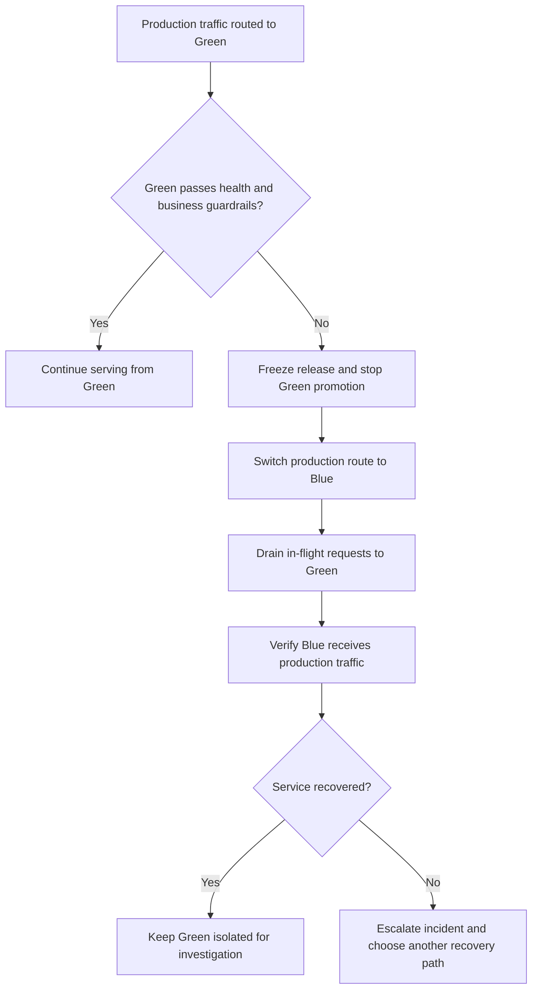
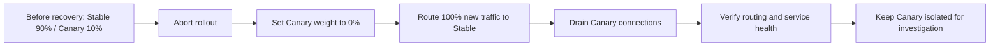

# Phục hồi lưu lượng khi dùng blue-green hoặc canary

Khi một phiên bản mới gây lỗi sau khi nhận traffic production, việc khôi phục không chỉ là chạy lại lệnh deploy. Nhóm cần đưa request về phiên bản đã biết là ổn định, xử lý kết nối đang mở, xác minh router thực sự đã chuyển traffic và kiểm tra các giao dịch đã phát sinh trong lúc phiên bản lỗi hoạt động.

Với blue-green, hai môi trường hoặc nhóm workload được duy trì song song; phục hồi thường là chuyển route từ green về blue. Với canary, traffic được chia giữa phiên bản stable và candidate; phục hồi thường là dừng rollout và đưa tỷ lệ candidate về 0%, stable nhận lại toàn bộ traffic. Cả hai cách đều dựa vào khả năng điều khiển traffic độc lập với việc tạo artifact.

**Phục hồi lưu lượng là hành động khôi phục đường đi của request về một phiên bản phù hợp, có thể phục vụ an toàn.** Nó giảm phạm vi ảnh hưởng của phiên bản lỗi nhưng không tự hoàn tác dữ liệu đã ghi, message đã phát, khoản thanh toán đã xử lý hoặc migration đã áp dụng. Vì vậy, kế hoạch traffic recovery cần đi cùng kiểm tra tương thích dữ liệu, side effect, session và khả năng quan sát.

## 1. Phục hồi lưu lượng là gì?

Phục hồi lưu lượng (traffic recovery hoặc traffic failback) là quá trình thay đổi định tuyến để đưa request mới khỏi phiên bản hoặc môi trường đang có vấn đề và chuyển về một đích đã được xác minh là an toàn.

Các thao tác thường gặp:

- Đặt traffic weight của candidate/canary về 0%.
- Chuyển route production từ green về blue.
- Gỡ rule định tuyến đến endpoint lỗi.
- Chuyển một region hoặc cohort về pool ổn định.
- Dừng rollout controller để nó không tiếp tục tăng traffic.
- Drain kết nối và request đang xử lý trước khi dừng workload lỗi.

Traffic recovery khác với rollback artifact. Router có thể chuyển request về phiên bản cũ mà không cần xóa phiên bản mới ngay. Cách này thường nhanh hơn và giữ lại workload lỗi để thu thập log hoặc điều tra. Sau khi ổn định, nhóm mới quyết định scale down, rollback deployment hoặc roll forward bằng bản sửa.

### Những mục tiêu cần đạt

1. Ngăn request mới đi vào phiên bản đang gây lỗi.
2. Đưa traffic về phiên bản có khả năng xử lý an toàn.
3. Hạn chế mất request và side effect trùng trong quá trình chuyển.
4. Xác minh mọi router, gateway và region đã áp dụng route mới.
5. Xác định và xử lý request đang chạy, session và queue còn liên quan.
6. Lưu bằng chứng về thời điểm, tỷ lệ traffic, quyết định và kết quả phục hồi.

## 2. Phân biệt abort, traffic failback, rollback và roll forward

Những hành động này thường nối tiếp nhau nhưng không đồng nghĩa.

| Hành động | Ý nghĩa | Ví dụ |
|---|---|---|
| Abort rollout | Dừng quá trình tăng phạm vi phát hành | Controller ngừng chuyển từ 10% lên 25% |
| Traffic failback | Đưa request mới về phiên bản ổn định | Canary weight từ 10% về 0% |
| Rollback deployment | Khôi phục workload/artifact trước đó | Scale down revision mới, giữ revision cũ |
| Roll forward | Phát hành phiên bản sửa lỗi mới | Deploy `v2.1` sau khi `v2` có lỗi |
| Data recovery | Khôi phục hoặc sửa dữ liệu đã bị tác động | Đối soát giao dịch, khôi phục backup hoặc chạy corrective job |

Trong sự cố canary, thứ tự thường là abort rollout, failback traffic, xác minh, sau đó mới quyết định rollback workload hay roll forward. Không nên xóa canary ngay nếu log, trace hoặc trạng thái process còn cần cho điều tra.

## 3. Khi nào cần phục hồi traffic?

Traffic recovery nên được kích hoạt khi phiên bản mới không còn đáp ứng điều kiện phục vụ an toàn hoặc có nguy cơ làm sự cố lan rộng.

Các tín hiệu thường gặp:

- Error rate, timeout hoặc latency vượt guardrail.
- Health check hoặc readiness liên tục thất bại.
- Tỷ lệ giao dịch nghiệp vụ thành công giảm bất thường.
- Dữ liệu được tạo sai, trùng lặp hoặc không đầy đủ.
- Queue lag tăng nhanh hoặc consumer liên tục retry.
- Tài nguyên cạn kiệt, crash loop hoặc connection pool quá tải.
- Lỗi xác thực/phân quyền hoặc dấu hiệu truy cập dữ liệu không đúng.
- Dependency hoặc cấu hình mới khiến service không thể xử lý request.
- Telemetry quan trọng mất khiến nhóm không thể xác nhận phiên bản mới đang an toàn.

Không cần đợi mọi metric cùng thất bại. Một lỗi nghiêm trọng như ghi sai số tiền, lộ dữ liệu hoặc bypass authorization có thể đủ để dừng traffic ngay cả khi CPU, latency và HTTP status vẫn bình thường.

### Chọn hành động theo mức độ

- **HOLD:** tín hiệu chưa rõ hoặc thiếu mẫu; giữ nguyên tỷ lệ hiện tại và điều tra.
- **ABORT:** dừng tăng traffic khi guardrail thất bại.
- **FAILBACK:** chuyển request mới về phiên bản ổn định.
- **ROLLBACK/ROLL FORWARD:** xử lý phiên bản sau khi traffic đã được kiểm soát.
- **INCIDENT CONTAINMENT:** nếu có rủi ro bảo mật, cô lập endpoint hoặc credential và tuân theo quy trình ứng phó sự cố.

## 4. Chuẩn bị khả năng phục hồi trước khi phát hành

Phục hồi nhanh phụ thuộc vào những gì được chuẩn bị trước deployment. Nếu chỉ bắt đầu tìm phiên bản cũ, người có quyền đổi route hoặc cấu hình router trong lúc sự cố xảy ra, thời gian khôi phục sẽ kéo dài.

Trước release, cần xác nhận:

- Phiên bản stable trước đó còn artifact bất biến và có thể triển khai lại.
- Blue và green hoặc stable và canary có cấu hình route được quản lý bằng mã.
- Có quyền và công cụ thay đổi traffic trong thời gian sự cố.
- Có thể dừng rollout controller để tránh controller tự tăng traffic trở lại.
- Phiên bản cũ còn tương thích với schema, cache, session và message hiện tại.
- Pool ổn định đủ capacity để nhận lại traffic.
- Health check và business metric có thể phân biệt theo version.
- Có kế hoạch xử lý kết nối dài, queue và request đang chạy.
- Có runbook, người on-call và kênh phối hợp rõ ràng.
- Có deployment record gồm commit, digest, route revision và cấu hình liên quan.

### Kiểm tra capacity của phiên bản cũ

Một pool stable đang nhận 90% traffic có thể không đủ tài nguyên để nhận lại 100% ngay lập tức. Nếu đã scale down pool cũ sau khi rollout, failback có thể gây quá tải.

Trong cửa sổ rollout, cần giữ đủ capacity hoặc có khả năng scale nhanh. Với blue-green, giữ blue sẵn sàng cho đến khi green được chấp nhận và cửa sổ phục hồi kết thúc. Với canary, stable phải có khả năng tiếp nhận toàn bộ traffic còn lại.

## 5. Phục hồi traffic trong blue-green deployment

Blue-green duy trì hai môi trường hoặc nhóm workload:

- **Blue:** phiên bản đang ổn định hoặc phiên bản trước deployment.
- **Green:** phiên bản mới đang được xác minh hoặc đã nhận traffic.

Khi green gặp lỗi, traffic được chuyển về blue thông qua load balancer, gateway, ingress hoặc cơ chế routing đang điều khiển production.



### Trình tự failback blue-green

1. Xác nhận green có vấn đề và ghi nhận release/deployment ID.
2. Dừng mọi promotion hoặc automation có thể tiếp tục đổi route.
3. Xác minh blue còn khỏe, đủ capacity và tương thích với trạng thái dữ liệu hiện tại.
4. Chuyển route production về blue bằng cơ chế điều khiển traffic chuẩn.
5. Kiểm tra route ở tất cả gateway, load balancer và region.
6. Ngừng cấp request mới cho green; drain kết nối và request đang xử lý theo chính sách.
7. Chạy smoke test qua đường production để xác nhận blue phục vụ được.
8. Theo dõi error rate, latency và metric nghiệp vụ sau khi chuyển.
9. Giữ green ở trạng thái cách ly nếu cần điều tra; chỉ scale down sau khi thu thập bằng chứng.
10. Ghi nhận quyết định, thời điểm và kết quả phục hồi.

### Vì sao không nên xóa green ngay?

Green có thể chứa log, heap/thread state, trace hoặc dữ liệu phục vụ điều tra. Nếu xóa ngay, nhóm mất bằng chứng về nguyên nhân. Giữ green không có nghĩa tiếp tục cho traffic vào; có thể giữ workload trong network scope hạn chế và chặn request mới.

## 6. Phục hồi traffic trong canary deployment

Canary thường có stable và candidate cùng hoạt động. Router phân chia request theo weight, cohort, header hoặc rule khác.

Khi candidate gặp lỗi, cần:

1. Abort rollout để controller không tiếp tục tăng weight.
2. Đặt candidate weight về 0% hoặc loại candidate khỏi routing rule.
3. Xác minh stable nhận toàn bộ request mới.
4. Drain request và kết nối đang mở đến candidate.
5. Kiểm tra các region/gateway đã áp dụng weight mới.
6. Chạy smoke test và kiểm tra business metric qua stable.
7. Giữ candidate cách ly để điều tra hoặc rollback workload theo quyết định.



### Dừng controller trước khi sửa weight

Một lỗi thường gặp là người vận hành đặt canary weight về 0%, nhưng rollout controller vẫn đang chạy và vài giây sau ghi đè weight theo lịch cũ. Cần dừng, pause hoặc abort controller trước, sau đó mới thay route. Khi incident được xử lý, xác minh không còn automation khác quản lý cùng route.

### Canary theo cohort

Nếu traffic được chia theo tenant, cookie hoặc header, weight 0% có thể chưa đủ nếu rule cohort riêng vẫn trỏ đến candidate. Cần rà soát toàn bộ routing rule, override và sticky assignment. Không chỉ nhìn phần trăm tổng hợp.

## 7. Chọn cơ chế điều khiển traffic

Phục hồi có thể diễn ra ở nhiều lớp. Nên dùng đúng lớp đã quản lý quá trình rollout để tránh route bị ghi đè hoặc tạo trạng thái không nhất quán.

| Cơ chế | Cách phục hồi | Điểm cần chú ý |
|---|---|---|
| Load balancer | Đổi backend pool hoặc weight về stable/blue | Kiểm tra mọi listener, region và connection persistence |
| Ingress/Gateway | Sửa route, service target hoặc traffic weight | Controller có thể reconcile và ghi đè thay đổi thủ công |
| Service mesh | Đổi virtual service/destination weight về stable | Kiểm tra config propagation đến mọi proxy |
| DNS | Đổi record về endpoint ổn định | Cache resolver và TTL khiến chuyển đổi không tức thời |
| Feature flag | Tắt chức năng mới trong cùng artifact | Chỉ phù hợp nếu nhánh cũ còn tương thích và flag thực sự kiểm soát side effect |
| CDN/edge routing | Đổi origin hoặc route rule | Cần xử lý cache, propagation và các POP |

### Dùng một nguồn điều khiển chuẩn

Nếu route được quản lý bằng GitOps hoặc controller, thao tác sửa trực tiếp trên console có thể bị controller khôi phục về trạng thái khai báo cũ. Trong incident, cần biết ai là nguồn sở hữu route và cách tạo thay đổi khẩn cấp có audit.

Không để hai hệ thống cùng ghi weight hoặc destination mà không có cơ chế phối hợp. Ví dụ, pipeline, service mesh controller và thao tác thủ công cùng sửa một route có thể tạo race condition.

## 8. DNS không phải lúc nào cũng là cách failback nhanh

Đổi DNS record từ green sang blue có vẻ đơn giản, nhưng client và resolver có thể cache kết quả theo TTL hoặc chính sách riêng. Một số kết nối đã mở tiếp tục dùng IP cũ; một số resolver không tuân TTL như mong đợi.

DNS failback phù hợp khi:

- Kiến trúc đã thiết kế chuyển đổi DNS và chấp nhận propagation delay.
- TTL được đặt phù hợp từ trước, không phải đến lúc incident mới hạ TTL.
- Có health check và xác minh từ nhiều mạng/region.
- Blue/green endpoint có TLS certificate, hostname và dependency tương thích.

Nếu cần chuyển traffic nhanh, gateway hoặc load balancer thường cho phép điều khiển trực tiếp hơn DNS. DNS có thể là một phần của kế hoạch failover vùng hoặc trung tâm dữ liệu, nhưng không nên mặc định thay đổi record sẽ có hiệu lực tức thì.

## 9. Xử lý request đang chạy và connection draining

Đổi route thường chỉ ảnh hưởng request mới. Request đang xử lý có thể tiếp tục trên phiên bản lỗi, và kết nối keep-alive có thể được tái sử dụng sau khi route thay đổi.

Các loại kết nối cần xem xét:

- HTTP keep-alive và connection pool.
- WebSocket và server-sent events.
- gRPC stream và long polling.
- Upload/download file dài.
- Request đang chạy transaction hoặc tác vụ ghi dữ liệu.

### Graceful draining

Drain cho phép instance ngừng nhận request mới nhưng hoàn tất request đang chạy trong một thời gian giới hạn. Quy trình thường gồm:

1. Đánh dấu backend không còn nhận traffic mới.
2. Router ngừng tạo kết nối mới đến backend.
3. Chờ request đang chạy hoàn tất trong grace period.
4. Theo dõi số connection/in-flight request còn lại.
5. Sau timeout, hủy kết nối còn treo theo chính sách.

Grace period phải phù hợp với timeout của ứng dụng và giao thức. Quá ngắn có thể cắt giao dịch hợp lệ; quá dài khiến request tiếp tục chạy trên phiên bản lỗi. Với lỗi bảo mật nghiêm trọng, có thể cần cắt kết nối ngay thay vì chờ drain.

### Sticky session

Sticky session có thể giữ người dùng trên backend cũ dù route weight đã thay đổi. Nếu cần failback triệt để, phải hiểu cơ chế affinity, cookie, consistent hashing và cache session. Chuyển traffic nhưng mất session có thể khiến người dùng bị đăng xuất hoặc mất trạng thái giỏ hàng.

## 10. Phục hồi khi có queue và tác vụ bất đồng bộ

Traffic API được chuyển về stable không đồng nghĩa worker cũ đã ngừng xử lý message. Nếu candidate đã nhận message vào queue, các worker có thể tiếp tục xử lý sau khi HTTP routing được phục hồi.

Nhóm cần kiểm tra:

- Worker version nào đang consume queue.
- Message được publish bởi phiên bản nào.
- Schema event có tương thích với consumer stable không.
- Có message đang retry hoặc nằm trong dead-letter queue không.
- Có thể pause consumer candidate mà không mất lease hoặc gây xử lý trùng không.
- Idempotency key và deduplication có bảo vệ side effect không.

Trong một số trường hợp, cần tách routing của API và worker. API stable có thể nhận request mới trong khi queue consumer candidate được pause, drain hoặc chuyển về phiên bản tương thích. Không nên xóa queue hoặc replay toàn bộ message nếu chưa hiểu side effect.

## 11. Dữ liệu và side effect không tự quay lui theo traffic

Đây là giới hạn quan trọng nhất của traffic recovery. Chuyển request về blue/stable chỉ thay đổi nơi xử lý request mới. Nó không đảo ngược các thao tác mà green/canary đã thực hiện.

Ví dụ:

- Một khoản thanh toán đã được gửi đến payment provider.
- Một đơn hàng đã được ghi vào database với giá trị sai.
- Một email đã được gửi.
- Một event đã được publish cho consumer khác.
- Một migration đã xóa hoặc đổi cấu trúc dữ liệu.
- Một cache key đã được ghi theo schema mới.

### Trước release cần có tương thích dữ liệu

- Dùng expand–migrate–contract cho schema thay đổi.
- Duy trì tương thích đọc/ghi giữa phiên bản cũ và mới trong cửa sổ rollout.
- Dùng idempotency key cho giao dịch có side effect.
- Có audit trail và correlation ID để tìm giao dịch do candidate xử lý.
- Có reconciliation hoặc corrective job cho dữ liệu sai.
- Không để rollback artifact phụ thuộc vào schema đã bị xóa.

### Khi cần phục hồi dữ liệu

Tách riêng quyết định traffic failback và data recovery. Đội vận hành có thể chuyển traffic ngay để hạn chế lỗi mới, trong khi đội dữ liệu/nghiệp vụ đối soát và sửa các giao dịch đã phát sinh. Không chạy restore database toàn bộ chỉ vì một phiên bản ứng dụng lỗi nếu điều đó sẽ xóa giao dịch hợp lệ xảy ra sau backup.

## 12. Capacity, autoscaling và warm pool

Sau failback, stable có thể đột ngột nhận thêm lượng traffic lớn. Nếu stable đã scale down hoặc cache đã nguội, dịch vụ có thể tiếp tục lỗi dù route đã chuyển đúng.

Các biện pháp:

- Giữ minimum replica/capacity của stable trong suốt rollout.
- Đảm bảo autoscaling metric và quota có thể đáp ứng tải tăng.
- Warm cache hoặc connection pool theo cách an toàn nếu cần.
- Kiểm tra database và dependency chịu được traffic trở lại.
- Không scale down blue/stable trước khi cửa sổ rollback kết thúc.
- Theo dõi saturation ngay sau failback.

Với blue-green, hai môi trường có thể cần chạy song song trong một khoảng thời gian, làm tăng chi phí nhưng giúp chuyển đổi nhanh. Cần đưa chi phí warm pool vào kế hoạch release thay vì bất ngờ scale down stable quá sớm.

## 13. Phục hồi ở nhiều region hoặc nhiều lớp routing

Một service có thể có nhiều lớp: global load balancer, regional gateway, ingress, service mesh và local service. Thay đổi route ở một lớp không đảm bảo mọi region đã chuyển.

Checklist cho multi-region:

- Xác định lớp routing nào là nguồn quyết định cuối.
- Kiểm tra route state ở từng region và từng gateway.
- Xác minh propagation status và config revision.
- Kiểm tra DNS/edge cache nếu có.
- Xác nhận phiên bản stable tồn tại và đủ capacity ở mọi region cần phục vụ.
- Kiểm tra failover không chuyển traffic sang region có cùng lỗi.
- Theo dõi metric theo region, không chỉ tổng toàn cầu.

Nếu một region bị lỗi riêng, có thể chuyển traffic sang region khác. Nhưng cần xác minh dữ liệu, replication lag, session và capacity của vùng nhận trước khi failover. Global route change không thay thế quy trình phục hồi dữ liệu giữa các vùng.

## 14. Tự động hóa traffic recovery

Rollout controller có thể tự động abort và failback khi metric vượt guardrail. Tự động hóa giảm thời gian phản ứng nhưng cần bảo vệ khỏi quyết định sai, metric nhiễu và race condition.

Một workflow nên có:

1. Nhận tín hiệu guardrail hoặc lệnh incident.
2. Pause/abort controller đang điều khiển rollout.
3. Xác minh đích stable/blue vẫn healthy và có capacity.
4. Cập nhật route về stable/blue.
5. Chờ propagation và xác minh routing thực tế.
6. Drain backend lỗi theo chính sách.
7. Kiểm tra health và business metric sau failback.
8. Ghi audit evidence và thông báo người chịu trách nhiệm.

### YAML minh họa

```yaml
traffic_recovery:
  target:
    service: orders-api
    environment: production

  rollout:
    controller: progressive-delivery
    action_before_route_change: abort

  stable:
    revision: orders-api-v1
    minimum_ready_replicas: 8
    required_health_checks:
      - readiness
      - database_connectivity
      - order_read_smoke_test

  candidate:
    revision: orders-api-v2
    traffic_weight_after_failback: 0

  recovery:
    stable_traffic_weight: 100
    wait_for_route_propagation: true
    drain_candidate_connections: true
    keep_candidate_for_diagnostics: true

  verification:
    compare_metrics:
      - http_5xx_rate
      - p95_latency
      - order_success_rate
      - queue_lag
    insufficient_telemetry: hold_and_escalate

  evidence:
    record:
      - incident_id
      - route_revision_before_after
      - actor
      - timestamps
      - stable_health_result
      - post_recovery_metrics
```

Đây là cấu hình khái niệm, không phải schema trực tiếp của một công cụ. Trong triển khai thật, cần định nghĩa rõ thứ tự thao tác, retry, timeout, quyền và trạng thái khi một bước thất bại. Không nên để job recovery chạy lặp không giới hạn hoặc nhiều job cùng sửa một route.

### Idempotency và concurrency

Một lệnh failback có thể được gửi nhiều lần bởi controller và operator. Thao tác cần idempotent: đặt weight stable về 100% và candidate về 0% phải cho cùng trạng thái cuối khi chạy lại. Cần khóa hoặc kiểm tra generation/revision để tránh một tiến trình cũ ghi đè route mới.

## 15. Xác minh sau khi traffic đã được phục hồi

Không coi lệnh cập nhật route thành công là bằng chứng dịch vụ đã phục hồi. Cần xác minh từ góc nhìn client và dữ liệu vận hành.

### Kiểm tra định tuyến

- Router/gateway báo đúng revision và weight.
- Request mới đến stable/blue theo tỷ lệ dự kiến.
- Không còn cohort hoặc header rule gửi request đến candidate ngoài ý muốn.
- Các region và proxy đã nhận cấu hình mới.
- Kết nối mới không còn được tạo đến backend lỗi.

### Kiểm tra sức khỏe dịch vụ

- Readiness và health check của stable đạt.
- Error rate và latency trở lại vùng baseline hoặc SLO.
- CPU, memory, thread và connection pool ổn định.
- Queue lag và retry rate không tiếp tục tăng.
- Dependency quan trọng kết nối bình thường.

### Kiểm tra nghiệp vụ và dữ liệu

- Giao dịch mới hoàn tất đúng.
- Không có giao dịch trùng hoặc side effect bất thường.
- Đối soát dữ liệu và event không có chênh lệch ngoài tolerance.
- Session và trạng thái người dùng còn hợp lệ.
- Các job bất đồng bộ đã chuyển về consumer tương thích.

### So sánh với baseline

So sánh metric sau failback với baseline stable trước release. Nếu route đã đúng nhưng metric vẫn xấu, nguyên nhân có thể nằm ở dữ liệu, dependency, capacity hoặc tác động đã phát sinh trước đó. Không nên đóng incident chỉ vì stable nhận 100% traffic.

## 16. Runbook phục hồi traffic trong incident

Runbook nên đủ ngắn để người trực có thể làm theo dưới áp lực, nhưng có đủ điểm xác minh để tránh chuyển traffic nhầm.

### Trước khi thao tác

1. Xác định service, environment, region và release ID.
2. Xác nhận phiên bản đang gây lỗi và phiên bản dự kiến nhận traffic.
3. Kiểm tra stable/blue health, capacity và schema compatibility.
4. Xác định controller hoặc hệ thống đang sở hữu route.
5. Ghi nhận incident ID và người điều phối.

### Thực hiện

1. Pause/abort rollout controller.
2. Chuyển route về stable/blue hoặc đặt canary weight bằng 0.
3. Kiểm tra route revision đã được áp dụng ở mọi lớp cần thiết.
4. Drain kết nối/request đang chạy theo mức độ sự cố.
5. Giữ candidate/green cách ly để điều tra.

### Xác minh

1. Gửi smoke request qua production endpoint.
2. Kiểm tra version thực tế xử lý request.
3. Theo dõi error rate, latency và business metric.
4. Kiểm tra queue, session và side effect.
5. Xác nhận stable đủ capacity và không có route còn trỏ nhầm.

### Sau khi ổn định

1. Thông báo trạng thái và quyết định tiếp theo.
2. Thu thập log, trace, route config và metric snapshot.
3. Xác định rollback workload, roll forward hay data recovery.
4. Ghi thời gian phát hiện, thời gian failback và thời gian phục hồi.
5. Cập nhật incident record và action items.

## 17. Quyền truy cập và audit trong thao tác phục hồi

Traffic recovery có thể ảnh hưởng toàn bộ người dùng nên quyền cần được kiểm soát nhưng không được tạo hàng đợi không cần thiết trong incident.

- Cấp quyền failback cho on-call hoặc automation identity có scope theo service/environment.
- Tách quyền đọc route, thay đổi route và xóa workload.
- Dùng credential ngắn hạn/workload identity khi có thể.
- Ghi actor, incident ID, lý do, route trước/sau và thời điểm.
- Giới hạn quyền bypass và yêu cầu review sau thao tác khẩn cấp.
- Bảo vệ audit log khỏi bị sửa bởi identity thực hiện failback.
- Không đưa token hoặc secret vào lệnh và log thao tác.

Với break-glass, có thể cho phép một người trực thực hiện failback ngay nếu policy quy định, sau đó yêu cầu review độc lập. Mục tiêu là giảm thời gian tác động mà vẫn giữ dấu vết và trách nhiệm.

## 18. Ví dụ xuyên suốt: phục hồi orders-api bằng blue-green

Giả sử `orders-api` đang phục vụ từ blue (`v1`). Nhóm triển khai green (`v2`) và chuyển 100% traffic sang green sau khi staging đạt. Vài phút sau, tỷ lệ xác nhận đơn thành công giảm và queue lag tăng.

**Phát hiện:** alert gắn release ID cho thấy green có order success rate thấp hơn baseline. Một số request trả HTTP 200 nhưng message xác nhận không được consumer xử lý đúng.

**Quyết định:** incident commander xác nhận lỗi ảnh hưởng nghiệp vụ và chọn failback. Nhóm pause rollout automation, kiểm tra blue còn healthy và schema mới vẫn tương thích với `v1`.

**Chuyển traffic:** gateway route production từ green về blue. Các region được kiểm tra để xác nhận route revision đã cập nhật. Green ngừng nhận request mới; kết nối đang chạy được drain trong giới hạn phù hợp.

**Xác minh:** smoke test tạo đơn mới thành công qua blue. Error rate và p95 trở về baseline, nhưng queue lag vẫn cao do message đã được phát bởi green. Nhóm giữ worker candidate ở trạng thái pause và xử lý queue riêng.

**Phục hồi dữ liệu:** nhóm đối soát đơn hàng đã tạo, xác định message thiếu và chạy corrective job idempotent. Không restore toàn bộ database vì các giao dịch hợp lệ khác đã xảy ra sau deployment.

**Kết thúc:** green được giữ cách ly để thu thập log và trace. Incident record lưu route change, release digest, metric trước/sau, số giao dịch cần đối soát và người quyết định. Sau khi sửa lỗi, nhóm phát hành `v2.1` qua một đợt canary mới.

Ví dụ này cho thấy traffic recovery và data recovery là hai phần việc khác nhau. Failback ngăn request mới đi vào phiên bản lỗi; đối soát mới xử lý tác động đã xảy ra.

## 19. Những anti-pattern thường gặp

| Anti-pattern | Hệ quả | Cách cải thiện |
|---|---|---|
| Chỉ rollback image mà không đổi traffic | Request vẫn có thể đến workload lỗi | Điều khiển route và xác minh backend thực tế |
| Đổi weight nhưng không pause controller | Automation ghi đè route ngay sau đó | Abort/pause controller trước khi failback |
| Chuyển traffic về blue mà không kiểm tra health | Đưa người dùng vào một pool không còn sẵn sàng | Kiểm tra readiness, dependency và capacity trước |
| Xóa green/canary ngay | Mất log và trạng thái phục vụ điều tra | Cách ly trước, dọn sau khi thu thập evidence |
| Dùng DNS như cơ chế tức thời | Resolver cache khiến traffic tiếp tục đến endpoint cũ | Dùng gateway/LB khi cần chuyển nhanh; tính propagation vào kế hoạch DNS |
| Không drain connection | Request dài hoặc session tiếp tục đi vào phiên bản lỗi | Drain có timeout và xác minh in-flight requests |
| Chỉ chuyển HTTP traffic, quên queue worker | Worker lỗi tiếp tục tạo side effect | Quản lý API route và consumer rollout riêng |
| Cho rằng failback hoàn tác dữ liệu | Giao dịch sai, message và email vẫn tồn tại | Đối soát, corrective job và data recovery riêng |
| Stable không đủ capacity | Failback tạo quá tải mới | Giữ warm pool và kiểm tra autoscaling/quota |
| Nhiều controller cùng sửa route | Race condition và route không ổn định | Một nguồn điều khiển, khóa/revision và idempotency |
| Không kiểm tra từng region | Một số vùng tiếp tục gửi traffic đến candidate | Xác minh route propagation theo region/gateway |
| Đóng incident ngay sau khi route đổi | Metric và side effect trễ chưa được kiểm tra | Có cửa sổ xác minh và điều kiện đóng rõ |

## 20. Checklist phục hồi lưu lượng blue-green/canary

Trước khi kết thúc một lần failback, nhóm có thể rà soát:

- [ ] Đã xác định đúng release, service, region và phiên bản gây lỗi.
- [ ] Đã dừng/pause controller đang điều khiển rollout.
- [ ] Đã xác minh blue/stable còn healthy, đủ capacity và tương thích trạng thái dữ liệu.
- [ ] Đã chuyển route về đúng đích và kiểm tra mọi gateway/load balancer/region.
- [ ] Canary weight bằng 0 hoặc green không còn nhận request mới.
- [ ] Cohort, header, cookie và sticky routing không còn đưa traffic đến candidate ngoài ý muốn.
- [ ] Request đang chạy và connection được drain hoặc cắt theo mức độ sự cố.
- [ ] Queue worker, scheduled job và consumer được kiểm tra riêng.
- [ ] Session, cache, schema và message format còn tương thích.
- [ ] Side effect và giao dịch phát sinh trong thời gian lỗi đã được xác định.
- [ ] Smoke test và health check qua endpoint production đạt.
- [ ] Error rate, latency, business metric và saturation trở lại vùng chấp nhận.
- [ ] Đã đối soát dữ liệu và xử lý message/giao dịch bất thường nếu cần.
- [ ] Candidate/green được giữ cách ly đủ lâu để thu thập evidence.
- [ ] Actor, incident ID, route revision, thời điểm và kết quả được ghi audit.
- [ ] Có quyết định tiếp theo: rollback workload, roll forward, data recovery hoặc tiếp tục điều tra.

## 21. Kết luận

Phục hồi lưu lượng khi dùng blue-green hoặc canary là cách giới hạn tác động của phiên bản lỗi bằng việc đưa request mới về một phiên bản có thể phục vụ an toàn. Với blue-green, nhóm chuyển route từ green về blue; với canary, nhóm dừng rollout và đưa candidate weight về 0% để stable nhận lại traffic.

Một lần failback đáng tin cậy cần dừng controller, xác minh đích nhận traffic, cập nhật route ở mọi lớp, xử lý kết nối đang mở, kiểm tra capacity và quan sát lại metric kỹ thuật lẫn nghiệp vụ. Đồng thời, nhóm phải xem xét queue, session, cache, database migration và side effect vì traffic recovery không tự hoàn tác dữ liệu. Khi runbook, quyền, automation và audit được chuẩn bị trước, nhóm có thể phục hồi nhanh mà vẫn giữ được bằng chứng và khả năng điều tra nguyên nhân.
