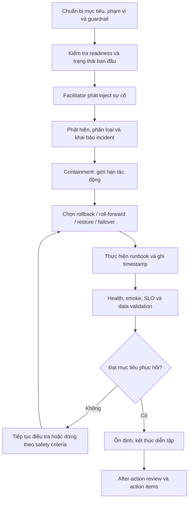

# Diễn tập quy trình phục hồi trong điều kiện có sự cố

Một kế hoạch rollback hoặc disaster recovery chỉ có giá trị khi đội ngũ có thể thực hiện nó trong điều kiện thực tế: có cảnh báo, áp lực thời gian, thông tin chưa đầy đủ, nhiều người cùng phối hợp và hệ thống đang chịu ảnh hưởng. Runbook có thể đầy đủ trên giấy nhưng vẫn thất bại vì credential hết hạn, backup không khôi phục được, phiên bản cũ không tương thích schema mới hoặc không ai biết ai có quyền ra quyết định.

**Diễn tập phục hồi (recovery exercise)** là hoạt động mô phỏng hoặc tạo có kiểm soát một tình huống sự cố để kiểm tra khả năng phát hiện, quyết định, thực hiện phục hồi và xác minh hệ thống. Diễn tập cần có mục tiêu đo được, phạm vi an toàn, người chịu trách nhiệm, tiêu chí dừng và bằng chứng. Mục đích là tìm ra điểm yếu của quy trình trước khi sự cố thật xảy ra, sau đó biến phát hiện thành cải tiến cụ thể.

Trong CI/CD, diễn tập phục hồi gắn trực tiếp với chiến lược phát hành: biết dừng rollout, quay về artifact ổn định, phục hồi cấu hình hoặc dữ liệu, xác minh lại SLO và lưu dấu vết quyết định. Diễn tập không chỉ kiểm tra nút rollback trong pipeline; nó kiểm tra toàn bộ con người, công cụ, quyền truy cập, dữ liệu và phụ thuộc cần thiết để khôi phục dịch vụ.

## 1. Phân biệt rollback, recovery và disaster recovery

Các khái niệm liên quan nhưng không giống nhau:

| Khái niệm | Mục tiêu | Ví dụ |
|---|---|---|
| Rollback | Đưa một thành phần về phiên bản hoặc trạng thái trước thay đổi gần nhất | Triển khai lại container image digest ổn định trước đó |
| Roll-forward | Sửa lỗi bằng một phiên bản mới hoặc thay đổi tiếp theo | Phát hành hotfix để sửa lỗi trong release hiện tại |
| Recovery | Khôi phục dịch vụ hoặc dữ liệu về trạng thái có thể vận hành chấp nhận được | Khôi phục database từ backup, replay event hoặc dựng lại workload |
| Disaster recovery (DR) | Khôi phục hoạt động sau sự cố lớn ảnh hưởng hạ tầng, vùng hoặc trung tâm dữ liệu | Chuyển sang region dự phòng và phục hồi dữ liệu tại đó |
| Business continuity | Duy trì các chức năng kinh doanh thiết yếu trong khi hệ thống chính bị gián đoạn | Chuyển sang quy trình xử lý thủ công đã được kiểm soát |

Rollback không phải lúc nào cũng là phương án phục hồi đúng. Nếu migration đã xóa hoặc biến đổi dữ liệu không thể đảo ngược, chạy lại image cũ có thể khiến ứng dụng lỗi nặng hơn. Nếu secret bị lộ, rollback ứng dụng không thu hồi được credential. Nếu region chính bị mất, rollback version không khôi phục được hạ tầng và dữ liệu. Cần chọn hành động theo loại sự cố và trạng thái dữ liệu.

## 2. Xác định mục tiêu phục hồi trước khi diễn tập

Diễn tập cần kiểm tra một mục tiêu cụ thể. Các chỉ số thường dùng:

- **RTO (Recovery Time Objective):** thời gian gián đoạn tối đa mà tổ chức đặt mục tiêu để khôi phục dịch vụ.
- **RPO (Recovery Point Objective):** lượng dữ liệu tối đa có thể chấp nhận mất, thường biểu diễn bằng khoảng thời gian dữ liệu.
- **MTTD (Mean Time to Detect):** thời gian trung bình từ khi sự cố bắt đầu đến khi được phát hiện.
- **MTTA (Mean Time to Acknowledge):** thời gian từ cảnh báo đến khi có người tiếp nhận và bắt đầu điều phối.
- **MTTR (Mean Time to Restore/Repair):** thời gian trung bình để khôi phục hoặc sửa dịch vụ; cần định nghĩa rõ điểm bắt đầu/kết thúc khi đo.
- **Service level objective (SLO):** mục tiêu chất lượng dịch vụ sau khi phục hồi, ví dụ availability và latency.

RTO và RPO là mục tiêu thiết kế, không phải kết quả tự động đạt được. Diễn tập cần đo thời gian thực tế và lượng dữ liệu có thể khôi phục rồi so sánh với mục tiêu.

Ví dụ:

| Hệ thống | RTO mục tiêu | RPO mục tiêu | Bằng chứng cần thu |
|---|---:|---:|---|
| API đọc danh mục | 30 phút | 15 phút | Thời điểm traffic trở lại, dữ liệu cache/database có thể tái tạo |
| Dịch vụ đơn hàng | 15 phút | 1 phút | API hoạt động, số đơn và trạng thái được đối soát |
| Sổ cái thanh toán | 60 phút | Gần 0 đối với giao dịch đã xác nhận | Event/transaction được bảo toàn, không mất hoặc ghi trùng |
| Hệ thống báo cáo nội bộ | 8 giờ | 24 giờ | Báo cáo được tái tạo và người dùng truy cập lại được |

Các giá trị trên chỉ là ví dụ để minh họa sự khác nhau giữa dịch vụ. Mục tiêu thật cần được thống nhất với chủ sở hữu nghiệp vụ, kỹ thuật, vận hành và yêu cầu pháp lý. Không nên tuyên bố RPO bằng 0 nếu kiến trúc replication/backup không chứng minh được điều đó.

### Tiêu chí thành công của một diễn tập

Không chỉ ghi “đã rollback thành công”. Nên xác định trước:

1. Sự cố được phát hiện trong khoảng thời gian mục tiêu.
2. Người có trách nhiệm được gọi và nhận quyền điều phối.
3. Nhóm chọn đúng runbook và đúng phương án phục hồi.
4. Hành động thực hiện trong phạm vi và thời gian cho phép.
5. Dịch vụ đạt lại health check, smoke test và SLO tối thiểu.
6. Dữ liệu được xác minh theo RPO và business invariant.
7. Không tạo thêm sự cố do thao tác phục hồi.
8. Log, quyết định, mốc thời gian và bằng chứng được lưu.
9. Các khoảng trống được chuyển thành action item có chủ sở hữu và hạn hoàn thành.

## 3. Các hình thức diễn tập

Không phải bài tập nào cũng cần gây lỗi thật. Hãy chọn mức mô phỏng phù hợp với độ trưởng thành, tác động và khả năng kiểm soát.

| Hình thức | Cách thực hiện | Phù hợp khi | Giới hạn |
|---|---|---|---|
| Tabletop exercise | Nhóm cùng đọc tình huống và mô tả quyết định, không thay đổi hệ thống | Kiểm tra vai trò, escalation, thông tin và quyết định | Không chứng minh công cụ/backup/credential hoạt động |
| Walkthrough runbook | Thực hiện từng bước trên tài liệu hoặc môi trường lab, có thể dùng dữ liệu giả | Kiểm tra hướng dẫn, quyền và thứ tự thao tác | Có thể không phản ánh áp lực hoặc phụ thuộc production |
| Technical recovery drill | Thực hiện rollback/restore/failover trong staging hoặc môi trường cô lập | Xác minh thao tác kỹ thuật và thời gian | Môi trường test có thể khác production |
| Game day | Tạo một lỗi được phê duyệt trong môi trường kiểm soát, quan sát toàn bộ phản ứng | Kiểm tra phối hợp, detection và khả năng phục hồi | Cần giới hạn blast radius và có người điều phối độc lập |
| Chaos experiment | Tiêm lỗi có giả thuyết, blast radius, steady-state hypothesis và điều kiện dừng | Kiểm tra khả năng chống chịu của hệ thống đang chạy | Không thay thế mọi loại DR test; có thể gây tác động nếu giới hạn kém |
| Full DR exercise | Diễn tập chuyển vùng hoặc khôi phục dịch vụ/dữ liệu trên hạ tầng dự phòng | Kiểm tra năng lực DR đầu-cuối | Tốn kém, cần phối hợp và kế hoạch rollback về trạng thái bình thường |

Nên tăng dần mức độ: tabletop → walkthrough → lab/staging → game day có giới hạn → DR exercise. Chỉ mở rộng phạm vi khi các bước trước đã có bằng chứng và đội ngũ hiểu rõ cách dừng, khôi phục lại môi trường diễn tập.

## 4. Thiết kế phạm vi và ranh giới an toàn

Diễn tập có thể gây gián đoạn nếu tạo lỗi trên hệ thống thật. Trước khi bắt đầu, cần ghi rõ phạm vi và điều kiện an toàn:

- Service, cluster, namespace, region, tenant hoặc tài khoản nằm trong phạm vi.
- Môi trường được phép diễn tập: lab, staging, pre-production hay production có phê duyệt riêng.
- Thành phần không được chạm tới, ví dụ payment gateway thật, dữ liệu khách hàng hoặc dịch vụ dùng chung.
- Loại lỗi được mô phỏng và mức độ tác động tối đa.
- Thời gian bắt đầu/kết thúc và change window.
- Người điều phối, người có quyền dừng và kênh liên lạc khẩn cấp.
- Backup/snapshot hoặc trạng thái ban đầu cần có trước khi thử.
- Điều kiện dừng ngay (abort criteria) và quy trình đưa môi trường về trạng thái ổn định.

### Guardrail bắt buộc

1. Không gây lỗi ngoài phạm vi được ủy quyền.
2. Không dùng dữ liệu cá nhân hoặc secret thật trong lab nếu không cần thiết.
3. Không xóa dữ liệu hoặc tài nguyên production để “thử xem backup có chạy không”.
4. Có người theo dõi health và có thể dừng thí nghiệm ngay.
5. Có giới hạn về traffic, số instance, thời lượng và tài nguyên bị ảnh hưởng.
6. Có đường phục hồi nếu chính thao tác diễn tập bị lỗi.
7. Thông báo trước cho nhóm liên quan và bộ phận hỗ trợ; tránh nhầm cảnh báo diễn tập với incident thật.
8. Nếu xuất hiện tác động ngoài dự kiến, dừng tiêm lỗi và chuyển sang quy trình xử lý incident thật.

Với diễn tập trên production, cần đánh giá rủi ro và có phê duyệt theo chính sách change management. Việc diễn tập không mặc nhiên cho phép gây lỗi trên hệ thống đang phục vụ người dùng.

## 5. Vai trò và cách phối hợp khi diễn tập

Diễn tập nên có người thực hiện và người quan sát tách biệt. Người đang thao tác không nên đồng thời phải ghi chép mọi mốc thời gian hoặc đánh giá khách quan chất lượng diễn tập.

| Vai trò | Trách nhiệm |
|---|---|
| Exercise lead / facilitator | Chuẩn bị kịch bản, điều phối inject, kiểm soát phạm vi và kết thúc bài tập |
| Incident commander (IC) | Tiếp nhận tình huống, đặt mức độ sự cố, phân công và quyết định tiếp tục/dừng phục hồi |
| Operations lead | Thực hiện runbook, kiểm tra trạng thái hạ tầng và phối hợp các nhóm kỹ thuật |
| Application/service owner | Xác minh hành vi ứng dụng, dependency, feature flag và business flow |
| Database/data lead | Đánh giá backup, replication, consistency, RPO và đối soát dữ liệu |
| Security lead | Đánh giá sự cố credential, access boundary, audit và containment khi cần |
| Communications lead | Cập nhật stakeholder, trạng thái dịch vụ, ETA và thông điệp đã được phê duyệt |
| Observer/scribe | Ghi timestamp, quyết định, thời gian chờ, trở ngại và bằng chứng |
| Safety controller | Theo dõi guardrail, có quyền dừng diễn tập nếu vượt phạm vi |

Với nhóm nhỏ, một người có thể giữ nhiều vai trò, nhưng facilitator hoặc safety controller cần có khả năng dừng bài tập độc lập với người thực hiện. Mọi người cần biết tín hiệu kết thúc diễn tập và cách phân biệt “inject giả lập” với incident thật.

## 6. Chuẩn bị trước khi bắt đầu

### Hồ sơ diễn tập

Mỗi bài tập nên có một exercise brief ngắn:

- Tên, mục tiêu và loại diễn tập.
- Service/environment và phạm vi bị ảnh hưởng.
- Kịch bản mở đầu, giả định và inject theo thời gian.
- RTO/RPO hoặc tiêu chí vận hành cần kiểm tra.
- Danh sách vai trò, người tham gia và người quan sát.
- Runbook, dashboard, log, backup/restore procedure và liên hệ cần dùng.
- Điều kiện bắt đầu, điều kiện dừng và cách reset môi trường.
- Bằng chứng phải thu thập và cách đánh giá pass/fail.

### Kiểm tra readiness

Trước khi diễn tập, xác minh:

1. Runbook đúng phiên bản, có owner và được truy cập được khi hệ thống chính gặp sự cố.
2. Credential khẩn cấp còn hiệu lực, đúng phạm vi và có người biết cách sử dụng.
3. Backup hoàn tất, có timestamp, checksum/metadata và có thể truy cập từ vùng phục hồi.
4. Artifact ổn định trước đó còn tồn tại trong registry và có digest đã ghi nhận.
5. Cấu hình, manifest và IaC có version; biết cách khôi phục revision trước.
6. Dashboard, alert và log hoạt động; đồng hồ hệ thống được đồng bộ.
7. Kênh liên lạc ngoài hệ thống chính vẫn dùng được nếu SSO/chat nội bộ bị gián đoạn.
8. Môi trường diễn tập có quota, dữ liệu và network được cô lập phù hợp.
9. Có người có quyền phê duyệt hoặc dừng hành động nhạy cảm.

Một backup job báo `success` chưa chứng minh có thể restore. Nếu mục tiêu bài tập là kiểm tra phục hồi dữ liệu, phải thực hiện restore vào môi trường cô lập và xác minh kết quả.

## 7. Xây dựng kịch bản sự cố có giá trị

Kịch bản nên bắt đầu từ một giả thuyết cụ thể, có tín hiệu quan sát và một kết quả mong đợi. Tránh tạo tình huống quá mơ hồ như “hệ thống bị lỗi” mà không có thông tin để đội ngũ điều tra.

Các nhóm kịch bản thường gặp:

| Kịch bản | Inject hoặc dấu hiệu ban đầu | Khả năng phục hồi cần kiểm tra |
|---|---|---|
| Release lỗi | Canary 5xx tăng, p95 vượt ngưỡng, smoke test thất bại | Pause rollout, xác định digest, rollback hoặc tắt feature flag, xác minh lại |
| Cấu hình sai | Endpoint dependency sai, feature flag bật nhầm, timeout quá thấp | Khôi phục config revision, kiểm tra config drift và rollout lại |
| Migration không tương thích | Phiên bản mới ghi schema mà phiên bản cũ không đọc được | Dừng rollout, đánh giá tương thích, roll-forward hoặc phục hồi dữ liệu |
| Database unavailable | Connection timeout, primary không sẵn sàng | Failover hoặc restore theo kiến trúc, kiểm tra consistency và RPO |
| Message backlog | Consumer dừng hoặc xử lý chậm, queue lag tăng | Khôi phục consumer, scale an toàn, xử lý retry/DLQ và duplicate |
| Credential bị lộ | Phát hiện token trong log hoặc secret store có truy cập bất thường | Containment, revoke/rotate, xác minh quyền và kiểm tra audit |
| Artifact sai hoặc registry lỗi | Digest không khớp, image bị xóa hoặc registry không truy cập được | Lấy artifact từ nguồn tin cậy, xác minh chữ ký/provenance và deploy lại |
| Region outage | Health check vùng chính thất bại, traffic không được phục vụ | Chuyển vùng, kiểm tra replication, DNS/routing và failback |
| Mất dữ liệu/nhầm xóa | Bản ghi hoặc object không còn, backup gần nhất có độ trễ | Restore vào vùng cô lập, xác minh RPO, đối soát và quyết định cutover |

### Kịch bản phải kiểm tra cả phụ thuộc

Rollback ứng dụng có thể thành công nhưng dịch vụ vẫn không phục hồi nếu database, queue, secret manager hoặc network đang lỗi. Mỗi kịch bản cần xác định dependency và thứ tự phục hồi. Ví dụ, trước khi khởi động lại consumer, cần bảo đảm database và broker sẵn sàng; trước khi chuyển traffic sang region dự phòng, cần xác nhận dữ liệu đã replicate tới mức RPO chấp nhận được.

## 8. Quy trình diễn tập từ phát hiện đến xác minh

Một chu trình chuẩn có thể chia thành các giai đoạn:



### Bước 1: Ghi nhận trạng thái ban đầu

Lưu deployment revision, artifact digest, config revision, database replication lag, queue depth, SLO/SLI và trạng thái backup. Đây là điểm tham chiếu để biết hệ thống đã thay đổi ra sao sau diễn tập.

### Bước 2: Phát hiện và phân loại

Người trực tiếp nhận cảnh báo hoặc inject, xác định phạm vi và mức độ. Cần phân biệt sự cố trong bài tập với một incident thật phát sinh đồng thời. Nếu xuất hiện tác động ngoài phạm vi, safety controller dừng diễn tập và incident thật được ưu tiên.

### Bước 3: Containment

Giảm blast radius trước khi phục hồi: pause rollout, ngừng tăng traffic, disable feature flag, cô lập credential hoặc chặn luồng lỗi theo runbook. Không thực hiện hành động phá hủy dữ liệu khi chưa xác định trạng thái và khả năng phục hồi.

### Bước 4: Chọn phương án

Quyết định rollback, roll-forward, restore hay failover dựa trên loại lỗi, trạng thái dữ liệu, tính tương thích và thời gian phục hồi. Ghi lý do lựa chọn, người quyết định và điều kiện chuyển sang phương án khác.

### Bước 5: Thực hiện và xác minh

Ghi timestamp cho từng thao tác. Sau khi phục hồi, kiểm tra không chỉ process/replica mà cả smoke test, dependency, business flow, data integrity, SLO và cảnh báo. Không tuyên bố hoàn tất chỉ vì lệnh rollback/restore trả mã thành công.

### Bước 6: Kết thúc và reset

Facilitator thông báo kết thúc bài tập, tắt fault injection, thu hồi credential tạm, dọn dữ liệu test và xác nhận môi trường trở về trạng thái được chấp thuận. Nếu đây là DR failover, cần có kế hoạch failback riêng thay vì chuyển ngược ngay mà chưa kiểm tra replication.

## 9. Diễn tập rollback một release lỗi

Đây là kịch bản gắn trực tiếp với CI/CD và có thể thực hiện an toàn trong staging hoặc môi trường canary được phê duyệt.

### Mục tiêu

- Kiểm tra pipeline có thể dừng rollout khi guardrail thất bại.
- Xác định đúng artifact digest đang chạy và digest ổn định trước đó.
- Thực hiện rollback hoặc disable feature theo runbook.
- Xác minh phiên bản cũ tương thích với schema/config hiện tại.
- Đo thời gian từ phát hiện đến khi dịch vụ trở lại trạng thái chấp nhận được.

### Chuẩn bị

1. Chọn service thử nghiệm và namespace riêng.
2. Ghi digest phiên bản ổn định, digest candidate và manifest revision.
3. Xác minh hai artifact còn tồn tại trong registry.
4. Dùng dataset giả lập và không kết nối tới hệ thống thanh toán thật.
5. Chuẩn bị dashboard theo revision, smoke test và rollback command đã review.
6. Xác định ngưỡng dừng, ví dụ error rate vượt ngưỡng trong hai cửa sổ hoặc smoke test critical thất bại.

### Thực hiện

Facilitator cho phép candidate nhận một tỷ lệ traffic nhỏ trong môi trường thử nghiệm. Sau đó phát inject: endpoint mới trả lỗi hoặc latency vượt guardrail. Người trực nhận cảnh báo, pause rollout, xác định revision lỗi và đối chiếu digest với release record. Deployer đưa workload về digest ổn định theo runbook.

Ví dụ lệnh chỉ dùng để quan sát trạng thái trong namespace diễn tập:

```bash
kubectl -n recovery-drill get deployment orders
kubectl -n recovery-drill rollout status deployment/orders
kubectl -n recovery-drill get pods -l app=orders -o wide
```

Các lệnh trên chỉ đọc trạng thái. Lệnh thay đổi như `kubectl rollout undo` hoặc cập nhật image phải lấy từ runbook đã được review và chỉ thực hiện trong đúng namespace được phê duyệt. Không sao chép lệnh diễn tập sang production nếu chưa xác minh context, cluster, namespace, digest và quyền.

### Xác minh

- Deployment chạy đúng digest ổn định đã ghi trước bài tập.
- Replica sẵn sàng và không còn crash loop.
- Smoke test chức năng đạt.
- Error rate, latency và saturation trở về trong ngưỡng.
- Queue không tăng backlog bất thường; không có giao dịch test bị ghi trùng.
- Feature flag, traffic routing và cấu hình được đưa về trạng thái dự kiến.
- Deployment record ghi rõ candidate, rollback target, người thực hiện và thời gian.

### Điều cần rút ra

Nếu rollback không hoạt động, xác định nguyên nhân là thiếu artifact, quyền, manifest, compatibility hay runbook. Nếu phiên bản cũ không đọc được schema mới, bài tập đã phát hiện rủi ro cần xử lý bằng expand-and-contract, roll-forward hoặc phục hồi dữ liệu trước khi phát hành thật.

## 10. Diễn tập phục hồi database và kiểm tra RPO

Database recovery khác rollback ứng dụng. Nó phải bảo vệ tính nhất quán và chứng minh lượng dữ liệu có thể khôi phục.

Một bài tập restore an toàn nên thực hiện trên môi trường cô lập:

1. Chọn backup/snapshot và ghi lại thời điểm tạo, retention, encryption key reference và checksum/metadata.
2. Khôi phục vào database hoặc account riêng, không ghi đè database đang phục vụ người dùng.
3. Nếu dùng point-in-time recovery, chọn mốc thời gian và ghi lại log/WAL/binlog cần replay.
4. Kiểm tra schema, số lượng bản ghi, constraint, index và quyền truy cập.
5. Chạy truy vấn đối soát và business invariant trên dữ liệu đã khôi phục.
6. Tính điểm dữ liệu mới nhất có thể khôi phục so với thời điểm sự cố giả lập để đo RPO.
7. Đo thời gian từ lúc bắt đầu restore đến khi ứng dụng kiểm thử có thể dùng dữ liệu để đo RTO.
8. Hủy môi trường và dữ liệu diễn tập theo chính sách retention.

Không chỉ kiểm tra backup file tồn tại hoặc snapshot có trạng thái `completed`. Chỉ khi restore được và dữ liệu qua kiểm tra mới có bằng chứng phục hồi. Với hệ thống giao dịch, cần xác minh tính nhất quán giữa các bảng, event, payment và ledger; số lượng bản ghi đơn thuần không đủ.

## 11. Diễn tập failover và failback

Failover chuyển workload hoặc traffic từ thành phần/vùng chính sang thành phần/vùng dự phòng. Failback đưa hoạt động trở lại vùng hoặc kiến trúc chính sau khi đã ổn định.

Trước khi diễn tập, xác định:

- Mô hình replication: synchronous/asynchronous, hướng replication và độ trễ.
- Điều kiện chọn primary mới và cách tránh split-brain.
- Cơ chế routing/DNS/load balancer và thời gian cache/TTL.
- Trạng thái queue, session, cache và background job.
- Quyền truy cập, secret, certificate và endpoint ở vùng dự phòng.
- RPO thực tế tại thời điểm chuyển đổi.
- Cách kiểm tra dữ liệu trước khi mở traffic.
- Điều kiện và quy trình failback.

Một bài tập tốt không chỉ chứng minh traffic chuyển được. Nó cần kiểm tra vùng dự phòng có đủ capacity, workload có đúng configuration, database có dữ liệu đủ mới, các consumer không xử lý trùng và hệ thống quan sát vẫn hoạt động.

Không nên failback ngay sau khi vùng chính vừa phục hồi. Cần xác minh replication đã đồng bộ, xác định authoritative data source, xử lý write phát sinh trong thời gian failover và có kế hoạch chuyển traffic không gây split-brain.

## 12. Diễn tập sự cố credential hoặc pipeline bị xâm nhập

Với sự cố secret, rollback image không đủ. Bài tập nên kiểm tra khả năng:

- Xác định credential/principal bị ảnh hưởng và tài nguyên nó có thể truy cập.
- Revoke hoặc disable credential cũ.
- Phát hành credential mới qua secret manager/workload identity.
- Cập nhật workload và xác minh không còn dùng credential cũ.
- Kiểm tra audit log để tìm hành động bất thường trong khoảng bị lộ.
- Xác minh pipeline/runner không còn bị xâm nhập hoặc giữ lại token.
- Thu hồi runner registration token, cache hoặc workspace nếu cần.
- Tạo lại artifact/signature nếu signing key hoặc build environment bị ảnh hưởng.

Diễn tập phải dùng credential thử nghiệm và tài khoản sandbox. Không cố tình làm lộ secret production để kiểm tra quy trình. Với nghi ngờ signing key bị lộ, cần xem xét thu hồi trust, re-sign artifact đáng tin cậy và thông báo các hệ thống tiêu thụ theo quy trình supply-chain security.

## 13. Tích hợp diễn tập vào CI/CD và lịch vận hành

Một số kiểm tra có thể tự động hóa trong pipeline; một số cần lịch game day riêng.

| Tần suất/giai đoạn | Hoạt động | Bằng chứng |
|---|---|---|
| Mỗi release | Xác minh rollback target, artifact retention, config revision và runbook link | Release manifest và pre-deploy check |
| Hàng ngày/tuần | Kiểm tra backup job, replication lag, alert routing và quyền khẩn cấp | Health report, backup metadata và access review |
| Hàng tháng/quý | Restore thử nghiệm vào môi trường cô lập | Restore duration, RPO đo được, integrity report |
| Theo quý hoặc sau thay đổi lớn | Tabletop/game day cho release failure, dependency outage hoặc credential incident | Timeline, quyết định và action items |
| Theo kế hoạch DR | Failover/failback hoặc khôi phục region | RTO/RPO thực tế, capacity và data validation |
| Sau incident thật | Diễn tập lại các bước đã thất bại sau khi khắc phục | Bằng chứng cải thiện và runbook cập nhật |

CI có thể kiểm tra rằng release manifest chứa digest trước đó và runbook URL, nhưng không nên tự động gây lỗi production trong pipeline thông thường. Fault injection cần một workflow riêng, môi trường/target được allowlist, quyền phê duyệt và safety controller.

Ví dụ mô tả lịch diễn tập bằng YAML:

```yaml
recoveryExercise:
  id: orders-release-rollback-drill
  service: orders
  environment: staging
  scenario: unhealthy_release
  objectives:
    rtoTarget: 15m
    dataLossAllowed: false
  scope:
    namespace: recovery-drill
    maxTrafficPercent: 5
    useSyntheticData: true
  prerequisites:
    - stableArtifactDigestRecorded
    - candidateArtifactDigestRecorded
    - rollbackRunbookReviewed
    - dashboardsAndAlertsReady
    - safetyControllerAssigned
  abortConditions:
    - trafficEscapesDrillNamespace
    - realCustomerDataDetected
    - sharedDependencyHealthDegrades
  successCriteria:
    - stableDigestRestored
    - criticalSmokeTestsPass
    - errorRateWithinThreshold
    - dataIntegrityChecksPass
  evidence:
    - eventTimeline
    - deploymentRecords
    - metricSnapshots
    - dataValidationReport
    - actionItems
```

Đây là cấu trúc minh họa, không phải schema tiêu chuẩn của một CI vendor. Bộ điều phối diễn tập cần xác thực phạm vi, target và abort condition trước khi cho phép bất kỳ fault injection nào.

## 14. Đo lường và đánh giá kết quả diễn tập

Ghi timeline với timestamp nhất quán:

| Mốc | Ý nghĩa |
|---|---|
| T0 | Sự cố giả lập bắt đầu |
| T1 | Monitoring phát hiện/cảnh báo |
| T2 | Người trực acknowledge |
| T3 | Incident commander nhận điều phối |
| T4 | Quyết định containment/phương án phục hồi |
| T5 | Bắt đầu rollback/restore/failover |
| T6 | Thành phần kỹ thuật báo hoàn tất |
| T7 | Functional/business/data validation đạt |
| T8 | Dịch vụ trở lại trạng thái vận hành chấp nhận được |

Từ timeline, tính:

- MTTD = T1 − T0.
- MTTA = T2 − T1.
- Decision time = T4 − T2.
- Execution time = T6 − T5.
- Validation time = T8 − T6.
- Recovery time thực tế = T8 − T0.

Đối chiếu recovery time với RTO; đối chiếu điểm dữ liệu mới nhất phục hồi được với RPO. Ngoài thời gian, đánh giá số lần thao tác sai, số lần cần escalation, bước runbook thiếu, credential không dùng được, cảnh báo không tới nơi và chất lượng xác minh dữ liệu.

Không tối ưu một chỉ số bằng cách bỏ qua an toàn. Phục hồi nhanh nhưng làm mất giao dịch hoặc mở quyền admin quá rộng không phải là thành công.

## 15. After-action review và cải tiến

Sau diễn tập, tổ chức buổi review tập trung vào hệ thống và quy trình thay vì quy lỗi cá nhân. Cần trả lời:

1. Mục tiêu và phạm vi có đạt không?
2. Điều gì diễn ra đúng như dự kiến?
3. Bước nào chậm, thiếu thông tin hoặc không hoạt động?
4. Alert có đủ ngữ cảnh để xác định service/revision/impact không?
5. Runbook có chính xác, dễ tìm và có thể thực hiện với quyền hiện có không?
6. RTO/RPO đo được có đáp ứng mục tiêu không?
7. Dữ liệu sau restore có qua business invariant và reconciliation không?
8. Quyết định dừng/tiếp tục/rollback có rõ người chịu trách nhiệm không?
9. Có rủi ro mới được phát hiện ngoài kịch bản ban đầu không?
10. Cải tiến nào cần hoàn tất trước lần release hoặc diễn tập tiếp theo?

Mỗi phát hiện nên trở thành action item có:

- Mô tả vấn đề và bằng chứng.
- Mức ưu tiên theo tác động/rủi ro.
- Owner chịu trách nhiệm.
- Hạn hoàn thành.
- Cách xác minh đã khắc phục.
- Liên kết tới runbook, pipeline, alert hoặc kiến trúc cần cập nhật.

Sau khi sửa, cần diễn tập lại phần thất bại để xác minh cải tiến thực sự có tác dụng. Cập nhật tài liệu mà không chạy lại bước đã lỗi chưa chứng minh quy trình đã tốt hơn.

## 16. Những anti-pattern thường gặp

- **Chỉ đọc runbook trong cuộc họp:** không kiểm tra quyền, tool, backup hoặc thời gian thực hiện.
- **Backup có nhưng chưa restore thử:** không biết bản sao có dùng được và đạt RPO hay không.
- **Diễn tập không có scope/abort criteria:** lỗi có thể lan sang hệ thống hoặc người dùng ngoài dự kiến.
- **Chỉ đo thời gian lệnh rollback:** bỏ qua thời gian phát hiện, quyết định và xác minh nghiệp vụ.
- **Rollback ứng dụng sau migration phá hủy:** phiên bản cũ có thể không tương thích dữ liệu mới.
- **Không kiểm tra artifact cũ còn tồn tại:** rollback cần image/package đã bị registry cleanup xóa.
- **Dùng credential production trong lab:** tăng rủi ro lộ secret và thao tác nhầm.
- **Không có người điều phối độc lập:** người tiêm lỗi và người phục hồi không thống nhất được khi cần dừng.
- **Không kiểm tra failback:** vùng chính phục hồi nhưng chuyển lại có thể gây mất dữ liệu hoặc split-brain.
- **Không ghi timeline và bằng chứng:** không thể tính RTO/RPO hoặc xác định nút thắt.
- **Không theo dõi action item:** cùng một lỗi quy trình lặp lại ở lần sau.
- **Diễn tập chỉ khi có audit:** runbook và quyền truy cập có thể đã lỗi thời từ lâu.

## 17. Checklist tổ chức một recovery exercise

Trước khi bắt đầu:

1. Mục tiêu, giả thuyết và kịch bản có rõ ràng không?
2. Phạm vi, môi trường, tài nguyên và dữ liệu có được cho phép không?
3. RTO/RPO và tiêu chí thành công có đo được không?
4. Có facilitator, incident commander, operator, observer và safety controller không?
5. Runbook, artifact ổn định, config revision và backup có sẵn không?
6. Credential, quyền truy cập và kênh liên lạc khẩn cấp có hoạt động không?
7. Dashboard, alert, log và đồng bộ thời gian có sẵn sàng không?
8. Abort condition và cách reset môi trường có được thống nhất không?

Trong khi diễn tập:

9. Có ghi timeline và quyết định theo thời gian thực không?
10. Có containment trước khi phục hồi không?
11. Phương án rollback/roll-forward/restore/failover có phù hợp trạng thái dữ liệu không?
12. Có theo dõi blast radius và dừng khi vượt guardrail không?
13. Có xác minh health, smoke, SLO và data integrity sau thao tác không?

Sau khi kết thúc:

14. Môi trường đã được reset, fault injection tắt và credential tạm thu hồi chưa?
15. RTO/RPO thực tế và các khoảng thời gian đã được tính chưa?
16. Bằng chứng và deployment/recovery record đã được lưu chưa?
17. Action item có owner, priority, due date và cách xác minh không?
18. Có lịch diễn tập lại sau khi khắc phục không?

Diễn tập phục hồi biến một kế hoạch trên giấy thành năng lực đã được kiểm chứng. Khi phạm vi được giới hạn an toàn, mục tiêu RTO/RPO rõ ràng, vai trò được phân công, runbook được thực hiện và dữ liệu được xác minh, đội ngũ sẽ biết không chỉ cách đưa dịch vụ trở lại mà còn biết quy trình nào cần cải thiện trước sự cố tiếp theo.
