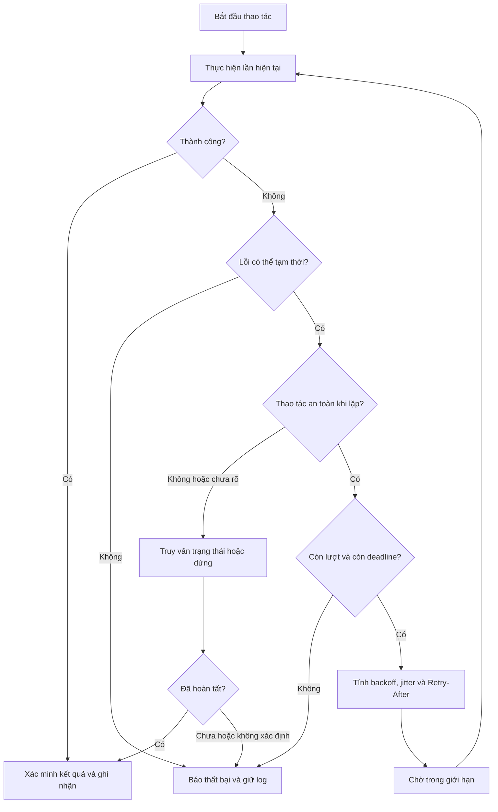

# Chỉ tự thử lại lỗi tạm thời với số lần và thời gian chờ hữu hạn

Trong một pipeline CI/CD, một thao tác có thể thất bại dù mã nguồn và cấu hình vẫn đúng. Registry tạm thời không phản hồi, kết nối tới dịch vụ kiểm thử bị ngắt, hoặc API giới hạn tốc độ trong vài giây đều có thể làm một bước đang chạy dở bị lỗi. Nếu chạy lại đúng thao tác sau khi dịch vụ hồi phục, pipeline có thể tiếp tục thành công.

Tuy nhiên, không phải lỗi nào cũng biến mất khi thử lại. Một bài kiểm thử phát hiện sai kết quả, một lệnh build dùng cú pháp không hợp lệ, hoặc một thông tin xác thực hết hạn thường sẽ tiếp tục thất bại. Thử lại những lỗi này chỉ làm pipeline chậm hơn và che khuất nguyên nhân thật.

Nguyên tắc của bài học là: **chỉ tự động thử lại khi có cơ sở nhận định lỗi mang tính tạm thời, thao tác an toàn khi lặp lại, và chính sách thử lại có giới hạn rõ ràng**. Khi hết giới hạn, pipeline phải báo thất bại để người vận hành xử lý.

## 1. Thử lại trong CI/CD là gì?

Thử lại (*retry*) là thực hiện lại một thao tác sau khi lần thực hiện trước thất bại. Trong CI/CD, thao tác đó có thể là tải dependency, gọi API của hệ thống kiểm thử, lấy image từ container registry, tải artifact lên kho lưu trữ, hoặc truy vấn trạng thái triển khai.

Một lần thử ban đầu và những lần thử tiếp theo phải được tính rõ ràng. Ví dụ, `maxAttempts: 4` thường có nghĩa là tối đa bốn lần thực hiện tổng cộng: một lần ban đầu và ba lần thử lại. Một số công cụ cấu hình theo `maxRetries`; khi đó `maxRetries: 3` cũng có thể tạo ra tổng cộng bốn lần thực hiện. Luôn kiểm tra cách công cụ CI đang dùng định nghĩa con số này.

Thử lại tự động khác với việc người dùng bấm chạy lại toàn bộ pipeline. Retry thường nằm trong phạm vi một thao tác hoặc một bước cụ thể và tuân theo chính sách đã định. Chạy lại pipeline có thể thực hiện lại nhiều bước, tạo thêm artifact, gửi thông báo hoặc tác động tới môi trường. Vì vậy, không nên dùng việc chạy lại toàn pipeline như một cách thay thế cho chính sách retry có kiểm soát.

## 2. Phân loại lỗi trước khi thử lại

Điều kiện đầu tiên là xác định lỗi có khả năng tự hết hay không. Hãy dựa vào loại lỗi, mã phản hồi, thông điệp từ dịch vụ, trạng thái của thao tác và hợp đồng của API. Không nên quyết định chỉ bằng cách tìm một từ như `timeout` trong log.

| Nhóm lỗi | Ví dụ thường gặp | Cách xử lý |
| --- | --- | --- |
| Lỗi hạ tầng tạm thời | Kết nối bị reset, DNS tạm thời không phân giải được, dịch vụ phụ thuộc mất kết nối trong thời gian ngắn | Có thể retry nếu thao tác an toàn khi lặp lại và còn ngân sách retry |
| Dịch vụ quá tải hoặc giới hạn tốc độ | HTTP `429`, `502`, `503`, `504`; registry hoặc API tạm thời không sẵn sàng | Có thể retry; tôn trọng `Retry-After` nếu dịch vụ cung cấp |
| Timeout | Không nhận được phản hồi trong thời hạn của request | Chỉ retry sau khi đánh giá trạng thái thao tác; timeout không chứng minh rằng phía nhận chưa thực hiện yêu cầu |
| Lỗi mã nguồn hoặc chất lượng | Build thất bại do lỗi biên dịch, lint báo lỗi, assertion trong test không đúng | Không retry tự động; sửa mã nguồn hoặc kiểm thử |
| Lỗi cấu hình hoặc quyền | Thiếu secret, sai endpoint, HTTP `401` hoặc `403`, thiếu quyền truy cập | Không retry; sửa cấu hình hoặc quyền được cấp |
| Dữ liệu hoặc trạng thái không hợp lệ | Sai schema, artifact sai checksum, phiên bản không được hỗ trợ | Không retry mù quáng; điều tra dữ liệu, quy trình tạo artifact hoặc trạng thái đích |

Các mã HTTP chỉ là tín hiệu ban đầu. `429` thường yêu cầu giảm tốc độ; `502`, `503` và `504` thường chỉ ra vấn đề tạm thời ở gateway hoặc dịch vụ. Nhưng phản hồi `500` có thể xuất hiện cả khi lỗi là tạm thời lẫn khi ứng dụng gặp lỗi logic. Một `404` ngay sau khi tạo tài nguyên đôi khi phản ánh độ trễ đồng bộ, nhưng trong trường hợp khác lại là sai đường dẫn. Hãy dựa vào tài liệu và hành vi đã cam kết của dịch vụ.

Đặc biệt, timeout sau một yêu cầu ghi dữ liệu là tình huống chưa rõ kết quả. Máy khách không nhận được phản hồi không có nghĩa là máy chủ chưa thực hiện thao tác. Trước khi gửi lại, cần truy vấn trạng thái theo mã yêu cầu hoặc mã phát hành, hoặc dùng cơ chế idempotency mà dịch vụ hỗ trợ.

## 3. Kiểm tra thao tác có an toàn khi lặp lại không

Một thao tác *idempotent* (có tính lặp an toàn) là thao tác mà việc thực hiện cùng yêu cầu nhiều lần vẫn dẫn tới cùng trạng thái mong muốn như thực hiện một lần. Điều này không nhất thiết có nghĩa mọi phản hồi đều giống nhau; điều quan trọng là tác động cuối cùng không bị nhân đôi.

Ví dụ, đọc trạng thái bằng `GET` thường an toàn để retry. Ghi một giá trị cố định vào cùng một tài nguyên bằng `PUT` có thể idempotent nếu API định nghĩa đúng như vậy. Ngược lại, một yêu cầu `POST` tạo bản phát hành mới, tạo hóa đơn, gửi thông báo hoặc khởi chạy một đợt triển khai có thể tạo tác động lặp nếu gửi lại.

Trước khi bật retry, hãy trả lời ba câu hỏi:

1. Nếu lần đầu đã được hệ thống đích thực hiện nhưng phản hồi bị mất, gửi lại có tạo thêm tác động hay không?
2. Có thể nhận diện cùng một yêu cầu bằng một mã ổn định, chẳng hạn `release_id`, `request_id` hoặc idempotency key, hay không?
3. Có thể truy vấn trạng thái hiện tại để biết thao tác đã hoàn tất, đang chạy hay chưa bắt đầu hay không?

Nếu API hỗ trợ idempotency key, hãy tạo khóa ổn định cho cùng một thao tác logic và dùng lại khóa đó trong các lần retry. Không tạo khóa mới ở mỗi lần thử, vì như vậy máy chủ có thể xem mỗi lần là một yêu cầu độc lập. Nếu dịch vụ không hỗ trợ cơ chế này, hãy kiểm tra trạng thái trước khi gửi lại một thao tác có tác động phụ.

Trong pipeline phát hành, nên triển khai cùng một artifact bất biến đã được build và kiểm tra, nhận diện bằng digest hoặc checksum. Nếu lệnh triển khai timeout, hãy truy vấn trạng thái của `release_id` và xác minh phiên bản đang chạy trước khi quyết định tiếp tục. Không tự build artifact mới rồi retry một lần phát hành đang có kết quả chưa rõ; điều đó làm giảm khả năng truy vết giữa commit, artifact và môi trường.

## 4. Giới hạn số lần, thời gian và độ trễ

Một chính sách retry cần ít nhất bốn giới hạn:

- **Số lần thực hiện tối đa:** bao gồm hay không bao gồm lần đầu phải được ghi rõ. Trong bài học này, `maxAttempts` là tổng số lần, tính cả lần đầu.
- **Timeout cho mỗi lần:** ngăn một request bị treo vô hạn.
- **Thời gian chờ tối đa giữa các lần:** tránh tạo khoảng nghỉ quá dài hoặc giữ worker CI chiếm dụng không cần thiết.
- **Tổng thời gian cho cả thao tác:** đặt một deadline để toàn bộ retry không vượt quá ngân sách của pipeline.

Một cách phổ biến để tăng dần thời gian chờ là *exponential backoff*. Gọi `k` là thứ tự lần retry, bắt đầu từ 1. Với `baseDelay` là thời gian chờ ban đầu và `maxDelay` là mức trần:

```text
upperBound(k) = min(maxDelay, baseDelay * 2^(k - 1))
delay(k)      = random(0, upperBound(k))
```

Phần chọn ngẫu nhiên trong khoảng từ 0 đến giới hạn trên được gọi là *full jitter*. Nó giúp nhiều pipeline không cùng thức dậy và gửi lại yêu cầu vào một thời điểm, tránh tạo thêm đợt quá tải cho dịch vụ đang phục hồi.

Ví dụ với `baseDelay = 2 giây`, `maxDelay = 15 giây`, giới hạn trên cho các lần chờ lần lượt là 2, 4, 8, rồi 15 giây. Thời gian thực tế được chọn ngẫu nhiên trong từng khoảng đó. Sau khi đạt mức trần, các lần chờ sau không tiếp tục tăng.

Nếu phản hồi có header `Retry-After`, hãy tôn trọng thời điểm dịch vụ yêu cầu thử lại. Không rút ngắn thời gian chờ xuống dưới giá trị đó chỉ vì backoff nội bộ ngắn hơn. Nếu thời điểm được yêu cầu nằm ngoài deadline hoặc vượt quá ngân sách của pipeline, hãy dừng và báo lỗi để xử lý sau thay vì retry sớm hơn chỉ dẫn của dịch vụ.

Ví dụ chính sách dưới đây mô tả ý tưởng cấu hình, không phải cú pháp dùng chung cho mọi nền tảng CI:

```yaml
retry:
  maxAttempts: 4          # Tối đa 1 lần đầu và 3 lần retry
  attemptTimeout: 20s     # Giới hạn cho từng lần gọi
  maxElapsedTime: 100s    # Deadline của toàn bộ thao tác
  backoff:
    type: exponential
    baseDelay: 2s
    maxDelay: 15s
    jitter: full
  retryOn:
    - connection_reset
    - temporary_dns_error
    - request_timeout
    - http_429
    - http_502
    - http_503
    - http_504
```

Khi ánh xạ chính sách này sang công cụ cụ thể, hãy kiểm tra tên trường, cách đếm lần thử, loại lỗi được hỗ trợ và giới hạn timeout của nền tảng đó. Không sao chép nguyên cấu hình minh họa vào pipeline rồi giả định mọi CI engine có cùng hành vi.

## 5. Đặt retry ở đúng phạm vi

Retry nên bao quanh thao tác nhỏ nhất có thể xác định và thực hiện an toàn. Nếu bước tải artifact lên registry gặp lỗi mạng, hãy retry thao tác tải lên. Không cần chạy lại toàn bộ build, test và các bước đã thành công nếu chúng không liên quan tới lỗi.

Retry toàn bộ job có thể phù hợp khi job được thiết kế để chạy lại an toàn và nền tảng chỉ có thể retry ở cấp job. Khi đó cần kiểm tra các bước trước điểm lỗi: chúng có tạo tag mới, gửi thông báo, cập nhật trạng thái triển khai hoặc ghi dữ liệu ra hệ thống bên ngoài hay không. Những bước này cần khóa idempotency, kiểm tra trạng thái hoặc cơ chế khử trùng lặp.

Tránh cấu hình retry chồng nhiều tầng mà không tính tổng số lần. Ví dụ, nếu một thư viện HTTP thực hiện tối đa bốn lần gọi và CI cũng chạy lại bước đó tối đa bốn lần, một thao tác logic có thể phát sinh tới mười sáu lần gọi. Hãy xác định tầng nào chịu trách nhiệm retry, ghi rõ ngân sách tổng và bảo đảm các tầng phối hợp với nhau. Có thể để thư viện xử lý lỗi kết nối ở mức request và CI xử lý việc khởi động lại một bước, nhưng tổng số lần và deadline vẫn phải được kiểm soát.

## 6. Tránh tạo retry storm

Khi registry, cloud API hoặc dịch vụ kiểm thử đang quá tải, nhiều pipeline có thể cùng thất bại. Nếu tất cả retry ngay lập tức theo cùng một lịch cố định, lượng yêu cầu tăng đột biến có thể khiến dịch vụ tiếp tục quá tải. Đây là *retry storm*.

Các biện pháp sau giúp giảm rủi ro:

- Dùng exponential backoff kết hợp jitter thay vì retry liên tục hoặc chờ một khoảng cố định giống nhau.
- Giới hạn số lần retry, tổng thời gian và số job đồng thời đang gọi dịch vụ phụ thuộc.
- Tôn trọng `Retry-After` và các giới hạn tốc độ mà dịch vụ công bố.
- Dùng retry budget cho một khoảng thời gian hoặc một nhóm request để hệ thống không dành phần lớn lưu lượng cho các lần thử lại.
- Nếu dịch vụ liên tục không sẵn sàng, tạm ngừng gửi yêu cầu mới theo cơ chế circuit breaker hoặc chính sách vận hành tương đương; chỉ mở lại khi có thể kiểm tra dịch vụ đã phục hồi.

Retry là cơ chế phục hồi cho lỗi tạm thời, không phải cách giữ cho pipeline tiếp tục gửi yêu cầu bất chấp tình trạng của hệ thống phụ thuộc.

## 7. Ví dụ: tải artifact lên registry

Giả sử pipeline đã build và kiểm thử thành công image cho commit `a1b2c3d`. Image được gắn digest `sha256:...` và cần tải lên registry để chuẩn bị triển khai. Chính sách cho thao tác tải lên là tối đa bốn lần thực hiện, timeout 20 giây cho mỗi lần và deadline tổng 100 giây.

Lần đầu registry trả về `503 Service Unavailable`. Pipeline xác định đây là lỗi có khả năng tạm thời, thao tác tải lên dùng cùng tên artifact bất biến và cùng idempotency key, đồng thời deadline còn đủ. Pipeline chờ theo backoff có jitter rồi thử lại. Lần tiếp theo registry trả về `429`; pipeline đọc `Retry-After` và chỉ tiếp tục nếu thời gian chờ được yêu cầu vẫn nằm trong deadline. Khi registry nhận artifact thành công, pipeline xác minh digest được lưu trùng với digest đã build và ghi lại kết quả phát hành.

Nếu registry trả `401 Unauthorized`, pipeline dừng ngay và báo lỗi xác thực. Chờ thêm vài giây không thể làm token sai trở nên hợp lệ. Nếu lần tải lên timeout và không rõ registry đã nhận image hay chưa, pipeline truy vấn registry theo digest hoặc idempotency key trước khi gửi lại. Cách này tránh tạo bản ghi hoặc tác động trùng lặp.

Luồng quyết định có thể biểu diễn như sau:



Sơ đồ thể hiện một nguyên tắc quan trọng: chỉ quay lại bước thực hiện sau khi đã xác nhận lỗi có thể retry, thao tác có thể lặp an toàn và ngân sách vẫn còn. Trường hợp kết quả chưa rõ cần được kiểm tra trạng thái trước khi gửi lại.

## 8. Khi đã hết lượt retry

Khi đạt `maxAttempts`, hết deadline hoặc gặp lỗi không được phép retry, thao tác phải kết thúc với trạng thái thất bại. Pipeline cần giữ lại log và thông tin đủ để điều tra, chẳng hạn:

- Tên pipeline, job và bước xảy ra lỗi.
- Commit SHA, artifact digest và môi trường liên quan.
- Số lần đã thực hiện trên tổng số lần tối đa.
- Mã lỗi hoặc loại lỗi đã phân loại, thời gian chờ đã dùng và thời gian đã trôi qua.
- Kết quả cuối cùng và trạng thái thao tác ở hệ thống đích nếu có thể truy vấn.

Thông báo nên cho biết lỗi đầu tiên và lỗi cuối cùng khi chúng khác nhau. Không ghi token, mật khẩu, nội dung secret hoặc header xác thực vào log. Nếu cần chạy lại thủ công, lần chạy mới phải có dấu vết về người thực hiện, commit, artifact và lý do chạy lại.

Không chuyển pipeline sang trạng thái thành công chỉ vì đã thử đủ số lần hoặc vì một lần retry sau đó có thể qua được. Các cổng chất lượng như build, test, kiểm tra bảo mật, xác minh artifact và phê duyệt phát hành vẫn phải đạt theo quy định. Nếu một test assertion thất bại, retry test cho tới khi xanh có thể che giấu lỗi không ổn định; cần phân biệt lỗi hạ tầng của hệ thống test với lỗi mà chính test đã phát hiện.

Với bước triển khai, retry lệnh deploy và chờ ứng dụng sẵn sàng là hai việc khác nhau. Có thể dùng một vòng polling có deadline để kiểm tra readiness sau khi triển khai. Nếu ứng dụng vẫn không khỏe sau thời gian xác minh đã định, pipeline phải đánh dấu phát hành thất bại và chuyển sang quy trình xử lý hoặc rollback đã được thiết kế. Không lặp lệnh deploy vô hạn để hy vọng trạng thái tự tốt lên.

## 9. Ghi nhận để có thể truy vết

Log retry cần đủ chi tiết để người trực vận hành trả lời được: thao tác nào đã được thử lại, vì sao, bao nhiêu lần, đã chờ bao lâu và cuối cùng hệ thống đích ở trạng thái nào. Một dòng log có cấu trúc có thể gồm các trường như:

```text
pipeline_run=ci-1842
commit=a1b2c3d
step=publish-image
artifact_digest=sha256:...
attempt=2/4
error_class=temporary_service_unavailable
http_status=503
delay_ms=3170
elapsed_ms=24110
outcome=retry_scheduled
```

Ví dụ trên là dữ liệu minh họa; giá trị thật cần được lấy từ pipeline và dịch vụ. Không đưa secret hoặc dữ liệu nhạy cảm vào các trường log. Khi thao tác hoàn tất, ghi lại digest artifact, mã phát hành, môi trường và kết quả xác minh để có thể lần theo đường đi từ commit tới bản phát hành.

Theo dõi thêm các chỉ số như tỷ lệ thao tác phải retry, tỷ lệ thành công sau retry, số lần retry trung bình, số thao tác hết ngân sách và thời gian chờ tích lũy. Nếu một dependency thường xuyên cần retry, đó là tín hiệu cần điều tra độ ổn định hoặc cấu hình của dependency; tăng số lần retry không giải quyết nguyên nhân gốc.

## 10. Những lỗi thiết kế thường gặp

| Cách làm | Hệ quả | Cách sửa |
| --- | --- | --- |
| Retry mọi loại lỗi | Lãng phí thời gian và che khuất lỗi mã nguồn, cấu hình hoặc quyền | Phân loại lỗi và chỉ cho phép các loại lỗi đã xác định |
| Retry ngay lập tức | Tạo thêm tải lên dịch vụ đang gặp sự cố | Dùng backoff có jitter và tôn trọng `Retry-After` |
| Không đặt deadline tổng | Worker có thể bị giữ quá lâu hoặc pipeline vượt thời gian dự kiến | Kết hợp giới hạn số lần, timeout từng lần và deadline tổng |
| Retry thao tác ghi không có bảo vệ | Có thể tạo bản phát hành, tài nguyên hoặc thông báo trùng lặp | Dùng idempotency key, khóa ổn định hoặc truy vấn trạng thái trước khi gửi lại |
| Retry cả job cho một lỗi nhỏ | Lặp lại các bước không liên quan và tác động phụ | Thu hẹp retry vào thao tác gây lỗi; nếu phải retry job, thiết kế các bước có thể chạy lại an toàn |
| Retry ở nhiều tầng mà không tính tổng | Số request thực tế tăng theo cấp số nhân giữa các tầng | Chỉ định chủ sở hữu retry và ngân sách chung |
| Bỏ qua lỗi sau khi một lần retry thành công | Làm mất dấu hiệu dependency không ổn định | Ghi nhận số lần retry và theo dõi xu hướng |

## 11. Checklist thiết kế chính sách retry

Trước khi đưa retry vào pipeline, hãy xác nhận:

- [ ] Đã xác định loại lỗi nào được phép retry và loại lỗi nào phải dừng ngay.
- [ ] Đã kiểm tra thao tác có idempotent hay có idempotency key/cơ chế truy vấn trạng thái.
- [ ] Đã chọn phạm vi retry nhỏ nhất có thể và đánh giá các tác động phụ của bước đó.
- [ ] Đã định nghĩa rõ số lần tối đa, bao gồm hay không bao gồm lần đầu.
- [ ] Đã đặt timeout cho mỗi lần, backoff, jitter, mức chờ tối đa và deadline tổng.
- [ ] Đã xử lý `Retry-After` và giới hạn tốc độ của dịch vụ phụ thuộc.
- [ ] Đã kiểm tra retry ở thư viện, script và CI engine để tránh nhân số lần ngoài dự kiến.
- [ ] Đã quy định hành vi khi hết lượt: pipeline thất bại, log đầy đủ và giữ nguyên các cổng chất lượng.
- [ ] Đã bảo đảm log không làm lộ secret và vẫn truy vết được commit, artifact, môi trường cùng kết quả phát hành.
- [ ] Đã theo dõi tỷ lệ retry để phát hiện dependency thường xuyên gặp sự cố.

Một chính sách retry tốt giúp pipeline vượt qua những gián đoạn ngắn mà vẫn giữ được thời gian thực thi dự đoán được, kết quả phát hành có thể truy vết và các cổng chất lượng đáng tin cậy. Nếu không chứng minh được lỗi có thể tạm thời hoặc thao tác an toàn khi lặp lại, hãy dừng và báo lỗi để điều tra.
