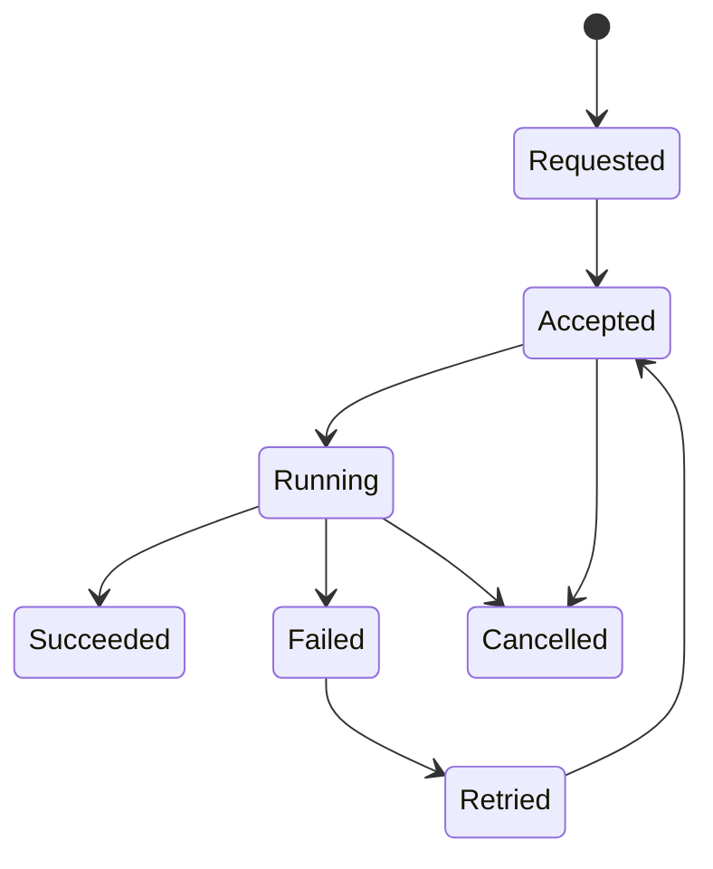

# Xử lý hết thời gian chờ khi chưa biết thao tác đích đã hoàn tất hay chưa

Trong CI/CD, một job có thể gửi yêu cầu triển khai, tạo release, publish artifact hoặc chạy migration tới hệ thống khác. Client chờ phản hồi nhưng hết thời gian chờ. Kết nối bị ngắt, runner bị dừng hoặc proxy trả lỗi trước khi nhận được kết quả. Lúc này, thao tác ở hệ thống đích có thể chưa bắt đầu, đang chạy, đã hoàn tất hoặc đã thất bại; client không biết trạng thái nào là đúng.

Đây là **timeout ambiguity**: phía gọi không nhận được phản hồi đúng hạn nên không thể kết luận thao tác phía đích đã thất bại. Một lệnh deploy timeout không có nghĩa deployment chưa xảy ra. Một request tạo đơn hàng timeout không có nghĩa đơn hàng chưa được tạo. Nếu retry bằng một request mới, hệ thống có thể tạo hai deployment, hai đơn hàng hoặc thực hiện cùng một thay đổi nhiều lần.

Nguyên tắc quan trọng là: **timeout là trạng thái chưa biết của phía gọi, không phải bằng chứng thao tác phía đích thất bại**. Cần nhận diện thao tác bằng ID ổn định, truy vấn trạng thái có thẩm quyền, dùng idempotency/deduplication và chỉ retry khi điều kiện an toàn được đáp ứng.

## 1. Vì sao timeout không cho biết kết quả?

Một request đi qua nhiều thành phần: CI runner, DNS, network, load balancer, API gateway, service đích, database hoặc queue. Timeout có thể xảy ra ở bất kỳ đoạn nào.

Ví dụ một job gửi yêu cầu triển khai:

1. Runner gửi HTTP request tới deployment API.
2. API nhận request và ghi nhận deployment operation.
3. Controller bắt đầu cập nhật workload.
4. Workload đã cập nhật xong và health check đạt.
5. Response bị mất trên đường về runner hoặc runner hết deadline trước khi nhận được response.

Ở phía runner, kết quả là timeout. Ở phía hệ thống đích, deployment có thể đã thành công. Nếu runner gửi một yêu cầu triển khai mới mà không kiểm tra operation cũ, hệ thống có thể tạo một lần triển khai thứ hai.

Một số tình huống có thể xảy ra:

| Thời điểm timeout | Trạng thái có thể có ở đích | Điều client biết |
|---|---|---|
| Trước khi request tới server | Chưa có thao tác | Không nhận được xác nhận |
| Server nhận request nhưng chưa xử lý | Đang chờ hoặc đã ghi nhận | Không biết server đã nhận chưa |
| Server đang xử lý | Operation đang chạy | Không biết tiến độ |
| Side effect đã commit, response chưa về | Đã hoàn tất | Không biết kết quả cuối |
| Server thất bại nhưng response mất | Đã thất bại | Không biết lỗi cụ thể |
| Client timeout nhưng server vẫn chạy | Có thể tiếp tục chạy | Hủy chờ ở client không đồng nghĩa hủy ở đích |

Vì vậy, không nên suy luận trạng thái từ exception hoặc exit code của client nếu giao thức không bảo đảm ý nghĩa đó.

## 2. Phân biệt connect timeout, response timeout và operation timeout

Các loại timeout cho biết client đã chờ bao lâu ở một giai đoạn, nhưng không phải lúc nào cũng cho biết side effect đã xảy ra hay chưa.

- **Connect timeout:** client không thiết lập được kết nối tới endpoint. Thông thường request chưa được gửi qua kết nối đó, nhưng cần xem proxy, retry layer và giao thức trung gian.
- **Response/read timeout:** kết nối đã được thiết lập và client chờ dữ liệu phản hồi quá lâu. Request có thể đã được server nhận và xử lý.
- **Overall deadline:** toàn bộ thao tác phía client vượt quá thời gian tối đa được cho phép. Các bước con hoặc server có thể vẫn đang chạy.
- **Operation timeout:** hệ thống đích tự xác định operation đã chạy quá lâu và chuyển sang trạng thái timeout/failed theo semantics riêng. Cần đọc hợp đồng API để biết side effect đã được commit hay chưa.

Hủy HTTP request, đóng socket hoặc dừng CI job chỉ dừng việc client chờ hoặc gửi thêm dữ liệu. Nó không tự động hủy transaction, process hay workflow đang chạy ở server. Nếu muốn hủy operation, cần API cancellation riêng và phải xác minh trạng thái sau khi yêu cầu hủy.

## 3. Gán định danh ổn định cho một thao tác

Khi một thao tác có thể được retry, hãy tạo ID trước lần gửi đầu tiên và dùng lại ID đó cho mọi lần kiểm tra hoặc retry cùng một ý định.

Các định danh thường dùng:

- **Request ID:** nhận diện một lần request để trace log.
- **Operation ID:** nhận diện công việc dài hạn được server chấp nhận.
- **Idempotency key:** nhận diện cùng một ý định nghiệp vụ để server không thực hiện side effect trùng lặp.
- **Deployment ID/release ID:** nhận diện lần triển khai hoặc release cụ thể.
- **Business key:** định danh nghiệp vụ ổn định như order ID, invoice ID hoặc migration version.

Request ID và idempotency key có mục đích khác nhau. Mỗi lần HTTP retry có thể có request ID mới để trace từng lượt, nhưng các lượt retry của cùng một ý định cần dùng cùng idempotency key. Operation ID do server trả về nên được lưu để client truy vấn trạng thái.

Ví dụ:

```text
business_operation: deploy/orders-service/release-2.7.1/production
idempotency_key: 9f82... (ổn định qua các lần retry)
operation_id: op-73184 (do deployment API cấp)
request_id: req-a1, req-a2, req-a3 (mỗi lần gửi)
```

Không tạo idempotency key ngẫu nhiên mới cho mỗi lần retry. Làm như vậy sẽ biến mỗi lượt gửi thành một thao tác mới và vô hiệu hóa cơ chế chống trùng.

## 4. Idempotency: gửi lại cùng ý định mà không lặp side effect

Một thao tác là idempotent khi thực hiện một hoặc nhiều lần với cùng đầu vào và cùng định danh không làm thay đổi kết quả cuối ngoài lần thực hiện đầu tiên.

Ví dụ các thao tác thường có thể thiết kế idempotent:

- Đặt desired replica count của deployment thành 5.
- Đặt cấu hình một feature flag thành OFF.
- Tạo hoặc cập nhật resource theo một khóa duy nhất.
- Đánh dấu một migration version đã áp dụng bằng bảng migration ledger có unique constraint.

Các thao tác thường không tự nhiên idempotent:

- Tạo đơn hàng mới mỗi lần gọi API.
- Trừ tiền hoặc capture payment.
- Gửi email hoặc notification.
- Tăng counter bằng phép cộng.
- Thêm một dòng event mới mà không có khóa deduplication.

Với thao tác không idempotent, cần bổ sung idempotency key hoặc business key và lưu kết quả của lần xử lý đầu tiên. Khi nhận lại cùng key, server trả về kết quả đã ghi nhận thay vì thực hiện side effect lần nữa.

### Hợp đồng idempotency key

Một API an toàn nên quy định:

- Key được tạo ở đâu và có phạm vi duy nhất nào.
- Key được giữ trong bao lâu.
- Key gắn với payload/request fingerprint nào.
- Cùng key và cùng payload thì trả lại kết quả đã có hoặc trạng thái operation hiện tại.
- Cùng key nhưng payload khác thì từ chối, thường bằng lỗi conflict.
- Request đang xử lý thì client nhận được operation ID hoặc trạng thái đang chạy.
- Kết quả terminal được lưu đủ lâu để retry sau timeout vẫn nhận cùng kết quả.

Không nên chỉ cache response trong memory của một instance. Request retry có thể tới instance khác hoặc server có thể restart. Deduplication cần lưu ở nơi bền vững và có ràng buộc duy nhất.

## 5. Lưu idempotency và side effect một cách nhất quán

Server cần tránh tình huống side effect đã commit nhưng idempotency record chưa được lưu, hoặc ngược lại.

Với side effect trong cùng database, có thể ghi idempotency record, business change và kết quả operation trong một transaction:

```sql
CREATE TABLE idempotency_requests (
    idempotency_key varchar(128) PRIMARY KEY,
    request_hash varchar(128) NOT NULL,
    operation_id varchar(64) NOT NULL,
    status varchar(20) NOT NULL,
    response_json jsonb,
    created_at timestamptz NOT NULL DEFAULT now()
);
```

Luồng xử lý khái niệm:

1. Nhận request và idempotency key.
2. Tính fingerprint từ payload có ý nghĩa nghiệp vụ.
3. Thử tạo record theo key duy nhất.
4. Nếu key đã tồn tại, so sánh fingerprint và trả trạng thái/kết quả hiện có.
5. Nếu key mới, thực hiện business change và cập nhật kết quả trong cùng transaction nếu có thể.
6. Commit trước khi trả response thành công.

Schema trên chỉ minh họa. Cần thiết kế thêm trạng thái đang xử lý, xử lý cạnh tranh khi hai request cùng key đến đồng thời, unique constraint, thời hạn lưu và cơ chế phục hồi record bị kẹt. Không để hai request cùng key cùng vượt qua bước kiểm tra rồi thực hiện side effect hai lần.

Nếu side effect nằm ở hệ thống ngoài database, một transaction SQL không thể bao trùm mọi dịch vụ. Có thể dùng transactional outbox: ghi business change và outbox event trong cùng transaction; worker gửi event với event ID ổn định; consumer deduplicate theo event ID. Đây là cách đạt xử lý at-least-once an toàn hơn, không phải bảo đảm mọi thành phần chỉ nhận đúng một lần.

## 6. Sau timeout, truy vấn trạng thái trước khi quyết định retry

Nếu server cung cấp operation status API, client nên dùng operation ID hoặc idempotency key để hỏi trạng thái hiện tại.

Ví dụ giao thức bất đồng bộ:

```http
POST /deployments
Idempotency-Key: 9f82...
Content-Type: application/json

{
  "release": "orders-service-2.7.1",
  "target": "production"
}
```

Server có thể trả:

```http
HTTP/1.1 202 Accepted
Location: /operations/op-73184
```

Client lưu op-73184. Nếu mất response của lần POST đầu tiên, client gửi lại cùng idempotency key hoặc tìm operation theo key. Khi đã có operation ID, client poll endpoint trạng thái:

```http
GET /operations/op-73184
```

Ví dụ trạng thái:

```json
{
  "operation_id": "op-73184",
  "status": "running",
  "progress": 65,
  "updated_at": "2026-11-18T09:15:00Z"
}
```

Các trạng thái terminal có thể là succeeded, failed hoặc cancelled; trạng thái trung gian có thể là accepted, queued và running. API phải định nghĩa rõ trạng thái nào là terminal và kết quả có được giữ sau khi operation kết thúc hay không.

Poll trạng thái không được tạo operation mới. Nếu trạng thái vẫn running, client tiếp tục chờ theo deadline và backoff. Nếu succeeded, không gửi lại lệnh tạo mới. Nếu failed, đọc lỗi và xác định có thể retry bằng cùng ý định hay phải tạo operation mới sau khi sửa nguyên nhân.

## 7. Reconcile khi không có status API

Không phải hệ thống nào cũng cung cấp operation ID hoặc endpoint truy vấn. Khi đó, cần xác định một nguồn sự thật khác để kiểm tra side effect.

Ví dụ:

- Với deployment: đọc deployment record, controller revision, image digest thực tế và rollout status.
- Với artifact publish: kiểm tra repository xem artifact digest/version đã tồn tại và nội dung có khớp không.
- Với database migration: đọc migration ledger/schema version và kiểm tra postcondition.
- Với resource provisioning: tìm resource theo business key hoặc resource name ổn định.
- Với payment: truy vấn transaction theo merchant reference/idempotency key qua API của provider.

Reconciliation cần xác minh đúng đối tượng và nội dung, không chỉ kiểm tra “có một resource cùng tên”. Resource có thể đã tồn tại từ trước nhưng mang cấu hình hoặc digest khác.

Nếu không có cách truy vấn trạng thái đáng tin cậy và thao tác không idempotent, không nên retry mù. Hãy giữ trạng thái unknown, dừng bước tiếp theo và chuyển sang quy trình đối soát hoặc xử lý thủ công có kiểm soát.

## 8. Phân biệt trạng thái operation với trạng thái quan sát của client

Một lỗi thiết kế phổ biến là đưa timeout vào trạng thái nghiệp vụ như thể server đã thất bại. Cần tách:

- **Operation state ở đích:** accepted, running, succeeded, failed, cancelled.
- **Client observation:** confirmed, pending, unknown, unreachable.

Khi client timeout, operation có thể vẫn running hoặc đã succeeded; client observation chuyển thành unknown. Khi truy vấn lại được, client mới cập nhật hiểu biết của mình.

Một state machine đơn giản:



Unknown là trạng thái quan sát phía client, không nhất thiết là trạng thái operation ở server. Việc phân biệt này ngăn client đánh dấu thất bại và khởi chạy lại trong khi thao tác đầu vẫn đang chạy.

## 9. Khi nào có thể retry?

Retry chỉ phù hợp khi lỗi có khả năng tạm thời và hành động được bảo vệ khỏi side effect trùng lặp.

| Tình huống | Cách xử lý |
|---|---|
| Connect timeout trước khi có kết nối | Có thể retry có giới hạn; vẫn dùng cùng operation key nếu API hỗ trợ |
| Read timeout sau khi request được gửi | Truy vấn trạng thái hoặc retry cùng idempotency key |
| HTTP 429 | Tuân thủ Retry-After, giảm tốc độ và dùng retry budget |
| HTTP 502/503/504 | Xác định API contract; truy vấn operation trước nếu request có thể đã được nhận |
| Validation error/HTTP 400 | Không retry cho tới khi sửa input |
| Unauthorized/HTTP 401/403 | Sửa credential hoặc policy; không retry liên tục |
| Conflict do key trùng payload khác | Dừng và điều tra; không đổi key để né conflict |
| Operation vẫn running | Poll status; không tạo operation khác |
| Trạng thái không xác định, không có dedup/status | Dừng retry mù và reconcile |

Không retry mọi exception theo một policy chung. Phân loại lỗi theo giai đoạn, semantics của API và khả năng lặp side effect.

## 10. Backoff, jitter, deadline và retry budget

Retry liên tục có thể làm hệ thống đang lỗi chịu tải nặng hơn. Nhiều client cùng retry theo một nhịp cố định có thể tạo retry storm.

Một chiến lược phổ biến là exponential backoff có jitter:

`delay = random(0, min(max_delay, base_delay × 2^attempt))`

Ví dụ cấu hình minh họa:

| Lần thử | Khoảng chờ tối đa |
|---|---:|
| 1 | 0–1 giây |
| 2 | 0–2 giây |
| 3 | 0–4 giây |
| 4 | 0–8 giây |
| 5 | 0–16 giây |

Giới hạn max_delay, số lần retry và overall deadline. Các giá trị thực tế phải dựa trên SLA, thời gian xử lý của dependency và deadline của pipeline. Không để mỗi layer tự retry nhiều lần mà không tính tổng số request: HTTP client, SDK, proxy, job runner và service có thể nhân số lần gọi lên rất lớn.

**Retry budget** giới hạn tổng lượng retry trong một khoảng thời gian hoặc theo tỷ lệ request gốc. Khi budget cạn, client ngừng retry và trả lỗi để tránh khuếch đại sự cố. Circuit breaker có thể tạm ngừng gọi dependency khi tỷ lệ lỗi cao; bulkhead giới hạn số operation đồng thời để một dependency chậm không chiếm hết tài nguyên.

Nếu server trả Retry-After, tôn trọng giá trị đó trong giới hạn deadline và policy. Không retry sau khi deadline của caller đã hết nếu kết quả không còn hữu ích, trừ khi một worker nền được giao tiếp tục theo dõi operation.

## 11. Deadline và thời gian sống của operation

Timeout từng request cần phù hợp với deadline tổng:

- Connect timeout giới hạn thời gian thiết lập kết nối.
- Response timeout giới hạn thời gian chờ một phản hồi.
- Operation deadline giới hạn thời gian nghiệp vụ được phép chạy.
- Caller deadline giới hạn thời gian workflow cần kết quả.

Ví dụ, job có deadline 10 phút nhưng mỗi lần request chờ 5 phút và retry 3 lần có thể vượt xa thời gian cho phép. Hãy truyền deadline hoặc timeout budget xuống các bước con nếu hệ thống hỗ trợ, đồng thời dành thời gian cho reconcile và lưu evidence.

Không đồng nhất caller deadline với server operation deadline. CI job có thể hết thời gian chờ sau 10 phút trong khi deployment controller vẫn tiếp tục rollout. Nếu cần dừng operation, gọi cancellation API bằng operation ID, sau đó truy vấn để xác nhận trạng thái cancelled hoặc biết rằng operation đã hoàn tất trước khi hủy.

## 12. Xử lý thao tác bất đồng bộ và job dài hạn

Đối với deploy, migration, provisioning hoặc build dài, API nên trả operation ID sớm thay vì giữ kết nối HTTP đến khi toàn bộ công việc kết thúc.

Luồng khuyến nghị:

1. Client gửi request với idempotency key.
2. Server xác thực, ghi operation record và trả operation ID.
3. Worker thực hiện operation và cập nhật trạng thái/tiến độ.
4. Client poll status hoặc nhận callback/event có xác thực.
5. Nếu client timeout, nó tiếp tục truy vấn cùng operation ID.
6. Khi terminal, client ghi kết quả vào deployment/release record.

Poll nên có backoff và jitter. Callback/webhook cũng có thể được gửi lặp hoặc đến sai thứ tự, vì vậy consumer cần deduplicate event ID và kiểm tra sequence/version của trạng thái. Không giả định một callback chỉ được gửi đúng một lần.

Operation record nên được giữ đủ lâu cho client khôi phục sau khi runner restart. Nếu CI runner chết, job mới có thể tiếp tục bằng operation ID đã lưu trong workflow state hoặc deployment record, thay vì tạo operation mới.

## 13. Ví dụ client xử lý timeout an toàn

Pseudocode sau minh họa cách phân biệt tạo operation với kiểm tra operation:

```text
key = stable_key_for_this_release_and_target

try:
    operation = submit_deployment(
        request,
        idempotency_key = key,
        timeout = short_request_timeout
    )
except Timeout:
    operation = find_operation_by_idempotency_key(key)

if operation is not found:
    # Chỉ gửi lại cùng key nếu server bảo đảm deduplication.
    operation = submit_deployment(request, idempotency_key = key)

while operation.status is accepted or running:
    wait_with_backoff_and_jitter()
    operation = get_operation(operation.id)

if operation.status is succeeded:
    verify_runtime_digest_and_health()
elif operation.status is failed:
    report_failure(operation.error)
else:
    stop_and_reconcile_without_blind_retry()
```

Đây là pseudocode, không phải API có sẵn. find_operation_by_idempotency_key chỉ khả thi nếu server cung cấp chức năng này. Nếu không có, cần nguồn reconcile khác. Khi key không được server hỗ trợ, gửi lại request sau timeout có thể tạo side effect trùng.

## 14. Ví dụ với deployment và migration trong CI/CD

### Deployment

Một job triển khai nên lưu deployment ID và release digest trước hoặc ngay khi hệ thống đích chấp nhận operation. Khi runner timeout:

1. Không tạo deployment ID mới ngay lập tức.
2. Dùng operation ID hoặc deployment ID để truy vấn controller.
3. Kiểm tra rollout status, desired revision và observed image digest.
4. Nếu rollout đang chạy, tiếp tục poll.
5. Nếu đã thành công, chạy post-deployment validation rồi đánh dấu job thành công.
6. Nếu thất bại, lưu lỗi và quyết định rollback/roll-forward theo policy.
7. Chỉ tạo deployment mới khi đã xác định operation cũ terminal và ý định mới được phê duyệt.

### Database migration

Migration tool thường lưu version đã áp dụng trong migration ledger. Khi CI timeout:

1. Kết nối lại database và đọc migration ledger.
2. Kiểm tra migration version có được đánh dấu hoàn tất không.
3. Chạy postcondition để xác minh schema và dữ liệu.
4. Nếu migration chạy theo batch, đọc checkpoint và xác định batch cuối đã commit.
5. Chỉ tiếp tục phần còn thiếu khi migration được thiết kế resume-safe.
6. Nếu có trạng thái dở dang không thể xác định, dừng và yêu cầu xử lý có kiểm soát.

Không chỉ dựa vào việc tên migration xuất hiện trong ledger nếu tool có thể ghi ledger và DDL ở các transaction khác nhau. Cần hiểu transaction semantics của database và migration framework đang dùng.

## 15. Khi không thể tạo thao tác idempotent

Một số side effect bên ngoài không hỗ trợ idempotency key, ví dụ gửi email qua provider cũ hoặc gọi một API đối tác không có khả năng tra cứu. Khi đó cần giảm rủi ro bằng các cách:

- Tạo business reference duy nhất và gửi reference đó nếu provider hỗ trợ.
- Lưu trạng thái intent trước khi gọi và trạng thái kết quả sau khi nhận.
- Dùng outbox để không mất yêu cầu giữa transaction và worker.
- Tra cứu/đối soát với đối tác trước khi gửi lại.
- Dùng compensating action nếu side effect đã xảy ra nhưng cần khắc phục.
- Chuyển sang manual review khi không thể chứng minh request đầu đã thất bại.

Compensation không phải rollback vật lý. Nếu đã gửi email, có thể gửi thông báo đính chính; nếu đã tạo giao dịch, có thể tạo giao dịch hoàn tiền. Các hành động bù cũng cần ID, audit và xử lý idempotent để không tạo thêm lỗi.

## 16. Quan sát và ghi log để điều tra timeout

Để reconcile được, log và metric phải liên kết các lượt gọi với cùng một operation:

- Operation ID và idempotency key đã che/mã hóa nếu key có thể chứa dữ liệu nhạy cảm.
- Request ID của từng lần gọi.
- Business key, deployment ID hoặc migration version.
- Endpoint/service đích và thời gian kết nối/chờ phản hồi.
- Attempt number, retry reason, delay và retry budget còn lại.
- HTTP status hoặc loại exception.
- Trạng thái operation cuối cùng và nguồn xác minh.
- Correlation/trace ID xuyên qua các service.

Không ghi token, authorization header, password hoặc payload chứa dữ liệu nhạy cảm. Với idempotency key, dùng giá trị ngẫu nhiên không chứa PII và áp dụng quyền truy cập log phù hợp.

Metric hữu ích:

- Timeout rate theo dependency và endpoint.
- Tỷ lệ operation ở trạng thái unknown/pending quá lâu.
- Retry attempts trên mỗi request gốc.
- Thời gian từ submit đến terminal state.
- Số lần idempotency conflict hoặc duplicate request.
- Retry budget exhaustion và circuit breaker open.

Alert nên tập trung vào operation chưa xác định quá lâu hoặc retry amplification, không chỉ số lượng timeout riêng lẻ.

## 17. Những sai lầm thường gặp

| Sai lầm | Hệ quả | Cách khắc phục |
|---|---|---|
| Coi timeout là thất bại | Retry tạo side effect trùng | Truy vấn trạng thái trước khi quyết định |
| Tạo key mới cho mỗi retry | Server xem mỗi lần là thao tác mới | Giữ idempotency key ổn định |
| Chỉ lưu idempotency trong memory | Restart hoặc instance khác xử lý trùng | Lưu deduplication record bền vững |
| Check key rồi xử lý ngoài transaction | Hai request đồng thời có thể cùng chạy | Unique constraint/atomic claim và transaction |
| Retry mọi lỗi | Tăng tải và lặp lỗi vĩnh viễn | Phân loại retryable/permanent |
| Retry theo nhịp cố định | Tạo retry storm | Exponential backoff, jitter và budget |
| Hủy client rồi cho rằng server đã dừng | Operation tiếp tục chạy ngoài dự kiến | Dùng cancellation API và xác minh trạng thái |
| Dựa vào tên resource để kết luận thành công | Có thể là resource cũ hoặc sai digest | Xác minh ID, fingerprint và observed state |
| Đánh dấu job failed khi operation vẫn running | Pipeline sau có thể tạo thao tác cạnh tranh | Giữ pending/unknown và reconcile |
| Giả định exactly-once end-to-end | Bỏ qua delivery lặp và crash window | Thiết kế at-least-once + idempotency/deduplication |

## 18. Checklist xử lý timeout khi kết quả chưa xác định

- [ ] Phân biệt connect timeout, response timeout và operation timeout.
- [ ] Hiểu rõ timeout ở client không chứng minh server đã dừng hoặc thất bại.
- [ ] Tạo operation ID/business key ổn định trước lần gửi đầu nếu có thể.
- [ ] Dùng cùng idempotency key cho mọi retry của cùng một ý định.
- [ ] Server lưu deduplication bền vững và xử lý request đồng thời an toàn.
- [ ] Cùng key nhưng payload khác được phát hiện và từ chối.
- [ ] Có status API hoặc nguồn reconcile có thẩm quyền.
- [ ] Poll operation hiện tại thay vì tạo operation mới khi trạng thái còn running.
- [ ] Phân biệt operation state với client observation unknown.
- [ ] Chỉ retry lỗi tạm thời và hành động có bảo vệ side effect.
- [ ] Có deadline, exponential backoff, jitter, retry budget và giới hạn concurrency.
- [ ] Tôn trọng Retry-After và không retry vượt deadline hữu ích.
- [ ] Cancellation được thực hiện qua API riêng và trạng thái được xác minh.
- [ ] Migration/deployment có ledger, checkpoint hoặc record để tiếp tục sau runner restart.
- [ ] Có quy trình reconcile/manual review cho thao tác không idempotent và không tra cứu được.
- [ ] Log/metric liên kết operation, request, attempt và kết quả mà không lộ secret.

Xử lý timeout an toàn bắt đầu từ việc thừa nhận rằng phía gọi có thể không biết điều gì đã xảy ra ở phía đích. Khi thao tác có định danh ổn định, server hỗ trợ idempotency, client truy vấn trạng thái trước khi retry và mọi lần thử đều bị giới hạn bởi deadline/budget, pipeline có thể tiếp tục sau lỗi mạng mà không vô tình lặp lại side effect.
