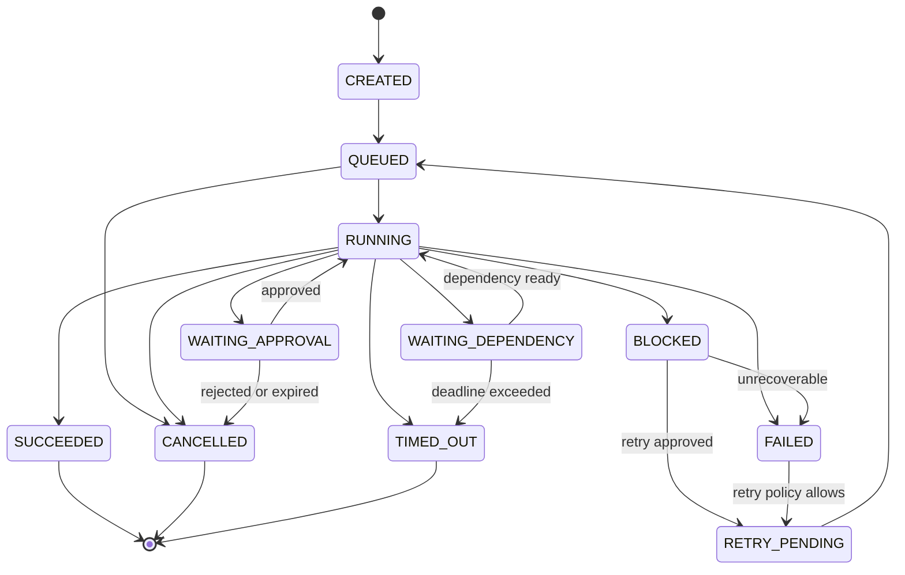

# Phân công người xử lý và làm rõ trạng thái pipeline chưa hoàn tất

Một pipeline CI/CD có thể chưa kết thúc vì nhiều lý do: job đang chạy, runner chưa nhận việc, chờ phê duyệt production, phụ thuộc bên ngoài chưa phản hồi, một bước bị treo, hoặc hệ thống điều phối mất kết nối nên không biết thao tác đã hoàn tất hay chưa. Nếu mọi trường hợp đều được gọi chung là “pipeline lỗi”, nhóm khó xác định việc tiếp theo cần làm và ai chịu trách nhiệm.

Để xử lý hiệu quả, cần làm rõ hai vấn đề độc lập nhưng liên quan: **trạng thái thực tế của pipeline** và **quyền sở hữu hành động tiếp theo**. Trạng thái cho biết hệ thống đang ở đâu trong vòng đời thực thi; ownership cho biết ai phải theo dõi, quyết định, điều tra hoặc thực hiện bước tiếp theo. Một run có thể vẫn ở trạng thái `RUNNING` nhưng đã cần người can thiệp; một run có thể `FAILED` nhưng chưa có người nhận xử lý; một run `WAITING_APPROVAL` có thể đang hoạt động đúng thiết kế và chỉ chờ đúng approver.

Trong CI/CD, trạng thái rõ ràng và ownership rõ ràng giúp tránh retry trùng, deploy lặp, bỏ quên release, chờ phê duyệt vô hạn và chuyển trách nhiệm không đầy đủ. Mục tiêu là mỗi pipeline chưa hoàn tất đều có trạng thái đáng tin, một người hoặc nhóm chịu trách nhiệm rõ ràng, thời hạn xử lý và hành động kế tiếp có thể kiểm chứng.

## 1. Phân biệt pipeline state và work ownership

Pipeline state mô tả tiến trình của run, job hoặc step. Work ownership mô tả ai chịu trách nhiệm xử lý một vấn đề hoặc thực hiện một quyết định. Không nên gộp hai khái niệm vào một trường `status`.

| Khía cạnh | Câu hỏi | Ví dụ |
|---|---|---|
| Execution state | Pipeline đang ở trạng thái nào? | `RUNNING`, `QUEUED`, `WAITING_APPROVAL` |
| Outcome | Lần chạy đã kết thúc với kết quả gì? | `SUCCEEDED`, `FAILED`, `CANCELLED` |
| Blocker | Điều gì đang ngăn bước tiếp theo? | Runner offline, thiếu approval, registry timeout |
| Ownership | Ai chịu trách nhiệm hành động tiếp theo? | Service owner, release manager, platform on-call |
| Acknowledgement | Người nhận đã xác nhận nhận việc chưa? | `UNACKNOWLEDGED`, `ACKNOWLEDGED` |
| Next action | Cần làm gì tiếp theo? | Kiểm tra runner, phê duyệt, retry step an toàn |
| Deadline/escalation | Khi nào cần cập nhật hoặc chuyển cấp? | Hạn phản hồi và escalation target |

Ví dụ: pipeline có state `WAITING_APPROVAL`, blocker là `PRODUCTION_APPROVAL`, owner là nhóm release approvers. Đây không phải lỗi thực thi. Nếu quá thời hạn phê duyệt, trạng thái vẫn có thể là `WAITING_APPROVAL`, nhưng work item cần chuyển sang quá hạn và escalation.

Ngược lại, pipeline state `RUNNING` không bảo đảm có tiến triển. Một job có thể chạy hàng giờ mà không có log mới, heartbeat hoặc thay đổi trạng thái. Khi đó, hệ thống cần đánh dấu nghi ngờ bị treo và giao người điều tra.

## 2. Đơn vị ownership: run, job, step và incident

Một pipeline có nhiều tầng. Ownership nên gắn với đúng đơn vị cần xử lý:

- **Pipeline/run owner:** chịu trách nhiệm tổng thể cho kết quả của một lần chạy hoặc release.
- **Job owner:** chịu trách nhiệm về một nhóm công việc như build, integration test, scan hoặc deploy.
- **Step/component owner:** hiểu công cụ hoặc dependency cụ thể gây lỗi, ví dụ package registry, runner pool hoặc migration tool.
- **Incident owner/coordinator:** điều phối khi sự cố ảnh hưởng nhiều service hoặc môi trường.
- **Approver:** có thẩm quyền chấp nhận một thay đổi hoặc cho phép chuyển môi trường.

Không phải lúc nào người tạo pipeline cũng là người xử lý lỗi. Pipeline có thể được kích hoạt bởi bot, webhook, lịch hoặc người dùng khác. Hãy xác định owner từ service, repository, job responsibility và on-call policy đã cấu hình.

Một run có thể có một overall owner và nhiều action owner. Ví dụ platform team xử lý runner offline, service team xử lý test thất bại và release approver quyết định có tiếp tục deploy hay không. Cần một coordinator duy nhất để giữ bức tranh tổng thể khi có nhiều nhóm tham gia.

## 3. DRI: mỗi hành động cần một người chịu trách nhiệm trực tiếp

DRI (*Directly Responsible Individual*) là người chịu trách nhiệm trực tiếp để một hành động được hoàn thành. Nhiều người có thể hỗ trợ, nhưng mỗi action nên có một DRI rõ ràng.

Ví dụ:

| Hành động | DRI | Người hỗ trợ |
|---|---|---|
| Điều tra runner không nhận job | Platform on-call | CI platform team |
| Phân tích integration test thất bại | Service owner | QA/feature team |
| Xác nhận migration có thể chạy lại | Database owner | Application team |
| Phê duyệt production deployment | Release approver | Service owner |
| Điều phối incident đa service | Incident coordinator | Các service/platform owner |

Tránh giao chung chung cho “team DevOps” hoặc “team backend” mà không có cá nhân nhận việc. Một nhóm có thể là owner tổ chức, nhưng cần người nhận action cụ thể và cơ chế thay ca khi người đó không sẵn sàng.

DRI không có nghĩa một người phải tự sửa mọi thứ. DRI chịu trách nhiệm điều phối, cập nhật trạng thái và xác nhận kết quả; chuyên gia khác có thể thực hiện phần việc chuyên môn.

## 4. Phân biệt RACI, service owner và on-call

RACI giúp làm rõ vai trò trong một quy trình:

- **Responsible:** người trực tiếp thực hiện công việc.
- **Accountable:** người chịu trách nhiệm cuối cùng cho kết quả.
- **Consulted:** người cần được tham vấn.
- **Informed:** người cần được thông báo.

RACI phù hợp để thiết kế trách nhiệm lặp lại, chẳng hạn ai duyệt release, ai vận hành runner hoặc ai sở hữu migration. Trong xử lý một run cụ thể, DRI giúp xác định người hành động ngay lúc đó.

Service owner chịu trách nhiệm về chất lượng và vận hành của service. On-call là người hoặc nhóm đang nhận ca phản hồi sự cố theo lịch. Hai vai trò có thể trùng nhau nhưng không mặc nhiên giống nhau. Nếu pipeline của service A lỗi do runner dùng chung, service owner vẫn cần phối hợp, còn platform on-call có thể là DRI sửa runner.

Không giao quyền phê duyệt cho người chỉ có nhiệm vụ theo dõi. Approver cần có quyền và hiểu rủi ro của thay đổi. Tương tự, người có quyền deploy không tự động là người có quyền chấp nhận rủi ro bảo mật hoặc dữ liệu.

## 5. Mô hình trạng thái cho pipeline chưa hoàn tất

Một tập trạng thái rõ giúp người xem phân biệt đang chạy, đang chờ và đã kết thúc. Có thể dùng mô hình sau, tùy nền tảng CI:

| State | Ý nghĩa | Có cần hành động của con người ngay không? |
|---|---|---|
| `CREATED` | Run đã được tạo nhưng chưa vào hàng đợi | Thường không; theo dõi enqueue |
| `QUEUED` | Đang chờ runner hoặc slot thực thi | Chỉ khi vượt queue threshold |
| `SCHEDULED` | Đã được lên lịch chạy tại thời điểm sau | Không, trừ khi lịch không hợp lệ |
| `RUNNING` | Có job/step đang thực thi | Chỉ khi không có tiến triển hoặc có cảnh báo |
| `WAITING_APPROVAL` | Chờ người có thẩm quyền phê duyệt | Có; approver là owner của quyết định |
| `WAITING_DEPENDENCY` | Chờ artifact, environment, callback hoặc hệ thống khác | Theo dõi dependency và deadline |
| `BLOCKED` | Có điều kiện cụ thể ngăn tiến trình | Có; cần xử lý blocker |
| `RETRY_PENDING` | Đã quyết định retry và đang chờ lần thử tiếp theo | Theo dõi retry policy |
| `UNKNOWN` | Không đủ dữ liệu để xác định trạng thái thực | Có; cần reconcile với nguồn sự thật |
| `SUCCEEDED` | Run kết thúc thành công | Không, nhưng cần ghi nhận evidence |
| `FAILED` | Run kết thúc thất bại | Có; cần phân loại và giao owner |
| `CANCELLED` | Run bị hủy theo yêu cầu hoặc policy | Xác minh side effect đã dừng |
| `TIMED_OUT` | Vượt deadline được định nghĩa | Có; xác định job nào bị timeout |
| `SUPERSEDED` | Run cũ bị thay thế bởi run mới hơn | Xác minh không còn side effect hoặc deploy đang chạy |

Đây là mô hình khái niệm. Một nền tảng có thể dùng `PENDING`, `IN_PROGRESS`, `ACTION_REQUIRED` hoặc tên khác. Khi tổng hợp trạng thái, không nên làm mất khác biệt giữa `WAITING_APPROVAL`, `QUEUED` và `RUNNING`.

## 6. Trạng thái run, job và step không phải lúc nào cũng giống nhau

Một pipeline run có thể `RUNNING` trong khi một job đã `FAILED` và các job khác đang được hủy hoặc chạy cleanup. Một job có thể `WAITING_APPROVAL` trong khi job scan đã `SUCCEEDED`. Vì vậy, dashboard cần hiển thị trạng thái ở nhiều cấp.

Ví dụ:

```text
Pipeline run #1842                 RUNNING
  build                             SUCCEEDED
  unit-tests                        SUCCEEDED
  integration-tests                 FAILED
  security-scan                     SUCCEEDED
  deploy-staging                    NOT_STARTED (blocked by integration-tests)
  notify                            SKIPPED
```

Nếu chỉ hiển thị `RUNNING`, người xem không biết pipeline đang chờ hay đã có lỗi. Nếu chỉ hiển thị `FAILED`, người xem có thể không biết cleanup hoặc job khác còn đang chạy.

Trạng thái tổng thể nên được tính từ trạng thái job/step và dependency graph. Cần xác định rõ semantics cho `continue-on-error`, optional job, skipped job, cancellation và cleanup. Một job tùy chọn bị skip không nên làm run thất bại nếu policy cho phép; một gate bắt buộc bị skip không được tự động coi là pass.

## 7. State transition và điều kiện chuyển trạng thái

Mỗi state cần có điều kiện vào/ra rõ. Ví dụ:



Không phải mọi transition đều hợp lệ trong mọi pipeline. Ví dụ, `FAILED` không nên tự chuyển về `RUNNING` nếu không tạo attempt mới hoặc lưu lịch sử retry. `WAITING_APPROVAL` chỉ được tiếp tục bởi approver được xác thực. `CANCELLED` cần ghi ai yêu cầu hủy và xác minh process/side effect thực sự đã dừng.

State transition nên được ghi thành event có timestamp, actor, source và correlation ID. Nếu hai webhook đến không đúng thứ tự, hệ thống tổng hợp phải dùng sequence/version hoặc kiểm tra trạng thái nguồn trước khi cập nhật.

## 8. Pending không có nghĩa là bị treo

`PENDING` hoặc `QUEUED` có thể là trạng thái bình thường. Pipeline có thể đang chờ:

- Runner phù hợp với label, architecture hoặc network zone.
- Slot do concurrency limit hoặc quota.
- Một pipeline khác nhả resource lock.
- Artifact từ job upstream.
- Environment protection approval.
- Deployment window hoặc change freeze kết thúc.
- Callback từ hệ thống ngoài.

Để xác định có bất thường hay không, cần biết queue age, expected wait, runner capacity, dependency status và deadline. Một job chờ 30 giây có thể bình thường ở giờ cao điểm; một job chờ 45 phút trong khi SLA queue là 5 phút cần được điều tra.

Không retry job chỉ vì nó đang `QUEUED`. Retry không tạo thêm capacity và có thể làm hàng đợi tệ hơn. Cần xác định blocker là thiếu runner, quota, lock hay dependency trước khi hành động.

## 9. Running nhưng không có tiến triển

Một job ở `RUNNING` có thể vẫn hoạt động dù không có log mới, chẳng hạn đang tải image lớn hoặc chạy test suite dài. Ngược lại, process có thể bị deadlock, runner mất kết nối hoặc step chờ một child process không bao giờ kết thúc.

Để phân biệt, theo dõi nhiều tín hiệu:

- Thời điểm bắt đầu job/step và thời lượng hiện tại.
- Thời điểm log/event gần nhất.
- Runner heartbeat và trạng thái agent.
- CPU/memory/network hoặc process activity nếu có.
- Progress marker của test/build/migration.
- Timeout riêng của step và timeout tổng của job.
- Trạng thái của dependency đang được gọi.

Không dùng “không có log trong X phút” làm kết luận duy nhất. Một số bước hợp lệ không ghi log liên tục. Nên định nghĩa expected duration và heartbeat theo loại job, đồng thời có cơ chế báo `UNKNOWN` nếu không thể xác minh process còn chạy.

## 10. Unknown state: không biết không đồng nghĩa thất bại

`UNKNOWN` xuất hiện khi hệ thống điều phối không có đủ thông tin để xác định kết quả. Ví dụ runner mất kết nối ngay sau khi gọi API deploy; webhook completion không đến; agent bị restart; hoặc job bị timeout nhưng lệnh bên ngoài vẫn có thể đang chạy.

Trong trạng thái này, không nên lập tức retry một thao tác có side effect. Nếu lệnh deploy đã thành công nhưng callback bị mất, retry có thể deploy lần nữa hoặc tạo một resource trùng. Nếu migration đã commit một phần, retry mù có thể làm dữ liệu sai.

Quy trình reconcile:

1. Ghi nhận run/job/step ID, attempt, thời điểm và sự kiện cuối cùng đã biết.
2. Truy vấn nguồn sự thật của hệ thống thực thi hoặc hệ thống đích.
3. Kiểm tra side effect đã xảy ra chưa: artifact publish, deployment revision, migration version, resource ID hoặc external transaction.
4. Đối chiếu expected state với observed state.
5. Nếu đã hoàn tất, cập nhật run record bằng evidence và giữ lịch sử mất callback.
6. Nếu chưa chạy, xác nhận có thể retry an toàn và tạo attempt mới.
7. Nếu chỉ hoàn tất một phần, chuyển sang recovery/runbook phù hợp và giao DRI.
8. Nếu không thể xác minh, giữ `UNKNOWN`, chặn bước phụ thuộc và escalation.

Không biến `UNKNOWN` thành `FAILED` chỉ để dashboard có trạng thái cuối. Sự không chắc chắn là thông tin vận hành quan trọng.

## 11. Phân loại blocker trước khi giao người xử lý

Blocker nên có category và thông tin có thể hành động. Một số nhóm thường gặp:

| Blocker category | Ví dụ | Owner ban đầu thường phù hợp |
|---|---|---|
| Source/change | Compile error, lint, merge conflict | Repository/service owner |
| Test | Unit, integration, contract hoặc E2E failure | Test suite owner và service owner |
| Runner/capacity | Runner offline, hết slot, disk đầy | CI/platform on-call |
| Dependency | Registry, package mirror, cloud API timeout | Owner của dependency hoặc platform |
| Approval/policy | Chờ phê duyệt, change window, policy denied | Approver hoặc policy owner |
| Artifact | Upload/download lỗi, digest mismatch | Build/release engineering |
| Environment | Namespace, database, credential hoặc quota | Environment/platform owner |
| Deployment | Rollout không ready, health gate fail | Service owner và release coordinator |
| Data/migration | Lock timeout, migration partial, schema incompatible | Database/data owner cùng service owner |
| External system | Webhook, ticket, signing service không phản hồi | Integration owner |
| Unknown | Mất runner/callback, không rõ side effect | Run owner/coordinator để reconcile |

Category chỉ là gợi ý routing, không phải kết luận nguyên nhân. Ví dụ test timeout có thể do code, runner quá tải hoặc dependency chậm. Owner ban đầu cần xác minh trước khi chuyển giao.

## 12. Xác định owner từ metadata thay vì suy đoán

Hệ thống có thể dùng metadata đã được quản lý để tìm owner:

- Repository/service catalog owner.
- CODEOWNERS hoặc ownership file đã được tổ chức phê duyệt.
- Job/component owner trong pipeline definition.
- Environment owner và approver group.
- Dependency catalog và on-call schedule.
- Runbook gắn với blocker category.

Không nên lấy người commit gần nhất làm owner duy nhất. Người commit có thể không hiểu hệ thống vận hành hoặc không còn trực. Không nên lấy người bấm nút chạy pipeline làm owner của mọi lỗi downstream.

Nếu metadata thiếu hoặc xung đột, gán tạm cho pipeline/release coordinator để điều tra ownership, đồng thời mở action cập nhật service catalog. Không tự động chọn một cá nhân ngẫu nhiên rồi coi đó là phân công chính thức.

## 13. Quy trình triage pipeline chưa hoàn tất

Một quy trình triage có thể áp dụng theo thứ tự:

1. **Xác định phạm vi:** run, job, step, environment và release nào bị ảnh hưởng?
2. **Xác nhận state:** nguồn dữ liệu nào là authoritative và cập nhật lần cuối khi nào?
3. **Phân loại blocker:** đang chờ, lỗi thực thi, quá hạn hay unknown?
4. **Đánh giá tác động:** có chặn release production, ảnh hưởng người dùng hoặc giữ resource không?
5. **Chọn DRI:** owner của component hoặc on-call phù hợp.
6. **Đặt next action:** điều tra log, phê duyệt, reconcile, retry, cancel hoặc rollback.
7. **Đặt deadline:** thời điểm cần acknowledge, cập nhật và escalation.
8. **Ghi handoff:** lưu evidence và các bước đã thực hiện.
9. **Xác minh hoàn tất:** state nguồn, artifact/deployment thực tế và các job phụ thuộc.
10. **Đóng work item:** ghi outcome, nguyên nhân và follow-up nếu cần.

Không bắt đầu bằng retry mặc định. Trước tiên phải biết run đang ở đâu, thao tác nào có thể đã xảy ra và retry có an toàn không.

## 14. Handoff phải có đủ ngữ cảnh

Một handoff tốt cho phép người nhận tiếp tục mà không phải hỏi lại từ đầu. Thông tin tối thiểu nên có:

- Pipeline run ID, job ID, step name và attempt number.
- Repository, branch/ref, commit SHA và pull request/release ID.
- Artifact name, version và digest nếu đã được tạo.
- Environment/region/namespace đích.
- State hiện tại, state trước đó và timestamp của event cuối.
- Blocker category và mô tả lỗi ngắn gọn.
- Link/log location và đoạn log liên quan đã được lọc secret.
- Các hành động đã thử, kết quả và retry count.
- Side effect có thể đã xảy ra và trạng thái xác minh.
- Next action được đề xuất, điều kiện an toàn và deadline.
- Current DRI, người hỗ trợ và trạng thái acknowledgement.

Ví dụ handoff:

```text
Run: release-1842 / attempt 1
Job: deploy-production
Commit: 9f4c...e81a
Artifact: order-service@sha256:ab12...89ef
Environment: production / region-a
State: UNKNOWN
Last event: deploy request accepted; runner disconnected before response
Blocker: execution result cannot be confirmed
Side effect: deployment may already be in progress
Actions tried: queried pipeline once; no terminal event received
DRI: platform-on-call
Next action: inspect deployment controller and observed workload digest
Retry safety: do not retry until current rollout is reconciled
Deadline: update within 10 minutes
```

Ví dụ đã rút gọn và không chứa token, password hoặc payload nhạy cảm. Handoff thực tế nên dùng liên kết có quyền truy cập phù hợp thay vì sao chép log bí mật vào ticket hoặc chat.

## 15. Quy tắc nhận việc và chuyển giao ownership

Một thông báo gửi đi chưa có nghĩa người nhận đã nhận trách nhiệm. Cần tách các trạng thái:

- `UNASSIGNED`: chưa có người nhận.
- `ASSIGNED`: đã chọn DRI nhưng chưa xác nhận.
- `ACKNOWLEDGED`: DRI xác nhận nhận việc.
- `IN_PROGRESS`: DRI đang thực hiện next action.
- `WAITING_EXTERNAL`: DRI đã yêu cầu một dependency/người khác và đang chờ.
- `HANDOFF_REQUESTED`: DRI đề nghị chuyển cho owner khác.
- `HANDOFF_ACCEPTED`: người nhận mới xác nhận và chịu trách nhiệm.
- `RESOLVED`: hành động đã hoàn tất và có evidence.
- `CLOSED`: coordinator xác nhận work item có thể đóng.

Chuyển giao nên gồm cả người giao và người nhận. Người giao cung cấp context; người nhận xác nhận đã hiểu phạm vi, next action và deadline. Chỉ sau khi được chấp nhận mới chuyển DRI chính thức, trừ quy trình khẩn cấp đã định nghĩa trước.

Nếu người nhận không phản hồi trong thời hạn, hệ thống cần escalation theo on-call policy. Không để action ở `ASSIGNED` vô thời hạn.

## 16. Một DRI cho mỗi action, một coordinator cho incident lớn

Một pipeline có thể có nhiều blocker cùng lúc. Hãy tạo action riêng cho từng blocker và gán DRI tương ứng. Ví dụ:

| Action | DRI | Status |
|---|---|---|
| Kiểm tra runner pool | Platform on-call | `IN_PROGRESS` |
| Xác minh test failure có tái hiện không | Service owner | `ASSIGNED` |
| Xác nhận production approval | Release approver | `WAITING_EXTERNAL` |

Nếu nhiều action liên quan cùng một release, chỉ định một coordinator để tổng hợp tiến độ và đưa ra quyết định tiếp tục/dừng. Coordinator không nhất thiết là người sửa kỹ thuật. Vai trò này giúp tránh nhiều nhóm cùng retry, cancel hoặc thay đổi deployment theo các hướng khác nhau.

Khi sự cố ảnh hưởng nhiều service, dùng incident command structure phù hợp: incident lead điều phối, technical lead dẫn dắt điều tra, communications owner cập nhật stakeholder và service owner chịu trách nhiệm khôi phục thành phần của mình.

## 17. Retry ownership và attempt history

Retry là một lần thực thi mới sau khi một attempt trước không hoàn tất hoặc không đạt điều kiện. Cần giữ quan hệ giữa các attempt:

```text
Pipeline run 1842
  attempt 1: FAILED (registry timeout)
  attempt 2: FAILED (same digest upload conflict)
  attempt 3: SUCCEEDED
```

Không ghi đè log hoặc kết quả attempt cũ bằng lần chạy mới. Mỗi attempt nên có ID, start/end time, trigger, actor, retry reason và link đến parent run.

Ownership của retry phụ thuộc loại lỗi:

- Retry tự động theo policy: pipeline system là actor thực thi; run owner vẫn chịu trách nhiệm theo dõi.
- Retry thủ công: người yêu cầu phải ghi lý do và xác nhận điều kiện an toàn.
- Retry có side effect: owner của component cần xác nhận idempotency/reconciliation.
- Retry vượt ngưỡng: chuyển sang owner/on-call để điều tra, không tiếp tục lặp tự động.

Không để một người khác bấm retry chỉ vì thấy nút khả dụng. UI nên hiển thị attempt hiện tại, retry count, nguyên nhân và cảnh báo nếu thao tác có thể tạo side effect.

## 18. Phân biệt lỗi retry được và lỗi cần người quyết định

Retry policy nên phân loại lỗi:

| Nhóm lỗi | Ví dụ | Hướng xử lý |
|---|---|---|
| Transient | HTTP 503, network reset, rate limit có `Retry-After` | Retry có giới hạn và backoff |
| Capacity | Runner thiếu slot, registry quá tải | Chờ capacity hoặc điều chỉnh queue; không tạo thêm tải |
| Permanent/configuration | Sai YAML, thiếu permission, compile error | Sửa nguyên nhân; retry cùng đầu vào thường vô ích |
| Policy/approval | Deployment bị policy từ chối hoặc chờ approver | Owner/approver quyết định; không retry mù |
| Data/partial side effect | Migration dở dang, deploy không rõ kết quả | Reconcile và runbook trước khi retry |
| Flaky test | Test không ổn định, phụ thuộc thời gian | Ghi nhận retry riêng, điều tra độ tin cậy; không che lỗi liên tục |

Retry policy nên có max attempts, exponential backoff, jitter, deadline và retry budget. Nếu dependency đã quá tải, retry quá dày có thể tạo retry storm. Nếu lỗi là cấu hình sai, retry chỉ lặp lại thất bại và tiêu tốn runner.

## 19. Idempotency và retry an toàn

Một thao tác idempotent có thể được thực hiện lặp lại mà không tạo thêm tác động ngoài ý muốn sau lần đầu. Đây là điều kiện quan trọng cho retry tự động và xử lý trạng thái unknown.

Ví dụ:

- Build artifact có tên tạm theo run ID rồi publish digest có thể kiểm tra trùng trước khi upload.
- Tạo deployment với cùng desired state có thể idempotent nếu API/controller hỗ trợ.
- Tạo ticket hoặc notification cần idempotency key để tránh gửi trùng.
- Migration cần schema history, lock và logic resume; không phải mọi câu SQL đều an toàn khi chạy lại.
- Tạo cloud resource cần xác định resource ID và reconcile trước khi tạo lại.

Ví dụ pseudocode:

```text
key = "deploy:" + releaseId + ":" + environment

if operationStore.completed(key):
    return operationStore.result(key)

record = operationStore.beginIfAbsent(key)
result = deploymentController.apply(desiredRevision)
operationStore.complete(key, result)
return result
```

Đây là pseudocode; `beginIfAbsent` cần atomic và record phải xử lý trạng thái đang chạy, timeout và recovery. Nếu process chết sau khi controller apply nhưng trước khi ghi `complete`, lần retry vẫn cần truy vấn controller để xác định kết quả trước khi gọi lại.

Idempotency key không thay thế reconciliation. Nó giúp nhận diện thao tác logic; hệ thống vẫn phải kiểm tra side effect thực tế.

## 20. Timeout, cancellation và tiến trình chưa dừng

Timeout có thể xảy ra ở nhiều tầng: HTTP request, step, job, pipeline, deployment controller hoặc external task. Timeout của client không có nghĩa thao tác phía server đã dừng.

Khi timeout:

1. Xác định timeout thuộc tầng nào và deadline gốc.
2. Kiểm tra process/operation phía server còn chạy không.
3. Nếu gửi cancellation, xác minh cancellation được chấp nhận và side effect đã dừng.
4. Kiểm tra trạng thái tài nguyên hoặc dữ liệu bị tác động.
5. Chỉ retry khi biết thao tác cũ đã kết thúc hoặc có thể chạy lặp an toàn.

Cancellation cũng không phải rollback. Hủy job deploy có thể chỉ dừng việc theo dõi mà controller vẫn tiếp tục rollout. Hủy migration không tự undo những câu SQL đã commit. Pipeline cần cleanup/finally step và runbook cho side effect từng loại.

Nếu không thể xác minh cancellation, giữ state `UNKNOWN` hoặc `CANCELLING` theo mô hình nội bộ, giao owner reconcile và chặn các thao tác xung đột.

## 21. Waiting approval: ai chịu trách nhiệm và khi nào hết hạn?

Approval gate thường xuất hiện trước production, migration nguy hiểm hoặc thay đổi có ảnh hưởng lớn. Cần xác định:

- Ai có quyền approve/reject?
- Approval dựa trên bằng chứng nào: test, scan, change record, release notes?
- Người phê duyệt có phải người thực hiện thay đổi không?
- Approval áp dụng cho commit/artifact digest nào?
- Approval có hết hạn khi artifact hoặc plan thay đổi không?
- Nếu không có phản hồi, pipeline giữ chờ, hết hạn hay tự hủy?

Approval nên gắn với immutable identity của release hoặc plan. Nếu artifact digest thay đổi sau khi được duyệt, approval cũ không nên tự động áp dụng cho artifact mới.

Người tạo pipeline không mặc nhiên là approver. Người phê duyệt cần xem được tác động, evidence và môi trường đích. Hệ thống nên ghi actor, timestamp, decision, comment và policy version.

## 22. Dependency wait và external callback

Pipeline có thể chờ một hệ thống ngoài: security scanner, package registry, change management, cloud API, deployment controller hoặc webhook từ test environment. Khi chờ, cần ghi dependency cụ thể thay vì chỉ để `PENDING`.

Thông tin nên có:

- Dependency name/service và request/correlation ID.
- Thời điểm gọi, deadline và retry-after nếu có.
- Trạng thái request phía remote nếu truy vấn được.
- Callback/webhook expected và chữ ký/xác thực của callback.
- Owner của integration và owner của hệ thống đích.
- Cách reconcile nếu callback thất lạc.

Webhook có thể đến trễ, trùng hoặc sai thứ tự. Handler cần xác thực nguồn, deduplicate theo event ID và không chuyển trạng thái ngược từ terminal về running chỉ vì event cũ đến muộn.

Không giữ runner chiếm slot trong lúc chờ hàng giờ nếu có thể dùng callback/polling ngoài worker. Tách trạng thái orchestration khỏi process thực thi giúp sử dụng capacity tốt hơn.

## 23. Escalation và deadline

Mỗi work item chưa hoàn tất cần có thời hạn acknowledge và thời hạn cập nhật tiếp theo. Deadline nên dựa trên tác động:

- Production release đang chặn hoặc incident đang ảnh hưởng người dùng: phản hồi theo on-call severity.
- Staging release bị chặn: theo release schedule và SLA nội bộ.
- CI pull request thông thường: theo thời gian phản hồi developer/team.
- Job nền không ảnh hưởng release: theo queue age và business deadline.

Một quy trình escalation có thể gồm:

1. Gán DRI và gửi notification có run link, blocker và next action.
2. Nếu chưa acknowledge trong thời hạn, thông báo backup/on-call.
3. Nếu blocker ảnh hưởng release hoặc SLO, chuyển coordinator/incident lead.
4. Nếu cần quyết định rủi ro, chuyển approver hoặc service owner có thẩm quyền.
5. Ghi lại escalation và cập nhật deadline mới.

Không gửi thông báo lặp lại cho toàn bộ nhóm mà không có điều kiện. Notification nên có action, owner và thời hạn; escalation cần dựa trên trạng thái acknowledgement và mức độ ảnh hưởng.

## 24. Notification phải giúp người nhận hành động

Một thông báo hữu ích cần trả lời:

- Run/job nào đang cần xử lý?
- Vì sao nó bị chặn hoặc chưa hoàn tất?
- Người nhận là ai và vai trò gì?
- Hành động cần thực hiện là gì?
- Deadline và escalation path ra sao?
- Link đến log, evidence và runbook ở đâu?

Ví dụ thông báo:

```text
ACTION REQUIRED — Production approval
Service: order-service
Run: release-1842
Artifact: sha256:ab12...89ef
Environment: production
State: WAITING_APPROVAL for 18 minutes
Approver group: release-approvers
Next action: review release evidence and approve/reject
Deadline: 16:30 UTC
Run: <internal pipeline link>
```

Đây là mẫu minh họa; không đưa token, secret, thông tin cá nhân hoặc log nhạy cảm vào notification. Người nhận phải truy cập hệ thống qua quyền đã cấp và xác thực trước khi thực hiện hành động.

## 25. Dashboard cho pipeline chưa hoàn tất

Dashboard không nên chỉ liệt kê màu xanh/đỏ. Cần hiển thị các trường giúp triage:

| Trường | Ý nghĩa |
|---|---|
| Run ID / attempt | Nhận diện lần thực thi và retry |
| Service/repository | Xác định ownership gốc |
| Commit/artifact digest | Xác định đầu vào đang được xử lý |
| Environment | Đánh giá mức độ ảnh hưởng |
| Run/job/step state | Biết pipeline đang ở tầng nào |
| State age | Thời gian ở trạng thái hiện tại |
| Last event/heartbeat | Đánh giá có tiến triển không |
| Blocker category | Phân loại nguyên nhân cần xác minh |
| DRI/acknowledgement | Biết ai đang chịu trách nhiệm |
| Next action/deadline | Biết việc tiếp theo và hạn xử lý |
| Retry count/attempt history | Tránh retry vô hạn hoặc lặp thao tác |
| Side-effect status | Biết có thể đã deploy/publish/migrate hay chưa |

Các filter quan trọng gồm service, environment, blocker, owner, state age và severity. Dashboard nên có view “unassigned”, “unacknowledged”, “unknown”, “overdue” và “production blocked” để phát hiện việc bị bỏ quên.

## 26. State record có thể máy đọc

Một record có cấu trúc giúp dashboard, automation và audit dùng chung semantics. Ví dụ JSON minh họa:

```json
{
  "runId": "release-1842",
  "attempt": 1,
  "service": "order-service",
  "environment": "production",
  "state": "WAITING_APPROVAL",
  "stateUpdatedAt": "2026-11-18T08:20:00Z",
  "lastEvent": "deployment-evidence-ready",
  "blocker": {
    "category": "APPROVAL",
    "code": "PRODUCTION_APPROVAL_REQUIRED"
  },
  "ownership": {
    "dri": "group:release-approvers",
    "acknowledgement": "UNACKNOWLEDGED",
    "nextAction": "Review evidence and approve or reject",
    "dueAt": "2026-11-18T08:40:00Z"
  },
  "retry": {
    "attempts": 0,
    "maxAttempts": 0,
    "allowed": false
  }
}
```

Đây là schema khái niệm, không phải định dạng bắt buộc của một CI platform. Hệ thống thực tế cần schema version, event sequence, actor identity, audit history và các trường environment/artifact phù hợp. Không dùng `dri` dạng chuỗi tự do nếu có thể tham chiếu đến directory/group ID có kiểm soát.

Tách state hiện tại khỏi event history. State hiện tại phục vụ truy vấn nhanh; event history giải thích state được hình thành như thế nào và ai đã thay đổi nó.

## 27. Ví dụ: pipeline chờ approval production

Tình huống: build, test và deploy staging đều thành công; pipeline đang chờ production approval.

1. Pipeline chuyển sang `WAITING_APPROVAL` sau khi artifact digest và evidence được ghi nhận.
2. Hệ thống tra approver group theo service/environment policy.
3. Tạo work item có DRI hoặc group owner, thời điểm bắt đầu chờ và deadline.
4. Gửi notification kèm release summary, test/security evidence và link run.
5. Approver xác thực, xem đúng artifact digest rồi approve hoặc reject.
6. Nếu approve, pipeline tiếp tục với chính digest đã duyệt.
7. Nếu reject, run kết thúc theo policy và ghi lý do; không retry tự động.
8. Nếu hết hạn không có phản hồi, escalation hoặc cancel theo quy tắc đã định nghĩa.

Nếu artifact được rebuild trong lúc chờ, approval cũ phải được đánh giá lại vì nội dung đã thay đổi. Không dùng approval cho release A để cho phép release B chỉ vì cùng version string.

## 28. Ví dụ: deploy request timeout và trạng thái unknown

Tình huống: pipeline gọi deployment API, nhận timeout và runner bị mất kết nối. Không biết deployment đã được chấp nhận hay chưa.

Hành động đúng:

1. Đánh dấu operation là `UNKNOWN`, giữ run ID và deployment request ID.
2. Giao DRI cho platform/service owner theo ownership map.
3. Truy vấn deployment controller bằng request ID, release ID hoặc workload revision.
4. Kiểm tra workload thực tế có đang rollout và digest nào đang chạy.
5. Nếu đúng digest đã deploy, ghi nhận completion/reconciliation và tiếp tục post-deploy validation.
6. Nếu chưa có side effect, xác nhận request cũ không còn chạy rồi tạo attempt mới.
7. Nếu chỉ một phần workload cập nhật, chạy recovery hoặc tiếp tục rollout theo runbook.
8. Nếu không thể xác minh, giữ blocked và escalation; không gửi lệnh deploy lặp.

Ví dụ này cho thấy trạng thái unknown cần người chịu trách nhiệm và quy trình đối chiếu, không thể giải quyết chỉ bằng nút Retry.

## 29. Ví dụ: integration test thất bại nhưng pipeline còn job cleanup

Tình huống: `integration-tests` thất bại, nhưng job thu hồi database tạm và upload report vẫn đang chạy.

Không nên đánh dấu toàn bộ run là đã kết thúc ngay khi thấy một job fail nếu cleanup còn hoạt động. Có thể biểu diễn:

```text
Run #1843                         RUNNING / FAILURE DETECTED
  build                            SUCCEEDED
  integration-tests                FAILED
  collect-test-report              RUNNING
  destroy-test-environment         RUNNING
  deploy-staging                   BLOCKED
```

Service/test owner chịu trách nhiệm phân tích test failure. Platform/test environment owner có thể chịu trách nhiệm nếu cleanup bị treo. Pipeline coordinator theo dõi cả hai action, chờ cleanup hoặc xử lý timeout, rồi mới chốt run outcome và mở retry nếu nguyên nhân đã được khắc phục.

Nếu retry test trước khi environment cũ được dọn, hai attempt có thể tranh chấp database hoặc port. Vì vậy, cleanup state là một điều kiện trước retry đối với job tạo tài nguyên tạm.

## 30. Quyền hạn và kiểm soát hành động

Không phải mọi owner đều có quyền thực hiện mọi action. Hãy tách quyền:

- Xem trạng thái/log.
- Acknowledge hoặc nhận ownership.
- Retry một job không có side effect nguy hiểm.
- Cancel run hoặc step.
- Thay đổi cấu hình pipeline.
- Approve production deployment.
- Thực hiện rollback hoặc recovery.
- Thay đổi secret, permission hoặc policy.

Các hành động nhạy cảm cần authorization theo service/environment, audit actor và lý do. Một người có quyền retry test không nên mặc nhiên có quyền deploy production. Một approver không nên có khả năng sửa artifact sau khi phê duyệt mà không tạo release identity mới.

Không gửi secret hoặc credential trong handoff. Log cần được redact; link nên trỏ đến hệ thống có access control. Hệ thống ownership cũng cần xử lý trường hợp nhân viên rời nhóm, đổi vai trò hoặc on-call schedule thay đổi.

## 31. Metrics để đánh giá chất lượng ownership và trạng thái

Có thể theo dõi các chỉ số sau:

| Metric | Ý nghĩa |
|---|---|
| Time to acknowledge | Thời gian từ lúc tạo action đến khi DRI xác nhận |
| Time to assign | Thời gian pipeline blocker ở trạng thái unassigned |
| Time to resolve | Thời gian từ lúc phát hiện blocker đến khi xử lý xong |
| Unassigned work count | Số action chưa có DRI |
| Unacknowledged age | Tuổi của action chưa được nhận |
| Unknown state age | Thời gian run không xác định được trạng thái |
| Queue age | Thời gian chờ runner hoặc concurrency slot |
| Approval wait time | Thời gian chờ phê duyệt |
| Retry rate | Tỷ lệ run/job cần attempt bổ sung |
| Retry success rate | Tỷ lệ retry thành công sau lần lỗi |
| Duplicate side-effect rate | Tỷ lệ thao tác bị lặp ngoài ý muốn |
| Stale ownership count | Action vẫn gán cho người không còn trực/không phản hồi |

Không dùng thời gian xử lý trung bình một mình để đánh giá cá nhân. Các chỉ số cần được phân tích theo loại blocker, mức độ ảnh hưởng, giờ làm việc, dependency và độ phức tạp. Mục tiêu là cải thiện hệ thống và quy trình, không tạo động lực che giấu lỗi hoặc đóng ticket quá sớm.

## 32. Các anti-pattern thường gặp

| Anti-pattern | Hậu quả | Cách cải thiện |
|---|---|---|
| Mọi trạng thái chưa xong đều là `FAILED` | Không phân biệt queue, approval, blocker và unknown | Dùng state model có semantics rõ |
| Pipeline `RUNNING` nhưng không theo dõi progress | Job treo bị bỏ quên | Heartbeat, progress, expected duration và timeout |
| Giao lỗi cho cả một nhóm | Không ai chịu trách nhiệm trực tiếp | Chọn một DRI cho mỗi action |
| Gán người tạo run làm owner mặc định | Owner không hiểu dependency hoặc không còn trực | Resolve theo service/component ownership |
| Gửi notification nhưng không có acknowledgement | Không biết ai đã nhận việc | Theo dõi `ACKNOWLEDGED` và escalation |
| Handoff chỉ có ảnh chụp lỗi | Người nhận thiếu run ID, digest và action history | Dùng handoff packet có cấu trúc |
| Retry khi state là unknown | Có thể tạo deploy, migration hoặc transaction trùng | Reconcile side effect trước khi retry |
| Retry vô hạn | Retry storm và che lỗi gốc | Max attempts, backoff, jitter, budget và deadline |
| Retry test khi cleanup chưa xong | Hai attempt tranh chấp tài nguyên | Chờ cleanup hoặc dùng resource isolation theo attempt |
| Approval không gắn với artifact digest | Có thể duyệt nhầm nội dung đã thay đổi | Gắn approval với immutable release identity |
| Cancel được coi là rollback | Side effect có thể vẫn tiếp tục | Xác minh process và state hệ thống đích |
| Webhook cũ ghi đè state mới | Dashboard lùi trạng thái sai | Event ID, sequence và transition validation |
| Đóng work item khi chưa verify | Run được coi là xong dù runtime chưa đúng | Xác minh source of truth và evidence |

## 33. Checklist vận hành pipeline chưa hoàn tất

Khi một pipeline chưa kết thúc, hãy kiểm tra:

- [ ] Có run ID, job ID, step ID và attempt number.
- [ ] State được lấy từ nguồn authoritative và có timestamp.
- [ ] Run, job và step state được hiển thị riêng.
- [ ] Phân biệt queued, running, waiting approval, blocked, unknown và terminal.
- [ ] Blocker có category, code và mô tả hành động được.
- [ ] Có service/component owner và một DRI cho action hiện tại.
- [ ] DRI đã acknowledge; nếu chưa có escalation deadline.
- [ ] Handoff có commit, artifact digest, environment, log link và action history.
- [ ] Secret và dữ liệu nhạy cảm đã được loại khỏi log/notification.
- [ ] Retry policy phân loại transient/permanent/partial-side-effect.
- [ ] Retry có giới hạn, backoff, jitter, deadline và retry budget.
- [ ] Side effect được reconcile trước khi retry thao tác unknown.
- [ ] Cancellation được xác minh đã dừng process/operation.
- [ ] Approval gắn với đúng artifact/plan và đúng approver identity.
- [ ] Webhook/event được xác thực, deduplicate và xử lý đúng thứ tự.
- [ ] Cleanup hoàn tất trước khi retry job tạo tài nguyên tạm.
- [ ] Next action, owner và deadline được ghi rõ.
- [ ] Outcome cuối cùng có evidence và audit trail.

## 34. Kết luận

Xử lý pipeline chưa hoàn tất cần kết hợp state model và ownership model. State cho biết run đang chạy, đang chờ, bị chặn, không xác định hay đã kết thúc; ownership xác định ai phải nhận việc, hành động nào cần làm và khi nào cần escalation. Phân biệt run/job/step state, blocker và outcome giúp nhóm tránh coi mọi trạng thái chưa xong là thất bại.

Mỗi blocker cần một DRI, một next action và deadline. Handoff phải giữ run ID, attempt, commit, artifact digest, environment, log, side effect và retry safety. Với trạng thái unknown, hãy reconcile nguồn sự thật trước khi retry; với approval, phải xác minh đúng approver và đúng artifact; với retry, phải có giới hạn và kiểm soát idempotency. Khi ownership được acknowledge và kết quả được xác minh, pipeline mới có thể được đóng một cách đáng tin cậy.
