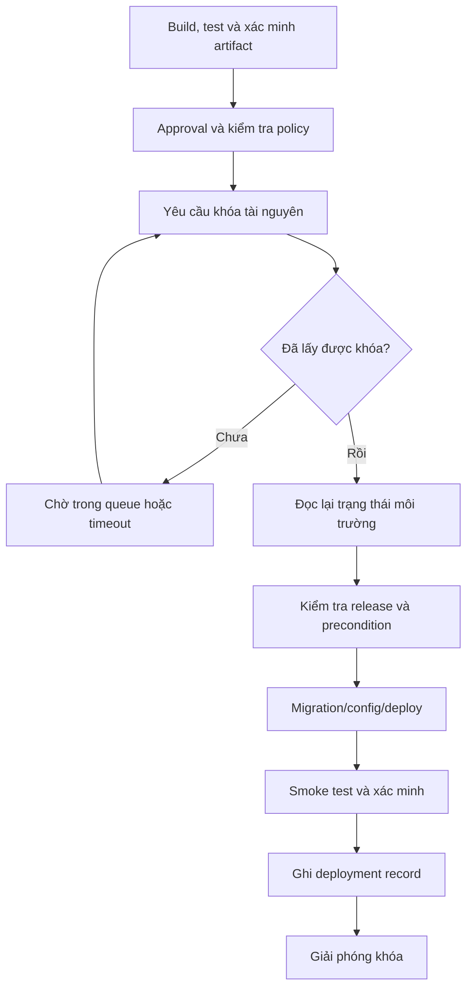
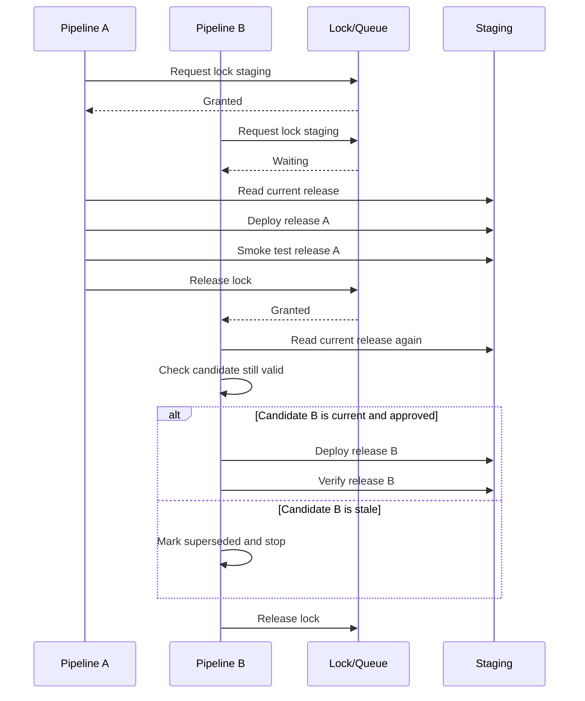

# Tuần tự hóa thay đổi vào cùng một môi trường dùng chung

Trong CI/CD, nhiều pipeline có thể cùng muốn triển khai vào staging, chạy migration trên một database tích hợp, cập nhật cấu hình của một cluster hoặc dùng chung một môi trường kiểm thử. Nếu các thay đổi đó diễn ra đồng thời, chúng có thể ghi đè trạng thái của nhau, áp dụng sai thứ tự hoặc kiểm tra một hệ thống đang bị pipeline khác thay đổi.

Ví dụ, pipeline A đang triển khai release `1.8.0` vào staging. Trước khi A hoàn tất smoke test, pipeline B bắt đầu triển khai `1.9.0`. B có thể thay image trong lúc A vẫn kiểm tra, hoặc A có thể ghi lại trạng thái release cũ sau khi B đã cập nhật. Kết quả cuối cùng không còn phản ánh rõ pipeline nào sở hữu môi trường.

**Tuần tự hóa thay đổi** là cách điều phối để tại một thời điểm chỉ có một tác nhân được phép thực hiện nhóm thao tác xung đột trên cùng tài nguyên. Pipeline vẫn có thể build và kiểm thử độc lập song song; chỉ phần thay đổi môi trường dùng chung mới cần được xếp hàng hoặc khóa. Để cơ chế này đáng tin cậy, cần xác định đúng tài nguyên được bảo vệ, thời gian giữ khóa, cách xử lý tiến trình chết và cách ngăn một tiến trình cũ tiếp tục ghi sau khi quyền sở hữu đã hết hạn.

## 1. Vì sao cần điều phối thay đổi vào môi trường dùng chung?

Môi trường dùng chung thường chứa trạng thái có thể bị nhiều workflow sửa:

- Kubernetes cluster, namespace, Deployment, Service, ingress và ConfigMap.
- VM, application server, load balancer hoặc nhóm instance sau một endpoint.
- Database tích hợp, schema, migration history và dữ liệu test.
- Terraform state hoặc tài nguyên cloud do nhiều pipeline quản lý.
- Feature flag, route, DNS, certificate và cấu hình runtime.
- Test account, queue, bucket, file share hoặc tài nguyên giả lập dùng chung.

Nếu hai pipeline cùng thay đổi một tài nguyên, kết quả có thể phụ thuộc vào thứ tự thực thi thực tế thay vì thứ tự release đã được phê duyệt.

### Một số tình huống điển hình

| Tình huống | Xung đột có thể xảy ra | Hậu quả |
|---|---|---|
| Hai release cùng deploy staging | Pipeline sau thay image trong khi pipeline trước đang smoke test | Kết quả test gắn nhầm release; báo cáo không đáng tin |
| Hai migration cùng chạy | Cùng tạo index, đổi schema hoặc cập nhật migration ledger | Lock contention, lỗi DDL hoặc trạng thái migration không rõ |
| Hai Terraform apply | Cùng đọc và ghi state hoặc sửa một tài nguyên cloud | State conflict, thay đổi bị ghi đè hoặc tài nguyên ở trạng thái trung gian |
| Deploy và test tích hợp cùng chạy | Test đang ghi dữ liệu trong lúc deploy thay service hoặc schema | Lỗi giả, dữ liệu test sai hoặc kết quả không tái hiện được |
| Hai pipeline cập nhật cấu hình | Cùng sửa replica count, route hoặc feature flag | Cấu hình cuối cùng phụ thuộc pipeline nào ghi sau |
| Hai job dùng chung tài khoản test | Cùng đổi mật khẩu, trạng thái đơn hàng hoặc giỏ hàng | Test của job này ảnh hưởng job kia |

Điều phối đồng thời làm rõ ai được thay đổi tài nguyên, lúc nào được thay đổi và trạng thái nào cần được xác minh trước khi tiếp tục.

## 2. Xác định đúng phạm vi cần khóa

Không phải mọi job trong một pipeline đều cần tuần tự. Build, unit test, static analysis và tạo artifact thường có thể chạy song song vì chúng không cùng sửa môi trường đích. Phần cần khóa là critical section: nhóm thao tác có thể làm thay đổi hoặc phụ thuộc vào trạng thái dùng chung.

Một khóa quá rộng làm giảm throughput. Ví dụ, nếu khóa toàn bộ module CI/CD, deploy service A sẽ phải chờ deploy service B dù chúng dùng hai namespace và database độc lập. Một khóa quá hẹp lại không bảo vệ được tài nguyên thực sự dùng chung.

### Chọn khóa theo tài nguyên, không chỉ theo tên pipeline

Định danh khóa nên phản ánh tài nguyên có xung đột. Một số ví dụ:

| Tài nguyên | Khóa gợi ý | Khi nào dùng |
|---|---|---|
| Staging của một service | `deploy:staging:orders-api` | Nhiều pipeline có thể thay phiên bản cùng service |
| Cả môi trường staging | `environment:staging` | Các service chia sẻ cấu hình hoặc dependency không thể thay đổi độc lập |
| Database tích hợp | `database:integration:main-schema` | Migration hoặc reset dữ liệu dùng chung |
| Terraform state | `terraform:account-a:region-1:platform` | Nhiều job áp dụng cùng state |
| Bộ test account | `test-fixture:shared-account-pool` | Test có thao tác thay đổi trạng thái account dùng chung |
| Registry promotion | `release-promotion:production` | Nhiều release cùng cập nhật alias hoặc metadata promotion |

Khóa cần có namespace ổn định để các pipeline khác nhau cùng tính ra một giá trị cho cùng tài nguyên. Nếu pipeline A dùng `staging` nhưng pipeline B dùng `deploy-stg`, hệ thống sẽ coi đó là hai khóa khác nhau và không ngăn được xung đột.

### Xác định ranh giới độc lập

Trước khi chọn granular lock, hãy hỏi:

1. Hai thao tác có ghi cùng một tài nguyên hoặc cùng một state không?
2. Một thao tác có thể làm thay đổi đầu vào mà thao tác kia đang kiểm tra không?
3. Có dependency dùng chung như database, DNS, queue hoặc account không?
4. Có thể cô lập bằng namespace, tenant, schema hoặc dữ liệu riêng không?
5. Nếu chạy song song, có thể chứng minh kết quả không phụ thuộc thứ tự không?

Nếu hai deployment chỉ cập nhật hai service độc lập, có thể khóa theo service. Nếu cả hai đều chạy migration trên cùng schema, chúng phải chia sẻ khóa database dù deploy hai service khác nhau. Phạm vi khóa phải theo tài nguyên xung đột sâu nhất.

## 3. Critical section trong một pipeline triển khai

Một pipeline thường có thể chia thành hai vùng:

- **Phần chuẩn bị:** checkout, build, unit test, scan, ký artifact, tạo release manifest và chờ approval. Những bước này thường không cần giữ khóa môi trường.
- **Phần thay đổi môi trường:** kiểm tra trạng thái hiện tại, chạy migration được điều phối, áp dụng config, triển khai artifact, chuyển traffic, smoke test trên môi trường dùng chung và ghi nhận kết quả. Đây là vùng cần bảo vệ theo tài nguyên.

Giữ khóa từ lúc bắt đầu build sẽ khiến các pipeline khác phải chờ trong khi CPU đang biên dịch hoặc test độc lập. Ngược lại, nhả khóa ngay sau lệnh apply có thể để pipeline khác thay môi trường trước khi smoke test và ghi nhận release hoàn tất.

Một luồng cơ bản:



Trong thực tế, nếu precondition không còn đúng, pipeline phải dừng hoặc tính lại kế hoạch trước khi apply. Ví dụ release đã cũ vì một release mới hơn được deploy trong lúc pipeline đang chờ khóa. Không nên tự động deploy một candidate đã lỗi thời chỉ vì nó đứng trước trong queue, trừ khi chính sách yêu cầu tuần tự phát hành mọi release.

### Đọc lại trạng thái sau khi lấy khóa

Trạng thái môi trường có thể thay đổi trong lúc pipeline chờ. Sau khi lấy khóa, cần đọc lại:

- Release ID và artifact digest hiện đang chạy.
- Config revision và feature flag revision.
- Schema version hoặc migration level.
- Trạng thái rollout trước đó.
- Desired state và actual state của tài nguyên.
- Candidate có còn được phép triển khai hay đã bị supersede/revoke.

Việc đọc lại này tránh dùng một snapshot cũ để ghi đè trạng thái mới hơn. Khóa ngăn các bên tuân thủ cùng giao thức thay đổi trong critical section; precondition giúp phát hiện thay đổi đã xảy ra trước khi lấy khóa.

## 4. Phân biệt concurrency control, queue và approval

Ba cơ chế này giải quyết các vấn đề khác nhau:

| Cơ chế | Mục đích | Ví dụ |
|---|---|---|
| Concurrency lock | Ngăn hai thao tác xung đột cùng chạy | Chỉ một job deploy staging tại một thời điểm |
| Queue/process order | Quyết định job nào được chạy tiếp | Release cũ nhất trước hoặc release mới nhất trước |
| Approval/protection rule | Xác nhận người hoặc policy cho phép thay đổi | Người trực vận hành duyệt production deployment |

Một environment approval không tự bảo đảm hai pipeline không đồng thời thay đổi cùng một tài nguyên. Ngược lại, lock chỉ tuần tự hóa thao tác; nó không chứng minh release đủ điều kiện hoặc người chạy có quyền production. Hệ thống thường cần cả ba: policy/approval, queue và lock.

Không nên giữ khóa trong lúc chờ người phê duyệt. Approval có thể kéo dài hàng giờ, làm các job khác bị chặn. Hãy hoàn tất approval trước, sau đó lấy khóa, kiểm tra lại trạng thái và thực hiện critical section. Nếu approval hết hạn hoặc trạng thái release đã đổi trong lúc chờ, yêu cầu duyệt lại theo policy.

## 5. Dùng concurrency group trong GitHub Actions

GitHub Actions có `concurrency` để giới hạn workflow run hoặc job cùng concurrency group. Ví dụ sau tuần tự hóa các workflow deploy vào staging của repository:

```yaml
name: Deploy staging

on:
  workflow_dispatch:
  push:
    branches: [main]

permissions:
  contents: read

concurrency:
  group: deploy-${{ github.repository }}-staging
  cancel-in-progress: false

jobs:
  deploy:
    runs-on: ubuntu-latest
    environment: staging
    steps:
      - uses: actions/checkout@v4
      - name: Deploy approved artifact
        run: ./scripts/deploy-staging.sh
      - name: Verify deployment
        run: ./scripts/smoke-test-staging.sh
```

Các workflow run cùng group không chạy đồng thời. `cancel-in-progress: false` giữ workflow đang chạy tiếp tục thay vì hủy nó khi có run mới. Tuy nhiên, concurrency group của GitHub Actions không phải hàng đợi FIFO bảo đảm lưu mọi yêu cầu: mỗi group có tối đa một run đang chạy và một run pending; run pending mới có thể thay thế run pending cũ. Vì vậy, nếu mọi release phải được triển khai theo thứ tự, cần một queue/release controller có semantics phù hợp thay vì dựa riêng vào concurrency group.

### Chọn group ổn định và đúng phạm vi

Nếu môi trường staging được chia sẻ giữa nhiều repository, group có thể cần một định danh tổ chức thống nhất thay vì chỉ `github.repository`. Concurrency group của GitHub Actions có phạm vi trong repository, do đó hai repository khác nhau không tự khóa lẫn nhau bằng cùng chuỗi group. Khi nhiều repository hoặc nhiều CI system cùng thay đổi một môi trường, cần lock service hoặc deployment controller chung.

Có thể khóa ở cấp job thay vì workflow để các job chuẩn bị khác vẫn chạy song song:

```yaml
jobs:
  build:
    runs-on: ubuntu-latest
    steps:
      - run: ./gradlew --no-daemon clean check

  deploy:
    needs: build
    runs-on: ubuntu-latest
    concurrency:
      group: deploy-${{ github.repository }}-staging
      cancel-in-progress: false
    environment: staging
    steps:
      - run: ./scripts/deploy-staging.sh
      - run: ./scripts/smoke-test-staging.sh
```

Job-level concurrency chỉ bảo vệ job đó. Nếu migration hoặc một job khác cũng thay đổi cùng database, job đó phải tham gia cùng giao thức khóa hoặc dùng khóa riêng phù hợp với database.

### Tránh hủy deployment giữa critical section

Không đặt `cancel-in-progress: true` cho job đang thực hiện thao tác môi trường nếu script không có cơ chế dừng an toàn. Hủy job có thể để lại rollout dở dang, migration đang chạy hoặc state đã được cập nhật một phần. Nếu cần supersede release cũ, hãy để deployment hiện tại hoàn tất hoặc chạy quy trình abort có kiểm soát trước khi bắt đầu release mới.

## 6. Dùng resource group trong GitLab CI/CD

GitLab hỗ trợ `resource_group` để các job dùng chung resource group không chạy đồng thời trong phạm vi project. Ví dụ:

```yaml
deploy_staging:
  stage: deploy
  resource_group: staging-environment
  environment:
    name: staging
  script:
    - ./scripts/deploy-staging.sh
    - ./scripts/smoke-test-staging.sh
```

Các job trong những pipeline khác nhau của cùng project nhưng cùng resource group sẽ được điều phối để không chạy đồng thời. Cách chọn job tiếp theo phụ thuộc process mode của resource group; cần cấu hình mode phù hợp nếu thứ tự phát hành có ý nghĩa. Không mặc định rằng mọi job sẽ chạy FIFO.

Resource group của GitLab có phạm vi project. Nếu nhiều project cùng cập nhật một cluster hoặc database, `resource_group` riêng của từng project không tạo ra một khóa toàn cục. Hãy dùng một project điều phối chung hoặc lock service mà tất cả pipeline cùng tham gia.

## 7. Dùng khóa ở tầng hệ thống khi nhiều pipeline cùng chia sẻ tài nguyên

Khi các pipeline đến từ nhiều repository, nhiều CI platform hoặc cả công cụ vận hành thủ công, khóa ở một workflow riêng lẻ không đủ. Cần một cơ chế điều phối nằm gần tài nguyên dùng chung hơn.

Một số lựa chọn:

- Deployment controller duy nhất nhận release request và tuần tự áp dụng vào môi trường.
- Lock service có lease, thời hạn, gia hạn và audit.
- Cơ chế lock của IaC backend/state store.
- Database advisory lock khi tất cả tác nhân có thể dùng chung database session và hiểu rõ giới hạn.
- Kubernetes Lease hoặc cơ chế leader election khi điều phối workload trong cluster.
- Resource lock của hệ thống CI trung tâm nếu mọi pipeline đều đi qua cùng nền tảng.

Ưu tiên một nguồn điều phối chung. Nếu mỗi pipeline tự tạo một file lock hoặc một mutex trong runner riêng, chúng không nhìn thấy khóa của nhau.

### PostgreSQL advisory lock cho migration dùng chung

PostgreSQL có advisory lock để các job hợp tác tuần tự hóa thao tác không được bảo vệ bởi row lock thông thường. Ví dụ session-level lock:

```sql
SELECT pg_try_advisory_lock(2401, 17);
```

Kết quả `true` nghĩa là session hiện tại lấy được khóa; `false` nghĩa là một session khác đang giữ khóa đó. Sau khi migration hoàn tất:

```sql
SELECT pg_advisory_unlock(2401, 17);
```

Hai số nguyên là namespace/key do tổ chức quy ước; mọi job cần phối hợp phải dùng cùng cặp giá trị. Advisory lock chỉ có tác dụng với client chủ động tuân theo giao thức. Nó không tự khóa các lệnh DDL hoặc query của ứng dụng không lấy khóa.

Session-level advisory lock gắn với database session. Job phải giữ nguyên kết nối đó trong suốt critical section và không trả connection về pool giữa chừng. Nếu connection bị đóng, lock được giải phóng. Với deployment kéo dài qua nhiều hệ thống hoặc network partition, mất kết nối có thể khiến lock được giải phóng trong khi process cũ vẫn còn chạy; vì vậy advisory lock đơn thuần không thay thế fencing token cho các thao tác ghi bên ngoài database.

### Khóa phải được giải phóng cả khi có lỗi

Với session-level lock, hãy dùng một connection riêng và đảm bảo unlock trong `finally` hoặc đóng session khi kết thúc. Nếu tiến trình chết, database giải phóng session lock khi session đóng. Với lock service có lease, cần TTL để khóa không bị giữ vô hạn khi worker chết.

Không giữ một connection pool connection vô thời hạn mà không theo dõi trạng thái. Cần log lock key, owner ID, thời điểm lấy, thời gian giữ và kết quả release; không log credential kết nối.

## 8. Lease, heartbeat và fencing token

Khóa phân tán thường dùng lease: một owner được quyền giữ khóa trong một khoảng thời gian hữu hạn. Owner phải gia hạn trước khi lease hết hạn. Nếu owner chết hoặc mất kết nối, lease hết hạn để owner khác có thể tiếp tục.

Lease giải quyết khóa bị giữ mãi khi process chết, nhưng tạo ra một tình huống nguy hiểm: process cũ có thể bị pause lâu hơn TTL, mất lease, rồi chạy tiếp khi process mới đã lấy khóa.

Ví dụ:

1. Pipeline A lấy lease cho staging với TTL 60 giây.
2. A bị pause hoặc mất kết nối trong 90 giây.
3. Lease hết hạn; pipeline B lấy lease mới và deploy release B.
4. A tiếp tục chạy và gửi lệnh deploy release A.

Nếu hệ thống đích không phân biệt owner hiện tại với owner cũ, A có thể ghi đè B dù đã mất khóa.

### Fencing token

Fencing token là số thứ tự tăng đơn điệu được cấp mỗi lần một owner lấy quyền. Ví dụ A nhận token 41, B nhận token 42. Tài nguyên đích ghi nhận token lớn nhất đã chấp nhận và từ chối mọi thao tác mang token nhỏ hơn.

Điều này giúp ngăn owner cũ tiếp tục ghi sau khi lease hết hạn. Tuy nhiên, chỉ phát token mà không có hệ thống đích kiểm tra token thì chưa tạo được fencing. Deployment controller, state store hoặc API quản lý tài nguyên phải thực sự từ chối request có token cũ.

Nếu công cụ deploy không hỗ trợ fencing token, cần dùng cơ chế điều phối giữ quyền thực thi duy nhất, kiểm tra generation/precondition ở API đích hoặc thiết kế thao tác idempotent và có compare-and-swap để ngăn ghi đè stale state.

### Gia hạn lease và timeout

Owner nên:

- Chọn TTL lớn hơn khoảng trễ dự kiến của heartbeat nhưng không quá dài.
- Gia hạn định kỳ trước khi hết hạn.
- Dừng gửi lệnh thay đổi ngay khi không thể xác nhận lease còn hiệu lực.
- Không tự lấy lại quyền chỉ vì không nhận được phản hồi; phải hỏi lock service.
- Ghi nhận lease ID, owner ID và fencing token trong log vận hành.
- Có timeout tổng cho việc chờ lấy khóa và timeout riêng cho critical section.

Không tiếp tục deploy khi lease renewal thất bại. Nếu mất lease giữa rollout, dừng thao tác mới, kiểm tra trạng thái môi trường và để controller hiện tại hoàn tất hoặc chuyển giao theo quy trình rõ ràng.

## 9. Deadlock và thứ tự lấy nhiều khóa

Một pipeline có thể cần nhiều tài nguyên: environment lock, database lock và Terraform state lock. Nếu hai pipeline lấy khóa theo thứ tự khác nhau, có thể tạo deadlock.

Ví dụ:

- Pipeline A giữ khóa staging, sau đó chờ database.
- Pipeline B giữ khóa database, sau đó chờ staging.
- A và B đều không thể tiếp tục.

### Quy định thứ tự khóa toàn cục

Đặt một thứ tự cố định cho các loại khóa và yêu cầu mọi pipeline tuân theo. Ví dụ:

1. Organization/environment coordination lock.
2. Database/schema lock.
3. Terraform state lock.
4. Service-specific deployment lock.

Thứ tự cụ thể phụ thuộc kiến trúc. Điều quan trọng là mọi tác nhân lấy nhiều khóa theo cùng thứ tự. Nếu không thể giữ nhiều khóa lâu, cân nhắc chia công việc thành các giai đoạn độc lập để giảm thời gian giữ khóa.

### Timeout và retry có giới hạn

Không chờ khóa vô thời hạn. Đặt timeout, ghi trạng thái đang chờ và trả về lỗi có thể xử lý nếu hết hạn. Retry nên có backoff và jitter để nhiều job không cùng thức dậy rồi tranh khóa lại một lúc.

Nếu job không lấy được khóa, có thể:

- Tiếp tục chờ trong queue nếu release vẫn còn hiệu lực.
- Hủy candidate đã bị supersede theo policy.
- Yêu cầu người vận hành xem xét nếu lock bị giữ lâu bất thường.
- Dừng với trạng thái rõ ràng để pipeline được chạy lại sau.

Không xóa một lock record chỉ vì nó cũ nếu chưa xác minh owner đã chết hoặc lease đã hết hạn. Xóa khóa đang hoạt động có thể tạo hai owner đồng thời.

## 10. Thứ tự release và xử lý candidate đã lỗi thời

Tuần tự hóa bảo đảm không có hai critical section cùng chạy, nhưng không tự quyết định release nào nên chạy trước.

Giả sử release A được tạo lúc 10:00, release B lúc 10:05. A đang build lâu hơn và chỉ xin khóa lúc 10:20, trong khi B đã deploy xong lúc 10:15. Nếu A tiếp tục deploy, môi trường có thể bị đưa lùi về artifact cũ.

### Dùng generation hoặc precondition

Mỗi release request có thể mang generation, sequence hoặc expected current release. Sau khi lấy khóa, pipeline đọc trạng thái môi trường và kiểm tra:

- Candidate có phải release mới nhất được chấp thuận không?
- Có release mới hơn đã được triển khai chưa?
- Candidate có còn nằm trong deployment window không?
- Approval có còn hiệu lực với commit/digest/config hiện tại không?
- Candidate có bị thu hồi hoặc supersede không?

Nếu không đạt, đánh dấu job là stale/superseded và dừng trước khi thay đổi. Với hệ thống hỗ trợ compare-and-swap, chỉ áp dụng nếu current generation khớp giá trị dự kiến.

### Chọn queue policy theo mục tiêu

| Policy | Hành vi | Phù hợp khi |
|---|---|---|
| FIFO/oldest first | Release đến trước được chạy trước | Mọi release đã duyệt phải được áp dụng tuần tự |
| Newest first | Ưu tiên candidate mới nhất | Release mới thay thế release cũ đang chờ |
| Newest ready first | Chọn candidate mới nhất đã sẵn sàng | Build/approval hoàn tất không đồng đều |
| Supersede pending | Chỉ giữ candidate pending mới nhất | Staging chỉ cần kiểm thử trạng thái hiện tại nhất |
| Manual selection | Người vận hành chọn candidate | Production hoặc incident có quyết định release cụ thể |

Queue policy cần được công bố để nhóm hiểu vì sao một pipeline bị bỏ qua hoặc chạy sau. Không xóa record của candidate bị supersede; giữ audit để truy vết quyết định.

## 11. Khóa và thao tác idempotent

Lock giảm nguy cơ xung đột nhưng không bảo đảm một thao tác chỉ chạy một lần. CI runner có thể retry sau timeout, người vận hành có thể bấm chạy lại hoặc pipeline mất phản hồi sau khi môi trường đã được cập nhật.

Vì vậy, thao tác deploy và migration vẫn cần idempotent hoặc có thể xác định trạng thái đã hoàn tất:

- Dùng release ID và digest để nhận diện đúng artifact.
- Kiểm tra desired state trước khi apply.
- Ghi deployment record sau khi trạng thái được xác minh.
- Migration có version table hoặc migration ledger.
- Tác vụ tạo tài nguyên dùng idempotency key hoặc tên tài nguyên ổn định.
- Nếu lệnh timeout, đọc lại actual state trước khi chạy lại.

Không giả định lệnh trả lỗi nghĩa là thao tác chưa xảy ra. Ví dụ API deploy có thể đã cập nhật cluster nhưng runner mất kết nối trước khi nhận response. Retry mù có thể lặp tác dụng phụ.

## 12. Điều phối migration và thay đổi dữ liệu

Database là tài nguyên dùng chung đặc biệt nhạy cảm. Hai release khác nhau có thể cùng muốn chạy migration, backfill hoặc cập nhật constraint. Nên có một migration runner duy nhất hoặc lock chung cho database/schema.

Một quy trình migration an toàn:

1. Job build tạo artifact và migration bundle.
2. Job deploy lấy khóa database/schema.
3. Đọc migration ledger và schema version hiện tại.
4. Xác minh migration chưa được chạy hoặc có thể resume an toàn.
5. Chạy DDL/migration theo transaction và timeout phù hợp engine.
6. Ghi migration version sau khi commit thành công.
7. Xác minh schema, rồi mới cho application rollout tiếp tục.
8. Giải phóng khóa database.

Với backfill dài, không nhất thiết giữ khóa độc quyền trong toàn bộ thời gian nếu các batch được thiết kế idempotent và tương thích với request ghi. Khi đó cần một coordination model riêng: migration state, worker lease, checkpoint và quy tắc đồng bộ với application writer. Không để hai backfill job cùng xử lý một phạm vi mà không có partition hoặc row claim.

### Khóa schema khác với khóa deploy service

Hai service có thể deploy độc lập nhưng cùng dùng database schema. Nếu cả hai đều chạy migration trên cùng schema, chỉ khóa theo service là không đủ. Dùng khóa theo database/schema, sau đó từng service có thể deploy theo khóa riêng khi migration hoàn tất.

## 13. Điều phối Terraform và IaC

Terraform backend có thể cung cấp state locking để ngăn nhiều thao tác ghi cùng state. Không vô hiệu hóa state lock để làm pipeline chạy nhanh hơn.

Một số nguyên tắc:

- Dùng remote backend có locking được hỗ trợ.
- Giữ lock trong suốt plan/apply theo semantics của backend/tool.
- Không dùng chung một state file cho các môi trường độc lập nếu có thể tách state an toàn.
- Khi apply bị gián đoạn, kiểm tra state và tài nguyên thực tế trước khi chạy lại.
- Không force-unlock khi chưa xác minh lock owner đã chết và không còn thao tác đang chạy.
- Dùng state key/workspace rõ ràng để tránh hai môi trường vô tình chia sẻ state.

State lock của Terraform bảo vệ state tương ứng, không tự tuần tự hóa mọi thao tác thủ công hoặc công cụ khác sửa cùng cloud resource mà không dùng state đó. Cần phân quyền cloud và quy trình thay đổi để tránh drift ngoài Terraform.

## 14. Điều phối test trên môi trường dùng chung

Nếu nhiều pipeline cùng dùng một staging environment để chạy integration test, chỉ khóa deployment chưa đủ. Một pipeline có thể deploy trong khi pipeline khác đang thực hiện test scenario dài.

Có một số cách thiết kế:

- Cấp namespace/schema/tenant riêng cho mỗi pipeline.
- Dùng environment pool và đặt lease cho từng test run.
- Khóa cả deployment và test session nếu test cần trạng thái môi trường không thay đổi.
- Dùng dữ liệu fixture riêng và idempotency key cho mỗi run.
- Chỉ cho phép reset environment khi không có test session đang giữ lease.

### Lease cho một phiên test

Một test session có thể đăng ký environment ID, release digest, config revision và thời hạn lease. Deployment controller chỉ được thay đổi environment khi không có test session đang giữ quyền sử dụng, hoặc khi session được kết thúc có kiểm soát.

Nếu test kéo dài, lease cần heartbeat. Khi mất heartbeat, controller không nên lập tức xóa dữ liệu test hoặc thay environment nếu chưa có cơ chế xác nhận session đã dừng. Có thể dùng TTL, grace period và cleanup job để thu hồi tài nguyên mồ côi.

### Ưu tiên cô lập khi có thể

Tuần tự hóa làm giảm concurrency. Nếu test có thể chạy trên namespace, database schema hoặc container riêng, cô lập thường tăng throughput và giảm thời gian chờ. Dùng lock cho tài nguyên thực sự phải chia sẻ, không dùng lock để che giấu việc fixture bị chia sẻ ngoài ý muốn.

## 15. Quan sát và xử lý lock bị giữ lâu

Một cơ chế lock tốt cần có telemetry. Nếu pipeline chờ 40 phút mà không biết owner là ai, nhóm khó phân biệt hàng đợi bình thường với lock bị rò rỉ.

Ghi lại tối thiểu:

- Resource key và environment.
- Owner ID, pipeline/run ID, commit và release ID.
- Thời điểm request, thời điểm acquire và thời điểm release.
- Thời gian chờ và thời gian giữ khóa.
- Lease expiration, heartbeat và fencing token nếu có.
- Kết quả critical section và nguyên nhân release thất bại.
- Người hoặc hệ thống thực hiện force recovery nếu có.

Không đưa token hoặc credential xác thực lock vào log. Owner ID nên là định danh run không nhạy cảm.

### Cảnh báo và ngưỡng vận hành

Theo dõi:

- Queue depth và tuổi của job chờ lâu nhất.
- Lock wait p50/p95 và số lần timeout.
- Thời gian giữ khóa theo loại resource.
- Lease renewal failure và số lần fencing từ chối stale owner.
- Job bị hủy khi đang giữ tài nguyên.
- Số deployment bị đánh dấu stale/superseded.

Nếu thời gian giữ khóa tăng, kiểm tra bước nào đang nằm trong critical section quá lâu. Có thể chuyển build, scan hoặc approval ra ngoài lock; chia migration thành batch; hoặc tách môi trường độc lập. Không giảm timeout hoặc force unlock chỉ để làm dashboard xanh.

## 16. Xử lý pipeline bị hủy hoặc runner chết

Pipeline có thể dừng vì timeout, mất runner, hủy thủ công hoặc lỗi hệ thống. Cách giải phóng khóa phụ thuộc loại lock:

| Cơ chế | Khi owner chết | Điều cần kiểm tra |
|---|---|---|
| CI concurrency/resource group | Nền tảng quản lý trạng thái run/job | Environment có bị thay đổi một phần trước khi job dừng không |
| Database session advisory lock | Session đóng thì lock được giải phóng | Connection còn sống hay bị treo; thao tác ngoài DB đã xảy ra chưa |
| Lease lock | Hết TTL nếu không heartbeat | Owner cũ có thể sống lại và gửi lệnh stale không |
| IaC backend state lock | Tool/backend quản lý lock metadata | State có đang ở trạng thái partial; lock owner có thật sự chết không |
| File lock trong một host | OS có thể giải phóng khi process đóng file handle | Các runner khác host có nhìn thấy cùng filesystem semantics không |

### Không force unlock khi chưa kiểm tra

Force unlock là thao tác có thể tạo hai writer đồng thời nếu owner cũ vẫn đang chạy. Trước khi thực hiện:

1. Xác định run ID và process owner.
2. Kiểm tra runner/session còn hoạt động không.
3. Kiểm tra thao tác đang thực hiện trên môi trường hoặc state store.
4. Dừng hoặc fence owner cũ nếu có thể.
5. Ghi audit và chỉ giải phóng khóa sau khi có bằng chứng owner cũ không còn quyền ghi.

Nếu không thể xác nhận, giữ môi trường ở trạng thái bảo vệ và xử lý theo incident procedure. Một lock bị giữ lâu thường ít nguy hiểm hơn hai deployment cùng ghi vào production.

## 17. Ví dụ trình tự phối hợp hai pipeline

Giả sử pipeline A và B cùng muốn deploy staging. A đã lấy khóa trước. B chờ trong queue. Khi A hoàn tất deploy và smoke test, A ghi release record rồi nhả khóa. B lấy khóa, đọc lại trạng thái và kiểm tra candidate của mình còn mới nhất hay không.



Sơ đồ giả định cả hai pipeline tuân theo cùng lock service và queue policy. Nếu pipeline A bị mất lease, lock service phải cấp fencing token mới và môi trường cần từ chối request stale của A trước khi B thay đổi.

## 18. Những cách làm dễ gây race condition

| Cách làm | Hệ quả | Cách cải thiện |
|---|---|---|
| Khóa theo tên workflow thay vì tài nguyên | Hai workflow khác tên vẫn sửa cùng môi trường | Khóa theo resource key thống nhất |
| Chỉ dùng concurrency group trong một repository cho môi trường nhiều repo | Pipeline ở repo khác không bị điều phối | Dùng lock service/controller chung |
| Giữ lock từ lúc build tới hết approval | Hàng đợi bị chặn lâu | Build và approval trước, lock chỉ cho critical section |
| Hủy job đang deploy để ưu tiên run mới | Môi trường có thể ở trạng thái partial | Hoàn tất hoặc abort có kiểm soát |
| Giả định queue luôn FIFO | Release có thể chạy sai thứ tự mong muốn | Cấu hình queue policy và kiểm tra candidate stale |
| Lease hết hạn nhưng owner cũ vẫn ghi | Hai owner cùng thay đổi tài nguyên | Fencing token được resource đích thực thi |
| Force unlock vì lock quá cũ | Owner cũ có thể vẫn hoạt động | Xác minh owner, dừng/fence rồi mới unlock |
| Hai pipeline lấy nhiều lock khác thứ tự | Deadlock | Quy định thứ tự khóa toàn cục |
| Không đọc lại trạng thái sau khi lấy khóa | Candidate cũ ghi đè release mới | Kiểm tra generation/precondition trong critical section |
| Tin rằng lock làm thao tác chạy đúng một lần | Retry có thể lặp side effect | Idempotency và đọc actual state trước retry |
| Chỉ khóa deploy nhưng để test session chạy đồng thời | Test quan sát môi trường thay đổi giữa chừng | Lease test session hoặc môi trường cô lập |
| Dùng lock riêng cho service trong khi migration dùng chung schema | Hai migration vẫn xung đột | Khóa theo database/schema |

## 19. Checklist tuần tự hóa thay đổi vào môi trường dùng chung

Trước khi vận hành nhiều pipeline trên cùng môi trường, hãy kiểm tra:

- [ ] Đã xác định tài nguyên nào thực sự dùng chung và có thể xung đột.
- [ ] Resource key thống nhất giữa mọi repository, workflow và công cụ vận hành.
- [ ] Phạm vi khóa đủ hẹp để giữ concurrency cho tài nguyên độc lập.
- [ ] Build, scan và approval nằm ngoài critical section nếu không cần môi trường.
- [ ] Pipeline lấy khóa trước khi đọc trạng thái cuối và thực hiện thay đổi.
- [ ] Sau khi lấy khóa, pipeline đọc lại release, config, schema và actual state.
- [ ] Candidate stale/superseded được phát hiện trước khi apply.
- [ ] Queue policy được xác định rõ: FIFO, newest-first, supersede hay manual.
- [ ] Có timeout khi chờ khóa và timeout cho critical section.
- [ ] Lease có TTL/heartbeat; owner dừng ghi khi mất lease.
- [ ] Fencing token được tài nguyên đích kiểm tra nếu dùng lease phân tán có khả năng owner cũ sống lại.
- [ ] Nhiều khóa được lấy theo thứ tự thống nhất để tránh deadlock.
- [ ] Deploy/migration có idempotency hoặc trạng thái để xác định thao tác đã hoàn tất.
- [ ] Lock được release trong đường thành công và có cơ chế thu hồi khi runner chết.
- [ ] Force unlock cần xác minh owner cũ không còn quyền ghi và có audit.
- [ ] Test session và deployment được phối hợp hoặc môi trường được cô lập.
- [ ] Migration dùng khóa theo database/schema nếu nhiều service cùng chia sẻ dữ liệu.
- [ ] Terraform state lock được giữ và không bị vô hiệu hóa để né xung đột.
- [ ] Có metrics về queue depth, wait time, lock duration và lease failure.
- [ ] Đã diễn tập job chết giữa critical section và xác minh môi trường có thể phục hồi.

Tuần tự hóa thay đổi giúp môi trường dùng chung có một lịch sử thay đổi rõ ràng và tránh các pipeline ghi đè lẫn nhau. Chọn khóa theo đúng tài nguyên, giữ khóa trong critical section, kiểm tra lại trạng thái sau khi lấy khóa và xử lý owner hết hạn bằng fencing hoặc cơ chế tương đương. Khi kết hợp queue policy, idempotency và quan sát lock, CI/CD có thể giữ tính nhất quán mà vẫn chạy song song những công việc độc lập.
