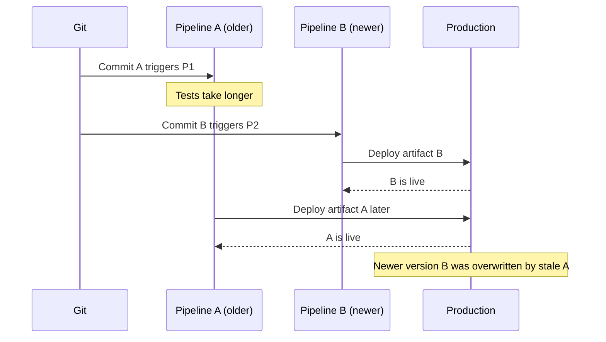
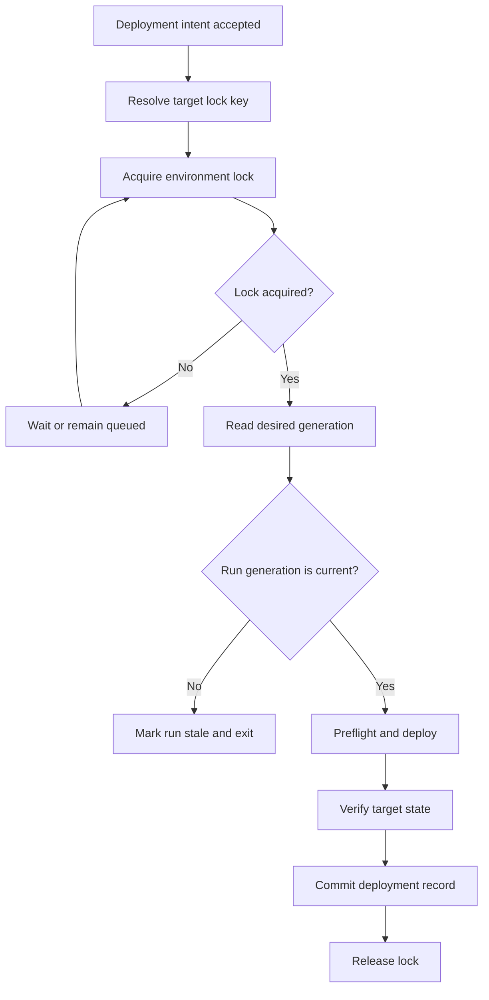

# Ngăn pipeline cũ ghi đè phiên bản mới hơn

Trong CI/CD, nhiều pipeline có thể chạy đồng thời cho cùng một service và môi trường. Một pipeline được kích hoạt từ commit cũ có thể chạy test lâu, trong khi pipeline của commit mới hoàn tất nhanh hơn và triển khai trước. Nếu pipeline cũ tiếp tục deploy khi kết thúc, nó có thể đưa artifact lỗi thời trở lại production, ghi đè cấu hình mới hoặc chuyển traffic về revision không còn được chấp nhận.

Đây là một race condition trong điều phối phát hành. Thứ tự pipeline bắt đầu, thứ tự build hoàn tất và thứ tự deployment thực tế không nhất thiết giống nhau. Chỉ dùng số thứ tự job, thời gian bắt đầu hoặc giả định “pipeline mới luôn chạy sau” là chưa đủ để bảo vệ môi trường.

**Mục tiêu là chỉ cho phép deployment intent còn hợp lệ và mới nhất theo chính sách ghi trạng thái môi trường.** Cần phối hợp tuần tự hóa thao tác trên cùng target, kiểm tra độ mới ngay trước khi thay đổi, dùng artifact bất biến và ngăn một tiến trình cũ tiếp tục ghi sau khi quyền điều khiển của nó đã hết hiệu lực.

## 1. Vấn đề pipeline cũ ghi đè phiên bản mới

Giả sử nhánh `main` có hai commit:

- Commit `A` được tạo trước và kích hoạt pipeline `P1`.
- Commit `B` được tạo sau `A` và kích hoạt pipeline `P2`.

`P1` mất nhiều thời gian chạy test. `P2` hoàn tất nhanh hơn và deploy artifact từ `B` lên production. Sau đó `P1` kết thúc và deploy artifact từ `A`. Production lúc này chạy phiên bản cũ hơn dù pipeline `P2` đã báo thành công.



Vấn đề không nhất thiết là artifact `A` bị lỗi. Vấn đề là quyết định deploy của `P1` không còn phù hợp với trạng thái và ý định phát hành hiện tại.

### Hậu quả thường gặp

- Production chạy commit cũ hơn commit đã được phê duyệt.
- Cấu hình mới bị ghi đè bởi manifest hoặc Terraform plan cũ.
- Blue-green route bị chuyển về môi trường đã hết thời gian phục vụ.
- Canary controller tiếp tục tăng traffic cho candidate đã bị thay thế.
- Rollback thủ công bị một pipeline đang chờ ghi đè ngay sau đó.
- Hai pipeline cùng chạy migration hoặc thay đổi tài nguyên dùng chung.
- Kết quả kiểm thử và deployment record không phản ánh phiên bản cuối cùng đang chạy.

## 2. Phân biệt thứ tự commit, thứ tự pipeline và thứ tự phát hành

Ba thứ tự này không đồng nhất:

| Thứ tự | Mô tả | Vì sao có thể khác nhau? |
|---|---|---|
| Commit order | Quan hệ lịch sử giữa các commit trong Git | Branch có merge, rebase, cherry-pick hoặc nhiều nhánh |
| Pipeline order | Thứ tự các run được tạo hoặc bắt đầu | Runner capacity, queue, cache, test duration và retry |
| Deployment order | Thứ tự thay đổi thực sự được áp dụng lên target | Lock, approval, thời gian deploy, API chậm và thao tác thủ công |

Một commit SHA không có ý nghĩa thứ tự lớn/nhỏ. Không thể so sánh hai SHA theo chuỗi ký tự để biết commit nào mới hơn. Timestamp commit cũng không đủ tin cậy vì có thể khác clock, bị sửa khi rebase hoặc không phản ánh thứ tự release được chấp thuận.

Hệ thống cần một khái niệm rõ ràng về **deployment intent**: yêu cầu đưa một artifact cụ thể đến một target cụ thể, được tạo từ revision và đã đáp ứng điều kiện phát hành. Thứ tự các intent hợp lệ mới là cơ sở để quyết định một pipeline có còn quyền triển khai hay không.

## 3. Xác định deployment target và phạm vi điều phối

Không phải mọi deployment đều cần khóa toàn hệ thống. Cần xác định tài nguyên nào có thể bị hai pipeline ghi đồng thời.

Ví dụ target có thể là:

- `production / orders-api`.
- `staging / storefront`.
- `production / region-eu / payment-api`.
- Một Terraform state hoặc cluster namespace dùng chung.
- Một database schema được nhiều service migration cùng thay đổi.
- Một DNS record hoặc route của blue-green release.

Khóa quá rộng làm giảm khả năng phát hành song song. Khóa quá hẹp có thể không bảo vệ được tài nguyên dùng chung. Ví dụ, khóa theo service không đủ nếu hai service cùng sửa một database schema hoặc cùng cập nhật một global gateway route.

### Chọn lock key

Lock key cần đại diện cho đơn vị thay đổi phải được tuần tự hóa. Ví dụ:

```text
deploy:production:orders-api
deploy:production:orders-api:region-eu
terraform:production:shared-network-state
database:production:orders-schema
route:production:storefront
```

Nếu mỗi region độc lập và không chia sẻ trạng thái, có thể deploy song song theo region. Nếu một release yêu cầu chuyển traffic toàn cầu đồng thời, cần một lock hoặc orchestration cấp cao hơn bao phủ tất cả region liên quan.

## 4. Các nguyên tắc bảo vệ môi trường

Một cơ chế đáng tin cậy thường kết hợp nhiều lớp:

1. **Immutable artifact:** build một lần, gắn digest và promote đúng artifact đã kiểm tra.
2. **Serialized mutation:** tại một thời điểm chỉ có một tác nhân được phép thay đổi cùng deployment target.
3. **Stale-run check:** kiểm tra intent còn hợp lệ trước khi bắt đầu thay đổi và trước các thao tác quan trọng.
4. **Monotonic generation:** dùng số thứ tự tăng dần cho các intent đã được chấp nhận.
5. **Atomic compare-and-swap:** chỉ cập nhật trạng thái nếu generation hiện tại vẫn đúng giá trị kỳ vọng.
6. **Fencing token:** ngăn tiến trình giữ lock cũ tiếp tục ghi sau khi lease đã hết hạn hoặc bị thay thế.
7. **Audit trail:** ghi lại ai yêu cầu, artifact nào, generation nào và target đã chuyển sang trạng thái gì.

Không nhất thiết mọi hệ thống đều cần một lock service riêng. Một deployment controller hoặc platform API có thể cung cấp tuần tự hóa và compare-and-swap. Điều quan trọng là tất cả đường ghi trạng thái phải tuân cùng một cơ chế.

## 5. Dùng deployment generation thay vì dựa vào timestamp

Một cách phổ biến là cấp một generation tăng đơn điệu cho mỗi deployment intent hợp lệ của một target.

Ví dụ:

| Intent | Source revision | Artifact digest | Generation |
|---|---|---|---:|
| Release 41 | Commit A | `sha256:aaa...` | 41 |
| Release 42 | Commit B | `sha256:bbb...` | 42 |
| Release 43 | Commit C | `sha256:ccc...` | 43 |

Khi generation 42 đã được chấp nhận làm trạng thái mong muốn, một tiến trình generation 41 không được phép thay đổi target. Dù `P1` hoàn tất muộn hơn, nó vẫn là intent cũ.

### Khi nào cấp generation?

Generation nên được cấp khi deployment intent đủ điều kiện đi vào hàng đợi phát hành theo policy, chẳng hạn sau khi các kiểm tra bắt buộc và approval cần thiết đã đạt. Không nên tăng generation chỉ vì có một commit mới được push nếu commit đó chưa build, chưa qua gate hoặc không được phép phát hành.

Hệ thống cần định nghĩa chính sách supersede:

- **Latest eligible wins:** intent mới hơn đã đủ điều kiện sẽ thay thế intent cũ đang chờ.
- **FIFO:** các intent đủ điều kiện được triển khai theo thứ tự chấp nhận.
- **Release train:** chỉ release đã được đưa vào một đợt phát hành mới có thể thay đổi target.
- **Manual approval:** intent mới chỉ supersede sau khi người có thẩm quyền chấp nhận.

Chính sách phụ thuộc quy trình tổ chức. Nhưng sau khi một intent mới đã được chọn làm desired state, intent cũ cần bị đánh dấu stale và không được ghi target.

### Rollback vẫn là intent mới

Không được hiểu generation là version ứng dụng hoặc số phiên bản artifact. Một rollback có chủ đích có thể deploy lại artifact cũ, nhưng đó là một deployment intent mới với generation cao hơn.

Ví dụ, production đang ở generation 43 chạy artifact `v3`. Incident commander quyết định quay về artifact `v2`. Hệ thống tạo intent `generation 44` trỏ đến digest của `v2`. Như vậy, một pipeline cũ generation 42 không thể ghi đè quyết định rollback mới.

## 6. Kiểm tra stale run trước khi deploy

Trước khi thay đổi target, pipeline cần xác minh intent của nó vẫn là intent được phép triển khai.

Các kiểm tra thường dùng:

- Deployment intent chưa bị supersede hoặc cancel.
- Generation của run vẫn bằng desired generation của target.
- Source revision còn hợp lệ theo branch/tag/release policy.
- Artifact digest đúng với artifact đã qua kiểm thử và approval.
- Target chưa được thay đổi bởi một deployment hoặc rollback khác.
- Environment đang ở trạng thái cho phép mutation.

### Kiểm tra branch head

Với workflow tự động deploy từ nhánh chính, có thể kiểm tra commit của run còn là head hiện tại hoặc vẫn thuộc revision được phép release. Tuy nhiên, head branch thay đổi không phải lúc nào cũng có nghĩa deployment đang chạy phải bị hủy: tổ chức có thể muốn phát hành tag đã được phê duyệt dù branch tiếp tục nhận commit mới.

Do đó, kiểm tra Git ancestry/head là một rule theo workflow, không thay thế deployment generation. Cần phân biệt release từ branch liên tục với release bất biến từ tag hoặc manifest được phê duyệt.

### Kiểm tra lại ngay trước thao tác ghi

Kiểm tra stale ở đầu job có thể trở nên lỗi thời trong lúc job chờ approval hoặc thực hiện preflight. Cần kiểm tra lại ngay trước các mutation quan trọng, ví dụ:

- Apply Terraform hoặc manifest.
- Cập nhật deployment revision.
- Chuyển blue-green route.
- Thay đổi canary weight.
- Chạy migration.
- Cập nhật con trỏ desired version trong deployment registry.

Với một thao tác gồm nhiều bước, mỗi bước cần kiểm tra fencing/generation hoặc được thực hiện qua một controller giữ quyền điều phối xuyên suốt.

## 7. Tuần tự hóa bằng environment lock

Lock bảo đảm chỉ một pipeline được phép thay đổi cùng target tại một thời điểm. Các run khác chờ, bị hủy nếu đã lỗi thời hoặc được xếp vào hàng đợi.



### Lock phải bao phủ đúng phạm vi

Nếu hai run cùng deploy `orders-api` production, chúng cần cùng lock key. Nếu một run deploy staging và một run deploy production, có thể dùng hai lock khác nhau nếu không có tài nguyên dùng chung.

Nếu hai service cùng sửa một Terraform state, lock theo service không bảo vệ được state đó. Cần dùng lock ở cấp state hoặc một cơ chế transaction của hệ thống IaC.

### Không giữ lock quá lâu nếu không cần

Build và test thường không cần giữ production lock. Có thể thực hiện build, test, scan và approval song song; chỉ acquire lock khi chuẩn bị mutation target. Điều này giảm thời gian chờ mà vẫn tuần tự hóa phần thay đổi môi trường.

Tuy nhiên, nếu preflight hoặc migration phụ thuộc trạng thái target và có thể thay đổi nó, cần xác định rõ thời điểm lock bắt đầu và phạm vi lock. Không thả lock giữa một chuỗi mutation chưa hoàn tất.

## 8. Lease, heartbeat và fencing token

Trong hệ thống phân tán, một lock có thể được cấp theo lease có thời hạn. Owner gia hạn lease bằng heartbeat. Nếu owner chết hoặc mất kết nối, lease hết hạn và một run khác có thể lấy lock.

Chỉ dựa vào lease là chưa đủ. Một tiến trình cũ có thể bị pause lâu, lease hết hạn, tiến trình mới lấy lock và deploy thành công, rồi tiến trình cũ tiếp tục chạy sau khi được resume. Nếu tiến trình cũ vẫn có thể ghi vào API đích, nó có thể ghi đè trạng thái mới.

### Fencing token

Lock service có thể cấp một token tăng dần mỗi lần cấp quyền:

| Owner | Lease | Fencing token |
|---|---|---:|
| Pipeline P1 | Hết hạn | 104 |
| Pipeline P2 | Đang giữ | 105 |

Target hoặc deployment controller ghi nhận token cao nhất đã chấp nhận. Khi P1 quay lại và gửi lệnh với token 104, target từ chối vì token 105 đã được sử dụng.

Fencing chỉ hiệu quả nếu hệ thống nhận lệnh thực sự kiểm tra token. Nếu API cloud hoặc router không hỗ trợ fencing, cần đặt một deployment controller làm cổng duy nhất, controller kiểm tra generation/CAS trước khi gửi mutation và không cho pipeline gọi trực tiếp đường ghi khác.

## 9. Compare-and-swap để ngăn ghi đè trạng thái

Compare-and-swap (CAS) là thao tác chỉ cập nhật giá trị nếu trạng thái hiện tại vẫn bằng giá trị mà caller đã đọc trước đó.

Ví dụ, deployment registry đang lưu generation 42 và artifact digest `bbb`. Pipeline muốn ghi generation 43. Nó gửi yêu cầu tương đương:

```text
UPDATE deployment_target
SET generation = 43, artifact_digest = 'ccc'
WHERE target = 'production/orders-api'
  AND generation = 42;
```

Nếu một pipeline khác đã cập nhật target lên generation 44, điều kiện `generation = 42` không còn đúng và update ảnh hưởng 0 row. Pipeline generation 43 phải dừng vì đã stale.

CAS có thể được thực hiện bằng database transaction, API có ETag/If-Match, resourceVersion của control plane hoặc một deployment controller có state version. Điều quan trọng là kiểm tra và ghi phải nguyên tử; nếu tách thành hai request không được bảo vệ, race condition vẫn tồn tại giữa bước đọc và ghi.

### Ví dụ HTTP conditional update

Một API có thể trả về ETag cho trạng thái target. Pipeline gửi `If-Match` với ETag đã đọc. Nếu trạng thái thay đổi, server trả conflict/precondition failed và pipeline phải đọc lại, đánh giá intent rồi quyết định dừng hay thử lại.

Không nên tự động retry một mutation stale với ETag mới mà không kiểm tra generation. Làm vậy có thể biến một pipeline cũ thành pipeline ghi đè hợp lệ về mặt kỹ thuật nhưng sai về ý định phát hành.

## 10. Hủy run cũ và chính sách latest-wins

Khi có intent mới hơn, hệ thống có thể hủy run cũ để tiết kiệm runner và giảm thời gian chờ. Đây là biện pháp hữu ích nhưng không phải hàng rào an toàn duy nhất.

Lý do:

- Run cũ có thể đã gửi lệnh deploy đến hệ thống bên ngoài.
- Job con hoặc task async có thể tiếp tục chạy sau khi pipeline bị cancel.
- Runner mất kết nối có thể không nhận được tín hiệu hủy.
- Một bước deploy có thể không hỗ trợ cancellation an toàn.
- Rollback hoặc manual action có thể không đi qua cùng cơ chế cancel.

Vì vậy, cancellation là tối ưu hóa; stale check, lock và fencing/CAS mới bảo vệ target trước mutation muộn.

### Chọn chính sách queue

| Chính sách | Hành vi | Phù hợp với |
|---|---|---|
| FIFO | Chạy mọi intent theo thứ tự được chấp nhận | Migration tuần tự hoặc release cần thực hiện đầy đủ |
| Latest-wins | Chỉ giữ intent mới nhất đang chờ; hủy intent pending cũ | Deploy branch liên tục khi commit mới thay thế commit trước |
| Cancel-in-progress | Hủy cả run đang triển khai khi run mới xuất hiện | Chỉ dùng nếu deployment controller hỗ trợ abort an toàn và có recovery |
| Manual promotion | Build/test song song, người có quyền chọn artifact để deploy | Release có approval hoặc cửa sổ phát hành |

Không nên bật cancel-in-progress một cách máy móc cho production. Hủy giữa lúc migration hoặc route change có thể để target ở trạng thái dở dang. Nếu muốn latest-wins, thường nên hủy run pending và để run đang mutation hoàn tất hoặc abort theo một quy trình có kiểm soát.

## 11. Build một lần và promote artifact bất biến

Ngay cả khi deployment lock hoạt động, một pipeline cũ vẫn có thể build lại artifact khác hoặc lấy tag mutable đã bị cập nhật.

Các nguyên tắc:

- Build từ commit cụ thể và lưu commit SHA.
- Gắn artifact digest bất biến, không chỉ dựa vào tag như `latest`.
- Lưu provenance, SBOM và kết quả test/scan gắn với digest.
- Approval tham chiếu đúng digest và deployment intent.
- Promotion qua staging/production dùng cùng artifact.
- Không rebuild khi đã vào hàng đợi deploy chỉ để lấy “phiên bản mới nhất”.

Ví dụ, pipeline `P1` build digest `sha256:aaa` từ commit A và `P2` build `sha256:bbb` từ commit B. Deployment registry cần biết mỗi intent trỏ đến digest nào. Không nên chỉ lưu tên image `orders-api:release` vì tag đó có thể được ghi đè.

## 12. Approval và artifact phải thuộc cùng một intent

Một rủi ro khác là approval được cấp cho artifact A nhưng pipeline sau đó deploy artifact B hoặc cùng pipeline bị thay đổi input sau approval.

Approval cần gắn với:

- Target/environment.
- Source repository và commit SHA.
- Artifact digest.
- Deployment generation hoặc intent ID.
- Kết quả kiểm thử và scan cần thiết.
- Cấu hình/migration sẽ được áp dụng.
- Người duyệt và thời điểm.

Nếu artifact hoặc target intent thay đổi sau approval, approval cũ không tự động áp dụng cho intent mới. Cần chạy lại các kiểm tra hoặc yêu cầu approval mới theo policy.

## 13. Điều phối pipeline theo từng môi trường

Development, test, staging và production có thể có chính sách concurrency khác nhau.

| Môi trường | Chính sách thường phù hợp | Lý do |
|---|---|---|
| Development preview | Mỗi pull request có namespace riêng; cleanup theo TTL | Cho phép nhiều nhánh chạy song song |
| Shared test | Lock theo test environment hoặc suite dùng chung | Tránh test run ghi đè dữ liệu và config của nhau |
| Staging | Tuần tự hóa theo service/release target | Giữ một candidate rõ ràng cho acceptance test |
| Production | Lock theo target, generation/CAS và approval theo policy | Bảo vệ trạng thái phục vụ người dùng |
| Shared infrastructure | Lock theo Terraform state, database hoặc tài nguyên chung | Tránh hai service cùng thay đổi một tài nguyên |

Không cần tuần tự hóa toàn bộ pipeline từ checkout đến test. Các bước độc lập có thể chạy song song. Chỉ những thao tác ghi vào cùng target hoặc trạng thái dùng chung mới cần điều phối.

## 14. Database migration và thay đổi stateful

Migration thường nguy hiểm hơn việc thay container vì nó có thể thay đổi trạng thái dùng chung và khó đảo ngược.

Hai pipeline cùng chạy migration có thể:

- Cùng thêm/xóa cột hoặc index.
- Đọc schema version khác nhau.
- Chạy backfill đồng thời gây duplicate hoặc lock contention.
- Áp dụng migration theo thứ tự không tương thích.
- Một pipeline cũ chạy migration sau khi phiên bản mới đã đổi schema.

### Biện pháp điều phối

- Dùng migration lock hoặc cơ chế advisory lock của database.
- Lưu migration version trong bảng schema history.
- Đảm bảo migration idempotent hoặc có cơ chế nhận biết đã áp dụng.
- Tuần tự hóa theo database/schema thay vì chỉ theo service.
- Kiểm tra generation/release intent trước khi chạy migration.
- Dùng expand–migrate–contract để các phiên bản cùng tồn tại trong cửa sổ chuyển đổi.
- Không tự động chạy lại migration thất bại nếu không biết trạng thái đã commit đến đâu.

Một migration cũ bị stale cần dừng trước khi ghi. Nếu migration đã bắt đầu và không thể hủy an toàn, cần để transaction hoặc migration runner hoàn tất/abort theo quy trình rồi mới cho intent tiếp theo tiếp quản.

## 15. Blue-green, canary và route update cũng cần chống stale write

Không chỉ deployment manifest có thể bị ghi đè. Route weight, DNS target và traffic split cũng là trạng thái dùng chung.

Ví dụ:

1. Pipeline A tạo green từ artifact cũ và chờ kiểm thử.
2. Pipeline B triển khai green mới, xác minh và chuyển production route sang green mới.
3. Pipeline A hoàn tất test muộn và cập nhật route sang green cũ.

Để tránh điều này:

- Gắn release ID/generation vào route intent.
- Chỉ controller sở hữu route mới được phép cập nhật.
- Kiểm tra desired generation ngay trước route switch.
- Dùng CAS hoặc resource version để từ chối cập nhật dựa trên trạng thái cũ.
- Ghi route revision và traffic weight vào deployment record.
- Dừng rollout controller cũ khi intent bị supersede.

Với canary, controller cũ có thể tiếp tục tăng weight sau khi pipeline mới đã promote candidate khác. Cần một control plane duy nhất quản lý rollout target và fencing/generation cho mọi thao tác weight.

## 16. Rollback thủ công và pipeline đang chạy

Rollback là một thay đổi có chủ đích về trạng thái mong muốn. Nó không nên bị coi là một thao tác ngoài luồng không có generation.

Giả sử pipeline release generation 51 đang chờ. Incident commander yêu cầu rollback về artifact đã biết là ổn định. Hệ thống nên tạo rollback intent generation 52, gắn digest cũ và lý do incident. Khi generation 52 được chấp nhận, pipeline 51 phải bị đánh dấu stale và không thể tiếp tục ghi.

### Quy trình rollback an toàn

1. Tạo incident/recovery intent cho target.
2. Cấp generation mới cao hơn mọi intent hiện tại.
3. Pause hoặc abort pipeline/rollout đang điều khiển target.
4. Acquire lock và kiểm tra fencing token.
5. Xác minh artifact rollback và compatibility của schema/config.
6. Cập nhật target bằng CAS với generation mới.
7. Kiểm tra health, route và metric sau rollback.
8. Ghi audit và giữ run cũ ở trạng thái superseded.

Không nên chỉ chạy lại một pipeline cũ hoặc sửa tag `latest` để rollback. Làm vậy không tạo được dấu vết rõ về quyết định và có thể bị một run khác ghi đè.

## 17. Ví dụ trạng thái deployment registry

Một registry có thể lưu trạng thái mong muốn và trạng thái thực tế của mỗi target:

```yaml
deployment_target:
  key: production/orders-api
  desired:
    generation: 104
    intent_id: release-2026-11-18-104
    source_revision: 8f31a2c
    artifact_digest: sha256:NEW_DIGEST
    requested_by: release-pipeline
  observed:
    generation: 104
    artifact_digest: sha256:NEW_DIGEST
    route_revision: route-882
    status: healthy
  lock:
    owner: pipeline-run-8821
    fencing_token: 105
    lease_expires_at: "2026-11-18T10:15:00Z"
```

Đây là mô hình dữ liệu khái niệm. Thời gian lease chỉ là một phần của lock; generation và fencing token mới giúp xác định một owner cũ có còn quyền ghi hay không. Hệ thống thật cần cập nhật trạng thái theo transaction hoặc API có điều kiện để tránh registry tự trở thành điểm race condition.

## 18. Ví dụ policy ngăn stale deployment

YAML sau minh họa logic ở mức khái niệm, không phải schema trực tiếp của một CI provider:

```yaml
deployment_policy:
  target: production/orders-api

  concurrency:
    lock_key: deploy:production:orders-api
    max_active_mutations: 1
    queue_policy: latest_eligible_wins
    cancel_superseded_pending: true

  freshness:
    require_current_generation: true
    check_before_mutation: true
    check_before_route_switch: true
    reject_superseded_intent: true

  artifact:
    immutable_digest_required: true
    rebuild_after_approval: false

  write_protection:
    compare_and_swap: true
    fencing_token_required: true

  rollback:
    create_new_intent: true
    increment_generation: true
    preserve_artifact_digest: true

  audit:
    record_intent_id: true
    record_generation: true
    record_actor_and_target: true
    record_before_after_state: true
```

Trong hệ thống thực tế, `max_active_mutations` cần được thực thi ở một lock manager hoặc deployment controller có tính nhất quán. Một trường YAML đơn thuần không ngăn được hai runner cùng ghi nếu không có cơ chế thực thi phía server.

## 19. Ví dụ xuyên suốt: orders-api có hai pipeline hoàn tất ngược thứ tự

Giả sử `orders-api` có hai commit liên tiếp trên `main`:

- `A`: tối ưu truy vấn cũ, pipeline mất 18 phút.
- `B`: sửa thêm timeout và test, pipeline mất 7 phút.

Pipeline A build digest `sha256:aaa` và chạy test. Trong lúc đó, pipeline B build digest `sha256:bbb`, vượt qua test và được chấp nhận làm release intent generation 72.

Pipeline B acquire lock `deploy:production:orders-api`, đọc desired generation 72, xác minh artifact digest, deploy `sha256:bbb`, chạy smoke test và cập nhật observed state generation 72. Sau đó lock được giải phóng.

Pipeline A kết thúc test và muốn deploy. Nó đọc deployment registry và thấy intent của mình có generation 71 trong khi desired generation là 72. Stale check thất bại, A ghi trạng thái `superseded` và dừng trước khi mutation. Nếu A đã giữ một lease cũ, fencing token của nó cũng thấp hơn token hiện tại nên deployment controller từ chối lệnh.

Sau đó có sự cố nghiệp vụ và on-call quyết định quay lại digest `sha256:stable`. Hệ thống tạo rollback intent generation 73. Rollback không bị stale guard chặn vì đó là intent mới được phê duyệt, dù artifact digest cũ hơn. Pipeline A vẫn không thể tiếp tục ghi vì generation 71 đã lỗi thời.

Kết quả: production chỉ chuyển theo các intent được chấp nhận, không theo thứ tự job tình cờ hoàn tất.

## 20. Quan sát, audit và cảnh báo stale run

Để điều tra và cải thiện điều phối, cần ghi lại trạng thái của mỗi intent và lý do bị từ chối.

Các trường nên lưu:

- Pipeline run ID và intent ID.
- Source revision và artifact digest.
- Target/lock key.
- Generation dự kiến và generation thực tế khi kiểm tra.
- Lock owner, lease và fencing token.
- Thời điểm acquire/release lock.
- Kết quả stale check/CAS.
- Mutation đã thực hiện và route/resource revision trước/sau.
- Actor, approval và lý do rollback/bypass.

### Metric hữu ích

| Metric | Ý nghĩa |
|---|---|
| Stale run rejection count | Số pipeline bị từ chối vì đã lỗi thời |
| Lock wait duration | Thời gian pipeline chờ target lock |
| Lock lease expiration | Số lần lease hết hạn bất thường |
| CAS conflict count | Số lần target thay đổi giữa read và write |
| Superseded pending runs | Số run pending bị thay thế bởi intent mới |
| Deployment generation lag | Chênh lệch giữa desired và observed generation |
| Concurrent mutation attempts | Số lần có nhiều actor muốn ghi cùng target |
| Rollback intent count | Số lần tạo intent phục hồi mới |

Stale rejection không nhất thiết là lỗi. Nó có thể cho thấy hệ thống đang bảo vệ target đúng cách. Nhưng tỷ lệ quá cao có thể phản ánh pipeline chạy quá lâu, build/test không tối ưu hoặc chính sách trigger tạo quá nhiều release không cần thiết.

## 21. Những anti-pattern thường gặp

| Anti-pattern | Hệ quả | Cách cải thiện |
|---|---|---|
| Giả định pipeline mới luôn deploy sau pipeline cũ | Run cũ có thể hoàn tất muộn và ghi đè | Generation, stale check và lock |
| Chỉ dùng timestamp hoặc so sánh SHA | Không phản ánh thứ tự intent đáng tin cậy | Dùng generation do deployment control plane cấp |
| Chỉ cancel run cũ | Lệnh async hoặc tiến trình đã gửi mutation vẫn có thể chạy | CAS/fencing ở nơi nhận mutation |
| Lock theo service trong khi tài nguyên dùng chung | Hai service vẫn sửa cùng state đồng thời | Khóa theo Terraform state, schema hoặc route thực tế |
| Giữ lock trong toàn bộ build/test | Giảm throughput và tạo hàng đợi dài | Chỉ khóa giai đoạn mutation target |
| Lease hết hạn nhưng không có fencing | Owner cũ có thể tiếp tục ghi | Fencing token hoặc controller duy nhất kiểm tra generation |
| Approval không gắn digest | Pipeline có thể deploy artifact khác với artifact đã duyệt | Bind approval vào intent và digest bất biến |
| Dùng tag mutable như `latest` | Nội dung deploy có thể thay đổi sau khi scan | Dùng digest bất biến |
| Pipeline cũ chạy migration sau pipeline mới | Schema hoặc dữ liệu bị thay đổi ngược | Migration lock, version history và stale guard |
| Rollback không tạo generation mới | Pipeline đang chạy có thể ghi đè rollback | Rollback là intent mới có generation cao hơn |
| Nhiều controller cùng quản lý route | Weight hoặc desired state bị ghi qua lại | Một control plane và audit chung |
| Retry CAS conflict mà không đánh giá intent | Run cũ có thể ghi lại sau khi đọc state mới | Dừng hoặc tạo intent mới theo policy |

## 22. Checklist ngăn pipeline cũ ghi đè phiên bản mới

Trước khi đưa cơ chế concurrency vào production, nhóm có thể rà soát:

- [ ] Đã xác định target và lock key theo tài nguyên thực sự dùng chung.
- [ ] Các mutation cùng target được tuần tự hóa.
- [ ] Build/test có thể chạy song song ngoài vùng mutation.
- [ ] Deployment intent có ID và generation tăng đơn điệu.
- [ ] Generation chỉ được cấp cho intent đủ điều kiện theo release policy.
- [ ] Pipeline kiểm tra generation/stale state trước khi deploy và trước mutation quan trọng.
- [ ] Target update dùng CAS hoặc API có điều kiện nguyên tử.
- [ ] Lease lock có heartbeat/expiry và fencing token khi cần.
- [ ] Target/controller từ chối lệnh có fencing token cũ.
- [ ] Cancellation được dùng để tiết kiệm tài nguyên, không phải lớp bảo vệ duy nhất.
- [ ] Queue policy FIFO/latest-wins/cancel được chọn rõ theo loại release.
- [ ] Artifact được build một lần, tham chiếu bằng digest bất biến.
- [ ] Approval gắn với target, intent, commit và artifact digest.
- [ ] Migration, Terraform state và route update có lock ở đúng phạm vi.
- [ ] Rollback tạo intent mới với generation cao hơn và có audit.
- [ ] Stale run được ghi trạng thái superseded/rejected với lý do.
- [ ] Có metric cho lock wait, stale rejection, CAS conflict và generation lag.
- [ ] Có diễn tập tình huống pipeline cũ hoàn tất sau pipeline mới và sau rollback.

## 23. Kết luận

Pipeline cũ ghi đè phiên bản mới là race condition xảy ra khi thứ tự hoàn tất công việc khác với thứ tự phát hành được chấp nhận. Hủy run cũ hoặc đặt một environment lock giúp giảm nguy cơ, nhưng vẫn cần kiểm tra độ mới ngay trước mutation và bảo vệ nơi nhận lệnh khỏi owner đã mất quyền.

Một cơ chế vững chắc kết hợp artifact bất biến, deployment intent có generation tăng đơn điệu, lock theo target, stale check, compare-and-swap và fencing token khi dùng lease phân tán. Rollback cũng phải được biểu diễn thành intent mới có generation cao hơn để không bị pipeline đang chạy ghi đè. Khi mọi mutation được điều phối qua một control plane có audit, production chỉ chuyển theo quyết định phát hành còn hợp lệ thay vì theo thứ tự pipeline tình cờ kết thúc.
