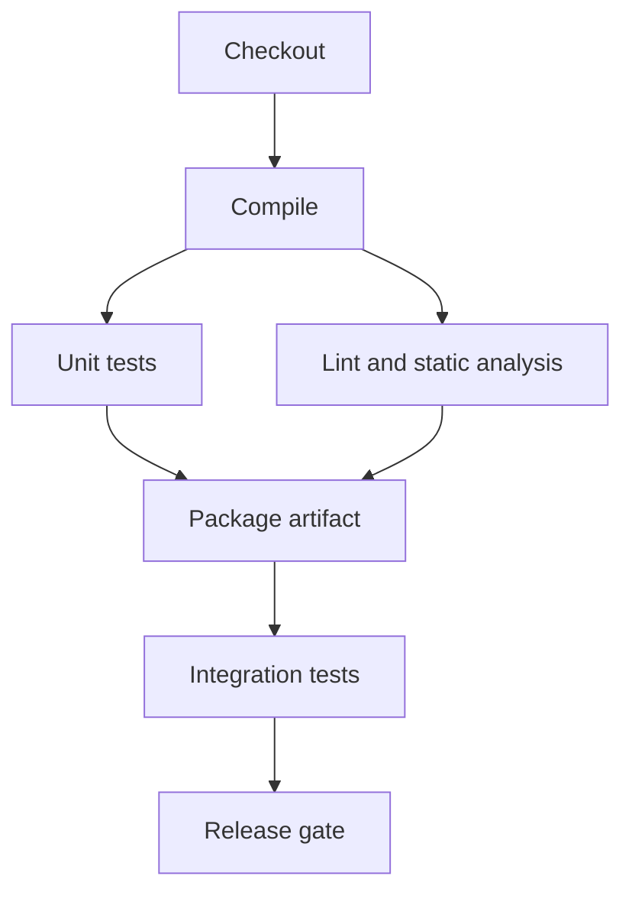
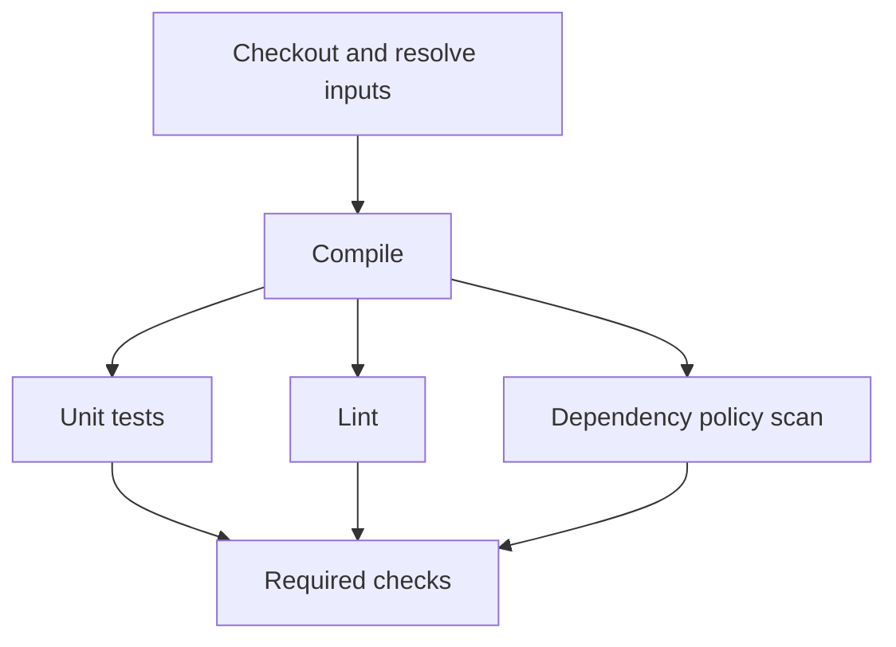
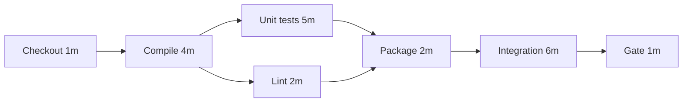

# Tối ưu phần nằm trên đường phụ thuộc dài nhất

Một pipeline CI/CD có thể có hàng chục job: checkout, cài toolchain, lint, compile, unit test, security scan, build image, integration test, đóng gói artifact và triển khai thử. Dù nhiều job có thể chạy song song, toàn bộ pipeline vẫn phải chờ các công việc nằm trên chuỗi phụ thuộc dài nhất hoàn tất. Tăng tốc một job không ảnh hưởng đến chuỗi này có thể gần như không làm thời gian phản hồi thay đổi.

Để cải thiện thời gian nhận kết quả, cần xác định **đường phụ thuộc dài nhất (critical path)** của pipeline rồi tối ưu những job và cạnh phụ thuộc nằm trên đường đó. Mục tiêu là đưa tín hiệu đáng tin cậy về thay đổi của developer đến sớm hơn, đồng thời giữ nguyên các cổng chất lượng cần thiết trước merge hoặc release.

Trong CI/CD, tối ưu critical path không chỉ là chạy nhiều job cùng lúc. Cần đo thời gian chờ runner, thời gian thực thi, thời gian truyền artifact, các bước tuần tự không cần thiết và sự cạnh tranh tài nguyên. Sau mỗi thay đổi, đo lại pipeline để xác nhận thời gian phản hồi thực sự giảm.

## 1. Hiểu pipeline như một đồ thị phụ thuộc

Pipeline thường được mô hình hóa thành directed acyclic graph (DAG): mỗi node là một job hoặc task; mỗi edge biểu thị một công việc phải hoàn thành trước khi công việc khác bắt đầu.

Ví dụ:



Trong sơ đồ này, lint và unit test có thể chạy song song sau compile. Package chỉ bắt đầu khi cả hai hoàn tất. Vì vậy, thời điểm package bắt đầu phụ thuộc vào nhánh chậm hơn giữa hai nhánh đó.

Nếu thời lượng lần lượt là:

| Job | Thời lượng |
|---|---:|
| Checkout | 1 phút |
| Compile | 4 phút |
| Unit tests | 5 phút |
| Lint/static analysis | 2 phút |
| Package | 2 phút |
| Integration tests | 6 phút |
| Release gate | 1 phút |

Đường qua unit test mất 19 phút. Đường qua lint mất 16 phút. Thời gian tối thiểu theo DAG là 19 phút, chưa tính queue time, runner contention và overhead truyền artifact. Tối ưu lint từ 2 phút xuống 30 giây không thay đổi đường dài nhất; tối ưu unit test từ 5 xuống 3 phút có thể rút ngắn toàn pipeline khoảng 2 phút nếu không có nút thắt khác thay thế.

## 2. Critical path và phần việc có thể chờ

Với DAG và thời lượng job đã biết, có thể tính:

- **Earliest start (ES):** thời điểm sớm nhất job có thể bắt đầu khi mọi dependency hoàn tất.
- **Earliest finish (EF):** ES cộng thời lượng job.
- **Latest finish (LF):** thời điểm muộn nhất job có thể kết thúc mà không làm trễ mốc hoàn thành chung.
- **Latest start (LS):** LF trừ thời lượng job.
- **Slack/float:** khoảng thời gian job có thể trễ mà chưa làm trễ toàn pipeline, thường tính LS trừ ES.

Job có slack bằng 0 nằm trên ít nhất một critical path. Nếu một pipeline có nhiều đường cùng dài nhất, tối ưu một đường có thể khiến đường kia trở thành critical path mới.

Không nên xem critical path là thuộc tính cố định. Thời lượng job thay đổi theo cache hit, kích thước thay đổi, loại runner, tải hệ thống, số shard test và queue time. Nên tính trên nhiều lần chạy đại diện, dùng p50/p90 hoặc percentile phù hợp thay vì chỉ dựa vào một lần chạy may mắn.

### Đường phụ thuộc khác với đường chậm do xếp hàng

Một job có thể chỉ chạy 2 phút nhưng phải đợi runner 8 phút. Trong biểu đồ DAG, job vẫn là dependency của các bước sau, nhưng phần lớn thời gian nằm ở queue chứ không phải runtime. Cần tách:

- **Queue time:** từ lúc job sẵn sàng đến lúc runner bắt đầu thực thi.
- **Execution time:** thời gian job thực sự chạy.
- **Transfer/setup time:** checkout, tải dependency, khởi tạo container hoặc tải artifact.
- **Wait time:** chờ service, lock, môi trường dùng chung hoặc manual approval.

Nếu không phân loại, nhóm có thể tối ưu code test trong khi nguyên nhân chính là thiếu runner hoặc runner group bị giới hạn concurrency.

## 3. Đo trước khi tối ưu

Không bắt đầu bằng việc thêm runner hoặc xóa test. Hãy thu thập dữ liệu đủ để biết pipeline mất thời gian ở đâu.

Nên theo dõi:

| Chỉ số | Ý nghĩa |
|---|---|
| Time to first signal | Thời gian từ commit/PR event đến kết quả kiểm tra đầu tiên có ích |
| Time to required checks | Thời gian tới khi mọi check bắt buộc hoàn tất |
| End-to-end pipeline duration | Tổng thời gian từ trigger tới trạng thái cuối |
| Queue time theo runner group | Phản ánh thiếu năng lực hoặc phân bổ runner không đều |
| Runtime theo job | Xác định job nặng và biến động |
| Cache hit/miss và download volume | Cho biết chi phí dependency/build setup |
| Artifact transfer duration | Phát hiện artifact lớn hoặc truyền lặp |
| Flaky/retry rate | Thời gian bị tiêu tốn bởi test không ổn định |
| Concurrency và resource utilization | Phát hiện CPU, memory, disk hoặc database contention |

Đo cả p50 và p90. p50 cho thấy trải nghiệm thường ngày; p90 phản ánh những lần chậm mà developer thường nhớ nhất. Có thể thêm p95 cho pipeline release hoặc hệ thống có SLA chặt.

Gắn metadata như commit SHA, branch type, runner label, cache state, số test, kích thước artifact và loại pipeline. So sánh các lần chạy tương đồng; một pull request đổi một file không nên so trực tiếp với lần build toàn bộ monorepo.

## 4. Tối ưu theo thứ tự tác động đến critical path

Một cách thực tế để chọn việc cần làm:

1. Tìm các job có slack thấp hoặc nằm trên critical path.
2. Tách thời gian queue, setup, execution và transfer của từng job.
3. Xác định phần nào có thể chạy song song mà không vi phạm dependency.
4. Giảm công việc phải làm trên đường tuần tự.
5. Tối ưu job dài nhất bằng incremental work, cache đúng cách, sharding hoặc sửa test chậm.
6. Đo lại; critical path mới có thể chuyển sang nhánh khác.

Ưu tiên những thay đổi có thể giảm thời gian phản hồi lặp lại trên nhiều pull request. Một job chạy 10 phút nhưng chỉ nằm trong pipeline nightly có thể ít quan trọng hơn job 4 phút chạy trên mọi pull request.

## 5. Chạy song song những công việc độc lập

Nếu hai job không cần output của nhau, hãy để chúng chạy đồng thời. Ví dụ lint, unit test và kiểm tra cấu hình có thể bắt đầu sau checkout hoặc sau compile tùy công cụ.



Fan-out tạo nhiều nhánh độc lập; fan-in chờ các nhánh cần thiết trước khi đi tiếp. Cách này có thể giảm thời gian chờ tổng, nhưng chỉ khi runner capacity đủ và các job không tranh chấp cùng một tài nguyên hạn chế.

Không tạo dependency giả như bắt lint chờ unit test nếu hai việc không cần output của nhau. Ngược lại, không bỏ dependency thật: test cần binary mới build thì phải chờ compile; deploy phải chờ artifact đã xác minh.

### Ví dụ GitHub Actions với job độc lập

```yaml
name: pull-request-checks

on:
  pull_request:

permissions:
  contents: read

jobs:
  compile:
    runs-on: ubuntu-24.04
    steps:
      - uses: actions/checkout@<FULL_COMMIT_SHA>
      - uses: actions/setup-java@<FULL_COMMIT_SHA>
        with:
          distribution: temurin
          java-version: "21"
      - run: ./gradlew --no-daemon compileJava

  lint:
    runs-on: ubuntu-24.04
    steps:
      - uses: actions/checkout@<FULL_COMMIT_SHA>
      - run: ./gradlew --no-daemon checkstyleMain

  unit-tests:
    runs-on: ubuntu-24.04
    steps:
      - uses: actions/checkout@<FULL_COMMIT_SHA>
      - run: ./gradlew --no-daemon test
```

Đây là ví dụ cấu trúc, không phải workflow tối ưu cho mọi dự án. Các SHA là placeholder cần thay bằng commit SHA đầy đủ đã xác minh. Nếu compile, lint và test đều tự thực hiện compile/setup giống nhau, workflow có thể lặp công việc. Hãy dùng task graph của build tool hoặc chia job sao cho output có thể được tái sử dụng mà không làm tăng chi phí tổng.

## 6. Giảm các bước tuần tự không cần thiết

Một pipeline thường dài vì có những bước chạy tuần tự do lịch sử:

- Cài cùng một toolchain ở nhiều job thay vì dùng image runner chuẩn.
- Download dependency lặp lại cho từng task.
- Build lại cùng artifact ở mỗi stage.
- Chạy lint sau toàn bộ integration test dù lint không phụ thuộc kết quả đó.
- Upload rồi download artifact trung gian nhiều lần.
- Chạy scan dài ở cuối pipeline dù một phần scan có thể chạy sớm.
- Chờ manual approval trước khi tạo report hoặc thực hiện kiểm tra không có side effect.

Rà soát từng cạnh dependency: bước sau thực sự cần output nào của bước trước? Nếu chỉ cần source revision, không cần đợi artifact package. Nếu chỉ cần test report, có thể thu thập ngay khi test xong. Nếu cần image đã build, hãy truyền đúng digest thay vì build lại.

Không xóa dependency chỉ để DAG trông song song. Một bước có side effect, cần credential hoặc phụ thuộc dữ liệu đã xác minh phải giữ đúng thứ tự kiểm soát.

## 7. Tối ưu compile và build bằng incremental work

Compile/build thường nằm trên nhiều đường phụ thuộc vì test, package và scan đều cần output của nó. Các hướng tối ưu:

- Dùng incremental compilation và build cache khi build tool hỗ trợ.
- Tránh xóa toàn bộ output/cache nếu không có lý do.
- Chỉ build module bị ảnh hưởng khi dependency graph cho phép.
- Tách task cấu hình nhẹ khỏi task compile nặng.
- Dùng dependency locking và cache dependency để giảm download.
- Tránh annotation processor hoặc plugin không cần thiết chạy trên mọi module.
- Đo thời gian configuration phase riêng với execution phase.

Với monorepo, xác định module bị ảnh hưởng dựa trên dependency graph và file thay đổi. Nếu một thư viện nền tảng thay đổi, các module phụ thuộc trực tiếp hoặc gián tiếp có thể cần build lại. Không dùng danh sách file đơn giản nếu nó bỏ sót dependency hoặc generated source.

Incremental build cần có kiểm tra tính đúng đắn. Cache sai key hoặc build output stale có thể làm test xanh giả. Cache phải phụ thuộc vào các đầu vào ảnh hưởng kết quả như source, lockfile, toolchain, build config và platform khi cần.

## 8. Cache đúng chỗ và tránh cache poisoning

Cache giảm thời gian tải dependency và tái sử dụng output, nhưng cache không thay thế artifact có provenance và không nên làm nguồn sự thật cho release.

Nên cache:

- Dependency package theo lockfile và toolchain.
- Compiler/build cache có key dựa trên input.
- Các dữ liệu có thể tái tạo và không chứa secret.

Tránh:

- Cache thư mục chứa credential, token hoặc file cấu hình nhạy cảm.
- Dùng cache từ mã không tin cậy cho trusted release build.
- Dùng key quá rộng khiến thay đổi compiler hoặc dependency vẫn khôi phục cache cũ.
- Chia sẻ cache ghi được giữa các trust boundary khác nhau.

Thiết kế key có thể gồm OS/architecture, toolchain version, lockfile hash, build configuration và namespace theo trust level. Có fallback key để khôi phục dữ liệu gần tương đồng khi phù hợp, nhưng cần hiểu thứ tự restore và nguy cơ cache từ branch không tin cậy.

Đo cache hit rate và thời gian tiết kiệm thực tế. Cache có thể làm pipeline chậm hơn nếu archive quá lớn, restore tốn I/O hoặc cache miss thường xuyên. Hãy so sánh thời gian end-to-end trước và sau khi thêm cache.

## 9. Chia nhỏ và phân tán test suite

Một test suite dài có thể được chia thành shard để chạy song song. Ví dụ 600 test độc lập có thể chia thành 4 nhóm, mỗi nhóm chạy trên runner riêng.

Để sharding hiệu quả:

- Chia theo thời lượng lịch sử hoặc chi phí ước lượng, không chỉ chia số lượng test.
- Cân bằng shard để nhóm chậm nhất không kéo dài toàn bộ fan-in.
- Tránh test dùng chung dữ liệu, port, account hoặc resource có thể xung đột.
- Mỗi shard tạo dữ liệu và cleanup độc lập.
- Gộp report sau khi các shard hoàn tất.
- Giữ test có thứ tự hoặc state dependency trong cùng một nhóm nếu chưa thể làm độc lập.

Nếu shard 1 mất 2 phút nhưng shard 4 mất 9 phút, tổng thời gian vẫn bị quyết định bởi shard 4. Cân bằng workload quan trọng hơn tăng số shard một cách máy móc.

Không chạy quá nhiều shard khi runner bị giới hạn CPU/memory hoặc test cần cùng database. Chạy 16 shard trên 4 core có thể làm context switching, disk I/O và database contention tăng, khiến thời gian tổng xấu hơn.

## 10. Đưa kiểm tra nhanh lên trước, nhưng giữ quality gates

Developer cần tín hiệu sớm để sửa lỗi khi context còn mới. Có thể sắp xếp các kiểm tra theo chi phí và khả năng phát hiện:

1. Validate pipeline/configuration và formatting.
2. Lint, static checks và kiểm tra secret đơn giản.
3. Compile hoặc type-check.
4. Unit tests.
5. Component/integration tests.
6. Security, license và policy scans phù hợp.
7. Build artifact, kiểm tra artifact và provenance.
8. E2E, staging validation và release gates.

Thứ tự cụ thể phụ thuộc dependency và rủi ro. Một security scan rất nhanh có thể chạy song song với compile; một scan chỉ có thể phân tích image thì phải đợi image. Không nên dời một gate bắt buộc sang sau merge chỉ để PR xanh nhanh hơn.

### Tách fast feedback lane và full validation lane

Một số dự án có thể tổ chức hai mức:

- **Fast PR lane:** kiểm tra rẻ, đáng tin và có thời gian ngắn để developer nhận lỗi sớm.
- **Full validation lane:** chạy đầy đủ integration, E2E, security và compatibility checks trước release hoặc theo policy của branch.

Fast lane không được tạo ấn tượng rằng thay đổi đã đủ điều kiện release nếu full validation chưa hoàn tất. Required checks cho merge cần phản ánh chính sách thực tế: nếu một kiểm tra là bắt buộc trước merge, nó phải là required check hoặc được thay thế bằng gate tương đương đã được phê duyệt.

Có thể chạy full lane song song khi PR mở hoặc khi có commit mới, nhưng cần hủy run cũ khi có commit mới nếu kết quả cũ không còn đại diện cho revision hiện tại. Chỉ dùng kết quả gắn với đúng commit SHA để ra quyết định.

## 11. Chạy test liên quan theo dependency graph

Trong monorepo hoặc dự án nhiều module, chạy toàn bộ test cho mọi thay đổi có thể tốn kém. Có thể xác định phạm vi ảnh hưởng:

- File nguồn thuộc module nào?
- Module đó phụ thuộc vào thư viện nội bộ nào?
- Thay đổi API hoặc schema có ảnh hưởng consumer nào?
- Thay đổi build logic/toolchain có buộc kiểm tra toàn repo không?
- Test nào cần chạy cho module bị ảnh hưởng và các consumer liên quan?

Selective testing cần có quy tắc rõ ràng và fallback an toàn. Nếu không xác định được phạm vi ảnh hưởng, chạy toàn bộ bộ test bắt buộc. Thay đổi build script, dependency catalog, compiler plugin, shared API hoặc base image thường có phạm vi ảnh hưởng rộng hơn thay đổi nội bộ một module.

Giữ một số kiểm tra toàn repo định kỳ hoặc trên protected branch để phát hiện dependency mà impact analysis bỏ sót. Không coi test selection là bằng chứng duy nhất cho tính đúng đắn.

## 12. Giảm thời gian setup và truyền artifact

Job ngắn có thể mất nhiều thời gian setup hơn thời gian thực thi. Hãy đo:

- Runner provisioning và container startup.
- Checkout repository và submodule/LFS.
- Download dependency.
- Cài toolchain và plugin.
- Upload/download artifact.
- Khởi tạo service container hoặc test database.

Các biện pháp có thể áp dụng:

- Dùng runner image đã chuẩn bị sẵn toolchain ổn định.
- Dùng dependency proxy/mirror nội bộ nếu phù hợp.
- Tránh checkout toàn bộ lịch sử Git khi job chỉ cần revision hiện tại.
- Chỉ upload file cần thiết, không đóng gói toàn bộ workspace.
- Dùng artifact theo digest hoặc run ID để tránh tải nhầm output.
- Tái sử dụng artifact build giữa các stage thay vì build lại.
- Đặt runner gần artifact registry hoặc dependency mirror để giảm network latency.

Không đánh đổi khả năng tái lập hoặc provenance để tiết kiệm vài giây. Runner image cần được version hóa và cập nhật có kiểm soát; artifact được tái sử dụng phải gắn với đúng source commit và build record.

## 13. Quản lý flaky test và thời gian retry

Flaky test làm feedback chậm và giảm niềm tin vào pipeline. Một test thất bại rồi chạy lại xanh không chứng minh thay đổi đúng; nó có thể che lỗi race condition hoặc môi trường.

Nên:

- Ghi nhận tỷ lệ flaky theo test, module và runner.
- Thu thập log/trace khi thất bại đầu tiên.
- Tách test không ổn định vào quarantine có owner và hạn xử lý rõ ràng.
- Không để retry vô hạn hoặc retry toàn bộ suite sau một test fail.
- Chạy lại test thất bại có giới hạn để phân loại, nhưng giữ trạng thái flaky/failure trong report.
- Loại bỏ phụ thuộc thời gian, random không seed, thứ tự test và tài nguyên dùng chung.

Quarantine không nên biến thành cách bỏ qua quality gate vĩnh viễn. Nếu test đang bảo vệ chức năng quan trọng, cần có kiểm soát thay thế và deadline khắc phục.

## 14. Cân bằng parallelism với tài nguyên

Chạy song song có lợi khi có đủ tài nguyên. Nếu mọi job cùng sử dụng CPU, memory, disk hoặc database, thời gian mỗi job có thể tăng mạnh.

Các giới hạn cần quan sát:

- CPU saturation và context switching.
- Memory pressure, swap và container throttling.
- Disk I/O, filesystem contention và cache restore.
- Database connection pool, lock và query contention.
- Rate limit của registry, API scanner hoặc dịch vụ ngoài.
- Runner concurrency quota và thời gian provisioning.

Đặt concurrency theo loại job. Unit test CPU-bound có thể cần ít shard hơn job lint nhẹ; integration test có thể bị giới hạn bởi database; scan có thể bị giới hạn bởi license hoặc API quota. Dùng queue riêng hoặc concurrency group cho tài nguyên dùng chung khi cần.

Không đặt concurrency cao chỉ để tăng số job đang chạy. Mục tiêu là giảm thời gian hoàn tất critical path và time to signal, không phải tối đa hóa số process.

## 15. Xác định job nên tối ưu bằng cách nào

Một ma trận đơn giản giúp chọn biện pháp:

| Dấu hiệu | Nguyên nhân có thể | Hướng tối ưu |
|---|---|---|
| Queue time cao, runtime thấp | Thiếu runner hoặc runner group bị nghẽn | Tăng/điều phối capacity, phân loại runner |
| Compile nằm trên nhiều đường | Build tuần tự hoặc incremental kém | Build cache, module impact analysis, giảm task graph |
| Một shard test rất lâu | Shard không cân bằng hoặc test chậm | Rebalance theo thời lượng, sửa test bottleneck |
| Nhiều job tải cùng dependency | Setup lặp lại | Cache/proxy dependency, runner image |
| Artifact transfer dài | Artifact lớn hoặc upload/download lặp | Giảm payload, truyền một lần, lưu gần runner |
| Retry nhiều | Flaky test hoặc dependency không ổn định | Sửa nguyên nhân, timeout/backoff có giới hạn |
| Parallel jobs làm chậm nhau | Resource contention | Giới hạn concurrency, tách pool, tối ưu tài nguyên |
| Job không critical path rất dài | Công việc không chặn tín hiệu chính | Chạy nền/parallel nếu policy cho phép |

## 16. Ví dụ đo và tính đường dài nhất

Giả sử pipeline có DAG:



Hai đường chính:

- Checkout → Compile → Unit tests → Package → Integration → Gate = 19 phút.
- Checkout → Compile → Lint → Package → Integration → Gate = 16 phút.

Nếu tối ưu lint từ 2 xuống 1 phút, tổng thời gian theo DAG vẫn là 19 phút. Nếu tối ưu unit test từ 5 xuống 3 phút, đường dài nhất còn 17 phút; khi đó đường qua lint có thể trở thành gần critical hơn nhưng vẫn ngắn hơn 1 phút. Nếu tiếp tục giảm unit test xuống 2 phút, hai nhánh có thể cân bằng và critical path chuyển sang nhánh lint.

Ví dụ này chưa tính queue và contention. Trong dữ liệu thực tế, cần đo thời lượng theo từng job và mỗi lần chạy. Khi nhiều job dùng chung runner, tổng thời gian có thể lớn hơn dự đoán theo DAG vì resource-constrained scheduling.

## 17. Quy trình cải tiến liên tục

Có thể áp dụng vòng lặp sau:

1. Chọn loại pipeline cần cải thiện: PR, main branch, release hoặc nightly.
2. Đo baseline trong một khoảng thời gian đủ đại diện.
3. Xây DAG và xác định critical path theo p50/p90.
4. Tách queue/setup/runtime/transfer và đánh dấu dependency thật.
5. Chọn một bottleneck có tác động lớn và thay đổi một nhóm nhỏ.
6. Chạy lại trên các commit tương đương, so sánh cả thời gian và chất lượng.
7. Kiểm tra cache correctness, test coverage và required gates.
8. Ghi nhận kết quả, owner và metric theo dõi để phát hiện regression.

Đừng tối ưu đồng thời quá nhiều yếu tố mà không có baseline. Khi thời gian giảm, cần biết thay đổi nào tạo tác động và liệu có gate nào vô tình bị bỏ qua.

## 18. Những sai lầm thường gặp

| Sai lầm | Hệ quả | Cách khắc phục |
|---|---|---|
| Tối ưu job lâu nhất nhưng không nằm trên critical path | Tổng thời gian gần như không đổi | Tối ưu job slack thấp trên đường dài nhất |
| Thêm parallelism không giới hạn | CPU, memory, database contention | Đặt concurrency theo tài nguyên |
| Chạy lại toàn bộ build ở mỗi stage | Lãng phí compile và dependency download | Build một lần, tái sử dụng artifact đã xác minh |
| Cache key quá rộng | Dùng output stale hoặc sai toolchain | Key theo đầy đủ input và trust boundary |
| Dùng selective testing thiếu fallback | Bỏ sót consumer bị ảnh hưởng | Impact analysis và full-suite fallback |
| Chuyển required check sang sau merge | Feedback nhanh nhưng giảm bảo vệ merge | Giữ policy gate hoặc thay bằng gate tương đương |
| Retry flaky test đến khi xanh | Che lỗi và kéo dài pipeline | Giới hạn retry, quarantine có owner, sửa nguyên nhân |
| Chỉ đo average duration | Không thấy trải nghiệm chậm ở p90 | Theo dõi percentile và queue time |
| Dựa vào một lần chạy để kết luận | Kết quả bị nhiễu bởi cache và tải | So sánh nhiều lần chạy tương đồng |

## 19. Checklist tối ưu phần nằm trên đường phụ thuộc dài nhất

- [ ] Có DAG thể hiện dependency thật giữa các job.
- [ ] Đo queue time, setup, execution, transfer và wait time riêng.
- [ ] Theo dõi time to first signal, required checks và end-to-end duration.
- [ ] Xác định critical path và slack bằng dữ liệu của nhiều lần chạy.
- [ ] Ưu tiên job trên critical path có thời gian lớn hoặc biến động cao.
- [ ] Chạy song song những job độc lập và giữ đúng dependency cần thiết.
- [ ] Giảm compile/build lặp, dùng incremental work và cache đúng key.
- [ ] Cân bằng test shard theo thời lượng và tránh shared-state contention.
- [ ] Chọn test liên quan theo dependency graph, có full-suite fallback.
- [ ] Đưa kiểm tra rẻ và đáng tin lên sớm nhưng giữ required quality gates.
- [ ] Tách fast PR feedback khỏi full release validation một cách minh bạch.
- [ ] Kiểm soát flaky test, retry, runner capacity và resource contention.
- [ ] Tái sử dụng artifact đã xác minh thay vì build lại ở mỗi stage.
- [ ] Đo lại p50/p90 sau thay đổi và kiểm tra không giảm coverage/chất lượng.

Tối ưu phần nằm trên đường phụ thuộc dài nhất giúp nhóm tập trung vào công việc thực sự quyết định thời gian phản hồi của pipeline. Khi DAG phản ánh đúng dependency, queue và runtime được đo riêng, job độc lập chạy song song, build/test được tổ chức hợp lý và quality gates vẫn được giữ, developer nhận được tín hiệu sớm hơn mà quy trình phát hành vẫn có bằng chứng cần thiết.
