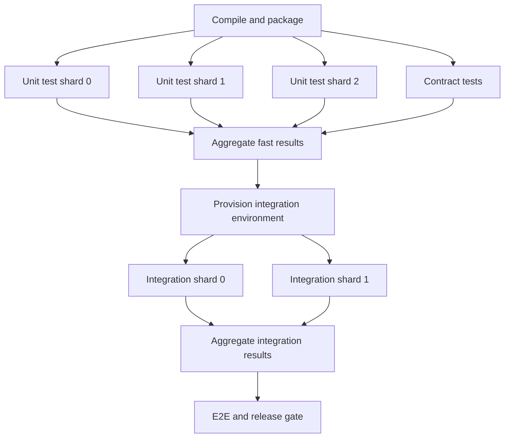

# Chạy kiểm thử độc lập song song và phân chia bộ kiểm thử

Khi một dự án có vài trăm hoặc vài nghìn test, chạy toàn bộ suite tuần tự có thể khiến mỗi thay đổi phải chờ rất lâu mới nhận được phản hồi. Nhóm thường tìm cách tăng số runner hoặc chia test thành nhiều job, nhưng nếu các test dùng chung dữ liệu, ghi vào cùng tài nguyên hoặc phụ thuộc thứ tự chạy, việc tăng mức song song có thể tạo ra lỗi ngẫu nhiên và kết quả khó tin cậy.

Tối ưu thời gian kiểm thử cần giải quyết hai việc đi cùng nhau: **xác định những test thực sự độc lập để chạy đồng thời, và phân chia công việc sao cho các worker có thời lượng tương đối cân bằng**. Chỉ tăng số worker không bảo đảm pipeline nhanh hơn nếu một vài test nặng vẫn dồn vào cùng shard, database trở thành nút thắt hoặc test phải chờ nhau vì trạng thái dùng chung.

Mục tiêu là giảm thời gian từ lúc tạo thay đổi đến khi có kết quả đáng tin cậy, đồng thời giữ khả năng tái hiện lỗi và truy vết test nào đã chạy trên revision nào.

## 1. Vì sao cần chạy test song song?

Trong CI/CD, test là một phần quan trọng của vòng phản hồi. Khi thời gian test tăng, developer phải chờ lâu hơn để biết thay đổi có an toàn hay không. Điều này kéo dài thời gian review, làm hàng đợi pull request tăng và khiến nhóm có xu hướng bỏ qua hoặc giảm phạm vi kiểm thử.

Ví dụ, một suite có 600 test mất tổng cộng 30 phút khi chạy tuần tự. Nếu chia thành 6 shard có thời lượng cân bằng, thời gian thực thi lý tưởng có thể giảm gần 5 lần. Nhưng thực tế còn có thời gian khởi tạo runner, tải dependency, tạo dữ liệu, kết nối database, thu thập report và chờ shard chậm nhất.

Chạy song song giúp:

- Giảm thời gian phản hồi của pull request.
- Tăng số thay đổi có thể được kiểm tra trong cùng khoảng thời gian.
- Phát hiện lỗi sớm hơn khi test được tổ chức theo mức độ ưu tiên.
- Tận dụng CPU, memory và runner capacity tốt hơn.
- Tách các nhóm test có dependency khác nhau để chạy phù hợp với tài nguyên.

Tuy nhiên, parallelism không tự làm giảm tổng lượng công việc. Nó chỉ thực hiện nhiều phần công việc cùng lúc. Nếu các test tranh chấp một database, một API sandbox hoặc một file dùng chung, thời gian có thể tăng và độ ổn định giảm.

## 2. Phân biệt parallelism, concurrency và test sharding

Ba khái niệm này liên quan nhưng khác nhau:

| Khái niệm | Ý nghĩa | Ví dụ |
|---|---|---|
| Concurrency | Nhiều công việc có thời gian thực thi chồng lấn; chúng có thể luân phiên hoặc chờ tài nguyên | Nhiều test cùng chờ database connection |
| Parallelism | Nhiều công việc thực sự chạy đồng thời trên nhiều CPU/core hoặc worker | Bốn test process chạy trên bốn runner |
| Test sharding | Chia một suite thành các nhóm nhỏ để chạy trên nhiều worker | 1.000 test được chia thành 8 shard |

Một hệ thống có thể có concurrency cao nhưng parallelism thấp nếu nhiều task cùng chờ I/O hoặc bị giới hạn một CPU. Sharding là cách phân phối công việc; mức parallelism thực tế phụ thuộc runner và tài nguyên.

### Các cấp độ song song

- **Trong một test process:** framework chạy nhiều test hoặc test method trên nhiều thread.
- **Nhiều process trên một máy:** mỗi process có JVM hoặc runtime riêng.
- **Nhiều job trong một pipeline:** CI tạo nhiều worker hoặc matrix job.
- **Nhiều máy/runner:** shard được phân phối trên các host độc lập.
- **Nhiều suite:** unit, contract, integration và E2E chạy đồng thời khi không có dependency tuần tự.

Không nên bật mọi cấp độ cùng lúc mà chưa đo tài nguyên. Ví dụ, 8 runner, mỗi runner chạy 8 JVM và mỗi JVM tạo 8 thread có thể tạo ra 512 luồng thực thi, vượt xa CPU, memory hoặc giới hạn database.

## 3. Phân loại test trước khi chia song song

Không phải mọi test có cùng chi phí hoặc dependency. Trước khi chọn chiến lược shard, hãy phân loại suite.

| Loại test | Mục tiêu | Đặc điểm khi chạy song song |
|---|---|---|
| Unit test | Kiểm tra logic nhỏ và nhanh | Thường dễ chạy song song nếu không dùng state toàn cục |
| Component test | Kiểm tra một thành phần cùng dependency giả lập | Có thể song song khi mỗi test có fixture và port riêng |
| Contract test | Xác minh hợp đồng giữa producer/consumer | Cần tách dữ liệu và mock/provider state theo test |
| Integration test | Kiểm tra nhiều thành phần thật cùng hoạt động | Cần database, queue, filesystem hoặc namespace được cô lập |
| End-to-end test | Kiểm tra luồng người dùng xuyên hệ thống | Tốn tài nguyên, dễ tranh chấp tài khoản và dữ liệu |
| Performance/load test | Đo hành vi dưới tải | Thường cần môi trường và lịch chạy riêng để tránh nhiễu |

Unit test thường là ứng viên tốt để chạy song song rộng. E2E test có thể chạy song song nhưng cần thiết kế dữ liệu, tài khoản và môi trường kỹ hơn. Performance test thường không nên chạy đồng thời với suite khác trên cùng môi trường vì chính các test đó có thể làm thay đổi kết quả đo.

## 4. Điều kiện để một test độc lập

Một test độc lập có thể chạy trước, sau hoặc cùng lúc với test khác mà kết quả không thay đổi ngoài các yếu tố đã kiểm soát.

Một test có tính độc lập khi:

1. Tạo hoặc sở hữu dữ liệu mà nó cần.
2. Không phụ thuộc test khác đã chạy trước để tạo trạng thái.
3. Không sửa dữ liệu mà test khác đang dùng.
4. Không phụ thuộc thứ tự thực thi hoặc trạng thái static/global còn sót.
5. Có thể chạy lại với cùng đầu vào và tạo kết quả tương đương.
6. Dọn tài nguyên sau khi chạy hoặc dùng tài nguyên có phạm vi riêng.
7. Có timeout và xử lý lỗi rõ ràng.

Ví dụ, hai test cùng cập nhật một bản ghi `customer_id=100` sẽ tranh chấp nếu cùng dùng database. Có thể làm chúng độc lập bằng cách tạo customer riêng cho mỗi test run hoặc mỗi test case.

### Test độc lập không có nghĩa test không cần dependency

Một integration test vẫn có thể cần PostgreSQL, Redis hoặc message broker thật. Điều cần thiết là test có môi trường hoặc namespace riêng, dữ liệu riêng và quy tắc cleanup rõ. Độc lập là không phụ thuộc trạng thái do test khác tạo ra, chứ không phải không có dependency.

## 5. Tìm và loại bỏ phụ thuộc ẩn giữa các test

Các lỗi thường chỉ xuất hiện khi chạy song song vì test có những phụ thuộc không được khai báo.

Ví dụ:

- Test A tạo user mặc định; test B giả định user đó tồn tại.
- Nhiều test dùng chung tên file `result.json`.
- Hai test cùng bind một port cố định.
- Một test thay đổi system property hoặc timezone toàn process.
- Test dùng chung singleton cache hoặc static mutable field.
- Test cùng xóa toàn bộ bảng dữ liệu khi bắt đầu.
- E2E test dùng chung một tài khoản và cùng thay đổi giỏ hàng.
- Test phụ thuộc thứ tự chạy để chờ queue hoặc cron job.

### Cách phát hiện

- Chạy test theo thứ tự ngẫu nhiên với seed được lưu lại.
- Chạy riêng từng test đang lỗi và chạy lại trong suite.
- Chạy suite với mức parallelism khác nhau để tìm race condition.
- Ghi log test ID, worker ID, dữ liệu và resource ID.
- Kiểm tra file, port, database row và account dùng chung.
- Dùng static analysis hoặc rule để tìm mutable global state nếu phù hợp.

Nếu một test chỉ pass khi chạy sau một test khác, đó là dấu hiệu cần sửa fixture hoặc dependency, không phải lý do để duy trì thứ tự ngầm.

## 6. Thiết kế dữ liệu test và tài nguyên cô lập

Dữ liệu và tài nguyên dùng chung là nguyên nhân phổ biến nhất khiến test song song không ổn định.

### 6.1. Dữ liệu có định danh riêng

Mỗi test hoặc worker nên dùng namespace, tenant, schema hoặc ID riêng. Ví dụ:

```text
test-run-8821-shard-0-customer-001
test-run-8821-shard-1-customer-001
test-run-8821-shard-2-customer-001
```

Tên có thể giống nhau ở cấp test nhưng phải được phân biệt bởi run/shard namespace. Tránh dùng một tài khoản hoặc bản ghi production-like cố định cho mọi worker.

### 6.2. Database isolation

Các lựa chọn thường dùng:

- Database hoặc schema riêng cho mỗi worker.
- Tenant riêng theo shard.
- Transaction rollback cho test phù hợp.
- Test container riêng theo suite hoặc worker.
- Prefix ID và cleanup theo test run.

Transaction rollback hữu ích cho test chạy trong cùng transaction, nhưng không cô lập được mọi side effect bên ngoài như message đã publish, email đã gửi, sequence value hoặc service khác đã đọc dữ liệu. Cần đánh giá toàn bộ luồng.

### 6.3. Filesystem và network

- Dùng temporary directory riêng theo test ID.
- Cấp port động thay vì hard-code một port chung.
- Dùng container network hoặc namespace riêng khi cần.
- Không ghi report hoặc snapshot vào cùng tên file từ nhiều worker.
- Cleanup theo run ID để không xóa tài nguyên của worker khác.

### 6.4. Tài khoản và session E2E

E2E test nên tạo user hoặc tenant riêng theo shard. Nếu hệ thống có giới hạn số tài khoản, có thể cấp pool tài khoản và lease độc quyền trong thời gian test. Không để hai worker cùng dùng một session hoặc cùng sửa một trạng thái giỏ hàng.

## 7. Chọn cách chia test thành shard

Sharding chia suite thành các nhóm để chạy trên nhiều worker. Chất lượng sharding ảnh hưởng trực tiếp đến thời gian hoàn tất toàn suite.

Một nguyên tắc quan trọng: **thời gian toàn suite song song bị quyết định bởi shard chậm nhất**, cộng thêm overhead khởi tạo và thu thập kết quả.

Nếu 4 shard mất lần lượt 3, 4, 5 và 18 phút, toàn bộ suite vẫn phải chờ 18 phút. Có 4 worker không có nghĩa suite nhanh gấp 4 lần.

### 7.1. Chia theo số lượng test

Ví dụ 400 test chia đều cho 4 shard, mỗi shard có 100 test.

Ưu điểm:

- Dễ triển khai.
- Dễ hiểu và kiểm tra.
- Phù hợp khi thời lượng test tương đối đồng đều.

Nhược điểm: một test E2E mất 3 phút có thể làm shard chứa nó chậm hơn nhiều so với shard chỉ có unit test vài mili giây.

### 7.2. Chia theo thời lượng lịch sử

CI lưu thời lượng của từng test từ các lần chạy trước. Scheduler có thể xếp test lâu nhất vào shard đang có tổng thời lượng ước tính thấp nhất.

Ưu điểm:

- Cân bằng thời gian tốt hơn chia theo số lượng.
- Tận dụng dữ liệu thực tế của suite.

Nhược điểm:

- Cần lịch sử đủ ổn định.
- Test mới chưa có duration phải dùng ước lượng mặc định.
- Thời lượng có thể thay đổi theo cache, tải hoặc dependency.

### 7.3. Chia theo hash ổn định

Có thể dùng hash của test ID để gán test vào shard:

```text
shard_index = stable_hash(test_id) % shard_count
```

Cách này giúp test thường nằm cùng shard qua các lần chạy, thuận tiện cache và điều tra. Tuy nhiên, hash không bảo đảm cân bằng thời lượng. Nếu một số test nặng rơi vào cùng shard, cần kết hợp duration-based assignment hoặc điều chỉnh manifest.

### 7.4. Chia theo nhóm hoặc dependency

Có thể gom test theo component, database, service hoặc loại tài nguyên. Cách này giúp worker khởi tạo dependency một lần cho nhóm, nhưng có nguy cơ shard không cân bằng nếu một component có nhiều test nặng.

### So sánh chiến lược

| Chiến lược | Cân bằng thời gian | Tính ổn định assignment | Độ phức tạp |
|---|---|---|---|
| Số lượng test | Thấp nếu duration khác nhau | Cao nếu danh sách cố định | Thấp |
| Duration lịch sử | Tốt khi dữ liệu đủ | Có thể thay đổi khi duration đổi | Trung bình |
| Hash ổn định | Không bảo đảm | Cao | Thấp |
| Theo nhóm/dependency | Phụ thuộc cấu trúc suite | Cao nếu nhóm ổn định | Trung bình |
| Bin packing theo duration | Tốt | Có thể đổi shard khi suite thay đổi | Cao hơn |

## 8. Thuật toán cân bằng shard theo thời lượng

Một cách đơn giản là greedy bin packing:

1. Lấy duration lịch sử của từng test.
2. Sắp xếp test theo duration giảm dần.
3. Gán test tiếp theo vào shard có tổng duration nhỏ nhất.
4. Lặp đến khi hết test.

Ví dụ có các test mất 10, 8, 7, 6, 5, 4, 3 và 2 phút, chia thành 3 shard. Sau khi sắp xếp giảm dần và lần lượt gán test vào shard đang có tổng thời lượng nhỏ nhất, ta có:

| Shard | Test | Tổng thời lượng ước tính |
|---|---|---:|
| 0 | 10 + 4 | 14 phút |
| 1 | 8 + 5 + 3 | 16 phút |
| 2 | 7 + 6 + 2 | 15 phút |

Shard lớn nhất mất khoảng 16 phút, gần với mức trung bình 15 phút. Thuật toán không luôn tạo nghiệm tối ưu, nhưng thường cân bằng tốt hơn chia đều theo số lượng.

### Pseudocode

```python
def assign_shards(test_durations, shard_count):
    shards = [[] for _ in range(shard_count)]
    totals = [0.0] * shard_count

    tests = sorted(
        test_durations.items(),
        key=lambda item: item[1],
        reverse=True,
    )

    for test_id, duration in tests:
        target = min(range(shard_count), key=lambda i: totals[i])
        shards[target].append(test_id)
        totals[target] += duration

    return shards, totals
```

Đây là ví dụ minh họa thuật toán phân bổ, không phải mã production hoàn chỉnh. Hệ thống thật cần xử lý test mới, test bị xóa, duration bất thường, test cần chạy cùng nhau và assignment ổn định giữa các run.

## 9. Số lượng shard và giới hạn tài nguyên

Tăng số shard thường giảm thời lượng thực thi cho đến khi đạt giới hạn CPU, memory, I/O, database hoặc runner capacity. Sau điểm đó, thêm worker có thể không giúp nhanh hơn.

Các yếu tố cần đo:

- Số CPU core và mức sử dụng CPU.
- Memory và garbage collection.
- Disk I/O và thời gian tải dependency.
- Số database connection và query latency.
- Queue, API sandbox và rate limit.
- Runner startup time và container image pull.
- Thời gian upload report và artifact.
- Hàng đợi runner khi nhiều pull request chạy cùng lúc.

Ví dụ, nếu mỗi test process dùng 1 GB RAM và runner chỉ có 4 GB khả dụng, chạy 8 process có thể gây swap hoặc OOM. Bốn process có thể nhanh và ổn định hơn tám.

### Công thức ước lượng đơn giản

Thời gian hoàn tất gần đúng có thể xem là:

\[
T_{total} \approx T_{setup} + \max(T_1, T_2, \ldots, T_n) + T_{collect}
\]

Trong đó `T_i` là thời gian của shard thứ i; `T_setup` là khởi tạo và `T_collect` là tổng hợp kết quả. Nếu tài nguyên dùng chung bị quá tải, thời gian từng shard có thể tăng khi số worker tăng.

## 10. Chọn mức parallelism trong test framework

Có thể chạy song song trong framework, giữa process hoặc giữa CI jobs. Mỗi cấp độ có trade-off.

### Trong cùng process

Ưu điểm là giảm overhead khởi tạo runtime. Nhưng các test có thể chia sẻ static state, singleton, system property hoặc thread-local không được dọn đúng.

### Nhiều process

Process tách memory và static state tốt hơn, nhưng tốn RAM, thời gian khởi động và cần phân chia dữ liệu/tài nguyên bên ngoài.

### Nhiều CI job

Job độc lập có thể chạy trên runner khác nhau, dễ cô lập môi trường. Đổi lại, mỗi job có thể phải checkout, tải dependency và khởi tạo service riêng.

Nên bắt đầu từ test độc lập, đo bottleneck rồi chọn cấp độ phù hợp. Không dùng parallelism cao để che giấu test có dependency hoặc trạng thái toàn cục.

## 11. Ví dụ cấu hình JUnit 5

JUnit Jupiter hỗ trợ chạy song song khi bật cấu hình phù hợp. Ví dụ file `junit-platform.properties`:

```properties
junit.jupiter.execution.parallel.enabled = true
junit.jupiter.execution.parallel.mode.default = concurrent
junit.jupiter.execution.parallel.mode.classes.default = concurrent
junit.jupiter.execution.parallel.config.strategy = dynamic
junit.jupiter.execution.parallel.config.dynamic.factor = 0.5
```

`dynamic.factor` dùng để tính mức parallelism từ số processor được runtime nhìn thấy. Giá trị phù hợp phụ thuộc loại test và tài nguyên. Với integration test có database, có thể cần giới hạn thấp hơn hoặc dùng resource lock.

Nếu một test cần chạy tuần tự với các test khác vì dùng tài nguyên chung, có thể dùng cơ chế khóa của framework, ví dụ `@ResourceLock` trong JUnit Jupiter:

```java
import org.junit.jupiter.api.Test;
import org.junit.jupiter.api.parallel.ResourceAccessMode;
import org.junit.jupiter.api.parallel.ResourceLock;

class SharedConfigurationTest {

    @Test
    @ResourceLock(
        value = "system-properties",
        mode = ResourceAccessMode.READ_WRITE
    )
    void changesSystemProperty() {
        // Arrange, execute and restore the property.
    }
}
```

Resource lock chỉ điều phối các test trong phạm vi framework/process có cùng cơ chế khóa. Nó không thay thế database lock hoặc distributed coordination giữa nhiều CI runner.

### Giữ test có state dùng chung ở chế độ tuần tự khi cần

Nếu test thay đổi timezone, locale, system property hoặc static singleton, có thể đánh dấu resource lock hoặc chạy nhóm test riêng. Nhưng giải pháp bền vững hơn là đưa state vào dependency có thể inject và reset theo test.

## 12. Chia shard trong CI pipeline

Pipeline có thể tạo matrix job, mỗi job nhận một shard index và tổng số shard. Các job độc lập chạy đồng thời rồi một bước tổng hợp kiểm tra mọi shard đã hoàn tất.

Ví dụ YAML khái niệm:

```yaml
test_pipeline:
  prepare:
    steps:
      - checkout_exact_commit
      - resolve_test_manifest
      - calculate_shard_assignments
      - publish_shard_manifest

  execute:
    matrix:
      shard: [0, 1, 2, 3]
    steps:
      - checkout_exact_commit
      - download_shard_manifest
      - create_isolated_test_namespace
      - run_assigned_tests
      - upload_junit_and_diagnostics
      - cleanup_test_namespace

  aggregate:
    needs: [execute]
    steps:
      - collect_all_shard_reports
      - verify_expected_test_coverage
      - detect_missing_or_duplicate_tests
      - publish_unified_test_result
```

Đây là cấu trúc khái niệm, không phải cú pháp của một CI provider cụ thể. Trong triển khai thật, cần bảo đảm mọi shard dùng cùng commit, dependency lockfile, test manifest và cấu hình test tương đương.

### Tránh shard bị thiếu hoặc chạy trùng

Bước aggregate cần kiểm tra:

- Tất cả shard dự kiến đã có report.
- Mỗi test ID được gán đúng một lần, trừ khi có chủ đích chạy lặp.
- Không có shard bị bỏ qua do matrix hoặc điều kiện sai.
- Report gắn với đúng pipeline run và commit.
- Test fail không bị che bởi job tổng hợp chỉ kiểm tra trạng thái upload.

Nếu một shard bị hủy hoặc runner mất, pipeline cần đánh dấu suite chưa hoàn tất. Không được coi “các report đã upload” là bằng chứng toàn bộ test đã chạy.

## 13. Chia test theo mức độ ưu tiên để có phản hồi sớm

Không phải test nào cũng cần chặn pull request ngay. Có thể tổ chức nhiều vòng phản hồi:

| Vòng | Nội dung | Mục tiêu |
|---|---|---|
| Fast checks | Lint, unit test nhanh, kiểm tra cấu hình | Phản hồi trong vài phút |
| PR suite | Unit và component test, contract test liên quan | Kiểm tra thay đổi trước merge |
| Integration suite | Database, queue, service integration | Xác minh tương tác thực |
| E2E/regression | Luồng người dùng quan trọng xuyên hệ thống | Phát hiện lỗi tích hợp và nghiệp vụ |
| Nightly/full suite | Test rộng, test ít chạy, compatibility và migration | Phát hiện lỗi không xuất hiện ở PR scope |
| Performance/security specialized | Load, stress, fuzz hoặc security test chuyên sâu | Kiểm tra rủi ro cần môi trường riêng |

Các vòng có thể chạy song song nếu không có dependency. Ví dụ, unit test và contract test có thể chạy đồng thời sau khi build. E2E có thể chạy sau khi môi trường preview sẵn sàng.

### Test selection theo thay đổi

Có thể chọn test liên quan dựa trên file/module/dependency graph bị thay đổi. Tuy nhiên, selection phải thận trọng:

- Nếu không xác định được impact, chạy phạm vi rộng hơn.
- Thay đổi shared library cần test các consumer liên quan.
- Thay đổi build script, test framework hoặc dependency có thể yêu cầu full suite.
- Chạy full suite định kỳ để phát hiện mapping bị thiếu.
- Không để test selection trở thành cách vô tình bỏ qua test bảo vệ quan trọng.

## 14. Quản lý test phụ thuộc và thứ tự thực thi

Một số test có dependency thật, ví dụ migration phải chạy trước integration test dùng schema mới. Những dependency này cần được khai báo thành DAG thay vì dựa vào thứ tự tình cờ.

Ví dụ:



Chỉ các bước có dependency mới cần chờ nhau. Các test độc lập nên được khởi chạy cùng lúc để giảm critical path.

Nếu nhiều test cần cùng một service setup, có thể provision một lần cho mỗi shard hoặc dùng environment chung có namespace dữ liệu riêng. Cần cân bằng chi phí setup với rủi ro tranh chấp tài nguyên.

## 15. Giữ kết quả test xác định và có thể tái hiện

Chạy song song làm lộ ra test không deterministic. Một test có thể pass ở lần này và fail ở lần khác do race, timeout, random seed hoặc dữ liệu bên ngoài.

Để tăng khả năng tái hiện:

- Ghi random seed và test order.
- Ghi test ID, shard ID, worker ID và commit SHA.
- Pin dependency và version runtime.
- Kiểm soát clock, timezone và locale khi test phụ thuộc thời gian.
- Dùng fixture cố định hoặc factory dữ liệu có seed.
- Không phụ thuộc API bên ngoài không ổn định trong unit test.
- Lưu log và report riêng cho từng test/shard.
- Có thể chạy lại đúng test ID với cùng cấu hình.

### Randomized test order

Random order có ích để phát hiện phụ thuộc ẩn. Nhưng cần lưu seed để tái hiện. Nếu framework không cung cấp seed rõ, có thể lưu danh sách thứ tự test trong artifact report.

Không nên cố định một thứ tự duy nhất mãi mãi nếu mục tiêu là phát hiện test order dependency. Có thể dùng thứ tự ngẫu nhiên trong nightly hoặc một tỷ lệ CI run, còn PR suite giữ chiến lược ổn định để phản hồi dễ so sánh.

## 16. Xử lý flaky test mà không che lỗi

Flaky test là test có thể cho kết quả khác nhau khi chạy lại với cùng revision và điều kiện tương đương. Chạy song song có thể làm lộ race condition, nhưng retry vô hạn sẽ che mất lỗi thật.

Một chính sách phù hợp:

1. Lưu kết quả lần chạy đầu và toàn bộ diagnostic.
2. Nếu policy cho phép, retry một lần có kiểm soát để phân biệt lỗi tạm thời.
3. Giữ trạng thái flaky/unstable trong report; không biến lần retry pass thành bằng chứng test ổn định.
4. Gán owner và issue cho test flaky.
5. Theo dõi tỷ lệ flaky và thời gian tồn tại.
6. Tách hoặc quarantine test chỉ khi có lý do, thời hạn và phạm vi rõ.

Không nên retry toàn bộ shard chỉ vì một test fail nếu có thể retry đúng test ID. Nhưng retry riêng phải bảo đảm test có thể chạy độc lập và dùng dữ liệu sạch.

## 17. Xử lý timeout, hủy và cleanup

Một shard có thể bị treo vì deadlock, service không phản hồi hoặc test chờ một điều kiện không bao giờ xảy ra.

Mỗi test/job cần:

- Timeout phù hợp với loại test.
- Diagnostic khi timeout: thread dump, container logs, DB activity hoặc trace nếu có.
- Cleanup có giới hạn thời gian và không xóa tài nguyên của worker khác.
- Trạng thái riêng cho timeout, cancelled và infrastructure error.
- Cơ chế dọn namespace nếu runner bị mất đột ngột.

Cleanup nên có owner/run ID và TTL để một worker không xóa dữ liệu của run khác. Nếu test tạo cloud resource, cần tag theo pipeline run và có job dọn định kỳ cho resource bị bỏ sót.

## 18. Tránh bottleneck ở dependency dùng chung

Khi số worker tăng, dependency dùng chung có thể trở thành giới hạn throughput.

Ví dụ:

- Database chỉ cho phép 50 connection nhưng 100 test process cùng mở pool.
- Một API sandbox giới hạn 20 request/giây.
- Một message broker có queue dùng chung và test consume message của nhau.
- Một container registry bị nhiều runner pull cùng image lớn.
- Một môi trường staging chỉ có một tenant test.

Các cách xử lý:

- Giới hạn parallelism theo dependency, không chỉ theo CPU.
- Dùng connection pool phù hợp và đóng connection sau test.
- Tạo service/container riêng theo shard khi khả thi.
- Dùng mock/fake cho test không cần dependency thật.
- Chia queue, topic hoặc namespace theo run ID.
- Cache dependency immutable nhưng tránh cache trạng thái mutable.
- Đo wait time và saturation của dependency.

Không nên tăng worker chỉ vì CPU còn rảnh nếu database hoặc API sandbox đã bão hòa.

## 19. Theo dõi hiệu quả của test parallelization

Đo thời gian tổng là chưa đủ. Cần biết bottleneck nằm ở runner queue, setup, test execution, shard imbalance hay aggregate.

| Chỉ số | Ý nghĩa | Cách dùng |
|---|---|---|
| Feedback time | Từ lúc pipeline bắt đầu đến khi có kết quả test cần thiết | Đo trải nghiệm developer |
| Queue time | Thời gian chờ runner | Xác định thiếu runner capacity |
| Setup time | Checkout, dependency download, service startup | Tối ưu cache và image |
| Shard duration p50/p95 | Thời gian của các shard | Phát hiện shard chậm và mất cân bằng |
| Shard imbalance ratio | Shard dài nhất so với trung bình | Đánh giá chất lượng phân bổ |
| Worker utilization | CPU/memory và thời gian worker hoạt động | Chọn mức parallelism phù hợp |
| Test flake rate | Tỷ lệ test không ổn định | Phát hiện race và test phụ thuộc trạng thái |
| Retry rate | Tỷ lệ test/job phải chạy lại | Phân biệt lỗi môi trường và lỗi sản phẩm |
| Missing/duplicate test count | Test bị bỏ sót hoặc chạy trùng ngoài chủ đích | Kiểm tra tính đúng của sharding |
| Cost per pipeline | Tài nguyên tiêu thụ cho mỗi run | Cân bằng tốc độ và chi phí |

### Shard imbalance ratio

Một cách đo đơn giản:

\[
\text{Imbalance ratio} = \frac{\text{Longest shard duration}}{\text{Average shard duration}}
\]

Giá trị càng gần 1 thì shard càng cân bằng. Chỉ số này cần được đọc cùng setup time và bottleneck dùng chung; shard cân bằng không có nghĩa toàn suite đã tối ưu.

## 20. Ví dụ thiết kế test pipeline cho orders-api

Giả sử `orders-api` có unit test nhanh, integration test dùng PostgreSQL và Redis, contract test với `inventory-api`, cùng một bộ E2E kiểm tra tạo đơn.

**Bước 1 — Phân loại:** unit test chạy trong process hoặc nhiều process; contract test chạy độc lập; integration test cần dependency container; E2E dùng tài khoản và tenant riêng.

**Bước 2 — Chuẩn bị manifest:** mỗi test có ID ổn định và duration lịch sử. Scheduler chia unit và integration suite theo duration để tạo 4 shard tương đối cân bằng.

**Bước 3 — Chạy song song:** unit shard và contract test chạy đồng thời. Mỗi integration shard có schema hoặc namespace riêng, database connection pool giới hạn và queue prefix theo run ID. E2E chạy sau khi environment preview sẵn sàng.

**Bước 4 — Thu thập:** mỗi shard upload JUnit XML, log và timing report. Aggregate job xác nhận đủ shard, không thiếu test ID và không có report trùng.

**Bước 5 — Xử lý lỗi:** nếu một test timeout, pipeline giữ thread dump và log dependency. Retry đúng test ID một lần theo policy, nhưng report vẫn ghi nhận lần đầu thất bại để theo dõi flakiness.

**Bước 6 — Cải thiện:** dashboard cho thấy integration shard 3 lâu hơn do test migration. Nhóm chuyển migration rehearsal sang suite riêng có lock database, cân bằng lại các shard còn lại và giới hạn parallelism theo connection capacity.

Kết quả mong muốn không chỉ là số phút giảm xuống mà còn là test coverage đầy đủ, kết quả có thể tái hiện và không có lỗi do các worker can thiệp lẫn nhau.

## 21. Những anti-pattern thường gặp

| Anti-pattern | Hệ quả | Cách cải thiện |
|---|---|---|
| Tăng worker mà không đo bottleneck | Database hoặc runner bị quá tải, tổng thời gian tăng | Đo CPU, memory, I/O, queue và dependency saturation |
| Chia đều theo số test | Một shard chứa test nặng làm cả suite chậm | Dùng duration lịch sử hoặc bin packing |
| Test dùng chung dữ liệu | Race condition và kết quả ngẫu nhiên | Namespace/fixture riêng theo test hoặc shard |
| Test phụ thuộc thứ tự | Chạy riêng pass nhưng chạy song song fail | Loại bỏ shared state và randomize order có seed |
| Mỗi worker tự tạo dependency quá nặng | Setup time và chi phí tăng mạnh | Chọn mức cô lập phù hợp theo suite/shard |
| Dùng một account E2E cho mọi worker | Session và dữ liệu bị ghi đè | Account pool hoặc tenant riêng |
| Retry đến khi pass | Che flaky test và lỗi sản phẩm | Retry giới hạn, giữ kết quả lần đầu và gán owner |
| Aggregate chỉ kiểm tra job upload report | Có thể thiếu test hoặc shard mà pipeline vẫn xanh | Kiểm tra manifest, shard coverage và test ID |
| Test performance chạy chung suite | Kết quả benchmark bị nhiễu | Môi trường và lịch chạy riêng |
| Cleanup xóa tài nguyên dùng chung | Worker khác thất bại hoặc mất dữ liệu | Tag theo run ID, namespace và TTL |
| Bỏ full suite sau khi có test selection | Mapping impact bị thiếu mà không phát hiện | Chạy full suite định kỳ và khi thay đổi rủi ro cao |

## 22. Checklist chạy kiểm thử độc lập song song

Trước khi tăng mức parallelism, nhóm có thể rà soát:

- [ ] Test được phân loại theo unit, component, contract, integration, E2E và performance.
- [ ] Mỗi test tạo hoặc sở hữu dữ liệu cần thiết.
- [ ] Không có phụ thuộc ngầm vào thứ tự test.
- [ ] Static/global state và system property được cô lập hoặc khóa phù hợp.
- [ ] Database, queue, filesystem, port và account được namespace theo test/run/shard.
- [ ] Test có timeout, cleanup và diagnostic rõ ràng.
- [ ] Test ID ổn định và manifest shard có thể tái tạo.
- [ ] Chiến lược sharding xét duration, dependency và tài nguyên.
- [ ] Số worker phù hợp CPU, memory, database connection và rate limit.
- [ ] Tất cả shard dùng cùng commit, dependency và cấu hình.
- [ ] Aggregate xác nhận đủ shard, không thiếu hoặc chạy trùng test ngoài chủ đích.
- [ ] Report giữ test ID, shard ID, seed, timing và artifact/revision.
- [ ] Retry có giới hạn và không che lần chạy đầu thất bại.
- [ ] Test selection có fallback và full suite định kỳ.
- [ ] Performance/load test được tách khỏi suite gây nhiễu.
- [ ] Theo dõi feedback time, shard imbalance, flake rate và cost.

## 23. Kết luận

Chạy kiểm thử độc lập song song và phân chia bộ kiểm thử giúp rút ngắn vòng phản hồi CI/CD khi test được thiết kế để không tranh chấp trạng thái và shard được cân bằng theo thời lượng thực tế. Nhóm nên bắt đầu bằng việc loại bỏ phụ thuộc ẩn, cô lập dữ liệu và tài nguyên, sau đó chọn mức parallelism phù hợp với runner cùng dependency.

Một pipeline song song đáng tin cậy cần test ID ổn định, sharding có thể tái tạo, report đầy đủ, aggregate kiểm tra coverage, retry có giới hạn và telemetry để tìm shard chậm hoặc flaky. Khi các yếu tố này được quản lý, tăng số worker mới thực sự cải thiện tốc độ phản hồi mà không làm giảm độ tin cậy của quality gate.
