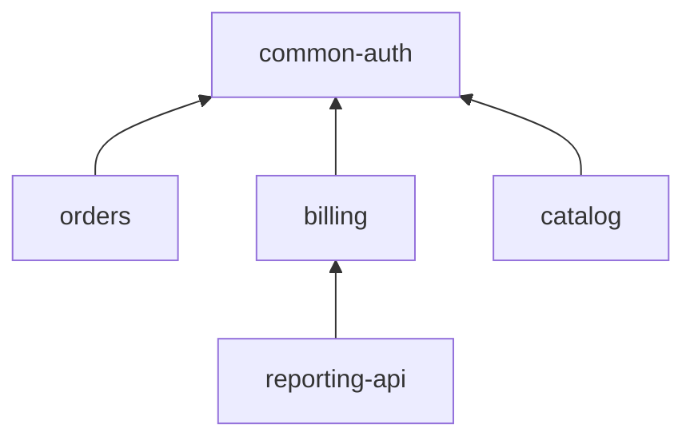

# Giảm công việc không cần thiết bằng phân tích phạm vi thay đổi

Trong một repository lớn, không phải mọi thay đổi đều cần chạy lại toàn bộ build và test suite. Một chỉnh sửa chỉ ảnh hưởng tài liệu có thể không cần chạy integration test của tất cả service; thay đổi trong thư viện dùng chung lại có thể ảnh hưởng nhiều module dù chỉ sửa một file. Nếu pipeline luôn chạy mọi thứ, phản hồi chậm và tốn runner. Nếu chọn test quá hẹp, lỗi ở thành phần phụ thuộc có thể lọt qua.

**Phân tích phạm vi thay đổi (change impact analysis)** xác định phần nào của hệ thống có thể bị ảnh hưởng bởi một tập thay đổi, sau đó chọn build, test và kiểm tra phù hợp. Mục tiêu là giảm công việc không cần thiết nhưng vẫn giữ đủ độ tin cậy. Việc lựa chọn cần dựa trên quan hệ phụ thuộc, loại file, rủi ro và bằng chứng; không chỉ dựa vào số lượng file đã sửa.

Trong CI/CD, cách tiếp cận này thường kết hợp ba lớp: phát hiện file thay đổi, mở rộng phạm vi qua dependency graph và áp dụng policy để chọn kiểm tra. Khi không đủ thông tin hoặc thay đổi có phạm vi rộng, pipeline cần quay về bộ kiểm tra đầy đủ.

## 1. Vì sao cần phân tích phạm vi thay đổi?

Một pipeline monorepo có thể chứa hàng chục service, thư viện, image, manifest và bộ kiểm thử. Chạy tất cả ở mỗi pull request có một số hệ quả:

- Thời gian chờ kết quả tăng dù phần lớn job không liên quan.
- Runner và tài nguyên môi trường kiểm thử bị sử dụng cho công việc không cần thiết.
- Hàng đợi kéo dài làm giảm tốc độ phản hồi của cả nhóm.
- Nhiều kết quả không liên quan khiến người phát triển khó tìm tín hiệu cần xử lý.
- Chi phí benchmark, integration environment và test end-to-end tăng.

Ngược lại, chỉ chạy test của thư mục vừa sửa cũng không đủ an toàn. Một thay đổi trong thư viện `common-auth` có thể ảnh hưởng tất cả service sử dụng nó; sửa file build convention có thể ảnh hưởng toàn repository; thay đổi API schema có thể ảnh hưởng producer, consumer và contract test.

Phân tích phạm vi thay đổi giúp trả lời:

1. Những file, module hoặc thành phần nào thay đổi trực tiếp?
2. Thành phần nào phụ thuộc vào phần đã thay đổi?
3. Những test/build nào xác minh được các đường ảnh hưởng đó?
4. Có thay đổi toàn cục hoặc chưa phân loại khiến phải chạy kiểm tra rộng hơn không?
5. Bằng chứng nào cho thấy bộ test được chọn là đủ an toàn?

## 2. Phân biệt changed files và affected components

**Changed files** là danh sách đường dẫn có khác biệt giữa hai revision. **Affected components** là tập module, service hoặc tài nguyên có thể bị ảnh hưởng bởi những file đó. Hai tập này không giống nhau.

Ví dụ:

```text
Repository
├── services/
│   ├── orders/
│   ├── billing/
│   └── catalog/
├── libs/
│   ├── common-auth/
│   └── common-observability/
├── contracts/
├── infra/
└── build-logic/
```

Nếu sửa `libs/common-auth/src/TokenVerifier.java`, file thay đổi nằm trong `common-auth`, nhưng phạm vi ảnh hưởng có thể gồm `orders`, `billing` và `catalog` nếu cả ba phụ thuộc thư viện này. Nếu sửa `build-logic`, phạm vi có thể là mọi module sử dụng convention plugin.

| Khái niệm | Câu hỏi | Ví dụ |
|---|---|---|
| Changed file | File nào khác so với base revision? | `libs/common-auth/src/TokenVerifier.java` |
| Direct owner | Module nào sở hữu file đó? | `common-auth` |
| Direct dependent | Thành phần nào phụ thuộc trực tiếp vào module đổi? | `orders`, `billing` |
| Transitive dependent | Thành phần nào phụ thuộc gián tiếp? | `reporting-api` phụ thuộc `billing` |
| Selected checks | Cần chạy những build/test nào? | Unit test `common-auth`, integration test auth của các service phụ thuộc |

Chỉ lấy thư mục chứa file thay đổi sẽ bỏ sót các dependent. Cần mở rộng phạm vi theo hướng ngược của quan hệ phụ thuộc.

## 3. Dùng dependency graph để tính phạm vi ảnh hưởng

Dependency graph mô tả quan hệ giữa module, service, package, API hoặc tài nguyên. Giả sử mũi tên `A → B` có nghĩa A phụ thuộc vào B. Khi B thay đổi, cần xem xét B và các node có đường đi tới B trong đồ thị phụ thuộc.



Nếu `common-auth` thay đổi, phạm vi ảnh hưởng gồm `common-auth`, `orders`, `billing`, `catalog` và có thể cả `reporting-api` thông qua `billing`. Nếu chỉ `orders` thay đổi, không nhất thiết chạy test của `catalog`.

### Direct dependency và reverse dependency

- **Direct dependency:** module A khai báo sử dụng module B.
- **Reverse dependency:** danh sách module sử dụng B.
- **Transitive dependency:** quan hệ qua nhiều tầng, ví dụ C phụ thuộc A và A phụ thuộc B.
- **Impact closure:** tập node cần xem xét sau khi mở rộng từ các node thay đổi qua reverse dependency tới khi không còn node mới.

Nếu thay đổi một thư viện, tính reverse dependency closure thường là cách an toàn để tìm các consumer cần kiểm tra. Nếu thay đổi một service độc lập, chỉ các module và contract liên quan có thể cần chạy.

### Không phải dependency nào cũng được khai báo tĩnh

Dependency graph có thể không phản ánh đầy đủ:

- Reflection, dynamic class loading hoặc plugin discovery.
- Dependency được chọn qua environment variable hoặc feature flag.
- Service gọi nhau qua URL/configuration thay vì khai báo trong build file.
- Schema/event được chia sẻ qua registry hoặc message broker.
- Terraform module, Helm chart và policy được tham chiếu gián tiếp.
- Generated code hoặc code sinh từ schema.

Với các quan hệ động, cần bổ sung mapping do nhóm sở hữu quản lý, contract registry, service catalog hoặc policy bảo thủ. Nếu không thể xác định tác động một cách đáng tin cậy, chọn phạm vi rộng hơn.

## 4. Phát hiện file thay đổi đúng cách

Trước khi phân tích, pipeline phải so sánh đúng hai revision. Chọn sai base commit có thể khiến danh sách thay đổi thiếu hoặc thừa file.

Các nguyên tắc:

- Với pull request, so sánh head revision với merge base của nhánh đích và nhánh nguồn.
- Dùng commit SHA bất biến thay vì tên branch mutable.
- Lấy đủ history hoặc fetch base commit để Git tính được merge base.
- Bao gồm file thêm, sửa, xóa và rename; rename nên được xử lý như xóa đường dẫn cũ và thêm đường dẫn mới khi mapping theo folder.
- Phân biệt file được sinh tự động với source of truth tạo ra nó.
- Với merge queue hoặc push event, dùng base/head tương ứng với event thay vì tái sử dụng logic riêng cho pull request.

Ví dụ lệnh Git cho pull request:

```bash
git diff --no-renames --name-only "$BASE_SHA...$HEAD_SHA"
```

Ba dấu chấm yêu cầu Git so sánh từ merge base tới head. `--no-renames` làm file được di chuyển xuất hiện như một đường dẫn bị xóa và một đường dẫn được thêm, giúp mapping thư mục cũ và mới không bị bỏ sót. Biến `BASE_SHA` và `HEAD_SHA` cần là commit SHA hợp lệ đã có trong local repository.

Với checkout nông (shallow clone), merge base có thể không tồn tại trong local history. Pipeline cần fetch đủ commit hoặc fetch base revision trước khi chạy diff. Nếu không lấy được base commit, không nên suy đoán danh sách file thay đổi.

### Xử lý trường hợp đặc biệt

| Trường hợp | Cách xử lý |
|---|---|
| File mới | Đưa module sở hữu file vào impact set |
| File bị xóa | Vẫn chạy test của module sở hữu và consumer có thể bị ảnh hưởng |
| File đổi tên/di chuyển | Xem cả module cũ và module mới |
| Lockfile/dependency catalog đổi | Chạy kiểm tra cho các module dùng dependency đó; thường cần mở rộng đáng kể |
| Build script hoặc plugin chung đổi | Chạy build/test rộng hoặc toàn repository |
| CI workflow/policy đổi | Chạy kiểm tra pipeline/configuration và xác minh các gate liên quan |
| Chỉ thay tài liệu | Có thể chỉ chạy lint/docs link check nếu policy xác nhận không có source được sinh |
| Không phân tích được diff | Fallback về bộ kiểm tra đầy đủ |

## 5. Ánh xạ đường dẫn tới module và loại kiểm tra

Một repository cần có quy tắc rõ ràng để xác định file thuộc module nào và thay đổi đó yêu cầu kiểm tra gì. Có thể lưu mapping trong build graph, project metadata hoặc một file cấu hình do repository quản lý.

Ví dụ mapping khái niệm:

| Đường dẫn | Component | Kiểm tra trực tiếp |
|---|---|---|
| `services/orders/**` | `orders` | Unit, component, API integration |
| `services/billing/**` | `billing` | Unit, payment contract, billing integration |
| `libs/common-auth/**` | `common-auth` | Library unit và reverse dependents |
| `contracts/**` | API/event contracts | Schema validation và producer/consumer contract tests |
| `infra/**` | Infrastructure | IaC validation, policy scan và environment plan |
| `build-logic/**` | Build system | Build logic tests và build affected modules hoặc toàn repo |
| `.github/workflows/**` | CI control plane | Workflow lint, policy checks và kiểm tra pipeline liên quan |

Không nên dựa vào quy tắc `startsWith` đơn giản nếu folder có thể chứa nhiều project hoặc tên module chồng lấn. Mapping cần xử lý glob theo ranh giới thư mục, được review như mã nguồn và có test cho các pattern quan trọng.

### Một file có thể tác động nhiều nhóm kiểm tra

Ví dụ thay đổi OpenAPI schema có thể yêu cầu:

- Schema lint/compatibility check.
- Build code client/server được sinh từ schema.
- Contract test của producer.
- Contract test của consumer.
- Integration test cho luồng nghiệp vụ quan trọng.

Vì vậy, mapping không chỉ là `path → module`; tốt hơn là `path → component + impact categories + required checks`.

## 6. Chọn test theo phạm vi ảnh hưởng

Sau khi có impact set, chọn các kiểm tra theo nhiều tầng. Không cần chạy tất cả test của mọi dependent nếu có cách xác minh hẹp hơn, nhưng phải bảo đảm các ranh giới rủi ro được kiểm tra.

| Phạm vi ảnh hưởng | Kiểm tra thường phù hợp |
|---|---|
| Một class/hàm trong module | Unit test của module và static analysis liên quan |
| Một package hoặc component | Unit + component test và test consumer trực tiếp nếu có API thay đổi |
| Shared library | Library test + reverse dependent compile/test + contract tests |
| API/event schema | Schema compatibility + producer/consumer contract + integration trọng yếu |
| Build logic/toolchain | Build logic test + build nhiều module hoặc full build |
| Database migration | Migration validation, compatibility test với phiên bản ứng dụng liên quan và data checks |
| Infrastructure/network/IAM | IaC validate/plan, policy scan và test kết nối phụ thuộc |
| Pipeline/security policy | Workflow lint, policy test và kiểm tra các đường phát hành chịu ảnh hưởng |
| Unknown/global change | Full required suite theo policy |

### Tách test bắt buộc và test mở rộng

Một mô hình hữu ích:

- **Required fast checks:** chạy cho mọi PR, gồm lint, unit test nhanh, kiểm tra định dạng và policy cơ bản.
- **Affected component checks:** chạy cho module bị ảnh hưởng và reverse dependents.
- **Boundary checks:** chạy contract/integration test tại các giao tiếp có thay đổi.
- **Risk-based checks:** chạy security, migration, performance smoke hoặc E2E khi loại thay đổi yêu cầu.
- **Full regression:** chạy theo lịch, trước release hoặc khi policy đánh giá phạm vi không đủ chắc chắn.

Phân tích phạm vi không nên bỏ qua một gate bắt buộc như secret scan hoặc kiểm tra license chỉ vì file được sửa nằm ở một module nhỏ. Một số kiểm tra có phạm vi repository-wide và phải luôn chạy.

## 7. Phân loại rủi ro để mở rộng phạm vi

Không phải mọi thay đổi cùng số lượng file đều có cùng rủi ro. Một dòng thay đổi trong authentication policy có thể quan trọng hơn hàng trăm dòng tài liệu.

Các yếu tố cần xem:

- Mức độ quan trọng của module và số consumer.
- Thay đổi có nằm trên đường đi của dữ liệu nhạy cảm hoặc giao dịch quan trọng không?
- Có thay đổi public API, event schema hoặc database schema không?
- Có thay đổi dependency version, build plugin, compiler hoặc runtime không?
- Có thay đổi pipeline, permission, secret handling hoặc deployment policy không?
- Dependency graph có đầy đủ và được kiểm chứng không?
- Test được chọn có đủ coverage và độ tin cậy không?

Một policy ví dụ:

| Mức | Dấu hiệu | Phạm vi kiểm tra |
|---|---|---|
| Thấp | Docs-only hoặc thay đổi isolated, graph rõ ràng | Docs checks hoặc module checks cùng required fast checks |
| Trung bình | Thay đổi module có consumer xác định | Affected module + reverse dependents + boundary tests |
| Cao | Shared library, API/schema, dependency lock, migration | Mở rộng consumer set, integration và compatibility tests |
| Rất cao | Build logic, CI policy, authentication, IAM, global config hoặc graph không tin cậy | Full required suite và các kiểm tra chuyên biệt |

Đây là phân loại tham khảo. Mức rủi ro cần được định nghĩa theo kiến trúc và chính sách của tổ chức. Nếu không biết một thay đổi có ảnh hưởng tới đâu, không được tự gán mức thấp chỉ vì diff nhỏ.

## 8. Ví dụ script phân tích phạm vi thay đổi

Đoạn Bash dưới đây minh họa cách phân loại thay đổi theo đường dẫn trong một monorepo. Nó sử dụng `BASE_SHA` và `HEAD_SHA` do workflow cung cấp; khi gặp file toàn cục hoặc đường dẫn chưa biết, nó chọn full suite.

```bash
#!/usr/bin/env bash
set -Eeuo pipefail

: "${BASE_SHA:?BASE_SHA is required}"
: "${HEAD_SHA:?HEAD_SHA is required}"

changed_files="$(git diff --no-renames --name-only "$BASE_SHA...$HEAD_SHA")"

run_orders=false
run_billing=false
run_catalog=false
run_auth=false
run_infra=false
run_docs=false
run_full=false

if [[ -z "$changed_files" ]]; then
  echo "No changed paths detected; verify the comparison range."
  run_full=true
fi

if printf '%s\n' "$changed_files" | grep -qE '^services/orders/'; then run_orders=true; fi
if printf '%s\n' "$changed_files" | grep -qE '^services/billing/'; then run_billing=true; fi
if printf '%s\n' "$changed_files" | grep -qE '^services/catalog/'; then run_catalog=true; fi
if printf '%s\n' "$changed_files" | grep -qE '^libs/common-auth/'; then
  run_auth=true
  run_orders=true
  run_billing=true
  run_catalog=true
fi
if printf '%s\n' "$changed_files" | grep -qE '^infra/'; then run_infra=true; fi
if printf '%s\n' "$changed_files" | grep -qE '^docs/'; then run_docs=true; fi
if printf '%s\n' "$changed_files" | grep -qE '^(build-logic/|gradle/|settings\.gradle\.kts$|build\.gradle\.kts$|\.github/workflows/)'; then
  run_full=true
fi

if printf '%s\n' "$changed_files" | grep -qEv '^(services/(orders|billing|catalog)/|libs/common-auth/|infra/|docs/|build-logic/|gradle/|settings\.gradle\.kts$|build\.gradle\.kts$|\.github/workflows/)'; then
  run_full=true
fi

if [[ "$run_full" == true ]]; then
  run_orders=true
  run_billing=true
  run_catalog=true
  run_auth=true
  run_infra=true
fi

printf 'orders=%s\n' "$run_orders"
printf 'billing=%s\n' "$run_billing"
printf 'catalog=%s\n' "$run_catalog"
printf 'auth=%s\n' "$run_auth"
printf 'infra=%s\n' "$run_infra"
printf 'docs=%s\n' "$run_docs"
printf 'full=%s\n' "$run_full"
```

Đây là mapping minh họa; trong repository thực tế cần bổ sung dependency graph và test categories thay vì giả định `common-auth` chỉ được dùng bởi ba service trên. Ví dụ dùng danh sách đường dẫn phân tách bằng newline nên phù hợp với quy ước tên file thông thường; nếu repository cho phép tên file chứa newline, hãy dùng `git diff -z` và parser xử lý NUL delimiter.

Một điểm quan trọng: script chọn phạm vi không được im lặng trả về “không có test”. Nếu diff rỗng do base/head sai, thiếu history hoặc lỗi parsing, pipeline cần báo lỗi hoặc fallback full suite.

## 9. Ví dụ workflow GitHub Actions

Workflow có thể có một job đầu tiên phát hiện thay đổi, sau đó các job test được chạy theo output. Ví dụ dưới đây dành cho pull request và giả định repository có script `ci/select-scope.sh` như phần trước.

```yaml
name: Selective CI

on:
  pull_request:
    types: [opened, synchronize, reopened]

jobs:
  analyze:
    runs-on: ubuntu-latest
    outputs:
      orders: ${{ steps.scope.outputs.orders }}
      billing: ${{ steps.scope.outputs.billing }}
      catalog: ${{ steps.scope.outputs.catalog }}
      auth: ${{ steps.scope.outputs.auth }}
      infra: ${{ steps.scope.outputs.infra }}
      docs: ${{ steps.scope.outputs.docs }}
      full: ${{ steps.scope.outputs.full }}
    steps:
      - uses: actions/checkout@v4
        with:
          fetch-depth: 0
      - id: scope
        env:
          BASE_SHA: ${{ github.event.pull_request.base.sha }}
          HEAD_SHA: ${{ github.event.pull_request.head.sha }}
        run: |
          ./ci/select-scope.sh > scope.txt
          cat scope.txt >> "$GITHUB_OUTPUT"

  orders-tests:
    needs: analyze
    if: needs.analyze.outputs.orders == 'true' || needs.analyze.outputs.full == 'true'
    runs-on: ubuntu-latest
    steps:
      - uses: actions/checkout@v4
      - run: ./gradlew :services:orders:test --no-daemon

  billing-tests:
    needs: analyze
    if: needs.analyze.outputs.billing == 'true' || needs.analyze.outputs.full == 'true'
    runs-on: ubuntu-latest
    steps:
      - uses: actions/checkout@v4
      - run: ./gradlew :services:billing:test --no-daemon

  catalog-tests:
    needs: analyze
    if: needs.analyze.outputs.catalog == 'true' || needs.analyze.outputs.full == 'true'
    runs-on: ubuntu-latest
    steps:
      - uses: actions/checkout@v4
      - run: ./gradlew :services:catalog:test --no-daemon

  auth-library-tests:
    needs: analyze
    if: needs.analyze.outputs.auth == 'true' || needs.analyze.outputs.full == 'true'
    runs-on: ubuntu-latest
    steps:
      - uses: actions/checkout@v4
      - run: ./gradlew :libs:common-auth:test --no-daemon

  infrastructure-checks:
    needs: analyze
    if: needs.analyze.outputs.infra == 'true' || needs.analyze.outputs.full == 'true'
    runs-on: ubuntu-latest
    steps:
      - uses: actions/checkout@v4
      - run: ./ci/validate-infrastructure.sh

  documentation-checks:
    needs: analyze
    if: needs.analyze.outputs.docs == 'true'
    runs-on: ubuntu-latest
    steps:
      - uses: actions/checkout@v4
      - run: ./ci/validate-docs.sh
```

Trong ví dụ:

- `fetch-depth: 0` giúp có đủ history để so sánh revision; nếu muốn tối ưu fetch, có thể fetch đúng base commit thay vì toàn bộ history.
- Job `analyze` tạo output cho các job phía sau.
- Đặt `analyze` hoặc một aggregate gate kiểm tra kết quả phân tích thành required check của repository; nếu selection thất bại thì pull request không được coi là đã qua kiểm tra.
- Job test chỉ chạy khi component tương ứng nằm trong impact set hoặc policy yêu cầu full suite.
- Các required fast checks và security checks repository-wide nên được thêm thành job luôn chạy, không phụ thuộc output module.

Workflow minh họa chưa xử lý merge queue, push event, rename đặc biệt hoặc mọi dependency động. Cần có nhánh logic riêng cho từng event type và kiểm thử script scope. Nếu job phân tích thất bại, các gate bắt buộc phải fail/hold; không được coi output rỗng là tất cả component đều không bị ảnh hưởng.

## 10. Tận dụng build graph thay vì chỉ chạy theo thư mục

Build tool thường biết quan hệ giữa project và task tốt hơn một script tự viết. Với Gradle multi-project, có thể dùng project dependency graph để xác định module phụ thuộc; với Maven reactor, có thể chọn project và các dependent theo cấu trúc reactor; với Bazel, Buck hoặc Pants, query graph có thể cung cấp tập target bị ảnh hưởng.

Ví dụ Gradle:

```bash
# Chạy test của một project cụ thể
./gradlew :services:orders:test --no-daemon

# Xem task graph trước khi thực thi để hiểu dependency
./gradlew :services:orders:test --dry-run
```

`--dry-run` giúp quan sát task Gradle dự định chạy, nhưng không tự tính toàn bộ impact của file thay đổi. Việc xác định project cần test vẫn cần build graph, mapping hoặc plugin hỗ trợ. Nên ưu tiên metadata chính thức của build system thay vì duy trì nhiều bản sao dependency graph thủ công.

Với monorepo lớn, công cụ build-aware có thể hỗ trợ:

- Xác định target phụ thuộc trực tiếp và gián tiếp.
- Chỉ build/test target bị ảnh hưởng.
- Cache output theo input hash.
- Chạy các target độc lập song song.
- Truy vấn lý do một target được chọn.

Tuy nhiên, build graph vẫn cần khai báo đúng dependency. Nếu một task đọc file bên ngoài graph hoặc dùng environment state không được khai báo, selective build có thể bỏ sót tác động.

## 11. Cache và change impact là hai cơ chế khác nhau

Cache tái sử dụng kết quả khi input không thay đổi theo cache key. Change impact analysis quyết định task nào cần chạy. Hai cơ chế bổ trợ nhau:

- Impact analysis giảm số task được đưa vào pipeline.
- Cache giảm thời gian của task vẫn cần chạy.

Không nên coi cache hit là bằng chứng rằng một test không cần thiết; cũng không nên bỏ qua một test chỉ vì cache đang có kết quả cũ. Cache key cần bao gồm input có ảnh hưởng như source, dependency lock, compiler/toolchain, cấu hình build và phiên bản test.

Với artifact có rủi ro bảo mật, cần bảo vệ cache khỏi poisoning từ pipeline không tin cậy và không dùng chung cache chứa secret hoặc output nhạy cảm giữa các trust boundary.

## 12. Fallback khi không thể xác định phạm vi

Selective testing chỉ an toàn khi quá trình phân tích có độ tin cậy. Cần có fallback rõ ràng.

Chạy full suite hoặc phạm vi rộng hơn khi:

- Không lấy được base commit hoặc diff không hợp lệ.
- Dependency graph thiếu, lỗi hoặc không được cập nhật.
- File thay đổi nằm ngoài mapping đã biết.
- Build logic, compiler, plugin, dependency lock hoặc toolchain thay đổi.
- Thay đổi authentication, authorization, secret handling hoặc CI policy.
- Thay đổi schema, migration hoặc contract dùng chung.
- Thay đổi cấu hình toàn cục, generated code hoặc code generation tool.
- Một test bắt buộc không được chọn do logic selection lỗi.
- Có nghi ngờ cache/metadata bị sai hoặc bị can thiệp.

Fallback phải được quan sát và ghi lý do. Nếu full suite quá tốn kém để chạy trên mọi PR, có thể giữ các gate nhanh bắt buộc trên PR và chạy bộ regression rộng ở merge queue/nightly/release; nhưng không được quảng bá kết quả selective như bằng chứng đầy đủ cho mọi rủi ro.

## 13. Quản trị rủi ro bỏ sót test

Nguy cơ lớn nhất của change-based selection là false negative: một thay đổi ảnh hưởng tới component nhưng bộ test liên quan không được chọn.

Các biện pháp giảm rủi ro:

1. Duy trì dependency graph có owner và cập nhật cùng thay đổi kiến trúc.
2. Thêm test cho mapping path → component → test category.
3. Với shared library, luôn mở rộng qua reverse dependency closure.
4. Chạy full suite định kỳ để phát hiện lỗi mà selective set bỏ sót.
5. So sánh selected suite với full suite trên một tỷ lệ PR hoặc theo lịch.
6. Ghi lại test nào được chọn, test nào bị bỏ qua và lý do.
7. Theo dõi lỗi được phát hiện muộn có liên quan đến component không nằm trong impact set.
8. Có cơ chế nâng phạm vi thủ công khi reviewer hoặc owner thấy rủi ro cao.
9. Khi graph hoặc selection engine thay đổi, kiểm thử hồi quy chính selection engine.

### Đo chất lượng của chính thuật toán selection

Không chỉ đo tốc độ pipeline. Cần theo dõi:

- Tỷ lệ thời gian/job được tiết kiệm so với full suite.
- Tỷ lệ component thay đổi được ánh xạ thành công.
- Tỷ lệ fallback full suite và nguyên nhân.
- Tỷ lệ lỗi do test bị bỏ sót (missed-impact incidents).
- Số lần selective suite pass nhưng full suite phát hiện lỗi liên quan.
- Độ trễ phản hồi PR từ lúc push đến khi có required result.
- Chi phí runner và môi trường kiểm thử.

Nếu tiết kiệm thời gian tăng nhưng số lỗi lọt qua tăng, policy đang quá hung hăng. Cần ưu tiên độ tin cậy hơn mức tiết kiệm tuyệt đối.

## 14. Kết hợp phân tích phạm vi với review và ownership

CODEOWNERS hoặc service ownership giúp xác định ai hiểu rõ thành phần bị ảnh hưởng. Khi thay đổi một shared library hoặc API contract, hệ thống có thể yêu cầu reviewer từ owner của consumer quan trọng.

Một luồng phù hợp:

1. Phát hiện changed files và commit range.
2. Ánh xạ file tới component owner.
3. Tính reverse dependency closure.
4. Xác định test/build/security checks theo loại thay đổi.
5. Hiển thị lý do từng job được chọn trong pipeline summary.
6. Yêu cầu review từ owner phù hợp khi phạm vi ảnh hưởng vượt module hiện tại.
7. Chạy các gate bắt buộc và lưu impact report cùng commit.

Phân tích phạm vi là công cụ hỗ trợ quyết định; nó không thay thế code review. Reviewer vẫn cần đánh giá liệu dependency graph và test selection có phản ánh đúng kiến trúc hay không.

## 15. Anti-pattern thường gặp

- **Chỉ chạy test trong thư mục đã sửa:** bỏ sót reverse dependents và shared consumers.
- **Dựa vào số file hoặc số dòng:** không phản ánh độ nhạy cảm và blast radius.
- **Dùng path filter cho mọi loại thay đổi:** bỏ sót dependency được khai báo ở nơi khác hoặc tác động runtime.
- **So sánh với commit cha thay vì đúng merge base:** diff PR có thể thiếu thay đổi từ nhánh đích hoặc đưa vào thay đổi không liên quan.
- **Không fetch đủ Git history:** merge-base không tìm được nhưng pipeline vẫn coi diff rỗng là không có thay đổi.
- **Bỏ qua file xóa/rename:** module cũ hoặc consumer có thể bị ảnh hưởng.
- **Không tính transitive dependencies:** chỉ test consumer trực tiếp dù ảnh hưởng lan nhiều tầng.
- **Tin dependency graph tuyệt đối:** bỏ sót dynamic dependency hoặc runtime configuration.
- **Coi cache hit là bỏ qua test an toàn:** cache key thiếu input có thể trả kết quả lỗi thời.
- **Cho phép unknown path không chạy job nào:** một file mới có thể thay đổi hành vi toàn hệ thống.
- **Không có full-suite fallback:** lỗi trong selection engine trở thành lỗ hổng kiểm thử.
- **Không ghi lý do job được chọn/bỏ qua:** khó điều tra false negative.

## 16. Checklist triển khai change impact analysis

Trước khi đưa selective build/test vào CI/CD, hãy kiểm tra:

1. Base/head revision có xác định bằng commit SHA và đúng event type không?
2. Diff có bao gồm file thêm, sửa, xóa và rename không?
3. Pipeline có xử lý shallow clone hoặc thiếu base commit không?
4. Mỗi file có thể được ánh xạ tới component và owner không?
5. Dependency graph có direct, reverse và transitive dependencies không?
6. Dynamic dependency, API contract, schema và generated code được mô hình hóa ra sao?
7. Mỗi loại thay đổi đã ánh xạ tới test/build/security checks tương ứng chưa?
8. Shared/global/build/CI/security changes có mở rộng phạm vi đúng không?
9. Unknown path, graph failure hoặc diff failure có fallback an toàn không?
10. Required fast checks và repository-wide gates có luôn chạy không?
11. Cache key có bao gồm đầy đủ input và tách biệt trust boundary không?
12. Pipeline có giải thích vì sao từng job được chọn hoặc bỏ qua không?
13. Full suite có chạy định kỳ hoặc trên một tỷ lệ thay đổi để kiểm chứng selection không?
14. Có đo thời gian tiết kiệm, false negative và lỗi lọt qua không?
15. Owner có thể yêu cầu mở rộng phạm vi khi nhận thấy rủi ro cao không?

Phân tích phạm vi thay đổi giúp pipeline tập trung vào những thành phần có khả năng bị ảnh hưởng, từ đó rút ngắn vòng phản hồi và giảm chi phí. Độ tin cậy đến từ việc mở rộng đúng dependency graph, chọn test theo rủi ro, giữ các gate bắt buộc và fallback khi không chắc chắn. Một hệ thống selective CI tốt phải giải thích được vì sao nó chạy một nhóm kiểm tra và vì sao nó không chạy nhóm khác.
