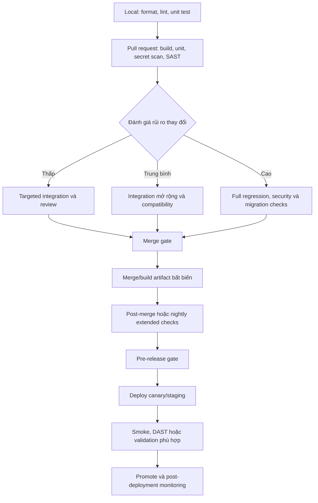

# Chuyển kiểm tra tốn thời gian sang giai đoạn phù hợp với rủi ro

CI/CD cần phản hồi đủ nhanh để lập trình viên biết thay đổi có vấn đề ngay khi còn dễ sửa. Tuy nhiên, không phải kiểm tra nào cũng có thể chạy trong vài phút. Integration test với nhiều service, kiểm thử hiệu năng, DAST, kiểm tra tương thích, migration trên dữ liệu lớn hoặc kiểm thử phục hồi có thể mất hàng chục phút hay hàng giờ.

Giải pháp không phải bỏ các kiểm tra tốn thời gian. Hãy đặt từng kiểm tra vào giai đoạn phù hợp với **chi phí, khả năng phát hiện lỗi và rủi ro của thay đổi**. Kiểm tra rẻ, nhanh và có giá trị cao nên chạy sớm. Kiểm tra cần môi trường thật hoặc tài nguyên lớn có thể chạy sau, nhưng phải hoàn tất trước khi release vượt qua cổng rủi ro tương ứng. Với thay đổi có tác động lớn, kiểm tra chuyên sâu phải được kéo về trước merge hoặc trước khi triển khai.

Một pipeline tốt tạo nhiều lớp phản hồi: kiểm tra cục bộ, pull request, sau merge, theo lịch, trước release và sau triển khai. Các lớp dùng chung artifact và bằng chứng kiểm tra, có quy tắc rõ về điều kiện bắt buộc, điều kiện có thể chạy bất đồng bộ và cách xử lý khi kết quả chưa có.

## 1. Vì sao không nên chạy mọi kiểm tra ở cùng một thời điểm?

Nếu tất cả kiểm tra đều chạy trên mỗi pull request, một thay đổi nhỏ có thể phải chờ toàn bộ integration suite, performance test, DAST và kiểm tra trên môi trường staging. Thời gian chờ dài làm chậm vòng lặp sửa lỗi, tăng số pipeline chạy đồng thời và khiến lập trình viên ít nhận được phản hồi trong lúc còn nhớ rõ thay đổi.

Ngược lại, nếu chỉ chạy kiểm tra nhanh rồi đẩy mọi kiểm tra chuyên sâu sang sau release, lỗi có thể đến production trước khi được phát hiện. Chi phí sửa lỗi lúc đó lớn hơn nhiều vì cần incident response, rollback, khôi phục dữ liệu hoặc thông báo khách hàng.

Hai cực đoan đều không phù hợp:

- Chạy mọi thứ ngay ở mỗi thay đổi làm phản hồi chậm, tốn runner và giảm throughput.
- Đẩy mọi kiểm tra lâu sang sau khi phát hành làm tăng khả năng lỗi vượt qua quality gate.

Điều cần tối ưu là **thời điểm phát hiện lỗi so với rủi ro và chi phí của việc chờ**. Kiểm tra nên chạy sớm nhất ở nơi có đủ ngữ cảnh và môi trường để kết quả đáng tin cậy.

### Ví dụ về chi phí và thời điểm phát hiện

| Kiểm tra | Thời gian tương đối | Lỗi thường phát hiện | Giai đoạn phù hợp ban đầu |
|---|---|---|---|
| Format, lint, static type check | Rất ngắn | Quy ước, cú pháp, kiểu dữ liệu | Local và pull request |
| Unit test | Ngắn | Logic trong một đơn vị | Local và pull request |
| Compile/build | Ngắn đến trung bình | Lỗi biên dịch, dependency, packaging | Pull request |
| Secret scan diff/working tree | Ngắn | Credential mới bị commit hoặc còn trong cây làm việc | Pull request |
| SAST trên thay đổi | Ngắn đến trung bình | Mẫu code có nguy cơ bảo mật | Pull request |
| Component/integration test | Trung bình đến dài | Tương tác giữa module hoặc service | Pull request theo rủi ro; merge pipeline |
| Full integration suite | Dài | Regression liên module và luồng end-to-end | Merge, nightly hoặc trước release; kéo sớm khi rủi ro cao |
| DAST trên môi trường triển khai | Dài | Lỗ hổng khi ứng dụng đang chạy | Staging hoặc pre-release |
| Performance/load test | Dài, cần hạ tầng riêng | Regression latency, throughput, saturation | Nightly, trước release hoặc khi thay đổi đường nóng |
| Migration test trên dữ liệu đại diện | Dài | Lock, thời gian DDL, tương thích và backfill | Pre-release; trước merge nếu migration có rủi ro cao |
| DR/restore exercise | Rất dài | Khả năng phục hồi | Theo lịch và trước thay đổi hạ tầng quan trọng |

Thời gian trong bảng chỉ mang tính tương đối. Một unit test khởi tạo cả hệ thống có thể rất chậm; một static check được tối ưu có thể chạy nhanh. Hãy đo pipeline thực tế thay vì phân loại chỉ theo tên kiểm tra.

## 2. Xây dựng các giai đoạn phản hồi

Một luồng điển hình có thể chia thành các giai đoạn sau:



### Local: phản hồi tức thì

Đặt các kiểm tra có thể chạy trên máy phát triển hoặc IDE:

- Formatter và lint.
- Static type check.
- Unit test nhỏ, nhanh và xác định.
- Kiểm tra cấu trúc, schema hoặc generated file.
- Pre-commit secret scan nếu có.

Mục tiêu là phát hiện lỗi trước khi tạo commit hoặc gửi pull request. Các hook cục bộ giúp tiết kiệm thời gian CI nhưng có thể không được cài hoặc bị bỏ qua, vì vậy CI vẫn phải thực hiện các gate bắt buộc.

### Pull request: phản hồi bắt buộc trước merge

Pull request nên chạy các kiểm tra có giá trị cao và đủ nhanh để reviewer nhận kết quả trong vòng phản hồi ngắn:

- Build/compile và unit test liên quan.
- Lint, formatting và type checking.
- Secret scan trên diff và kiểm tra dependency policy cơ bản.
- SAST hoặc rule bảo mật nhanh.
- Contract test hoặc integration test nhỏ cho module bị ảnh hưởng.
- Kiểm tra migration syntax và backward compatibility khi có thay đổi schema.

Không nên bỏ qua một gate bảo mật quan trọng chỉ vì nó mất thêm vài phút. Với thay đổi authentication, authorization, xử lý dữ liệu nhạy cảm hoặc dependency rủi ro cao, các kiểm tra chuyên sâu cần chạy trước merge.

### Sau merge: kiểm tra rộng trên commit tích hợp

Sau khi merge, chạy những kiểm tra cần toàn bộ repository hoặc cần trạng thái đã tích hợp:

- Full integration suite.
- Test giữa nhiều module hoặc service.
- Kiểm tra packaging và deployment bundle.
- Kiểm tra tương thích với phiên bản dependency được tích hợp.
- Build artifact release candidate và xác minh metadata.

Nếu một kiểm tra sau merge là điều kiện bắt buộc để phát hành, trạng thái release phải ở dạng pending cho tới khi kiểm tra hoàn tất. Không đánh dấu release là đạt chỉ vì pull request đã xanh.

### Nightly hoặc theo lịch: tìm lỗi hiếm và regression dài hạn

Job theo lịch phù hợp với kiểm tra:

- Full test matrix trên nhiều JDK, OS hoặc database version.
- Performance/load/soak test.
- Fuzzing hoặc security scan toàn diện.
- Kiểm tra dependency/license sâu.
- Kiểm tra backup restore và DR drill.
- Quét toàn bộ Git history hoặc image registry.

Job theo lịch giúp phát hiện lỗi phụ thuộc thời gian, tải hoặc tổ hợp môi trường. Nhưng nếu một thay đổi có rủi ro cao, không thể chờ nightly mới chạy kiểm tra cần thiết để quyết định merge hoặc release.

### Trước release: xác minh trên artifact và môi trường gần production

Trước khi promote, chạy các kiểm tra cần artifact đã đóng gói hoặc môi trường tương đương production:

- Xác minh digest, signature và provenance.
- Kiểm tra cấu hình môi trường và secret reference.
- DAST hoặc smoke test trên deployment candidate.
- Migration rehearsal trên dữ liệu đại diện.
- Performance test cho thay đổi có thể ảnh hưởng capacity hoặc latency.
- Approval và policy gate.

Kiểm tra phải gắn với đúng artifact digest được triển khai. Nếu build lại sau khi test, đó là artifact mới và cần xác minh lại theo policy.

### Sau triển khai: kiểm tra hành vi thật

Smoke test, synthetic transaction, metrics, logs và traces giúp xác nhận ứng dụng hoạt động sau khi traffic được chuyển. Đây là lớp bổ sung cho test trước deploy; không thể thay thế unit/integration/security test đã phải chạy trước đó.

## 3. Đánh giá rủi ro để chọn kiểm tra

Không phải mọi thay đổi trong cùng một repository đều có rủi ro như nhau. Sửa chính tả trong tài liệu, thay logic tính giá, đổi schema hoặc sửa pipeline có quyền deploy production cần mức kiểm tra khác nhau.

Một mô hình thực tế đánh giá ít nhất bốn yếu tố:

1. **Blast radius:** số service, người dùng, tenant hoặc dữ liệu có thể bị ảnh hưởng.
2. **Failure likelihood:** độ phức tạp của thay đổi, độ mới của công nghệ, lịch sử lỗi và mức độ thay đổi phụ thuộc.
3. **Detectability:** lỗi có dễ phát hiện qua unit test/log/metric hay chỉ xuất hiện dưới tải hoặc trong một luồng hiếm?
4. **Recovery cost:** rollback có đơn giản không, dữ liệu có bị biến đổi không, có phụ thuộc migration hoặc external side effect không?

### Ma trận rủi ro minh họa

| Mức rủi ro | Ví dụ | Kiểm tra trước merge | Kiểm tra bổ sung |
|---|---|---|---|
| Thấp | Tài liệu, UI text, refactor nội bộ không đổi contract | Lint, build, unit test liên quan | Targeted integration nếu vùng code có dependency |
| Trung bình | Thay business logic, API nội bộ, cấu hình service | Build, unit, component/integration, contract test | Full integration sau merge; smoke test trước release |
| Cao | Auth, payment, dữ liệu nhạy cảm, schema migration, CI permissions, dependency lớn | Full regression liên quan, security review/scan, migration test, contract/compatibility | Performance/DAST, canary, rollback rehearsal hoặc approval bổ sung |
| Rất cao | Thay đổi dữ liệu không đảo ngược, trust boundary, signing/deploy identity, hạ tầng production | Gate chuyên sâu trước merge và phê duyệt chủ sở hữu | Rehearsal trên môi trường đại diện, staged rollout và validation mở rộng |

Đây là ví dụ phân loại, không phải tiêu chuẩn điểm số áp dụng cho mọi tổ chức. Nhóm cần xác định rõ loại thay đổi nào tự động được xếp vào mức cao, ai có quyền hạ mức và bằng chứng nào cần lưu.

### Những thay đổi nên tự động nâng mức rủi ro

- Thay đổi authentication, authorization, session hoặc cryptography.
- Thay đổi payment, billing, order state hoặc thao tác có side effect bên ngoài.
- Thay đổi schema, migration, backfill hoặc dữ liệu không thể khôi phục dễ dàng.
- Thay đổi CI workflow, runner, secret access, signing hoặc deployment permissions.
- Thay đổi dependency lớn, base image, compiler, runtime hoặc build tool.
- Thay đổi network policy, ingress, DNS, TLS hoặc identity federation.
- Thay đổi module dùng chung hoặc API được nhiều service tiêu thụ.
- Thay đổi có lịch sử incident hoặc test flaky trong khu vực đó.

Không chỉ dựa vào nhãn do tác giả PR tự chọn. Có thể kết hợp file path, ownership, dependency graph, loại migration và policy repository để tự nâng mức rủi ro. Nếu hệ thống không thể xác định phạm vi ảnh hưởng, chọn đường kiểm tra rộng hơn thay vì giả định thay đổi có rủi ro thấp.

## 4. Phân loại kiểm tra theo giá trị và chi phí

Một cách quyết định thời điểm chạy là xem mỗi kiểm tra theo bốn thuộc tính:

| Thuộc tính | Câu hỏi |
|---|---|
| Thời gian | Kiểm tra mất bao lâu, có thể chia nhỏ hoặc chạy song song không? |
| Tài nguyên | Có cần database, cluster, license, thiết bị hoặc môi trường độc quyền không? |
| Tín hiệu | Khi thất bại, kết quả có chỉ rõ nguyên nhân và vị trí lỗi không? |
| Rủi ro được bao phủ | Kiểm tra giảm loại rủi ro nào và hậu quả nếu phát hiện muộn là gì? |

Ưu tiên kiểm tra có tín hiệu rõ, chi phí thấp và bắt được lỗi phổ biến chạy sớm. Kiểm tra đắt nhưng bảo vệ rủi ro lớn cần được đặt trước gate có hậu quả tương ứng. Kiểm tra ít liên quan tới thay đổi có thể chạy theo lịch hoặc trên nhánh tích hợp.

### Fail fast theo thứ tự hợp lý

Trong một stage, có thể chạy song song các kiểm tra độc lập. Nhưng nếu một bước rẻ có thể phát hiện lỗi khiến toàn bộ bước đắt không còn giá trị, hãy chạy bước rẻ trước hoặc dùng dependency để chặn phần sau.

Ví dụ:

1. Parse YAML và validate workflow syntax.
2. Format, lint và compile.
3. Unit test.
4. Component/integration test.
5. Security scan sâu hoặc performance test.

Không nhất thiết tuần tự tất cả bước. Nếu lint và unit test độc lập, có thể chạy song song để giảm thời gian tổng. Nguyên tắc là tránh khởi chạy tài nguyên đắt cho một commit đã biết chắc không thể merge vì lỗi cú pháp hoặc compile.

### Phân biệt thời gian thực thi và thời gian phản hồi

Một job chạy 30 phút không nhất thiết làm PR phải chờ 30 phút nếu nó không phải gate của thay đổi đó. Ngược lại, một job chỉ chạy 2 phút nhưng phải chờ runner 20 phút vẫn tạo feedback latency cao.

Đo cả:

- Queue time: thời gian chờ runner hoặc môi trường.
- Execution time: thời gian kiểm tra thực tế.
- Feedback latency: từ lúc commit/push tới khi kết quả hữu ích xuất hiện.
- Gate latency: thời gian từ lúc mở PR tới khi đủ điều kiện merge.
- Time to release: thời gian từ commit được chấp thuận tới khi có thể triển khai.

Tối ưu chỉ execution time nhưng bỏ qua queue time có thể không cải thiện trải nghiệm lập trình viên.

## 5. Chọn test theo ảnh hưởng của thay đổi

Chạy toàn bộ suite cho mọi commit thường tốn kém. Có thể dùng change impact analysis để chạy test liên quan, nhưng việc chọn lọc phải dựa trên quan hệ phụ thuộc đã được kiểm chứng.

Ví dụ, thay đổi module `pricing` có thể cần:

- Unit test của pricing.
- Test của order service gọi pricing.
- Contract test giữa pricing và checkout.
- Integration test của luồng tạo đơn có tính giá.

Chỉ chạy test nằm trong thư mục `pricing` có thể bỏ sót lỗi ở consumer. Dependency graph phải bao gồm cả quan hệ compile-time, runtime, API và dữ liệu khi có thể.

### Quy tắc an toàn cho test selection

- Chạy test trực tiếp của module bị thay đổi.
- Chạy test của consumer phụ thuộc vào module đó.
- Mở rộng phạm vi nếu thay đổi API, schema, shared library hoặc build logic.
- Chạy full suite khi dependency graph thiếu, không chắc chắn hoặc thay đổi nền tảng.
- Ghi lại danh sách test được chọn và lý do để có thể kiểm tra quyết định.
- Định kỳ so sánh targeted suite với full suite để đo tỷ lệ bỏ sót.

Không dùng path filter đơn giản làm bằng chứng rằng các module khác không bị ảnh hưởng nếu dependency graph có quan hệ xuyên thư mục hoặc code generation.

### Test selection không thay thế kiểm tra toàn diện

Targeted test tăng tốc phản hồi cho PR. Full suite vẫn cần chạy sau merge, nightly hoặc trước release theo mức rủi ro. Nếu full suite phát hiện lỗi chỉ xuất hiện khi nhiều module tương tác, pipeline cần liên kết lỗi đó với commit gây ra và ngăn release tiếp tục.

## 6. Giữ quality gate rõ ràng khi kiểm tra chạy bất đồng bộ

Một kiểm tra có thể chạy sau PR mà vẫn là gate bắt buộc trước release. Điều quan trọng là biểu diễn trạng thái rõ:

- `pending`: chưa chạy hoặc chưa có kết quả.
- `passed`: đã chạy và đạt.
- `failed`: đã chạy và không đạt.
- `skipped`: được bỏ qua theo policy có giải thích.
- `inconclusive`: không đủ dữ liệu hoặc hạ tầng lỗi.
- `waived`: được miễn có người phê duyệt, lý do và thời hạn.

Không coi `pending`, `inconclusive` hoặc lỗi hạ tầng là `passed`. Nếu kiểm tra là điều kiện phát hành, release phải ở trạng thái chờ cho đến khi có kết quả đạt hoặc waiver hợp lệ.

### Tách required gate và advisory check

Required gate phải hoàn tất trước khi hành động được bảo vệ xảy ra, ví dụ merge vào branch bảo vệ hoặc promote production. Advisory check cung cấp thông tin nhưng không chặn bước đó; nó có thể chạy sau hoặc theo lịch.

Hãy công bố rõ kiểm tra nào thuộc nhóm nào. Không để một job nightly có tên giống required check nhưng không được liên kết đúng với commit hoặc artifact đang phát hành.

### Không để check bị skip âm thầm

Khi dùng điều kiện theo path hoặc risk output, cần có một gate tổng hợp luôn chạy và xác nhận:

- Những kiểm tra bắt buộc đã chạy hoặc được miễn theo policy.
- Không có job bắt buộc đang pending.
- Job bị skip có lý do hợp lệ.
- Kết quả thuộc đúng commit SHA và artifact digest.

Nếu một job bị skip vì classifier lỗi hoặc output không xác định, gate tổng hợp nên thất bại hoặc yêu cầu kiểm tra rộng hơn. Không dùng điều kiện skip để vô tình bỏ qua bảo vệ trên branch chính.

## 7. Ví dụ pipeline chia giai đoạn theo rủi ro

Ví dụ GitHub Actions dưới đây minh họa một workflow pull request có bước phân loại rủi ro, chạy fast checks bắt buộc và chọn integration suite phù hợp. Script `classify-change.sh` và `run-impacted-tests.sh` là công cụ của repository, cần được triển khai và kiểm thử riêng.

```yaml
name: Pull request quality

on:
  pull_request:
    branches: [main]

permissions:
  contents: read

jobs:
  classify:
    runs-on: ubuntu-latest
    outputs:
      risk: ${{ steps.classify.outputs.risk }}
    steps:
      - uses: actions/checkout@v4
        with:
          fetch-depth: 0
      - id: classify
        run: |
          risk="$(./scripts/classify-change.sh)"
          case "$risk" in
            low|medium|high|critical) ;;
            *) echo "Unknown risk classification" >&2; exit 1 ;;
          esac
          echo "risk=$risk" >> "$GITHUB_OUTPUT"

  fast-checks:
    needs: classify
    runs-on: ubuntu-latest
    steps:
      - uses: actions/checkout@v4
      - uses: actions/setup-java@v4
        with:
          distribution: temurin
          java-version: '21'
      - name: Format and static checks
        run: ./gradlew --no-daemon spotlessCheck checkstyleMain
      - name: Compile and unit tests
        run: ./gradlew --no-daemon test
      - name: Secret scan repository working tree
        run: gitleaks dir --redact .

  targeted-integration:
    needs: [classify, fast-checks]
    if: needs.classify.outputs.risk == 'low' || needs.classify.outputs.risk == 'medium'
    runs-on: ubuntu-latest
    steps:
      - uses: actions/checkout@v4
      - name: Run impacted integration tests
        run: ./scripts/run-impacted-tests.sh

  high-risk-validation:
    needs: [classify, fast-checks]
    if: needs.classify.outputs.risk == 'high' || needs.classify.outputs.risk == 'critical'
    runs-on: ubuntu-latest
    steps:
      - uses: actions/checkout@v4
      - name: Full integration suite
        run: ./gradlew --no-daemon integrationTest
      - name: Security and migration validation
        run: ./scripts/security-and-migration-checks.sh

  pr-gate:
    if: always()
    needs: [classify, fast-checks, targeted-integration, high-risk-validation]
    runs-on: ubuntu-latest
    steps:
      - name: Enforce risk-specific checks
        env:
          CLASSIFY_RESULT: ${{ needs.classify.result }}
          RISK: ${{ needs.classify.outputs.risk }}
          FAST_RESULT: ${{ needs.fast-checks.result }}
          TARGETED_RESULT: ${{ needs.targeted-integration.result }}
          HIGH_RESULT: ${{ needs.high-risk-validation.result }}
        run: |
          test "$CLASSIFY_RESULT" = success
          test "$FAST_RESULT" = success
          case "$RISK" in
            low|medium) test "$TARGETED_RESULT" = success ;;
            high|critical) test "$HIGH_RESULT" = success ;;
            *) exit 1 ;;
          esac
```

Ví dụ này cần được điều chỉnh theo repository:

- `classify-change.sh` phải phân loại dựa trên policy đã review, không cho tác giả PR tự đặt mức thấp để bỏ gate.
- Classifier có thể chuẩn hóa mức “rất cao” trong ma trận thành `critical`; cả `high` và `critical` đều chạy cùng nhóm validation chuyên sâu trong ví dụ này.
- `run-impacted-tests.sh` phải dựa trên dependency graph; khi không xác định được test ảnh hưởng, chạy suite rộng hơn.
- Gate tổng hợp cần là required status check của branch protection. Tên job ổn định và điều kiện `always()` giúp nó báo kết quả rõ khi job con bị fail hoặc skip.
- Workflow minh họa dùng các job riêng cho targeted và high-risk checks; job không được chọn có thể ở trạng thái skipped, nhưng gate tổng hợp chỉ chấp nhận đúng job tương ứng với risk.
- Pin các action theo full commit SHA nếu policy chuỗi cung ứng yêu cầu. Các task Gradle cần tồn tại trong build thực tế.

Điểm quan trọng là risk classification và gate phải được kiểm soát. Nếu classifier không chạy, trả giá trị lạ hoặc không có output, PR phải không đạt gate thay vì tự động đi theo nhánh rủi ro thấp.

## 8. Ví dụ kiểm tra dài chạy sau merge và trước release

Các kiểm tra dài có thể được tách thành workflow khác. Workflow sau minh họa nightly regression trên nhánh chính:

```yaml
name: Nightly regression

on:
  schedule:
    - cron: '0 18 * * 1-5'
  workflow_dispatch:

permissions:
  contents: read

jobs:
  full-regression:
    runs-on: ubuntu-latest
    timeout-minutes: 90
    steps:
      - uses: actions/checkout@v4
        with:
          ref: main
      - uses: actions/setup-java@v4
        with:
          distribution: temurin
          java-version: '21'
      - name: Full integration matrix
        run: ./gradlew --no-daemon integrationTest
      - name: Performance baseline
        run: ./scripts/run-performance-baseline.sh
      - name: Upload reports
        if: always()
        uses: actions/upload-artifact@v4
        with:
          name: nightly-${{ github.sha }}
          path: |
            build/reports/
            performance-results/
          if-no-files-found: ignore
          retention-days: 14
```

Nightly report phải gắn với commit SHA và, nếu kiểm tra artifact, digest của artifact. Nếu job nightly phát hiện lỗi, cần xác định commit hoặc release nào đưa lỗi vào. Không chỉ gửi cảnh báo rồi để release tiếp tục mà không có owner xử lý.

Với release candidate, có thể thêm một gate chờ kết quả full regression gần nhất nếu kết quả đó thuộc cùng commit/artifact và chưa quá thời hạn policy. Nếu release đã thay đổi sau khi nightly chạy, kết quả cũ không tự động chứng minh candidate mới đạt.

### Khi nào cần kéo kiểm tra dài về trước merge?

- Thay đổi ảnh hưởng authentication hoặc authorization.
- Migration có nguy cơ lock lâu, mất dữ liệu hoặc không tương thích ngược.
- Thay đổi thuật toán pricing, payment hoặc tính toán tài chính.
- Thay đổi concurrency, queue semantics hoặc transaction boundary.
- Thay đổi compiler/runtime/base image hoặc dependency cốt lõi.
- Sửa pipeline, secret handling, signing identity hoặc quyền deploy.
- Regression gần đây cho thấy unit/targeted test không đủ phát hiện lỗi trong vùng đó.

Đối với những thay đổi này, full integration, security hoặc migration rehearsal có thể là required gate trước merge, dù mất nhiều thời gian. Tốc độ phản hồi không phải lý do để chấp nhận rủi ro không được kiểm soát.

## 9. Tổ chức kiểm tra đắt để không lãng phí tài nguyên

### Chạy song song những kiểm tra độc lập

Lint, unit test module A và unit test module B có thể chạy song song nếu không tranh chấp cùng tài nguyên. Integration test cần database hoặc cluster riêng nên có thể cần giới hạn concurrency.

Không khởi chạy hàng chục job cùng lúc nếu tất cả đều dùng một database staging nhỏ. Khi môi trường là bottleneck, queue time sẽ tăng và kết quả có thể nhiễu do test tranh chấp CPU, connection hoặc dữ liệu.

### Chia test suite theo mục đích

Một cách tổ chức:

| Suite | Nội dung | Trigger |
|---|---|---|
| `unitTest` | Logic nhỏ, không cần service ngoài | Local và mọi PR |
| `componentTest` | Một service với dependency giả hoặc container riêng | PR theo module/risk |
| `integrationTest` | Nhiều module/service và database thật | PR rủi ro vừa/cao, merge |
| `contractTest` | Consumer/provider contract | PR khi thay API hoặc schema |
| `securityTest` | SAST, dependency, secret và policy scan | PR với phần nhanh; full scan theo risk/release |
| `performanceTest` | Load, stress, soak và benchmark | Nightly hoặc trước release theo risk |
| `migrationTest` | Upgrade schema, backfill, lock và rollback compatibility | PR cho migration; rehearsal trước release |

Tên task chỉ là quy ước. Điều quan trọng là mỗi suite có thời gian mục tiêu, trigger, owner và quality gate được công bố.

### Dùng cache và artifact đúng cách

Cache dependency có thể giảm thời gian tải và build, nhưng không nên cache kết quả kiểm tra theo key quá rộng khiến commit mới dùng lại kết quả cũ không hợp lệ. Key cần bao gồm các đầu vào ảnh hưởng: lockfile, runtime, OS, build config và version của tool.

Tạo artifact một lần rồi kiểm tra và promote cùng digest. Không build lại ở staging hoặc production để tiết kiệm vài phút mà làm mất mối liên hệ giữa kết quả test và nội dung triển khai.

### Hạn chế matrix không cần thiết

Không phải mọi PR cần chạy mọi JDK/OS/database version. Có thể chạy một cấu hình chính trên PR và full compatibility matrix nightly hoặc trước release. Tuy nhiên, nếu thay đổi trực tiếp runtime support, build toolchain hoặc driver database, matrix tương ứng phải được chạy trước khi merge.

## 10. Quản lý kiểm tra flaky và kết quả không ổn định

Một kiểm tra chậm và flaky tạo feedback kém: lập trình viên phải chờ lâu rồi nhận kết quả không đáng tin. Không nên chuyển kiểm tra đó sang nightly chỉ để PR xanh nếu rủi ro nó bảo vệ vẫn cần được kiểm soát trước merge.

Hãy phân loại:

- **Test không ổn định do code:** race condition, clock, random, dữ liệu dùng chung hoặc timeout sai. Cần sửa nguyên nhân.
- **Test không ổn định do môi trường:** runner quá tải, service test không đủ capacity hoặc network không ổn định. Cần sửa môi trường hoặc giới hạn concurrency.
- **Test có điều kiện:** chỉ áp dụng khi một capability hoặc platform cụ thể được bật. Cần khai báo điều kiện và bảo đảm classifier đúng.
- **Test không còn giá trị:** không kiểm tra hành vi quan trọng hoặc trùng lặp. Có thể loại bỏ sau khi owner xác nhận.

Retry có thể giúp phân biệt lỗi tạm thời với lỗi xác định, nhưng không được biến một lần retry xanh thành bằng chứng chất lượng. Ghi lại lần chạy đầu, số lần retry và tỷ lệ flaky. Với gate bảo mật, migration hoặc dữ liệu quan trọng, trạng thái không xác định nên được coi là chưa đạt cho tới khi có kết quả tin cậy.

Nếu phải quarantine test flaky, cần owner, ticket sửa, thời hạn và kiểm tra thay thế cho rủi ro mà test đó bảo vệ. Không quarantine cả nhóm test chỉ vì chúng làm pipeline chậm.

## 11. Đo hiệu quả của chiến lược phản hồi

Không đánh giá thành công chỉ bằng việc PR pipeline nhanh hơn. Nếu thời gian giảm vì bỏ gate nhưng số incident tăng, chiến lược đã thất bại.

Theo dõi các chỉ số:

| Chỉ số | Ý nghĩa | Cách sử dụng |
|---|---|---|
| PR feedback latency p50/p95 | Thời gian nhận kết quả hữu ích | Đặt mục tiêu theo trải nghiệm developer |
| Queue time | Thời gian chờ runner/environment | Phát hiện thiếu capacity hoặc concurrency quá cao |
| Failure detection stage | Lỗi được phát hiện ở local, PR, merge, nightly hay production | Đánh giá gate có đặt đúng thời điểm không |
| Escaped defect rate | Lỗi lọt qua các gate tới môi trường sau | Kiểm tra có đang đẩy rủi ro quá muộn không |
| Flaky test rate | Tỷ lệ test thay đổi kết quả không do code | Ưu tiên sửa test và môi trường |
| Cost per successful change | Tài nguyên CI trung bình cho một thay đổi đạt | Cân bằng tốc độ và chi phí |
| Change failure rate | Tỷ lệ release gây rollback/hotfix/incident | Đánh giá chất lượng release |
| Time to restore | Thời gian phục hồi khi release lỗi | Xác nhận rollback/recovery readiness |

Phân tích theo loại thay đổi và mức rủi ro. Nếu lỗi migration thường chỉ xuất hiện ở pre-release, hãy đưa migration rehearsal sớm hơn cho các PR có migration. Nếu lỗi format bị phát hiện muộn ở merge, đưa formatter vào local/PR. Nếu performance regression chỉ xuất hiện dưới tải, giữ load test ở môi trường có tài nguyên phù hợp và yêu cầu nó trước release của vùng code liên quan.

### Đặt mục tiêu theo percentile

Trung bình có thể che giấu các PR phải chờ rất lâu. Dùng p50 và p95 để thấy trải nghiệm điển hình và trường hợp xấu. Ví dụ nhóm có thể đặt mục tiêu p95 của fast PR gate dưới 10 phút, trong khi full regression chạy riêng. Con số cần được chọn theo quy mô dự án, không phải chuẩn chung.

## 12. Những cách làm dễ làm mất chất lượng

| Cách làm | Hệ quả | Cách cải thiện |
|---|---|---|
| Chạy mọi test dài trên mọi PR | Feedback chậm, queue tăng và lãng phí tài nguyên | Chia suite theo risk và stage |
| Đẩy tất cả security/performance test sang nightly | Rủi ro cao có thể merge/release trước khi phát hiện | Kéo gate cần thiết về trước merge/release theo risk |
| Chỉ chạy test theo file thay đổi | Bỏ sót consumer hoặc dependency gián tiếp | Dùng dependency graph và fallback full suite |
| Coi job pending hoặc skipped là đạt | Release có thể đi tiếp khi chưa có bằng chứng | Gate tổng hợp kiểm tra trạng thái và lý do skip |
| Rebuild artifact sau khi test | Kết quả test không còn gắn với artifact được deploy | Build once, verify và promote cùng digest |
| Retry tới khi test xanh | Che giấu flaky hoặc race condition | Ghi nhận lần fail đầu và sửa nguyên nhân |
| Dùng một mức rủi ro cho mọi thay đổi | Thay đổi nhạy cảm nhận kiểm tra quá ít hoặc thay đổi nhỏ bị kiểm tra quá mức | Risk classifier theo path, ownership và change type |
| Tối ưu execution time nhưng bỏ qua queue time | Developer vẫn phải chờ runner | Đo feedback latency và capacity |
| Quarantine test không thời hạn | Quality gate mất dần phạm vi bảo vệ | Owner, deadline và compensating check |
| Nightly thất bại nhưng không chặn release liên quan | Lỗi đã biết vẫn được phát hành | Liên kết nightly result với commit/artifact và release policy |

## 13. Checklist thiết kế kiểm tra theo rủi ro

Trước khi tối ưu pipeline, hãy kiểm tra:

- [ ] Mỗi suite có mục đích, owner, thời gian mục tiêu và rủi ro được bảo vệ.
- [ ] Format, lint, compile, unit và secret scan nhanh chạy sớm.
- [ ] PR gate bắt buộc có kết quả gắn với đúng commit SHA.
- [ ] Thay đổi auth, payment, schema, CI permissions và shared contract tự động được nâng mức rủi ro.
- [ ] Risk classifier không cho phép hạ mức rủi ro tùy ý và fail closed khi không xác định.
- [ ] Targeted test bao gồm dependency/consumer; khi thiếu dữ liệu thì chạy full suite.
- [ ] Full integration và compatibility matrix có lịch sau merge/nightly hoặc trước release.
- [ ] Security, performance và migration checks được kéo về sớm khi hậu quả phát hiện muộn lớn.
- [ ] Gate tổng hợp không coi pending, skipped không hợp lệ hoặc inconclusive là passed.
- [ ] Approval và quality gate được tách biệt, có policy rõ.
- [ ] Artifact được build một lần, xác minh và promote cùng digest.
- [ ] Kết quả nightly/pre-release gắn với đúng commit, artifact và config revision.
- [ ] Flaky test có owner, metric, thời hạn quarantine và phương án thay thế.
- [ ] CI cache có key đúng đầu vào và không làm tái sử dụng kết quả lỗi thời.
- [ ] Queue time, execution time, PR feedback latency và escaped defects được đo.
- [ ] Định kỳ rà soát test nào nên chạy sớm hơn, muộn hơn hoặc được loại bỏ.

Chuyển kiểm tra tốn thời gian sang giai đoạn phù hợp giúp pipeline phản hồi nhanh mà vẫn giữ được mức bảo vệ cần thiết. Các kiểm tra rẻ và có tín hiệu rõ chạy sớm; kiểm tra cần môi trường hoặc tải lớn chạy ở stage chuyên biệt; thay đổi rủi ro cao kéo những gate quan trọng về trước merge hoặc release. Khi trạng thái kiểm tra được liên kết với commit và artifact, nhóm có thể tối ưu thời gian chờ mà không đánh đổi khả năng kiểm soát chất lượng.
