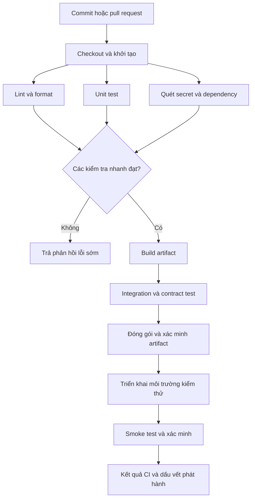

# Cân bằng tốc độ, độ tin cậy và chi phí thực thi

Một pipeline CI/CD tốt cần trả lời câu hỏi quan trọng càng sớm càng tốt: thay đổi này có an toàn để tiếp tục đi qua quy trình phát hành hay không? Nếu phản hồi đến quá muộn, lập trình viên phải chờ lâu mới biết một lỗi biên dịch, kiểm thử hoặc cấu hình đã xuất hiện. Nếu pipeline được tối ưu chỉ để chạy nhanh, nó có thể bỏ qua kiểm tra cần thiết, dùng cache sai hoặc tạo kết quả không ổn định. Nếu mọi bước đều chạy đồng thời trên tài nguyên lớn, thời gian có thể giảm nhưng chi phí runner và mức cạnh tranh tài nguyên lại tăng.

Vì vậy, tối ưu CI/CD là bài toán cân bằng ba mục tiêu: **phản hồi nhanh, kết quả đáng tin cậy và chi phí thực thi hợp lý**. Không có một cấu hình tối ưu cho mọi repository. Nhóm cần đo thời gian và chi phí thực tế, xác định loại phản hồi nào cần nhanh nhất, rồi chọn cách tổ chức pipeline phù hợp với mức độ rủi ro của thay đổi.

## 1. Hiểu ba mục tiêu cần cân bằng

### Tốc độ phản hồi

Tốc độ phản hồi là khoảng thời gian từ lúc một thay đổi được gửi vào quy trình CI đến khi người thực hiện nhận được kết quả có thể hành động. Kết quả đó có thể là lỗi format, lỗi biên dịch, test thất bại, kiểm tra bảo mật hoặc trạng thái một cổng chất lượng.

Một pipeline có tổng thời gian chạy 15 phút chưa chắc luôn phản hồi chậm. Nếu các kiểm tra nhanh phát hiện lỗi sau 40 giây và những kiểm tra chuyên sâu tiếp tục chạy khi cần, người phát triển đã nhận được tín hiệu sớm. Ngược lại, pipeline mất 8 phút nhưng chỉ hiển thị kết quả sau khi mọi job kết thúc có thể tạo trải nghiệm phản hồi kém.

### Độ tin cậy

Độ tin cậy thể hiện việc pipeline có phát hiện đúng vấn đề và đưa ra kết quả nhất quán hay không. Một pipeline nhanh nhưng bỏ sót test quan trọng, thỉnh thoảng báo đỏ do môi trường không ổn định, hoặc phụ thuộc vào cache cũ không đáng tin cậy.

Độ tin cậy còn bao gồm khả năng tái hiện: cùng commit, cùng cấu hình và cùng phiên bản công cụ cần tạo ra kết quả có thể giải thích. Pipeline phải giữ các cổng chất lượng đã thống nhất, đặc biệt với kiểm thử tích hợp, kiểm tra bảo mật, xác minh artifact và phê duyệt phát hành.

### Chi phí thực thi

Chi phí có thể bao gồm phút sử dụng runner, CPU và bộ nhớ, máy chạy chuyên dụng, lưu trữ cache và artifact, băng thông tải dependency, cùng chi phí vận hành hệ thống CI. Cách tính hóa đơn phụ thuộc nền tảng: có nơi tính theo phút runner, có nơi tính theo loại máy, mức sử dụng đồng thời hoặc dung lượng lưu trữ.

Không nên đánh đồng thời gian chờ của người phát triển với lượng tài nguyên tiêu thụ. Chạy bốn job song song có thể rút thời gian đồng hồ xuống còn một phần tư, nhưng vẫn tiêu thụ tổng lượng runner-minute lớn hơn một job chạy tuần tự. Tốc độ tăng lên có thể đáng chi phí đó, nhưng quyết định cần dựa trên dữ liệu.

## 2. Đo đúng thời gian phản hồi và chi phí

Trước khi tối ưu, hãy thống nhất các mốc đo. Thời gian từ lúc push đến lúc có kết quả thường gồm:

```text
feedback_time = queue_time
              + setup_time
              + execution_time
              + result_publication_time
```

- `queue_time`: thời gian job chờ runner hoặc chờ slot thực thi.
- `setup_time`: checkout mã nguồn, khởi tạo môi trường, tải công cụ và dependency.
- `execution_time`: thời gian chạy build, test và các bước kiểm tra.
- `result_publication_time`: thời gian tổng hợp, tải log, tạo báo cáo và cập nhật trạng thái về commit hoặc pull request.

Phân tách các thành phần giúp xác định đúng nút thắt. Nếu job chỉ chạy 3 phút nhưng chờ runner 7 phút, tối ưu lệnh build sẽ không cải thiện đáng kể thời gian phản hồi. Nếu test kết thúc nhanh nhưng báo cáo coverage được tổng hợp rất lâu, cần xem lại bước xuất và tải báo cáo.

Với pipeline có các job chạy song song, tổng thời gian hoàn thành thường bị chi phối bởi đường phụ thuộc dài nhất, còn thời gian của từng job vẫn cộng vào lượng tài nguyên tiêu thụ. Có thể mô hình hóa gần đúng:

```text
wall_clock_time ~= queue_and_setup + longest_dependency_path
compute_consumption = sum(resource_time_of_all_jobs)
```

Đây là mô hình tư duy. Thời gian thực tế còn chịu ảnh hưởng của lịch runner, giới hạn đồng thời, tải hệ thống, bước tải artifact và các phụ thuộc giữa job.

Nên theo dõi ít nhất các số liệu sau:

| Chỉ số | Điều cần biết | Cách sử dụng |
| --- | --- | --- |
| Thời gian phản hồi p50 | Một lần chạy điển hình mất bao lâu | Theo dõi trải nghiệm thường ngày |
| Thời gian phản hồi p95 | Những lần chạy chậm thường mất bao lâu | Phát hiện queue hoặc test có độ biến động cao |
| Queue time | Job chờ runner bao lâu | Quyết định điều chỉnh pool hoặc giới hạn đồng thời |
| Thời gian từng job | Job nào chiếm thời gian chính | Tập trung tối ưu đúng bước |
| Tỷ lệ thành công ngay lần đầu | Bao nhiêu lần chạy đạt kết quả mà không phải chạy lại | Phát hiện môi trường không ổn định hoặc test flaky |
| Cache hit rate và thời gian khôi phục cache | Cache có thực sự giảm thời gian setup hay không | So sánh lợi ích với chi phí lưu trữ và khôi phục |
| Runner-minute hoặc chi phí mỗi lần chạy | Một lần CI tiêu thụ bao nhiêu tài nguyên | Đánh giá tác động của song song hóa và kích thước máy |
| Tỷ lệ retry và tỷ lệ test flaky | Pipeline thường xuyên phải chạy lại vì lý do nào | Tách lỗi hạ tầng khỏi lỗi sản phẩm |

Không chỉ xem giá trị trung bình. p50 cho biết trải nghiệm phổ biến, trong khi p95 cho thấy các lần chờ lâu mà người dùng vẫn thường gặp. Hãy phân nhóm theo nhánh, loại thay đổi, job, loại runner và thời điểm để tránh kết luận sai từ một con số tổng hợp.

## 3. Đưa phản hồi nhanh lên trước trong pipeline

Các kiểm tra nhanh, rẻ và có khả năng phát hiện lỗi sớm nên xuất hiện sớm trong luồng. Một thứ tự tham khảo là:

1. Kiểm tra cấu trúc thay đổi, format, lint và cấu hình cơ bản.
2. Biên dịch hoặc kiểm tra kiểu dữ liệu.
3. Chạy unit test nhanh.
4. Chạy phân tích tĩnh, kiểm tra dependency và các kiểm tra bảo mật phù hợp.
5. Chạy integration test, contract test hoặc test cần dịch vụ phụ thuộc.
6. Đóng gói artifact, xác minh checksum hoặc digest.
7. Triển khai vào môi trường phù hợp, chạy smoke test và các bước xác minh sau triển khai.

Thứ tự cụ thể phụ thuộc dự án. Ví dụ, một công cụ quét bí mật có thể chạy ngay sau checkout vì nó nhanh và có khả năng phát hiện rủi ro nghiêm trọng. Một kiểm tra cần artifact đã đóng gói phải chạy sau build. Mục tiêu là phát hiện vấn đề sớm mà vẫn tôn trọng quan hệ phụ thuộc của các bước.

Với các bước độc lập, có thể chạy song song. Ví dụ, lint, unit test và quét secret có thể chạy đồng thời nếu chúng dùng cùng commit và không phụ thuộc kết quả của nhau. Build artifact chỉ bắt đầu khi các điều kiện cần thiết đã đạt. Sơ đồ dưới đây minh họa một luồng đơn giản:



Sơ đồ không có nghĩa mọi dự án phải dùng đúng thứ tự này. Hãy đặt bước theo dependency thực tế, mức rủi ro và khả năng phát hiện lỗi. Không cho một bước chậm chặn các phản hồi độc lập nếu điều đó không cần thiết.

## 4. Song song hóa có chọn lọc

Song song hóa giảm thời gian đồng hồ khi các job độc lập có thể sử dụng runner riêng. Tuy nhiên, mức cải thiện có giới hạn. Nếu một pipeline gồm 12 phút kiểm thử độc lập và 3 phút đóng gói tuần tự, chia test thành bốn shard cân bằng có thể giảm thời gian test gần xuống 3 phút. Tổng thời gian có thể giảm đáng kể, nhưng số runner sử dụng đồng thời và lượng tài nguyên tiêu thụ sẽ tăng.

Khi quyết định song song hóa, hãy xem xét:

- **Độ độc lập:** job có ghi vào cùng thư mục, database, tài khoản kiểm thử hoặc tài nguyên dùng chung hay không? Nếu có, cần cô lập dữ liệu hoặc điều phối truy cập.
- **Kích thước shard:** shard quá lớn làm một job trở thành nút thắt; shard quá nhỏ tạo thêm thời gian khởi động, checkout và tải dependency.
- **Độ cân bằng:** chia theo số lượng test không đảm bảo thời gian bằng nhau. Nên dùng thời gian chạy lịch sử để phân bổ các test nặng.
- **Giới hạn runner:** nhiều job được tạo ra không có nghĩa chúng sẽ chạy ngay. Nếu vượt giới hạn đồng thời, queue time có thể tăng và làm mất lợi ích.
- **Chi phí:** đo tổng runner-minute và chi phí thực tế sau khi song song hóa, không chỉ đo thời gian trên đồng hồ.

Một chiến lược thực tế là ưu tiên song song hóa các bước độc lập có thời gian dài và mức sử dụng tài nguyên hợp lý. Sau đó đo lại p50, p95, queue time và chi phí. Nếu số job tăng khiến queue time tăng mạnh, hãy điều chỉnh mức đồng thời hoặc kích thước shard.

## 5. Dùng cache và incremental build đúng cách

Cache giảm công việc lặp lại bằng cách tái sử dụng dependency đã tải, kết quả build hoặc dữ liệu trung gian. Incremental build chỉ thực hiện lại phần công việc bị ảnh hưởng bởi thay đổi. Cả hai có thể rút ngắn pipeline đáng kể khi repository lớn hoặc dependency nặng.

Một cache hiệu quả cần có khóa phản ánh các yếu tố quyết định tính hợp lệ của dữ liệu, chẳng hạn:

- Hệ điều hành, kiến trúc và loại runner nếu chúng ảnh hưởng đến artifact.
- Phiên bản runtime, compiler, build tool và các plugin liên quan.
- Lockfile hoặc checksum của tập dependency.
- Tham số build, profile hoặc cấu hình có thể làm thay đổi kết quả.

Ví dụ, cache dependency Java có thể sử dụng khóa gồm hệ điều hành, phiên bản JDK, phiên bản Maven hoặc Gradle và checksum của lockfile hay các file khai báo dependency tương ứng. Khi khóa thay đổi, pipeline tạo cache mới thay vì khôi phục dữ liệu không còn phù hợp.

```yaml
# Ví dụ minh họa ý tưởng; cú pháp thật tùy nền tảng CI.
cache:
  key:
    os: linux
    jdk: "21"
    build_tool: "gradle-8.x"
    dependency_fingerprint: "hash-of-dependency-lockfiles"
  paths:
    - dependency-cache/
```

Không nên dùng cache như nguồn dữ liệu chuẩn cho phát hành. Artifact cần được tạo ra, định danh và lưu giữ theo quy trình rõ ràng; cache chỉ là cơ chế tăng tốc. Pipeline vẫn phải có khả năng build sạch khi cache không tồn tại. Hãy định kỳ kiểm tra bằng clean build để phát hiện trường hợp build chỉ thành công nhờ dữ liệu cũ.

Cache cũng có chi phí: thời gian tạo, nén, tải lên, tải xuống, lưu trữ và dọn dẹp. Với một job ngắn, khôi phục cache lớn có thể lâu hơn cài dependency từ đầu. Hãy đo tổng thời gian trước và sau khi bật cache, đồng thời xem xét hit rate. Cache có hit rate thấp hoặc thời gian restore cao cần được thiết kế lại hoặc loại bỏ.

Incremental build cần khai báo dependency chính xác. Nếu hệ thống không nhận ra một file cấu hình hoặc generated source ảnh hưởng tới kết quả, nó có thể giữ lại đầu ra cũ và tạo build sai. Vì vậy, phải kiểm tra tính đúng đắn của dependency graph, giữ khả năng clean build và so sánh kết quả incremental với kết quả build sạch trong các tình huống quan trọng.

## 6. Tổ chức test theo tốc độ và mức rủi ro

Không phải mọi thay đổi đều cần cùng một tập kiểm thử ngay tại thời điểm đầu tiên. Tuy nhiên, việc chọn test cần dựa trên dependency và rủi ro có thể giải thích được.

| Lớp kiểm thử | Đặc điểm | Vai trò trong phản hồi |
| --- | --- | --- |
| Format, lint, kiểm tra kiểu | Nhanh, ít phụ thuộc môi trường | Phát hiện lỗi cơ bản sớm |
| Unit test | Thường chạy nhanh, phạm vi nhỏ | Xác minh logic của module |
| Contract test | Kiểm tra thỏa thuận giữa các thành phần | Phát hiện thay đổi giao tiếp không tương thích |
| Integration test | Cần database, queue hoặc dịch vụ phụ thuộc | Xác minh tương tác thực tế |
| End-to-end test | Mô phỏng luồng người dùng qua nhiều thành phần | Kiểm tra hành vi toàn hệ thống, thường tốn thời gian hơn |
| Smoke test sau triển khai | Tập kiểm tra nhỏ trên môi trường đích | Xác nhận phiên bản mới có thể khởi động và phục vụ luồng cơ bản |

Có thể chạy một tập test nhanh cho mỗi pull request và mở rộng kiểm thử theo loại thay đổi. Ví dụ, thay đổi chỉ ở tài liệu có thể không cần chạy toàn bộ integration test; thay đổi schema database hoặc luồng xác thực cần kích hoạt các test liên quan. Nhưng việc bỏ qua test phải dựa trên quan hệ phụ thuộc được duy trì và có thể kiểm tra. Nếu không xác định chắc phạm vi ảnh hưởng, chạy tập kiểm thử rộng hơn là lựa chọn an toàn.

Một số test end-to-end hoặc kiểm thử toàn bộ có thể chạy sau khi merge, theo lịch hoặc trên môi trường chuyên biệt. Nếu kết quả đó là điều kiện bắt buộc trước phát hành, pipeline phát hành phải chờ cổng tương ứng. Tách thời điểm phản hồi không đồng nghĩa bỏ qua yêu cầu chất lượng.

### Xử lý test không ổn định

Test flaky là test có thể cho kết quả khác nhau khi mã nguồn và điều kiện đầu vào không thay đổi. Nguyên nhân có thể là phụ thuộc thứ tự, dữ liệu dùng chung, race condition, timeout quá ngắn hoặc môi trường thiếu ổn định.

Không nên lặp lại test cho tới khi có một lần xanh rồi coi thay đổi là đạt. Cách làm đó biến độ không ổn định thành false positive và làm giảm niềm tin vào cổng chất lượng. Khi retry được dùng để thu thập thêm bằng chứng, cần ghi rõ lần chạy lại, giữ trạng thái flaky và có chủ sở hữu cùng thời hạn khắc phục. Test quan trọng vẫn cần được xử lý như một vấn đề chất lượng.

## 7. Giữ môi trường thực thi nhất quán

Môi trường không nhất quán làm tăng cả thời gian điều tra lẫn số lần chạy lại. Hãy cố định phiên bản runtime, compiler, build tool, dependency và image của runner trong phạm vi phù hợp. Ưu tiên môi trường có thể tái tạo, cấu hình được bằng mã và được cập nhật có kiểm soát.

Một số thực hành hữu ích:

- Dùng lockfile hoặc cơ chế khóa dependency tương đương.
- Định danh image môi trường bằng tag bất biến hoặc digest khi cần tái lập chính xác.
- Tạo dữ liệu test riêng cho mỗi job và dọn dẹp sau khi hoàn thành.
- Tránh để nhiều job cùng sửa một tài nguyên bên ngoài mà không có cơ chế cô lập.
- Ghi lại phiên bản công cụ và môi trường trong log hoặc metadata của artifact.
- Chạy clean build định kỳ để xác minh kết quả không phụ thuộc cache cũ.

Môi trường nhất quán giúp phân biệt lỗi sản phẩm với lỗi hạ tầng, nhờ đó nhóm có thể giảm retry không cần thiết mà vẫn giữ kết quả đáng tin cậy.

## 8. Ví dụ: tối ưu pipeline cho một dịch vụ Java

Giả sử một dịch vụ Java có pipeline ban đầu mất 18 phút. Đo trong một tuần cho thấy p50 là 18 phút, p95 là 31 phút. Phân tích job cho thấy checkout và tải dependency mất 2 phút, compile mất 2 phút, unit test mất 3 phút, integration test mất 6 phút, quét dependency và bảo mật mất 1 phút; khởi tạo runner và xuất báo cáo chiếm 4 phút còn lại. Một phần thời gian p95 tăng cao do job chờ runner.

Nhóm thực hiện theo từng bước:

1. Đưa format, compile và unit test vào nhóm phản hồi nhanh; cho phép các kiểm tra độc lập bắt đầu sớm sau checkout.
2. Bật cache dependency với khóa dựa trên JDK, build tool và fingerprint của dependency; so sánh thời gian restore với thời gian tải từ đầu.
3. Chia integration test thành các shard theo thời gian chạy lịch sử, đồng thời cấp dữ liệu và schema riêng cho từng shard.
4. Giữ quét bảo mật và các cổng chất lượng bắt buộc trong quy trình; không bỏ kiểm tra chỉ để giảm thời gian.
5. Giới hạn số job đồng thời để không làm queue của runner tăng cao trong giờ cao điểm.
6. Chạy clean build định kỳ và theo dõi test flaky để xác nhận cải thiện không làm giảm độ tin cậy.

Sau thay đổi, giả sử nhóm đo được phản hồi nhanh đầu tiên sau 2 phút, p50 toàn pipeline còn 11 phút, p95 còn 17 phút. Runner-minute mỗi lần chạy tăng 8% vì integration test được chia shard. Nhóm có thể chấp nhận mức tăng này nếu giá trị của phản hồi sớm và thời gian chờ giảm phù hợp với ngân sách. Nếu chi phí vượt ngân sách, có thể giảm số shard ở các nhánh ít rủi ro hoặc dùng runner có kích thước phù hợp hơn, sau khi đo lại tác động.

Các con số trên chỉ minh họa cách đánh giá. Một cải thiện chỉ được xác nhận khi so sánh dữ liệu trước và sau trên cùng loại workload, có đủ số lần chạy và giữ nguyên các cổng chất lượng liên quan.

## 9. Quyết định theo loại thay đổi và rủi ro

Không phải lúc nào cũng cần chọn giữa chạy mọi thứ ngay lập tức và bỏ qua phần lớn kiểm tra. Có thể thiết kế các mức kiểm tra dựa trên tác động của thay đổi:

| Loại thay đổi | Phản hồi sớm | Kiểm tra bổ sung |
| --- | --- | --- |
| Tài liệu hoặc comment | Kiểm tra format và liên kết nếu có | Có thể bỏ qua build/test không liên quan nếu chính sách repository cho phép |
| Logic trong một module | Lint, compile, unit test module | Test tích hợp của các thành phần phụ thuộc |
| API hoặc schema | Compile, unit test, contract test | Integration test và kiểm tra tương thích ngược |
| Dependency hoặc toolchain | Kiểm tra build và unit test | Kiểm tra bảo mật, tương thích, clean build và các module bị ảnh hưởng |
| Cấu hình triển khai hoặc secret reference | Kiểm tra cấu hình và chính sách | Xác minh quyền, môi trường, smoke test và phê duyệt phù hợp |

Việc phân loại cần được mã hóa thành quy tắc có thể review, kiểm thử và bảo trì. Tránh dựa vào nhãn thủ công không được xác minh hoặc quy tắc đường dẫn quá rộng khiến thay đổi nhạy cảm vô tình bỏ qua test. Với thay đổi ảnh hưởng nhiều thành phần hoặc không xác định được phạm vi, hãy chạy tập kiểm tra đầy đủ theo chính sách.

## 10. Tối ưu có kiểm soát

Một vòng tối ưu thực tế có thể thực hiện theo trình tự:

1. **Lập baseline:** thu thập thời gian phản hồi p50/p95, queue time, thời gian từng job, tỷ lệ thành công lần đầu và chi phí.
2. **Tìm nút thắt:** xác định phần chiếm nhiều thời gian hoặc gây biến động lớn nhất; phân biệt chờ runner với thời gian xử lý thực.
3. **Đặt mục tiêu có ràng buộc:** ví dụ giảm p95 xuống một mức cụ thể, giữ tỷ lệ thành công lần đầu không giảm và chi phí mỗi lần chạy trong ngân sách.
4. **Thử một thay đổi:** như cache dependency, song song hóa một nhóm test hoặc giảm thời gian khởi tạo runner.
5. **Đo lại cùng loại workload:** so sánh trước và sau, kiểm tra cả tốc độ, độ tin cậy và chi phí.
6. **Giữ hoặc hoàn tác:** chỉ giữ thay đổi khi lợi ích đo được phù hợp và không làm suy yếu cổng chất lượng.

Không nên tối ưu nhiều yếu tố cùng lúc nếu nhóm chưa thể xác định yếu tố nào tạo ra thay đổi. Khi workload thay đổi theo mùa hoặc theo giờ, cần so sánh các nhóm tương đương và theo dõi đủ lâu để tránh kết luận từ một đợt chạy ngẫu nhiên.

Một số quyết định thường gặp:

| Quan sát | Hướng xử lý nên thử | Điều phải xác minh |
| --- | --- | --- |
| Queue time cao, execution time thấp | Tăng hoặc phân bổ lại runner, điều chỉnh concurrency | Chi phí và mức sử dụng runner sau thay đổi |
| Setup time cao, cache hit thấp | Cải thiện khóa cache, preinstall công cụ hoặc tối ưu image | Cache có hợp lệ và nhanh hơn clean setup không |
| Một test shard quá lâu | Chia lại theo thời gian lịch sử hoặc tách test nặng | Dữ liệu test có cô lập và kết quả có ổn định không |
| p95 cao do test flaky | Sửa test, môi trường và dữ liệu dùng chung | Tỷ lệ flaky giảm mà không che lỗi sản phẩm |
| Runner-minute tăng sau song song hóa | Giảm số shard hoặc dùng runner phù hợp hơn | p50/p95 có còn đạt mục tiêu không |
| Clean build chậm hơn nhiều so với build có cache | Điều tra dependency graph và chiến lược cache | Build sạch và build incremental có tạo cùng kết quả không |

## 11. Checklist cân bằng pipeline

Trước khi xem một thay đổi tối ưu CI/CD là thành công, hãy kiểm tra:

- [ ] Đã đo thời gian từ lúc kích hoạt đến khi có kết quả có thể hành động.
- [ ] Đã tách queue time, setup time, execution time và thời gian xuất kết quả.
- [ ] Đã theo dõi p50 và p95, thời gian từng job và chi phí thực thi.
- [ ] Các kiểm tra nhanh, rẻ và có giá trị phát hiện lỗi cao được thực hiện sớm.
- [ ] Các job chỉ chạy song song khi dependency và tài nguyên dùng chung đã được xử lý.
- [ ] Việc chia shard dựa trên thời gian chạy và không tạo quá nhiều chi phí khởi tạo.
- [ ] Cache có khóa phù hợp với môi trường và dependency; pipeline vẫn build sạch được.
- [ ] Incremental build có dependency graph đúng và được kiểm chứng với clean build.
- [ ] Phạm vi test được chọn theo dependency và rủi ro; cổng chất lượng bắt buộc vẫn được giữ.
- [ ] Test flaky được ghi nhận và sửa nguyên nhân, không retry cho đến khi có kết quả xanh.
- [ ] Môi trường và phiên bản công cụ có thể tái tạo, artifact có định danh rõ ràng.
- [ ] Thay đổi tối ưu được đo trước/sau và có thể hoàn tác nếu làm tăng chi phí hoặc giảm độ tin cậy.

Một pipeline được tối ưu tốt giúp người phát triển nhận được tín hiệu quan trọng sớm, giúp nhóm tin vào kết quả kiểm tra và sử dụng tài nguyên trong ngân sách. Hãy coi tốc độ, độ tin cậy và chi phí là ba chỉ số phải được đo cùng nhau; cải thiện một chỉ số chỉ có ý nghĩa khi hai chỉ số còn lại vẫn đáp ứng yêu cầu của quy trình phát hành.
