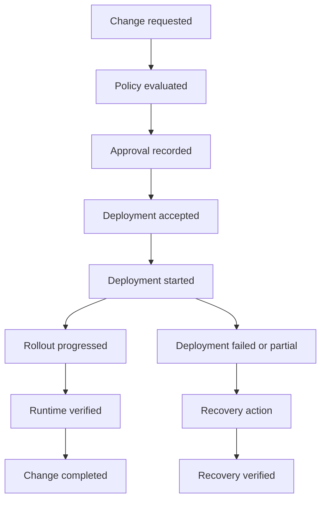

# Lưu lịch sử thay đổi và phê duyệt đối với môi trường quan trọng

Một lần triển khai production không chỉ là việc pipeline chạy xong. Khi có sự cố, nhóm cần biết ai hoặc workload identity nào đã yêu cầu thay đổi, thay đổi nào được áp dụng, artifact và cấu hình nào đã được triển khai, ai phê duyệt, policy nào được kiểm tra và trạng thái thực tế sau triển khai ra sao. Nếu chỉ có vài dòng log trong CI job, thông tin có thể biến mất khi log hết hạn, runner bị xóa hoặc lịch sử workflow không còn truy cập được.

Vì vậy, các môi trường quan trọng cần có **lịch sử thay đổi và bằng chứng phê duyệt có thể truy vết**. Mỗi thay đổi cần liên kết được từ yêu cầu ban đầu đến source revision, build, artifact digest, approval, deployment operation và kết quả xác minh. Lịch sử phải đủ tin cậy để phục vụ vận hành, điều tra sự cố và kiểm toán.

Trong CI/CD, bằng chứng không chỉ là một file log. Nó là tập hợp các sự kiện và tài liệu có định danh, thời gian, nguồn phát sinh và quan hệ rõ ràng. Khi được lưu tập trung, bảo vệ khỏi sửa/xóa trái phép và liên kết với deployment identity, lịch sử này giúp trả lời chính xác điều gì đã thay đổi trong môi trường quan trọng.

## 1. Phân biệt change history, audit log và telemetry

Ba loại dữ liệu thường liên quan nhưng có mục đích khác nhau:

- **Change history:** mô tả thay đổi đã được yêu cầu hoặc áp dụng, ví dụ release version, cấu hình, database migration, infrastructure plan hoặc feature flag.
- **Audit log:** ghi lại hành động có ý nghĩa kiểm soát, gồm actor, thời điểm, đối tượng, hành động, kết quả và bằng chứng authorization/approval.
- **Operational telemetry:** logs, metrics và traces cho biết hệ thống hoạt động như thế nào trước, trong và sau thay đổi.

Ví dụ, audit log ghi nhận một release được phê duyệt và triển khai lúc 09:30 UTC. Change history chỉ ra image digest mới và config revision đã áp dụng. Metrics cho thấy error rate tăng sau 09:34, còn trace giúp tìm request lỗi đi qua service nào.

Không nên dùng log ứng dụng thay cho audit trail. Log ứng dụng có thể bị sampling, rotate, thiếu actor hoặc bị thay đổi bởi chính ứng dụng đang gặp lỗi. Audit trail cần được ghi bởi control plane hoặc hệ thống có trách nhiệm ghi nhận hành động, với quyền ghi và retention được quản lý riêng.

## 2. Xác định phạm vi môi trường quan trọng

Không phải mọi môi trường đều cần cùng mức phê duyệt. Nhóm nên phân loại môi trường theo tác động nếu có thay đổi sai:

| Mức môi trường | Ví dụ | Kiểm soát tham khảo |
|---|---|---|
| Development | Namespace cá nhân, sandbox | Quyền developer, audit cơ bản |
| Integration/test | Môi trường kiểm thử dùng chung | Ghi nhận release/config, giới hạn quyền ghi |
| Staging/pre-production | Môi trường mô phỏng production | Approval theo nhóm, kiểm tra artifact và dữ liệu |
| Production | Hệ thống phục vụ người dùng | Protected environment, required reviewers, policy gates, audit bền vững |
| Critical production | Thanh toán, dữ liệu nhạy cảm, hệ thống điều khiển quan trọng | Phê duyệt độc lập, change window nếu cần, evidence đầy đủ, break-glass có kiểm soát |

Tên môi trường không tự tạo ra bảo vệ. Cần cấu hình quyền truy cập, branch/tag restrictions, runner group, service identity, network policy và approval rule tương ứng. Nếu ai cũng có thể đổi workflow để bỏ qua bước phê duyệt, nhãn production trong YAML không đủ.

## 3. Một thay đổi cần được truy vết qua những gì?

Một change record cho môi trường quan trọng nên liên kết các phần sau:

1. **Change request:** lý do, phạm vi, hệ thống và môi trường bị ảnh hưởng.
2. **Source revision:** repository, commit SHA, pull request và review.
3. **Build evidence:** pipeline run, builder, test, scan và provenance.
4. **Artifact identity:** image/package digest, version và registry.
5. **Configuration identity:** manifest, chart, infrastructure code, config revision và secret references.
6. **Approval evidence:** người phê duyệt, thời điểm, quyết định, policy và nội dung đã xem xét.
7. **Deployment record:** deployment ID, actor/service identity, target, strategy và trạng thái.
8. **Post-deployment evidence:** observed digest, rollout, health check, smoke test và telemetry window.
9. **Recovery relationship:** deployment trước đó, rollback/roll-forward và kết quả xác minh phục hồi.

Các phần có thể nằm trong nhiều hệ thống. Change management tool lưu yêu cầu; Git host lưu review; CI lưu build; artifact registry lưu digest; deployment controller lưu rollout; observability platform lưu metrics. Cần một tập định danh chung để nối chúng, thay vì cố sao chép toàn bộ nội dung vào một nơi.

## 4. Thiết kế change record có cấu trúc

Một record cần có định danh ổn định và những trường tối thiểu để trả lời ai, làm gì, ở đâu, khi nào, vì sao và kết quả thế nào.

| Nhóm | Trường tham khảo | Mục đích |
|---|---|---|
| Identity | change_id, deployment_id, release_id | Phân biệt thay đổi và lần triển khai |
| Actor | user/service principal, identity provider, workflow | Xác định người hoặc workload thực hiện |
| Action | requested, approved, deployed, rolled_back | Xác định hành động |
| Target | environment, account/project, region, cluster, namespace | Xác định phạm vi tác động |
| Source | repository, commit SHA, pull request | Truy về mã nguồn và review |
| Artifact | image/package reference, digest | Xác định nội dung phát hành |
| Configuration | config revision, manifest/chart, IaC revision | Xác định cấu hình áp dụng |
| Approval | reviewer, decision, timestamp, policy result | Chứng minh điều kiện phê duyệt |
| Timing | requested_at, approved_at, started_at, completed_at | Dựng lại trình tự sự kiện |
| Outcome | status, error code, verification evidence | Xác định kết quả |
| Correlation | request ID, operation ID, trace ID | Liên kết log và telemetry |

Thời gian nên được chuẩn hóa theo UTC và lưu cả thời điểm sự kiện lẫn thời điểm hệ thống ghi nhận nếu hai giá trị có thể khác nhau. Đồng bộ clock giữa runner, control plane và hệ thống log giúp dựng timeline chính xác hơn.

Ví dụ record minh họa:

```yaml
change:
  change_id: "chg-2026-01842"
  deployment_id: "dep-2026-004281"
  release_id: "orders-service-2.7.1"
  environment: "production"
  target:
    account: "prod-platform"
    region: "ap-southeast-1"
    cluster: "prod-apps"
    namespace: "production-orders"

  source:
    repository: "platform/orders-service"
    commit: "4f2a9c1..."
    pull_request: "4821"

  artifact:
    reference: "registry.example.com/orders-service"
    digest: "sha256:abc..."

  configuration:
    revision: "deploy-config@7c91e2..."
    chart_version: "orders-chart-4.3.0"

  approval:
    decision: "approved"
    reviewer: "user:release-approver-17"
    policy: "production-change-policy-v3"
    approved_at: "2026-11-18T09:20:00Z"

  execution:
    actor: "workload:ci-production-deployer"
    operation_id: "op-73184"
    started_at: "2026-11-18T09:24:00Z"
    completed_at: "2026-11-18T09:28:42Z"
    status: "succeeded"

  evidence:
    test_run: "ci-18452"
    smoke_test: "smoke-2917"
    observed_digest: "sha256:abc..."
    audit_event: "evt-993812"
```

Schema và giá trị trên chỉ là ví dụ. Không đưa token, password, private key hoặc secret value vào record. Với dữ liệu nhạy cảm, chỉ lưu reference/version và đường dẫn tới kho evidence có kiểm soát quyền.

## 5. Ghi lịch sử theo sự kiện, không chỉ ghi kết quả cuối

Nếu chỉ ghi một dòng sau khi deploy thành công, nhóm có thể mất thông tin khi runner chết giữa chừng hoặc thao tác chỉ hoàn thành một phần. Nên ghi event theo vòng đời:



Mỗi event nên có event ID duy nhất, change/deployment ID, actor, timestamp, action, target, result và correlation ID. Nếu cùng một event được gửi lại do retry, event collector cần deduplicate theo event ID hoặc sequence để không đếm hai lần.

Không ghi đè event cũ khi trạng thái thay đổi. Ví dụ một deployment từ running sang failed rồi được rollback cần giữ đủ các mốc đó. Có thể tạo một materialized current-state view để truy vấn nhanh, nhưng event history gốc cần được giữ theo retention policy.

## 6. Phê duyệt phải gắn với đúng nội dung thay đổi

Một approval chỉ có ý nghĩa nếu người phê duyệt biết mình đang duyệt điều gì. Approval cần được liên kết với:

- Change request và lý do thay đổi.
- Commit SHA hoặc pull request đã review.
- Artifact digest sẽ được triển khai.
- Environment và target cụ thể.
- Config/manifest/infrastructure revision.
- Kết quả test, security scan và quality gate.
- Kế hoạch triển khai, quan sát và phục hồi.

Nếu artifact digest hoặc cấu hình thay đổi sau khi được phê duyệt, approval cũ có thể không còn áp dụng. Policy cần xác định trường nào làm approval mất hiệu lực và yêu cầu phê duyệt lại khi nội dung thay đổi.

Không nên phê duyệt một nhãn chung như “release 2.7.1” nếu nhãn có thể trỏ tới artifact khác. Hãy duyệt digest bất biến và target rõ ràng.

## 7. Separation of duties và quyền phê duyệt

Với môi trường quan trọng, người yêu cầu hoặc tạo thay đổi không nên tự phê duyệt mọi trường hợp có rủi ro cao. Separation of duties giảm nguy cơ một danh tính đơn lẻ vừa tạo, vừa phê duyệt và triển khai thay đổi không được kiểm tra.

Một ma trận tham khảo:

| Vai trò | Quyền chính | Giới hạn |
|---|---|---|
| Developer | Tạo pull request và change request | Không tự cấp production deploy role |
| Reviewer | Review source và test evidence | Không nhất thiết có quyền deploy |
| Release approver | Phê duyệt release/target cụ thể | Không sửa artifact đã được duyệt |
| Deployment workload | Thực hiện deploy theo policy | Chỉ có quyền trên target được cấp |
| Auditor | Đọc change/approval history | Không sửa record hoặc triển khai |
| Incident commander | Điều phối break-glass theo quy trình | Mọi hành động phải được ghi nhận và hậu kiểm |

Số lượng approver và quy tắc độc lập cần phù hợp mức rủi ro. Một môi trường staging có thể chỉ cần một reviewer; hệ thống thanh toán hoặc dữ liệu nhạy cảm có thể cần hai người thuộc nhóm khác nhau. Tránh tạo quy trình phê duyệt quá nặng cho thay đổi không có tác động tương ứng, nhưng không bỏ kiểm soát bắt buộc của production.

## 8. Protected environment trong CI/CD

CI platform thường hỗ trợ environment protection, required reviewers, branch restrictions và deployment history. Các tính năng này nên được cấu hình ở cấp repository/organization hoặc control plane, không chỉ dựa vào điều kiện trong workflow do chính pull request có thể sửa.

Ví dụ cấu trúc GitHub Actions:

```yaml
jobs:
  deploy_production:
    if: github.ref == 'refs/heads/main'
    environment: production
    runs-on: [self-hosted, production-deploy]
    permissions:
      contents: read
      id-token: write
    steps:
      - name: Verify approved release
        run: ./scripts/verify-approved-release.sh
      - name: Deploy immutable artifact
        run: ./scripts/deploy-by-digest.sh
      - name: Verify runtime
        run: ./scripts/verify-production-state.sh
```

Đây là ví dụ cấu trúc. Required reviewers, branch restrictions, runner group và environment protection phải được cấu hình ngoài workflow theo quyền quản trị của nền tảng. Các script là placeholder. Job cần xác minh digest và approval record gắn với đúng commit, config revision và target trước khi triển khai.

Quyền id-token: write chỉ cho phép job yêu cầu OIDC token. Trust policy phía cloud cần giới hạn issuer, audience, repository, workflow, ref và environment; role được cấp vẫn phải giới hạn resource/action. Không dùng static cloud key lâu dài chỉ để đơn giản hóa bước deploy.

## 9. Ghi nhận quyết định policy và lý do từ chối

Audit trail cần lưu cả quyết định được chấp thuận lẫn bị từ chối:

- Policy nào được đánh giá và version nào đang có hiệu lực.
- Các điều kiện bắt buộc đã đạt hay chưa.
- Approver nào quyết định và vào thời điểm nào.
- Thay đổi bị từ chối vì lý do gì.
- Có ngoại lệ hoặc waiver nào được cấp không, ai cấp và thời hạn.
- Approval có hết hạn hoặc bị thu hồi trước khi deploy không.

Nếu chỉ lưu các lần deploy thành công, hệ thống không cho thấy các thay đổi từng bị chặn hoặc policy nào đã ngăn một release rủi ro. Lịch sử từ chối giúp chứng minh gate hoạt động và hỗ trợ điều tra khi có câu hỏi về một quyết định cụ thể.

Waiver cần có phạm vi hẹp, lý do, owner, người phê duyệt, thời hạn và điều kiện bù. Không dùng waiver vĩnh viễn để biến một quality gate thành tùy chọn.

## 10. Break-glass cho sự cố khẩn cấp

Đôi khi cần thay đổi production nhanh để khôi phục dịch vụ. Break-glass là cơ chế khẩn cấp có quyền hạn giới hạn, không phải đường tắt vô danh để bỏ audit.

Một quy trình break-glass nên:

1. Xác định điều kiện kích hoạt và vai trò có quyền sử dụng.
2. Ghi incident ID, lý do, target và phạm vi thay đổi.
3. Dùng danh tính đặc biệt có thời hạn, quyền tối thiểu và xác thực mạnh.
4. Ghi lại mọi lệnh, artifact/config revision và thao tác thực tế.
5. Thông báo tới người chịu trách nhiệm theo policy.
6. Thu hồi quyền khẩn cấp khi hoàn tất.
7. Hậu kiểm, bổ sung change record và đánh giá có cần thay đổi quy trình thường lệ không.

Nếu hệ thống yêu cầu approval kép nhưng trong sự cố không thể chờ, policy cần quy định rõ ngoại lệ và hậu kiểm. Không nên tạo tài khoản dùng chung hoặc ghi credential khẩn cấp trong tài liệu. Mọi hành động break-glass phải có actor cá nhân hoặc workload identity có thể truy vết.

## 11. Bảo vệ tính toàn vẹn của audit trail

Audit log chỉ có giá trị nếu người thực hiện thay đổi không thể âm thầm sửa lịch sử của chính mình.

Các biện pháp thường dùng:

- Gửi event tới hệ thống audit tập trung nằm ngoài quyền quản trị của workload được ghi nhận.
- Dùng append-only storage hoặc object lock/WORM khi yêu cầu retention cần chống sửa/xóa.
- Giới hạn quyền ghi theo service identity và quyền đọc theo vai trò.
- Tách quyền quản trị audit storage khỏi quyền deploy production.
- Ghi nhận mọi thao tác truy cập, export, retention change và deletion exception.
- Dùng checksum, chữ ký hoặc hash chain cho batch/event khi cần phát hiện sửa đổi.
- Sao lưu và kiểm tra khả năng phục hồi audit data.

Hash chain có thể giúp phát hiện một phần thay đổi: mỗi record chứa hash của record trước. Tuy nhiên, nếu kẻ tấn công có thể viết lại toàn bộ chuỗi và thay anchor, hash chain đơn lẻ không đủ. Cần anchor hoặc bản sao hash được lưu ở hệ thống độc lập, cùng quyền truy cập và retention phù hợp.

Không dùng hash thay cho access control. Tính toàn vẹn cần kết hợp quyền hạn, lưu trữ chống sửa, giám sát và quy trình quản trị khóa ký.

## 12. Retention, quyền riêng tư và dữ liệu nhạy cảm

Lịch sử thay đổi cần được giữ đủ lâu để đáp ứng điều tra, vận hành và chính sách tổ chức. Nhưng lưu quá nhiều dữ liệu cũng làm tăng rủi ro riêng tư và chi phí.

Thiết kế retention cần xác định:

- Loại event và thời gian lưu cho từng nhóm môi trường.
- Yêu cầu pháp lý, hợp đồng và chính sách nội bộ áp dụng.
- Thời gian lưu online để tìm kiếm nhanh và thời gian lưu archive.
- Cách xử lý legal hold hoặc incident hold.
- Quy trình hết hạn và xóa có kiểm soát.
- Người được phép truy cập/export dữ liệu.

Không lưu secret value, token, private key, session cookie hoặc payload nhạy cảm trong audit event. Với actor, chỉ lưu định danh cần thiết; tránh sao chép thông tin cá nhân không liên quan. Nếu lưu IP hoặc user agent, cần có mục đích và retention phù hợp.

Log phải chống log injection. Các trường như branch name, commit message, change title hoặc user-supplied text cần được escape/structured logging để ký tự xuống dòng không giả mạo event mới. Giới hạn kích thước field và không đưa nguyên payload không tin cậy vào audit record.

## 13. Liên kết audit với logs, metrics và traces

Change record giúp biết thay đổi nào đã xảy ra; telemetry cho biết tác động sau thay đổi. Cần dùng correlation identifiers để nối chúng:

- Change ID và deployment ID.
- Release ID và artifact digest.
- Commit SHA và pipeline run ID.
- Operation ID và request/trace ID.
- Environment, region, cluster và workload.
- Config revision và feature flag configuration version.

Khi một metric tăng error rate, người vận hành có thể truy vấn deployment gần nhất trong cùng service/environment. Từ deployment record, họ tìm commit, pull request, approval, artifact và config revision. Sau đó, trace/log theo cùng time window giúp xác định request nào bị ảnh hưởng.

Không nên chỉ ghép theo timestamp gần nhất vì nhiều deployment có thể diễn ra đồng thời. ID ổn định và metadata target giúp tránh gán nhầm sự cố cho một thay đổi không liên quan.

## 14. Ví dụ truy vấn lịch sử thay đổi

Giả sử audit store có các trường change_id, deployment_id, environment, actor, action, event_time, commit_sha, artifact_digest và approval_id. Một truy vấn khái niệm có thể tìm thay đổi production trong một khoảng thời gian:

```sql
SELECT
    event_time,
    change_id,
    deployment_id,
    actor,
    action,
    commit_sha,
    artifact_digest,
    approval_id
FROM deployment_audit_events
WHERE environment = 'production'
  AND event_time >= TIMESTAMP '2026-11-18 00:00:00'
  AND event_time <  TIMESTAMP '2026-11-19 00:00:00'
ORDER BY event_time;
```

Tên bảng và schema là ví dụ. Trong hệ thống thực tế, audit event có thể nằm trong log platform hoặc event store thay vì SQL database. Cần phân trang, giới hạn truy vấn và ghi audit cho thao tác export nếu chính sách yêu cầu.

Một điều tra thường đi theo các câu hỏi:

1. Có deployment nào xảy ra trước thời điểm lỗi bắt đầu?
2. Deployment đó áp dụng artifact digest và config revision nào?
3. Approval có gắn với đúng digest/target không?
4. Ai hoặc identity nào thực hiện operation?
5. Post-deployment validation có pass không?
6. Metrics/traces thay đổi thế nào sau thời điểm đó?
7. Có rollback, hotfix hoặc thao tác thủ công tiếp theo không?

## 15. Báo cáo thay đổi và evidence package

Đối với release quan trọng, có thể tạo một evidence package liên kết các bản ghi thay vì chụp màn hình rời rạc. Một package tham khảo gồm:

- Change request và lý do.
- Pull request, review và commit SHA.
- CI run, test report, security scan và policy result.
- Artifact digest, provenance và SBOM nếu được yêu cầu.
- Config/manifest/IaC revision.
- Approval decision và reviewer identity.
- Deployment ID, target và thời gian.
- Post-deployment health/smoke evidence.
- Metrics observation window và kết quả.
- Rollback/recovery reference nếu đã xảy ra.

Package cần có manifest liệt kê file/reference, checksum và thời điểm thu thập. Các liên kết tới hệ thống ngoài phải có retention đủ dài và quyền truy cập phù hợp; URL hết hạn hoặc dashboard chỉ giữ dữ liệu ngắn hạn không phải bằng chứng lưu trữ lâu dài.

Không cần sao chép mọi log và trace vào một gói duy nhất. Lưu reference có định danh, checksum hoặc snapshot của phần bằng chứng cần giữ. Với dữ liệu lớn, evidence catalog có thể lập chỉ mục và trỏ tới kho lưu trữ tương ứng.

## 16. Xử lý thay đổi ngoài pipeline

Không phải mọi thay đổi production đều đi qua CI/CD. Quản trị viên có thể sửa cấu hình trực tiếp, operator có thể thay đổi resource, cloud console có thể cập nhật firewall hoặc người vận hành có thể khởi động lại service.

Để lịch sử không có khoảng trống:

- Bật audit log ở cloud provider, Kubernetes API server, Git host, database và change management platform.
- Thu thập thay đổi thủ công cùng actor, target, before/after hoặc resource version nếu nguồn cung cấp.
- Phát hiện drift giữa desired state trong Git và observed state.
- Liên kết thao tác thủ công với incident/change request nếu có.
- Có cảnh báo khi production thay đổi ngoài workflow được phê duyệt.
- Định kỳ đối chiếu deployment record với trạng thái thực tế.

Không tự động ghi đè mọi drift. Có thay đổi khẩn cấp hợp lệ cần được ghi nhận và đưa trở lại source of truth sau đó. Mục tiêu là phát hiện, phân loại và truy vết thay đổi, không làm mất dấu hành động của người vận hành.

## 17. Những sai lầm thường gặp

| Sai lầm | Hệ quả | Cách khắc phục |
|---|---|---|
| Chỉ giữ CI console log | Log hết hạn hoặc khó liên kết với deployment | Lưu audit/change record tập trung |
| Chỉ ghi deploy success | Mất lịch sử request, approval và rollout lỗi | Ghi event theo vòng đời |
| Approval chỉ gắn với release name | Có thể duyệt nhầm artifact/config | Gắn approval với digest, commit và target |
| Người tạo tự duyệt mọi production change | Thiếu separation of duties | Dùng reviewer độc lập theo risk policy |
| Workflow tự kiểm soát toàn bộ approval | Pull request có thể sửa điều kiện bảo vệ | Cấu hình protected environment ở control plane |
| Audit store cho deployer quyền xóa log | Có thể che giấu hành động | Tách quyền, append-only/WORM và giám sát |
| Ghi secret vào evidence package | Lộ credential qua audit export | Chỉ lưu secret reference/version |
| Chỉ theo dõi timestamp | Gán nhầm telemetry cho deployment khác | Dùng change/deployment/correlation IDs |
| Bỏ qua thay đổi thủ công | Lịch sử production không đầy đủ | Thu thập cloud/platform audit và drift |
| Break-glass không có hậu kiểm | Ngoại lệ trở thành đường bypass thường xuyên | Ghi incident, thu hồi quyền và review sau sự cố |

## 18. Checklist lưu lịch sử thay đổi và phê duyệt

- [ ] Phân loại môi trường theo mức độ quan trọng và tác động.
- [ ] Mỗi change/deployment có ID duy nhất và liên kết được với release.
- [ ] Ghi actor, action, target, timestamp, outcome và correlation IDs.
- [ ] Liên kết commit, pull request, build run, artifact digest và config revision.
- [ ] Approval gắn với đúng artifact, cấu hình, môi trường và policy version.
- [ ] Có separation of duties và reviewer phù hợp với mức rủi ro.
- [ ] Protected environment, branch restriction và runner permission được cấu hình ở control plane.
- [ ] Ghi cả approval, rejection, waiver và policy evaluation.
- [ ] Event history được lưu append-only hoặc có biện pháp phát hiện sửa đổi.
- [ ] Retention, archive, legal hold và quyền export được xác định.
- [ ] Không lưu secret value hoặc dữ liệu cá nhân không cần thiết trong evidence.
- [ ] Liên kết change/deployment IDs với logs, metrics, traces và post-deployment checks.
- [ ] Thu thập audit log cho thay đổi ngoài pipeline và phát hiện drift.
- [ ] Break-glass có identity, incident reference, giới hạn thời gian và hậu kiểm.
- [ ] Có thể dựng lại timeline từ yêu cầu, review, approval đến deploy và recovery.

Lưu lịch sử thay đổi và phê duyệt biến một lần phát hành ở môi trường quan trọng thành chuỗi sự kiện có thể kiểm chứng. Khi change ID, artifact digest, config revision, approval, deployment và telemetry được liên kết trong một audit trail bền vững, nhóm vận hành có thể biết ai đã làm gì, thay đổi nào thực sự chạy, quyết định dựa trên bằng chứng nào và hệ thống phản ứng ra sao sau đó.
