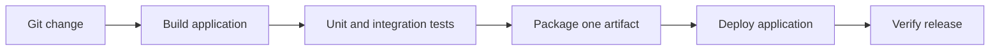
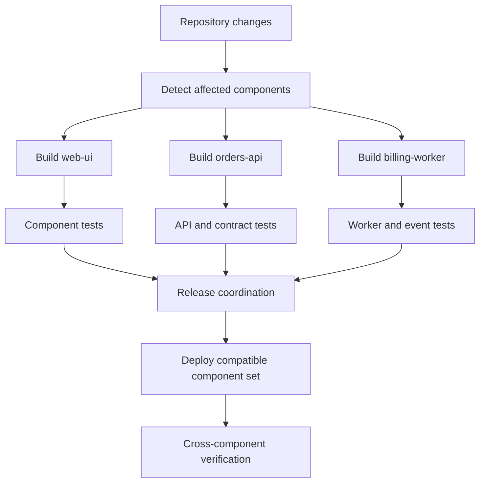
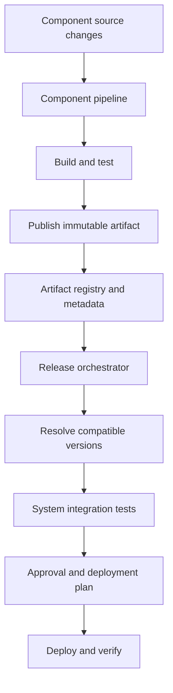
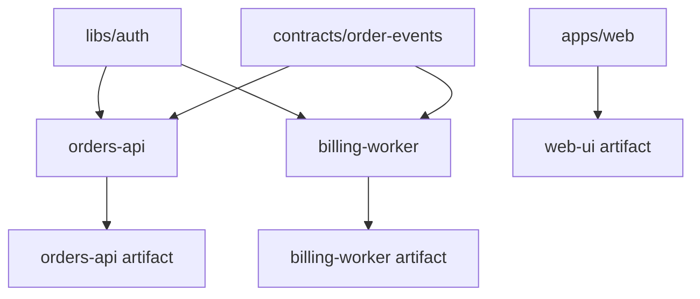
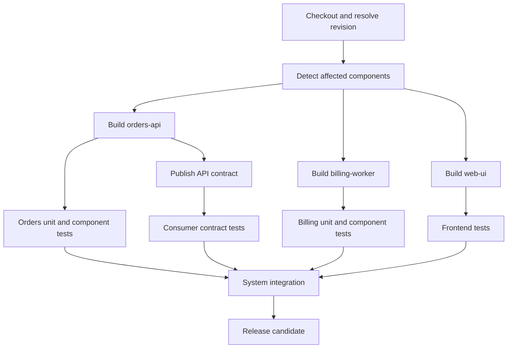

# Phân biệt pipeline cho một ứng dụng với nhiều thành phần

Một ứng dụng nhỏ có thể được build, kiểm thử và triển khai bằng một pipeline duy nhất. Khi sản phẩm phát triển thành nhiều thành phần như frontend, API, worker, database migration và hạ tầng, cách tổ chức pipeline cần thay đổi. Nếu tiếp tục chạy mọi công việc trong một luồng khổng lồ, một thay đổi nhỏ có thể kích hoạt build và test của toàn hệ thống. Nếu tách mỗi thành phần thành pipeline hoàn toàn độc lập mà không có quy ước phối hợp, các phiên bản có thể không tương thích và việc phát hành một tính năng xuyên nhiều service trở nên khó kiểm soát.

Điểm cần hiểu đầu tiên là **cấu trúc repository, kiến trúc ứng dụng và cấu trúc pipeline là ba quyết định có liên quan nhưng không đồng nhất**. Monorepo không bắt buộc phải có một pipeline duy nhất; nhiều repository cũng không có nghĩa mỗi repository được phát hành mà không cần phối hợp. Thiết kế tốt xác định ranh giới thành phần, quyền sở hữu, dependency, artifact và cách các pipeline trao đổi trạng thái.

## 1. Pipeline cho một ứng dụng và pipeline cho nhiều thành phần

Với một ứng dụng đơn giản, một lần thay đổi thường đi qua cùng một chuỗi: checkout, build, test, package và deploy. Các bước có chung source revision, dependency và release unit.

Khi hệ thống có nhiều thành phần, mỗi phần có thể có:

- Mã nguồn và dependency riêng.
- Nhịp phát triển và lịch phát hành khác nhau.
- Bộ test và yêu cầu tài nguyên khác nhau.
- Artifact riêng như container image, package, static bundle hoặc migration.
- Owner và quyền deploy riêng.
- Quan hệ tương thích với API, event schema hoặc database của thành phần khác.

Pipeline cần phản ánh các ranh giới này. Một thay đổi ở `web-ui` không nhất thiết phải build lại `billing-worker`; thay đổi contract dùng chung có thể yêu cầu test nhiều consumer; một release gồm nhiều service cần có release manifest ghi rõ phiên bản nào đi cùng nhau.

### Ví dụ một ứng dụng đơn



### Ví dụ hệ thống nhiều thành phần



Sơ đồ thứ hai không có nghĩa mọi thay đổi luôn phải build cả ba thành phần. Bước phát hiện ảnh hưởng quyết định pipeline nào cần chạy; bước điều phối release quyết định khi nào các artifact tương thích được triển khai cùng nhau.

## 2. Phân biệt kiến trúc ứng dụng, repository và pipeline

Ba chiều này thường bị nhầm lẫn:

| Chiều | Câu hỏi | Ví dụ lựa chọn |
|---|---|---|
| Kiến trúc ứng dụng | Hệ thống được chia thành module/service nào? | Monolith modular, microservices, frontend/API/worker |
| Repository topology | Mã nguồn được lưu ở đâu? | Monorepo, multirepo, một repo cho mỗi domain |
| Pipeline topology | Build/test/release được tổ chức và điều phối ra sao? | Một pipeline, pipeline theo component, orchestrator trung tâm, mô hình kết hợp |

Một monolith có thể nằm trong monorepo và dùng một pipeline. Nó cũng có thể nằm trong nhiều repository thư viện và ứng dụng. Một hệ thống microservices có thể đặt nhiều service trong một monorepo hoặc tách mỗi service thành repository riêng. Pipeline cần theo dependency và release boundary thực tế, không chỉ dựa trên tên kiến trúc.

### Monorepo không đồng nghĩa monolithic pipeline

Trong monorepo, các component có thể nằm trong một repository nhưng có build graph và release cadence độc lập. Thay đổi ở `services/orders` có thể chỉ kích hoạt pipeline của `orders-api`, trong khi thay đổi ở `libs/security` cần chạy test cho mọi component sử dụng thư viện đó.

### Multirepo không đồng nghĩa không có điều phối

Trong multirepo, mỗi repository có pipeline riêng, nhưng một tính năng có thể cần thay đổi đồng thời API provider, consumer, frontend và schema. Các pipeline cần chia sẻ contract, artifact version và release manifest để phối hợp.

## 3. Xác định component và ranh giới build

Trước khi tạo nhiều pipeline, cần xác định thành phần nào có thể build, test và phát hành độc lập.

Một component nên có ranh giới tương đối rõ:

- Có mục đích và trách nhiệm nghiệp vụ xác định.
- Có owner chịu trách nhiệm.
- Có đầu vào build và artifact đầu ra nhận diện được.
- Có test xác minh hành vi của chính nó.
- Có interface hoặc contract với thành phần khác.
- Có thể xác định dependency và phạm vi ảnh hưởng khi thay đổi.
- Có quy trình version, deploy và rollback.

Không nên tách pipeline chỉ theo thư mục nếu các thư mục thực chất luôn phải build và phát hành cùng nhau. Ngược lại, nếu một component có dependency, test và release cadence riêng, việc gộp nó vào pipeline lớn có thể tạo thời gian chờ không cần thiết.

### Component, module và deployable unit

Một module trong code không nhất thiết là một deployable component. Ví dụ, `orders-domain` và `orders-persistence` có thể là module trong cùng một ứng dụng `orders-api`, được package thành một artifact. Pipeline có thể test module riêng nhưng vẫn phát hành một đơn vị triển khai.

Ngược lại, một repository có thể tạo nhiều artifact: một container API, một container worker và một migration package. Khi đó, pipeline cần theo dõi artifact nào được tạo từ phần source nào và release nào sử dụng chúng.

## 4. Chọn monorepo hay multirepo theo nhu cầu

Không có một lựa chọn đúng cho mọi tổ chức. Repository topology ảnh hưởng đến cách phát hiện thay đổi, quản lý quyền, chia sẻ code và điều phối pipeline.

| Tiêu chí | Monorepo | Multirepo |
|---|---|---|
| Thay đổi xuyên component | Một pull request có thể cập nhật nhiều component cùng lúc | Thường cần nhiều pull request hoặc release phối hợp |
| Dependency nội bộ | Có thể dùng source revision chung và cập nhật đồng bộ | Thường dùng package/API version đã publish |
| Trigger pipeline | Cần path filtering hoặc build graph | Trigger theo repository và dependency event |
| Quyền truy cập | Cần CODEOWNERS/path permission và guardrail phù hợp | Quyền có thể tách theo repository/team |
| CI scale | Cần tối ưu affected-component detection và cache | Nhiều pipeline nhỏ nhưng có overhead giữa repo |
| Release cadence | Có thể độc lập nếu component được thiết kế tốt | Thường độc lập hơn nhưng cần contract/versioning |
| Refactor xuyên component | Dễ tạo thay đổi nguyên tử | Cần tương thích trong giai đoạn chuyển tiếp |

### Khi monorepo phù hợp

- Nhiều component được phát triển bởi một nhóm hoặc các nhóm phối hợp chặt.
- Thay đổi thường xuyên xuyên qua nhiều module.
- Có thể xây dựng dependency graph và chỉ chạy phần bị ảnh hưởng.
- Muốn review một thay đổi nguyên tử cho nhiều component.

### Khi multirepo phù hợp

- Component có owner, quyền truy cập hoặc vòng đời release riêng.
- Các nhóm cần triển khai độc lập và có ranh giới contract rõ.
- Repository có yêu cầu bảo mật hoặc compliance khác nhau.
- Artifact được tiêu thụ qua registry/API với version được quản lý.

### Mô hình kết hợp

Một tổ chức có thể dùng monorepo cho service thuộc cùng domain và multirepo cho shared platform, SDK hoặc sản phẩm có quyền sở hữu khác nhau. Quan trọng là có quy tắc dependency và release nhất quán.

## 5. Chọn mô hình tổ chức pipeline

Có ba mô hình thường gặp. Mỗi mô hình phù hợp với quy mô và mức độ phụ thuộc khác nhau.

### 5.1. Một pipeline duy nhất

Pipeline trung tâm build và deploy toàn bộ hệ thống.

Ưu điểm:

- Một nơi để nhìn toàn bộ quy trình.
- Dễ điều phối các bước phải chạy tuần tự.
- Phù hợp với sản phẩm nhỏ hoặc các component luôn release cùng nhau.

Hạn chế:

- Thay đổi nhỏ có thể kích hoạt nhiều công việc không cần thiết.
- Pipeline có thể dài và khó bảo trì.
- Một component chậm hoặc lỗi có thể chặn toàn bộ release.
- Quyền deploy và ownership dễ bị tập trung quá mức.

### 5.2. Pipeline riêng theo component

Mỗi component có pipeline build, test và publish artifact riêng. Một pipeline release hoặc platform controller có thể chọn các artifact để triển khai.

Ưu điểm:

- Team tự chủ hơn về build/test/release cadence.
- Thay đổi chỉ chạy pipeline liên quan.
- Dễ áp dụng quyền và tài nguyên theo component.

Hạn chế:

- Cần quản lý dependency và compatibility giữa artifact.
- Có thể trùng lặp workflow và policy.
- Một thay đổi xuyên nhiều component cần orchestration rõ.

### 5.3. Mô hình kết hợp: component pipelines và release orchestrator

Component pipeline tạo artifact, test và provenance. Release orchestrator chọn đúng tập artifact tương thích, chạy integration/acceptance test ở cấp hệ thống, xin approval cần thiết và điều phối deployment.



Đây là mô hình phổ biến khi component cần tự chủ nhưng sản phẩm vẫn cần một điểm kiểm soát release xuyên hệ thống.

## 6. Trigger pipeline theo phạm vi thay đổi

Trong monorepo, path filtering hoặc build graph có thể xác định component bị ảnh hưởng. Trong multirepo, repository event, package publication hoặc API contract change có thể kích hoạt pipeline liên quan.

Ví dụ monorepo:

| Đường dẫn thay đổi | Pipeline cần chạy |
|---|---|
| `services/orders/**` | Build/test `orders-api` |
| `services/billing/**` | Build/test `billing-worker` |
| `apps/web/**` | Build/test `web-ui` |
| `libs/auth/**` | Auth library test và consumer tests của component phụ thuộc |
| `contracts/events/**` | Schema validation và consumer/provider contract tests |
| `infra/shared/**` | IaC validation và test các deployment target liên quan |
| Root build script hoặc shared workflow | Có thể cần chạy rộng hơn vì ảnh hưởng toàn repo |

### Path filtering cần xét dependency graph

Nếu chỉ nhìn file thay đổi, pipeline có thể bỏ sót consumer. Ví dụ `libs/auth` thay đổi nhưng `orders-api` không có file nào đổi; `orders-api` vẫn có thể bị ảnh hưởng vì nó sử dụng thư viện đó.

Một dependency graph có hướng có thể biểu diễn:



Khi một node thay đổi, scheduler cần tính các node phụ thuộc theo chiều phù hợp để chạy build/test consumer. Với thay đổi build toolchain hoặc shared workflow, có thể cần invalidate cache và chạy pipeline rộng hơn.

### Khi không chắc phạm vi ảnh hưởng

Nếu dependency graph thiếu hoặc không thể xác định chắc chắn, chọn phạm vi test rộng hơn. Không nên coi “không tìm thấy đường dẫn bị ảnh hưởng” là bằng chứng không cần chạy test.

## 7. Xây dựng dependency graph và DAG pipeline

Dependency graph mô tả quan hệ giữa component; DAG pipeline mô tả thứ tự các job cần thực hiện. Một job chỉ nên chờ dependency thực sự cần thiết.

Ví dụ, frontend build có thể chạy song song với backend unit test. Contract test cần artifact hoặc schema của provider. E2E chỉ bắt đầu sau khi các component liên quan đã được deploy vào environment kiểm thử.



Không cần tạo một chuỗi tuần tự `orders -> billing -> web` nếu ba component độc lập. Chỉ nối dependency khi một job cần output hoặc trạng thái từ job khác.

## 8. Phân biệt component pipeline và release pipeline

Component pipeline trả lời: “Thành phần này có thể được build và phát hành như một artifact hợp lệ không?” Release pipeline trả lời: “Tập artifact này có tương thích và được phép triển khai cùng nhau vào target cụ thể không?”

| Component pipeline | Release pipeline |
|---|---|
| Build source của một component | Chọn tập artifact cho một release |
| Chạy unit/component/contract test | Chạy integration/acceptance test cấp hệ thống |
| Tạo artifact bất biến | Tham chiếu artifact digest đã tạo |
| Tạo SBOM/provenance/scan report | Xác minh evidence và compatibility |
| Publish metadata và version | Tạo release manifest và deployment plan |
| Không nhất thiết deploy production | Điều phối approval, deployment và verification |

Một component pipeline có thể deploy preview hoặc development để kiểm tra. Nhưng quyền phát hành production cần tuân release policy và environment protection của hệ thống.

## 9. Artifact và versioning giữa nhiều component

Trong hệ thống nhiều thành phần, artifact phải được nhận diện rõ và không phụ thuộc tag mutable.

Ví dụ artifact:

- Container image `orders-api`.
- Container image `billing-worker`.
- Static bundle `web-ui`.
- Package thư viện dùng chung.
- Database migration package.
- Helm chart hoặc manifest triển khai.

Mỗi artifact cần metadata như:

- Component name và version.
- Source repository và commit SHA.
- Build pipeline/run ID.
- Artifact digest.
- Dependency versions.
- SBOM, scan result và provenance.
- Contract/schema version tương ứng.

### Semantic versioning và compatibility

Version `major.minor.patch` có thể giúp consumer hiểu mức thay đổi API/package, nhưng version number không tự chứng minh compatibility. Cần contract test, compatibility policy và changelog.

Với container, nên deploy bằng digest bất biến. Tag như `latest`, `main` hoặc `stable` tiện cho con người nhưng có thể bị di chuyển. Release manifest cần tham chiếu digest cụ thể để tái tạo release.

## 10. Release manifest cho một tập component

Một release có thể bao gồm nhiều artifact. Release manifest ghi rõ chính xác phiên bản nào được coi là một bộ tương thích.

Ví dụ:

```yaml
release:
  id: commerce-2026.11.18-rc2
  source_revision: 8f31a2c
  components:
    orders-api:
      version: 3.8.1
      image: registry.example.test/orders-api@sha256:ORDERS_DIGEST
    billing-worker:
      version: 2.4.0
      image: registry.example.test/billing-worker@sha256:BILLING_DIGEST
    web-ui:
      version: 5.2.3
      artifact: registry.example.test/web-ui@sha256:WEB_DIGEST
  contracts:
    order-events: 4
    billing-api: 2
```

Đây là schema minh họa. Manifest thực tế cần có chữ ký hoặc nguồn lưu đáng tin cậy, policy validation và liên kết đến test/provenance. Giá trị digest trong ví dụ là placeholder.

Manifest giúp nhóm biết release nào đã được triển khai, artifact nào đi cùng nhau và cần quay lui về bộ phiên bản nào khi có sự cố.

## 11. Quản lý contract giữa provider và consumer

Các component thường giao tiếp qua REST/gRPC API, event, message schema hoặc package. Pipeline cần kiểm tra compatibility tại ranh giới đó.

### Provider/consumer contract

- Provider công bố schema/API và version.
- Consumer mô tả phần contract mà nó sử dụng.
- Contract test xác minh provider vẫn đáp ứng yêu cầu của consumer.
- Breaking change cần có kế hoạch chuyển tiếp hoặc version mới.

### Backward compatibility

Trong rollout nhiều component, provider mới có thể được triển khai trước consumer hoặc ngược lại. Thiết kế API/event nên hỗ trợ giai đoạn hai phiên bản cùng tồn tại:

- Thêm field optional thay vì xóa field đang dùng.
- Consumer bỏ qua field không biết nếu contract cho phép.
- Không đổi ý nghĩa field hiện tại mà không version hóa.
- Dùng expand–migrate–contract cho schema và dữ liệu.
- Duy trì consumer cũ trong cửa sổ chuyển tiếp.

Nếu release cần deploy nhiều component đồng thời vì contract không tương thích, release orchestrator phải quản lý thứ tự và kiểm tra readiness của cả tập.

## 12. Điều phối nhiều repository

Trong multirepo, pipeline của một repository có thể phát artifact event hoặc cập nhật release metadata. Repository consumer có thể theo dõi version mới, chạy compatibility test và tạo pull request nâng dependency.

Các cách phối hợp phổ biến:

1. **Version pinning:** consumer khai báo version cụ thể của package/API client.
2. **Artifact event:** provider publish artifact và phát thông báo cho consumer.
3. **Dependency update automation:** bot tạo PR nâng version, sau đó pipeline consumer chạy test.
4. **Release manifest:** một repository hoặc registry lưu tập component version được phát hành cùng nhau.
5. **Central orchestrator:** workflow trung tâm gọi hoặc chờ pipeline của các project rồi tổng hợp kết quả.

Không nên để consumer tự động lấy `latest` trong production. Việc cập nhật dependency cần được kiểm tra và có thể truy vết về artifact cụ thể.

### Trigger downstream có kiểm soát

Một provider publish version mới không nhất thiết phải tự động deploy mọi consumer production. Nó có thể kích hoạt contract test hoặc tạo dependency update PR. Quyết định deploy consumer vẫn theo release policy và owner của consumer.

## 13. Chọn orchestration trung tâm hay federated

Orchestration trung tâm có một pipeline quản lý release xuyên nhiều project. Federated orchestration để từng component tự vận hành, chỉ chia sẻ event, contract và release metadata.

| Tiêu chí | Central orchestration | Federated pipelines |
|---|---|---|
| Điều phối release | Một nơi quyết định thứ tự và trạng thái | Mỗi team tự phát hành theo policy |
| Tự chủ component | Thấp hơn nếu trung tâm kiểm soát quá sâu | Cao hơn |
| Tầm nhìn hệ thống | Dễ có release dashboard tổng thể | Cần tổng hợp event/metadata |
| Phù hợp | Release đồng bộ, phụ thuộc chặt | Service độc lập, release thường xuyên |
| Rủi ro | Orchestrator thành bottleneck hoặc single point of failure | Khó đồng bộ nếu contract và ownership yếu |

### Mô hình kết hợp

Một lựa chọn cân bằng là federate build/test/publish theo component, nhưng tập trung các policy chung như artifact verification, security gates, deployment identity và audit. Release orchestrator chỉ can thiệp khi cần phối hợp nhiều component hoặc một release train.

## 14. Trigger downstream và tránh vòng lặp pipeline

Pipeline A có thể publish artifact, từ đó trigger pipeline B. Nếu pipeline B lại publish một metadata event trigger A, có thể tạo vòng lặp hoặc chạy lại không cần thiết.

Để tránh:

- Phân biệt source change event với artifact publication event.
- Ghi origin pipeline/run ID và correlation ID.
- Không trigger lại pipeline chỉ vì file output do chính pipeline tạo thay đổi.
- Dùng idempotency key cho downstream trigger.
- Xác định event nào chỉ cần test, event nào được phép deploy.
- Có giới hạn số lần trigger và phát hiện loop.

Một downstream trigger nên truyền artifact version/digest và source revision, không chỉ truyền tên branch. Nếu event bị gửi lại, consumer phải nhận diện duplicate và xử lý idempotent.

## 15. Môi trường và thứ tự triển khai nhiều thành phần

Các component có thể có vòng đời môi trường riêng, nhưng release tổng thể cần xác định thứ tự và điều kiện tương thích.

Ví dụ một release gồm:

1. Database schema mở rộng theo hướng tương thích ngược.
2. Deploy provider API hỗ trợ cả contract cũ và mới.
3. Deploy worker consumer hiểu event mới.
4. Deploy frontend gọi API mới nhưng vẫn có fallback phù hợp.
5. Bật feature flag theo cohort.
6. Xác minh metrics và dữ liệu.
7. Sau cửa sổ chuyển tiếp, mới gỡ contract và schema cũ.

Không phải hệ thống nào cũng dùng đúng thứ tự này. Thứ tự phải dựa vào dependency graph và compatibility. Mục tiêu là tránh trạng thái mà component A yêu cầu contract mới trong khi component B vẫn chỉ cung cấp contract cũ.

### Environment promotion

Component pipeline có thể tạo artifact một lần rồi promote qua development, staging và production. Không rebuild artifact ở mỗi môi trường chỉ để thay đổi cấu hình; cấu hình môi trường nên được quản lý riêng, có version và audit.

Release manifest có thể được promote nguyên vẹn, nhưng các approval và policy checks có thể khác nhau theo môi trường.

## 16. Quản lý cấu hình và secret giữa nhiều project

Nhiều component có thể dùng chung một số cấu hình như endpoint, schema registry hoặc observability backend, nhưng không nên dùng chung một secret quản trị rộng cho tất cả pipeline.

Nguyên tắc:

- Mỗi component có workload identity và quyền tối thiểu cần thiết.
- Secret được lấy từ secret manager theo project/environment.
- Shared configuration có owner, version và quy trình thay đổi.
- Pipeline không truyền secret qua artifact hoặc log.
- Quyền deploy được tách khỏi quyền publish artifact nếu phù hợp.
- Cross-project trigger chỉ được cấp quyền gọi đúng workflow/target cần thiết.
- Thay đổi secret hoặc policy dùng chung cần xác định component bị ảnh hưởng.

Một pipeline trung tâm không nên trở thành nơi giữ mọi credential production. Ưu tiên identity ngắn hạn và quyền theo target.

## 17. Chia sẻ workflow và template mà vẫn giữ quyền tự chủ

Nhiều project thường lặp lại các bước checkout, setup runtime, test, scan, sign artifact và publish. Reusable workflow hoặc pipeline template giúp giảm trùng lặp.

Một template tốt cung cấp:

- Quy trình chuẩn và phiên bản được pin.
- Security defaults và permission tối thiểu.
- Artifact metadata và provenance thống nhất.
- Cache policy và test report convention.
- Các extension point có giới hạn cho component.
- Cách nâng version template và kiểm thử thay đổi.

Không nên ép mọi project dùng cùng một pipeline chi tiết nếu ngôn ngữ, build tool hoặc loại artifact khác nhau. Nên chuẩn hóa contract đầu vào/đầu ra và các guardrail bắt buộc; cho phép component cấu hình phần thực thi phù hợp.

### Version hóa template

Reusable workflow được tham chiếu theo version hoặc commit bất biến. Thay đổi template có thể ảnh hưởng hàng chục project nên cần release note, test compatibility và lộ trình nâng version. Không nên để pipeline production tham chiếu một branch mutable nếu cần tái lập chính xác.

## 18. Bảo mật ranh giới giữa các pipeline

Mỗi project pipeline là một trust boundary. Một pipeline chạy từ pull request không tin cậy không được thừa hưởng quyền deploy production hoặc đọc secret của project khác.

Các kiểm soát cần có:

- Tách workflow CI không tin cậy khỏi workflow release có quyền cao.
- Không cấp secret production cho job chạy mã từ fork hoặc branch chưa được tin cậy.
- Dùng workload identity với audience/scope đúng project và environment.
- Pin reusable workflow/action theo version đáng tin cậy.
- Xác minh artifact provenance trước khi release orchestrator sử dụng.
- Giới hạn quyền cross-project trigger.
- Ghi audit cho artifact promotion và deployment.
- Cô lập runner cho project có mức độ tin cậy khác nhau.

Một orchestrator nhận artifact từ nhiều project cần kiểm tra nguồn tạo, digest, chữ ký và policy evidence. Không nên tin một tên artifact hoặc một URL chỉ vì nó đến từ project nội bộ.

## 19. Test ở cấp component và cấp hệ thống

Test cần được đặt đúng ranh giới để tránh lặp lại mọi thứ ở mọi pipeline.

| Cấp test | Nơi chạy | Mục tiêu |
|---|---|---|
| Unit/component | Component pipeline | Kiểm tra logic và module của component |
| Contract | Provider/consumer pipeline | Kiểm tra interface giữa hai component |
| Integration | Component hoặc release pipeline | Kiểm tra dependency thật và cấu hình tương tác |
| System/E2E | Release candidate environment | Kiểm tra luồng xuyên nhiều component |
| Resilience/performance | Môi trường được kiểm soát | Kiểm tra hệ thống dưới tải/lỗi |

Nếu mọi component pipeline đều chạy full E2E suite của toàn hệ thống, chi phí có thể tăng nhanh. Ngược lại, chỉ chạy unit test từng component sẽ bỏ sót lỗi contract và cấu hình tích hợp. Cần phân bổ test theo phạm vi và rủi ro.

### Contract test giúp giảm coupling

Contract test cho phép provider và consumer kiểm tra tương thích mà không cần deploy toàn bộ hệ thống cho mỗi thay đổi. Tuy nhiên, nó không thay thế integration/E2E test hoàn toàn; vẫn cần một số release candidate test để xác minh cấu hình và dependency thực tế.

## 20. Quan sát trạng thái nhiều pipeline và release

Khi có nhiều project, dashboard chỉ hiển thị trạng thái xanh/đỏ của từng pipeline chưa đủ. Cần nối các trạng thái bằng release ID và artifact metadata.

Một release view nên trả lời:

- Component nào bị ảnh hưởng bởi thay đổi?
- Pipeline nào đã chạy trên commit nào?
- Artifact digest nào được tạo và đã qua gate nào?
- Contract version nào đã được kiểm tra?
- Component nào đang chờ dependency hoặc approval?
- Release manifest đang ở environment nào?
- Phiên bản thực tế đang chạy có khớp desired manifest không?
- Deployment nào thất bại và có thể rollback về bộ artifact nào?

### Metadata nên liên kết

- Repository, commit SHA và pipeline run ID.
- Component name và owner.
- Artifact digest và provenance.
- Test/scan report và contract version.
- Release manifest ID.
- Environment, deployment ID và config revision.
- Approval, actor và timestamp.
- Post-deploy validation result.

Không nên tổng hợp trạng thái bằng cách suy ra từ tên branch hoặc tag mutable. Cần một release record có định danh ổn định.

## 21. Xử lý thay đổi dùng chung và blast radius

Một thay đổi ở shared library, build script, reusable workflow hoặc schema có thể ảnh hưởng nhiều project hơn một thay đổi component thông thường.

Nên phân loại thay đổi:

- **Local change:** chỉ ảnh hưởng một component; chạy pipeline component và contract liên quan.
- **Shared library change:** xác định consumer qua dependency graph; chạy consumer compatibility tests.
- **Shared workflow/toolchain change:** chạy validation trên các loại project đại diện và có thể yêu cầu rollout theo nhóm.
- **API/event schema change:** chạy provider/consumer contract và migration plan.
- **Infrastructure change:** xác định environment/resource phụ thuộc, kiểm tra IaC và rollout có kiểm soát.

Với thay đổi có blast radius lớn, không nên promote đồng loạt mà không có canary, staged rollout hoặc nhóm project thử nghiệm trước.

## 22. Ví dụ xuyên suốt: nền tảng commerce gồm nhiều project

Giả sử sản phẩm commerce có bốn component:

- `web-ui`: giao diện checkout.
- `orders-api`: tạo và quản lý đơn hàng.
- `billing-worker`: xử lý thanh toán bất đồng bộ.
- `platform-contracts`: API schema và event schema dùng chung.

Các component nằm trong monorepo. Khi developer chỉ thay CSS trong `web-ui`, affected-component detection kích hoạt frontend build/test và visual checks. `orders-api` và `billing-worker` không cần build lại.

Khi `platform-contracts` thay đổi event `OrderCreated`, pipeline xác định cả producer và consumer bị ảnh hưởng. Nó chạy schema compatibility, provider tests và consumer contract tests. Nếu thay đổi tương thích ngược, component có thể phát hành độc lập theo version mới. Nếu breaking change, release manifest yêu cầu một tập phiên bản và thứ tự chuyển tiếp rõ ràng.

Component pipelines build artifact bất biến, chạy test, scan và publish provenance. Release orchestrator chọn digest của `orders-api`, `billing-worker` và `web-ui`, chạy system integration test trên staging, sau đó yêu cầu approval production theo policy. Một release manifest lưu các phiên bản và contract version được triển khai.

Sau deployment, dashboard so sánh desired manifest với observed state của từng component. Nếu `billing-worker` chưa sẵn sàng, orchestrator giữ release ở trạng thái partial/blocked và không tuyên bố toàn bộ release thành công. Nhóm có thể retry component đó hoặc phục hồi theo kế hoạch tương thích mà không phải build lại toàn bộ sản phẩm.

## 23. Những anti-pattern thường gặp

| Anti-pattern | Hệ quả | Cách cải thiện |
|---|---|---|
| Một pipeline khổng lồ cho mọi component | Thay đổi nhỏ vẫn chạy mọi build/test | Affected-component detection và DAG |
| Mỗi component tự phát hành không contract | Các phiên bản có thể không tương thích | Contract test, versioning và release manifest |
| Đồng nhất monorepo với một pipeline | Mất khả năng phát hành độc lập | Tổ chức pipeline theo component boundary |
| Đồng nhất multirepo với hoàn toàn độc lập | Không kiểm soát thay đổi xuyên project | Dependency metadata và release orchestration |
| Dùng `latest` trong production | Không tái tạo được release chính xác | Artifact digest và manifest bất biến |
| Trigger downstream không có correlation ID | Khó phát hiện loop và duplicate event | Event identity, origin và idempotency |
| Mọi component pipeline đều chạy full E2E | Chi phí cao và phản hồi chậm | Test theo tầng, E2E ở release candidate |
| Path filter không xét dependency graph | Bỏ sót consumer bị ảnh hưởng | Build graph và fallback chạy rộng hơn |
| Orchestrator giữ mọi secret production | Tập trung quyền quá mức | Workload identity theo component/target |
| Reusable workflow tham chiếu branch mutable | Hành vi pipeline thay đổi ngoài dự kiến | Pin version/commit và quản lý upgrade |
| Không lưu release manifest | Không biết bộ phiên bản nào đang chạy | Release record có digest và observed state |
| Báo release thành công khi một component chưa deploy | Trạng thái sản phẩm không nhất quán | Fan-in gate xác nhận mọi component bắt buộc |

## 24. Checklist thiết kế pipeline cho nhiều thành phần

Trước khi triển khai mô hình multi-project, nhóm có thể rà soát:

- [ ] Đã phân biệt kiến trúc ứng dụng, repository topology và pipeline topology.
- [ ] Mỗi component có ranh giới, owner, artifact và release responsibility rõ.
- [ ] Đã chọn monorepo, multirepo hoặc mô hình kết hợp theo nhu cầu thực tế.
- [ ] Có dependency graph để xác định component bị ảnh hưởng.
- [ ] Path filtering có fallback khi không xác định được phạm vi.
- [ ] DAG chỉ tuần tự hóa những bước có dependency thực sự.
- [ ] Component pipeline và release pipeline có trách nhiệm riêng.
- [ ] Artifact được build một lần, nhận diện bằng digest bất biến.
- [ ] Release manifest ghi rõ phiên bản và contract của từng component.
- [ ] Provider/consumer contract được kiểm tra trước promotion.
- [ ] API/event/schema hỗ trợ tương thích trong thời gian chuyển tiếp.
- [ ] Downstream trigger có event ID, origin, correlation và idempotency.
- [ ] Reusable workflow được version hóa và có security defaults.
- [ ] Secret, workload identity và quyền deploy được giới hạn theo project/environment.
- [ ] Test được phân bổ theo component, contract và system boundary.
- [ ] Release orchestrator xác minh đủ component và approval trước production.
- [ ] Dashboard nối source revision, artifact digest, release ID và observed state.
- [ ] Thay đổi shared component được đánh giá blast radius và rollout theo giai đoạn.
- [ ] Có phương án partial failure, retry và rollback cho release nhiều component.

## 25. Kết luận

Pipeline cho một ứng dụng thường xử lý một release unit với chuỗi build, test và deploy tương đối thống nhất. Pipeline cho nhiều thành phần cần thêm khả năng phát hiện phạm vi ảnh hưởng, điều phối dependency, quản lý artifact/version, kiểm tra contract và phối hợp release. Cấu trúc repository chỉ là một yếu tố; ranh giới component và cách chúng được triển khai mới quyết định pipeline nên được tổ chức ra sao.

Một mô hình bền vững thường để component pipeline tự chủ trong build/test/publish, dùng artifact bất biến và metadata chuẩn, sau đó phối hợp qua contract test hoặc release orchestrator khi cần một tập phiên bản tương thích. Khi ownership, security boundary, dependency graph và release manifest được xác định rõ, hệ thống có thể phát hành từng thành phần độc lập mà vẫn giữ được tính nhất quán của toàn sản phẩm.
