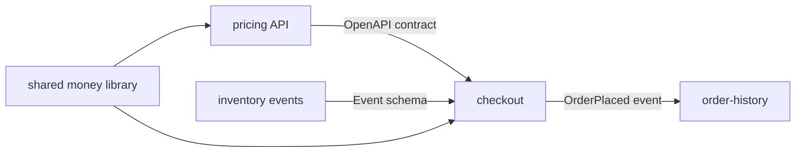
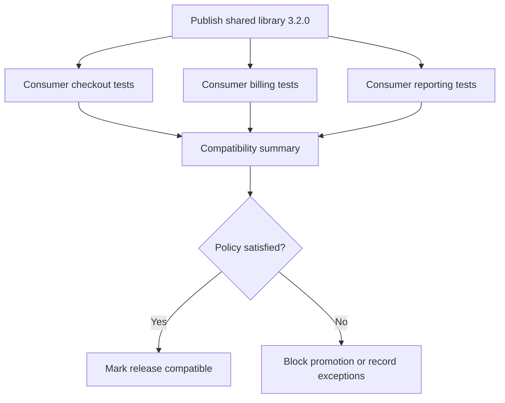

# Giảm phụ thuộc triển khai đồng thời giữa các dịch vụ

Trong hệ thống gồm nhiều dự án hoặc microservice, một thay đổi ở service A thường kéo theo nhu cầu cập nhật service B, C hoặc một thư viện dùng chung. Nếu mỗi lần phát hành đều phải triển khai tất cả thành phần cùng lúc, tốc độ phát hành của toàn hệ thống bị giới hạn bởi thành phần chậm nhất. Một pipeline lỗi hoặc một service chưa sẵn sàng cũng có thể chặn các dự án không liên quan.

Mục tiêu của multi-project CI/CD là để mỗi dự án có thể build, kiểm thử và phát hành theo nhịp riêng trong khi vẫn bảo đảm các hợp đồng tích hợp được giữ đúng. Muốn vậy, cần quản lý rõ dependency, duy trì tương thích giữa các phiên bản đang chạy song song, truyền artifact/version giữa pipeline và chỉ điều phối nhiều dự án thành một release khi có lý do kỹ thuật thực sự.

Độc lập triển khai không có nghĩa là các service không cần phối hợp. Nó có nghĩa là phần lớn thay đổi tương thích có thể được phát hành riêng, còn các thay đổi phá vỡ hợp đồng được nhận diện, kiểm thử và điều phối có chủ đích.

## 1. Vì sao triển khai đồng thời giữa nhiều dịch vụ làm chậm phát hành?

Giả sử một luồng đặt hàng có ba service:

- `checkout` nhận yêu cầu từ người dùng và điều phối đặt hàng.
- `pricing` tính giá, khuyến mãi và thuế.
- `inventory` kiểm tra và giữ hàng.

Nếu `checkout` chỉ hoạt động với đúng một phiên bản API của `pricing`, mỗi lần `pricing` thay đổi endpoint hoặc schema response, nhóm có thể phải deploy hai service trong cùng một cửa sổ. Nếu `inventory` cũng thay đổi message schema mà `checkout` tiêu thụ, release lại cần cả ba dự án cùng sẵn sàng.

Sự phụ thuộc triển khai thường xuất hiện khi:

- Consumer chỉ hiểu một phiên bản contract duy nhất.
- Provider xóa field, endpoint hoặc message mà consumer cũ vẫn sử dụng.
- Các service cùng ghi trực tiếp vào một schema database.
- Pipeline downstream luôn build lại hoặc deploy theo nhánh `main` mới nhất thay vì một phiên bản artifact cụ thể.
- Một shared library được phát hành nhưng không có cửa sổ tương thích giữa phiên bản cũ và mới.
- Release orchestration buộc mọi dự án tham gia dù thay đổi không ảnh hưởng tới chúng.

Hệ quả là release train có nhiều thành phần chờ nhau, rollback trở nên khó vì các service không cùng quay về một trạng thái tương thích, và nhóm không thể xác định chính xác thay đổi nào gây lỗi.

### Phân biệt dependency và deployment dependency

Hai service có thể phụ thuộc runtime vào nhau mà vẫn deploy độc lập nếu contract tương thích với nhiều phiên bản.

| Quan hệ | Ý nghĩa | Có bắt buộc deploy cùng lúc? |
|---|---|---|
| Build dependency | Dự án cần package hoặc thư viện của dự án khác để build | Không, nếu package được version hóa và có thể tải độc lập |
| Runtime dependency | Service A gọi API hoặc gửi message cho service B | Không, nếu hai phía giữ contract tương thích trong giai đoạn chuyển tiếp |
| Data dependency | Hai service đọc/ghi cùng dữ liệu hoặc schema | Thường tạo coupling mạnh; cần tách ownership hoặc migration tương thích |
| Release dependency | Một thay đổi chỉ an toàn sau khi dự án khác đã đạt phiên bản tối thiểu | Có thể cần thứ tự triển khai, nhưng không nhất thiết cùng một thời điểm |
| Operational dependency | Nhiều dự án dùng chung cluster, database, queue hoặc môi trường | Cần điều phối tài nguyên; không đồng nghĩa phải phát hành cùng release |

Khi vẽ dependency graph, hãy ghi rõ loại quan hệ. Một đường nối trong sơ đồ không nên mặc định có nghĩa hai service phải được deploy cùng lúc.

## 2. Thiết kế service có thể phát hành độc lập

Khả năng deploy độc lập bắt đầu từ ranh giới sở hữu và hợp đồng rõ ràng. Mỗi service nên kiểm soát dữ liệu và hành vi nghiệp vụ của mình, công bố API hoặc event contract mà consumer có thể dựa vào, và có pipeline riêng để tạo artifact bất biến.

Các nguyên tắc chính:

1. **Một service có một chủ sở hữu contract:** provider định nghĩa API/event và chính sách tương thích; consumer khai báo phiên bản hoặc khả năng mà nó cần.
2. **Ưu tiên thay đổi bổ sung:** thêm field tùy chọn, endpoint mới hoặc event version mới trước khi loại bỏ cấu trúc cũ.
3. **Duy trì overlap window:** provider hỗ trợ đồng thời consumer cũ và mới đủ lâu để rollout từng dự án.
4. **Phát hành artifact bất biến:** consumer kiểm thử với một version/digest cụ thể, không phụ thuộc `latest`.
5. **Kiểm thử contract hai phía:** provider xác minh vẫn đáp ứng consumer; consumer xác minh vẫn xử lý response/event theo hợp đồng.
6. **Loại bỏ API cũ theo bằng chứng:** chỉ xóa sau khi xác nhận không còn consumer được hỗ trợ sử dụng.

### Consumer không nên phụ thuộc vào implementation nội bộ

Consumer nên phụ thuộc vào contract công khai, không phụ thuộc vào bảng database, class nội bộ hoặc package chưa được cam kết tương thích của provider.

Ví dụ, `checkout` nên gọi API `pricing` hoặc nhận `PriceCalculated` event. Nó không nên đọc trực tiếp bảng `pricing_rules` trong database của `pricing`. Khi provider thay cách lưu trữ, consumer không phải thay đổi nếu contract vẫn giữ nguyên.

Nếu hai service cần chia sẻ một thư viện, hãy phát hành thư viện thành package có version, API công khai và chính sách deprecation. Không dùng một thư mục source được copy hoặc một branch mutable làm hợp đồng tích hợp.

## 3. Quản lý API contract theo hướng tương thích ngược

API compatibility là công cụ quan trọng nhất để giảm nhu cầu deploy đồng thời. Một provider nên có thể phát hành phiên bản mới mà consumer đang chạy phiên bản trước vẫn tiếp tục hoạt động.

### Thay đổi thường tương thích

Với API HTTP/JSON, các thay đổi sau thường có thể tương thích nếu consumer tuân thủ contract:

- Thêm endpoint mới mà không đổi endpoint hiện có.
- Thêm response field tùy chọn.
- Thêm request field tùy chọn có default rõ ràng.
- Thêm giá trị metadata mà consumer được yêu cầu bỏ qua nếu không hiểu.
- Tăng giới hạn hoặc thêm capability mà không đổi ý nghĩa field hiện tại.

Tính tương thích phụ thuộc cách consumer parse dữ liệu. Một consumer dùng strict schema validation có thể từ chối response chỉ vì provider thêm field. Vì vậy, contract cần quy định rõ consumer có phải bỏ qua field không biết hay không.

### Thay đổi có nguy cơ phá vỡ contract

- Xóa hoặc đổi tên field đang được consumer sử dụng.
- Đổi kiểu dữ liệu, đơn vị đo hoặc ý nghĩa nghiệp vụ của field.
- Đổi field từ nullable sang required hoặc ngược lại mà không có default tương thích.
- Thay status code, error format hoặc semantics retry.
- Đổi thứ tự hoặc ý nghĩa của enum mà consumer parse theo ordinal.
- Thay endpoint, authentication scheme hoặc pagination semantics.
- Làm response chậm hơn đáng kể hoặc thay đổi giới hạn rate mà consumer phụ thuộc.

Không chỉ xét schema. Một API có thể giữ nguyên JSON nhưng thay ý nghĩa `totalAmount` từ trước thuế sang sau thuế; đó vẫn là breaking change về nghiệp vụ.

### Ví dụ thêm field theo nhiều release

Giả sử provider `pricing` muốn thêm `taxAmount` vào response.

**Release provider P1:** thêm field mới nhưng vẫn giữ toàn bộ field cũ:

```json
{
  "subtotal": 120000,
  "total": 132000,
  "taxAmount": 12000
}
```

Consumer cũ tiếp tục đọc `subtotal` và `total`, bỏ qua `taxAmount`. Provider có thể deploy P1 mà không cần consumer thay đổi.

**Release consumer C1:** consumer bắt đầu đọc `taxAmount` khi field có mặt, đồng thời vẫn xử lý response từ provider cũ nếu field chưa có trong môi trường chưa được nâng cấp. Consumer có thể triển khai trước hoặc sau provider tùy cách fallback được thiết kế.

**Release provider P2:** chỉ khi mọi consumer cần field mới đã hỗ trợ và dữ liệu đã sẵn sàng, provider mới xem xét bỏ logic cũ trong một thay đổi riêng. Không xóa field cũ chỉ vì một consumer đã chuyển đổi.

### Dùng versioning khi thay đổi không thể tương thích

Nếu thay đổi semantics hoặc cấu trúc không thể làm tương thích, hãy tạo contract mới có version rõ, ví dụ `/v2/prices` hoặc event `PriceCalculated.v2`. Giữ version cũ trong deprecation window, đo mức sử dụng và thông báo consumer owner.

Versioning không phải lý do để tạo version mới cho mọi field. Chỉ tăng major contract version khi thay đổi thực sự phá vỡ khả năng tương thích. Nếu không, version quá nhiều sẽ làm provider phải vận hành nhiều implementation và khiến ma trận kiểm thử phức tạp.

## 4. Tương thích message và event giữa các dự án

Với hệ thống event-driven, producer và consumer có thể được deploy ở thời điểm rất khác nhau. Message đã nằm trong queue hoặc log có thể được đọc lại nhiều ngày sau khi producer phát hành.

Vì vậy, contract message cần có chính sách tương thích rõ:

- Consumer phải xử lý field tùy chọn hoặc field không biết theo quy tắc đã công bố.
- Producer không xóa field cũ trước khi consumer được hỗ trợ ngừng sử dụng.
- Thêm enum value phải có cách xử lý unknown value an toàn.
- Event cần schema version hoặc loại event ổn định.
- Consumer phải idempotent vì message có thể được giao lại.
- Retention và replay window của broker phải được tính vào deprecation window.

### Ví dụ event bổ sung field

Event cũ:

```json
{
  "eventType": "OrderPlaced",
  "eventVersion": 1,
  "orderId": "ord-1042",
  "customerId": "cus-72"
}
```

Event mới bổ sung `channel` tùy chọn:

```json
{
  "eventType": "OrderPlaced",
  "eventVersion": 1,
  "orderId": "ord-1042",
  "customerId": "cus-72",
  "channel": "mobile"
}
```

Consumer cũ vẫn phải xử lý event không có `channel`; consumer mới phải xử lý event cũ chưa có field này. Nếu thay đổi cấu trúc không thể tương thích, dùng version mới hoặc event type mới và duy trì consumer cho cả hai trong giai đoạn chuyển tiếp.

### Schema registry và compatibility policy

Nếu dùng Avro, Protobuf hoặc JSON Schema, schema registry có thể kiểm tra compatibility trước khi producer publish schema mới. Cần chọn policy phù hợp với cách lưu và replay message:

| Policy | Mục tiêu khái quát | Khi phù hợp |
|---|---|---|
| Backward | Consumer mới đọc được dữ liệu được ghi theo schema cũ | Consumer được nâng cấp trước producer |
| Forward | Consumer cũ đọc được dữ liệu mới theo giới hạn policy | Producer được nâng cấp trước consumer |
| Full | Hai chiều tương thích | Producer và consumer được rollout độc lập trong overlap window |
| Transitive | Kiểm tra với nhiều version lịch sử, không chỉ version gần nhất | Message cũ có thể được replay trong thời gian dài |

Tên và semantics chính xác phụ thuộc schema format/registry. Hãy xác định compatibility theo reader/writer schema và chính sách replay thực tế, không chỉ chọn một nhãn mà không kiểm tra phiên bản cũ còn tồn tại.

## 5. Tách ownership dữ liệu để giảm coupling

Chia service theo repository nhưng cùng ghi trực tiếp một database schema thường không tạo ra tính độc lập thực sự. Một migration của service A có thể làm service B lỗi dù pipeline của B không thay đổi.

Mỗi service nên sở hữu dữ liệu và quy tắc ghi của mình. Service khác truy cập qua API, event hoặc read model được công bố. Nếu cần dữ liệu cho truy vấn liên service, có thể dùng:

- API read-only có contract rõ.
- Event/CDC để cập nhật read model riêng.
- Materialized view hoặc projection thuộc quyền sở hữu của consumer.
- Data product được version hóa và có SLA cập nhật.

Không dùng CDC hoặc event để sao chép mọi bảng nội bộ mà không xác định schema contract. Nếu consumer phụ thuộc trực tiếp vào tên cột hoặc trạng thái nội bộ, provider vẫn chưa thể thay đổi schema độc lập.

### Khi vẫn phải chia sẻ database

Trong giai đoạn chuyển đổi, có thể chưa tách được database vật lý. Hãy ít nhất xác định schema/table owner, cấp quyền theo service, cấm service khác ghi trực tiếp vào bảng thuộc owner và áp dụng migration tương thích theo nhiều bước.

Nếu nhiều service bắt buộc cùng thay đổi một schema, hãy quản lý migration như dependency cấp database. Không chạy migration tự động từ tất cả service cùng lúc. Một migration owner hoặc pipeline điều phối chung phải kiểm soát version và thứ tự.

Các kỹ thuật expand-contract, dual-write và backfill có thể giúp chuyển đổi schema mà vẫn giữ consumer cũ hoạt động. Nhưng chúng cần được thực hiện trong quy trình data migration riêng, với kiểm tra dữ liệu và rollback phù hợp.

## 6. Version hóa artifact và phát hành package dùng chung

Build dependency không nên kéo theo việc build lại toàn bộ dự án phụ thuộc mỗi lần source provider thay đổi. Hãy phát hành package có version bất biến vào registry và để consumer khai báo version mà nó đã kiểm thử.

### Dùng semantic versioning có kỷ luật

Với thư viện áp dụng SemVer:

- PATCH: sửa lỗi không làm đổi public API theo cam kết tương thích.
- MINOR: thêm chức năng tương thích ngược.
- MAJOR: thay đổi phá vỡ contract.

SemVer chỉ hữu ích khi provider định nghĩa public API và kiểm tra compatibility. Nếu package có behavior thay đổi nhưng không được biểu diễn trong type/schema, cần release note và test bổ sung. Không tự động tăng version theo số build rồi giả định mọi version có ý nghĩa tương thích.

### Khóa dependency ở consumer

Ví dụ Gradle khai báo version thư viện:

```kotlin
dependencies {
    implementation("com.example.platform:pricing-client:2.4.1")
}
```

Consumer build lại với version đã khai báo và dependency lock/verification phù hợp. Khi provider phát hành `2.5.0`, consumer có thể tạo PR cập nhật, chạy contract/integration test rồi merge theo nhịp riêng.

Không dùng dynamic version như `2.+` hoặc `latest.release` trong release build nếu cần tái lập. Dynamic version có thể resolve sang nội dung khác giữa hai lần build, khiến cùng commit tạo ra artifact khác nhau.

### Promote cùng artifact qua môi trường

Provider tạo package/image một lần, ký và lưu digest. Staging, pre-production và production dùng cùng artifact đã kiểm thử. Không build lại package ở từng dự án consumer hoặc ở từng environment rồi giả định nội dung tương đương.

Release manifest nên ghi source commit, package version, artifact digest, provenance và kết quả kiểm tra. Consumer pipeline ghi lại version/digest của provider mà nó đã test để có thể truy vết khi contract thay đổi.

## 7. Xây dependency graph để chỉ kích hoạt pipeline liên quan

Trong hệ thống nhiều repository, không nên kích hoạt toàn bộ pipeline mỗi khi một dự án có commit mới. Hãy mô hình hóa dependency graph và xác định loại sự kiện nào cần truyền sang consumer.

Ví dụ:



Đồ thị này giúp trả lời:

- Thay đổi implementation của `pricing` có cần kích hoạt `checkout` không?
- Thay đổi OpenAPI contract có ảnh hưởng consumer nào?
- Thay đổi shared library có cần build/test lại các consumer đang pin version đó không?
- Một migration database ảnh hưởng tới service nào đang đọc schema?
- Một release provider đã tạo artifact mới hay chỉ cập nhật tài liệu nội bộ?

### Phân biệt source event và release event

Một commit được merge không nhất thiết có nghĩa một artifact đã được phát hành. Pipeline downstream nên được kích hoạt theo sự kiện phù hợp:

| Sự kiện | Ý nghĩa | Hành động downstream phù hợp |
|---|---|---|
| Source merged | Mã đã tích hợp | Có thể chạy contract/consumer compatibility check nếu contract thay đổi |
| Build passed | Artifact được tạo | Lưu build metadata; chưa nhất thiết promote |
| Artifact published | Package/image bất biến đã được publish | Consumer có thể nhận thông báo về version mới |
| Contract changed | API/event schema có thay đổi | Chạy provider verification và consumer contract tests liên quan |
| Release approved | Artifact đủ điều kiện phát hành | Mở candidate để promote hoặc cập nhật dependency |
| Production deployed | Một version đang chạy thật | Cập nhật deployment ledger và trạng thái dependency thực tế |

Tách các sự kiện giúp tránh việc consumer build/deploy mỗi khi provider có một commit chưa phát hành.

## 8. Pipeline event-driven giữa các repository

Pipeline provider nên phát hành artifact và metadata. Pipeline consumer có thể nhận sự kiện rồi quyết định chạy kiểm tra tương thích hoặc tạo dependency update. Không nên tự động deploy consumer chỉ vì provider vừa publish version mới, trừ khi policy đã xác định rõ thay đổi đó an toàn và consumer đã được kiểm thử.

### Ví dụ GitHub Actions gửi sự kiện release

Provider sau khi publish artifact có thể gửi `repository_dispatch` tới repository consumer bằng GitHub App token có quyền tối thiểu. Payload chỉ mang thông tin tham chiếu:

```yaml
- name: Notify checkout about pricing release
  env:
    DISPATCH_TOKEN: ${{ steps.app-token.outputs.token }}
    RELEASE_ID: ${{ steps.release.outputs.release_id }}
    ARTIFACT_DIGEST: ${{ steps.release.outputs.digest }}
  run: |
      [[ "$RELEASE_ID" =~ ^[A-Za-z0-9._-]+$ ]]
      [[ "$ARTIFACT_DIGEST" =~ ^sha256:[0-9a-f]{64}$ ]]
      payload="$(jq -n \
        --arg release_id "$RELEASE_ID" \
        --arg digest "$ARTIFACT_DIGEST" \
        '{event_type: "pricing-release-published", client_payload: {release_id: $release_id, digest: $digest}}')"
      curl --fail-with-body \
        -X POST \
        -H "Accept: application/vnd.github+json" \
        -H "Authorization: Bearer $DISPATCH_TOKEN" \
        -H "X-GitHub-Api-Version: 2022-11-28" \
        https://api.github.com/repos/example/checkout/dispatches \
        -d "$payload"
```

Đây là ví dụ rút gọn; cần tạo GitHub App installation token ở bước trước và bảo đảm giá trị release ID/digest được validate trước khi đưa vào JSON. Dùng jq để serialize payload an toàn thay vì nối chuỗi thủ công. Token không được in ra log và chỉ được cấp quyền gửi dispatch tới repository đích.

Consumer nhận sự kiện:

```yaml
name: Verify upstream release

on:
  repository_dispatch:
    types: [pricing-release-published]

permissions:
  contents: read

jobs:
  compatibility:
    runs-on: ubuntu-latest
    steps:
      - uses: actions/checkout@v4
      - name: Verify release reference
        env:
          UPSTREAM_RELEASE_ID: ${{ github.event.client_payload.release_id }}
          UPSTREAM_DIGEST: ${{ github.event.client_payload.digest }}
        run: |
          ./scripts/verify-pricing-release.sh \
            "$UPSTREAM_RELEASE_ID" \
            "$UPSTREAM_DIGEST"
      - name: Run consumer contract tests
        run: ./gradlew --no-daemon contractTest
```

Payload là dữ liệu đầu vào chưa được tin cậy. Consumer phải tải release manifest từ registry/ledger đáng tin cậy, xác minh chữ ký, provenance và digest, rồi kiểm tra contract. Không thực thi script, workflow hoặc artifact đính kèm từ repository upstream chỉ vì nhận được event.

Ví dụ này chỉ kích hoạt kiểm tra tương thích. Việc cập nhật dependency của `checkout` có thể được tạo thành pull request tự động, sau đó cần các gate và review của consumer. Điều đó giúp provider publish độc lập trong khi consumer chủ động chọn thời điểm nâng cấp.

### Tránh trigger loop và cascade không kiểm soát

Nếu A publish kích hoạt B, B publish lại kích hoạt A, pipeline có thể tạo vòng lặp. Mỗi event cần có source release ID, correlation ID và loại sự kiện. Consumer chỉ phát event downstream khi thực sự tạo artifact/release mới, không phát lại event nhận vào như thể đó là release của chính nó.

Nên có:

- Idempotency key để event gửi lại không tạo nhiều update giống nhau.
- Allowlist event type và repository nguồn được phép.
- Chống vòng lặp theo correlation ID hoặc release lineage.
- Rate limit và giới hạn fan-out.
- Dead-letter hoặc retry policy cho dispatch thất bại.
- Audit log cho producer, consumer và kết quả xử lý.

## 9. Fan-out và fan-in trong pipeline nhiều dự án

Một thay đổi ở shared library có thể ảnh hưởng nhiều consumer. Pipeline có thể fan-out để chạy kiểm tra song song trên các consumer, sau đó fan-in để tổng hợp kết quả trước khi đánh dấu release đủ điều kiện.



Fan-out phù hợp khi các consumer test độc lập. Fan-in cần biết consumer nào là bắt buộc, consumer nào đã ngừng hỗ trợ và consumer nào chỉ cần cảnh báo. Nếu chỉ một consumer quan trọng thất bại, policy có thể chặn major release; nếu một consumer thử nghiệm không còn active, có thể ghi nhận ngoại lệ có chủ sở hữu.

### Không chờ mọi consumer cho mọi patch release

Một bản vá tương thích có thể không cần chạy toàn bộ consumer matrix nếu contract không đổi và policy đã chứng minh. Nhưng với major contract change hoặc shared library có ảnh hưởng rộng, fan-out verification có thể là gate trước release.

Phạm vi fan-out cần dựa trên dependency inventory được cập nhật. Nếu inventory không đầy đủ, coi đó là rủi ro và mở rộng kiểm tra thay vì bỏ qua consumer không được liệt kê.

## 10. Consumer-driven contract testing

Consumer-driven contract testing cho phép consumer mô tả những tương tác mà nó thực sự cần từ provider. Provider chạy xác minh các contract đó trong pipeline của mình.

Luồng điển hình:

1. Consumer test tạo contract cho các request/response hoặc message mà nó sử dụng.
2. Contract được publish vào broker/store có version và gắn với consumer build.
3. Provider pipeline tải các contract của consumer được hỗ trợ.
4. Provider verification xác nhận implementation hiện tại đáp ứng contract.
5. Kết quả được ghi theo provider version và consumer version.
6. Release policy kiểm tra tổ hợp version được phép triển khai.

### Lợi ích

- Provider phát hiện sớm nếu thay đổi làm hỏng consumer trước khi deploy.
- Consumer không cần chờ provider deploy vào môi trường tích hợp chung để kiểm tra mọi thay đổi.
- Có bằng chứng về những tổ hợp provider/consumer đã được xác minh.
- Có thể giảm số lần cần chạy end-to-end test toàn hệ thống.

### Giới hạn cần hiểu

Contract test chỉ kiểm tra các tương tác được mô tả. Nó không chứng minh toàn bộ hành vi nghiệp vụ, hiệu năng, bảo mật hoặc độ sẵn sàng của hệ thống. Một contract có thể đạt nhưng production vẫn lỗi do dữ liệu, network, timeout hoặc dependency ngoài.

Hãy kết hợp contract test với integration test đại diện, smoke test và monitoring. Contract phải phản ánh cách consumer sử dụng thật, tránh tạo expectation quá rộng khiến provider không thể thay đổi implementation nội bộ.

## 11. Quản lý ma trận tương thích phiên bản

Khi nhiều service deploy độc lập, tại một thời điểm có thể tồn tại nhiều tổ hợp phiên bản. Không thể giả định toàn bộ hệ thống luôn dùng cùng release train.

Một ma trận đơn giản:

| Consumer `checkout` | Provider `pricing` 2.3 | Provider `pricing` 2.4 | Provider `pricing` 3.0 |
|---|---:|---:|---:|
| `checkout` 1.8 | Supported | Supported | Not supported |
| `checkout` 1.9 | Supported | Supported | Supported after contract update |
| `checkout` 2.0 | Not supported | Supported | Supported |

Ma trận phải xuất phát từ contract test, compatibility policy và release metadata. Không tự điền “Supported” chỉ vì hai service từng chạy cùng nhau ở staging.

### Ghi khoảng version được hỗ trợ

Mỗi consumer có thể khai báo:

- Phiên bản provider tối thiểu.
- Phiên bản provider tối đa đã được kiểm thử hoặc major version được hỗ trợ.
- Contract/schema version cần có.
- Capability flags bắt buộc.
- Thời điểm kết thúc hỗ trợ version cũ.

Release manifest của consumer có thể ghi các dependency runtime đã kiểm thử. Deployment controller hoặc release gate kiểm tra tổ hợp thực tế trước khi promote.

### Hạn chế số tổ hợp phải hỗ trợ

Nếu mỗi service hỗ trợ vô hạn phiên bản provider, ma trận sẽ bùng nổ. Cần deprecation policy và thời hạn nâng cấp. Có thể hỗ trợ một major hiện tại và một major trước trong overlap window, tùy SLA và quy mô hệ thống.

Việc loại bỏ một phiên bản cần dữ liệu sử dụng thực tế, thông báo tới consumer owner và kế hoạch xử lý consumer không còn hoạt động. Không chỉ dựa trên số phiên bản đã phát hành.

## 12. Triển khai theo thứ tự khi vẫn cần nhiều dự án phối hợp

Một số thay đổi cần thứ tự triển khai nhưng vẫn không cần deploy đồng thời. Hãy chia thay đổi thành các release tương thích.

### Thêm capability mới

Ví dụ provider `pricing` bổ sung API tính phí vận chuyển:

1. Deploy provider với endpoint mới, endpoint cũ vẫn hoạt động.
2. Xác minh endpoint mới trên staging/canary.
3. Deploy consumer có code hỗ trợ cả trường hợp provider cũ và mới.
4. Bật feature flag cho nhóm nhỏ.
5. Theo dõi metrics và tăng dần traffic.
6. Sau khi mọi consumer cần capability đã chuyển, xem xét dọn code cũ ở release sau.

Provider có thể được phát hành trước consumer vì API cũ vẫn còn.

### Ngừng một field hoặc endpoint

Khi muốn bỏ `legacyStatus`:

1. Provider đánh dấu deprecated và phát telemetry về việc sử dụng.
2. Consumer được cập nhật để ngừng đọc field/endpoint cũ.
3. Consumer owner xác nhận version đã deploy và không còn traffic cũ.
4. Provider chờ đủ deprecation window và chu kỳ batch/job.
5. Provider xóa field/endpoint trong một major contract release.

Ở đây consumer phải chuyển trước, provider xóa sau. Không cần triển khai cả hai cùng một lúc.

### Khi thay đổi thật sự breaking

Nếu không thể duy trì hai contract song song, hãy dùng release orchestration có kế hoạch:

- Chọn một cửa sổ thay đổi và xác định mọi service bị ảnh hưởng.
- Tạo danh sách artifact/config cụ thể cho từng dự án.
- Kiểm thử tổ hợp version trên môi trường đại diện.
- Xác định thứ tự deploy và điều kiện dừng giữa các bước.
- Đóng băng các thay đổi không liên quan trong cửa sổ cần thiết.
- Chuẩn bị rollback/forward-fix cho cả code và dữ liệu.
- Có người chịu trách nhiệm điều phối và xác minh trạng thái cuối.

Đây là ngoại lệ được quản lý, không nên trở thành cách phát hành mặc định cho mọi thay đổi.

## 13. Release orchestration và deployment orchestration

Hai khái niệm này cần được tách rõ:

- **Release orchestration:** xác định artifact nào, contract nào và tổ hợp version nào được chấp thuận để phát hành.
- **Deployment orchestration:** điều khiển thứ tự và thời điểm áp dụng các artifact vào môi trường.

Một release có thể gồm nhiều service version nhưng vẫn được deploy theo từng đợt. Ví dụ provider được deploy trước, consumer sau, feature flag bật cuối cùng. Release manifest ghi cả tổ hợp đã được xác minh.

### Khi nào cần một pipeline điều phối trung tâm?

Pipeline trung tâm hữu ích khi:

- Một release thực sự gồm nhiều artifact phải được kiểm tra như một tập hợp.
- Cần một approval chung cho thay đổi có blast radius lớn.
- Có thứ tự migration/provider/consumer không thể tự quyết định tại từng repo.
- Cần tổng hợp trạng thái từ nhiều pipeline trước khi promote production.

Không nên biến pipeline trung tâm thành nơi build mọi dự án. Mỗi repository vẫn sở hữu build, test và artifact của mình; pipeline điều phối chỉ tham chiếu release manifest, kích hoạt job cần thiết và tổng hợp kết quả.

### Choreography hay orchestration?

| Cách phối hợp | Đặc điểm | Phù hợp khi |
|---|---|---|
| Event choreography | Dự án phát event; consumer tự phản ứng theo contract | Quan hệ lỏng, nhiều consumer, không cần một thứ tự deploy cố định |
| Central orchestration | Một controller quyết định bước và thứ tự của nhiều dự án | Release có dependency bắt buộc, cần audit/approval tập trung |
| Hybrid | Event để thông báo, controller điều phối các thay đổi có rủi ro cao | Hệ thống lớn với nhiều luồng độc lập và một số release phối hợp |

Choreography dễ mở rộng nhưng khó quan sát nếu event không có correlation ID và ownership. Orchestration dễ kiểm soát thứ tự nhưng có thể tạo bottleneck nếu mọi thay đổi đều phải qua một pipeline trung tâm.

## 14. Thiết kế pipeline nhiều dự án trong GitLab

GitLab hỗ trợ multi-project pipeline để một dự án kích hoạt pipeline ở dự án khác. Ví dụ provider có thể kích hoạt consumer chạy contract test sau khi publish release candidate:

```yaml
notify_checkout:
  stage: notify
  trigger:
    project: platform/checkout
    branch: main
    strategy: depend
  variables:
    UPSTREAM_PROJECT: "$CI_PROJECT_PATH"
    UPSTREAM_COMMIT: "$CI_COMMIT_SHA"
    RELEASE_ID: "$RELEASE_ID"
    ARTIFACT_DIGEST: "$ARTIFACT_DIGEST"
```

`strategy: depend` khiến trạng thái trigger job phụ thuộc kết quả downstream pipeline trong các phiên bản GitLab hỗ trợ semantics này. Cần kiểm tra version GitLab và quyền trigger giữa hai project. Pipeline downstream phải xác minh release manifest và digest từ registry; không tin biến truyền qua chỉ vì nó đến từ upstream.

Không truyền secret production qua variables chỉ để tiện cho pipeline downstream. Mỗi project nên tự lấy secret từ secret manager bằng identity riêng. Token trigger hoặc job token cần giới hạn project đích và quyền tối thiểu.

### Chỉ trigger consumer bị ảnh hưởng

Provider có thể có nhiều consumer. Hãy duy trì dependency inventory hoặc contract broker để xác định project nào cần chạy. Không trigger tất cả project trong group nếu chỉ một contract thay đổi.

Nếu pipeline downstream chỉ kiểm tra tương thích, không tự động deploy. Việc tạo dependency update hoặc promote cần gate riêng của consumer.

## 15. Kiểm soát quyền và độ tin cậy giữa các repository

Multi-project pipeline mở rộng ranh giới tin cậy. Một repository có thể gửi event tới repository khác, tạo pipeline, yêu cầu artifact hoặc truy cập package registry.

Các nguyên tắc:

- Dùng GitHub App, GitLab job token hoặc workload identity với scope tối thiểu thay vì PAT quyền rộng.
- Chỉ allowlist repository/project và event type được phép.
- Consumer xác minh release record, signature, provenance và artifact digest.
- Không thực thi script từ upstream branch chưa được tin cậy trong pipeline có secret.
- Không cấp quyền deploy production cho pipeline chỉ có nhiệm vụ thông báo.
- Tách identity build, publish, sign và deploy.
- Ghi audit cho trigger, artifact download, dependency update và promotion.
- Giới hạn concurrency và rate để một upstream không làm cạn runner của toàn tổ chức.

Đặc biệt, pull request từ fork hoặc branch không được bảo vệ không nên có quyền gửi event kích hoạt pipeline đặc quyền. Trigger chỉ nên phát sinh từ release job đã qua policy và dùng identity được cấp quyền rõ ràng.

## 16. Quan sát trạng thái phát hành liên dự án

Khi mỗi service deploy độc lập, dashboard cần thể hiện tổ hợp version đang chạy và dependency compatibility, không chỉ trạng thái pipeline từng repository.

Một deployment ledger có thể ghi:

| Trường | Ví dụ |
|---|---|
| Environment | production |
| Service | checkout |
| Release ID | `checkout-2026.11.18.2` |
| Artifact digest | `sha256:<digest>` |
| Dependency | `pricing-client 2.4.1` |
| Runtime provider | `pricing-api 2.5.0` |
| Contract status | verified |
| Deployment time | timestamp |
| Rollout state | complete |

Khi incident xảy ra, nhóm có thể tìm service nào đang dùng contract/version bị ảnh hưởng. Cần liên kết trace hoặc metric với service version và dependency version để phân tích lỗi liên service.

### Theo dõi deprecation và consumer usage

Provider nên đo:

- Request count theo API version/endpoint/consumer identity.
- Tỷ lệ lỗi và latency theo consumer.
- Message schema version đang được consume.
- Số consumer còn sử dụng field/endpoint cũ.
- Consumer không gửi traffic trong thời gian dài nhưng vẫn nằm trong inventory.

Không xóa contract chỉ vì metrics không thấy traffic trong một ngày. Consumer batch hoặc job theo tháng có thể chưa chạy trong cửa sổ quan sát. Kết hợp telemetry với xác nhận ownership và lịch vận hành.

## 17. Xử lý lỗi khi một dự án phát hành độc lập

Nếu provider release mới nhưng một consumer bị lỗi contract test, không nhất thiết rollback provider ngay. Cần xác định contract cũ có còn được hỗ trợ hay không.

Một quy trình:

1. Xác định provider artifact/digest và consumer version đang chạy.
2. Kiểm tra lỗi có phải contract breaking hay chỉ là lỗi implementation.
3. Nếu contract cũ vẫn được hỗ trợ, giữ provider ở phiên bản mới và sửa consumer riêng.
4. Nếu provider vi phạm contract đã công bố, rollback provider hoặc phát hành forward fix theo mức ảnh hưởng.
5. Kiểm tra các consumer khác để xác định blast radius.
6. Ghi nhận compatibility matrix và bổ sung contract test còn thiếu.

Rollback một service độc lập thường ít rủi ro hơn rollback toàn bộ release train, miễn là contract và dữ liệu vẫn tương thích. Nếu schema đã bị contract hoặc event mới đã phát đi mà consumer cũ không hiểu, cần kế hoạch phục hồi riêng.

### Không rollback consumer một cách mù quáng

Consumer cũ có thể không xử lý được message mới đã được producer publish. Khi quay lại, cần xác minh consumer có thể đọc backlog hiện tại, có thể bỏ qua event mới hay cần adapter/replay. Tương tự, provider rollback có thể làm mất endpoint mà consumer mới đang gọi. Compatibility window phải bao gồm cả đường rollback.

## 18. Những cách làm khiến các dự án bị khóa vào cùng một release

| Cách làm | Hệ quả | Cách cải thiện |
|---|---|---|
| Consumer gọi API không có contract/version rõ | Provider không thể thay đổi độc lập | OpenAPI/schema và compatibility policy |
| Provider xóa field ngay sau khi deploy consumer mới | Consumer cũ hoặc job batch lỗi | Deprecation window và usage evidence |
| Mọi consumer dùng `latest` | Kết quả build thay đổi theo thời điểm | Pin package version và artifact digest |
| Provider commit nào cũng trigger deploy consumer | Pipeline cascade và release không cần thiết | Trigger theo artifact/contract release event |
| Shared database được nhiều service ghi trực tiếp | Migration của một service phá service khác | Data ownership, API/event và migration coordination |
| Pipeline trung tâm build lại mọi repository | Bottleneck và khó xác định artifact đã test | Build độc lập, orchestration chỉ tham chiếu artifact |
| Event payload được tin cậy tuyệt đối | Có thể dùng digest hoặc release giả | Verify manifest/signature từ registry tin cậy |
| Không có compatibility matrix | Không biết tổ hợp version nào được hỗ trợ | Contract test và deployment ledger |
| Mọi breaking change xử lý bằng deploy đồng thời | Release window lớn, rollback khó | Versioned contract và overlap window |
| Chỉ kiểm thử provider hoặc chỉ consumer | Một phía có thể phá tương tác | Consumer-driven contract và provider verification |
| Không theo dõi consumer của API cũ | Xóa contract khi vẫn còn người dùng | Usage telemetry và ownership inventory |

## 19. Checklist giảm phụ thuộc triển khai đồng thời

Trước khi thiết kế hoặc thay đổi multi-project pipeline, hãy kiểm tra:

- [ ] Dependency graph phân biệt build, runtime, data, release và operational dependency.
- [ ] Mỗi service có owner và contract công khai.
- [ ] Consumer không phụ thuộc trực tiếp vào implementation hoặc database nội bộ của provider.
- [ ] API/event thay đổi theo hướng bổ sung trước, loại bỏ sau.
- [ ] Consumer cũ và mới có thể chạy trong overlap window đã xác định.
- [ ] Breaking change có version/deprecation policy và danh sách consumer bị ảnh hưởng.
- [ ] Shared library được phát hành thành package có version bất biến.
- [ ] Consumer pin dependency version; release build không dùng dynamic version tùy tiện.
- [ ] Artifact được build một lần, ký/xác minh và promote cùng digest.
- [ ] Pipeline downstream được kích hoạt theo release/contract event phù hợp, không theo mọi commit.
- [ ] Event có source identity, release ID, correlation ID và idempotency handling.
- [ ] Consumer xác minh manifest, signature, provenance và digest trước khi dùng artifact upstream.
- [ ] Fan-out chỉ tới consumer bị ảnh hưởng; fan-in có policy bắt buộc/ngoại lệ rõ.
- [ ] Consumer-driven contract test và provider verification được tích hợp vào pipeline.
- [ ] Compatibility matrix phản ánh version thực tế đã được kiểm thử.
- [ ] Release orchestration chỉ dùng cho thay đổi thật sự cần phối hợp nhiều dự án.
- [ ] Quyền trigger và deploy giữa repository được giới hạn, audit và tách biệt.
- [ ] Deployment ledger ghi service version, dependency version và contract status.
- [ ] Có quy trình xử lý consumer lỗi, provider rollback và event backlog.
- [ ] Có deprecation window đủ dài cho batch job, replay và consumer ít hoạt động.

Giảm phụ thuộc triển khai đồng thời là kết quả của contract ổn định, artifact có version và pipeline truyền đúng sự kiện. Provider có thể phát hành thay đổi tương thích trước; consumer nâng cấp khi đã kiểm thử; cấu trúc cũ chỉ được loại bỏ sau khi mọi consumer được hỗ trợ đã chuyển đổi. Khi cần thay đổi breaking, release orchestration sẽ điều phối một ngoại lệ có kiểm soát thay vì biến mọi lần phát hành thành một đợt deploy toàn hệ thống.
