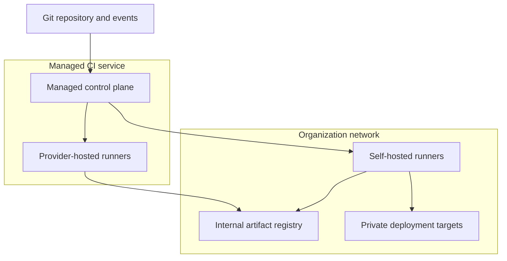

# Phân biệt dịch vụ quản lý sẵn với hệ thống CI tự vận hành

Khi chọn công cụ CI/CD, nhóm thường phải quyết định nên dùng dịch vụ được nhà cung cấp quản lý (managed CI service) hay tự triển khai và vận hành nền tảng CI (self-hosted CI). Hai mô hình đều có thể chạy pipeline, kiểm thử, tạo artifact và tích hợp với hệ thống phát hành. Khác biệt lớn nằm ở ranh giới trách nhiệm: ai vận hành control plane, ai cấp và bảo trì runner, dữ liệu nằm ở đâu, ai xử lý nâng cấp và sự cố, cùng chi phí thực tế để duy trì dịch vụ.

Không nên quyết định chỉ dựa trên giá niêm yết hoặc số lượng tính năng. Một dịch vụ managed có thể giảm công việc quản trị nền tảng nhưng vẫn cần nhóm tự quản lý runner, network, workflow và secret. Một hệ thống self-hosted có thể kiểm soát sâu hơn nhưng đòi hỏi năng lực vận hành, bảo mật, backup, nâng cấp và trực hỗ trợ. Một số tổ chức chọn mô hình hybrid: dùng control plane managed nhưng thực thi job trên runner riêng trong mạng nội bộ.

Trong CI/CD, lựa chọn phù hợp là mô hình đáp ứng yêu cầu bảo mật, tuân thủ, tích hợp, độ sẵn sàng và tốc độ phản hồi với tổng chi phí vận hành chấp nhận được. Cần đánh giá cả nền tảng lẫn cách thực thi pipeline, vì hai phần này có thể do hai bên khác nhau quản lý.

## 1. Phân biệt control plane và execution plane

Trước khi so sánh hai mô hình, cần tách nền tảng điều phối khỏi nơi thực thi công việc:

- **Control plane:** nhận sự kiện Git, xác định workflow, lập lịch job, quản lý trạng thái, quyền, approval, log và giao diện quản trị.
- **Execution plane:** runner/agent thực thi script, build, test, scan, đóng gói và deploy.
- **Artifact/data plane:** nơi lưu artifact, cache, log, test report, provenance và metadata.

Một dịch vụ CI managed thường cung cấp control plane dưới dạng SaaS. Execution plane có thể là runner do nhà cung cấp lưu trữ hoặc runner do tổ chức tự quản lý. Vì vậy, “dùng managed CI” không nhất thiết có nghĩa toàn bộ job chạy trên hạ tầng bên ngoài.

Ngược lại, một hệ thống self-hosted thường đặt control plane trong hạ tầng tổ chức và nhóm tự vận hành runner. Artifact registry, cache, database hoặc log storage có thể dùng dịch vụ managed riêng. Ranh giới thực tế phụ thuộc kiến trúc.



Sơ đồ cho thấy một control plane managed có thể điều phối cả runner hosted và self-hosted. Job có thể cần chạy trên runner nội bộ để truy cập private database, registry hoặc deployment target. Khi đánh giá công cụ, hãy hỏi rõ thành phần nào được nhà cung cấp vận hành và thành phần nào thuộc trách nhiệm của nhóm.

## 2. Mô hình managed CI service

Managed CI service là dịch vụ mà nhà cung cấp vận hành phần lớn control plane: cập nhật nền tảng, điều phối job, lưu trạng thái workflow, giao diện, API và thường cả runner hosted.

Những đặc điểm thường gặp:

- Tạo pipeline bằng YAML hoặc cấu hình trong repository.
- Tích hợp trực tiếp với Git hosting, pull request, branch protection và status checks.
- Có runner hosted theo hệ điều hành hoặc image được cung cấp.
- Hỗ trợ scale runner theo nhu cầu hoặc theo quota dịch vụ.
- Có sẵn log, artifact storage, cache, approval và marketplace/integration.
- Nhà cung cấp chịu trách nhiệm một phần về availability, patching và vận hành control plane.

### Lợi ích

- Nhóm không phải tự dựng database, scheduler, web server và hệ thống quản trị CI.
- Bắt đầu nhanh, phù hợp nhóm nhỏ hoặc tổ chức chưa có đội platform chuyên trách.
- Dễ mở rộng khi workload tăng nếu quota và loại runner đáp ứng nhu cầu.
- Tích hợp Git và developer workflow thường có sẵn.
- Nhà cung cấp xử lý nhiều công việc bảo trì control plane.

### Giới hạn cần đánh giá

- Phụ thuộc availability, quota, giới hạn thời gian job và chính sách của nhà cung cấp.
- Chi phí có thể tăng theo phút runner, concurrency, storage, artifact transfer hoặc tính năng nâng cao.
- Runner hosted có thể không truy cập trực tiếp tài nguyên private nếu không cấu hình network riêng.
- Khả năng tùy biến hệ điều hành, phần cứng, kernel hoặc toolchain có thể hạn chế.
- Log, artifact và metadata có thể được lưu ở region hoặc thời hạn do dịch vụ quy định.
- Thay đổi giá, API, giới hạn hoặc điều khoản dịch vụ có thể ảnh hưởng kế hoạch dài hạn.

Managed không loại bỏ trách nhiệm của tổ chức đối với workflow, quyền token, secret, dependency, artifact và code chạy trong pipeline. Nhà cung cấp quản lý nền tảng không thể tự quyết định một workflow có an toàn hay không.

## 3. Mô hình self-hosted CI

Self-hosted CI là mô hình tổ chức tự triển khai và vận hành control plane CI trong hạ tầng của mình. Ví dụ phổ biến là cài một CI server như Jenkins hoặc một nền tảng tương đương, sau đó cấu hình agent/runner, storage, database, backup và tích hợp với Git.

Những thành phần nhóm có thể phải vận hành:

- Web/API server và scheduler.
- Database hoặc metadata store.
- Queue, cache và artifact storage.
- Runner/agent pool và image build.
- Plugin, extension và integration.
- TLS, DNS, ingress, firewall và identity provider.
- Backup, restore, disaster recovery và monitoring.
- Upgrade, patch, vulnerability management và capacity planning.

### Lợi ích

- Kiểm soát sâu hơn vị trí dữ liệu, network, runner image và cách tích hợp.
- Có thể chạy job trong mạng nội bộ hoặc trên phần cứng chuyên dụng.
- Chủ động lịch nâng cấp và cấu hình nếu đã có quy trình vận hành tốt.
- Tùy biến plugin, integration, scheduler hoặc build environment theo nhu cầu.
- Có thể tối ưu cho workload đặc thù như build phần mềm nhúng, GPU, mobile signing hoặc hệ thống legacy.

### Chi phí và rủi ro

- Cần đội ngũ có năng lực vận hành nền tảng và xử lý sự cố.
- Nhóm phải chịu trách nhiệm patch, nâng cấp, backup, restore và bảo vệ control plane.
- Runner có thể trở thành điểm xâm nhập nếu job không tin cậy được chạy chung host.
- Mở rộng capacity cần provisioning, quota nội bộ, network và storage.
- Plugin hoặc extension cũ có thể tạo lỗ hổng và xung đột phiên bản.
- Control plane hoặc database lỗi có thể làm ngừng toàn bộ pipeline.
- Thời gian bảo trì nền tảng lấy đi nguồn lực dành cho cải thiện developer workflow.

Self-hosted không mặc nhiên an toàn hơn. Vị trí đặt máy chủ trong mạng nội bộ chỉ giúp kiểm soát một phần đường đi dữ liệu; quyền quản trị yếu, plugin dễ tổn thương, runner dùng chung hoặc patch chậm có thể làm rủi ro tăng lên.

## 4. Mô hình hybrid

Hybrid kết hợp nhiều ranh giới quản lý. Một số cấu hình thường gặp:

1. Managed control plane với self-hosted runners trong VPC/VNet hoặc datacenter.
2. Managed control plane và runner hosted cho PR thông thường, runner nội bộ cho deploy production.
3. Self-hosted control plane nhưng dùng artifact registry, secrets manager hoặc database managed.
4. Nhiều runner pool riêng theo trust level, kiến trúc CPU, hệ điều hành hoặc môi trường.

Hybrid hữu ích khi muốn giảm gánh nặng vận hành control plane nhưng cần job truy cập tài nguyên private hoặc dùng phần cứng đặc thù. Tuy nhiên, nó làm xuất hiện thêm trách nhiệm tích hợp: runner phải xác thực với control plane, network cần cho phép đúng luồng, log/artifact phải được bảo vệ và quyền của mỗi pool phải được tách biệt.

Không nên để một runner pool dùng chung cho mọi loại job. Job từ pull request không tin cậy, job build release có quyền ký artifact và job deploy production có credential đặc quyền cần trust boundary khác nhau.

## 5. So sánh trách nhiệm vận hành

Bảng dưới đây là mô hình khái quát; trách nhiệm thực tế cần đối chiếu hợp đồng dịch vụ và kiến trúc đã chọn.

| Hạng mục | Managed control plane | Self-hosted control plane |
|---|---|---|
| Cài đặt nền tảng | Nhà cung cấp | Tổ chức |
| Patch/upgrade control plane | Chủ yếu nhà cung cấp | Tổ chức |
| Availability control plane | Theo SLA của nhà cung cấp | Tổ chức thiết kế và vận hành |
| Runner hosted | Có thể do nhà cung cấp quản lý | Thường do tổ chức quản lý |
| Self-hosted runner | Tổ chức quản lý | Tổ chức quản lý |
| Network tới private resource | Cần runner/network integration | Tổ chức kiểm soát toàn bộ đường đi |
| Workflow và pipeline code | Tổ chức | Tổ chức |
| Secret và token trong job | Trách nhiệm chia sẻ | Chủ yếu tổ chức |
| Artifact và cache policy | Cấu hình theo dịch vụ | Tổ chức thiết kế/vận hành |
| Backup control plane | Theo khả năng dịch vụ | Tổ chức thực hiện |
| Compliance evidence | Nhà cung cấp cung cấp một phần; tổ chức đánh giá | Tổ chức thu thập và duy trì |
| Capacity và quota | Theo plan/quota và runner choice | Tổ chức provisioning và scale |

Hãy dùng shared responsibility matrix cho từng dịch vụ cụ thể. Chẳng hạn, nhà cung cấp có thể chịu trách nhiệm mã hóa storage ở tầng nền tảng, nhưng tổ chức vẫn phải cấu hình quyền đọc artifact, thời gian lưu và loại dữ liệu được phép upload.

## 6. Bảo mật control plane và runner

CI/CD có quyền truy cập source code, dependency, artifact registry, signing key và đôi khi cả production. Do đó, nền tảng CI là một phần quan trọng của software supply chain.

### Control plane

Với cả managed và self-hosted:

- Bật MFA/SSO và quản lý quyền theo nhóm/role.
- Giới hạn ai được sửa workflow, secret, runner group và environment protection.
- Bảo vệ branch chính và yêu cầu review cho thay đổi pipeline.
- Giới hạn quyền token theo job và chỉ cấp khi thực sự cần.
- Ghi audit log cho thay đổi quyền, secret, runner và workflow.
- Tách quyền quản trị CI khỏi quyền quản trị production nếu có thể.

Với self-hosted, cần thêm patch OS/runtime, bảo vệ database, ingress, backup credentials, plugin và admin endpoint. Không expose dashboard quản trị ra Internet mà không có lớp bảo vệ phù hợp.

### Runner và job isolation

Runner thực thi code từ repository và dependency. Một job độc hại có thể đọc file, environment variable, token hoặc dữ liệu còn sót lại từ job trước nếu dùng chung môi trường không an toàn.

- Ưu tiên runner ephemeral cho job không tin cậy hoặc job có quyền cao.
- Xóa workspace và credential sau job.
- Không chạy pull request từ fork trên runner có quyền production.
- Tách runner pool theo trust level: untrusted PR, trusted build, release/signing và deployment.
- Không mount Docker socket hoặc host filesystem nếu job không cần.
- Giới hạn network egress và quyền truy cập metadata/cloud API.
- Không để job đặc quyền chạy cùng host với job từ nguồn không tin cậy.

### Ví dụ tách runner pool

```yaml
jobs:
  pull_request_checks:
    runs-on: ubuntu-24.04
    permissions:
      contents: read
    steps:
      - uses: actions/checkout@<FULL_COMMIT_SHA>
      - run: ./gradlew test

  production_deploy:
    if: github.ref == 'refs/heads/main'
    environment: production
    runs-on: [self-hosted, production-deploy]
    permissions:
      contents: read
      id-token: write
    steps:
      - run: ./scripts/deploy-approved-digest.sh
```

Đây là ví dụ khái niệm. Action SHA là placeholder cần thay bằng commit SHA đầy đủ đã xác minh; runner label, protected environment, approval và OIDC trust policy phải được cấu hình thực tế. Không để workflow từ pull request tự chọn runner đặc quyền.

## 7. Network và quyền truy cập tài nguyên nội bộ

Managed runner thường chạy trong network do nhà cung cấp quản lý. Nếu job cần truy cập database, registry hoặc deployment API private, có thể cần:

- Self-hosted runner đặt trong VPC/VNet hoặc datacenter.
- Private networking hoặc kết nối riêng do nhà cung cấp hỗ trợ.
- VPN/tunnel với route và identity được giới hạn.
- Proxy hoặc private endpoint cho artifact/dependency registry.

Self-hosted runner cũng cần network policy. Không nên mở toàn bộ mạng nội bộ cho mọi runner chỉ vì chúng ở cùng datacenter. Phân tách subnet/security group, giới hạn egress và cấp quyền tới đúng endpoint/port.

Với mọi mô hình, kiểm tra DNS, TLS, proxy, certificate trust, outbound access và khả năng truy cập secret manager từ đúng runtime context. Một pipeline xanh trên runner hosted không chứng minh runner production nội bộ có cấu hình giống hệt.

## 8. Mở rộng, hiệu năng và độ sẵn sàng

CI workload thường tăng đột biến khi có giờ làm việc, release hoặc merge lớn. Cần đánh giá:

- Số job đồng thời và thời gian chờ runner.
- Thời gian provisioning runner và tải image/toolchain.
- CPU, memory, disk I/O và network throughput.
- Khả năng scale-out và giới hạn concurrency.
- Thời gian queue khi nhà cung cấp hoặc hạ tầng nội bộ bị tải cao.
- Availability của scheduler, database, queue và artifact store.

Managed service có thể scale control plane và runner hosted theo cơ chế của nhà cung cấp, nhưng vẫn có quota, giới hạn concurrency hoặc giới hạn thời gian job. Self-hosted có thể tối ưu capacity riêng, nhưng cần autoscaling, image chuẩn, scheduler và kế hoạch khi node/zone bị lỗi.

### High availability cho self-hosted

Nếu CI là dịch vụ quan trọng, cần thiết kế:

- Nhiều instance/control-plane replica nếu sản phẩm hỗ trợ.
- Database có backup và cơ chế HA phù hợp.
- Queue hoặc scheduler có khả năng phục hồi.
- Artifact store có durability và replication phù hợp.
- Runner pool ở nhiều node/zone nếu yêu cầu.
- Monitoring cho queue depth, job latency, runner health và storage.
- Runbook khôi phục và diễn tập restore.

Không phải mọi hệ thống CI cần active-active. Có thể chọn kiến trúc đơn giản với backup/restore nếu RTO/RPO phù hợp. Nhưng cần định nghĩa rõ pipeline sẽ hoạt động thế nào khi control plane mất kết nối: job đang chạy có tiếp tục không, kết quả có được ghi lại không và job mới có thể khởi tạo không.

## 9. Tổng chi phí sở hữu (TCO)

So sánh giá dịch vụ với chi phí máy chủ là chưa đủ. TCO cần tính cả chi phí trực tiếp và thời gian con người:

**Managed CI:**

- Phí subscription hoặc usage.
- Phút runner hosted, concurrency và runner size.
- Storage, cache, artifact transfer và retention.
- Phí tính năng quản trị, compliance hoặc support.
- Chi phí self-hosted runner nếu cần network nội bộ.
- Công sức quản lý workflow, security và integration.

**Self-hosted CI:**

- VM/bare metal, storage, database, network và license.
- Runner capacity, autoscaling và image maintenance.
- Backup, DR, monitoring và log storage.
- Patch, upgrade, plugin compatibility và security response.
- On-call, incident handling và thời gian platform engineering.
- Chi phí cơ hội do đội ngũ phải duy trì CI thay vì cải thiện sản phẩm.

Một mô hình tính tổng quát:

```text
TCO =
  infrastructure_or_subscription
  + runner_compute
  + storage_and_network
  + support_and_license
  + security_and_compliance
  + operations_labor
  + outage_and_recovery_cost
```

Chi phí nhân lực và sự cố thường bị bỏ sót. Nếu một kỹ sư phải dành nhiều ngày mỗi tháng để nâng cấp plugin, xử lý runner hoặc phục hồi database, đó là chi phí thật của self-hosted.

Đánh giá theo workload thực tế: số job/tháng, thời lượng, concurrency peak, loại runner, kích thước artifact, retention, cache hit rate và thời gian hỗ trợ. Không so sánh dựa trên một con số giá trung bình nếu hai mô hình có quota hoặc cách tính khác nhau.

## 10. Compliance, data residency và audit

Tổ chức có thể cần kiểm soát:

- Source code, build log, artifact và metadata được lưu ở region nào.
- Dữ liệu nào được upload lên dịch vụ bên ngoài.
- Thời gian lưu log, artifact và cache.
- Cách xóa dữ liệu khi hết retention hoặc chấm dứt dịch vụ.
- Audit event có thể export và giữ độc lập không.
- Nhà cung cấp có chứng nhận/attestation phù hợp yêu cầu nội bộ không.
- Runner có được phép truy cập dữ liệu nhạy cảm hoặc production không.

Managed service thường cung cấp tài liệu compliance và thông tin kiểm soát nền tảng, nhưng tổ chức vẫn phải đánh giá phạm vi chứng nhận, region, subprocessors, retention và trách nhiệm cấu hình. Chứng nhận của nhà cung cấp không tự động chứng minh toàn bộ pipeline của tổ chức tuân thủ.

Self-hosted cho phép chọn nơi đặt dữ liệu và log, nhưng nhóm phải tự duy trì bằng chứng về access control, patching, backup, audit, vulnerability handling và vận hành. Quyền kiểm soát cao hơn đi kèm nghĩa vụ chứng minh kiểm soát đó đang hoạt động.

## 11. Tích hợp với hệ sinh thái phát triển

Đánh giá mức độ phù hợp với:

- Git hosting, pull request, branch protection và code review.
- Artifact registry và dependency proxy.
- Secrets manager, KMS và workload identity/OIDC.
- Container registry, Kubernetes, cloud account và deployment platform.
- Security scanner, SBOM, signing và provenance.
- Issue/change management, chat notification và incident platform.
- Metrics/logging/tracing và audit export.

Managed CI thường có tích hợp sẵn với hệ sinh thái Git hoặc marketplace. Self-hosted có thể tùy biến sâu nhưng cần duy trì plugin/API tương thích. Một integration quan trọng nhưng chỉ được hỗ trợ qua plugin không còn được cập nhật có thể trở thành rủi ro vận hành.

Ưu tiên giao thức và định dạng có thể chuyển đổi: pipeline as code, artifact digest, standard test report, SBOM, provenance, OIDC và API có tài liệu. Điều này giảm chi phí chuyển đổi khi thay nền tảng.

## 12. Nâng cấp, plugin và vòng đời nền tảng

Managed service thường cập nhật control plane theo lịch của nhà cung cấp. Nhóm cần theo dõi release note, breaking change, deprecation và khả năng pin phiên bản runner/toolchain. Việc nhà cung cấp cập nhật nền tảng không có nghĩa môi trường build của tổ chức tự động tái lập được.

Self-hosted cần quy trình:

1. Theo dõi phiên bản nền tảng, plugin và dependency.
2. Đánh giá security advisory và compatibility matrix.
3. Thử nâng cấp trên staging/control plane riêng.
4. Backup database/configuration và xác minh restore trước thay đổi lớn.
5. Triển khai theo maintenance window hoặc rolling strategy được hỗ trợ.
6. Kiểm tra workflow, runner registration, artifact và audit sau nâng cấp.
7. Có rollback plan nếu nâng cấp thất bại.

Plugin mở rộng chức năng nhưng cũng tăng bề mặt tấn công và rủi ro tương thích. Chỉ cài plugin có owner, nguồn tin cậy, lịch cập nhật và lý do sử dụng. Tránh để plugin không còn duy trì nắm quyền truy cập token hoặc filesystem rộng.

## 13. Khi nào nên chọn managed, self-hosted hoặc hybrid?

Không có lựa chọn tốt nhất cho mọi tổ chức. Một số tình huống tham khảo:

| Bối cảnh | Mô hình thường phù hợp | Lý do |
|---|---|---|
| Nhóm nhỏ, ít năng lực vận hành platform | Managed | Giảm công việc dựng và bảo trì control plane |
| Git-hosting SaaS là trung tâm, job chủ yếu build/test thông thường | Managed + hosted runners | Tích hợp và khởi động nhanh |
| Job cần truy cập private network | Managed + self-hosted runners hoặc hybrid | Control plane managed, execution trong mạng riêng |
| Phần cứng/build environment đặc thù | Self-hosted hoặc hybrid | Kiểm soát thiết bị, OS và toolchain |
| Yêu cầu lưu dữ liệu nội bộ nghiêm ngặt | Self-hosted hoặc managed có region/private option phù hợp | Cần xác minh data residency và hợp đồng |
| Tổ chức có platform team và yêu cầu tùy biến sâu | Self-hosted/hybrid | Có năng lực vận hành và nhu cầu kiểm soát |
| Nhiều workload khác trust level | Managed hoặc self-hosted với runner pools tách biệt | Phân tách untrusted, release và deploy |

Đừng chọn self-hosted chỉ vì muốn “toàn quyền kiểm soát” nếu không có người chịu trách nhiệm patch và trực vận hành. Cũng đừng chọn managed chỉ vì dễ bắt đầu nếu region, data handling, quota hoặc network không đáp ứng yêu cầu.

## 14. Khung đánh giá có trọng số

Một scorecard giúp các nhóm thảo luận dựa trên tiêu chí thống nhất. Gán trọng số theo bối cảnh tổ chức, sau đó chấm từng lựa chọn theo bằng chứng thực tế.

| Tiêu chí | Câu hỏi đánh giá | Trọng số gợi ý |
|---|---|---:|
| Security/isolation | Tách untrusted PR, release và production deploy được không? | 20% |
| Integration/network | Truy cập Git, registry, private target và identity thế nào? | 15% |
| Availability/scale | Đáp ứng peak concurrency, SLA và recovery không? | 15% |
| Compliance/data | Region, retention, audit và export có đáp ứng không? | 15% |
| TCO | Tổng phí dịch vụ, runner, storage và nhân lực là bao nhiêu? | 15% |
| Developer experience | Feedback time, UI, logs, local debugging và workflow reuse? | 10% |
| Maintainability | Upgrade, plugin, support và portability ra sao? | 10% |

Trọng số trên chỉ là điểm khởi đầu. Với tổ chức chịu ràng buộc data residency nghiêm ngặt, tiêu chí compliance có thể cao hơn; với nền tảng có release liên tục, availability và feedback time có thể quan trọng hơn. Không chấm điểm theo brochure: cần chạy pilot và thu thập bằng chứng.

## 15. Pilot trước khi quyết định

Một pilot nhỏ nên dùng một dịch vụ đại diện có cả build, test, artifact và deployment staging. Đừng chỉ chạy một job echo rồi kết luận nền tảng phù hợp.

Pilot nên kiểm tra:

1. Kết nối repository, pull request và branch protection.
2. Pipeline as code và reuse workflow/template.
3. Runner provisioning, concurrency và queue time ở tải bình thường/peak.
4. Cache, artifact upload/download và retention.
5. Secret injection, OIDC/workload identity và quyền tối thiểu.
6. Chạy job từ pull request không tin cậy trên runner cô lập.
7. Truy cập private registry hoặc staging target nếu cần.
8. Approval, audit log và evidence export.
9. Hủy job, retry, timeout và phục hồi khi control plane/runner mất kết nối.
10. Chi phí theo workload dự kiến và effort vận hành.

Đo time to first signal, time to required checks, queue time, runtime, failure rate và công sức quản trị. Thử cả một pipeline thông thường và một tình huống lỗi. Kết quả pilot nên được ghi lại để so sánh cùng workload giữa các mô hình.

## 16. Lộ trình chuyển đổi giữa hai mô hình

Chuyển từ self-hosted sang managed hoặc ngược lại không chỉ là chép file YAML. Cần chuyển cả identity, secret, runner, artifact, cache, audit và quy trình vận hành.

Một lộ trình an toàn:

1. Kiểm kê workflow, plugin, runner label, secret, artifact và integration hiện tại.
2. Tách logic pipeline khỏi cấu hình riêng của nhà cung cấp nếu có thể.
3. Chuẩn hóa artifact identity bằng digest và lưu build provenance.
4. Xác định runner pool theo trust level và network requirement.
5. Chạy song song một số workflow trên nền tảng mới với cùng commit.
6. So sánh kết quả test, artifact digest, thời gian và log.
7. Chuyển dần repository hoặc nhóm workload.
8. Giữ khả năng quay lại trong giai đoạn chuyển tiếp.
9. Chỉ tắt nền tảng cũ sau khi xác minh lịch sử, artifact và audit đã được lưu.

Không chạy hai pipeline cùng deploy vào một target production nếu chưa có cơ chế khóa/concurrency và idempotency. Shadow run nên dừng trước bước có side effect hoặc chỉ deploy vào môi trường thử riêng.

## 17. Những sai lầm thường gặp

| Sai lầm | Hệ quả | Cách khắc phục |
|---|---|---|
| Cho rằng managed service quản lý mọi thứ | Bỏ sót runner, secret, workflow và quyền truy cập | Lập shared responsibility matrix |
| Cho rằng self-hosted an toàn hơn mặc định | Patch chậm, plugin yếu và runner dùng chung | Đánh giá control thực tế và năng lực vận hành |
| Chỉ so sánh giá runner | Bỏ qua storage, support, on-call và outage | Tính TCO đầy đủ |
| Dùng một runner pool cho mọi job | PR không tin cậy có thể ảnh hưởng job đặc quyền | Tách pool theo trust level |
| Mở network nội bộ rộng cho runner | Tăng phạm vi di chuyển ngang khi bị xâm nhập | Giới hạn subnet, egress và destination |
| Không kiểm tra quota/region | Pipeline có thể bị nghẽn hoặc vi phạm data policy | Pilot và xác minh hợp đồng dịch vụ |
| Cài plugin không có owner | Rủi ro bảo mật và upgrade | Quản lý plugin lifecycle |
| Chỉ pilot bằng job đơn giản | Không phát hiện vấn đề artifact, approval và deploy | Pilot với pipeline gần thực tế |
| Chuyển nền tảng nhưng không chuyển audit/evidence | Mất khả năng truy vết lịch sử | Export và kiểm chứng retention trước cutover |

## 18. Checklist lựa chọn mô hình CI

- [ ] Đã tách control plane, execution plane và artifact/data plane.
- [ ] Đã xác định thành phần nào do nhà cung cấp và thành phần nào do tổ chức vận hành.
- [ ] Có shared responsibility matrix cho security, backup, upgrade và incident.
- [ ] Runner được tách theo trust level và quyền truy cập.
- [ ] Có network path phù hợp tới registry, secrets manager và deployment target.
- [ ] Đã xác minh region, retention, audit export và yêu cầu compliance.
- [ ] Đã tính quota, peak concurrency, queue time và scale behavior.
- [ ] TCO bao gồm subscription/license, compute, storage, support và operations labor.
- [ ] Có quy trình patch, upgrade, backup/restore và DR phù hợp.
- [ ] Workflow có thể tái sử dụng, version hóa và gắn với artifact digest.
- [ ] Đã chạy pilot với build, test, artifact, approval và deployment staging.
- [ ] Đã thử tình huống timeout, retry, runner failure và control-plane outage.
- [ ] Có kế hoạch migration, rollback và bảo toàn audit/evidence.

Phân biệt managed CI với self-hosted CI là xác định ai chịu trách nhiệm cho từng phần của hệ thống và tổ chức có đủ năng lực duy trì các trách nhiệm đó hay không. Managed service giảm gánh nặng vận hành control plane; self-hosted tăng quyền kiểm soát nhưng cũng tăng nghĩa vụ bảo trì; hybrid cho phép kết hợp hai hướng. Quyết định tốt cần dựa trên ranh giới bảo mật, network, compliance, scale, TCO và kết quả pilot với workload thực tế.
