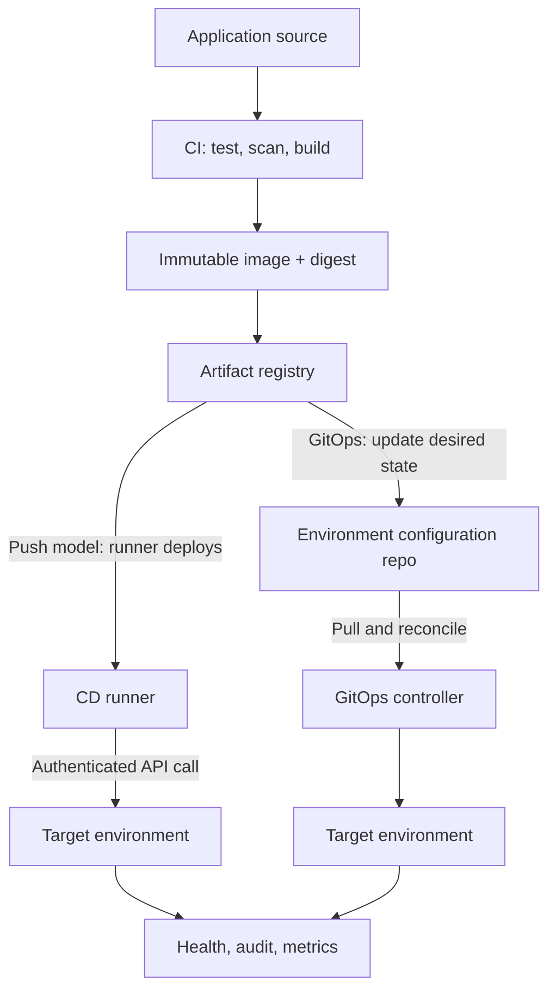
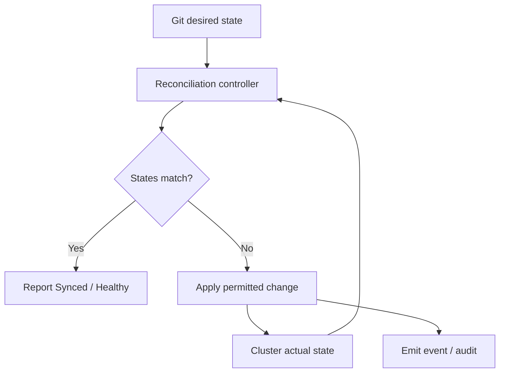

# Phân biệt pipeline điều khiển trực tiếp với triển khai kiểu GitOps

Một pipeline CI/CD có thể đưa phiên bản mới vào production bằng cách tự kết nối tới môi trường đích và thực hiện lệnh triển khai. Một cách khác là pipeline chỉ cập nhật trạng thái mong muốn trong Git; một controller chạy trong môi trường đích đọc thay đổi đó rồi liên tục điều chỉnh hệ thống cho khớp. Cách thứ nhất thường được gọi là push-based hoặc pipeline-driven deployment; cách thứ hai là pull-based deployment theo mô hình GitOps.

Hai cách đều có thể tự động hóa phát hành, nhưng khác nhau ở nơi giữ quyền điều khiển, nơi lưu trạng thái mong muốn, cách phát hiện drift, ranh giới bảo mật và cách xử lý lỗi. Chọn đúng mô hình giúp xác định ai được quyền thay đổi production, pipeline cần credential nào, cách truy vết release và cách khôi phục khi trạng thái thực tế lệch khỏi trạng thái đã duyệt.

Điểm quan trọng là phân biệt **công việc CI tạo và xác minh artifact** với **cơ chế CD đưa artifact vào môi trường**. CI có thể giống nhau ở cả hai mô hình: checkout source, test, scan, build image, tạo SBOM/provenance và ghi lại digest. Khác biệt chính nằm ở cách trạng thái triển khai được áp dụng và duy trì.

## 1. Hai mô hình điều khiển triển khai

### Pipeline điều khiển trực tiếp (push-based)

Trong mô hình push-based, job của CI/CD runner chủ động kết nối tới API hoặc control plane của môi trường đích rồi yêu cầu triển khai. Ví dụ:

- Pipeline chạy `kubectl apply`, `helm upgrade` hoặc gọi API của nền tảng deployment.
- Job chạy `terraform apply` để thay đổi hạ tầng.
- Release automation gọi API của PaaS, VM manager hoặc cloud service.
- Runner gửi lệnh cập nhật image/version tới cluster hoặc service cụ thể.

Pipeline là thành phần điều phối hành động. Job thường cần network route và danh tính có quyền trên tài nguyên đích. Khi lệnh kết thúc, pipeline ghi kết quả, nhưng việc tiếp tục phát hiện và sửa drift có thể phụ thuộc vào một cơ chế khác.

### Triển khai kiểu GitOps (pull-based reconciliation)

Trong GitOps, Git chứa trạng thái mong muốn (desired state) được khai báo bằng manifest, Helm values, Kustomize overlay hoặc cấu hình tương đương. Một controller chạy gần môi trường đích theo dõi nguồn này, so sánh desired state với trạng thái thực tế và liên tục reconcile để đưa hệ thống về trạng thái mong muốn.

Pipeline thường build và kiểm tra artifact, sau đó cập nhật digest hoặc release configuration trong repository cấu hình. Controller như Argo CD hoặc Flux quan sát commit mới và áp dụng thay đổi trong cluster. CI không cần trực tiếp cầm credential quản trị cluster.

GitOps không chỉ là “để YAML trong Git”. Một quy trình chỉ commit manifest rồi có người chạy `kubectl apply` thủ công vẫn chưa có vòng reconcile tự động. GitOps cần nguồn trạng thái mong muốn có version, controller tự lấy trạng thái đó và liên tục đối chiếu với môi trường.

## 2. Sơ đồ luồng hoạt động



Ở cả hai nhánh, artifact nên được tạo một lần và tham chiếu bằng digest bất biến. Khác biệt là ai thực hiện thao tác cập nhật runtime: pipeline runner hay controller đang chạy trong môi trường đích.

## 3. So sánh nhanh

| Khía cạnh | Pipeline điều khiển trực tiếp | GitOps pull-based |
|---|---|---|
| Ai áp dụng thay đổi? | CI/CD runner hoặc release job | Controller trong/ gần môi trường đích |
| Nguồn trạng thái mong muốn | Pipeline parameter, release record, IaC/config repo hoặc lệnh triển khai | Git repository được chỉ định làm source of truth |
| Hướng kết nối | Runner chủ động gọi vào API đích | Controller chủ động lấy cấu hình từ nguồn đã tin cậy |
| Credential chính | Runner cần quyền deploy trên target | Controller có quyền trong target; CI chủ yếu cần quyền cập nhật config repo |
| Drift detection | Tùy công cụ và bước kiểm tra sau deploy | Controller liên tục so sánh desired state với actual state |
| Tự sửa drift | Chỉ khi pipeline/automation chạy lại hoặc có hệ thống khác | Có thể tự reconcile theo policy |
| Audit trail | Pipeline run, command, deployment record và target audit | Git commit/PR, controller sync event và target audit |
| Rollback | Chạy lệnh deploy version/config trước hoặc gọi rollback API | Revert desired state trong Git; controller reconcile về revision trước |
| Phù hợp | Quy trình đơn giản, môi trường ít cluster, thao tác theo workflow | Nhiều môi trường/cluster, desired state cần review và liên tục được duy trì |
| Rủi ro nổi bật | Runner/credential bị chiếm quyền hoặc trạng thái chỉ được cập nhật một lần | Config repo/controller trở thành control plane đặc quyền; drift có thể bị tự sửa theo desired state sai |

Không có mô hình nào tự động an toàn chỉ nhờ tên gọi. Push deployment có thể dùng manifest khai báo và quyền tối thiểu; GitOps có thể cấu hình sai, controller quá quyền hoặc repository cấu hình không được bảo vệ. Cần đánh giá toàn bộ đường đi từ source tới runtime.

## 4. Desired state, actual state và reconciliation

Ba khái niệm giúp hiểu GitOps:

- **Desired state:** trạng thái hệ thống cần đạt, được khai báo trong Git hoặc nguồn cấu hình có kiểm soát.
- **Actual state:** trạng thái đang tồn tại trong cluster/cloud/runtime.
- **Reconciliation:** quá trình so sánh hai trạng thái và thực hiện hành động để giảm khác biệt.

Ví dụ desired state yêu cầu Deployment `orders` có ba replica và chạy image `orders@sha256:abc...`. Actual state hiện có hai replica hoặc một replica đang chạy digest cũ. Controller phát hiện khác biệt và thực hiện cập nhật để đạt trạng thái mong muốn, nếu policy cho phép.



Reconciliation là vòng lặp, không chỉ là một lần deploy. Nếu ai đó sửa trực tiếp Deployment trong cluster, controller có thể phát hiện drift và đưa cấu hình về Git. Đây là đặc tính có ích khi Git là nguồn sự thật, nhưng cũng có thể gây bất ngờ nếu operator thay đổi production để xử lý incident mà không cập nhật desired state.

### GitOps thường dựa trên các nguyên tắc

Một cách diễn đạt phổ biến của GitOps gồm:

1. Desired state được khai báo theo cách declarative.
2. Trạng thái mong muốn được lưu trong hệ thống version control có thể truy vết.
3. Software agent tự động lấy trạng thái mong muốn và áp dụng.
4. Agent liên tục quan sát, phát hiện và điều chỉnh drift.

Các nguyên tắc này giúp Git trở thành nơi review và audit thay đổi. Chúng không bắt buộc mọi thao tác phải là một PR thủ công; automation có thể tạo commit hoặc PR theo policy. Điều quan trọng là thay đổi desired state phải có nguồn gốc, quyền và lịch sử rõ ràng.

## 5. Ranh giới giữa CI và CD trong GitOps

Một cách phân chia trách nhiệm hiệu quả:

| Giai đoạn | CI pipeline | GitOps controller |
|---|---|---|
| Checkout source | Có | Không cần checkout application source để build |
| Unit/integration test | Có | Không |
| Build image/package | Có | Không |
| Scan, SBOM, provenance, signing | Có hoặc gọi dịch vụ chuyên biệt | Có thể xác minh policy trước khi sync |
| Chọn artifact digest | Ghi vào release metadata | Đọc digest từ desired state |
| Cập nhật environment config | Tạo PR/commit hoặc gọi config automation | Theo dõi repository/branch/path đã cấu hình |
| Áp dụng workload | Không nhất thiết có quyền trực tiếp | Có |
| Reconcile drift | Không phải chức năng mặc định | Có |
| Health/rollout observation | CI có thể theo dõi release status | Controller báo sync/health; monitoring xác minh SLO và nghiệp vụ |

CI có thể cập nhật GitOps repository bằng bot identity. Ví dụ sau khi image được build và ký, workflow tạo pull request thay giá trị image digest trong `environments/production/orders/values.yaml`. Reviewer xem commit, digest, scan report và release note. Sau khi merge, controller nhận desired state mới và triển khai.

CI không nên vừa cập nhật desired state vừa giữ quyền tùy ý sửa cluster nếu mục tiêu kiến trúc là để controller sở hữu quyền deploy. Nếu pipeline vẫn có quyền `kubectl apply` vào production, ranh giới pull-based đã bị làm yếu đi.

## 6. Ví dụ push-based deployment

Giả sử pipeline đã tạo image và lưu digest vào biến `IMAGE_REF`. Job triển khai dùng workload identity hoặc credential ngắn hạn để gọi cluster API, sau đó kiểm tra rollout.

```yaml
name: Deploy orders directly

on:
  workflow_dispatch:

permissions:
  contents: read
  id-token: write

jobs:
  deploy:
    runs-on: ubuntu-latest
    environment: production
    steps:
      - uses: actions/checkout@v4
      - name: Authenticate to cloud with workload identity
        run: ./ci/exchange-oidc-token.sh
      - name: Deploy approved image
        env:
          IMAGE_REF: ${{ vars.ORDERS_IMAGE_DIGEST }}
        run: |
          helm upgrade --install orders ./deploy/orders \
            --namespace production-orders \
            --set image.reference="$IMAGE_REF" \
            --wait --timeout 5m
      - name: Verify deployment
        run: ./ci/verify-orders-production.sh
```

Ví dụ giả định cloud trust policy, environment protection, Helm chart và script xác thực đã được cấu hình. `id-token: write` chỉ cho job yêu cầu OIDC token; quyền thật do trust policy và IAM quyết định. `IMAGE_REF` phải là image digest đã được kiểm tra và phê duyệt, không phải tag mutable như `latest`.

Trong mô hình này, runner có network route và quyền gọi cluster/cloud API. Cần giới hạn runner pool, egress, target namespace, quyền IAM/RBAC và thời hạn credential. Không dùng runner xử lý pull request không tin cậy để deploy production.

### Ưu điểm của push-based

- Dễ tích hợp với pipeline hiện có và các công cụ release tuần tự.
- Có thể triển khai tới nhiều loại target không có GitOps controller.
- Một workflow có thể kết hợp approval, migration, deploy và post-deploy verification.
- Phù hợp với môi trường nhỏ hoặc hệ thống đã có control plane triển khai riêng.

### Hạn chế cần quản lý

- Runner phải truy cập được target, tạo thêm đường inbound hoặc network route.
- Credential deploy nằm trong hoặc được cấp cho execution environment của pipeline.
- Nếu pipeline không chạy lại, drift phát sinh sau deploy có thể không được sửa.
- Khi job timeout hoặc mất kết nối, trạng thái thực tế có thể chưa rõ; cần reconcile trước khi retry.
- Nhiều pipeline có thể cùng sửa một target nếu thiếu concurrency control.

## 7. Ví dụ GitOps với Argo CD

Một repository cấu hình có thể chứa manifest cho từng môi trường. Ví dụ Deployment tham chiếu image bằng digest:

```yaml
apiVersion: apps/v1
kind: Deployment
metadata:
  name: orders
  namespace: production-orders
spec:
  replicas: 3
  selector:
    matchLabels:
      app: orders
  template:
    metadata:
      labels:
        app: orders
    spec:
      containers:
        - name: orders
          image: registry.example.com/team/orders@sha256:0123456789abcdef
          ports:
            - name: http
              containerPort: 8080
```

Argo CD Application có thể trỏ tới path cấu hình production:

```yaml
apiVersion: argoproj.io/v1alpha1
kind: Application
metadata:
  name: orders-production
  namespace: argocd
spec:
  project: production
  source:
    repoURL: https://git.example.com/platform/environment-config.git
    targetRevision: main
    path: environments/production/orders
  destination:
    server: https://kubernetes.default.svc
    namespace: production-orders
  syncPolicy:
    automated:
      prune: false
      selfHeal: true
    syncOptions:
      - CreateNamespace=false
```

Ví dụ chỉ minh họa cấu trúc. Cần cấu hình quyền của Argo CD Project, repository credential, cluster destination, sync window, health assessment và policy prune theo nhu cầu. `selfHeal: true` cho phép controller sửa drift đối với resource được quản lý; `prune: false` tránh tự xóa resource không còn trong Git trong ví dụ này. Bật prune cần hiểu rõ ownership và tác động xóa tài nguyên.

Khi CI cập nhật image digest trong repository cấu hình và thay đổi được merge, Argo CD phát hiện revision mới, so sánh manifest với cluster rồi sync theo policy. Controller có thể báo `Synced` nhưng ứng dụng vẫn có thể gặp lỗi nghiệp vụ; cần monitoring, smoke test và SLO validation độc lập.

## 8. Cách CI cập nhật repository cấu hình

Một release flow điển hình:

1. CI checkout application source tại commit cụ thể.
2. Chạy test, scan, build và tạo image.
3. Tính digest, tạo provenance/SBOM và ký artifact theo policy.
4. Xác minh image đã có trong registry và bằng chứng gắn với đúng digest.
5. Tạo thay đổi trong environment config repo, cập nhật image digest.
6. Mở PR với release metadata, ticket, test/scan summary và target environment.
7. Reviewer hoặc policy bot kiểm tra thay đổi.
8. Merge PR; GitOps controller quan sát commit và reconcile.
9. Monitoring và release verification kiểm tra health, SLO và business flow.

Ví dụ nội dung thay đổi:

```diff
 image:
-  reference: registry.example.com/team/orders@sha256:old_digest
+  reference: registry.example.com/team/orders@sha256:new_digest
```

PR thay đổi cấu hình trở thành bằng chứng về phiên bản được yêu cầu chạy ở production. Commit SHA của config repo cần được liên kết với application commit và artifact digest để có thể truy vết hai chiều.

### Không build lại trong GitOps controller

Controller nên triển khai artifact đã được build và kiểm tra trong CI. Không nên để controller clone application source rồi tự build image trong lúc sync, vì sẽ làm mờ ranh giới giữa build và deploy, khó tái lập artifact và khó gắn chữ ký/provenance với đúng nội dung đang chạy.

Một số hệ thống có image updater tự động sửa config repo khi registry xuất hiện image mới. Nếu dùng cách này, cần policy rõ về tag/digest được phép, kiểm tra scan/signature, tạo PR hoặc commit có audit, và tránh tự động đưa mọi image mới vào production.

## 9. Source of truth và quản lý cấu hình theo môi trường

GitOps yêu cầu xác định repository, branch, folder và revision nào là nguồn trạng thái mong muốn cho mỗi môi trường. Không nên để nhiều nơi cùng tuyên bố là source of truth cho một resource.

Một cách tổ chức:

```text
environment-config/
├── base/
│   └── orders/
├── environments/
│   ├── development/
│   │   └── orders/
│   ├── staging/
│   │   └── orders/
│   └── production/
│       └── orders/
└── clusters/
    ├── dev-cluster/
    └── prod-cluster/
```

Có thể dùng Kustomize base/overlay, Helm chart/values hoặc manifest thuần. Cấu hình môi trường cần được review và có owner. Những khác biệt như replica count, resource limits, endpoint, policy và feature flag nên được thể hiện rõ; secret value cần được quản lý bằng cơ chế secret riêng.

### Tránh nhiều nguồn ghi cùng resource

Nếu GitOps controller quản lý Deployment `orders`, một pipeline khác cũng chạy `kubectl set image` lên cùng Deployment thì hai bộ điều khiển có thể liên tục ghi đè nhau. GitOps controller có thể đưa resource về Git; pipeline lại thay đổi runtime lần nữa. Đây là tranh chấp ownership.

Hãy xác định owner cho từng resource/field và chọn một đường thay đổi chính thức. Nếu có ngoại lệ vận hành khẩn cấp, cần ghi nhận thay đổi vào Git sau khi xử lý để desired state không bị lệch lâu dài.

## 10. Drift detection và cách xử lý

Drift là khác biệt giữa desired state và actual state. Drift có thể xuất hiện do:

- Operator sửa trực tiếp resource trong cluster.
- Một controller khác thay đổi field được quản lý.
- Autoscaler điều chỉnh replica count.
- Admission webhook mutate resource.
- Resource bị xóa hoặc thay đổi ngoài Git.
- Thay đổi cloud resource qua console/API ngoài IaC.

Không phải mọi khác biệt đều là lỗi. Ví dụ HPA điều chỉnh replica là hành vi runtime được mong đợi; nếu Git cố định `replicas: 3` và GitOps liên tục ép về 3, có thể xung đột với autoscaler. Cần phân định field nào do Git quản lý, field nào do controller/runtime quản lý và cấu hình ignore/ownership phù hợp.

### Các cách xử lý drift

| Chính sách | Hành vi | Khi phù hợp |
|---|---|---|
| Alert only | Phát hiện và báo drift, không tự sửa | Môi trường cần đánh giá trước khi thay đổi hoặc resource có rủi ro cao |
| Manual sync | Controller hiển thị diff; operator quyết định sync | Production có approval gate hoặc change window |
| Auto sync | Controller tự áp dụng desired state mới từ Git | Thay đổi đã qua policy và môi trường cho phép tự động |
| Self-heal | Controller sửa drift do thay đổi ngoài Git | Cần duy trì cấu hình chuẩn và ngăn thay đổi thủ công kéo dài |
| Prune | Xóa resource được controller quản lý nhưng không còn trong desired state | Chỉ bật khi ownership, dependency và hậu quả xóa đã được kiểm soát |

Self-heal có thể phục hồi drift ngoài ý muốn, nhưng nếu Git chứa cấu hình sai hoặc bị xâm nhập, controller sẽ liên tục áp dụng trạng thái sai. Vì vậy, bảo vệ Git, review, signature/policy và audit quan trọng ngang với bảo vệ cluster.

## 11. Bảo mật và ranh giới tin cậy

### Push-based

Pipeline runner thường cần credential hoặc token để truy cập API đích. Kiểm soát nên gồm:

- Runner riêng cho release/deploy, không chạy mã PR không tin cậy.
- Workload identity/OIDC và credential ngắn hạn thay cho key dài hạn.
- RBAC giới hạn theo namespace, service hoặc resource.
- Network egress chỉ tới registry, cloud API và cluster endpoint cần thiết.
- Protected environment, approval và branch/tag policy.
- Artifact digest/signature/provenance được xác minh trước khi deploy.
- Audit log liên kết pipeline run, actor, target và deployment ID.

### GitOps

GitOps giảm nhu cầu cho CI runner truy cập trực tiếp vào production cluster, nhưng controller có quyền áp dụng thay đổi nên cần được bảo vệ:

- Git repository dùng branch protection, required review và CODEOWNERS.
- Chỉ bot/workflow được phép cập nhật đúng path và branch theo policy.
- Controller dùng service account/RBAC tối thiểu theo project/namespace.
- Tách controller hoặc project theo trust boundary khi cần.
- Bảo vệ credential truy cập Git/registry bằng secret manager và rotation.
- Admission policy xác minh image registry, digest, signature, security context và resource constraints.
- Hạn chế quyền tạo cluster-scoped resource và CRD.
- Ghi audit cho commit, sync operation, drift correction và manual override.

GitOps repository là một phần của production control plane. Người có quyền merge manifest production có thể gián tiếp thay đổi production; quyền đó cần được xem xét như quyền deploy.

### Secret không nên nằm trong Git dưới dạng plaintext

GitOps không có nghĩa commit password, token hoặc private key vào repository. Có thể dùng External Secrets Operator, Sealed Secrets, SOPS với KMS hoặc cơ chế secret manager tương đương. Cần phân biệt encrypted secret material với secret đã giải mã trong cluster, giới hạn ai có thể giải mã và tránh để plaintext xuất hiện trong pipeline log hoặc Git history.

## 12. Rollback trong hai mô hình

### Push-based rollback

Pipeline hoặc operator triển khai lại artifact/config revision ổn định trước đó, hoặc gọi rollback API của nền tảng. Release record cần lưu digest, manifest/config revision và deployment ID trước đó. Rollback job cần quyền riêng, xác minh target và tránh build lại một artifact mới thay cho artifact cũ.

### GitOps rollback

Rollback thường là revert commit thay đổi desired state hoặc tạo commit mới trỏ image/config về revision trước. Controller đọc desired state đã revert và reconcile cluster. Không nên sửa trực tiếp cluster để rollback rồi để Git vẫn chứa cấu hình lỗi, vì controller có thể đưa trạng thái lỗi trở lại.

### Các điểm cần lưu ý

- Rollback code không nhất thiết đảo ngược database migration.
- Thay đổi schema cần backward/forward compatibility trong giai đoạn rollout.
- Secret rotation có thể không đảo ngược bằng cách quay lại commit cũ.
- Prune có thể xóa resource; khôi phục cần backup hoặc manifest phù hợp.
- Controller sync status không chứng minh business transaction đã đúng.
- Nếu release mới gây mất dữ liệu, cần recovery/restore hoặc compensation, không chỉ revert manifest.

## 13. Xử lý sự cố và trạng thái không rõ ràng

Một pipeline push có thể timeout sau khi API đích đã nhận yêu cầu. Không được giả định deploy thất bại chỉ vì runner không nhận được response. Cần đọc trạng thái deployment hiện tại, kiểm tra revision/digest và reconcile trước khi retry.

GitOps cũng có các trạng thái cần phân biệt:

- **OutOfSync:** desired state và actual state khác nhau.
- **Syncing:** controller đang áp dụng thay đổi.
- **Synced:** tài nguyên được quản lý khớp với desired state theo cách controller đánh giá.
- **Degraded/Unhealthy:** một hoặc nhiều resource không đạt health assessment.
- **Unknown:** controller không thể xác định trạng thái do lỗi API, permission hoặc telemetry.

`Synced` không đồng nghĩa ứng dụng khỏe; `Unknown` không đồng nghĩa đã thất bại hoặc thành công. Cần kết hợp health probe, application metrics, logs, traces, smoke test và business validation.

Khi GitOps controller mất kết nối với Git, cluster có thể tiếp tục chạy phiên bản hiện tại nhưng không nhận release mới hoặc không sửa drift. Cần cảnh báo trạng thái controller, tuổi của revision cuối cùng đã sync và thời gian từ commit tới sync.

## 14. Progressive delivery và kiểm soát rollout

Push-based pipeline có thể gọi trực tiếp công cụ canary/blue-green hoặc cập nhật traffic routing. Trong GitOps, desired state có thể khai báo rollout strategy và một progressive delivery controller thực hiện từng bước, ví dụ Argo Rollouts hoặc Flagger.

Dù mô hình nào, cần xác định:

- Tỷ lệ traffic/replica ở mỗi bước.
- Observation window và số mẫu tối thiểu.
- Error rate, latency, saturation và business guardrail.
- Điều kiện pause, abort, promote hoặc rollback.
- Ai có quyền override khi incident xảy ra.
- Bằng chứng được lưu theo artifact digest và deployment revision.

GitOps controller có thể bảo đảm manifest được áp dụng; progressive delivery controller quyết định tốc độ rollout; monitoring đánh giá chất lượng dịch vụ. Không nên gộp ba trách nhiệm thành một trạng thái “sync thành công”.

## 15. Quản lý nhiều môi trường và nhiều cluster

GitOps thường hữu ích khi cùng một ứng dụng cần triển khai qua development, staging và production hoặc nhiều cluster/region. Có thể tổ chức:

- Một repository cấu hình riêng cho mỗi môi trường.
- Một repository chung với thư mục/overlay cho từng môi trường.
- Một repo platform chứa cluster bootstrap và repo app chứa workload.
- Một controller quản lý nhiều cluster hoặc controller riêng theo trust boundary.

Lựa chọn phụ thuộc quyền truy cập, tần suất thay đổi, mức độ cô lập và cách review. Không nên cho controller ở cluster development có quyền ghi cluster production chỉ để tái sử dụng cấu hình.

Với promotion, nên đưa cùng artifact digest qua các môi trường. Mỗi môi trường có thể có cấu hình khác nhau, nhưng không nên build lại image cho production sau khi staging đã xác minh. Release record cần nối application commit, artifact digest, config commit và environment.

## 16. Khi nào chọn mô hình nào?

| Điều kiện | Push-based thường phù hợp | GitOps thường phù hợp |
|---|---|---|
| Ít service, ít target, quy trình đơn giản | Có | Có thể quá nhiều thành phần vận hành ban đầu |
| Nhiều cluster/môi trường | Cần quản lý runner/credential và orchestration cẩn thận | Có lợi từ controller và desired state theo cluster |
| Target không có controller GitOps | Thường phù hợp | Có thể cần adapter hoặc không phù hợp |
| Muốn drift được phát hiện và tự reconcile liên tục | Cần thêm công cụ | Là năng lực cốt lõi |
| Hạn chế CI runner truy cập production network | Khó hơn nếu runner cần gọi target | Thường phù hợp hơn vì controller pull từ trong cluster |
| Cần quy trình migration phức tạp theo thứ tự | Pipeline orchestration trực tiếp có thể thuận tiện | Có thể phối hợp controller với job/operator và explicit gates |
| Muốn mọi thay đổi production qua PR/review | Có thể tích hợp approval nhưng cần policy bổ sung | Tự nhiên hơn khi Git là desired-state source of truth |
| Đội ngũ chưa vận hành controller/repository cấu hình | Dễ bắt đầu hơn | Cần đầu tư bootstrap, ownership và observability |

Không nhất thiết chọn một mô hình cho toàn tổ chức. Có thể dùng GitOps cho Kubernetes workload, push-based cho database migration hoặc dịch vụ ngoài cluster, miễn là ownership và thứ tự thao tác được định nghĩa rõ.

## 17. Mô hình kết hợp thường gặp

Một kiến trúc thực tế có thể dùng:

1. CI build và ký artifact.
2. Release automation tạo PR cập nhật GitOps repository.
3. GitOps controller triển khai workload.
4. Pipeline hoặc release verifier theo dõi controller và health metrics.
5. Database migration chạy qua job riêng có approval, lock và compatibility policy.
6. Monitoring quyết định promote canary hoặc dừng rollout.

Trong mô hình này, GitOps controller quản lý desired state của workload; pipeline vẫn điều phối các bước ngoài phạm vi controller như migration, approval và release record. Cần tránh hai hệ thống cùng ghi một resource.

## 18. Những anti-pattern thường gặp

- **Gọi quy trình là GitOps chỉ vì manifest nằm trong Git:** không có controller pull/reconcile liên tục.
- **CI vừa có quyền deploy trực tiếp vừa GitOps quản lý cùng resource:** hai writer tranh chấp trạng thái.
- **Để tag mutable trong desired state:** controller có thể kéo nội dung khác với artifact đã được duyệt.
- **Commit secret plaintext:** Git history làm lộ secret lâu dài.
- **Controller có cluster-admin trên mọi cluster:** một lỗi cấu hình hoặc credential có blast radius lớn.
- **Bật prune/self-heal mà không hiểu ownership:** resource cần thiết có thể bị xóa hoặc thay đổi ngoài ý muốn.
- **Coi Synced là Healthy:** manifest khớp nhưng ứng dụng có thể lỗi.
- **Rollback bằng cách sửa trực tiếp cluster:** GitOps có thể reconcile ngược thay đổi thủ công.
- **Build lại image trong quá trình sync:** làm mất liên kết giữa test, signature và artifact chạy thật.
- **Không lưu config commit và application digest:** khó truy vết release.
- **Không có quy trình break-glass:** incident buộc operator sửa ngoài Git mà không có cách ghi nhận và reconcile lại.
- **Không giám sát controller:** Git có commit mới nhưng môi trường không sync trong thời gian dài mà không ai biết.

## 19. Checklist lựa chọn và triển khai mô hình

Trước khi thiết kế CD, hãy kiểm tra:

1. Ai là chủ thể thực hiện thay đổi trên runtime: CI runner hay controller trong môi trường?
2. Desired state được lưu ở đâu và nguồn nào là source of truth?
3. Có một writer duy nhất cho mỗi resource/field hay không?
4. Artifact được tham chiếu bằng digest bất biến và có provenance/signature phù hợp không?
5. Credential có ngắn hạn, scope hẹp và tách theo build/publish/deploy/controller không?
6. CI runner có cần route vào production không? Nếu có, network và runner pool được giới hạn ra sao?
7. GitOps repository có branch protection, CODEOWNERS, approval và audit không?
8. Controller có quyền đúng namespace/project/cluster và có tách trust boundary không?
9. Secret được mã hóa hoặc lấy từ secret manager theo identity nào?
10. Drift được phát hiện, cảnh báo, tự sửa hay chờ manual sync theo policy nào?
11. Prune/self-heal có được đánh giá tác động và dependency trước khi bật không?
12. Rollback được thực hiện bằng cách nào và có tương thích schema/data không?
13. Có phân biệt Synced, Healthy, SLO pass và business validation không?
14. Controller hoặc runner mất kết nối thì hệ thống biểu diễn trạng thái unknown và xử lý retry ra sao?
15. Multi-environment promotion có giữ cùng artifact digest không?
16. Có runbook break-glass, manual override và quy trình ghi lại thay đổi về source of truth không?
17. Audit record có liên kết source commit, artifact digest, config commit, approver và deployment ID không?

Pipeline điều khiển trực tiếp trao quyền triển khai cho job CI/CD và phù hợp khi cần một workflow điều phối rõ ràng tới target. GitOps trao quyền reconcile cho controller dựa trên desired state được version hóa trong Git, phù hợp khi cần duy trì trạng thái nhất quán qua nhiều môi trường và phát hiện drift liên tục. Dù chọn cách nào, release vẫn cần artifact bất biến, quyền tối thiểu, policy rõ, quan sát sau deploy và phương án phục hồi đã được kiểm chứng.
