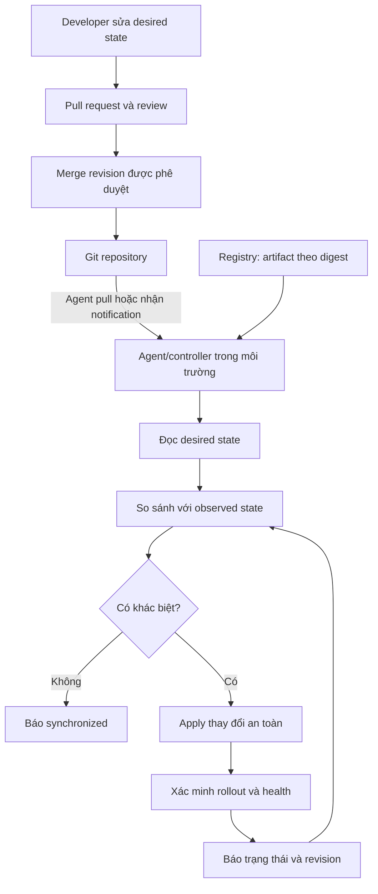
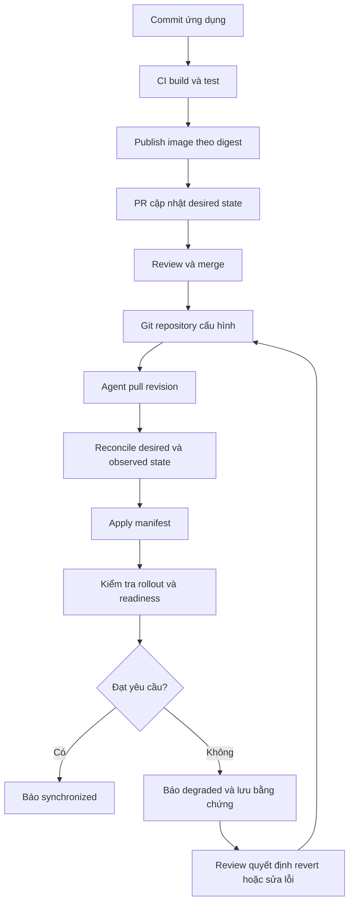

# Hiểu mô hình đẩy thay đổi với tác nhân kéo trạng thái mong muốn

Trong CI/CD, hệ thống có thể đưa thay đổi đến môi trường bằng cách gửi lệnh triển khai từ pipeline, hoặc để một tác nhân đang chạy trong môi trường đích chủ động lấy trạng thái mong muốn rồi điều chỉnh hệ thống cho khớp. Hai cách này thường được gọi là mô hình *push* và *pull*.

Ở mô hình push, pipeline hoặc bộ điều phối khởi tạo hành động và gửi yêu cầu tới môi trường đích. Ở mô hình pull, agent hoặc controller quan sát nguồn mô tả trạng thái mong muốn, so sánh với trạng thái thực tế và thực hiện các hành động cần thiết để hội tụ. Sự khác biệt cốt lõi nằm ở nơi khởi tạo việc thay đổi và cách hệ thống duy trì trạng thái sau lần triển khai đầu tiên.

Không có mô hình nào phù hợp cho mọi bước. Pipeline thường phù hợp để build, kiểm thử và phát hành artifact; agent kéo trạng thái có thể phù hợp để áp dụng cấu hình hoặc triển khai vào môi trường nằm sau ranh giới mạng riêng. Điều quan trọng là hiểu quyền sở hữu trạng thái, luồng xác thực, cách xử lý sai lệch và cách chứng minh hệ thống đã đạt phiên bản mong muốn.

## 1. Mô hình push hoạt động như thế nào?

Trong mô hình push, một sự kiện hoặc người vận hành kích hoạt pipeline. Pipeline xác định phiên bản cần phát hành, chuẩn bị artifact và gọi API hoặc công cụ điều khiển môi trường đích để triển khai.

Một luồng điển hình:

1. Developer tạo commit hoặc mở pull request.
2. CI chạy build, test và các cổng chất lượng.
3. Pipeline publish artifact bất biến vào registry.
4. Sau khi đủ điều kiện, job triển khai lấy artifact theo version hoặc digest.
5. Job xác thực với môi trường đích và gửi lệnh cập nhật.
6. Pipeline chờ kết quả, chạy smoke test và ghi nhận trạng thái.

Ví dụ, một job có thể gọi API của nền tảng triển khai để cập nhật image của dịch vụ:

```text
CI pipeline
  -> authenticate to deployment API
  -> request: deploy image@sha256:abc...
  -> wait for rollout
  -> verify health and version
```

Pipeline chủ động điều khiển thời điểm và nội dung thay đổi. Vì thế, nó có thể gắn việc triển khai với một lần chạy cụ thể, một commit đã review hoặc một lần phê duyệt. Nếu triển khai thất bại, job có thể trả trạng thái thất bại trực tiếp về pull request hoặc release.

Push cũng có thể dùng để đẩy cấu hình hoặc lệnh tới máy chủ bằng SSH, gọi API cloud, cập nhật task trên nền tảng container hoặc chạy công cụ quản lý cấu hình từ một máy điều khiển. Dù cách thực thi khác nhau, điểm chung là bên điều phối khởi tạo hành động trên hệ thống đích.

## 2. Mô hình pull với agent kéo trạng thái mong muốn

Trong mô hình pull, một agent hoặc controller chạy trong môi trường đích. Nó có quyền đọc một nguồn trạng thái đã được phê duyệt, chẳng hạn Git repository, API điều khiển hoặc kho cấu hình. Agent định kỳ kiểm tra hoặc nhận tín hiệu có thay đổi, tải phiên bản trạng thái mong muốn, so sánh với trạng thái thực tế và thực hiện các thao tác cần thiết.

Luồng khái quát:

1. Developer cập nhật cấu hình mong muốn trong repository.
2. Thay đổi được review, kiểm tra và merge theo chính sách.
3. Agent trong môi trường đích đọc revision đã được cho phép.
4. Agent phân tích cấu hình, xác định các tài nguyên cần có.
5. Agent so sánh desired state với observed state.
6. Agent áp dụng thay đổi và kiểm tra lại kết quả.
7. Agent tiếp tục quan sát để phát hiện drift hoặc thay đổi mới.

Ví dụ, repository cấu hình khai báo dịch vụ cần chạy image digest nào và có bao nhiêu replica:

```yaml
application:
  name: checkout
  image: registry.example/checkout@sha256:abc123
  replicas: 3
  configRevision: checkout-prod-v17
```

Agent đọc revision được phê duyệt, sau đó yêu cầu nền tảng chạy ba replica của đúng image digest. Nếu một replica bị xóa thủ công hoặc tiến trình bị lỗi, controller có thể phát hiện số replica thực tế thấp hơn số mong muốn và tạo lại replica để hệ thống hội tụ.

Pull không nhất thiết chỉ có polling theo chu kỳ. Agent có thể nhận webhook hoặc notification để biết có revision mới, sau đó tự kết nối ra ngoài để lấy cấu hình. Nhiều hệ thống kết hợp event để giảm độ trễ với chu kỳ resync định kỳ để phát hiện thay đổi bị bỏ lỡ. Nguồn trạng thái được xác thực vẫn là căn cứ quyết định; notification chỉ là tín hiệu đánh thức agent.

## 3. So sánh push và pull

| Tiêu chí | Push | Pull với agent |
| --- | --- | --- |
| Bên khởi tạo thay đổi | Pipeline hoặc bộ điều phối | Agent/controller trong môi trường đích |
| Kết nối mạng | Thường cần đường từ runner tới API hoặc máy đích | Agent thường tạo kết nối đi ra để lấy trạng thái |
| Credential | Pipeline cần quyền triển khai trên môi trường đích | Agent cần quyền đọc nguồn mong muốn và quyền áp dụng trong môi trường của nó |
| Thời điểm áp dụng | Thường gắn với một lần chạy pipeline | Theo chu kỳ đồng bộ hoặc khi agent nhận tín hiệu |
| Duy trì trạng thái | Pipeline thường kết thúc sau khi triển khai và xác minh | Agent tiếp tục quan sát và sửa drift theo chính sách |
| Phản hồi | Kết quả thường gắn trực tiếp với job triển khai | Cần quan sát trạng thái đồng bộ và báo cáo từ agent |
| Phạm vi điều khiển | Tập trung ở pipeline/orchestrator | Phân tán theo agent hoặc controller |
| Trường hợp phù hợp | Release có phê duyệt, thao tác theo lệnh, môi trường có API truy cập được | Môi trường riêng, cấu hình khai báo, duy trì trạng thái dài hạn |

Pull thường giảm nhu cầu mở cổng inbound từ CI runner vào mạng riêng, nhưng không tự động làm hệ thống an toàn. Agent vẫn giữ quyền thay đổi tài nguyên và phải được bảo vệ. Nếu agent có quyền đọc mọi branch hoặc mọi file trong repository cấu hình, một thay đổi chưa được phê duyệt có thể trở thành lệnh triển khai.

Push giúp pipeline điều khiển trực tiếp thời điểm thực thi, nhưng runner cần credential và đường kết nối phù hợp. Nếu runner bị xâm nhập hoặc job không tin cậy được cấp quyền triển khai, phạm vi ảnh hưởng có thể rất lớn. Quyền cần được giới hạn theo môi trường, repository, workflow và loại hành động.

## 4. Desired state, observed state và reconciliation

Mô hình pull thường được xây dựng quanh ba khái niệm:

- **Desired state:** trạng thái mà hệ thống cần đạt, được mô tả trong cấu hình hoặc API đã được phê duyệt.
- **Observed state:** trạng thái agent quan sát được ở môi trường thực tế.
- **Reconciliation:** quá trình so sánh hai trạng thái và thực hiện hành động để giảm khác biệt.

Ví dụ desired state khai báo ba replica, nhưng observed state chỉ có hai. Controller có thể tạo replica còn thiếu. Khi cả ba replica chạy đúng image digest, trạng thái có thể được báo là synchronized hoặc converged.

Một vòng reconciliation đơn giản:

```text
loop:
    desired = read_approved_revision()
    observed = inspect_environment()
    diff = compare(desired, observed)

    if diff is empty:
        report_synced(desired.revision)
    else:
        apply_safe_changes(diff)
        verify_environment()
```

Đây là mã giả mô tả ý tưởng. Controller thực tế cần xử lý lỗi từng tài nguyên, timeout, retry có giới hạn, quyền truy cập và các thao tác có thể chạy lại. Không nên giả định một lần apply thành công đồng nghĩa mọi thành phần đã khỏe mạnh.

Reconciliation nên có tính idempotent: chạy lại cùng một desired state không tạo thêm tài nguyên trùng lặp hoặc tác động phụ ngoài ý muốn. Agent cần biết trạng thái hiện tại trước khi hành động và xác minh sau khi hành động. Với thao tác không thể lặp an toàn, chẳng hạn gửi thông báo hoặc tạo một giao dịch, cần cơ chế nhận diện yêu cầu hoặc tách thao tác đó khỏi vòng reconcile.

Một hệ thống có thể mất thời gian để hội tụ vì tài nguyên phải khởi động, image phải tải hoặc dịch vụ phụ thuộc chưa sẵn sàng. Do đó, trạng thái thường không chỉ có hai giá trị thành công/thất bại. Nên phân biệt pending, progressing, synchronized, degraded và failed, kèm revision cùng lý do.

## 5. GitOps là một cách triển khai mô hình pull

GitOps là một cách tổ chức vận hành trong đó trạng thái mong muốn được khai báo và quản lý có phiên bản trong Git. Agent hoặc controller trong môi trường đích lấy revision được cho phép và liên tục đối chiếu trạng thái thực tế với cấu hình đó.

Một quy trình GitOps thường có các thành phần:

- **Source repository:** lưu cấu hình mong muốn, manifest, chart hoặc định nghĩa triển khai.
- **Review và policy:** kiểm tra thay đổi, phê duyệt và bảo vệ nhánh.
- **Artifact registry:** lưu image hoặc package bất biến được tham chiếu từ cấu hình.
- **Agent/controller:** theo dõi revision và áp dụng cấu hình vào môi trường.
- **Status/observability:** báo revision đang áp dụng, trạng thái đồng bộ, lỗi và sức khỏe ứng dụng.

Sơ đồ:



Git lưu lịch sử thay đổi và hỗ trợ review, nhưng bản thân việc merge không bảo đảm cấu hình đúng. Cần kiểm tra schema, policy, tham chiếu artifact, quyền truy cập và khả năng tương thích trước khi agent áp dụng. Một cấu hình sai nhưng được merge vẫn có thể khiến controller hội tụ về một trạng thái sai.

GitOps cũng không có nghĩa mọi dữ liệu bí mật phải lưu trực tiếp trong Git. Repository nên chứa tham chiếu tới secret hoặc cơ chế mã hóa được kiểm soát. Secret thực tế cần được lấy từ secret manager hoặc giải mã bởi một thành phần có quyền phù hợp, với audit và rotation.

## 6. Chọn mô hình theo loại công việc

Push và pull có thể cùng tồn tại trong một hệ thống CI/CD. Hãy chọn theo đặc điểm của thao tác:

| Công việc | Mô hình thường phù hợp | Lý do |
| --- | --- | --- |
| Build và unit test sau commit | Push/event-triggered CI | Sự kiện commit kích hoạt công việc và kết quả gắn với revision |
| Publish package hoặc image | Push từ pipeline phát hành | Pipeline tạo, kiểm tra và publish một artifact cụ thể |
| Gửi lệnh triển khai trực tiếp tới môi trường | Push từ pipeline | Pipeline gọi API môi trường và chờ kết quả |
| Ghi nhận thay đổi desired state trong Git | Push commit/PR; agent pull sau khi merge | Tách việc đề xuất trạng thái khỏi việc áp dụng vào môi trường |
| Duy trì cấu hình cluster hoặc máy chủ | Pull/reconciliation | Agent tiếp tục phát hiện và sửa drift |
| Triển khai vào mạng riêng không nhận inbound từ runner | Pull agent | Agent có thể chủ động kết nối ra registry và nguồn cấu hình |
| Thao tác một lần cần phê duyệt trực tiếp | Push có approval gate hoặc workflow điều phối | Thời điểm và người phê duyệt được gắn với lần thực thi |
| Phân phối cấu hình dài hạn cho nhiều môi trường | Pull hoặc mô hình kết hợp | Mỗi môi trường tự đồng bộ theo revision được phép |

Một kiến trúc phổ biến là push cho CI và publish artifact, sau đó cập nhật repository cấu hình bằng một pull request. Khi thay đổi được merge, agent pull trong môi trường đích sẽ triển khai đúng digest. Như vậy, pipeline không cần giữ credential truy cập trực tiếp vào mọi cluster, còn trạng thái triển khai vẫn có lịch sử và bằng chứng.

## 7. Quản lý revision và tránh áp dụng trạng thái cũ

Agent cần xác định rõ revision nào đang được áp dụng và revision nào mới hơn. Chỉ ghi nhận tên branch là chưa đủ vì nội dung branch có thể thay đổi. Nên ghi commit SHA hoặc một version bất biến của bundle cấu hình.

Một số nguyên tắc:

- Gắn mỗi lần reconcile với revision cụ thể.
- Không áp dụng cấu hình từ pull request chưa merge hoặc ref không được cho phép.
- Khi nhiều lần cập nhật đến gần nhau, xác định thứ tự revision và tránh để một job cũ ghi đè trạng thái mới.
- Ghi lại thời điểm bắt đầu, kết quả và revision đã áp dụng.
- Nếu apply thất bại giữa chừng, báo trạng thái chưa hội tụ và tiếp tục từ trạng thái thực tế sau khi đánh giá.

Ví dụ agent đang áp dụng revision `v17`, trong lúc đó repository đã có `v18`. Agent có thể hoàn thành hoặc hủy an toàn công việc cũ tùy loại tài nguyên, sau đó reconcile `v18`. Không nên để một worker xử lý chậm của revision `v17` hoàn tất muộn và ghi đè kết quả `v18`.

Có thể dùng generation, resource version, lock hoặc compare-and-swap tùy nền tảng để bảo vệ cập nhật. Cần xác minh cơ chế cụ thể của hệ thống; chỉ so sánh timestamp từ nhiều máy có thể không đủ do sai lệch đồng hồ.

## 8. Drift và chính sách tự sửa

Drift là khác biệt giữa desired state và observed state. Drift có thể xuất hiện khi:

- Người vận hành sửa tài nguyên trực tiếp bằng console hoặc CLI.
- Một tiến trình bên ngoài thay đổi cấu hình.
- Tài nguyên bị xóa, hỏng hoặc thay đổi do lỗi hạ tầng.
- Agent áp dụng chưa đầy đủ do timeout hoặc thiếu quyền.
- Một thay đổi hợp lệ ở môi trường chưa được phản ánh vào repository mong muốn.

Agent có thể phát hiện drift và phản ứng theo chính sách. Có ba lựa chọn phổ biến:

1. **Thông báo:** phát hiện và báo cáo khác biệt để người vận hành quyết định.
2. **Tự sửa:** đưa môi trường trở lại desired state khi thay đổi được phép và an toàn.
3. **Chặn thay đổi:** dùng admission policy hoặc quyền truy cập để ngăn thao tác ngoài luồng.

Không nên tự động ghi đè mọi drift. Một thay đổi thủ công có thể là biện pháp khẩn cấp đã được phê duyệt nhưng chưa kịp cập nhật Git. Chính sách cần xác định tài nguyên nào được tự sửa, tài nguyên nào chỉ cảnh báo và cách ghi nhận thay đổi khẩn cấp. Sau xử lý khẩn cấp, desired state cần được cập nhật để không bị agent đảo ngược ngoài dự kiến.

Với tài nguyên có dữ liệu, thao tác tự sửa cần đánh giá nguy cơ mất dữ liệu. Ví dụ, controller có thể tạo lại một pod stateless, nhưng không thể tùy tiện xóa một volume chứa dữ liệu chỉ vì metadata hiện tại khác manifest. Hành động reconcile phải hiểu loại tài nguyên và chính sách bảo toàn dữ liệu.

## 9. Bảo mật agent và nguồn trạng thái

Agent thường có quyền đọc cấu hình và quyền thay đổi tài nguyên trong môi trường. Nếu bị chiếm quyền, nó có thể trở thành đường triển khai trái phép. Hãy thiết kế ranh giới bảo mật cho cả agent lẫn nguồn trạng thái.

- Cấp quyền tối thiểu theo namespace, project, resource type và hành động.
- Dùng danh tính workload hoặc token ngắn hạn nếu nền tảng hỗ trợ; tránh credential tĩnh dùng chung nhiều môi trường.
- Chỉ cho agent đọc repository, branch hoặc path đã được phê duyệt.
- Bảo vệ branch cấu hình bằng review, status checks và quy tắc phê duyệt.
- Xác minh nguồn gốc artifact và pin image bằng digest.
- Không lưu secret dạng rõ trong Git, log hoặc output của pipeline.
- Phân tách quyền đọc cấu hình, quyền publish artifact và quyền áp dụng vào production.
- Cập nhật agent có kiểm soát và theo dõi phiên bản agent đang chạy.
- Ghi audit cho ai thay đổi desired state, agent nào áp dụng và tài nguyên nào bị tác động.

Agent trong môi trường production không nên tự ý lấy bất kỳ commit mới nhất nào chỉ vì nó nằm trên một branch. Nó phải tuân theo chính sách revision được phép, nguồn tin cậy và cơ chế phê duyệt của môi trường.

## 10. Retry, timeout và khả năng phục hồi của agent

Agent có thể mất kết nối với Git server, registry, API điều khiển hoặc dịch vụ phụ thuộc. Vòng reconcile cần chịu được gián đoạn mà không tạo tải quá mức hoặc thay đổi lặp nguy hiểm.

- Đặt timeout cho từng request và deadline cho một vòng reconcile.
- Dùng exponential backoff có jitter khi kết nối thất bại.
- Giới hạn số lần retry liên tiếp và tốc độ gọi API.
- Tôn trọng giới hạn tốc độ hoặc chỉ dẫn retry từ dịch vụ.
- Giữ revision đang xử lý để có thể tiếp tục hoặc đánh giá lại sau khi agent khởi động lại.
- Xác minh trạng thái thực tế trước khi lặp một thao tác có tác động phụ.
- Báo degraded hoặc error khi vượt ngân sách retry, thay vì giả vờ đã đồng bộ.

Không nên retry vô hạn trong một vòng giữ worker hoặc chiếm khóa. Sau một số lần lỗi, agent nên ghi nhận nguyên nhân, chờ theo lịch phù hợp và tiếp tục reconcile ở vòng sau. Nếu lỗi là cấu hình sai hoặc thiếu quyền, retry liên tục không thể khắc phục; cần hiển thị lỗi rõ ràng.

## 11. Quan sát trạng thái và chứng minh đã hội tụ

Push pipeline thường có trạng thái job, nhưng pull agent cần thêm cách quan sát quá trình đồng bộ dài hạn. Một dashboard hoặc API trạng thái nên thể hiện:

- Desired revision và revision đang áp dụng.
- Thời điểm lần reconcile gần nhất và thời gian lần reconcile đang chạy.
- Trạng thái synchronized, progressing, degraded hoặc failed.
- Tài nguyên nào chưa đạt desired state và nguyên nhân.
- Số lần retry, thời gian chờ và lỗi gần nhất.
- Phiên bản agent/controller và môi trường đang quản lý.
- Artifact digest và kết quả health check của workload.

Log nên có correlation ID hoặc reconcile ID để nối một thay đổi từ commit, pipeline, artifact tới agent và môi trường. Không ghi token, secret hoặc nội dung nhạy cảm. Metric như thời gian hội tụ, tỷ lệ reconcile thành công, tuổi của revision chưa áp dụng và số lượng drift giúp phát hiện agent bị kẹt hoặc hệ thống phụ thuộc không ổn định.

Một trạng thái synchronized chỉ nên được báo khi agent xác minh revision mong muốn đã được áp dụng và các điều kiện cần thiết đã đạt. Nếu manifest đã được cập nhật nhưng workload chưa sẵn sàng, trạng thái phải là progressing hoặc degraded tùy tình trạng, không phải thành công.

## 12. Rollback và khôi phục trạng thái mong muốn

Với push, rollback thường là một lệnh triển khai lại artifact trước đó hoặc chạy một workflow rollback có phê duyệt. Với pull, rollback có thể là revert commit cấu hình hoặc chọn lại revision đã biết là tốt; agent sau đó kéo trạng thái mới và reconcile môi trường về phiên bản đó.

Một quy trình pull-based rollback có thể gồm:

1. Xác định release hoặc revision trước đó đã được xác minh.
2. Kiểm tra artifact, digest, cấu hình và secret reference của revision đó còn khả dụng.
3. Tạo thay đổi revert hoặc cập nhật desired state về revision đã chọn.
4. Review và phê duyệt theo chính sách môi trường.
5. Agent nhận revision mới, áp dụng và xác minh rollout.
6. Ghi lại kết quả, revision thực tế và tình trạng ứng dụng.

Revert Git không tự động làm dữ liệu đã migrate quay ngược. Nếu release đã thay đổi schema hoặc tạo event không thể thu hồi, cần đánh giá tương thích dữ liệu và có thể phải roll forward. Tương tự, agent không nên tự động rollback chỉ vì một request health check đơn lẻ thất bại; cần ngưỡng, thời gian quan sát và chính sách rõ ràng.

## 13. Ví dụ: triển khai ứng dụng lên Kubernetes theo desired state

Giả sử team có CI pipeline build image cho `checkout-service`, chạy test và publish image digest. Pipeline cập nhật repository cấu hình production bằng pull request chứa digest mới. Sau khi được review và merge, GitOps agent trong cluster phát hiện revision mới.

Agent kiểm tra cấu hình, xác minh tham chiếu image, áp dụng manifest và theo dõi rollout. Nếu deployment yêu cầu ba replica nhưng chỉ có hai replica sẵn sàng, agent tiếp tục báo progressing hoặc degraded tùy trạng thái. Khi đủ ba replica chạy đúng digest và readiness probe đạt, agent báo revision đã đồng bộ.

Nếu image mới không khởi động được, agent ghi nhận rollout thất bại. Nhóm có thể revert desired state về digest trước đó qua pull request, hoặc dùng cơ chế rollout/rollback được phê duyệt của nền tảng. Agent sau đó reconcile revision revert và xác minh lại sức khỏe.

Luồng minh họa:



CI không cần giữ credential quản trị cluster nếu chỉ có nhiệm vụ build image và đề xuất thay đổi cấu hình. Agent có quyền trong cluster để áp dụng revision đã được phê duyệt. Hai phần vẫn cần phối hợp bằng digest, revision, trạng thái và bằng chứng triển khai.

## 14. Những lỗi thiết kế thường gặp

| Cách làm | Hệ quả | Cách khắc phục |
| --- | --- | --- |
| Coi pull chỉ là polling định kỳ | Có thể bỏ lỡ yêu cầu về độ trễ hoặc tạo tải polling không cần thiết | Kết hợp notification với resync có giới hạn |
| Agent lấy bất kỳ branch mới nhất | Cấu hình chưa được duyệt có thể đi vào production | Pin nguồn và revision được phép |
| Desired state thay đổi nhưng không có review | Lịch sử Git tồn tại nhưng không có kiểm soát thay đổi | Bảo vệ branch, review và policy checks |
| Agent có quyền quản trị toàn bộ nền tảng | Một lỗi hoặc credential bị lộ có phạm vi ảnh hưởng lớn | Giới hạn quyền theo namespace, resource và hành động |
| Tự sửa mọi drift | Có thể ghi đè thay đổi khẩn cấp hoặc làm mất dữ liệu | Phân loại drift và đặt chính sách theo loại tài nguyên |
| Báo synchronized ngay sau khi gửi lệnh apply | Workload có thể chưa sẵn sàng | Xác minh rollout, readiness và revision thực tế |
| Reconcile không idempotent | Retry có thể tạo tài nguyên hoặc tác động trùng lặp | So sánh trạng thái và thiết kế thao tác lặp an toàn |
| Không giới hạn retry | Agent tạo tải lên hệ thống đang lỗi và khó quan sát | Timeout, backoff, jitter và retry budget |
| Rollback chỉ bằng revert manifest | Có thể bỏ qua migration hoặc thay đổi dữ liệu không thể đảo ngược | Đánh giá trạng thái dữ liệu và tương thích trước rollback |

## 15. Checklist chọn và vận hành mô hình

Trước khi chọn push, pull hoặc kết hợp cả hai, hãy xác nhận:

- [ ] Đã xác định bên khởi tạo hành động và nơi lưu trạng thái mong muốn.
- [ ] Đã chọn mô hình phù hợp với mạng, ranh giới bảo mật và yêu cầu độ trễ.
- [ ] Nếu dùng pull, agent chỉ đọc revision, branch và path đã được phê duyệt.
- [ ] Desired state có version hoặc commit bất biến; artifact được pin bằng version và digest.
- [ ] Agent phân biệt desired state, observed state và trạng thái đang hội tụ.
- [ ] Reconciliation có tính idempotent và xử lý được tiến trình bị gián đoạn.
- [ ] Có chính sách drift rõ ràng: thông báo, tự sửa hay chặn thay đổi.
- [ ] Tài nguyên có dữ liệu được bảo vệ khỏi thao tác reconcile phá hủy ngoài ý muốn.
- [ ] Quyền agent và credential tuân theo nguyên tắc tối thiểu, có rotation và audit.
- [ ] Có timeout, backoff, jitter, giới hạn retry và trạng thái lỗi dễ điều tra.
- [ ] Dashboard/log cho biết desired revision, applied revision, health và nguyên nhân chưa hội tụ.
- [ ] Rollback được review, kiểm tra tương thích dữ liệu và xác minh sau khi áp dụng.

Push phù hợp khi pipeline cần điều khiển một hành động gắn với lần chạy và cổng phê duyệt cụ thể. Pull phù hợp khi môi trường cần liên tục duy trì trạng thái được khai báo từ một nguồn tin cậy. Kết hợp hai mô hình giúp CI tạo và xác minh artifact, còn agent trong môi trường đích chịu trách nhiệm áp dụng và duy trì desired state. Dù chọn cách nào, mỗi thay đổi cần có revision, quyền thực thi rõ ràng, kết quả xác minh và dấu vết đủ để truy vết hoặc khôi phục.
