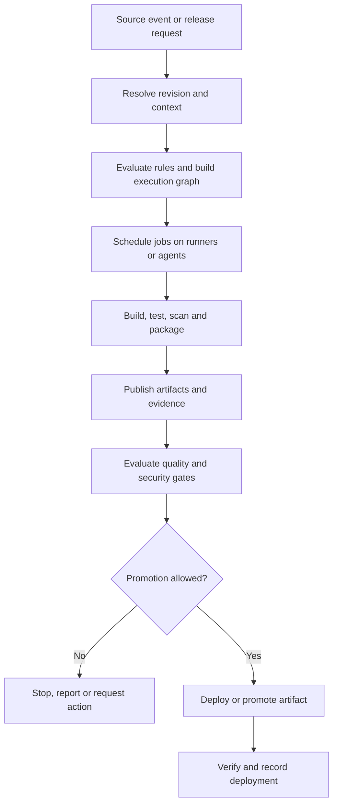
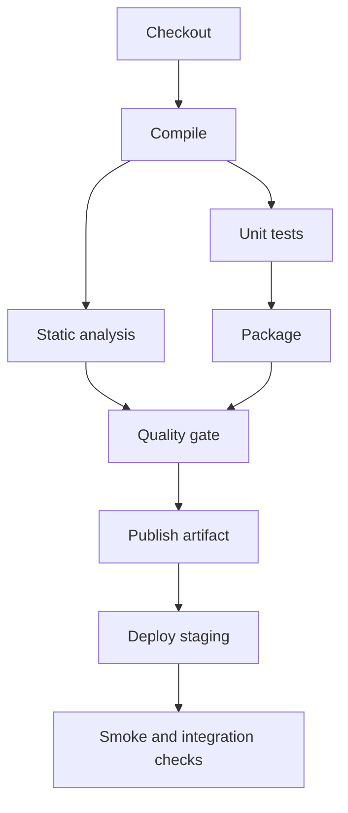

# Xác định phần nguyên lý dùng chung trước khi học cú pháp từng nền tảng

Mỗi nền tảng CI/CD có cách viết pipeline, tên thành phần và cơ chế cấu hình riêng. GitHub Actions dùng workflow, job và step; GitLab CI có pipeline, stage và job; Jenkins Pipeline mô tả stage, agent và step; Azure Pipelines tổ chức stage, job, step và agent pool. Nếu học từng công cụ bằng cách ghi nhớ cú pháp trước, người học dễ nhầm tên gọi với bản chất, khó chuyển đổi giữa các nền tảng và có thể thiết kế pipeline phụ thuộc vào một tính năng mà chưa hiểu rủi ro của nó.

Một cách học bền vững hơn là xác định các nguyên lý chung trước: sự kiện nào khởi động quy trình, mã nguồn và revision nào được xử lý, công việc được chia thành các đơn vị ra sao, runner thực thi ở đâu, dữ liệu được truyền giữa job thế nào, artifact được tạo và promotion ra sao, quyền nào được cấp, quality gate quyết định điều gì và bằng chứng được lưu ở đâu. Sau khi hiểu các khái niệm này, cú pháp của từng nền tảng chỉ còn là cách biểu diễn một mô hình đã biết.

**Công cụ CI/CD là cách triển khai các năng lực và quy tắc phát hành.** Hãy học mô hình điều khiển, luồng dữ liệu, ranh giới tin cậy và trạng thái trước; sau đó mới học cú pháp để cấu hình chúng trên nền tảng cụ thể. Cách tiếp cận này giúp đọc tài liệu nhanh hơn, so sánh công cụ chính xác hơn và tránh sao chép cấu hình mà không hiểu tác động.

## 1. Vì sao nên học nguyên lý trước cú pháp?

Một pipeline có thể được viết bằng YAML, Groovy, giao diện kéo thả hoặc cấu hình trong một hệ thống chuyên dụng. Cú pháp khác nhau nhưng các câu hỏi thiết kế cốt lõi thường giống nhau:

- Điều gì kích hoạt pipeline và sự kiện đó có đáng tin cậy không?
- Pipeline đang xử lý commit, tag hay artifact nào?
- Job nào có thể chạy song song, job nào phải chờ?
- Công việc chạy trên máy hoặc môi trường nào?
- Input/output của job được truyền và lưu ở đâu?
- Artifact có bất biến và truy ngược được về source không?
- Job được cấp identity và secret với phạm vi nào?
- Điều kiện nào cho phép merge, release hoặc deploy?
- Khi một bước lỗi, hệ thống retry, dừng hay phục hồi ra sao?
- Có thể chứng minh phiên bản nào đã được triển khai và ai đã cho phép không?

Nếu hiểu các câu hỏi này, khi gặp một nền tảng mới, người học có thể tìm đúng phần tài liệu: event model, execution graph, runner model, artifact store, environment protection, identity, policy và audit. Không cần bắt đầu bằng việc học thuộc hàng chục keyword.

### Cú pháp không phải mô hình tư duy

Hai nền tảng có thể dùng cùng từ `stage` nhưng định nghĩa phạm vi chạy khác nhau. Một nền tảng có thể cho phép khai báo dependency trực tiếp giữa job; nền tảng khác mặc định chạy theo stage rồi mới cho phép DAG. Một nền tảng gọi nơi chạy là runner, nền tảng khác gọi là agent. Chỉ so sánh tên gọi có thể dẫn đến kết luận sai.

Hãy hỏi mỗi khái niệm thực hiện trách nhiệm gì, trạng thái nào nó quản lý và ranh giới nào nó bảo vệ. Sau đó mới tìm cú pháp tương ứng.

## 2. Mô hình tổng quát của một hệ thống CI/CD

Có thể xem CI/CD như một hệ thống xử lý sự kiện và điều phối công việc có trạng thái. Nó nhận một thay đổi hoặc yêu cầu phát hành, xác định những gì cần thực hiện, chạy công việc trên executor, tạo bằng chứng và artifact, rồi quyết định có được chuyển kết quả đến môi trường tiếp theo hay không.



Các bước này có thể nằm trong một workflow hoặc nhiều pipeline liên kết. Điều quan trọng là phân biệt:

1. **Control plane:** nhận event, đánh giá policy, lập lịch, quản lý trạng thái và quyết định bước tiếp theo.
2. **Execution plane:** runner/agent/container thực sự chạy command, test, build hoặc deploy.
3. **Data plane:** source, dependency, cache, artifact, report, secret reference và metadata đi qua các bước.
4. **Governance plane:** identity, quyền, approval, policy, audit và evidence chứng minh hành động được phép.

Đây là cách phân chia để suy nghĩ và thiết kế, không phải bốn sản phẩm bắt buộc riêng biệt. Một nền tảng có thể cung cấp tất cả trong cùng dịch vụ; tổ chức lớn có thể dùng nhiều hệ thống khác nhau cho từng năng lực.

## 3. Pipeline lifecycle: từ event đến kết quả

Một pipeline thường trải qua các trạng thái sau:

| Giai đoạn | Câu hỏi chính | Kết quả cần có |
|---|---|---|
| Trigger | Vì sao quy trình được khởi chạy? | Event, actor, repository và context |
| Resolve | Revision hoặc release intent nào được xử lý? | Commit SHA, tag, branch hoặc manifest |
| Plan | Công việc nào cần chạy và theo thứ tự nào? | Execution graph/DAG |
| Schedule | Công việc chạy ở đâu và với tài nguyên nào? | Runner/agent allocation |
| Execute | Build/test/scan/deploy có kết quả gì? | Exit status, logs và reports |
| Publish | Đầu ra nào được lưu để dùng tiếp? | Artifact, digest, provenance và evidence |
| Gate | Có đủ điều kiện đi tiếp không? | Pass, fail, hold hoặc approval required |
| Promote | Artifact nào được đưa đến target nào? | Deployment/release record |
| Verify | Trạng thái sau triển khai có đạt yêu cầu không? | Health, metrics và validation evidence |

Pipeline không chỉ là danh sách command. Nó là một quy trình có input, output, dependency, trạng thái và chính sách khi có lỗi.

## 4. Từ vựng nền tảng: workflow, pipeline, stage, job, task và step

Các nền tảng không thống nhất hoàn toàn về tên gọi. Bảng sau mô tả ý nghĩa khái niệm thường gặp, không phải cam kết rằng mọi sản phẩm định nghĩa giống hệt nhau.

| Thuật ngữ | Ý nghĩa khái niệm | Câu hỏi khi đọc tài liệu |
|---|---|---|
| Workflow/Pipeline | Quy trình tự động cấp cao được kích hoạt bởi event hoặc yêu cầu | Nó bắt đầu khi nào và quản lý trạng thái nào? |
| Stage | Nhóm công việc hoặc một pha trong quy trình | Stage có tạo ranh giới tuần tự hay chỉ để tổ chức? |
| Job | Đơn vị công việc được scheduler thực thi trên một executor | Job có workspace riêng? Có thể chạy song song không? |
| Task | Một đơn vị thao tác hoặc nhóm thao tác, tùy nền tảng | Task có chạy trong job hay được scheduler quản lý độc lập? |
| Step | Một hành động nhỏ trong job/task, thường là command hoặc action | Step chia sẻ process, workspace và environment với bước khác thế nào? |
| Runner/Agent/Executor | Máy, container hoặc worker thực thi công việc | Ai cấp máy, quản lý image và thu hồi tài nguyên? |
| Artifact | Đầu ra được lưu để tiêu thụ hoặc triển khai | Có version/digest, retention và provenance không? |
| Cache | Dữ liệu trung gian có thể tái tạo để tăng tốc | Cache key, phạm vi và điều kiện invalidation là gì? |

Khi chuyển giữa các nền tảng, hãy ánh xạ theo trách nhiệm thay vì dịch từng từ. Một `job` trong nền tảng A có thể gần với một `stage` hoặc `task` trong nền tảng B tùy cách scheduler hoạt động.

## 5. Pipeline as Code và nguồn sự thật

Pipeline as Code là cách định nghĩa quy trình bằng file hoặc mã được version hóa cùng source hoặc trong repository quản trị pipeline. Nó giúp review thay đổi, tái lập lịch sử, kiểm thử policy và biết ai đã thay đổi quy trình.

Một định nghĩa pipeline tốt cần:

- Có source control và review như mã ứng dụng.
- Có schema/validation để phát hiện cấu hình sai trước khi chạy.
- Dùng reusable workflow/template có version rõ.
- Tách logic dùng chung khỏi cấu hình riêng của service.
- Hạn chế quyền của pipeline definition.
- Ghi lại phiên bản workflow/template đã dùng trong mỗi run.
- Có quy trình migration khi thay đổi cấu trúc pipeline.

Không phải mọi thiết lập đều nhất thiết nằm trong một file YAML. Environment protection, identity trust policy, runner pool và secret permission có thể được quản lý ở cấp platform. Điều quan trọng là xác định nguồn sự thật cho từng loại cấu hình và kiểm soát thay đổi của nó.

### Declarative và imperative

- **Declarative:** mô tả trạng thái hoặc quy tắc mong muốn, ví dụ job A cần hoàn tất trước job B.
- **Imperative:** mô tả từng lệnh cần thực hiện, ví dụ chạy `./gradlew test` rồi đóng gói.

Pipeline thực tế thường kết hợp cả hai: graph và điều kiện được khai báo; command bên trong step thực hiện thao tác cụ thể.

## 6. Trigger và event model

Trigger là cơ chế khởi động pipeline. Event có thể đến từ Git, pull/merge request, tag, lịch, API, artifact publication, approval hoặc một pipeline khác.

| Loại trigger | Ví dụ | Điều cần kiểm tra |
|---|---|---|
| Source event | Push/commit | Branch, actor, revision và quyền chạy |
| Review event | Pull request/merge request | Fork trust, changed files và approval state |
| Release event | Tag hoặc release request | Tag có được bảo vệ và artifact có bất biến không? |
| Scheduled | Nightly/weekly | Timezone, duplicate run và tải hệ thống |
| Manual/API | Người dùng hoặc hệ thống gọi pipeline | Authorization, input validation và audit |
| Upstream event | Pipeline khác publish artifact | Origin, event ID, version và idempotency |

Một event không tự động có nghĩa mọi job đều được phép chạy. Trigger xác định quy trình bắt đầu; rule/condition xác định job nào được chạy; permission xác định job được làm gì.

### Trigger filter và điều kiện job

Có thể lọc theo branch, path, tag, actor, event type hoặc metadata. Cần có fallback an toàn khi không xác định được phạm vi ảnh hưởng. Nếu dependency graph thiếu, chạy test rộng hơn thay vì kết luận không có component nào cần kiểm tra.

### Idempotency và duplicate event

Webhook hoặc event có thể được gửi lại. Pipeline hoặc downstream consumer cần nhận diện event ID, source revision và intent để tránh publish hoặc deploy lặp ngoài chủ đích. Một thao tác có side effect cần có idempotency key hoặc cơ chế kiểm tra trạng thái trước khi thực hiện.

## 7. Execution graph và dependency

Pipeline thường được mô hình hóa thành directed acyclic graph (DAG). Mỗi node là job/task; cạnh thể hiện một công việc phải chờ output hoặc trạng thái của công việc khác.



Các nguyên lý cần hiểu:

- Chỉ tạo dependency khi job thực sự cần kết quả của job khác.
- Công việc độc lập nên chạy song song để rút ngắn critical path.
- Fan-out chia công việc; fan-in tổng hợp kết quả.
- Một job bị skip khác với job pass; gate phải hiểu rõ trạng thái.
- Retry cần xem xét idempotency và side effect.
- Cancel job không bảo đảm mọi tiến trình bên ngoài đã dừng.
- Concurrency limit và lock bảo vệ tài nguyên dùng chung.

Không nên biến toàn bộ pipeline thành một chuỗi tuần tự chỉ để dễ đọc. Ngược lại, không nên chạy song song những job cùng sửa một môi trường hoặc dùng chung dữ liệu không được cô lập.

## 8. Runner, agent và executor

Runner/agent là nơi thực thi job. Nền tảng có thể cấp runner hosted, self-hosted, VM, container hoặc worker pool. Cần hiểu các đặc tính sau trước khi chọn cấu hình:

- Hệ điều hành và kiến trúc CPU.
- Image/runtime và toolchain có sẵn.
- CPU, memory, disk và network.
- Workspace có sạch giữa các job không?
- Job có thể truy cập Internet hoặc mạng nội bộ nào?
- Identity của runner và cách lấy secret.
- Cách cập nhật, vá lỗi và thu hồi runner.
- Job có chạy trên máy dùng chung với workload khác không?

### Hosted và self-hosted runner

| Tiêu chí | Hosted runner | Self-hosted runner |
|---|---|---|
| Vận hành máy | Nhà cung cấp quản lý phần lớn | Tổ chức quản lý OS, image và patch |
| Tùy biến | Theo image và giới hạn dịch vụ | Linh hoạt hơn |
| Truy cập mạng nội bộ | Có thể bị giới hạn hoặc cần cấu hình riêng | Có thể truy cập mạng nội bộ nếu được cấp quyền |
| Isolation | Phụ thuộc mô hình runner của nhà cung cấp | Tổ chức phải thiết kế và xác minh |
| Chi phí | Theo mức dùng và loại runner | Hạ tầng, vận hành và bảo trì |

Self-hosted không tự động an toàn hơn. Nếu runner tái sử dụng workspace hoặc credential sau job không tin cậy, nó có thể trở thành điểm xâm nhập vào các pipeline khác. Với workload nhạy cảm, cân nhắc runner ephemeral, image được quản lý và quyền mạng tối thiểu.

## 9. Workspace, process và môi trường thực thi

Các step trong một job có thể chia sẻ workspace nhưng không nhất thiết chia sẻ process hoặc environment giống nhau. Job khác thường có workspace riêng, trừ khi nền tảng hỗ trợ cơ chế truyền dữ liệu rõ ràng.

Khi đọc tài liệu nền tảng, cần kiểm tra:

- Working directory mặc định.
- File nào tồn tại giữa các step và giữa các job.
- Environment variable được kế thừa ở cấp nào.
- Shell mặc định và khác biệt quoting/exit code.
- Container job có mount workspace và credential thế nào.
- Cleanup có chạy khi job fail hoặc bị cancel không.
- Cách truyền file/artifact giữa runner khác nhau.

Đừng giả định file được tạo trong job A tự xuất hiện ở job B. Hãy publish artifact hoặc dùng cơ chế output/transfer được nền tảng hỗ trợ.

## 10. Input, output, artifact và cache

Một pipeline có dữ liệu đầu vào và đầu ra. Cần phân biệt output dùng để điều khiển graph, artifact cần lưu và cache chỉ nhằm tăng tốc.

| Khái niệm | Mục đích | Đặc tính |
|---|---|---|
| Input/parameter | Cấu hình run hoặc job | Cần validate kiểu, giá trị và quyền thay đổi |
| Output/variable | Truyền giá trị nhỏ giữa step/job | Thường gắn với run và có phạm vi rõ |
| Artifact | Lưu đầu ra build/test/package để dùng lại | Cần version, digest, retention và access control |
| Cache | Tái sử dụng dữ liệu có thể tạo lại | Có thể bị xóa hoặc miss mà pipeline vẫn phải chạy đúng |
| Secret reference | Tham chiếu credential từ secret store | Không nên truyền như output thông thường hoặc ghi vào log |

Artifact là đầu ra cần tin cậy và có thể truy vết. Cache là tối ưu hiệu năng, không phải nguồn sự thật. Nếu xóa cache làm pipeline thất bại về tính đúng đắn, quy trình đang phụ thuộc sai vào cache.

### Build once, promote many

Một artifact nên được build một lần từ source revision cụ thể, sau đó promote qua các môi trường bằng cùng digest. Không rebuild khác nhau ở staging và production chỉ vì cần thay đổi cấu hình; cấu hình môi trường nên được quản lý riêng.

Artifact metadata nên nối:

- Repository và commit SHA.
- Pipeline run ID và workflow version.
- Build toolchain/dependency metadata.
- Artifact name, version và digest.
- Test, scan, SBOM và provenance.
- Release manifest và deployment record.

## 11. Configuration, secret và identity là ba thứ khác nhau

Configuration mô tả hành vi môi trường, secret là dữ liệu nhạy cảm dùng để xác thực hoặc ký, còn identity xác định workload hoặc người đang thực hiện hành động.

| Thành phần | Ví dụ | Cách quản lý |
|---|---|---|
| Configuration | `LOG_LEVEL`, endpoint, feature setting | Version hóa, validate và scope theo environment |
| Secret | Password, API token, signing key | Secret manager, rotation, masking và hạn chế truy cập |
| Identity | CI workload, deployment service account | Federation/short-lived credential và least privilege |

Không nên dùng một secret dài hạn chung cho mọi pipeline nếu có thể cấp identity ngắn hạn theo project và environment. Không đưa secret vào artifact, cache, command output hoặc log. Masking không thay thế việc hạn chế secret được cấp cho job.

### Trust boundary

Một job chạy mã từ pull request không tin cậy không được tự động thừa hưởng quyền deploy production. Tách workflow kiểm tra source không tin cậy khỏi workflow release có quyền cao; xác minh artifact và provenance trước khi cấp quyền promotion.

## 12. Quality gate và policy evaluation

Quality gate là điều kiện quyết định pipeline có được đi tiếp hay không. Gate có thể kiểm tra test, code quality, vulnerability, artifact provenance, approval hoặc trạng thái môi trường.

Một gate tốt trả lời:

- Mục tiêu rủi ro hoặc chất lượng nào đang được bảo vệ?
- Điều kiện nào phải đạt?
- Bằng chứng nào được dùng?
- Nếu công cụ lỗi hoặc dữ liệu thiếu thì trạng thái là gì?
- Ai có quyền override và override được audit ra sao?

### Trạng thái không chỉ có pass/fail

| Trạng thái | Ý nghĩa | Hành động |
|---|---|---|
| Pass | Có đủ bằng chứng và điều kiện đạt | Cho phép bước tiếp theo |
| Fail | Có vi phạm hoặc test thất bại | Chặn và yêu cầu xử lý |
| Warning | Có vấn đề nhưng policy cho phép tiếp tục có điều kiện | Ghi owner/thời hạn và theo dõi |
| Skipped | Job không chạy | Xác định lý do; không tự coi là pass |
| Not applicable | Rule không áp dụng theo điều kiện đã định nghĩa | Lưu rule và lý do |
| Unknown/error | Không đủ dữ liệu hoặc hệ thống kiểm tra lỗi | Hold hoặc block theo mức rủi ro |
| Waived | Có ngoại lệ được phê duyệt và còn hiệu lực | Cho phép trong phạm vi waiver, lưu audit |

Với cổng bảo vệ production, thiếu bằng chứng thường không nên được coi là pass. Policy phải xác định rõ fail-closed hoặc hành vi fallback phù hợp.

## 13. Approval và environment protection

Approval có ý nghĩa khi cần con người đánh giá rủi ro, tác động nghiệp vụ hoặc chấp nhận ngoại lệ. Nó không nên thay thế các kiểm tra có thể tự động hóa.

Người duyệt cần xem:

- Commit và artifact digest.
- Test/scan/provenance evidence.
- Phạm vi component và environment bị tác động.
- Migration, config và feature flag thay đổi.
- Finding/waiver còn mở.
- Rollout, verification và recovery plan.

Environment protection có thể giới hạn branch/tag, actor, workflow hoặc reviewer được phép deploy. Cần hiểu approval được gắn với run, artifact hay deployment intent; nếu input thay đổi sau approval, cần xác định approval cũ còn hiệu lực không.

## 14. Promotion và deployment strategy

Promotion là đưa cùng artifact qua các môi trường hoặc trạng thái phát hành khác nhau. Ví dụ development → test → staging → production. Mỗi môi trường có policy và bằng chứng riêng, nhưng artifact nên giữ nguyên digest.

Các chiến lược triển khai phổ biến:

- Rolling: thay instance theo từng nhóm.
- Blue-green: duy trì hai pool và chuyển traffic.
- Canary: mở rộng traffic theo giai đoạn.
- Feature flag: điều khiển khả năng sử dụng tính năng ở runtime.
- Recreate: dừng phiên bản cũ rồi triển khai phiên bản mới, phù hợp một số workload chấp nhận downtime.

Pipeline nên tách deploy khỏi verify. Lệnh deploy thành công chỉ chứng minh công cụ đã áp dụng thao tác; post-deployment validation mới xác minh ứng dụng thực sự hoạt động đúng.

## 15. Concurrency, cancellation và rollback

Pipeline có thể chạy đồng thời cho cùng một service hoặc environment. Nếu hai run cùng sửa một target, run cũ có thể hoàn tất muộn và ghi đè trạng thái mới.

Các nguyên lý cần nắm:

- Lock theo deployment target hoặc tài nguyên dùng chung.
- Stale-run check trước mutation.
- Deployment generation hoặc intent ID để xác định trạng thái mong muốn.
- Compare-and-swap/fencing khi có lease hoặc nhiều writer.
- Cancellation để tiết kiệm tài nguyên, không xem là hàng rào bảo vệ duy nhất.
- Rollback là một intent mới có audit và thứ tự rõ ràng.
- Migration và side effect cần recovery plan riêng.

Khi học một nền tảng, hãy tìm cách nó hỗ trợ concurrency group, resource lock, deployment queue, cancellation và environment serialization. Nếu nền tảng không có tính năng đủ mạnh, có thể cần deployment controller hoặc lock service bên ngoài.

## 16. Observability và evidence

Một pipeline có thể chạy xanh nhưng không thể giải thích nó đã triển khai gì. Observability và evidence giúp nối hoạt động của CI/CD với trạng thái thực tế của hệ thống.

Mỗi run nên ghi nhận:

- Trigger, actor, repository và source revision.
- Workflow/template version.
- Job/step status, duration và logs.
- Artifact digest, SBOM, scan report và provenance.
- Approval, policy result và waiver.
- Environment, deployment ID và config revision.
- Health check, baseline comparison và kết quả sau deploy.

### Ba câu hỏi phải trả lời được

1. **What changed?** Commit, dependency, config hoặc artifact nào thay đổi?
2. **What ran?** Pipeline, test, scan và policy nào đã thực thi?
3. **What is live?** Artifact và cấu hình nào đang chạy trên từng môi trường?

Nếu không thể nối ba câu hỏi này, khả năng truy vết và điều tra sự cố còn yếu.

## 17. Reusable workflow, template và composition

Khi nhiều project có các bước giống nhau, reusable workflow/template giúp chuẩn hóa build, test, scan, sign và publish. Nhưng cần hiểu các cấp độ tái sử dụng:

- **Command/script:** tái sử dụng một thao tác cụ thể.
- **Action/task/plugin:** đóng gói một năng lực hoặc nhóm thao tác.
- **Reusable workflow/template:** đóng gói cấu trúc job/stage và policy chung.
- **Shared library:** tái sử dụng logic lập trình của pipeline.
- **Pipeline orchestrator:** phối hợp nhiều workflow/project hoặc release.

Một template tốt có input/output contract, version, quyền mặc định an toàn và extension point có giới hạn. Không nên để mỗi project copy một bản rồi sửa khác nhau mà không có cách cập nhật policy.

### Composition và inheritance

Composition ghép các thành phần nhỏ có interface rõ. Inheritance hoặc template extension kế thừa cấu hình chung rồi ghi đè một số phần. Cần kiểm tra precedence và khả năng override: một project có thể vô tình vô hiệu hóa security gate nếu template cho phép thay đổi tùy ý.

## 18. Phần nào có thể portable và phần nào phụ thuộc nền tảng?

Không phải mọi chi tiết pipeline đều có thể chuyển nguyên vẹn giữa công cụ. Nên phân biệt nguyên lý có thể giữ lại với cơ chế triển khai cụ thể.

| Tương đối portable | Thường platform-specific |
|---|---|
| Build command và test command | Cú pháp workflow/job/stage |
| Artifact identity và digest | Artifact store và syntax publish/download |
| Dependency graph và điều kiện thứ tự | Cách khai báo `needs`, `dependsOn` hoặc stage ordering |
| Quality criteria và policy intent | Cách tạo required check, approval rule và environment protection |
| Least privilege và secret scope | Identity federation, token permission và secret expression |
| Deployment strategy | Native deployment environment, concurrency control và rollout controller |
| Evidence cần lưu | UI, API, retention và audit schema |

Hãy chuẩn hóa contract và mục tiêu kiểm soát. Đừng cố tạo một file cấu hình duy nhất chạy được trên mọi nền tảng nếu điều đó làm mất tính năng bảo mật hoặc khiến cấu hình trở nên khó hiểu.

## 19. Bản đồ khái niệm giữa một số nền tảng

Bảng dưới đây là bản đồ khái niệm để định hướng đọc tài liệu. Tên gọi không phải lúc nào cũng tương đương tuyệt đối; cần đọc semantics cụ thể của phiên bản nền tảng đang dùng.

| Khái niệm chung | GitHub Actions | GitLab CI/CD | Jenkins Pipeline | Azure Pipelines |
|---|---|---|---|---|
| Quy trình cấp cao | Workflow | Pipeline | Pipeline | Pipeline |
| Pha/nhóm công việc | Job grouping qua `jobs` và dependency | Stage | Stage | Stage |
| Đơn vị được lập lịch | Job | Job | Stage/parallel branch hoặc agent workload tùy cấu trúc | Job |
| Bước thực thi | Step | Script hoặc job step | Step | Step |
| Máy thực thi | Runner | Runner | Agent/node | Agent trong agent pool |
| Quan hệ phụ thuộc | `needs` | `needs` hoặc stage order | Stage/parallel/logic trong Jenkinsfile | `dependsOn` |
| Artifact | Artifact service/package registry | Job artifacts/package registry | Archive/stash hoặc artifact manager | Pipeline artifacts/build artifacts |
| Secret | Secrets/variables và OIDC | CI/CD variables và ID tokens | Credentials binding/plugins | Variable groups/secure files/service connections |
| Tái sử dụng | Reusable workflow/composite action | Include/component/child pipeline | Shared library | Template/task |

Ví dụ, GitHub Actions `needs` và Azure Pipelines `dependsOn` đều có thể biểu diễn dependency giữa job, nhưng điều kiện, phạm vi output và cách xử lý stage có thể khác. GitLab `needs` có thể thay đổi cách job tiêu thụ artifact và vượt qua thứ tự stage mặc định. Jenkins Pipeline linh hoạt qua Groovy nhưng cũng đòi hỏi quản lý plugin và shared library. Luôn kiểm tra tài liệu chính thức cho semantics và giới hạn của phiên bản cụ thể.

## 20. Ví dụ một pipeline trung lập với nền tảng

Trước khi chuyển sang cú pháp cụ thể, hãy mô tả quy trình bằng một mô hình trung lập:

```yaml
pipeline:
  name: orders-api-ci
  trigger:
    events:
      - pull_request
      - push_to_main

  source:
    revision: exact_commit_sha

  jobs:
    build:
      executor: linux_container
      steps:
        - checkout_source
        - resolve_locked_dependencies
        - compile

    unit_tests:
      needs: [build]
      steps:
        - run_unit_tests
        - publish_test_report

    security_checks:
      needs: [build]
      steps:
        - secret_scan
        - dependency_scan

    package:
      needs: [unit_tests, security_checks]
      steps:
        - create_immutable_image
        - generate_sbom_and_provenance
        - publish_artifact

  release_gate:
    require:
      - required_tests_pass
      - security_policy_pass
      - artifact_provenance_valid

  deployment:
    target: staging
    artifact: exact_published_digest
    verify_after_deploy: true
```

Đây là mô hình giải thích, không phải file cấu hình chạy trực tiếp trên GitHub Actions, GitLab, Jenkins hoặc Azure Pipelines. Nó làm rõ các ý định và dependency trước khi chuyển sang cú pháp cụ thể.

### Cách chuyển mô hình trung lập sang nền tảng

1. Chọn trigger tương ứng và kiểm tra event context.
2. Ánh xạ job/dependency sang graph của nền tảng.
3. Chọn runner/agent image và permission tối thiểu.
4. Chọn cơ chế truyền output, artifact và cache.
5. Ánh xạ gate sang required checks, rules hoặc approval.
6. Cấu hình identity/secret theo trust boundary.
7. Bổ sung concurrency, cancellation và deployment environment.
8. Chạy thử với một branch hoặc environment an toàn.
9. Kiểm tra logs, evidence và hành vi khi job fail/cancel.

## 21. Cách đọc tài liệu của một nền tảng mới

Thay vì đọc tài liệu từ đầu đến cuối theo thứ tự menu, có thể đi theo các câu hỏi kiến trúc:

| Thứ tự học | Chủ đề tài liệu cần tìm | Bài tập nhỏ |
|---|---|---|
| 1 | Event/trigger model | Chạy pipeline khi push và pull request |
| 2 | Workflow/job/step model | Tạo hai job có dependency và hai job chạy song song |
| 3 | Runner/agent/executor | Chạy trên image cụ thể, kiểm tra OS/toolchain |
| 4 | Variables, outputs và artifacts | Truyền version giữa job và publish một file |
| 5 | Cache | Tạo cache dependency và kiểm tra invalidation |
| 6 | Secrets/identity/permissions | Dùng secret giả lập, sau đó kiểm tra OIDC hoặc identity scope |
| 7 | Conditions, matrix và concurrency | Lọc path, chia matrix và ngăn deploy đồng thời |
| 8 | Environments/approval | Thêm staging gate và approval trước production |
| 9 | Reusable workflow/template | Tạo một template dùng lại ở project thứ hai |
| 10 | Audit/observability/deployment | Ghi release ID và xác minh sau deploy |

Với mỗi tính năng, hãy tìm cả trường hợp thành công lẫn thất bại: runner mất kết nối, cache miss, artifact không tồn tại, secret không được cấp, job bị cancel, approval hết hạn hoặc deployment bị supersede.

## 22. Cách đánh giá một công cụ CI/CD

Không nên chọn nền tảng chỉ vì cú pháp ngắn hoặc có nhiều plugin. Đánh giá theo nhu cầu tổ chức và các năng lực cần vận hành lâu dài.

| Tiêu chí | Câu hỏi đánh giá |
|---|---|
| Source integration | Hỗ trợ repository, review event, protected branch và monorepo ra sao? |
| Execution | Có runner phù hợp OS, architecture, network và workload không? |
| Scalability | Scheduler, queue và concurrency có đáp ứng số project/run không? |
| Artifact | Có registry, immutable digest, retention và promotion không? |
| Security | Có OIDC/federation, least privilege, secret scoping và audit không? |
| Governance | Có approval, environment protection, policy và exception workflow không? |
| Reuse | Có template, reusable workflow, library hoặc component không? |
| Observability | Có logs, metrics, traces, deployment record và API không? |
| Portability | Có thể chuyển build/test logic và artifact giữa các môi trường không? |
| Operations | Ai vá runner, cập nhật plugin, backup cấu hình và xử lý outage? |
| Cost | Chi phí license, runner, storage, network và vận hành là bao nhiêu? |

Một công cụ mạnh về workflow nhưng thiếu identity federation có thể cần tích hợp bổ sung. Một công cụ linh hoạt nhưng phụ thuộc nhiều plugin có thể tạo chi phí bảo trì và rủi ro supply chain. Đánh giá cần bao gồm toàn bộ vòng đời vận hành.

## 23. Anti-pattern khi học và thiết kế theo cú pháp

| Anti-pattern | Vì sao có vấn đề | Cách cải thiện |
|---|---|---|
| Học thuộc keyword trước khi hiểu graph | Khó nhận ra dependency và concurrency sai | Vẽ DAG rồi ánh xạ sang cú pháp |
| Sao chép YAML mẫu mà không đọc permission | Có thể cấp quyền quá rộng hoặc lộ secret | Review trigger, identity và permission từng job |
| Nghĩ stage/job/step giống nhau ở mọi công cụ | Hiểu sai scheduler và output scope | So sánh semantics, không chỉ tên |
| Dùng cache như artifact | Pipeline có thể mất đầu ra cần thiết khi cache miss | Publish artifact có version và retention |
| Rebuild ở mỗi môi trường | Artifact staging khác production | Build once, promote immutable digest |
| Dùng một credential chung | Blast radius lớn và khó audit | Workload identity/secret scope theo target |
| Cho job PR không tin cậy đọc secret production | Có thể thực thi mã độc trong runner | Tách trust boundary và workflow release |
| Coi pipeline xanh là deployment thành công | Chưa chứng minh ứng dụng hoạt động đúng | Có post-deploy verification và evidence |
| Dùng một template bất biến quá lâu | Policy lỗi thời và khó nâng cấp | Version hóa, test compatibility và deprecation |
| Cố tạo một cấu hình portable tuyệt đối | Mất khả năng dùng native security/governance | Portable hóa contract, giữ implementation-specific controls |
| Không kiểm thử hành vi khi fail/cancel | Target có thể ở trạng thái dở dang | Diễn tập failure path và recovery |

## 24. Checklist học một nền tảng mới

Khi bắt đầu với một CI/CD platform, hãy xác nhận mình trả lời được:

- [ ] Event nào kích hoạt workflow và context nào được cung cấp?
- [ ] Pipeline, stage, job, task và step được định nghĩa thế nào?
- [ ] Dependency graph và điều kiện chạy được biểu diễn ra sao?
- [ ] Runner/agent chạy trên OS, image và network nào?
- [ ] Workspace và process được chia sẻ giữa các bước thế nào?
- [ ] Input, output, artifact và cache khác nhau ra sao?
- [ ] Artifact được version hóa, lưu trữ và promote thế nào?
- [ ] Secret, identity và permission có phạm vi nào?
- [ ] Pull request/fork không tin cậy được cách ly ra sao?
- [ ] Quality gate xử lý pass, fail, skipped và unknown thế nào?
- [ ] Approval gắn với run, artifact hay deployment intent?
- [ ] Environment protection và concurrency lock hoạt động ra sao?
- [ ] Job fail, timeout, retry hoặc cancel để lại trạng thái gì?
- [ ] Reusable workflow/template được version hóa và nâng cấp thế nào?
- [ ] Logs, metrics, audit và deployment evidence được truy xuất ở đâu?
- [ ] Có thể mô phỏng rollback và xác minh sau deploy không?

## 25. Kết luận

Các nền tảng CI/CD có thể khác nhau về cú pháp, tên gọi và cách tích hợp, nhưng phần lớn cùng giải quyết một nhóm bài toán: nhận event, lập execution graph, cấp executor, truyền dữ liệu, tạo artifact, áp dụng policy, cấp quyền, triển khai và xác minh kết quả.

Khi hiểu các nguyên lý này trước, người học có thể đọc cú pháp của từng công cụ bằng cách ánh xạ khái niệm thay vì ghi nhớ rời rạc. Hãy bắt đầu từ event, dependency, runner, artifact, identity, quality gate và evidence; sau đó học các tính năng riêng như matrix, reusable workflow, environment protection hay plugin. Cách tiếp cận này tạo nền tảng để chuyển đổi công cụ, đánh giá lựa chọn và thiết kế pipeline an toàn, có thể truy vết trên nhiều nền tảng.
