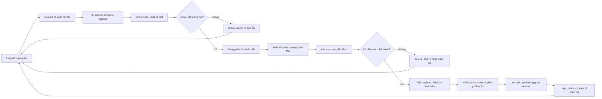

# Mô tả luồng từ commit đến kết quả người dùng quan sát được

CI/CD là cách tổ chức việc đưa thay đổi phần mềm từ kho mã nguồn đến môi trường mà người dùng sử dụng, với các bước kiểm tra và bằng chứng có thể truy vết. Một commit chỉ là điểm bắt đầu của luồng giao phần mềm. Pipeline chạy thành công cũng chưa đủ để kết luận thay đổi đã có ích cho người dùng: phiên bản phải được đóng gói, triển khai đúng môi trường, vượt qua xác minh sau triển khai và thực sự được phân phối đến nhóm người dùng dự kiến.

Trong phạm vi CI/CD fundamentals, cần nhìn toàn bộ chuỗi này như một luồng liên tục: sự kiện Git khởi chạy pipeline; pipeline kiểm tra và tạo artifact; artifact được quản lý và đưa qua các môi trường; cổng chất lượng quyết định có được phát hành tiếp hay không; hệ thống quan sát xác nhận kết quả sau triển khai. Mỗi chặng phải để lại bằng chứng liên kết được với chặng trước và chặng sau.

## 1. Bức tranh tổng thể

Một luồng giao phần mềm phổ biến có thể biểu diễn như sau:



Các bước có thể được chia thành nhiều workflow hoặc pipeline khác nhau. Ví dụ, pipeline của pull request tập trung phản hồi nhanh cho người phát triển; pipeline sau khi merge vào nhánh chính tạo artifact có thể phát hành; quy trình release chịu trách nhiệm triển khai artifact đó đến các môi trường. Dù được chia như thế nào, mối liên kết từ commit đến phiên bản đang chạy phải được giữ nguyên.

### CI, Continuous Delivery và Continuous Deployment

- **Continuous Integration (CI)** là thực hành tích hợp thay đổi thường xuyên vào nhánh dùng chung, tự động chạy các kiểm tra để phát hiện xung đột và lỗi sớm.
- **Continuous Delivery** giữ cho phần mềm luôn ở trạng thái có thể phát hành. Artifact đã qua kiểm tra có thể được triển khai đến production khi đáp ứng các điều kiện và có quyết định phát hành phù hợp. Việc đưa lên production có thể vẫn cần phê duyệt.
- **Continuous Deployment** tự động đưa mọi thay đổi vượt qua các cổng chất lượng đến production mà không cần một bước phê duyệt phát hành thủ công riêng.

Ba khái niệm liên quan nhưng không đồng nghĩa. Một tổ chức có thể áp dụng CI tốt mà chưa có quy trình delivery hoàn chỉnh; cũng có thể thực hiện Continuous Delivery với một cổng phê duyệt trước production.

## 2. Từ commit đến pipeline

### 2.1. Commit tạo ra một đơn vị thay đổi có thể truy vết

Người phát triển chỉnh sửa mã nguồn, cấu hình hoặc tài nguyên, sau đó tạo commit. Commit có mã định danh (commit SHA), tác giả, thời điểm và thông điệp mô tả. Khi đẩy commit lên remote repository, hệ thống Git hosting phát ra sự kiện để các công cụ CI/CD có thể tiếp nhận.

Một thay đổi dễ kiểm soát thường có phạm vi nhỏ, thông điệp rõ ràng và đi qua pull request hoặc merge request. Review mã nguồn, kiểm tra chính sách nhánh và thảo luận thiết kế diễn ra trước hoặc song song với kiểm tra tự động. Review của con người và kiểm tra của máy bổ sung cho nhau: máy phù hợp với các quy tắc lặp lại; con người đánh giá ý định, khả năng bảo trì và tác động kiến trúc.

Commit SHA là điểm neo quan trọng. Pipeline phải ghi nhận chính xác commit nào đã được kiểm tra và artifact nào được tạo từ commit đó. Chỉ lưu tên nhánh như `main` là chưa đủ vì nội dung của nhánh thay đổi theo thời gian.

### 2.2. Sự kiện Git quyết định khi nào chạy

Pipeline thường được kích hoạt bởi một trong các sự kiện sau:

| Sự kiện | Mục đích thường gặp |
|---|---|
| `pull_request` hoặc merge request | Kiểm tra thay đổi trước khi hợp nhất |
| `push` | Kiểm tra commit mới trên nhánh được theo dõi |
| Push tag hoặc tạo release | Tạo bản phát hành có phiên bản |
| Lịch định kỳ | Chạy kiểm tra phụ thuộc, kiểm tra bảo trì hoặc quét định kỳ |
| Kích hoạt thủ công | Chạy lại, phát hành hoặc thực hiện thao tác có kiểm soát |

Sự kiện chỉ là tín hiệu khởi chạy. Bộ lọc theo nhánh, đường dẫn, tag và loại hành động quyết định workflow nào thực sự chạy. Cần thiết kế bộ lọc cẩn thận để tránh bỏ sót thay đổi quan trọng hoặc chạy trùng lặp không cần thiết. Ví dụ, thay đổi tài liệu có thể không cần build toàn bộ ứng dụng, nhưng thay đổi file cấu hình build phải kích hoạt các kiểm tra liên quan.

Không nên xem mọi sự kiện là đáng tin như nhau. Pipeline chạy từ pull request bên ngoài có thể cần quyền truy cập và secret hạn chế hơn pipeline chạy trên nhánh chính. Quyền ghi vào repository, registry hoặc production nên được cấp theo danh tính và mục đích của từng job.

## 3. Pipeline thực thi kiểm tra và tạo artifact

### 3.1. Orchestrator và execution environment

Hệ thống CI/CD tiếp nhận sự kiện, tạo một lần chạy (pipeline run), phân công job cho runner hoặc agent, rồi điều phối thứ tự thực thi. Pipeline thường được mô hình hóa thành các stage và job có quan hệ phụ thuộc. Các job độc lập có thể chạy song song; job triển khai chỉ được chạy khi những job cần thiết đã hoàn tất thành công.

Runner có thể là máy ảo dùng một lần, container, máy tự quản lý hoặc agent trong cụm. Môi trường chạy ảnh hưởng trực tiếp đến tính lặp lại của kết quả. Cần kiểm soát phiên bản hệ điều hành, runtime, compiler, công cụ build, biến môi trường và quyền truy cập mạng. Runner dùng chung lâu ngày có thể giữ lại file hoặc cấu hình từ lần chạy trước, làm cho kết quả khó tái lập; runner tạm thời giúp giảm loại trạng thái tồn dư này.

### 3.2. CI kiểm tra thay đổi

Một pipeline CI thường thực hiện các nhóm kiểm tra sau, tùy loại dự án:

1. **Kiểm tra định dạng và quy ước:** formatter, lint, quy tắc đặt tên và cấu trúc mã.
2. **Kiểm tra kiểu và phân tích tĩnh:** compiler, type checker, static analysis và phát hiện mẫu lỗi phổ biến.
3. **Kiểm thử tự động:** unit test, integration test, contract test hoặc end-to-end test ở phạm vi phù hợp.
4. **Kiểm tra bảo mật:** quét dependency, mã nguồn, cấu hình và secret bị lộ; có thể bổ sung kiểm tra license hoặc policy.
5. **Kiểm tra đóng gói:** xác nhận ứng dụng có thể build và tạo ra đầu ra cần thiết.

Không phải dự án nào cũng cần mọi loại kiểm thử ở mọi lần chạy. Hãy đặt kiểm tra nhanh, có khả năng phát hiện lỗi thường gặp ở đầu pipeline để người phát triển nhận phản hồi sớm; các kiểm tra tốn thời gian hơn có thể chạy sau hoặc trên lịch riêng nếu rủi ro cho phép. Tuy vậy, một kiểm tra bắt buộc không được âm thầm bị bỏ qua chỉ để pipeline chuyển sang trạng thái xanh.

Kết quả kiểm tra cần được lưu thành bằng chứng: trạng thái job, log, báo cáo test, coverage khi có ý nghĩa, kết quả quét và phiên bản công cụ. Chỉ lưu một dòng “passed” làm mất khả năng điều tra khi có sự cố.

### 3.3. Build có thể tái lập

Build biến mã nguồn cùng các đầu vào thành chương trình hoặc gói có thể chạy. Để kết quả ổn định, cần khóa phiên bản dependency, dùng lockfile khi hệ sinh thái hỗ trợ, ghim phiên bản công cụ quan trọng và kiểm soát các đầu vào bên ngoài. Build không nên phụ thuộc vào file cá nhân trên máy người phát triển hoặc trạng thái ngẫu nhiên còn sót trên runner.

Một build được gọi là tái lập khi cùng một tập đầu vào được kiểm soát có thể tạo ra đầu ra tương đương theo tiêu chí của dự án. Không phải hệ thống nào cũng tạo được byte-for-byte identical artifact ngay lập tức, nhưng việc ghi nhận đầy đủ commit, dependency, toolchain, tham số build và môi trường là bước nền tảng để điều tra sai khác.

### 3.4. Artifact là đầu ra được quản lý

Artifact là gói đầu ra của quá trình build, chẳng hạn JAR, binary, package, image container hoặc bundle frontend. Artifact cần được lưu trong registry hoặc artifact repository có kiểm soát quyền và chính sách lưu giữ.

Artifact nên được nhận diện bằng phiên bản và digest. Tag như `latest` tiện cho thao tác thủ công nhưng có thể trỏ sang nội dung khác theo thời gian; digest nội dung giúp xác định chính xác artifact. Metadata đi kèm nên cho biết commit nguồn, pipeline run, thời điểm build, toolchain, kết quả kiểm tra và thông tin provenance hoặc chữ ký nếu hệ thống hỗ trợ.

Nguyên tắc quan trọng là **build một lần, promote cùng artifact qua các môi trường**. Nếu build lại riêng cho staging và production, hai môi trường có thể nhận các gói khác nhau dù cùng được gắn một phiên bản. Thay vào đó, lưu artifact đã được kiểm tra rồi triển khai chính artifact đó; cấu hình theo môi trường được cung cấp tại thời điểm chạy.

## 4. Từ artifact đến môi trường đang chạy

### 4.1. Triển khai và cấu hình môi trường

Triển khai là quá trình đưa artifact vào một môi trường và làm cho phiên bản mới có thể chạy. Các môi trường thường gồm development, test, staging và production. Mỗi môi trường có thể khác nhau về tài nguyên, quyền, endpoint, dữ liệu và tích hợp bên ngoài.

Artifact chứa ứng dụng; cấu hình môi trường quyết định ứng dụng kết nối đến đâu và hoạt động theo chính sách nào. URL dịch vụ, feature flag và tham số vận hành thường được truyền qua cấu hình. Mật khẩu, token và khóa riêng phải được lấy từ secret manager hoặc cơ chế quản lý bí mật tương đương, giới hạn theo nguyên tắc quyền tối thiểu. Không ghi secret vào source code, file artifact, log hoặc tham số dòng lệnh có thể bị lộ.

Một quy trình triển khai an toàn xác minh artifact trước khi chạy, dùng danh tính triển khai có quyền giới hạn, ghi lại ai hoặc workflow nào đã triển khai, và lưu môi trường, thời điểm, phiên bản cùng kết quả. Với nhiều dịch vụ, thứ tự triển khai và khả năng tương thích giữa các phiên bản cần được thể hiện rõ.

### 4.2. Cổng chất lượng và phê duyệt

Cổng chất lượng là điều kiện để luồng chuyển sang bước tiếp theo. Tùy giai đoạn, cổng có thể yêu cầu:

- Pipeline build và test bắt buộc đã thành công.
- Không có lỗ hổng ở mức độ bị chính sách chặn; dependency và artifact đáp ứng chính sách.
- Artifact có nguồn gốc xác định, digest hợp lệ và được lưu trong registry tin cậy.
- Kiểm thử trên môi trường đích đạt yêu cầu.
- Người có thẩm quyền phê duyệt khi thay đổi có rủi ro hoặc khi chính sách yêu cầu.
- Sức khỏe production và chỉ số vận hành nằm trong ngưỡng chấp nhận sau khi phát hành.

Cổng phải có tiêu chí đo được và lý do từ chối rõ ràng. Một bước phê duyệt chỉ có giá trị khi người phê duyệt có đủ thông tin về thay đổi, rủi ro, bằng chứng kiểm thử và phương án khôi phục.

### 4.3. Chiến lược triển khai và phát hành

Triển khai (deployment) và phát hành tính năng (release) là hai khái niệm khác nhau. Một phiên bản có thể đã được triển khai nhưng tính năng mới vẫn tắt bằng feature flag hoặc chưa được định tuyến đến người dùng. Tách hai thao tác này giúp kiểm soát thời điểm và phạm vi tiếp cận.

Các chiến lược thường gặp:

| Chiến lược | Cách hoạt động | Điểm cần chú ý |
|---|---|---|
| Recreate | Dừng phiên bản cũ rồi chạy phiên bản mới | Có thể gây gián đoạn nếu không có dự phòng |
| Rolling | Thay từng nhóm instance bằng phiên bản mới | Cần bảo đảm các phiên bản cùng tồn tại tương thích |
| Blue-green | Duy trì hai môi trường, chuyển traffic sang môi trường mới | Cần quản lý dữ liệu và tài nguyên của hai môi trường |
| Canary | Chuyển một phần traffic đến phiên bản mới rồi tăng dần | Cần đo lỗi và hành vi theo từng nhóm traffic |
| Feature flag | Triển khai mã nhưng bật tính năng theo điều kiện hoặc nhóm người dùng | Flag cần có chủ sở hữu, thời hạn và kế hoạch dọn dẹp |

Không có chiến lược phù hợp cho mọi hệ thống. Lựa chọn phụ thuộc vào yêu cầu sẵn sàng, kiến trúc, khả năng tương thích dữ liệu, chi phí tài nguyên và mức độ quan sát được.

## 5. Xác minh sau triển khai và kết quả người dùng

Trạng thái triển khai thành công thường chỉ xác nhận công cụ đã hoàn thành thao tác cập nhật. Nó không chứng minh ứng dụng hoạt động đúng từ góc nhìn người dùng. Vì vậy, sau triển khai cần có bước xác minh độc lập.

Các lớp xác minh có thể gồm:

- **Health check:** tiến trình và các thành phần thiết yếu đang hoạt động.
- **Smoke test:** một số luồng quan trọng có thể thực hiện được, ví dụ đăng nhập hoặc đọc dữ liệu cơ bản.
- **Synthetic check:** mô phỏng yêu cầu từ vị trí hoặc mạng gần với người dùng để kiểm tra đường đi thực tế.
- **Kiểm tra metrics:** tỷ lệ lỗi, độ trễ, throughput, mức sử dụng tài nguyên và các chỉ số nghiệp vụ liên quan.
- **Logs và traces:** hỗ trợ tìm nguyên nhân khi một yêu cầu đi qua nhiều dịch vụ hoặc thất bại ở một bước cụ thể.
- **Xác minh phân phối:** kiểm tra traffic đã đến đúng phiên bản, cache/CDN đã cập nhật khi cần và feature flag đang có trạng thái mong muốn.

Kết quả người dùng quan sát được có thể bị ảnh hưởng bởi cache, DNS, CDN, ứng dụng mobile chưa cập nhật, tác vụ bất đồng bộ hoặc rollout theo nhóm. Do đó, tiêu chí hoàn tất nên được diễn đạt theo hành vi cần có, chẳng hạn “người dùng thuộc nhóm được bật tính năng có thể tạo đơn hàng và nhận xác nhận”, thay vì chỉ “deployment job màu xanh”.

Với thay đổi liên quan dữ liệu, cần kiểm tra tính tương thích của schema và ứng dụng. Một mẫu an toàn thường là mở rộng schema trước (expand), triển khai phiên bản có thể làm việc với cả cấu trúc cũ và mới, chuyển đổi dữ liệu, rồi mới loại bỏ cấu trúc cũ (contract) ở một lần phát hành sau. Cách làm này giảm nguy cơ phiên bản cũ không thể chạy trong lúc rollout hoặc rollback.

## 6. Ví dụ xuyên suốt: phát hành chức năng mã giảm giá

Giả sử nhóm phát triển thêm API áp dụng mã giảm giá cho đơn hàng.

1. Người phát triển tạo commit chứa API và kiểm thử unit, sau đó mở pull request. Commit SHA được ghi lại để xác định chính xác thay đổi.
2. Sự kiện pull request kích hoạt pipeline. Runner checkout đúng commit, chạy formatter, lint, kiểm tra kiểu và unit test. Nếu một kiểm tra thất bại, pipeline báo trạng thái cùng log để người phát triển sửa.
3. Sau khi review và merge vào nhánh chính, sự kiện push kích hoạt pipeline build. Pipeline chạy các kiểm tra tích hợp, đóng gói ứng dụng và tạo image container. Image được lưu trong registry; digest cùng commit SHA được lưu làm metadata.
4. Quy trình triển khai lấy đúng digest đó đưa lên staging. Cấu hình staging và thông tin xác thực được cấp từ hệ thống quản lý cấu hình và secret tương ứng.
5. Smoke test kiểm tra API áp dụng mã giảm giá, các test tích hợp xác minh cách tính tổng tiền và metrics được theo dõi trong thời gian thử nghiệm. Nếu có lỗi hoặc sai lệch nghiệp vụ, phát hành bị giữ lại.
6. Khi đủ điều kiện, cùng image digest được promote lên production. Nhóm có thể dùng canary, ban đầu định tuyến một tỷ lệ nhỏ traffic, quan sát tỷ lệ lỗi, độ trễ và tỷ lệ áp dụng mã thành công rồi mới tăng dần.
7. Sau khi rollout hoàn tất, nhóm xác minh một người dùng thuộc nhóm được bật tính năng có thể nhập mã, nhìn thấy mức giảm đúng và hoàn tất đơn hàng. Dashboard, logs và traces liên kết được với phiên bản vừa phát hành.

Ví dụ này cho thấy bằng chứng cần nối liền nhiều hệ thống: pull request, commit, pipeline run, báo cáo kiểm thử, artifact digest, lần triển khai, trạng thái rollout và metrics sau phát hành. Khi có sự cố, nhóm có thể lần ngược từ phiên bản đang chạy về đúng thay đổi nguồn.

## 7. Pipeline dưới dạng mã

Pipeline as Code lưu định nghĩa workflow cùng repository hoặc trong hệ thống quản lý phiên bản tương đương. Cách làm này giúp review thay đổi pipeline, tái sử dụng quy tắc, kiểm tra lịch sử và áp dụng cùng chuẩn cho nhiều nhánh hoặc dự án.

Ví dụ rút gọn dưới đây dùng cú pháp GitHub Actions để minh họa việc kiểm tra pull request và chỉ đóng gói khi có push lên nhánh chính. Lệnh build và đường dẫn registry cần điều chỉnh theo dự án thực tế.

```yaml
name: ci

on:
  pull_request:
    branches: [main]
  push:
    branches: [main]

permissions:
  contents: read

jobs:
  verify:
    runs-on: ubuntu-latest
    steps:
      - uses: actions/checkout@v4
      - name: Run checks and tests
        run: ./gradlew check

  package:
    needs: verify
    if: github.event_name == 'push'
    runs-on: ubuntu-latest
    steps:
      - uses: actions/checkout@v4
      - name: Build application
        run: ./gradlew assemble
      - name: Build and publish image
        run: |
          docker build -t registry.example.com/app:${GITHUB_SHA} .
          docker push registry.example.com/app:${GITHUB_SHA}
```

Đây là ví dụ minh họa, chưa phải cấu hình production hoàn chỉnh. Trong hệ thống thật, cần bổ sung xác thực registry an toàn, ghi nhận digest trả về, kiểm tra artifact, quản lý cache, giới hạn quyền job và quy trình triển khai có kiểm soát. Việc dùng tag theo commit SHA giúp dễ nhận diện hơn tag dùng chung, nhưng khi promote vẫn nên tham chiếu digest bất biến của image.

Khi pipeline phát triển, nên tách logic dùng chung thành action, task hoặc template có phiên bản; đặt tên job và step theo mục đích; khai báo quan hệ `needs` rõ ràng; giới hạn quyền mặc định; và tránh nhúng secret trực tiếp vào file workflow. Mọi thay đổi làm yếu đi một quality gate cần được review như thay đổi mã nguồn thông thường.

## 8. Truy vết, bảo mật và xử lý thất bại

### 8.1. Giữ chuỗi bằng chứng

Một luồng có thể kiểm toán nên nối được các định danh sau:

| Đối tượng | Thông tin cần lưu |
|---|---|
| Thay đổi nguồn | Repository, branch, commit SHA, pull request |
| Pipeline | Workflow/version định nghĩa, run ID, runner, thời gian và trạng thái job |
| Kiểm thử | Bộ test, báo cáo, log và kết quả kiểm tra bảo mật |
| Artifact | Tên, version, digest, nguồn build và vị trí lưu trữ |
| Triển khai | Môi trường, artifact digest, danh tính thực hiện, thời điểm và kết quả |
| Phát hành | Phạm vi traffic, feature flag, phê duyệt và trạng thái rollout |
| Vận hành | Metrics, logs, traces, cảnh báo và sự cố liên quan |

Khi một cảnh báo xuất hiện, chuỗi này giúp trả lời: phiên bản nào đang chạy, được tạo từ commit nào, đã qua những kiểm tra nào, ai hoặc workflow nào triển khai và traffic nào đang nhận phiên bản đó.

### 8.2. Secret và danh tính triển khai

Job chỉ nên có quyền cần thiết cho nhiệm vụ của nó. Job kiểm thử pull request thường không cần quyền ghi production. Job phát hành nên dùng danh tính riêng, phạm vi quyền hẹp và thông tin xác thực ngắn hạn nếu nền tảng hỗ trợ. Có thể dùng OIDC hoặc cơ chế liên kết danh tính tương đương để lấy quyền truy cập từ nhà cung cấp đích mà không phải lưu khóa dài hạn trong repository.

Log cần được kiểm soát để tránh in token, password hoặc dữ liệu cá nhân. Khi secret có nguy cơ bị lộ, cần thu hồi hoặc xoay vòng secret, điều tra phạm vi ảnh hưởng và xử lý log/artifact liên quan theo chính sách.

### 8.3. Retry, rollback và phục hồi

Job thất bại do lỗi tạm thời như giới hạn dịch vụ hoặc mạng có thể cần retry. Chỉ retry tự động khi thao tác có tính idempotent hoặc đã có cơ chế chống thực hiện lặp. Nếu job triển khai tạo tài nguyên hoặc chạy migration mà không kiểm soát lần thực hiện, retry có thể gây trạng thái trùng hoặc hỏng dữ liệu.

Khi phát hành gây lỗi, lựa chọn phục hồi phụ thuộc loại thay đổi:

- Dừng rollout hoặc chuyển traffic về phiên bản ổn định trước đó.
- Tắt feature flag để ngừng cung cấp tính năng có vấn đề.
- Rollback artifact khi phiên bản trước vẫn tương thích với dữ liệu hiện tại.
- Roll forward bằng một bản sửa lỗi nếu dữ liệu đã thay đổi theo cách không thể quay lui an toàn.
- Khôi phục dữ liệu từ backup hoặc quy trình phục hồi đã diễn tập khi cần.

Rollback ứng dụng không tự động đồng nghĩa rollback database. Migration phá hủy hoặc đổi nghĩa dữ liệu có thể khiến phiên bản cũ không còn hoạt động. Vì vậy, migration cần có kế hoạch tương thích, backup phù hợp và phương án phục hồi được kiểm chứng trước khi phát hành.

## 9. Đo lường và cải thiện luồng giao phần mềm

Các chỉ số giúp nhận ra điểm nghẽn và tác động của thay đổi quy trình. Có thể theo dõi:

- **Lead time for changes:** thời gian từ khi thay đổi được commit hoặc bắt đầu công việc đến khi chạy production, cần thống nhất mốc đo.
- **Deployment frequency:** tần suất triển khai thành công đến môi trường production.
- **Change failure rate:** tỷ lệ triển khai dẫn đến rollback, hotfix hoặc suy giảm dịch vụ theo định nghĩa của nhóm.
- **Time to restore service:** thời gian khôi phục dịch vụ sau sự cố do thay đổi.
- **Thời gian phản hồi CI:** thời gian từ sự kiện Git đến khi người phát triển nhận được kết quả kiểm tra.
- **Tỷ lệ pipeline thành công và nguyên nhân thất bại:** giúp phân biệt lỗi sản phẩm với lỗi hạ tầng hoặc cấu hình pipeline.
- **Chỉ số sản phẩm và vận hành:** tỷ lệ hoàn tất tác vụ, tỷ lệ lỗi nghiệp vụ, độ trễ và mức độ hài lòng phù hợp với chức năng được phát hành.

Không nên tối ưu một chỉ số riêng lẻ. Tăng tần suất deploy mà change failure rate tăng mạnh có thể làm giảm độ tin cậy. Giảm thời gian pipeline bằng cách bỏ test quan trọng có thể chỉ chuyển chi phí sang giai đoạn production. Hãy dùng các chỉ số cùng nhau để xác định nơi cần cải thiện: thời gian chờ review, build chậm, test thiếu ổn định, triển khai thủ công hoặc xác minh sau phát hành chưa đủ.

## 10. Những ngộ nhận thường gặp

| Ngộ nhận | Cách hiểu đúng |
|---|---|
| Commit đã push nghĩa là người dùng đã nhận thay đổi | Commit mới chỉ khởi đầu luồng; còn kiểm tra, build, triển khai và phân phối |
| Pipeline xanh đồng nghĩa production khỏe mạnh | Pipeline chỉ chứng minh các bước đã định nghĩa đạt; cần xác minh từ môi trường và góc nhìn người dùng |
| Staging và production có thể build riêng miễn cùng version | Hai lần build có thể tạo đầu ra khác nhau; nên promote cùng artifact digest |
| Dùng tag `latest` đủ để truy vết | Tag có thể bị thay đổi; cần version, digest và metadata nguồn build |
| Retry mọi job khi thất bại luôn an toàn | Retry thao tác không idempotent có thể lặp side effect |
| Rollback ứng dụng luôn khôi phục toàn hệ thống | Schema, dữ liệu, queue và side effect có thể không tương thích với phiên bản cũ |
| Có feature flag là không cần kiểm thử | Flag giảm phạm vi phát hành nhưng vẫn cần kiểm thử cả trạng thái bật, tắt và chuyển đổi |

## 11. Checklist thiết kế một luồng có thể tin cậy

- [ ] Mỗi pipeline run ghi nhận repository, commit SHA và sự kiện kích hoạt.
- [ ] Quy tắc trigger và lọc nhánh/đường dẫn rõ ràng; pull request không đáng tin bị giới hạn quyền.
- [ ] Kiểm tra nhanh chạy sớm; test và quality gate bắt buộc có báo cáo, log và tiêu chí thất bại rõ ràng.
- [ ] Toolchain và dependency được kiểm soát để build có thể tái lập ở mức phù hợp.
- [ ] Artifact được lưu trong registry tin cậy, có version, digest và liên kết đến commit/pipeline.
- [ ] Cùng một artifact được promote qua môi trường; cấu hình và secret được cấp riêng theo môi trường.
- [ ] Quyền runner và danh tính triển khai tuân theo nguyên tắc quyền tối thiểu.
- [ ] Triển khai có chiến lược rollout, cổng chất lượng và cơ chế phê duyệt phù hợp rủi ro.
- [ ] Có smoke test hoặc kiểm tra tương đương sau triển khai, theo dõi metrics/logs/traces và xác minh hành vi người dùng.
- [ ] Retry có kiểm soát; rollback, roll forward và phục hồi dữ liệu có phương án đã kiểm chứng.
- [ ] Có thể truy ngược từ phiên bản production đến artifact, pipeline run, commit và bằng chứng kiểm thử.

Một luồng CI/CD hoàn chỉnh kết thúc khi thay đổi đã được phân phối đúng đối tượng, hành vi cần thiết được xác minh và nhóm có đủ dữ liệu để tiếp tục vận hành hoặc phục hồi. Thiết kế theo chuỗi bằng chứng này giúp biến việc giao phần mềm từ tập hợp thao tác thủ công thành quy trình có thể lặp lại, kiểm soát và cải tiến.
