# Theo dõi một thay đổi qua mã nguồn, artifact và bản triển khai

Trong một hệ thống CI/CD, câu hỏi quan trọng không chỉ là “pipeline có xanh hay không?”. Khi một lỗi xuất hiện hoặc cần kiểm toán một lần phát hành, nhóm phải trả lời được: thay đổi nào đã tạo ra phiên bản đang chạy, mã nguồn được lấy từ commit nào, pipeline nào đã build và kiểm thử, artifact chính xác là gì, ai đã cho phép triển khai, artifact đó đang ở môi trường nào và kết quả sau triển khai ra sao.

Khả năng nối các thông tin này thành một chuỗi có thể kiểm chứng được gọi là **truy vết đầu cuối (end-to-end traceability)**. Chuỗi truy vết giúp nhóm điều tra sự cố, xác định phạm vi ảnh hưởng, chứng minh quy trình phát hành đã tuân thủ chính sách và quay lui về đúng phiên bản đã biết là ổn định. Trong CI/CD, truy vết phải đi theo danh tính của thay đổi và artifact xuyên suốt pipeline, registry, môi trường triển khai và hệ thống vận hành.

## 1. Bức tranh truy vết từ thay đổi đến production

Một thay đổi thường bắt đầu từ issue hoặc yêu cầu công việc, được thực hiện trong một nhánh mã nguồn, xem xét qua pull request/merge request và ghi nhận bằng commit. CI xử lý commit đó, tạo artifact, gắn artifact với các kết quả kiểm thử và bằng chứng nguồn gốc. CD chọn chính artifact đã được xác minh để triển khai lên các môi trường. Sau triển khai, hệ thống ghi lại kết quả rollout và các tín hiệu vận hành.

```mermaid
flowchart LR
    A[Issue / yêu cầu] --> B[Pull request]
    B --> C[Commit SHA]
    C --> D[Pipeline run]
    D --> E[Build và kiểm thử]
    E --> F[Artifact digest]
    F --> G[SBOM, provenance, chữ ký]
    G --> H[Cổng chất lượng]
    H --> I[Deploy staging]
    I --> J[Smoke test và phê duyệt]
    J --> K[Deploy production]
    K --> L[Health check và metrics]
    L -->|Không đạt| M[Quay lui artifact ổn định]
```



Mỗi mắt xích có một định danh riêng. Không nên chỉ dựa vào tên branch, tên file hoặc nhãn phiên bản để nối chúng, vì các tên này có thể thay đổi hoặc trỏ tới nội dung khác. Một chuỗi truy vết tốt sử dụng các định danh ổn định và lưu quan hệ giữa chúng trong hệ thống có thể tra cứu.

## 2. Những định danh cần nối với nhau

Các định danh sau thường xuất hiện trong một lần phát hành:

| Đối tượng | Định danh nên lưu | Vai trò trong truy vết |
|---|---|---|
| Yêu cầu thay đổi | Issue ID, ticket ID | Giải thích vì sao thay đổi được thực hiện và yêu cầu nào cần đáp ứng |
| Review mã nguồn | PR/MR ID, URL, người duyệt | Cho biết thay đổi được thảo luận và chấp thuận như thế nào |
| Mã nguồn | Repository, commit SHA, branch hoặc tag | Xác định chính xác nội dung đầu vào của build |
| Lần chạy CI | Pipeline ID, run ID, attempt, workflow revision | Xác định lần thực thi đã build và kiểm tra thay đổi |
| Công việc CI | Job ID, runner, trạng thái, log và báo cáo | Cho biết từng bước đã thực hiện ở đâu và kết quả gì |
| Artifact | Tên, phiên bản, registry, digest hoặc checksum | Xác định chính xác đầu ra được lưu và chuyển giao |
| Bằng chứng build | Provenance, SBOM, chữ ký, kết quả scan/test | Giải thích artifact được tạo ra từ đâu và đã được xác minh thế nào |
| Bản triển khai | Release ID, deployment ID, revision | Xác định lần triển khai cụ thể |
| Môi trường | Environment, cluster/namespace hoặc đích triển khai | Cho biết artifact được đưa tới đâu |
| Kết quả vận hành | Thời điểm xác minh, health check, metrics, incident ID | Cho biết phiên bản hoạt động thế nào sau khi triển khai |

Các giá trị này không thay thế cho nhau. Commit SHA nhận diện nội dung mã nguồn; pipeline ID nhận diện lần chạy quy trình; digest nhận diện nội dung artifact; deployment ID nhận diện lần đưa artifact vào môi trường. Ví dụ, một commit có thể được xử lý bởi nhiều pipeline run, một pipeline có thể tạo nhiều artifact, và cùng một artifact có thể được triển khai nhiều lần tới các môi trường khác nhau.

### Phân biệt tên tham chiếu và danh tính nội dung

Branch như `main`, tag như `latest` hoặc nhãn image như `2.4.0` hữu ích cho con người, nhưng có thể được di chuyển hoặc gắn lại theo chính sách của hệ thống. Khi cần chứng minh chính xác nội dung, hãy lưu commit SHA và digest của artifact.

Với container image, tham chiếu dạng:

```text
registry.example.com/team/api:2.4.0
```

thường là một tag. Tag có thể được cập nhật để trỏ tới image khác. Tham chiếu theo digest có dạng:

```text
registry.example.com/team/api@sha256:<image-digest>
```

Digest được tính từ nội dung image và là định danh phù hợp để triển khai, xác minh hoặc quay lui. Tag vẫn hữu ích để tìm kiếm và hiển thị, nhưng bản ghi phát hành cần lưu digest đã dùng thực tế.

## 3. Bắt đầu truy vết từ thay đổi trong repository

Trước khi build, cần xác định thay đổi thuộc yêu cầu nào và đã được tích hợp vào repository ra sao. Một quy trình review có thể lưu:

- Issue hoặc ticket liên quan và tiêu chí chấp nhận.
- PR/MR chứa thay đổi, danh sách người review và trạng thái phê duyệt.
- Commit SHA cuối cùng được đưa vào pipeline.
- Branch hoặc tag kích hoạt pipeline và loại sự kiện, chẳng hạn push, merge hoặc tạo release tag.
- Các kiểm tra bắt buộc đã hoàn tất trước khi merge.

Commit SHA là điểm neo cho các bước sau. Tên branch có thể trỏ tới commit mới khi có thay đổi tiếp theo, vì vậy không nên chỉ lưu `main` hoặc `release/2.x` làm thông tin nguồn. Với repository có submodule hoặc nhiều thành phần, cần ghi nhận cả commit của các nguồn phụ thuộc có ảnh hưởng tới build.

Một pipeline nên lấy mã nguồn tại đúng commit đã kích hoạt nó. Nếu build từ một workspace đã bị sửa thêm sau khi checkout, hoặc script tự lấy nhánh mới nhất thay vì dùng commit của lần chạy, artifact có thể không còn tương ứng với commit được ghi trên pipeline. Các bước build cần làm việc trong workspace xác định và tránh lấy đầu vào không được khai báo.

Ví dụ, có thể lấy commit đang checkout trong một job Git:

```bash
git rev-parse HEAD
```

Giá trị trả về cần được ghi vào metadata của lần build. Nếu pipeline xử lý merge request, hãy phân biệt commit của nhánh nguồn với commit merge tạm hoặc merge commit mà nền tảng thực sự dùng để kiểm thử. Bản ghi nên thể hiện rõ commit nào đã được build và commit nào được merge vào nhánh đích.

## 4. Gắn pipeline và kết quả kiểm thử với artifact

Pipeline ID cho biết một lần thực thi, nhưng chỉ lưu ID là chưa đủ. Bản ghi build nên nối pipeline với commit nguồn, cấu hình workflow, phiên bản toolchain và các job quan trọng. Với mỗi job, cần giữ trạng thái, thời điểm, runner hoặc executor, log và báo cáo có liên quan theo thời hạn lưu phù hợp.

Khi build hoàn tất, artifact phải được đưa vào kho lưu trữ hoặc registry có quản lý quyền và chính sách lưu giữ. Những đầu ra thường gặp gồm:

- Gói ứng dụng như JAR, WAR, ZIP hoặc binary.
- Container image được lưu trong container registry.
- Gói triển khai như Helm chart hoặc manifest đã đóng gói.
- Báo cáo kiểm thử, kết quả phân tích chất lượng và báo cáo quét bảo mật.

Nên tạo artifact một lần từ commit đã xác định, sau đó kiểm thử và quảng bá chính artifact đó qua các môi trường. Nếu build lại riêng cho staging và production, hai môi trường có thể nhận các byte khác nhau dù cùng được gắn một phiên bản. Điều đó làm giảm khả năng chứng minh phiên bản production chính là phiên bản đã qua kiểm thử.

### Ghi nhận digest và nguồn gốc build

Sau khi artifact được tạo, hãy tính hoặc lấy digest do registry cung cấp. Với file thông thường, checksum SHA-256 có thể giúp phát hiện nội dung bị thay đổi. Với container image, dùng digest do registry/build tool trả về. Lưu digest sau khi đẩy artifact lên registry và dùng đúng digest đó trong manifest phát hành.

Ví dụ minh họa build và đẩy image bằng Docker Buildx:

```bash
docker buildx build \
  --push \
  --tag registry.example.com/team/api:ci-5831 \
  --metadata-file build-metadata.json \
  .

jq -r '.["containerimage.digest"]' build-metadata.json
```

Tên tag `ci-5831` giúp tìm image theo lần chạy CI; digest trả về mới là danh tính nội dung cần ghi vào bản ghi phát hành. Lệnh trên là ví dụ cho môi trường có Docker Buildx và `jq`; registry, tên image và cách trích xuất metadata cần được điều chỉnh theo nền tảng thực tế.

Ngoài digest, nên lưu **provenance** (bằng chứng nguồn gốc build). Provenance mô tả artifact được tạo từ repository nào, commit nào, bởi builder/workflow nào, với những đầu vào và tham số nào. Nó giúp người nhận kiểm tra artifact có được tạo bởi quy trình được tin cậy hay không. Nếu hệ thống hỗ trợ attestation theo chuẩn như in-toto/SLSA, có thể lưu attestation cùng artifact và xác minh chữ ký của nó trước khi triển khai.

**SBOM** (Software Bill of Materials) liệt kê các thành phần phần mềm và dependency có trong artifact. SBOM hỗ trợ đánh giá ảnh hưởng khi một thư viện xuất hiện lỗ hổng mới. SBOM cần gắn với đúng digest; một SBOM của image khác tên hoặc khác tag chưa đủ để chứng minh thành phần của image đang chạy.

Checksum, chữ ký, provenance và SBOM phục vụ các mục đích khác nhau:

| Bằng chứng | Câu hỏi được trả lời |
|---|---|
| Checksum/digest | Nội dung hiện tại có đúng là artifact đã được nhận diện không? |
| Chữ ký | Artifact hoặc bằng chứng có được ký bởi danh tính được tin cậy không? |
| Provenance/attestation | Artifact được tạo từ mã nguồn, builder và quy trình nào? |
| SBOM | Artifact chứa những thư viện và thành phần nào? |
| Test/scan report | Artifact hoặc mã nguồn đã vượt qua những kiểm tra nào? |

Một checksum tự nó không chứng minh ai tạo artifact. Một chữ ký hợp lệ cũng không tự chứng minh phần mềm an toàn; nó chỉ giúp xác minh danh tính người hoặc hệ thống ký và tính toàn vẹn của nội dung được ký. Các bằng chứng cần được kiểm tra theo chính sách của tổ chức.

## 5. Tạo manifest phát hành để nối các bằng chứng

Không nên buộc người điều tra phải ghép thông tin bằng cách tìm thủ công trong nhiều log đã hết hạn. Một cách thực tế là tạo **release manifest** (bản kê phát hành) cho mỗi artifact hoặc release. Manifest là metadata có cấu trúc, lưu định danh nguồn, lần build, artifact và bằng chứng kiểm tra.

Ví dụ JSON dưới đây minh họa các trường có thể lưu. Các giá trị ID và digest chỉ là dữ liệu giả định:

```json
{
  "schemaVersion": "1.0",
  "service": "api",
  "change": {
    "ticket": "PAY-184",
    "pullRequest": "184",
    "repository": "https://example.com/team/api",
    "commit": "8f2c1d7a9b0e...",
    "sourceRef": "refs/heads/main"
  },
  "build": {
    "pipelineId": "ci-5831",
    "workflowRevision": "8f2c1d7a9b0e...",
    "builder": "trusted-linux-builder",
    "completedAt": "2026-11-18T08:30:00Z"
  },
  "artifact": {
    "type": "oci-image",
    "name": "registry.example.com/team/api",
    "tag": "ci-5831",
    "digest": "sha256:abc123..."
  },
  "evidence": {
    "unitTests": "passed",
    "integrationTests": "passed",
    "securityScan": "passed-policy",
    "sbom": "sbom.spdx.json",
    "provenance": "provenance.intoto.jsonl",
    "signature": "verified"
  },
  "deployments": []
}
```

Manifest có thể được lưu cùng artifact, trong hệ thống quản lý release hoặc trong một cơ sở dữ liệu deployment. Cần kiểm soát quyền ghi và quyền sửa: metadata dùng để kiểm toán phải có lịch sử thay đổi hoặc cơ chế lưu bất biến phù hợp. Nếu manifest được cập nhật khi triển khai, hãy giữ lại lịch sử từng deployment thay vì ghi đè thông tin lần trước.

Không đưa secret, token, mật khẩu, private key hoặc dữ liệu người dùng vào manifest. Chỉ lưu tham chiếu tới secret/configuration version nếu cần truy vết; giá trị bí mật phải ở trong hệ thống quản lý secret được phân quyền.

## 6. Kiểm thử và cổng chất lượng phải xác định đúng đối tượng

Kết quả kiểm thử chỉ có ý nghĩa khi biết nó áp dụng cho mã nguồn hoặc artifact nào. Unit test thường chạy trong quá trình build và gắn với commit, pipeline run, job. Integration test, smoke test hoặc kiểm thử chấp nhận nên ghi rõ artifact digest hoặc release candidate đã được kiểm tra khi chúng chạy trên gói đã đóng.

Một cổng chất lượng (quality gate) có thể yêu cầu:

1. Các job bắt buộc thành công và báo cáo kiểm thử được lưu.
2. Artifact có digest và được tải lên registry được phép.
3. Provenance trỏ về repository, commit và builder được chấp thuận.
4. Chữ ký được xác minh theo trust policy.
5. SBOM được tạo và kết quả quét đáp ứng ngưỡng lỗ hổng của tổ chức.
6. Artifact được kiểm thử là cùng digest với artifact chuẩn bị triển khai.
7. Phê duyệt phát hành được ghi nhận nếu môi trường yêu cầu.

Điểm cuối rất quan trọng: nếu job kiểm thử một image được gắn tag, nhưng job triển khai kéo lại tag sau khi tag đã bị cập nhật, artifact triển khai có thể khác artifact đã kiểm thử. Cách khắc phục là truyền digest bất biến qua các job và kiểm tra digest trước khi triển khai.

Kết quả `passed` cũng nên có ngữ cảnh: tên bộ test, phiên bản test suite, thời điểm chạy, commit hoặc digest, và liên kết tới báo cáo. Khi chính sách scan thay đổi, tổ chức có thể cần đánh giá lại artifact đã lưu dựa trên SBOM và dữ liệu lỗ hổng mới. Khi đó phải ghi nhận lần đánh giá lại, chính sách áp dụng và kết quả mới.

## 7. Quảng bá cùng một artifact qua các môi trường

Sau khi artifact vượt qua các cổng bắt buộc, CD có thể triển khai nó lên development, test, staging rồi production theo quy trình của tổ chức. Nguyên tắc hữu ích là **build một lần, quảng bá nhiều lần**: artifact giữ nguyên digest; mỗi environment nhận cùng nội dung ứng dụng nhưng sử dụng cấu hình và secret riêng.

Ví dụ, image `registry.example.com/team/api@sha256:abc123...` được triển khai ở staging, kiểm thử thành công rồi được phê duyệt để triển khai ở production. Production phải nhận đúng digest đó. Không build lại image chỉ để thay đổi URL database hoặc endpoint; các giá trị theo môi trường nên được cung cấp qua configuration, secret, ConfigMap hoặc cơ chế cấu hình tương đương.

Để truy vết cấu hình, deployment record có thể lưu:

- Phiên bản cấu hình hoặc commit của repository cấu hình.
- Tên environment và đích triển khai cụ thể.
- Tham chiếu secret version hoặc cấu hình được sử dụng, không lưu giá trị secret.
- Phiên bản chart, manifest hoặc deployment template.
- Danh tính người hoặc service account thực hiện deployment.

Nếu một thay đổi cấu hình có thể ảnh hưởng đến hành vi ứng dụng, nó cũng cần được quản lý như một thay đổi có thể truy vết. Cùng một artifact nhưng hai cấu hình khác nhau có thể tạo ra hành vi khác nhau; vì vậy bản ghi release phải chỉ rõ cả artifact lẫn cấu hình được áp dụng.

### Ghi nhận lần triển khai

Mỗi deployment nên tạo một bản ghi có tối thiểu các thông tin:

| Trường | Nội dung |
|---|---|
| Deployment ID | Định danh duy nhất của lần triển khai |
| Release/artifact | Tên artifact và digest được triển khai |
| Environment | Môi trường, cluster, namespace hoặc đích triển khai |
| Source/build | Commit SHA và pipeline run đã tạo artifact |
| Configuration | Phiên bản cấu hình hoặc manifest được áp dụng |
| Actor/approval | Người hoặc service account thực hiện, người phê duyệt nếu có |
| Time | Thời điểm bắt đầu, kết thúc và múi giờ rõ ràng |
| Strategy | Rolling, blue-green, canary hoặc chiến lược khác |
| Result | Thành công, thất bại, bị hủy hoặc đang rollout |
| Verification | Health check, smoke test và liên kết tới metrics/log |

Với Kubernetes, ví dụ triển khai một image theo digest có thể là:

```bash
kubectl set image deployment/api \
  api=registry.example.com/team/api@sha256:<image-digest> \
  --namespace staging

kubectl rollout status deployment/api --namespace staging
```

Lệnh minh họa việc chỉ định digest và chờ rollout. Trong thực tế, hệ thống có thể dùng Helm, Argo CD, Flux hoặc công cụ triển khai khác. Dù dùng công cụ nào, cần ghi nhận digest thực tế mà workload đang chạy, vì trạng thái mong muốn trong cấu hình và trạng thái thực tế có thể lệch nhau khi rollout gặp lỗi.

## 8. Xác minh sau triển khai và nối với dữ liệu vận hành

Pipeline thành công không đồng nghĩa dịch vụ đã hoạt động tốt sau khi phát hành. Sau triển khai, cần kiểm tra ứng dụng ở chính environment đích. Các bước xác minh thường gồm:

- Readiness/liveness hoặc health endpoint cho biết instance có khởi động và sẵn sàng phục vụ không.
- Smoke test kiểm tra một số luồng chức năng quan trọng.
- Synthetic check xác minh đường đi từ góc nhìn người dùng hoặc hệ thống bên ngoài.
- Metrics về tỷ lệ lỗi, độ trễ, lưu lượng, mức sử dụng tài nguyên và các chỉ số nghiệp vụ.
- Log, trace và sự kiện triển khai giúp xác định lỗi bắt đầu sau revision nào.

Kết quả xác minh cần gắn với deployment ID, artifact digest, environment và khoảng thời gian quan sát. Nếu chỉ ghi “smoke test passed” mà không biết test chạy trên deployment nào, thông tin đó không đủ để chứng minh bản triển khai hiện tại đã được kiểm tra.

Với canary hoặc progressive delivery, nên lưu các mốc tăng tỷ lệ lưu lượng, điều kiện tiếp tục rollout và kết quả ở mỗi mốc. Ví dụ, bản mới nhận 5% lưu lượng trong 10 phút; nếu error rate và latency trong ngưỡng, hệ thống mới tăng lên 25%, 50% rồi 100%. Nếu điều kiện không đạt, dừng rollout và kích hoạt phương án phục hồi đã định nghĩa. Các con số cụ thể phải xuất phát từ SLO và đặc điểm dịch vụ, không nên áp dụng máy móc.

Khi có incident, liên kết deployment ID với incident ID và thời điểm bắt đầu sẽ giúp xác định liệu sự cố có liên quan tới lần phát hành gần nhất hay không. Các hệ thống quan sát nên cho phép lọc log, metrics và trace theo service version, release ID hoặc deployment revision.

## 9. Quay lui dựa trên danh tính artifact đã biết

Quay lui (rollback) đáng tin cậy đòi hỏi biết chính xác phiên bản hiện tại và phiên bản ổn định trước đó. Bản ghi deployment cần giữ digest hiện tại, digest trước triển khai, thời điểm, cấu hình liên quan và kết quả xác minh. Khi cần phục hồi, nhóm có thể triển khai lại artifact trước đó đã được lưu trong registry, thay vì build lại từ một branch cũ.

Quy trình rollback nên xác định trước:

1. Điều kiện kích hoạt: health check thất bại, error rate vượt ngưỡng, SLO bị vi phạm hoặc kiểm tra nghiệp vụ không đạt.
2. Phiên bản đích để phục hồi: artifact digest đã biết là ổn định và còn được lưu giữ.
3. Cấu hình cần khôi phục hoặc xác minh tương thích với phiên bản cũ.
4. Người hoặc hệ thống có quyền thực hiện, cách phê duyệt và cách ghi nhận sự kiện.
5. Kiểm tra sau rollback để xác nhận dịch vụ đã trở lại trạng thái chấp nhận được.

Rollback ứng dụng không tự động hoàn tác được mọi thay đổi database. Migration nên được thiết kế có tính tương thích ngược khi có thể, chẳng hạn chiến lược expand-and-contract: thêm schema tương thích trước, triển khai code mới, chuyển dữ liệu hoặc luồng sử dụng, rồi mới loại bỏ cấu trúc cũ ở một lần thay đổi riêng. Feature flag cũng có thể giúp tắt hành vi mới mà không cần thay đổi artifact đang chạy.

Khi rollback hoàn tất, hãy ghi một deployment event mới với digest được phục hồi, liên kết tới deployment gây sự cố và incident liên quan. Không xóa lịch sử lần triển khai thất bại; lịch sử đó là bằng chứng quan trọng cho điều tra sau sự cố.

## 10. Ví dụ xuyên suốt: từ pull request tới production

Giả sử nhóm API xử lý ticket `PAY-184` để sửa lỗi tính phí. Một chuỗi truy vết có thể được ghi như sau. Các ID và digest trong bảng chỉ minh họa cách tổ chức thông tin:

| Bước | Sự kiện | Dữ liệu truy vết |
|---|---|---|
| 1. Yêu cầu | Tạo ticket và PR | `PAY-184`, PR `#184` |
| 2. Mã nguồn | Review và merge thay đổi | Commit `8f2c1d7a...` |
| 3. CI | Pipeline chạy trên commit đó | Pipeline `ci-5831`, các job test và scan đạt yêu cầu |
| 4. Build | Tạo và đẩy container image | `registry.example.com/team/api@sha256:abc123...` |
| 5. Bằng chứng | Tạo SBOM, provenance và chữ ký | Provenance trỏ về commit `8f2c1d7a...`, chữ ký được xác minh |
| 6. Staging | Triển khai artifact đã build | Deployment `dep-stg-021`, digest `sha256:abc123...` |
| 7. Xác minh | Smoke test và kiểm thử chấp nhận đạt | Báo cáo gắn với `dep-stg-021` và digest tương ứng |
| 8. Production | Phê duyệt và triển khai cùng digest | Deployment `dep-prod-017`, digest `sha256:abc123...` |
| 9. Vận hành | Theo dõi health và metrics | Kết quả theo dõi gắn với `dep-prod-017` |

Nếu vài phút sau phát hành, tỷ lệ lỗi tăng, người trực vận hành có thể bắt đầu từ deployment `dep-prod-017`, lấy digest đang chạy, mở release manifest để tìm pipeline `ci-5831`, rồi truy ngược về commit và PR `#184`. Nhóm biết được ticket liên quan, các kiểm tra đã chạy, người phê duyệt và artifact cần xem xét. Nếu quyết định rollback, nhóm có thể lấy digest ổn định từ deployment trước đó và triển khai lại đúng artifact đó.

Điểm quan trọng trong ví dụ là cùng digest `sha256:abc123...` được dùng ở staging và production. Bản ghi ở mỗi môi trường khác nhau vì deployment ID, cấu hình và kết quả xác minh khác nhau, trong khi danh tính artifact vẫn giữ nguyên.

## 11. Những lỗi làm đứt chuỗi truy vết

- **Chỉ lưu branch hoặc tag:** tham chiếu có thể di chuyển, khiến không xác định được mã nguồn hoặc artifact thực tế.
- **Build lại khi triển khai:** staging và production có thể nhận các gói khác nhau dù cùng tên phiên bản.
- **Dùng tag mutable trong lệnh deploy:** tag có thể bị cập nhật giữa lúc kiểm thử và triển khai; hãy triển khai bằng digest.
- **Không lưu quan hệ pipeline-artifact:** log hết hạn hoặc pipeline bị xóa sẽ khiến khó tìm nguồn gốc của gói đang chạy.
- **Không gắn báo cáo với digest:** kết quả test/scan có thể thuộc một artifact khác với artifact được triển khai.
- **Ghi đè lịch sử deployment:** mất thông tin về phiên bản trước, người thực hiện và thời điểm thay đổi.
- **Đưa secret vào log hoặc manifest:** làm lộ thông tin xác thực và tạo rủi ro cho các môi trường có quyền truy cập rộng.
- **Chỉ kiểm tra pipeline xanh:** bỏ qua health check và metrics sau triển khai, nên lỗi runtime có thể không được phát hiện kịp thời.
- **Không giữ artifact cũ:** khi xảy ra sự cố, nhóm không còn đúng gói đã chạy trước đó để phục hồi.

## 12. Checklist thiết kế khả năng truy vết

Khi thiết kế hoặc rà soát một luồng CI/CD, hãy kiểm tra các điểm sau:

1. Mỗi lần thay đổi có liên kết tới ticket, PR/MR và commit SHA cụ thể không?
2. Pipeline lưu ID, sự kiện kích hoạt, workflow revision và trạng thái các job không?
3. Artifact được lưu trong registry có kiểm soát, có digest và chính sách lưu giữ không?
4. Provenance, SBOM, chữ ký và kết quả test/scan có gắn với đúng digest không?
5. Cổng chất lượng xác minh artifact sẽ triển khai có đúng artifact đã kiểm thử không?
6. Các môi trường nhận cùng artifact digest, còn cấu hình và secret được quản lý riêng không?
7. Mỗi lần triển khai có deployment ID, người thực hiện, phê duyệt, thời điểm và kết quả không?
8. Health check, smoke test và metrics sau triển khai có gắn với deployment revision không?
9. Có thể tìm được digest ổn định trước đó và thực hiện rollback mà không cần build lại không?
10. Log, báo cáo và manifest được lưu đủ lâu, có phân quyền và lịch sử chỉnh sửa phù hợp không?

Khi các câu trả lời đều rõ ràng, nhóm có thể lần theo một thay đổi từ yêu cầu ban đầu đến mã nguồn, artifact và bản triển khai đang chạy. Đây là nền tảng để CI/CD tạo ra các bản phát hành có thể kiểm chứng, điều tra được và phục hồi có kiểm soát.
