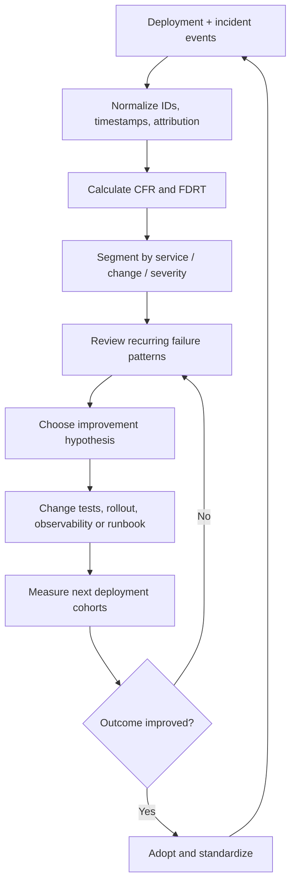

# Theo dõi tỷ lệ thay đổi gây lỗi và khả năng phục hồi

Một pipeline triển khai thành công về mặt kỹ thuật chưa chắc tạo ra một release thành công. Ứng dụng có thể khởi động bình thường nhưng làm tăng lỗi giao dịch, giảm availability, gây chậm request hoặc làm hỏng dữ liệu sau khi nhận traffic thật. Để đánh giá chất lượng phát hành, đội ngũ cần theo dõi cả **tần suất thay đổi gây lỗi** và **khả năng khôi phục dịch vụ khi lỗi xảy ra**.

Hai chỉ số quan trọng trong nhóm đo lường delivery là **Change Failure Rate (CFR)** và **Failed Deployment Recovery Time (FDRT)**. CFR cho biết tỷ lệ deployment dẫn tới sự cố cần can thiệp; FDRT cho biết mất bao lâu để khôi phục dịch vụ sau một deployment gây lỗi. Chúng bổ sung cho deployment frequency và lead time for changes: một nhóm không chỉ cần phát hành nhanh mà còn phải phát hành an toàn và phục hồi được khi có vấn đề.

Để hai chỉ số có ý nghĩa, cần định nghĩa đơn vị đo, cách quy lỗi cho deployment, mốc thời gian bắt đầu/kết thúc, phạm vi production, cửa sổ báo cáo và quy tắc xử lý dữ liệu thiếu. Nếu mỗi nhóm tính theo cách khác nhau, số liệu không thể so sánh và dễ tạo động cơ che giấu sự cố.

## 1. Hai chỉ số trả lời hai câu hỏi khác nhau

| Chỉ số | Câu hỏi | Điều chỉ số phản ánh |
|---|---|---|
| Change Failure Rate | Bao nhiêu deployment gây ra lỗi cần can thiệp? | Độ ổn định của thay đổi khi đi vào môi trường production |
| Failed Deployment Recovery Time | Khi deployment gây lỗi, mất bao lâu để khôi phục dịch vụ? | Khả năng phát hiện, quyết định, giảm tác động và phục hồi |

Một hệ thống có CFR thấp nhưng FDRT cao có thể ít gặp lỗi phát hành, nhưng khi lỗi xảy ra thì khó khôi phục. Ngược lại, CFR cao nhưng FDRT thấp cho thấy đội ngũ phản ứng nhanh, song release process vẫn tạo ra quá nhiều sự cố. Cả hai trường hợp đều cần cải thiện.

Không nên tối ưu riêng một chỉ số. Nếu chỉ giảm CFR, nhóm có thể phát hành ít hơn hoặc gom nhiều thay đổi vào một release lớn. Nếu chỉ giảm recovery time, nhóm có thể rollback nhanh nhưng không đầu tư ngăn lỗi lặp lại. Cần xem cùng deployment frequency, lead time, SLO, error budget và mức độ tác động tới người dùng.

## 2. Định nghĩa Change Failure Rate

Change Failure Rate là tỷ lệ deployment tới production dẫn tới failure và cần can thiệp để khôi phục dịch vụ hoặc sửa hậu quả. Hành động can thiệp có thể là rollback, hotfix, roll-forward, tắt feature flag, revert cấu hình, chạy compensation hoặc một biện pháp khẩn cấp tương đương.

Một công thức phổ biến:

\[
\text{CFR} = \frac{\text{Số production deployments gây failure cần can thiệp}}{\text{Tổng số production deployments}} \times 100\%
\]

Ví dụ trong một kỳ có 80 deployment production. Có 6 deployment gây sự cố cần rollback hoặc hotfix. Khi đó:

\[
\text{CFR} = \frac{6}{80} \times 100\% = 7.5\%
\]

Diễn giải: khoảng 7,5% deployment trong kỳ dẫn tới failure cần can thiệp. Đây là tín hiệu để điều tra chất lượng thay đổi, phạm vi kiểm thử, rollout guardrail và các rủi ro của dịch vụ.

### Xác định mẫu số

Mẫu số nên là tổng số deployment production thuộc phạm vi đo trong cùng kỳ. Tổ chức cần thống nhất:

- Deployment là một lần thay đổi phiên bản hoặc cấu hình của workload trên production target.
- Một lần rollout có nhiều replica hoặc nhiều bước canary vẫn là một deployment logical nếu được điều phối như một release duy nhất.
- Nếu triển khai cùng release tới nhiều region/cluster, cần quy định đo ở cấp service release hay từng target deployment và giữ nhất quán.
- Thay đổi chỉ ở development/staging không nằm trong mẫu số CFR production.
- Deployment bị hủy trước khi có bất kỳ thay đổi nào trên production không được tính là production deployment.
- Một lần retry do công cụ timeout nhưng target đã nhận cùng artifact không nên tự động bị tính thành hai deployment; cần định danh release và deployment attempt rõ ràng.

Mẫu số phải phản ánh hoạt động phát hành thực tế. Nếu chỉ ghi các deployment thành công và bỏ các lần rollout thất bại đã làm thay đổi production, CFR sẽ thấp giả tạo.

### Xác định tử số

Một deployment được tính là failed deployment khi có bằng chứng hợp lý cho thấy thay đổi đó gây ra failure cần can thiệp. Ví dụ:

- Error rate hoặc latency vượt ngưỡng sau rollout và phải rollback.
- Hotfix được phát hành để sửa lỗi do release vừa triển khai.
- Feature flag phải tắt khẩn cấp vì hành vi mới gây lỗi cho người dùng.
- Cấu hình mới làm service mất kết nối dependency và cần revert.
- Migration hoặc code mới gây lỗi dữ liệu, buộc phải chạy compensation/repair.
- Một deployment bị dừng ở giữa rollout vì health hoặc business guardrail không đạt và cần đưa target về trạng thái ổn định.

Không phải mọi incident xảy ra sau deployment đều do deployment đó gây ra. Ví dụ, một cloud region outage độc lập hoặc dependency bên ngoài ngừng hoạt động có thể trùng thời điểm phát hành. Cần có quy trình attribution dựa trên timeline, thay đổi và bằng chứng kỹ thuật.

## 3. Quy tắc attribution: deployment nào gây ra failure?

Attribution là việc liên kết một failure với thay đổi hoặc deployment có khả năng gây ra nó. Nếu không có quy tắc, cùng một incident có thể bị tính vào nhiều deployment hoặc không được tính vào deployment nào.

Nên ghi nhận các dữ liệu sau:

- Service, environment, cluster/region và deployment ID.
- Release ID, commit SHA, artifact digest và configuration revision.
- Thời điểm bắt đầu rollout, thời điểm nhận traffic và thời điểm lỗi bắt đầu.
- SLI/SLO trước và sau thay đổi, alert, log, trace và smoke-test result.
- Incident ID, mức độ ảnh hưởng, nhóm người dùng hoặc giao dịch bị ảnh hưởng.
- Hành động can thiệp: pause, rollback, hotfix, roll-forward, flag disable hoặc compensation.
- Người hoặc hệ thống xác nhận nguyên nhân và mức độ chắc chắn của attribution.

### Một incident có thể liên quan nhiều thay đổi

Ví dụ service `orders` nhận hai deployment trong một giờ: deployment A cập nhật thư viện authentication; deployment B cập nhật cấu hình timeout. Sau deployment B, error rate tăng. Điều tra cho thấy lỗi do timeout quá thấp ở B. Khi đó B được tính là failed deployment; A không tự động bị tính chỉ vì nằm trong cùng khoảng thời gian.

Nếu hai deployment cùng góp phần gây lỗi, cần có quy tắc rõ. Có thể tính từng deployment có trách nhiệm nếu cả hai đều cần remediation, hoặc ghi một incident có nhiều contributing changes và báo cáo riêng. Không được thay đổi cách tính theo hướng có lợi cho một kỳ báo cáo.

### Failure được phát hiện muộn

Một lỗi có thể chỉ xuất hiện sau vài giờ hoặc vài ngày, ví dụ memory leak, batch job chạy theo lịch hoặc dữ liệu tăng dần. CFR theo cohort nên gắn failure về deployment nguồn, không chỉ tính vào ngày incident được phát hiện. Vì vậy, dashboard cần hỗ trợ cả hai góc nhìn:

- **Deployment cohort:** các deployment phát hành trong kỳ và tỷ lệ trong số đó về sau bị xác định là failed.
- **Incident period:** các failure được phát hiện/xử lý trong kỳ, kể cả khi deployment nguồn nằm ở kỳ trước.

Kỳ gần hiện tại có thể chưa đủ thời gian quan sát để kết luận. Hãy đánh dấu dữ liệu provisional hoặc chờ hết attribution window thay vì coi deployment mới là an toàn chỉ vì chưa có incident.

## 4. Định nghĩa Failed Deployment Recovery Time

Failed Deployment Recovery Time đo khoảng thời gian từ khi failure do deployment bắt đầu ảnh hưởng tới dịch vụ đến khi dịch vụ được khôi phục về trạng thái vận hành chấp nhận được.

Một công thức cho từng failure:

\[
\text{FDRT} = t_{\text{service restored}} - t_{\text{impact start}}
\]

Trong đó:

- `impact start` là thời điểm failure bắt đầu gây ảnh hưởng đo được tới người dùng hoặc SLO, theo quy tắc của tổ chức.
- `service restored` là thời điểm service trở lại trạng thái chấp nhận được và được xác minh bằng health, SLI hoặc business checks.

Không nên kết thúc đồng hồ chỉ vì lệnh rollback trả về exit code 0. Nếu traffic vẫn lỗi, queue vẫn backlog hoặc giao dịch chưa được đối soát, dịch vụ chưa được phục hồi đầy đủ.

### Phân biệt FDRT với MTTR

MTTR thường được dùng với nhiều nghĩa: Mean Time to Repair, Restore, Recover hoặc Resolve. Vì cách dùng khác nhau, dashboard phải định nghĩa chính xác sự kiện bắt đầu/kết thúc và loại sự cố được đo. FDRT tập trung vào failure có liên quan tới deployment; MTTR có thể bao gồm mọi loại incident trong vận hành.

| Thuật ngữ | Phạm vi | Ví dụ |
|---|---|---|
| FDRT | Failure do deployment gây ra | Release làm API trả 5xx, nhóm rollback và xác minh service |
| Incident MTTR | Mọi incident thuộc phạm vi vận hành | Region outage, lỗi dependency, capacity exhaustion hoặc release failure |
| Time to detect | Từ lúc lỗi bắt đầu tới khi được phát hiện | Alert phát sau 3 phút |
| Time to acknowledge | Từ alert tới khi người trực tiếp nhận | On-call acknowledge sau 2 phút |
| Time to mitigate | Từ khi bắt đầu xử lý tới khi tác động giảm đáng kể | Tắt feature flag để giảm lỗi |
| Time to restore | Từ khi ảnh hưởng bắt đầu tới khi dịch vụ trở lại mức chấp nhận | Rollback xong và SLI đạt lại ngưỡng |

Có thể theo dõi các khoảng thời gian con để tìm nút thắt. Ví dụ FDRT dài vì alert phát hiện muộn, không phải vì rollback khó. Nếu chỉ nhìn tổng thời gian, nhóm có thể đầu tư sai chỗ.

## 5. Chọn mốc thời gian nhất quán

Mốc bắt đầu và kết thúc cần được ghi trong incident/deployment record. Một cách chia hữu ích:

| Mốc | Ý nghĩa |
|---|---|
| `t_deploy_start` | Bắt đầu thay đổi target |
| `t_first_traffic` | Phiên bản mới bắt đầu nhận traffic hoặc xử lý dữ liệu |
| `t_impact_start` | Failure bắt đầu ảnh hưởng người dùng/SLO |
| `t_detected` | Monitoring hoặc người vận hành phát hiện |
| `t_acknowledged` | Người có trách nhiệm nhận xử lý |
| `t_mitigated` | Biện pháp tạm thời giảm đáng kể tác động |
| `t_service_restored` | Dịch vụ được xác minh trở lại trạng thái chấp nhận |
| `t_followup_closed` | Các tác vụ dữ liệu/đối soát còn lại được hoàn tất nếu thuộc định nghĩa phục hồi |

Với một API stateless, `t_service_restored` có thể là thời điểm error rate và latency trở lại ngưỡng trong một cửa sổ xác nhận. Với hệ thống thanh toán, có thể cần thêm data reconciliation trước khi đánh dấu recovery hoàn tất. Cần tách “service restored” khỏi “toàn bộ follow-up đã đóng” để không trộn thời gian phục vụ lại với công việc hậu kiểm kéo dài.

### Tính FDRT trong ví dụ

Giả sử deployment bắt đầu nhận traffic lúc 10:00. Lỗi bắt đầu ảnh hưởng request lúc 10:04, alert phát lúc 10:06, on-call acknowledge lúc 10:08, rollback hoàn tất lúc 10:15 và health/business checks đạt lúc 10:19.

- Time to detect: 2 phút.
- Time to acknowledge: 2 phút.
- Thời gian từ impact tới mitigation nếu mitigation là rollback hoàn tất: 11 phút.
- FDRT nếu service được xác minh phục hồi lúc 10:19: 15 phút.

Không dùng 10:15 làm thời điểm kết thúc nếu dịch vụ chỉ được xác nhận khỏe lúc 10:19. Nếu business reconciliation cần thêm 20 phút, ghi thêm thời gian follow-up riêng theo định nghĩa dịch vụ.

## 6. Báo cáo phân vị thay vì chỉ dùng trung bình

Recovery time thường có phân phối lệch: phần lớn sự cố nhỏ được xử lý nhanh, nhưng một vài sự cố phức tạp kéo dài nhiều giờ. Trung bình có thể bị chi phối bởi outlier và che khuất trải nghiệm thông thường.

Nên xem ít nhất:

- Median (p50): một nửa failure được phục hồi trong khoảng thời gian này hoặc ngắn hơn.
- p75: cho biết nhóm sự cố chậm hơn mức thông thường.
- p90 hoặc p95: thể hiện tail recovery và các tình huống khó.
- Maximum và danh sách các incident dài nhất để điều tra riêng.
- Số mẫu (N) trong kỳ để hiểu độ tin cậy của thống kê.

Ví dụ:

| Chỉ số | Kết quả |
|---|---:|
| Số failed deployments | 8 |
| FDRT median | 18 phút |
| FDRT p75 | 34 phút |
| FDRT p90 | 92 phút |
| FDRT trung bình | 31 phút |

Với số mẫu nhỏ, p90/p95 có thể biến động mạnh. Luôn hiển thị số lượng sự cố và tránh xếp hạng team dựa trên một kỳ có rất ít deployment.

## 7. Xây dựng mô hình dữ liệu cho deployment failure

Để tính CFR và FDRT đáng tin cậy, cần lưu event có cấu trúc thay vì chỉ đọc thủ công từ dashboard. Có thể bắt đầu với hai thực thể: deployment và incident/failure.

### Deployment record

| Trường | Ý nghĩa |
|---|---|
| `deployment_id` | ID duy nhất cho logical deployment |
| `service` | Tên service hoặc component |
| `environment` | Môi trường đích, ví dụ production |
| `target` | Cluster, region hoặc workload target |
| `release_id` | ID release liên kết nhiều job/artifact |
| `commit_sha` | Revision source |
| `artifact_digest` | Digest image/package đã triển khai |
| `config_revision` | Revision cấu hình môi trường |
| `started_at` | Thời điểm bắt đầu deployment |
| `traffic_started_at` | Thời điểm bắt đầu nhận traffic |
| `completed_at` | Thời điểm rollout hoàn tất |
| `deployment_status` | Succeeded, failed, cancelled, superseded hoặc partial |

### Failure/incident record

| Trường | Ý nghĩa |
|---|---|
| `incident_id` | ID incident duy nhất |
| `deployment_id` | Deployment được xác định là nguyên nhân hoặc yếu tố góp phần |
| `attribution` | Confirmed, probable, unrelated hoặc unknown |
| `impact_start_at` | Thời điểm ảnh hưởng bắt đầu |
| `detected_at` | Thời điểm phát hiện |
| `acknowledged_at` | Thời điểm được tiếp nhận |
| `mitigated_at` | Thời điểm tác động được giảm |
| `restored_at` | Thời điểm dịch vụ được xác minh phục hồi |
| `severity` | Mức độ ảnh hưởng |
| `remediation_type` | Rollback, hotfix, roll-forward, flag-off, config-revert hoặc compensation |
| `customer_impact` | Phạm vi ảnh hưởng đã xác định |
| `postmortem_url` | Liên kết điều tra/hậu kiểm nếu có |

Các trường thời gian cần dùng một timezone thống nhất, tốt nhất lưu timestamp UTC và hiển thị theo timezone người xem. Cần giữ event history để biết khi nào trạng thái incident thay đổi; không chỉ ghi đè timestamp cuối cùng.

### Một deployment có thể có nhiều attempt

Nếu một logical release được retry do runner mất kết nối, cần phân biệt `deployment_id` với `attempt_id`. Mẫu số CFR nên đếm logical production deployment theo quy ước, không đếm mọi lần job retry thành deployment mới. Tuy nhiên, mỗi attempt vẫn cần lưu để audit và phân tích lỗi của automation.

## 8. Ví dụ tính CFR và FDRT từ dữ liệu mẫu

Giả sử báo cáo một tháng có các deployment production sau:

| Deployment | Trạng thái | Có failure cần can thiệp? | Impact start | Restored | FDRT |
|---|---|---|---|---|---:|
| D-101 | Succeeded | Không | — | — | — |
| D-102 | Rolled back | Có | 09:10 | 09:28 | 18 phút |
| D-103 | Succeeded | Không | — | — | — |
| D-104 | Hotfix applied | Có | 13:00 | 13:42 | 42 phút |
| D-105 | Succeeded | Không | — | — | — |
| D-106 | Feature disabled | Có | 16:15 | 16:25 | 10 phút |
| D-107 | Succeeded | Không | — | — | — |
| D-108 | Succeeded | Không | — | — | — |
| D-109 | Succeeded | Không | — | — | — |
| D-110 | Succeeded | Không | — | — | — |

Tổng cộng 10 logical production deployments, trong đó 3 deployment gây failure cần can thiệp:

\[
\text{CFR} = \frac{3}{10} \times 100\% = 30\%
\]

FDRT cho ba failure lần lượt là 18, 42 và 10 phút. Sắp xếp tăng dần: 10, 18, 42. Median của ba quan sát là 18 phút. Trung bình là khoảng 23,3 phút. Khi báo cáo cần hiển thị cả N=3 và phân phối; một mẫu nhỏ chưa đủ để kết luận xu hướng ổn định.

## 9. Phân nhóm để tìm nơi phát sinh rủi ro

Một con số toàn tổ chức hữu ích cho xu hướng chung nhưng không đủ để quyết định cải tiến. Nên phân nhóm CFR và FDRT theo:

- Service hoặc product area.
- Team/ownership, nhưng dùng để hỗ trợ cải tiến chứ không xếp hạng trừng phạt.
- Environment, region và deployment target.
- Loại thay đổi: code, dependency, schema, configuration, infrastructure, security policy.
- Chiến lược rollout: rolling, canary, blue-green, feature flag.
- Mức độ rủi ro hoặc blast radius.
- Artifact type và runtime/platform.
- Remediation type: rollback, hotfix, roll-forward, flag-off hoặc compensation.
- Severity/customer impact.

Ví dụ, CFR cao ở migration có thể chỉ ra thiếu kiểm tra backward compatibility; FDRT cao ở một service có thể do thiếu dashboard hoặc rollback mất nhiều bước. Phân nhóm giúp tìm vấn đề cụ thể thay vì yêu cầu mọi team “cẩn thận hơn”.

Không nên so sánh trực tiếp một service có hàng trăm deployment nhỏ với một hệ thống legacy chỉ phát hành vài lần mỗi quý mà không xét độ phức tạp, blast radius và số mẫu.

## 10. Dashboard nên hiển thị gì?

Một dashboard hữu ích nên kết hợp xu hướng, phân phối, số mẫu và các metric cân bằng.

### Hàng chỉ số tổng quan

- Production deployment count.
- Change Failure Rate (%), kèm numerator/denominator.
- Failed Deployment Recovery Time median và p90.
- Incident count theo severity.
- Deployment frequency và lead time for changes.
- SLO/error budget impact trong kỳ.

### Biểu đồ xu hướng

- CFR theo tuần/tháng, có đường rolling window nếu số lượng deployment biến động.
- FDRT p50/p90 theo kỳ, hiển thị số failure.
- CFR theo service và loại thay đổi.
- FDRT theo remediation type để biết rollback, hotfix hay feature disable mất bao lâu.
- Số failure chưa xác định attribution hoặc chưa đóng recovery.

### Bảng chi tiết

Mỗi failed deployment cần liên kết tới release ID, artifact digest, incident, timeline, hành động remediation và postmortem. Người xem phải drill down được từ metric tổng tới các sự kiện tạo ra nó.

Không nên chỉ hiển thị một gauge màu đỏ/xanh. CFR 0% với một deployment trong kỳ không có cùng độ tin cậy với CFR 0% trên hàng trăm deployment. Luôn hiển thị sample count và kỳ đo.

## 11. Cửa sổ báo cáo và dữ liệu trễ

CFR là metric theo tỷ lệ deployment trong một cohort; failure có thể được phát hiện muộn. Cần định nghĩa:

- Kỳ đưa deployment vào mẫu số: theo thời điểm bắt đầu hay hoàn tất deployment.
- Attribution window: bao lâu sau deployment vẫn có thể liên kết failure với thay đổi đó.
- Cách xử lý incident phát hiện sau khi kỳ báo cáo đã đóng.
- Cách cập nhật số liệu lịch sử khi attribution chuyển từ unknown sang confirmed.
- Cách xử lý deployment gần cuối kỳ chưa có đủ thời gian quan sát.

Ví dụ, nếu báo cáo CFR của tháng 5 vào ngày 1 tháng 6, một deployment ngày 31 tháng 5 mới chạy vài giờ chưa có cùng thời gian phơi nhiễm như deployment ngày 2 tháng 5. Có thể đánh dấu cohort gần đây là provisional và cập nhật khi attribution window hoàn tất.

FDRT thường được tính khi failure đã được phục hồi. Những incident còn mở không được bỏ khỏi dashboard mà nên hiển thị riêng là ongoing recovery, với elapsed time hiện tại. Nếu chỉ tính incident đã đóng, chỉ số có thể trông tốt hơn thực tế vì các sự cố dài nhất chưa xuất hiện trong thống kê.

## 12. Phân biệt failure do deployment với failure nền

Để CFR phản ánh chất lượng thay đổi, cần có quy trình xác định nguyên nhân:

1. Xây timeline deployment, traffic, alert và symptom.
2. So sánh SLI trước/sau deployment và giữa canary/control nếu có.
3. Xác định component, config, dependency hoặc data path thay đổi.
4. Kiểm tra có sự kiện độc lập như provider outage, capacity event hoặc network incident không.
5. Ghi attribution level: confirmed, probable, unrelated hoặc unknown.
6. Review attribution khi có thêm bằng chứng hoặc postmortem hoàn tất.

Không cần đợi RCA đầy đủ mới hành động khôi phục. Trong lúc incident đang diễn ra, có thể ghi attribution tạm thời `probable`; sau đó cập nhật khi điều tra hoàn tất. Dashboard nên phân biệt số liệu confirmed với provisional.

Một deployment không có liên quan vẫn có thể là yếu tố góp phần. Ví dụ, release làm tăng traffic tới dependency vốn đang suy yếu; nếu không có release, sự cố có thể không xảy ra. Ghi contributing factor thay vì ép mọi incident vào nhãn nguyên nhân duy nhất.

## 13. Dùng CFR và FDRT để cải tiến pipeline

Metric chỉ có giá trị khi dẫn tới hành động cụ thể. Hãy phân tích nguyên nhân lặp lại và chọn thay đổi trong quy trình.

| Dấu hiệu | Nguyên nhân có thể | Cải tiến CI/CD hoặc vận hành |
|---|---|---|
| CFR cao ở thay đổi schema | Migration không tương thích hoặc thiếu test dữ liệu | Expand-and-contract, migration rehearsal, compatibility test |
| CFR cao ở shared library | Consumer không được kiểm tra đầy đủ | Dependency impact analysis, contract test, canary theo consumer |
| CFR cao ở cấu hình | Thiếu validation hoặc drift giữa môi trường | Config schema validation, policy test, environment parity |
| CFR cao sau release lớn | Batch thay đổi khó cô lập nguyên nhân | Release nhỏ hơn, progressive delivery, feature flags |
| FDRT cao do phát hiện chậm | Alert thiếu hoặc ngưỡng không phù hợp | SLI-based alert, synthetic checks, deployment annotations |
| FDRT cao do quyết định chậm | Không rõ owner hoặc runbook | Incident role, escalation, rollback decision tree |
| FDRT cao do rollback phức tạp | Artifact/config cũ không sẵn sàng hoặc schema không tương thích | Immutable artifact retention, rollback rehearsal, expand-and-contract |
| FDRT cao do xác minh lâu | Thiếu smoke test/business validation | Automated post-deploy verification và data reconciliation |
| FDRT cao ở một region | Failover hoặc network path chưa được diễn tập | Regional recovery exercise, routing/failback test |

Không nên phản ứng với mọi CFR tăng bằng cách thêm approval thủ công. Nếu nguyên nhân là thiếu test tự động, thêm người duyệt có thể làm tăng lead time mà không giảm failure. Chọn biện pháp dựa trên nguyên nhân và đo lại sau cải tiến.

## 14. Liên kết metric với deployment strategy

Các chiến lược rollout ảnh hưởng tới cả xác suất failure và khả năng giảm tác động:

- **Rolling deployment:** theo dõi từng batch, readiness và khả năng tương thích giữa phiên bản cũ/mới.
- **Canary:** giới hạn blast radius ban đầu, dùng control group và guardrail để dừng trước khi mở rộng.
- **Blue-green:** giữ môi trường cũ sẵn sàng để chuyển traffic lại, nhưng cần xử lý session/data compatibility.
- **Feature flag:** có thể tắt tính năng lỗi mà không rollback toàn bộ artifact; cần ghi nhận flag change như một remediation.
- **Progressive delivery:** tự động promote/pause/abort theo metrics, nhưng cần đủ sample và telemetry đáng tin cậy.

Nếu canary phát hiện lỗi và rollout được dừng trước khi người dùng production chịu ảnh hưởng đáng kể, tổ chức cần quy định rõ có tính là failed deployment hay failed rollout. Một định nghĩa thực tế là nếu deployment đã được áp dụng lên production target và cần can thiệp để đưa target về trạng thái ổn định, nó được tính; nếu chỉ là candidate test ở staging chưa vào production thì không nằm trong CFR production. Quan trọng là áp dụng quy tắc nhất quán.

## 15. Ví dụ truy vấn dữ liệu báo cáo

Giả sử kho dữ liệu có bảng `deployments` và `deployment_failures`. Ví dụ SQL sau minh họa cách tính CFR theo service và tháng:

```sql
WITH production_deployments AS (
    SELECT
        deployment_id,
        service,
        DATE_TRUNC('month', MAX(completed_at)) AS deployment_month
    FROM deployments
    WHERE environment = 'production'
      AND deployment_status IN ('succeeded', 'rolled_back', 'partially_applied')
      AND completed_at >= TIMESTAMP '2026-01-01 00:00:00'
      AND completed_at <  TIMESTAMP '2026-02-01 00:00:00'
    GROUP BY deployment_id, service
), failed_deployments AS (
    SELECT deployment_id
    FROM deployment_failures
    WHERE attribution IN ('confirmed', 'probable')
    GROUP BY deployment_id
)
SELECT
    d.service,
    d.deployment_month,
    COUNT(*) AS production_deployments,
    COUNT(f.deployment_id) AS failed_deployments,
    100.0 * COUNT(f.deployment_id) / NULLIF(COUNT(*), 0)
        AS change_failure_rate_pct
FROM production_deployments d
LEFT JOIN failed_deployments f
    ON f.deployment_id = d.deployment_id
GROUP BY d.service, d.deployment_month;
```

Đây là SQL minh họa, cần điều chỉnh theo schema và quy ước của tổ chức. Hai CTE gom các event theo `deployment_id` để mỗi logical deployment chỉ xuất hiện một lần ở mẫu số và mỗi deployment có failure chỉ xuất hiện một lần ở tử số. Nếu hệ thống dùng một release ID cho nhiều target deployment, khóa nhóm cần là ID của đơn vị đo đã chọn (logical release hoặc target deployment), không được gom các target độc lập thành một bản ghi. Cần xử lý cohort provisional và attribution window thay vì chỉ lấy record hiện có tại thời điểm truy vấn.

Ví dụ truy vấn FDRT theo incident:

```sql
SELECT
    service,
    PERCENTILE_CONT(0.50) WITHIN GROUP (
        ORDER BY EXTRACT(EPOCH FROM (restored_at - impact_start_at)) / 60.0
    ) AS fdrt_p50_minutes,
    PERCENTILE_CONT(0.90) WITHIN GROUP (
        ORDER BY EXTRACT(EPOCH FROM (restored_at - impact_start_at)) / 60.0
    ) AS fdrt_p90_minutes,
    COUNT(*) AS recovered_failures
FROM deployment_failures
WHERE attribution IN ('confirmed', 'probable')
  AND impact_start_at IS NOT NULL
  AND restored_at IS NOT NULL
GROUP BY service;
```

Incident chưa phục hồi bị loại khỏi phân vị trong ví dụ này, nên dashboard phải có một truy vấn riêng cho open failures và elapsed time hiện tại. Cú pháp percentile có thể khác giữa PostgreSQL, BigQuery, Snowflake và hệ quản trị khác.

## 16. Ví dụ dashboard và diễn giải xu hướng

Giả sử một nhóm có kết quả ba tháng:

| Tháng | Production deployments | Failed deployments | CFR | FDRT median | FDRT p90 |
|---|---:|---:|---:|---:|---:|
| Tháng 1 | 40 | 6 | 15,0% | 52 phút | 180 phút |
| Tháng 2 | 48 | 5 | 10,4% | 31 phút | 95 phút |
| Tháng 3 | 60 | 3 | 5,0% | 19 phút | 55 phút |

Xu hướng cho thấy tỷ lệ deployment gây lỗi giảm và thời gian phục hồi cũng rút ngắn. Nhưng cần kiểm tra thêm:

- Deployment frequency có tăng vì release nhỏ hơn hay vì thay đổi được gom lại?
- Mức độ nghiêm trọng và số người dùng bị ảnh hưởng có giảm không?
- Attribution window của tháng 3 đã hoàn tất chưa?
- Có incident đang mở chưa được đưa vào FDRT không?
- SLO và business outcome có cải thiện tương ứng không?
- Có thay đổi cách phân loại hoặc báo cáo failure giữa các tháng không?

Chỉ khi định nghĩa, phạm vi và dữ liệu nhất quán mới có thể kết luận cải tiến đã tạo ra kết quả tốt hơn.

## 17. Tránh gaming và tác dụng phụ của metric

Khi CFR/FDRT trở thành mục tiêu đánh giá, nhóm có thể vô tình hoặc cố ý làm số liệu đẹp hơn thay vì cải thiện hệ thống.

Các hành vi cần tránh:

- Không ghi incident vì sợ làm tăng CFR.
- Gọi rollback là “cancelled deployment” để loại khỏi tử số.
- Chỉ tính failure cần rollback, bỏ qua hotfix, flag disable hoặc compensation.
- Gom nhiều thay đổi vào một deployment lớn để giảm số lần có thể bị tính failure.
- Đẩy thay đổi rủi ro sang môi trường không được đo nhưng vẫn phục vụ người dùng thật.
- Đóng incident sớm khi metric tạm ổn dù business validation chưa hoàn tất.
- Loại các incident phục hồi lâu khỏi báo cáo vì chúng chưa đóng.
- So sánh team mà không xét số mẫu, loại service và mức độ rủi ro.

Biện pháp giảm gaming:

1. Công bố định nghĩa và quy tắc attribution thống nhất.
2. Gắn deployment record với incident management và release system.
3. Review ngẫu nhiên các deployment được đánh dấu không failure sau alert lớn.
4. Báo cáo open incidents và provisional cohorts.
5. Theo dõi cả customer impact, severity và SLO.
6. Dùng metric để tìm vấn đề trong hệ thống, không dùng làm chỉ tiêu trừng phạt cá nhân.
7. Cho phép cập nhật attribution có audit khi có bằng chứng mới.

## 18. Kết hợp với các chỉ số delivery và reliability khác

CFR và FDRT nên được đọc cùng các chỉ số khác:

| Metric | Vai trò khi diễn giải |
|---|---|
| Deployment frequency | Tần suất đưa thay đổi vào production |
| Lead time for changes | Thời gian từ thay đổi được commit tới khi chạy production |
| Change Failure Rate | Tỷ lệ deployment gây failure cần can thiệp |
| Failed Deployment Recovery Time | Thời gian phục hồi sau deployment failure |
| Availability/SLO | Chất lượng dịch vụ mà người dùng nhận được |
| Error budget burn | Tốc độ tiêu thụ ngân sách lỗi |
| Escaped defect rate | Lỗi được phát hiện sau khi qua các gate trước đó |
| Rollback rate | Tỷ lệ deployment phải rollback, chỉ là một phần của change failure |

Ví dụ, deployment frequency tăng trong khi CFR giảm và FDRT giảm có thể cho thấy nhóm đã cải thiện cả tốc độ lẫn độ an toàn. Nhưng nếu CFR giảm vì nhóm ít deploy hơn, lead time tăng và batch size lớn hơn, kết quả không phải cải tiến delivery toàn diện.

## 19. Chu trình cải tiến dựa trên CFR và FDRT

Một chu trình thực tế:

1. Thu thập deployment và incident event tự động.
2. Chuẩn hóa định nghĩa, attribution và timestamp.
3. Tính CFR theo cohort và FDRT theo failure đã phục hồi; hiển thị incident đang mở riêng.
4. Phân nhóm theo service, loại thay đổi, severity và remediation.
5. Chọn một nguyên nhân lặp lại có tác động đáng kể.
6. Đề xuất thay đổi pipeline, test, rollout, observability hoặc runbook.
7. Đặt giả thuyết và chỉ số kiểm chứng trước khi thay đổi.
8. Thực hiện cải tiến trong một phạm vi đủ nhỏ để đánh giá.
9. So sánh kết quả sau thay đổi với baseline có cùng định nghĩa.
10. Chia sẻ bài học và cập nhật chuẩn kỹ thuật/runbook.



### Ví dụ giả thuyết cải tiến

“Các deployment thay đổi database schema chiếm phần lớn CFR của service orders. Nếu thêm migration rehearsal trên snapshot dữ liệu đại diện và kiểm tra backward compatibility với phiên bản ứng dụng trước, số deployment schema gây failure sẽ giảm trong hai tháng tiếp theo mà không làm lead time tăng quá ngưỡng đã thống nhất.”

Giả thuyết tốt xác định phạm vi, biện pháp, metric kết quả, metric cân bằng và khoảng đánh giá. Nếu CFR giảm nhưng migration lead time tăng quá nhiều, cần xem lại thiết kế kiểm tra thay vì bỏ gate một cách tùy tiện.

## 20. Checklist triển khai đo lường

Trước khi đưa CFR và FDRT vào dashboard, hãy xác nhận:

1. Đơn vị đo là logical production deployment hay target deployment đã được thống nhất chưa?
2. Mẫu số có bao gồm deployment partial/rollback và loại trừ đúng staging/cancel-before-impact không?
3. Failure cần can thiệp được định nghĩa gồm rollback, hotfix, roll-forward, flag disable và compensation chưa?
4. Có quy tắc attribution confirmed/probable/unrelated/unknown không?
5. Incident phát hiện muộn có được gắn lại với deployment nguồn không?
6. Có phân biệt deployment cohort và incident period không?
7. Mốc impact start và service restored được định nghĩa, ghi nhận và xác minh chưa?
8. FDRT có tách time to detect, acknowledge, mitigate và restore không?
9. Dashboard có hiển thị median, p90, sample count và incident đang mở không?
10. Có phân nhóm theo service, loại thay đổi, rollout strategy và severity không?
11. Attribution window và dữ liệu provisional có được công bố không?
12. Có liên kết deployment ID, commit SHA, artifact digest, config revision và incident ID không?
13. Có theo dõi SLO, customer impact và error budget bên cạnh CFR/FDRT không?
14. Có kiểm tra hành vi gaming hoặc thay đổi định nghĩa giữa các kỳ không?
15. Mỗi cải tiến có owner, giả thuyết, metric kết quả và metric cân bằng không?

CFR cho biết thay đổi production thường xuyên gây lỗi đến mức nào; FDRT cho biết tổ chức phục hồi nhanh ra sao khi lỗi phát hành xảy ra. Hai chỉ số chỉ đáng tin khi deployment, failure và thời điểm phục hồi được ghi nhận nhất quán, có thể truy vết và không bị bóp méo bởi cách phân loại. Dùng chúng cùng SLO, deployment frequency, lead time và mức độ ảnh hưởng sẽ giúp đội ngũ cải thiện cả chất lượng thay đổi lẫn năng lực vận hành.
