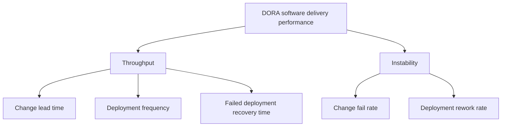

# Giới thiệu cách dùng chỉ số DORA theo bối cảnh nhóm

DORA cung cấp một cách nhìn định lượng về khả năng đưa thay đổi phần mềm tới người dùng. Các chỉ số này giúp nhóm nhận ra tốc độ thay đổi đang đi qua hệ thống ra sao, mức độ bất ổn do triển khai và lượng công việc phát sinh để sửa lỗi sau phát hành. Giá trị của chúng nằm ở việc giúp nhóm đặt câu hỏi đúng và chọn điểm cần cải thiện, không nằm ở việc tạo một bảng xếp hạng giữa các nhóm.

Để dùng DORA có ích, trước hết cần chọn đúng ứng dụng hoặc service làm đơn vị đo, thống nhất định nghĩa sự kiện triển khai, hiểu bối cảnh người dùng và vận hành, rồi theo dõi xu hướng theo thời gian. Một API giao dịch, một ứng dụng mobile, một nền tảng dữ liệu và một hệ thống batch có nhịp phát hành khác nhau; so sánh trực tiếp các con số mà không xét bối cảnh có thể dẫn tới kết luận sai.

Theo mô hình hiện hành, DORA sử dụng **năm chỉ số hiệu suất phân phối phần mềm**, chia thành hai nhóm: throughput (khả năng đưa thay đổi qua hệ thống) và instability (mức độ bất ổn của thay đổi). Mô hình này đã phát triển từ bộ bốn chỉ số quen thuộc trước đây; vì vậy cần biết phiên bản định nghĩa đang dùng khi đọc báo cáo cũ hoặc dashboard nội bộ.

## 1. DORA đo điều gì và không đo điều gì?

DORA là viết tắt của DevOps Research and Assessment. Chương trình nghiên cứu này tìm hiểu các năng lực kỹ thuật, quy trình và văn hóa có liên hệ với hiệu suất của tổ chức công nghệ. Năm chỉ số phân phối phần mềm tập trung vào kết quả của quá trình đưa thay đổi tới production hoặc người dùng.

Các chỉ số trả lời những câu hỏi như:

- Một thay đổi mất bao lâu từ lúc được commit tới khi chạy thành công ở production?
- Một service được triển khai thường xuyên đến mức nào?
- Khi một lần triển khai làm suy giảm dịch vụ, nhóm mất bao lâu để khôi phục?
- Bao nhiêu lần triển khai gây lỗi production và cần can thiệp ngay?
- Bao nhiêu lần triển khai phát sinh ngoài kế hoạch để sửa lỗi người dùng gặp phải?

Các chỉ số không tự trả lời vì sao một nhóm có kết quả như vậy. Lead time dài có thể do build chậm, review chờ lâu, approval thủ công, môi trường thiếu ổn định hoặc release window hiếm. Change fail rate cao có thể liên quan tới kiểm thử, thay đổi quá lớn, cấu hình, dữ liệu hoặc khả năng quan sát. Nhóm cần kết hợp số liệu với value stream mapping, log pipeline, incident review và trao đổi giữa những người chịu trách nhiệm xây dựng, phát hành và vận hành.

### DORA không phải bảng chấm điểm cá nhân

Đơn vị đo phù hợp là một ứng dụng hoặc service cùng nhóm đa chức năng chịu trách nhiệm ưu tiên, xây dựng, phát hành và vận hành nó. Không dùng số lần deploy để xếp hạng developer, không gán lỗi production cho một cá nhân và không biến chỉ số thành quota cứng.

Khi chỉ số trở thành mục tiêu thưởng phạt, nhóm có thể tìm cách tăng số deploy nhỏ không tạo giá trị, chia nhỏ sự kiện để làm đẹp lead time, không ghi nhận hotfix hoặc né các thay đổi rủi ro. Khi đó dashboard có thể xanh hơn trong khi trải nghiệm người dùng xấu đi. DORA nên hỗ trợ học hỏi và cải tiến hệ thống làm việc, không tạo động cơ che giấu vấn đề.

## 2. Mô hình hiện hành gồm năm chỉ số



| Nhóm | Chỉ số | Câu hỏi chính | Cách diễn giải khi cải thiện |
|---|---|---|---|
| Throughput | Change lead time | Thay đổi đi từ commit tới production nhanh đến đâu? | Luồng đưa thay đổi qua hệ thống ít chờ đợi và ít batch hơn |
| Throughput | Deployment frequency | Service đưa thay đổi tới production thường xuyên thế nào? | Nhóm có thể phát hành thay đổi nhỏ theo nhịp phù hợp |
| Throughput | Failed deployment recovery time | Khi một deploy làm suy giảm dịch vụ, nhóm khôi phục nhanh đến đâu? | Phạm vi lỗi được khoanh vùng và dịch vụ được phục hồi nhanh hơn |
| Instability | Change fail rate | Tỷ lệ deploy gây lỗi production cần can thiệp ngay là bao nhiêu? | Thay đổi được kiểm soát tốt hơn và ít gây gián đoạn |
| Instability | Deployment rework rate | Bao nhiêu deploy ngoài kế hoạch được thực hiện để sửa lỗi người dùng gặp phải? | Ít năng lực phát hành bị tiêu hao bởi công việc sửa lỗi ngoài kế hoạch |

DORA xếp ba chỉ số đầu vào throughput và hai chỉ số sau vào instability. Cách phân nhóm này là mô hình của DORA; không nên tự đổi nhóm chỉ vì một chỉ số nghe có vẻ liên quan tới độ ổn định.

### Phân biệt bộ bốn chỉ số lịch sử với bộ năm hiện hành

Trong nhiều tài liệu, dashboard hoặc bài viết cũ, nhóm có thể gặp tên “Four Keys”:

- Deployment frequency.
- Lead time for changes.
- Mean time to recover (MTTR) hoặc time to restore service.
- Change failure rate.

Hai thay đổi quan trọng cần nhớ:

1. Năm 2023, DORA đổi cách gọi và định nghĩa chỉ số phục hồi thành **failed deployment recovery time**. Chỉ số này tập trung vào thời gian phục hồi sau khi một thay đổi production gây suy giảm dịch vụ và cần remediation. Nó không còn gộp mọi sự cố vận hành không liên quan đến deployment như cách hiểu MTTR rộng trước đây.
2. Năm 2024, DORA bổ sung **deployment rework rate** để quan sát tỷ lệ deploy ngoài kế hoạch nhằm xử lý lỗi người dùng gặp phải. Đây là chỉ số thứ năm trong mô hình hiện hành.

Khi nhập dữ liệu lịch sử, không ghép MTTR tổng thể với failed deployment recovery time như thể chúng có cùng phạm vi. Hãy ghi rõ định nghĩa, khoảng thời gian và nguồn dữ liệu của từng chuỗi.

## 3. Hiểu từng chỉ số và cách đo

### 3.1. Change lead time — thời gian từ commit tới production

Change lead time là thời gian từ khi thay đổi được commit vào version control tới khi thay đổi đó được triển khai thành công ở production.

Với mỗi thay đổi, có thể tính:

\[
\text{Change lead time} = t_{production\_success} - t_{commit}
\]

Ví dụ, một commit được tạo lúc 09:00 thứ Hai và lần đầu chạy thành công ở production lúc 15:00 thứ Ba. Lead time của thay đổi đó là 30 giờ, nếu dùng elapsed time liên tục.

Khi đo thực tế:

- Xác định rõ mốc commit: commit được ghi vào repository, không tùy tiện thay bằng thời điểm mở pull request hoặc bắt đầu code.
- Xác định mốc production: thay đổi thực sự chạy hoặc được phát hành tới người dùng, không phải lúc deploy lên staging.
- Nếu một lần deploy chứa nhiều commit, liên kết từng commit/change với deployment đã đưa nó tới production.
- Ghi nhận cả thời gian chờ review, CI, approval, release window và chờ môi trường; đó đều là thời gian trôi qua trong luồng phân phối.
- Dùng cùng một quy tắc cho mọi release để xu hướng có thể so sánh được.

Không chỉ nhìn trung bình. Một vài thay đổi bị chờ nhiều ngày có thể bị che khuất bởi nhiều commit nhỏ đi production nhanh. Theo dõi median và percentile cao như p85 hoặc p90 để thấy phần đuôi của phân phối. Nếu service phát hành ít và mẫu nhỏ, hãy hiển thị số mẫu cùng khoảng thời gian thay vì diễn giải percentile như một kết luận chắc chắn.

Lead time dài không nhất thiết có nghĩa developer viết code chậm. Hãy phân rã thành các đoạn:

| Chặng | Dữ liệu cần xem | Câu hỏi chẩn đoán |
|---|---|---|
| Commit tới PR | Thời gian từ commit tới mở PR | Thay đổi có được tích hợp thường xuyên không? |
| PR tới review | Thời gian chờ reviewer và thời gian review thực tế | Có thiếu reviewer hoặc PR quá lớn không? |
| Review tới merge | Số vòng sửa, thời gian CI và chờ gate | Gate nào thường xuyên tạo hàng đợi? |
| Merge tới artifact | Build, scan, ký và publish | Build có chậm hoặc phải chạy lại nhiều lần không? |
| Artifact tới production | Approval, release window, deploy và rollout | Có bước thủ công hoặc phụ thuộc môi trường nào đang chặn? |

Các phân đoạn này là chỉ số chẩn đoán bổ sung, không thay thế định nghĩa lead time của DORA.

### 3.2. Deployment frequency — tần suất triển khai

Deployment frequency cho biết một ứng dụng hoặc service được triển khai lên production hoặc phát hành tới người dùng thường xuyên đến mức nào. Có thể biểu diễn bằng số lần deploy trong một khoảng thời gian hoặc khoảng cách giữa hai lần deploy liên tiếp.

Ví dụ, một service có 12 deployment production trong 4 tuần có tần suất trung bình 3 deploy mỗi tuần.

Khi đo:

- Chỉ tính deployment/release thực sự tới production hoặc người dùng; không cộng deploy staging, test environment hay build artifact chưa phát hành.
- Xác định deployment unit của service: một lần áp dụng release được coi là một sự kiện, không đếm từng pod/instance được rollout như một deployment riêng nếu chúng thuộc cùng một release.
- Nếu một release bị rollback, ghi nhận cả deployment ban đầu và deployment rollback theo quy tắc sự kiện; liên kết chúng với cùng incident/release lineage.
- Không đếm lại retry của cùng một lệnh nếu không có thay đổi production mới.
- Với mobile hoặc desktop app, xác định rõ mốc phát hành tới người dùng, chẳng hạn app-store release hoặc rollout theo phần trăm; không trộn với deploy backend.

Deployment frequency cao không tự động có nghĩa tốt. Một hệ thống có release hàng tuần vẫn có thể phù hợp với cách phân phối của nó. Điều cần tìm hiểu là nhóm có thể đưa thay đổi đã sẵn sàng tới người dùng mà không phải gom batch lớn hoặc chờ một đợt phát hành hiếm hay không.

### 3.3. Failed deployment recovery time — thời gian phục hồi sau deploy lỗi

Chỉ số này đo thời gian cần để phục hồi sau một deployment gây suy giảm dịch vụ hoặc outage ở production và cần remediation, ví dụ rollback, hotfix, fix forward hoặc patch.

Một cách ghi nhận nhất quán:

\[
\text{Recovery time} = t_{service\_restored} - t_{change\_impairment}
\]

Nhóm cần thống nhất mốc bắt đầu. Có thể lưu riêng thời điểm deployment, thời điểm impairment bắt đầu/được phát hiện và thời điểm dịch vụ trở lại mức chấp nhận được. Không dùng thời điểm mở ticket thay cho thời điểm lỗi bắt đầu nếu dữ liệu quan sát cho phép xác định chính xác hơn.

Phạm vi của chỉ số này là sự cố do thay đổi production gây ra. Một outage do mất điện trung tâm dữ liệu, sự cố nhà cung cấp mạng hoặc lỗi hạ tầng độc lập không nên tự động được tính là failed deployment recovery time, dù vẫn cần được đo bằng chỉ số reliability/incident riêng.

Hãy theo dõi thêm các mốc chẩn đoán:

- Thời gian phát hiện: từ lúc impairment bắt đầu tới lúc alert hoặc người dùng báo.
- Thời gian xác định nguyên nhân và quyết định phương án.
- Thời gian thực thi rollback/fix.
- Thời gian xác nhận dịch vụ đã phục hồi.

Những mốc này giúp tìm nút thắt. Ví dụ rollback chỉ mất 5 phút nhưng nhóm mất 50 phút mới nhận ra release gây lỗi; vấn đề nằm ở detection/observability chứ không phải lệnh rollback.

### 3.4. Change fail rate — tỷ lệ deployment gây lỗi

Change fail rate là tỷ lệ deployment production dẫn tới suy giảm dịch vụ và cần can thiệp ngay, thường bằng rollback, hotfix hoặc fix forward.

\[
\text{Change fail rate} =
\frac{\text{Deployments gây suy giảm dịch vụ và cần remediation}}
{\text{Tổng deployments production}}
\times 100\%
\]

Ví dụ, trong 40 deployment production, có 4 deployment gây impairment và cần can thiệp ngay. Change fail rate là 10%.

Để tránh số liệu không nhất quán:

- Xác định khoảng attribution sau deploy, ví dụ một khoảng thời gian phù hợp với đặc tính service và cách phát hiện lỗi.
- Định nghĩa thế nào là impairment: ảnh hưởng SLO, lỗi nghiệp vụ, outage hoặc mức suy giảm người dùng thực sự nhận thấy.
- Chỉ tính deployment cần remediation ngay theo định nghĩa đã thống nhất; không tính mọi cảnh báo hoặc lỗi test không tới production.
- Nếu một deployment gây nhiều incident, quy tắc cơ bản có thể tính một deployment thất bại một lần và liên kết nhiều incident; tránh đếm mẫu số không nhất quán.
- Có quy trình cập nhật kết quả sau khi incident được phân tích, thay vì chỉ dựa vào nhãn ban đầu của pipeline.

Change fail rate không phải tỷ lệ test thất bại, tỷ lệ build đỏ hay tỷ lệ PR bị từ chối. Nó đo kết quả của thay đổi đã được đưa tới production.

### 3.5. Deployment rework rate — tỷ lệ deployment sửa lỗi ngoài kế hoạch

Deployment rework rate đo tỷ lệ deployment không nằm trong kế hoạch nhưng được thực hiện để xử lý lỗi người dùng gặp phải. DORA Quick Check hiện hỏi tỷ lệ deployment trong sáu tháng gần nhất thuộc loại này.

\[
\text{Deployment rework rate} =
\frac{\text{Deployments ngoài kế hoạch để sửa lỗi user-facing}}
{\text{Tổng deployments trong cùng kỳ}}
\times 100\%
\]

Ví dụ, trong 50 deployment ở kỳ đo, có 5 deployment khẩn cấp được thực hiện để sửa lỗi user-facing. Deployment rework rate là 10%.

Chỉ số này bổ sung một góc nhìn khác với change fail rate:

- Change fail rate hỏi: trong số deployment, bao nhiêu lần gây impairment cần can thiệp ngay?
- Deployment rework rate hỏi: trong số deployment, bao nhiêu lần là công việc ngoài kế hoạch để sửa lỗi người dùng gặp phải?

Hai chỉ số có thể liên quan nhưng không đồng nghĩa. Deployment ban đầu gây lỗi có thể làm tăng change fail rate; một hotfix tiếp theo có thể được tính là deployment rework. Hotfix có thể thành công và không làm tăng change fail rate của chính nó, nhưng vẫn là công việc rework ngoài kế hoạch.

Để đo đúng, cần phân loại release theo kế hoạch trước khi triển khai và lưu lý do cho deployment ngoài kế hoạch. Không gắn nhãn “planned” cho hotfix chỉ để giảm tỷ lệ.

## 4. Chọn đúng đơn vị đo: một ứng dụng hoặc service

DORA khuyến nghị áp dụng các chỉ số trong bối cảnh của ứng dụng hoặc service đang được nhóm chịu trách nhiệm. Đây là điểm quan trọng nhất khi dùng số liệu trong tổ chức nhiều dự án.

Không nên gộp tất cả service thành một con số duy nhất ngay từ đầu. Một hệ thống có thể có:

- API thanh toán cần thay đổi an toàn, có yêu cầu audit và khả năng chịu lỗi cao.
- Service nội bộ ít người dùng, deploy theo batch.
- Ứng dụng mobile phát hành qua app store với rollout theo đợt.
- Data pipeline chạy theo lịch, có cửa sổ xử lý và dữ liệu lớn.
- Thư viện dùng chung không deploy trực tiếp nhưng phát hành package cho nhiều consumer.

Các đơn vị này có chu kỳ và định nghĩa production khác nhau. Gộp chúng thành một deployment frequency hoặc lead time trung bình có thể làm mất ý nghĩa.

### Lập service profile trước khi đo

Với mỗi service, ghi một profile ngắn:

| Thuộc tính | Ví dụ nội dung |
|---|---|
| Service/application | `orders-api` |
| Owner | Nhóm chịu trách nhiệm build, release và vận hành |
| Người dùng | Web/mobile clients, nội bộ hoặc đối tác |
| Production boundary | Cluster/namespace hoặc nơi release thực sự tới người dùng |
| Deployment unit | Một release image digest của `orders-api` |
| Release model | Rolling, canary, blue-green, app-store rollout hoặc batch |
| Criticality | Mức ảnh hưởng tới nghiệp vụ và người dùng |
| Runtime dependencies | Database, queue, identity provider, service upstream |
| Data ownership | Schema hoặc dữ liệu service chịu trách nhiệm |
| SLO/quality context | Availability, latency, correctness và các yêu cầu liên quan |

Service profile giúp nhóm thống nhất mẫu số và giải thích tại sao kết quả của service này khác service khác.

### Team sở hữu nhiều service

Nếu một nhóm vận hành nhiều service, hãy đo từng service trước. Sau đó có thể trình bày phân phối hoặc nhóm các service có đặc tính tương tự. Nếu cần tổng hợp, phải công bố cách tính và trọng số; không lấy trung bình đơn giản các tỷ lệ có mẫu số rất khác nhau.

Ví dụ, service A có 100 deploy và 10 thất bại, service B có 4 deploy và 2 thất bại. Trung bình hai tỷ lệ (10% và 50%) là 30%, nhưng tỷ lệ gộp theo deployment là 12/104, khoảng 11,5%. Hai con số trả lời hai câu hỏi khác nhau. Báo cáo theo service giúp tránh che khuất service B có vấn đề.

### Đặc thù một số loại sản phẩm

| Loại sản phẩm | Cần thống nhất điều gì? | Cẩn trọng khi diễn giải |
|---|---|---|
| Backend API | Một deployment production là gì; rollout nhiều instance được tính thế nào | Đừng đếm từng pod thành một deployment |
| Mobile app | Mốc phát hành tới store, rollout theo phần trăm và thời điểm người dùng nhận bản cập nhật | Người dùng có thể ở nhiều version trong thời gian dài |
| Data pipeline | Một lần thay đổi code/job được đưa vào production và lịch chạy thực tế | Một job chạy hàng ngày không có nghĩa code được deploy hàng ngày |
| Infrastructure/IaC | Thay đổi cấu hình/hạ tầng nào được tính là change tới production | Phân biệt apply thật với plan/no-op |
| Shared library | Package release và consumer adoption được đo ra sao | Package publish không đồng nghĩa tất cả consumer đã deploy |
| Batch/legacy system | Cửa sổ release, lịch xử lý và tiêu chí phục hồi | Không ép tần suất của hệ thống tương tác trực tiếp lên batch |

## 5. Thu thập dữ liệu có định nghĩa thống nhất

Không cần xây một nền tảng telemetry lớn ngay từ đầu. Hãy bắt đầu từ dữ liệu sẵn có trong Git, CI/CD, deployment platform và incident management. Điều quan trọng là mỗi sự kiện có định danh và liên kết được với nhau.

### Các nguồn dữ liệu thường dùng

| Nguồn | Sự kiện có thể lấy | Chỉ số liên quan |
|---|---|---|
| Git provider | Commit SHA, repository, timestamp, merge | Change lead time |
| CI/CD | Build, artifact publish, approval, deployment run | Lead time, deployment frequency |
| Deployment platform | Release ID, environment, digest, rollout status | Deployment frequency, change fail rate |
| Monitoring/incident | Impairment start, alert, service restored, remediation | Failed deployment recovery time, change fail rate |
| Change/release record | Planned/unplanned, reason, hotfix, owner | Deployment rework rate |
| Feature/release system | Rollout percentage, feature flag, release audience | Bổ sung ngữ cảnh cho deployment và failure attribution |

### Định nghĩa một deployment event

Một event nên có các trường tối thiểu:

```json
{
  "deploymentId": "dep-2026-0412",
  "service": "orders-api",
  "environment": "production",
  "productionChange": true,
  "releaseId": "orders-2026.11.18.2",
  "artifactDigest": "sha256:<digest>",
  "sourceCommit": "<full-commit-sha>",
  "startedAt": "2026-11-18T08:00:00Z",
  "completedAt": "2026-11-18T08:08:00Z",
  "result": "succeeded",
  "planned": true,
  "changeType": "feature"
}
```

Đây là schema minh họa. Không cần mọi hệ thống dùng cùng tên field, nhưng phải có định danh service, production boundary, release/artifact, commit, timestamp và trạng thái. Trường `planned` cùng `changeType` giúp phân biệt release thường với deployment rework; nên có danh mục giá trị rõ ràng.

Một record incident liên kết deployment có thể lưu `deploymentId`, thời điểm impairment, thời điểm restore, mức độ ảnh hưởng, remediation type và trạng thái xác nhận. Không dùng văn bản tự do duy nhất làm dữ liệu phân tích nếu có thể dùng field có cấu trúc.

### Tránh tính hai lần hoặc bỏ sót

- Mỗi release có một deployment ID ổn định xuyên qua retry và rollout step.
- Nếu rollout canary có nhiều bước traffic nhưng cùng một release, quyết định trước đó là một deployment hay nhiều production change event theo mô hình của service; giữ quy tắc nhất quán.
- Nếu rollback là một lần deploy mới, ghi event riêng và liên kết với deployment gây lỗi.
- Nếu deploy bị hủy trước khi có thay đổi production, không tính nó như deployment đã tới người dùng.
- Nếu một deployment chứa nhiều commit, giữ quan hệ commit-to-deployment để tính lead time.
- Nếu sự cố phát hiện muộn, cập nhật liên kết incident sau khi có bằng chứng; không xóa lịch sử event.

## 6. Ví dụ tính năm chỉ số cho một service

Giả sử `orders-api` có dữ liệu trong bốn tuần:

- 20 deployment thực sự tới production.
- 3 deployment gây impairment và cần rollback hoặc hotfix.
- 2 deployment ngoài kế hoạch được thực hiện để sửa lỗi user-facing.
- 3 sự cố do deployment có thời gian phục hồi lần lượt là 40, 70 và 110 phút.
- Tập thay đổi đã deploy có median lead time 7 giờ và p85 là 22 giờ.

Các kết quả minh họa:

| Chỉ số | Phép tính | Kết quả |
|---|---|---:|
| Change lead time | Median/p85 của commit-to-production | 7 giờ / 22 giờ |
| Deployment frequency | 20 deploy / 4 tuần | 5 deploy/tuần |
| Failed deployment recovery time | Median của 40, 70, 110 phút | 70 phút |
| Change fail rate | 3 / 20 × 100 | 15% |
| Deployment rework rate | 2 / 20 × 100 | 10% |

Các con số chỉ là ví dụ tính toán, không phải mục tiêu hay benchmark DORA. Nhóm nên lưu cả mẫu số, khoảng thời gian, median/percentile và định nghĩa attribution để người xem hiểu kết quả.

### Cùng một sự kiện có thể tác động nhiều chỉ số

Giả sử deployment `dep-17` gây lỗi tính phí. Nhóm rollback, sau đó triển khai `dep-18` là hotfix ngoài kế hoạch.

- `dep-17` được tính vào change fail rate vì nó gây impairment và cần remediation.
- Thời gian từ impairment tới lúc service phục hồi được tính vào failed deployment recovery time.
- `dep-18` được tính là deployment rework nếu nó là deployment ngoài kế hoạch để sửa lỗi user-facing.
- `dep-18` không tự động làm tăng change fail rate nếu bản hotfix hoạt động đúng và không gây impairment mới.

Việc liên kết incident, deployment gây lỗi và deployment sửa lỗi giúp nhóm không nhầm số lần thất bại với số lần rework.

## 7. Thiết lập baseline phù hợp

Baseline là ảnh chụp cách service đang hoạt động trước khi nhóm bắt đầu một sáng kiến cải tiến. Không cần chờ có dashboard hoàn hảo mới bắt đầu; có thể dùng DORA Quick Check và dữ liệu pipeline sẵn có để tạo baseline ban đầu.

### Chọn khoảng thời gian

Chọn cửa sổ đủ dài để có số mẫu có ý nghĩa:

- Service deploy thường xuyên có thể dùng cửa sổ ngắn hơn để nhìn xu hướng.
- Service phát hành theo tháng hoặc theo đợt cần cửa sổ dài hơn để có đủ deployment.
- Deployment rework trong DORA Quick Check được hỏi theo sáu tháng gần nhất; khi tự xây chuỗi dữ liệu, hãy giữ cửa sổ nhất quán và ghi rõ kỳ đo.
- Với nhóm mới thay đổi hệ thống ghi nhận, cần đánh dấu thời điểm thay đổi định nghĩa để tránh so sánh dữ liệu trước/sau không tương đương.

Không chọn một khoảng thời gian chỉ vì nó tạo kết quả đẹp. Ghi rõ ngày bắt đầu/kết thúc, số deployment, số thay đổi và số incident được tính.

### Dùng DORA Quick Check như điểm bắt đầu

DORA Quick Check đặt câu hỏi về một ứng dụng hoặc service chính mà nhóm đang làm việc. Nhóm đa chức năng nên cùng trả lời để phát hiện những cách hiểu khác nhau: “deploy” nghĩa là gì, khi nào coi service đã phục hồi và thế nào là deployment sửa lỗi ngoài kế hoạch.

Quick Check hữu ích để:

- Có baseline nhanh mà không phải tích hợp nhiều hệ thống ngay lập tức.
- Tạo cuộc trò chuyện giữa development, operations, QA, security và product.
- Phát hiện nhóm chưa thống nhất về định nghĩa hoặc không biết dữ liệu nằm ở đâu.
- Theo dõi tiến triển bằng cách lặp lại cùng cách đánh giá.

Kết quả Quick Check là đánh giá ở mức khái quát, không thay thế event data chi tiết nếu nhóm cần phân tích từng chặng của pipeline. Điểm tổng hợp 0–10 của Quick Check cũng không nên thay thế việc đọc từng chỉ số riêng.

### Kiểm tra chất lượng dữ liệu trước khi đặt mục tiêu

Trước khi dùng baseline để quyết định, hãy kiểm tra:

- Deployment staging có bị tính nhầm vào production không?
- Rollback và hotfix có được ghi nhận đầy đủ không?
- Commit có liên kết đúng với artifact và deployment không?
- Incident do deployment có được phân biệt với sự cố hạ tầng độc lập không?
- Thời điểm service phục hồi có dựa trên tín hiệu vận hành đáng tin không?
- Deployment ngoài kế hoạch có được phân loại nhất quán không?
- Service có thay đổi ranh giới hoặc ownership trong kỳ đo không?

Nếu dữ liệu chưa đủ, ghi rõ mức độ tin cậy và cải thiện instrumentation trước khi so sánh. Không biến dữ liệu ước lượng thành số liệu chính xác giả tạo.

## 8. Diễn giải DORA theo bối cảnh nhóm

Năm chỉ số nên được đọc cùng nhau. Một con số đơn lẻ hiếm khi chỉ ra được hành động đúng.

### Trường hợp A: Lead time dài, deployment frequency thấp

Khả năng có batch lớn hoặc hàng đợi dài. Nhóm nên lập bản đồ luồng từ commit tới production và phân tích thời gian chờ review, CI, approval, môi trường và release window.

Hành động có thể thử:

- Giảm kích thước pull request và chia feature thành thay đổi độc lập.
- Tích hợp code thường xuyên hơn vào main branch.
- Tự động hóa build, test và deployment lặp lại.
- Rút ngắn hàng đợi approval bằng policy rõ và phân quyền phù hợp.
- Tạo môi trường test có thể cấp phát theo nhu cầu.
- Tách migration hoặc thay đổi hạ tầng thành các bước tương thích.

Không đặt mục tiêu “deploy hàng ngày” nếu chưa biết lý do release đang chậm. Tìm constraint thực tế trước.

### Trường hợp B: Deployment frequency cao nhưng change fail rate cũng cao

Nhóm có thể phát hành thường xuyên nhưng thay đổi gây lỗi production nhiều. Cần kiểm tra chất lượng feedback trước deploy và phạm vi thay đổi.

Hành động có thể thử:

- Bổ sung component/contract test cho vùng thường gây regression.
- Dùng canary hoặc progressive delivery với ngưỡng dừng rõ.
- Bổ sung feature flag hoặc kill switch cho thay đổi rủi ro.
- Kiểm tra cấu hình và migration trong môi trường gần production.
- Tăng observability để phát hiện impairment sớm.
- Giảm batch size và tách thay đổi có blast radius lớn.

Không giảm deployment frequency một cách máy móc. Việc gom thay đổi thành release lớn hơn có thể làm failure impact nặng hơn.

### Trường hợp C: Change fail rate thấp nhưng deployment rework rate cao

Có thể các deployment sửa lỗi được phát hành thành công, nhưng nhóm vẫn phải dành nhiều lượt deploy ngoài kế hoạch để xử lý lỗi người dùng. Hãy phân tích loại lỗi, nơi phát hiện và thời gian từ report tới fix.

Hành động có thể thử:

- Phân loại rework theo nguyên nhân: logic, dữ liệu, cấu hình, UX, tương thích hoặc dependency.
- Cải thiện acceptance test và kiểm thử luồng người dùng thật.
- Rà soát lỗi thường được phát hiện sau khi release do thiếu telemetry hoặc feedback.
- Tăng khả năng phát hành patch nhỏ, có kiểm soát và không làm gián đoạn roadmap.
- Đưa nguyên nhân lặp lại thành backlog cải tiến có owner.

### Trường hợp D: Recovery time dài dù change fail rate thấp

Số lần lỗi có thể ít nhưng mỗi lần phục hồi mất nhiều thời gian. Nguyên nhân có thể là alert chậm, thiếu release traceability, rollback phức tạp, migration khó đảo ngược hoặc quyền truy cập khẩn cấp chưa sẵn sàng.

Hành động có thể thử:

- Gắn release ID và artifact digest vào metric/log/trace.
- Diễn tập rollback và forward-fix trên môi trường đại diện.
- Giữ artifact/config known-good có thể truy xuất.
- Viết runbook và xác định quyền break-glass.
- Thực hiện progressive rollout và tự động dừng khi vượt ngưỡng.
- Thiết kế database migration theo expand-contract để giảm rủi ro rollback.

### Trường hợp E: Các chỉ số throughput tốt nhưng reliability kém

DORA không thay thế SLO, latency, availability, correctness, security hay trải nghiệm người dùng. Một nhóm có thể deploy nhanh và ít rollback nhưng vẫn gây suy giảm hiệu năng kéo dài hoặc lỗi nghiệp vụ khó phát hiện.

Hãy bổ sung các chỉ số reliability và outcome của sản phẩm. Không kết luận hệ thống khỏe chỉ vì năm chỉ số DORA đang tốt.

## 9. Không so sánh các nhóm khi thiếu bối cảnh

Một service có thể triển khai nhiều lần mỗi ngày; service khác chỉ phát hành mỗi tháng vì phụ thuộc app store, dữ liệu lớn, chứng nhận hoặc cửa sổ nghiệp vụ. Điều đó không tự chứng minh service thứ hai hoạt động kém.

Trước khi so sánh hai service, cần xem:

- Cùng định nghĩa production/deployment không?
- Mức độ criticality và yêu cầu compliance có tương tự không?
- Người dùng, traffic và mức ảnh hưởng của lỗi có giống nhau không?
- Mô hình release, kiến trúc và dependency có tương đồng không?
- Số lượng deployment và thay đổi trong kỳ có đủ lớn không?
- Cách ghi nhận incident, hotfix và rework có nhất quán không?

Ưu tiên so sánh service với chính lịch sử của nó trước và sau một thay đổi. Nếu dùng benchmark ngành hoặc benchmark DORA, xem chúng như điểm tham chiếu để đặt câu hỏi, không phải quota áp dụng cho mọi nhóm.

### Khi nào có thể tổng hợp ở cấp tổ chức?

Tổ chức có thể dùng dashboard tổng quan để nhận ra xu hướng hoặc tìm service cần hỗ trợ. Nhưng dashboard cấp tổ chức nên cho phép drill-down theo service và công bố cách tổng hợp.

Không dùng trung bình tổng hợp để che giấu một service có rủi ro cao. Với tỷ lệ, phải công bố mẫu số và trọng số; với lead time và recovery time, dùng phân phối hoặc percentile thay vì cộng/trung bình tùy tiện. Các service có ranh giới khác nhau không nên được gộp chỉ vì cùng thuộc một phòng ban.

## 10. Tránh gaming và tối ưu một chỉ số duy nhất

DORA cảnh báo việc biến chỉ số thành mục tiêu cứng có thể khiến nhóm tối ưu con số thay vì cải thiện kết quả. Một số hành vi thường gặp:

| Hành vi gaming | Vì sao gây sai lệch | Cách phòng tránh |
|---|---|---|
| Chia một rollout thành nhiều event để tăng deployment frequency | Số deploy không còn phản ánh thay đổi độc lập tới người dùng | Định nghĩa deployment unit và release ID ổn định |
| Chỉ ghi nhận hotfix là planned | Deployment rework rate thấp giả tạo | Phân loại theo lý do và kế hoạch trước khi triển khai |
| Không liên kết incident với deployment | Change fail rate thấp giả tạo | Kết hợp incident review với deployment ledger |
| Đổi mốc commit hoặc mốc production | Lead time không còn có ý nghĩa | Dùng timestamp từ Git và deployment platform |
| Chỉ đo service dễ deploy, bỏ service khó | Báo cáo không đại diện hệ thống | Công bố phạm vi và service chưa có dữ liệu |
| Hạ số lần deploy để tránh lỗi | Throughput giảm và batch size tăng | Đọc throughput cùng instability và user outcome |
| Ép mọi nhóm đạt cùng tần suất | Không phù hợp bối cảnh ứng dụng | Dùng baseline riêng và mục tiêu cải tiến theo constraint |
| Dùng điểm tổng hợp thay cho năm chỉ số | Một điểm có thể che giấu điểm yếu riêng | Xem từng metric, mẫu số và trend |

### Đừng tối ưu throughput bằng cách hy sinh stability

Tăng deployment frequency mà change fail rate, rework và recovery time cùng xấu đi không phải cải tiến. Ngược lại, giảm mọi deploy để tránh thất bại có thể làm lead time dài và người dùng chờ sửa lỗi lâu hơn.

Mục tiêu là tăng khả năng đưa thay đổi có giá trị tới người dùng với rủi ro được kiểm soát. Nhóm nên theo dõi cả throughput và instability, đồng thời quan sát SLO và outcome nghiệp vụ.

## 11. Dùng leading indicators để tìm nguyên nhân

Năm chỉ số DORA chủ yếu mô tả kết quả của hệ thống phân phối. Khi muốn thay đổi kết quả, nhóm cần thêm leading indicators gần với nguyên nhân có thể tác động.

| Vấn đề quan sát | Leading indicator có thể xem | Cải tiến có thể thử |
|---|---|---|
| Lead time cao | PR age, review wait, CI duration, approval wait, deploy queue | PR nhỏ hơn, reviewer rotation, cache/build optimization, policy automation |
| Deployment frequency thấp | Batch size, thời gian chờ release window, tỷ lệ deploy thủ công | Trunk-based development, automated promotion, môi trường tự phục vụ |
| Recovery time cao | Alert detection delay, rollback duration, tỷ lệ deploy có release metadata | Alert tốt hơn, runbook, rollback automation, progressive delivery |
| Change fail rate cao | Test coverage theo risk, escaped defect, canary abort, config drift | Contract test, test dữ liệu, canary, policy-as-code |
| Rework rate cao | Lỗi theo nguyên nhân, defect escape stage, thời gian từ feedback tới fix | Shift-left test phù hợp, cải thiện acceptance criteria, telemetry người dùng |

Leading indicator cần gắn với giả thuyết. Ví dụ, nhóm cho rằng review wait là bottleneck; họ đo p85 thời gian chờ review, thử phân công reviewer theo ownership trong một chu kỳ, rồi kiểm tra lead time có thay đổi không. Không thêm hàng chục chỉ số nếu không có câu hỏi cụ thể.

## 12. Chuyển số liệu thành vòng lặp cải tiến

DORA có ích khi nhóm biến kết quả thành một thử nghiệm cải tiến nhỏ, kiểm tra tác động rồi lặp lại.

Một vòng làm việc có thể gồm:

1. **Chọn service:** nhóm đa chức năng xác nhận ranh giới ứng dụng và người chịu trách nhiệm.
2. **Thống nhất định nghĩa:** commit, production deployment, failure, recovery và rework được hiểu giống nhau.
3. **Lập baseline:** dùng DORA Quick Check hoặc dữ liệu event hiện có; ghi mẫu số và độ tin cậy.
4. **Tìm constraint:** xem value stream, queue, incident và phản hồi của developer/người dùng.
5. **Chọn một thay đổi:** tập trung vào bottleneck có tác động lớn nhất.
6. **Đặt leading indicator:** chọn một vài tín hiệu cho biết thay đổi có được thực hiện và có tác dụng không.
7. **Thực hiện:** dành năng lực của nhóm để thay đổi cách làm hoặc công cụ.
8. **Đánh giá lại:** xem DORA metrics, SLO, chất lượng và phản hồi nhóm.
9. **Giữ hoặc điều chỉnh:** nếu có cải thiện, chuẩn hóa; nếu không, cập nhật giả thuyết.

Không cần thay đổi cả năm chỉ số cùng lúc. Một constraint rõ ràng và một thử nghiệm có thể kiểm chứng thường tạo tiến triển tốt hơn một chương trình KPI rộng nhưng không có owner.

### Ví dụ kế hoạch cải tiến một service

Giả sử `orders-api` có lead time p85 3 ngày, deployment frequency 2 lần/tuần, change fail rate 12%, recovery median 90 phút và rework rate 8%.

Nhóm phân tích thấy phần lớn lead time nằm ở chờ review và một integration suite chạy lại nhiều lần. Họ đặt giả thuyết: giảm kích thước PR và chạy targeted tests trước sẽ giảm thời gian chờ mà không làm tăng defect escape.

Kế hoạch 6 tuần:

| Tuần | Thử nghiệm | Leading indicator | Kết quả cần quan sát |
|---|---|---|---|
| 1 | Đo baseline theo chặng và xác nhận dữ liệu | PR age, CI rerun rate | Xác nhận bottleneck review/test |
| 2–3 | Chia thay đổi lớn thành PR nhỏ, phân công reviewer theo ownership | p85 review wait, PR size | Review nhanh hơn, ít PR bị treo |
| 3–4 | Chạy targeted integration theo dependency graph, giữ full suite ở merge/nightly | Fast feedback time, escaped defects | CI phản hồi nhanh mà không tăng lỗi lọt |
| 5 | Bật canary cho thay đổi rủi ro cao | Canary abort, error rate | Phát hiện lỗi trước khi rollout rộng |
| 6 | Đánh giá lại năm DORA metrics và SLO | Lead time, frequency, fail/rework, recovery | Xác định cải tiến có hiệu quả hay không |

Các số ban đầu là ví dụ, không phải ngưỡng chuẩn. Nếu change fail rate tăng sau thử nghiệm, nhóm cần điều tra nguyên nhân và điều chỉnh test selection thay vì giữ thay đổi chỉ vì lead time đã giảm.

## 13. Vai trò của DORA Quick Check và benchmark

DORA Quick Check là công cụ nhanh để nhóm đánh giá hiệu suất phân phối phần mềm cho một ứng dụng hoặc service. Phiên bản được cập nhật năm 2026 bổ sung deployment rework rate, hiển thị năm chỉ số riêng lẻ cùng các điểm throughput/stability và điểm tổng hợp trên thang 0–10. Các benchmark được công bố trong Quick Check cập nhật dựa trên nghiên cứu DORA 2025.

Khi sử dụng Quick Check:

- Trả lời cho cùng một service và cùng một góc nhìn cross-functional.
- Nếu các thành viên đưa ra câu trả lời khác nhau, xem đó là tín hiệu cần thống nhất định nghĩa hoặc cải thiện khả năng quan sát.
- Lưu kết quả theo thời điểm để theo dõi tiến triển.
- Xem điểm tổng hợp như bản tóm tắt; đọc năm chỉ số và throughput/stability riêng để hiểu điều gì đang kéo kết quả.
- Dùng benchmark để đặt câu hỏi về khoảng cách, không biến nó thành mục tiêu bắt buộc cho mọi service.

Quick Check có thể dùng đánh giá theo câu hỏi/range. Dashboard tự xây từ event data có thể dùng timestamp và phân phối chi tiết hơn. Hai cách không nhất thiết cho con số giống hệt nhau nếu cửa sổ, mẫu số hoặc phương pháp tổng hợp khác nhau; hãy ghi rõ nguồn khi đặt cạnh nhau.

## 14. DORA không thay thế các thước đo sản phẩm và vận hành

Năm chỉ số DORA chỉ mô tả một phần hiệu suất phân phối phần mềm. Một scorecard cân bằng nên bổ sung các góc nhìn khác tùy service:

| Nhóm đo lường | Ví dụ | Câu hỏi |
|---|---|---|
| User/business outcome | Conversion, order success, task completion, customer satisfaction | Thay đổi có tạo giá trị cho người dùng không? |
| Reliability | SLO, error budget, availability, latency, saturation | Dịch vụ có đáp ứng cam kết vận hành không? |
| Quality | Defect escape, data correctness, support tickets | Phần mềm có hoạt động đúng và đáng tin không? |
| Security/compliance | Vulnerability age, policy violations, audit findings | Release có đáp ứng yêu cầu bảo mật và tuân thủ không? |
| Developer experience | CI feedback latency, toil, satisfaction, environment wait | Nhóm có thể làm việc hiệu quả và bền vững không? |
| Delivery performance | Năm DORA metrics | Thay đổi đi qua hệ thống nhanh và ổn định thế nào? |

Không gộp tất cả thành một điểm duy nhất nếu việc gộp làm mất thông tin. Một service có deployment frequency cao nhưng SLO vi phạm liên tục cần ưu tiên reliability; một service có DORA tốt nhưng không tạo giá trị cho người dùng cần xem lại hướng sản phẩm.

## 15. Những sai lầm thường gặp khi áp dụng DORA

| Sai lầm | Hệ quả | Cách làm phù hợp hơn |
|---|---|---|
| Dùng bộ bốn chỉ số lịch sử nhưng gọi là mô hình hiện hành | Bỏ qua deployment rework rate và dùng recovery definition cũ | Ghi phiên bản định nghĩa, dùng bộ năm hiện hành khi phù hợp |
| Dùng MTTR cho mọi incident rồi coi là failed deployment recovery time | Trộn lỗi do deploy với sự cố hạ tầng độc lập | Phân loại nguyên nhân và giữ metric vận hành riêng |
| Gộp tất cả service thành một số | Khác biệt bối cảnh bị che khuất | Đo theo app/service trước, tổng hợp có trọng số và drill-down |
| So sánh nhóm mobile với backend API | Kết luận sai vì deployment boundary khác nhau | So sánh theo bối cảnh và ưu tiên xu hướng nội bộ |
| Đặt quota deploy/ngày cho mọi nhóm | Khuyến khích gaming và release không cần thiết | Chọn mục tiêu theo constraint của service |
| Chỉ xem deployment frequency | Có thể tăng tốc nhưng làm tăng lỗi và rework | Đọc throughput cùng instability và SLO |
| Chỉ xem change fail rate | Không thấy khối lượng hotfix ngoài kế hoạch đã thành công | Theo dõi thêm deployment rework rate |
| Dữ liệu incident thiếu liên kết deployment | Change fail rate và recovery time sai | Deployment ledger và incident correlation |
| Coi Quick Check score là sự thật tuyệt đối | Điểm tổng hợp che khuất metric thành phần và sai số tự đánh giá | Dùng như conversation starter và kiểm chứng bằng event data |
| Đo nhiều nhưng không có hành động | Dashboard tăng nhưng hệ thống không tốt hơn | Chọn một bottleneck, owner và thử nghiệm có thời hạn |

## 16. Checklist dùng DORA theo bối cảnh nhóm

Trước khi đưa DORA vào dashboard hoặc buổi review, hãy kiểm tra:

- [ ] Đã chọn một ứng dụng/service và nhóm đa chức năng chịu trách nhiệm.
- [ ] Đã xác định production boundary và deployment unit.
- [ ] Đã dùng đúng mô hình năm chỉ số hiện hành hoặc ghi rõ đang dùng dữ liệu lịch sử.
- [ ] Đã phân biệt failed deployment recovery time với MTTR cho mọi incident.
- [ ] Change lead time liên kết commit với lần triển khai thành công tới production.
- [ ] Deployment frequency chỉ tính sự kiện thực sự tới production/người dùng.
- [ ] Change fail rate có định nghĩa impairment, remediation và attribution window.
- [ ] Deployment rework rate phân biệt deployment ngoài kế hoạch để sửa lỗi user-facing.
- [ ] Có deployment ID, release ID, artifact digest và commit SHA để truy vết.
- [ ] Incident có liên kết tới deployment gây lỗi và deployment sửa lỗi.
- [ ] Có mẫu số, khoảng thời gian, median/percentile và mức tin cậy của dữ liệu.
- [ ] Đã thống nhất định nghĩa giữa development, QA, operations, security và product.
- [ ] Benchmark chỉ dùng làm tham chiếu, không dùng làm quota hoặc xếp hạng cá nhân.
- [ ] Dashboard thể hiện cả throughput, instability và các chỉ số reliability/outcome cần thiết.
- [ ] Nhóm chọn một bottleneck, một giả thuyết và một owner cho mỗi vòng cải tiến.
- [ ] Kết quả được xem lại theo thời gian và điều chỉnh khi bối cảnh service thay đổi.

## 17. Tài liệu tham khảo

- [DORA — Software delivery performance metrics](https://dora.dev/guides/dora-metrics/): định nghĩa năm chỉ số, phân nhóm throughput/instability, bối cảnh đo theo ứng dụng/service và các lỗi thường gặp khi sử dụng.
- [DORA — A history of DORA’s software delivery metrics](https://dora.dev/insights/dora-metrics-history/): lịch sử từ bộ bốn chỉ số, thay đổi failed deployment recovery time và bổ sung deployment rework rate.
- [DORA — Quick Check updates](https://dora.dev/insights/quickcheck-updates/): cập nhật Quick Check năm 2026, điểm throughput/stability và benchmark nghiên cứu 2025.
- [DORA Quick Check](https://dora.dev/quickcheck/): công cụ tự đánh giá cho một ứng dụng hoặc service.

Dùng DORA đúng cách bắt đầu từ việc hiểu service và người dùng mà nhóm đang phục vụ. Khi định nghĩa deployment nhất quán, năm chỉ số được đọc cùng bối cảnh, dữ liệu có thể truy vết và nhóm chọn cải tiến từ bottleneck thực tế, DORA trở thành công cụ học hỏi giúp phân phối phần mềm tốt hơn theo thời gian thay vì một bảng điểm để cạnh tranh.
