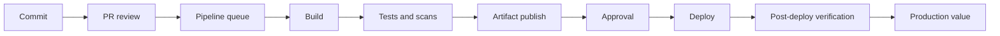
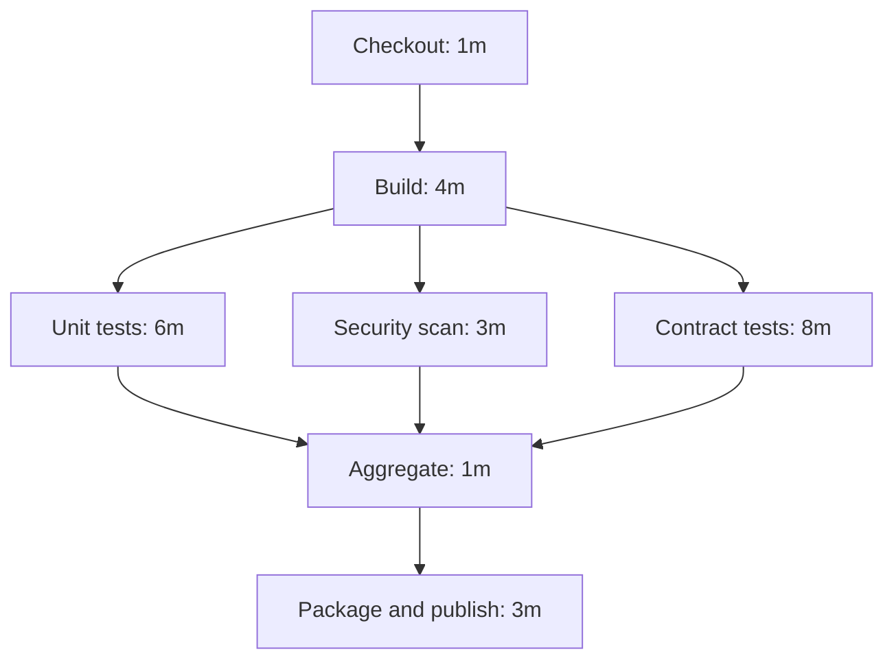

# Tìm điểm nghẽn bằng dữ liệu thay vì tăng số bước tự động hóa

Khi pipeline chậm, phản ứng quen thuộc là thêm runner, thêm cache, thêm job song song hoặc tự động hóa thêm một bước thủ công. Những thay đổi đó đôi khi có ích, nhưng cũng có thể làm hệ thống phức tạp hơn mà thời gian chờ của developer gần như không giảm. Nếu bottleneck thực sự nằm ở một bộ test mất 25 phút, một approval phải chờ cả ngày hoặc một môi trường staging chỉ có một slot, thêm nhiều bước tự động hóa khác sẽ không giải quyết được nguyên nhân.

Muốn cải thiện CI/CD, trước hết cần quan sát toàn bộ luồng công việc và đo thời gian ở từng điểm chuyển tiếp. Phải biết công việc chờ ở đâu, bước nào đang chiếm critical path, tài nguyên nào bão hòa, lỗi nào gây chạy lại và phần nào tạo ra giá trị cho chất lượng phát hành. Sau đó mới chọn thay đổi, đo lại và xác nhận tác động.

**Điểm nghẽn là giới hạn đang quyết định thông lượng hoặc thời gian hoàn tất của luồng công việc tại thời điểm quan sát.** Nó có thể là một job chậm, hàng đợi runner, dependency dùng chung, bước phê duyệt, môi trường triển khai hoặc tỷ lệ test flaky gây rework. Cải tiến hiệu quả bắt đầu từ dữ liệu của luồng thực tế, không phải từ số lượng bước được thêm vào pipeline.

## 1. Vì sao không nên mặc định pipeline cần thêm automation?

Automation giảm thao tác thủ công lặp lại, tăng tính nhất quán và có thể rút ngắn thời gian xử lý. Nhưng mỗi bước tự động hóa cũng tạo thêm cấu hình, dependency, runner usage, log, quyền truy cập và failure mode.

Ví dụ, nhóm thấy pipeline mất 40 phút và quyết định thêm bốn job kiểm tra mới chạy song song. Nếu các job đó đều chờ một database integration environment chỉ có một slot, thời gian chờ có thể tăng. Nếu chúng tạo thêm report cần approval thủ công, lead time có thể còn dài hơn.

Trước khi thêm automation, hãy trả lời:

- Vấn đề quan sát được là thời gian chạy, thời gian chờ, tỷ lệ lỗi hay chi phí?
- Bước nào đang giới hạn toàn bộ luồng?
- Có dữ liệu nào chứng minh bước đó là bottleneck?
- Thay đổi đề xuất tác động trực tiếp đến giới hạn nào?
- Có thể loại bỏ, đơn giản hóa hoặc chạy song song công việc hiện tại không?
- Làm sao đo được kết quả sau thay đổi?

Automation nên giải quyết một nhu cầu đã xác định. Nếu không có giả thuyết và phép đo, thêm bước mới chỉ làm tăng bề mặt vận hành.

## 2. Phân biệt các loại thời gian trong CI/CD

Một con số “pipeline duration” thường không đủ để tìm bottleneck. Cần tách thời gian theo từng giai đoạn và phân biệt thời gian thực thi với thời gian chờ.

| Chỉ số thời gian | Ý nghĩa | Ví dụ |
|---|---|---|
| Lead time for change | Từ lúc thay đổi được tạo/commit đến khi chạy trong production | Commit lúc 09:00, production lúc 16:00: 7 giờ |
| PR/MR cycle time | Từ lúc mở review đến khi merge | PR chờ review 3 giờ và xử lý review 1 giờ |
| Pipeline duration | Từ lúc pipeline bắt đầu đến khi kết thúc | 28 phút |
| Queue time | Thời gian chờ runner, executor hoặc resource slot | Job chờ runner 6 phút |
| Execution time | Thời gian job/step thực sự chạy | Test job chạy 14 phút |
| Approval wait | Thời gian chờ người hoặc policy approval | Chờ release owner 90 phút |
| Environment wait | Thời gian chờ môi trường hoặc dependency sẵn sàng | Chờ staging slot 12 phút |
| Rework time | Thời gian chạy lại do lỗi, flaky test hoặc cấu hình sai | Rerun mất thêm 18 phút |
| Deployment verification time | Thời gian chờ đủ bằng chứng sau deploy | Quan sát canary 20 phút |

Lead time bao gồm nhiều hoạt động ngoài pipeline. Pipeline duration không phản ánh thời gian PR chờ review, approval hay môi trường. Nếu mục tiêu là rút ngắn thời gian đưa thay đổi đến production, tối ưu một job từ 10 phút xuống 5 phút có thể không đáng kể khi approval đang chờ 8 giờ.

## 3. Xác định ranh giới đo và câu hỏi cần trả lời

Trước khi thu thập dữ liệu, hãy định nghĩa rõ luồng cần cải thiện. Ví dụ, đo từ commit đến production, từ pipeline trigger đến required checks hoàn tất, hoặc từ lúc bắt đầu deploy đến lúc validation pass.

Một phép đo cần xác định:

1. **Đối tượng:** một pipeline, một component, một repository, một team hay toàn bộ release flow.
2. **Điểm bắt đầu:** commit, push, PR opened, pipeline queued hay deployment requested.
3. **Điểm kết thúc:** merge, artifact published, production healthy hay release verified.
4. **Phạm vi thời gian:** giờ cao điểm, tuần, sprint hoặc release window.
5. **Đơn vị phân tích:** pipeline run, change, job, deployment hay incident.
6. **Phân đoạn:** branch, service, runner type, test suite, environment hoặc team.

Không thay đổi định nghĩa metric giữa baseline và giai đoạn sau cải tiến. Nếu đổi cách tính, cần ghi phiên bản định nghĩa và giải thích cách so sánh.

## 4. Vẽ value stream của một thay đổi

Value stream là chuỗi hoạt động mà một thay đổi đi qua từ lúc được tạo đến khi tạo ra kết quả có giá trị cho người dùng. Với CI/CD, luồng có thể gồm coding, review, build, test, security checks, package, approval, deploy và post-deployment validation.

Với mỗi bước, ghi lại:

- Thời điểm bắt đầu và kết thúc.
- Thời gian chạy và thời gian chờ.
- Số lần retry hoặc rerun.
- Input/output và dependency.
- Người hoặc hệ thống chịu trách nhiệm.
- Điều kiện khiến bước bị block.
- Tỷ lệ thất bại và nguyên nhân.

Value stream map giúp thấy rõ bước nào tạo giá trị, bước nào cần thiết để kiểm soát rủi ro và bước nào chỉ tạo thêm hàng đợi hoặc rework.

## 5. Thu thập dữ liệu từ đúng nguồn

Không có một dashboard duy nhất luôn chứa đủ dữ liệu. Cần nối dữ liệu từ source control, CI scheduler, runner, test framework, artifact store, deployment controller và observability platform.

| Nguồn dữ liệu | Thông tin cần lấy | Dùng để tìm vấn đề gì? |
|---|---|---|
| Git/SCM | Commit, PR, review, merge, changed files | Thời gian chờ review, kích thước thay đổi, tần suất thay đổi |
| CI orchestration | Trigger, queue, job start/end, status, retry | Queue time, critical path, failure và scheduling |
| Runner/agent | CPU, memory, disk, startup, image pull | Thiếu capacity, runner quá tải hoặc setup chậm |
| Test framework | Test duration, failure, seed, shard, flaky/retry | Test chậm, mất cân bằng shard và test không ổn định |
| Dependency/cache | Download time, cache hit/miss, registry latency | Tắc nghẽn dependency hoặc cache không hiệu quả |
| Artifact registry | Publish/download time, size, retention | Artifact transfer chậm hoặc package quá lớn |
| Environment/deploy | Provision, approval, rollout, health check | Chờ môi trường, approval và deployment |
| Monitoring/logs/traces | Latency, errors, saturation, dependency calls | Xác định nguyên nhân runtime và bottleneck ngoài CI |
| Incident/change records | Incident, rollback, failed change, recovery | Đánh giá chất lượng và rủi ro của tốc độ phát hành |

### Nối dữ liệu bằng định danh

Để truy vết một thay đổi xuyên hệ thống, nên dùng các định danh ổn định như:

- Repository và commit SHA.
- Pull/merge request ID.
- Pipeline run ID và job ID.
- Release/deployment ID.
- Artifact digest.
- Environment và service/component.
- Trace/correlation ID cho thao tác liên quan runtime.

Không nối dữ liệu chỉ bằng branch name hoặc timestamp gần nhau. Branch có thể thay đổi và nhiều pipeline có thể chạy cùng lúc. Định danh ổn định giúp phân biệt run, artifact và deployment thực tế.

## 6. Bộ metric nền tảng để tìm bottleneck

Không cần đo hàng trăm chỉ số ngay từ đầu. Hãy bắt đầu bằng các metric phản ánh thời gian, thông lượng, độ ổn định và mức sử dụng tài nguyên.

| Nhóm | Metric | Câu hỏi |
|---|---|---|
| Flow | Lead time, cycle time, throughput | Thay đổi mất bao lâu để đến production? Bao nhiêu thay đổi hoàn tất mỗi tuần? |
| CI latency | Pipeline duration, queue time, job duration | Chậm ở scheduler hay ở bước thực thi? |
| Balance | Critical path, shard duration p50/p95, imbalance | Job hoặc shard nào quyết định thời gian hoàn tất? |
| Reliability | Failure rate, flaky rate, retry rate, rerun rate | Bao nhiêu thời gian bị mất vì kết quả không ổn định? |
| Capacity | Runner utilization, queue depth, CPU/memory, concurrency | Có thiếu hoặc phân bổ sai tài nguyên không? |
| Dependency | Cache hit ratio, download time, registry latency | Build có chờ tải dependency hoặc artifact không? |
| Deployment | Deployment frequency, change failure rate, recovery time | Tốc độ có đi cùng chất lượng phát hành không? |
| Cost | Runner minutes, storage, network, cost per successful change | Cải tiến có tạo hiệu quả tương xứng với chi phí không? |

Chỉ số nên được xem cùng nhau. Queue time thấp nhưng execution time cao cho thấy vấn đề khác với queue time cao và runner utilization gần 100%.

## 7. Phân tích pipeline duration và critical path

Pipeline có nhiều job chạy song song, nên tổng thời lượng không bằng tổng thời lượng của mọi job. Thời gian hoàn tất phụ thuộc đường đi dài nhất trong DAG, còn gọi là critical path.

Ví dụ:

Trong ví dụ này, contract test là nhánh dài nhất. Tối ưu security scan từ 3 phút xuống 1 phút không làm pipeline nhanh hơn nếu nhánh contract test vẫn mất 8 phút và không có thay đổi khác. Tối ưu đúng điểm cần tập trung vào nhánh quyết định thời gian hoàn tất.

### Tính critical path

Với DAG đơn giản, có thể tính thời điểm kết thúc sớm nhất của mỗi node bằng thời điểm kết thúc lớn nhất của các dependency cộng duration của node đó. Đường có tổng duration lớn nhất là critical path.

Không chỉ xem job dài nhất riêng lẻ. Một job 10 phút có thể không nằm trên critical path nếu nó chạy song song với nhánh 15 phút. Một job 4 phút nằm nối tiếp trên critical path lại có thể trực tiếp kéo dài tổng thời gian.

## 8. Đo queue time và runner utilization

Queue time là thời gian từ lúc job đủ điều kiện chạy đến lúc runner bắt đầu thực thi. Nếu queue time lớn, tăng tốc command bên trong job không giải quyết được phần thời gian chờ.

Các tín hiệu cần quan sát:

- Queue depth theo runner pool và label.
- Queue time p50, p95 và p99.
- Runner utilization theo giờ.
- Job pending do thiếu capacity, quota hoặc label mismatch.
- Thời gian provision runner và pull image.
- Số runner idle nhưng không nhận job do constraint.
- Tỷ lệ job bị hủy khi đang chờ.

### Đọc utilization đúng cách

Runner CPU 100% trong lúc test có thể là dấu hiệu sử dụng tốt nếu thời gian hoàn tất vẫn đạt mục tiêu. Nhưng utilization cao cùng queue time tăng cho thấy pool có thể thiếu capacity. Ngược lại, CPU thấp nhưng job chờ lâu có thể do giới hạn concurrency, lock, network hoặc một loại runner không đủ điều kiện nhận job.

Không nên chỉ tăng số runner trước khi kiểm tra job có bị gắn label quá hẹp, runner image khởi động chậm hay dependency ngoài runner đang chặn.

## 9. Dùng Little's Law để hiểu hàng đợi

Little's Law mô tả quan hệ giữa số công việc trung bình trong hệ thống, thông lượng và thời gian trung bình một công việc ở trong hệ thống:

\[
L = \lambda W
\]

Trong đó:

- `L`: số công việc trung bình đang chờ hoặc đang xử lý trong phạm vi đo.
- `λ`: thông lượng trung bình, số công việc hoàn tất trong một đơn vị thời gian.
- `W`: thời gian trung bình một công việc ở trong hệ thống.

Ví dụ, nếu trung bình có 24 job trong queue/pool và hệ thống hoàn tất 12 job mỗi giờ, thời gian trung bình trong hệ thống xấp xỉ 2 giờ. Nếu muốn giảm thời gian, có thể tăng throughput bằng cách gỡ bottleneck hoặc giảm lượng công việc đến hệ thống; chỉ tăng số job đang chờ không tạo ra thông lượng.

Little's Law áp dụng khi hệ thống ở trạng thái ổn định trong khoảng quan sát và các đại lượng được đo trên cùng ranh giới. Không dùng công thức để suy luận từ một đợt spike ngắn hoặc trộn queue của nhiều loại job có hành vi khác nhau.

## 10. Phân biệt bottleneck về capacity và bottleneck về flow

Không phải mọi điểm nghẽn đều giải quyết bằng thêm CPU hoặc runner.

| Loại bottleneck | Dấu hiệu | Hướng điều tra |
|---|---|---|
| Capacity | Queue tăng, runner/DB/API bão hòa | Tối ưu mức song song, tăng hoặc phân bổ capacity |
| Slow execution | Một job hoặc test suite chạy lâu | Profile command, test, build và dependency |
| Serial dependency | Nhiều job chờ một bước tuần tự | Xem lại DAG và ranh giới dependency |
| Approval/process | Job hoàn tất nhưng release chờ người hoặc lịch | Đo approval wait, quyền và lịch release |
| Environment | Chờ provision, lock hoặc slot | Tối ưu môi trường, namespace và lifecycle |
| Rework | Retry, flaky test, failed deployment | Loại bỏ nguyên nhân lỗi và giảm biến động |
| Data/dependency | Cache miss, tải package, registry chậm | Cache, mirror, dependency pinning và artifact locality |
| Policy | Gate hoặc rule không rõ làm job bị block | Làm rõ policy, owner và trạng thái unknown/waiver |

Trước khi can thiệp, cần xác định bottleneck đang nằm ở flow, capacity, chất lượng đầu vào hay quyết định quản trị.

## 11. Những điểm nghẽn thường gặp trong CI/CD

### 11.1. Build và dependency resolution

Build chậm có thể do compile lặp, dependency tải từ xa, cache không đúng key, annotation processing hoặc build graph không tối ưu. Hãy đo riêng dependency resolution, configuration, compilation, test và packaging.

### 11.2. Test suite

Một vài test integration/E2E nặng có thể quyết định critical path. Cần đo duration từng test, cân bằng shard, cô lập dữ liệu và kiểm tra test flaky gây rerun.

### 11.3. Runner pool

Runner có thể thiếu, provision chậm, image quá lớn, label không khớp hoặc bị dùng chung với workload khác. Phân đoạn queue theo pool và job type để tìm nguyên nhân.

### 11.4. Dependency dùng chung

Database, package registry, API sandbox, container registry hoặc message broker có thể bị quá tải khi parallelism tăng. Thêm runner đôi khi làm bottleneck nặng hơn.

### 11.5. Approval và release window

Pipeline có thể hoàn tất trong 20 phút nhưng chờ người duyệt 6 giờ hoặc chờ cửa sổ triển khai. Đây là process bottleneck, cần cải thiện ownership, policy và lịch làm việc thay vì tối ưu compiler.

### 11.6. Provisioning môi trường

Staging environment dùng chung, database reset chậm hoặc namespace không được cleanup có thể tạo hàng đợi. Cần đo thời gian provision và teardown riêng.

### 11.7. Post-deployment observation

Canary cần cửa sổ quan sát và số mẫu đủ. Không nên rút ngắn thời gian chỉ để dashboard đẹp hơn nếu điều đó làm giảm khả năng phát hiện regression. Cải thiện ở đây có thể là chọn metric tốt hơn hoặc thu thập dữ liệu nhanh hơn, không nhất thiết bỏ bước xác minh.

## 12. Đo rework: failure, retry và flaky test

Pipeline có thể nhanh khi chạy lần đầu nhưng chậm khi nhiều job phải chạy lại. Vì vậy, cần xem thời gian thực thi và thời gian rework.

Các chỉ số:

- First-run pass rate.
- Retry rate theo job/test suite.
- Flaky test rate.
- Infrastructure failure rate.
- Tỷ lệ rerun toàn pipeline so với rerun một job.
- Thời gian trung bình để xác định và sửa lỗi.
- Số lần rollback hoặc hotfix sau release.

### Phân loại failure trước khi retry

| Loại lỗi | Ví dụ | Cách xử lý |
|---|---|---|
| Product/test failure | Assertion fail, regression | Sửa code hoặc test theo nguyên nhân; không retry mù |
| Infrastructure transient | Runner mất kết nối, registry timeout | Retry có giới hạn và ghi nhận sự cố hạ tầng |
| Flaky test | Race condition, timing-sensitive assertion | Ghi nhận lần đầu, tìm nguyên nhân và gán owner |
| Configuration failure | Secret thiếu, sai environment variable | Sửa cấu hình hoặc policy; retry chỉ sau khi nguyên nhân được khắc phục |
| External dependency failure | API sandbox hoặc service ngoài bị outage | Dùng test double phù hợp, circuit breaker hoặc lịch chạy khác |

Retry không nên biến một lần thất bại thành pass không dấu vết. Nếu lần đầu fail và lần hai pass, report cần thể hiện trạng thái flaky/retried để nhóm nhìn thấy rework.

## 13. Phân tích phân phối thay vì chỉ nhìn trung bình

Average có thể che giấu trải nghiệm của phần lớn hoặc nhóm job chậm. Một pipeline có median 12 phút nhưng p95 50 phút cho thấy một nhóm run bị kéo dài đáng kể.

Nên xem:

- p50: trải nghiệm điển hình.
- p75/p90: phần lớn run nhưng có độ trễ cao hơn.
- p95/p99: tail latency và trường hợp rất chậm.
- Min/max: chỉ dùng để phát hiện cực trị, không làm đại diện chính.
- Histogram: thấy phân phối nhiều cụm hoặc mode khác nhau.

Phân đoạn theo component, branch, runner pool, loại test, thời gian trong ngày và kích thước thay đổi. Nếu chỉ đo trung bình toàn tổ chức, bottleneck của một service quan trọng có thể bị hòa loãng bởi hàng trăm pipeline nhanh.

### Ví dụ

| Metric | p50 | p95 | Nhận xét |
|---|---:|---:|---|
| Queue time | 1 phút | 18 phút | Có giờ cao điểm hoặc pool thiếu capacity |
| Build duration | 4 phút | 6 phút | Khá ổn định |
| Integration tests | 9 phút | 34 phút | Có suite hoặc dependency bất thường |
| Approval wait | 25 phút | 5 giờ | Nút thắt có thể nằm ở quy trình người duyệt |

Trong ví dụ, tối ưu build 4 phút có thể ít tác động hơn xử lý integration tail hoặc approval wait.

## 14. Xác định bottleneck bằng giả thuyết và bằng chứng

Một quy trình điều tra có thể thực hiện theo vòng lặp:

1. **Mô tả triệu chứng:** ví dụ p95 lead time tăng từ 3 giờ lên 5 giờ.
2. **Phân rã luồng:** chia thời gian thành review, queue, build, test, approval, deploy và verify.
3. **Tìm đoạn chiếm nhiều thời gian:** xem p50/p95 và critical path.
4. **Đặt giả thuyết:** ví dụ runner pool Linux thiếu capacity vào buổi sáng.
5. **Tìm bằng chứng:** queue depth, runner utilization, label mismatch và job arrival rate.
6. **Kiểm tra yếu tố khác:** test duration, dependency outage, approval schedule.
7. **Chọn thay đổi nhỏ nhất:** tăng capacity theo giờ, điều chỉnh label hoặc tối ưu scheduling.
8. **Đo trước/sau:** dùng cùng định nghĩa, cùng phân đoạn và khoảng thời gian đủ đại diện.
9. **Giữ hoặc hoàn tác:** chỉ giữ thay đổi nếu tác động có lợi và không làm xấu metric khác.

### Ví dụ giả thuyết tốt

“p95 queue time của integration job tăng từ 2 lên 14 phút trong giờ 09:00–11:00; runner pool có utilization trên 90% và queue depth tăng cùng thời điểm. Nếu cấp thêm hai runner ephemeral cho pool này trong giờ cao điểm, p95 queue time sẽ giảm ít nhất 30% mà không làm tăng lỗi hoặc chi phí trên mỗi pipeline thành công quá ngưỡng.”

Giả thuyết này có metric, phạm vi, nguyên nhân dự kiến, hành động và điều kiện đánh giá. Nó có thể được kiểm chứng.

## 15. Ưu tiên điểm nghẽn theo tác động, không theo mức dễ thấy

Không phải vấn đề lâu nhất luôn là ưu tiên cao nhất. Cần xem mức ảnh hưởng đến lead time, throughput, độ tin cậy, chi phí và rủi ro.

Một cách xếp hạng thực dụng:

| Tiêu chí | Câu hỏi |
|---|---|
| Impact | Bao nhiêu developer, service hoặc release bị ảnh hưởng? |
| Frequency | Vấn đề xảy ra thường xuyên đến đâu? |
| Delay contribution | Nó đóng góp bao nhiêu vào critical path hoặc lead time? |
| Rework | Nó tạo thêm retry, rerun hoặc incident bao nhiêu? |
| Risk | Giải pháp có làm giảm test coverage hoặc quality gate không? |
| Cost | Chi phí runner, license, storage và vận hành thay đổi ra sao? |
| Confidence | Bằng chứng hiện tại mạnh đến đâu? |
| Effort | Cần bao nhiêu thời gian và phối hợp để sửa? |

Có thể dùng ma trận impact/effort để chọn quick win, nhưng không nên biến điểm số thành mục tiêu tuyệt đối. Một bottleneck bảo mật hoặc dữ liệu có thể cần xử lý dù effort cao.

## 16. Chọn đúng loại cải tiến

Sau khi tìm được bottleneck, hãy chọn thay đổi tác động trực tiếp đến nguyên nhân.

| Nguyên nhân | Cải tiến có thể thử | Điều cần bảo vệ |
|---|---|---|
| Runner queue cao | Điều chỉnh pool, autoscaling, scheduling hoặc concurrency | Chi phí, isolation và quota |
| Build chậm | Incremental build, dependency cache, remote cache, giảm work không cần thiết | Cache key, trust và reproducibility |
| Shard mất cân bằng | Duration-based sharding và theo dõi test mới | Test coverage, assignment ổn định |
| Test flaky | Cô lập dữ liệu, loại race, sửa timeout và dependency | Không che failure bằng retry vô hạn |
| Approval chờ lâu | Risk-based approval, owner rõ và lịch trực | Separation of duties và audit |
| Environment provisioning chậm | Ephemeral environment, image chuẩn và reusable fixture | Cleanup, data isolation và secret scope |
| Artifact transfer chậm | Registry gần runner, giảm artifact size, layer reuse | Digest, signature và provenance |
| DAG tuần tự quá mức | Tách job độc lập và giảm dependency không cần | Shared state và resource contention |
| Deploy/verification chậm | Tối ưu rollout orchestration và telemetry | Không rút ngắn guardrail quan trọng |
| Rework cao | Phân loại failure và sửa nguyên nhân gốc | Giữ lại first-run result và audit |

Một cải tiến tốt có thể là xóa một bước trùng lặp, giảm phạm vi test bị kích hoạt sai, sửa một test flaky hoặc thay đổi lịch approval. Không phải lúc nào cũng cần thêm automation.

## 17. Đánh giá trade-off khi tăng parallelism

Chạy nhiều job cùng lúc có thể giảm critical path, nhưng cũng tăng tranh chấp tài nguyên.

Các câu hỏi cần kiểm tra:

- CPU và memory runner có đủ không?
- Database connection pool có chịu được số worker mới không?
- API sandbox có rate limit không?
- Artifact registry có bị tăng tải không?
- Test có dùng chung dữ liệu hoặc account không?
- Nhiều job có cùng giữ lock hoặc chờ environment không?
- Tăng concurrency có làm queue của team khác dài hơn không?
- Chi phí trên mỗi pipeline thành công thay đổi ra sao?

Nếu runner utilization tăng nhưng throughput không tăng, bottleneck có thể đã chuyển sang dependency. Nếu tổng thời gian giảm nhưng flaky rate tăng, cải tiến chưa chắc tốt.

### Parallelism có điểm tối ưu

Với một workload nhất định, thời gian có thể giảm khi tăng worker cho đến lúc tài nguyên chung bão hòa. Sau điểm đó, thêm worker làm tăng contention, context switching, queue ở dependency và chi phí. Cần đo nhiều mức concurrency thay vì chọn mức lớn nhất có thể.

## 18. Cải thiện cache và dependency resolution dựa trên dữ liệu

Cache chỉ hữu ích khi dữ liệu được tái sử dụng và chi phí tạo lại lớn hơn chi phí tra cứu/tải cache.

Metric cần đo:

- Cache hit/miss rate.
- Thời gian restore và save cache.
- Kích thước cache và thời gian truyền.
- Tỷ lệ cache invalidation.
- Tỷ lệ build lỗi do cache stale hoặc corrupt.
- Dependency download time khi cold/warm cache.

Cache key quá rộng có thể trả dữ liệu không tương thích; quá hẹp khiến cache miss thường xuyên. Không nên tối ưu hit rate bằng cách bỏ qua lockfile, toolchain hoặc OS khỏi key nếu chúng ảnh hưởng tính đúng đắn.

Nếu cache restore mất 90 giây nhưng build cold chỉ mất 60 giây, cache đó không tạo lợi ích. Cần đo thời gian end-to-end thay vì chỉ báo hit rate.

## 19. Tối ưu test suite theo critical path và rework

Test là một điểm nghẽn phổ biến nhưng không nên giải quyết bằng cách xóa test hoặc giảm coverage mà không đánh giá rủi ro.

Các hướng cải tiến:

- Đo duration từng test và shard.
- Chuyển test nhanh, ổn định vào vòng PR; giữ test dài phù hợp ở integration/nightly nếu policy cho phép.
- Dùng test selection dựa trên dependency graph, có full-suite fallback.
- Cô lập dữ liệu để tăng parallelism an toàn.
- Giảm setup lặp lại bằng fixture/container phù hợp.
- Sửa test flaky để giảm rework.
- Dùng contract test để giảm số lần cần dựng toàn hệ thống, nhưng vẫn giữ system test cần thiết.
- Kiểm tra report tổng hợp không bỏ sót shard.

Đánh giá cải tiến bằng thời gian phản hồi, first-run pass rate, defect escape và chi phí. Một pipeline nhanh hơn nhưng để lọt regression nghiêm trọng không phải là thành công.

## 20. Tối ưu approval và bước thủ công

Approval wait có thể là phần lớn lead time dù thời gian thực thi rất ngắn. Cần phân biệt approval thực sự bảo vệ rủi ro với approval chỉ tồn tại vì thói quen.

Có thể cải thiện bằng:

- Xác định rõ owner và người thay thế khi vắng mặt.
- Đặt notification và SLA phản hồi phù hợp.
- Tự động hóa kiểm tra khách quan, giữ approval cho quyết định rủi ro.
- Dùng risk-based approval: thay đổi có rủi ro thấp đi theo policy đã phê duyệt trước; thay đổi nhạy cảm cần reviewer thích hợp.
- Hiển thị artifact digest, test, scan, rollout plan và recovery plan ngay trong yêu cầu duyệt.
- Theo dõi thời gian chờ và tỷ lệ approval bị trả lại.

Không nên xóa approval chỉ để giảm lead time nếu nó là kiểm soát bắt buộc. Mục tiêu là giảm thời gian chờ không tạo giá trị và giúp người duyệt có đủ thông tin.

## 21. Đo deployment performance cùng với chất lượng

Tốc độ phát hành cần được xem cùng độ ổn định. Có thể dùng nhóm metric DORA như deployment frequency, lead time for changes, change failure rate và failed deployment recovery time, kết hợp các metric CI chi tiết.

| Metric | Câu hỏi | Cẩn trọng khi diễn giải |
|---|---|---|
| Deployment frequency | Bao lâu có deployment thành công? | Tăng số deploy không đồng nghĩa tăng giá trị nếu deploy rỗng hoặc nhỏ không cần thiết |
| Lead time for changes | Thay đổi mất bao lâu để đến production? | Phải định nghĩa điểm bắt đầu/kết thúc nhất quán |
| Change failure rate | Bao nhiêu deployment gây incident, rollback hoặc hotfix? | Cần định nghĩa failure và liên kết đúng deployment |
| Failed deployment recovery time | Mất bao lâu để khôi phục sau deployment lỗi? | Tách phát hiện, quyết định và phục hồi |
| Pipeline duration | Thời gian pipeline chạy | Không bao gồm mọi thời gian chờ ngoài pipeline |
| First-run pass rate | Bao nhiêu run đạt ngay lần đầu? | Phân loại infrastructure failure và product failure |

Không nên tối ưu một metric bằng cách làm xấu metric khác. Ví dụ, giảm lead time bằng cách bỏ security scan có thể làm change failure rate hoặc security risk tăng.

## 22. Thiết kế dashboard giúp tìm nguyên nhân

Dashboard nên hỗ trợ điều tra, không chỉ trình bày một điểm số tổng hợp.

Một dashboard CI/CD có thể chia thành:

1. **Flow overview:** throughput, lead time, cycle time và backlog.
2. **Pipeline latency:** queue time, duration p50/p95 và critical path.
3. **Job breakdown:** duration, retry, failure và runner pool theo job type.
4. **Test health:** flaky rate, slow tests, shard imbalance và missing reports.
5. **Capacity:** runner utilization, queue depth, dependency saturation.
6. **Release quality:** deployment frequency, change failure, rollback và recovery.
7. **Cost:** runner minutes, artifact storage, network và cost per successful change.

Mọi chart cần filter theo repository, service, branch, environment và khoảng thời gian. Khi click vào một điểm bất thường, người vận hành cần đi được đến pipeline run, job log, test report hoặc deployment record tương ứng.

### Định nghĩa metric rõ ràng

Mỗi metric nên có tên, mô tả, đơn vị, query/source, aggregation, labels, owner và phiên bản định nghĩa. Nếu metric được thay đổi, dashboard cần ghi mốc để tránh so sánh dữ liệu không cùng semantics.

## 23. Cảnh báo và ngưỡng hành động

Không phải mọi metric chậm đều cần alert ngay. Cảnh báo nên gắn với mục tiêu dịch vụ hoặc ngưỡng ảnh hưởng đến developer/release.

Ví dụ:

| Tín hiệu | Ngưỡng minh họa | Hành động |
|---|---|---|
| p95 queue time | Vượt 10 phút trong 3 cửa sổ liên tiếp | Kiểm tra runner pool, quota và arrival rate |
| p95 PR feedback | Vượt mục tiêu team đã thống nhất | Xem critical path và test selection |
| Flaky test rate | Tăng trên baseline trong nhiều ngày | Mở issue theo owner và suite |
| Missing shard reports | Bất kỳ required shard nào thiếu | Chặn quality gate và điều tra pipeline |
| Artifact download latency | Vượt SLO nội bộ | Kiểm tra registry, network và artifact size |
| Change failure rate | Tăng so với baseline | Phân tích deployment và validation evidence |

Các ngưỡng chỉ là ví dụ. Cần đặt theo baseline, SLO, số lượng run và tác động. Alert nên có owner, runbook và hành động rõ; cảnh báo không có người xử lý chỉ tạo noise.

## 24. Thử nghiệm cải tiến và xác minh trước/sau

Một thay đổi tối ưu nên được xem như một thử nghiệm có giả thuyết. Trước khi triển khai, ghi nhận baseline; sau đó thay đổi một yếu tố chính nếu có thể và đo lại trên cùng phạm vi.

Quy trình:

1. Chọn bottleneck có bằng chứng rõ.
2. Ghi metric baseline và cửa sổ quan sát.
3. Đặt giả thuyết và mức cải thiện mong đợi.
4. Chọn thay đổi có phạm vi nhỏ và cách rollback.
5. Đo sau thay đổi với cùng định nghĩa metric.
6. Kiểm tra cả metric mục tiêu lẫn guardrail.
7. Phân tích theo component, runner pool hoặc loại pipeline.
8. Giữ, điều chỉnh hoặc hoàn tác dựa trên kết quả.
9. Cập nhật runbook/template nếu cải tiến trở thành chuẩn.

### Ví dụ bảng trước/sau

| Metric | Baseline | Sau cải tiến | Thay đổi |
|---|---:|---:|---:|
| p95 queue time | 12 phút | 5 phút | Giảm 58,3% |
| p95 pipeline duration | 31 phút | 25 phút | Giảm 19,4% |
| First-run pass rate | 91% | 95% | Tăng 4 điểm % |
| Runner minutes/run | 42 | 48 | Tăng 14,3% |

Kết quả cho thấy thời gian giảm nhưng runner cost tăng. Nhóm cần xem lợi ích về feedback có xứng đáng với chi phí không, và liệu có thể giảm runner minutes bằng scheduling hoặc cache mà vẫn giữ p95 thấp.

## 25. Ví dụ xuyên suốt: tìm bottleneck của pipeline orders-api

Một nhóm nhận thấy developer thường chờ gần một giờ để biết PR có thể merge. Thay vì thêm runner ngay, nhóm đo 200 pipeline gần nhất và phân rã thời gian:

| Giai đoạn | p50 | p95 |
|---|---:|---:|
| Chờ runner | 2 phút | 16 phút |
| Build/dependency | 5 phút | 7 phút |
| Unit test | 6 phút | 8 phút |
| Integration test | 14 phút | 31 phút |
| Security scan | 3 phút | 4 phút |
| Aggregate/report | 1 phút | 2 phút |

Phân tích sâu cho thấy:

- Queue tăng trong khung 09:00–11:00 do nhiều team dùng chung runner pool.
- Integration shard thứ tư mất lâu vì một số test migration chạy tuần tự.
- Test retry tăng do database container dùng chung state.
- Security scan không nằm trên critical path ở phần lớn run.

Nhóm đặt ba giả thuyết riêng. Thứ nhất, runner pool riêng cho integration jobs trong giờ cao điểm sẽ giảm queue. Thứ hai, cô lập database schema theo shard và sửa test migration sẽ giảm rework. Thứ ba, duration-based sharding sẽ cân bằng critical path.

Nhóm thử từng thay đổi theo giai đoạn và theo dõi p95 queue, integration duration, flaky rate, runner minutes và defect escape. Kết quả sau cải tiến cho thấy p95 feedback giảm, first-run pass rate tăng và chi phí runner chỉ tăng nhẹ. Nhóm giữ thay đổi, cập nhật template và tiếp tục theo dõi.

Điểm quan trọng là nhóm không thêm bước automation mới một cách tùy ý. Họ dùng dữ liệu để tìm các giới hạn cụ thể và chọn thay đổi tác động trực tiếp đến chúng.

## 26. Anti-pattern khi đo lường và cải tiến

| Anti-pattern | Hệ quả | Cách cải thiện |
|---|---|---|
| Chỉ nhìn pipeline duration trung bình | Không biết thời gian chờ hoặc tail latency | Tách queue/execution/approval và xem p50/p95 |
| Thêm runner trước khi tìm bottleneck | Tăng chi phí hoặc làm dependency quá tải | Đo utilization, queue và saturation |
| Tối ưu job không nằm trên critical path | Tổng thời gian gần như không đổi | Phân tích DAG và critical path |
| Tăng parallelism không kiểm soát | Race, flaky test và contention | Cô lập dữ liệu, giới hạn theo dependency |
| Giảm test để pipeline nhanh | Defect escape và rủi ro release tăng | Test selection có fallback và đo chất lượng |
| Retry đến khi pass | Che flaky test và mất dấu rework | Giới hạn retry, giữ first-run result |
| Dùng một metric làm mục tiêu duy nhất | Tối ưu cục bộ gây hại hệ thống | Kết hợp speed, quality, reliability và cost |
| So sánh trước/sau khác định nghĩa | Kết luận sai | Version hóa metric và giữ cùng ranh giới đo |
| Dashboard quá nhiều chart không có owner | Khó hành động và alert fatigue | Chọn metric dẫn dắt, owner và runbook |
| Đo số bước automation | Khuyến khích thêm bước thay vì tạo giá trị | Đo lead time, flow efficiency và outcome |
| Bỏ qua approval/environment wait | Tối ưu CI nhưng lead time không giảm | Đo toàn value stream đến production |

## 27. Checklist tìm điểm nghẽn bằng dữ liệu

Trước khi đề xuất cải tiến CI/CD, nhóm có thể rà soát:

- [ ] Đã xác định mục tiêu: lead time, feedback time, throughput, reliability hay cost.
- [ ] Đã định nghĩa ranh giới bắt đầu/kết thúc và đơn vị đo.
- [ ] Có dữ liệu nối commit, PR, pipeline, job, artifact và deployment.
- [ ] Đã tách queue time, execution time, approval wait và rework.
- [ ] Đã xem p50/p95 và phân đoạn theo service, job type, runner pool.
- [ ] Đã xác định critical path trong execution DAG.
- [ ] Đã kiểm tra runner utilization, queue depth và dependency saturation.
- [ ] Đã phân loại failure, retry, flaky test và infrastructure error.
- [ ] Đã kiểm tra cache/dependency/artifact transfer time.
- [ ] Đã đo thời gian chờ approval và environment provisioning.
- [ ] Giả thuyết cải tiến có metric, phạm vi và kết quả mong đợi.
- [ ] Thay đổi không làm yếu security gate, test coverage hoặc validation.
- [ ] Có baseline và cửa sổ so sánh trước/sau tương đương.
- [ ] Theo dõi guardrail về chất lượng, chi phí và độ ổn định.
- [ ] Có owner, dashboard và runbook cho metric quan trọng.
- [ ] Kết quả được ghi nhận và cập nhật vào pipeline/template khi phù hợp.

## 28. Kết luận

Tìm điểm nghẽn trong CI/CD là bài toán đo lường luồng công việc, không phải cuộc thi thêm nhiều bước tự động hóa. Cần phân biệt thời gian chạy với thời gian chờ, xem critical path thay vì chỉ cộng duration, phân tích queue và capacity, nhận diện rework do lỗi/flaky test, đồng thời đo cả approval, environment và post-deployment verification.

Một vòng cải tiến có hiệu quả bắt đầu từ baseline, xác định bottleneck bằng dữ liệu, đặt giả thuyết có thể kiểm chứng, thay đổi có phạm vi và đo lại cả tốc độ, chất lượng, độ ổn định lẫn chi phí. Khi các metric có định nghĩa rõ, liên kết được với commit và deployment, dashboard có owner và quyết định dựa trên bằng chứng, nhóm sẽ biết nên loại bỏ, đơn giản hóa, tối ưu hay tự động hóa bước nào để cải thiện kết quả thực tế.
