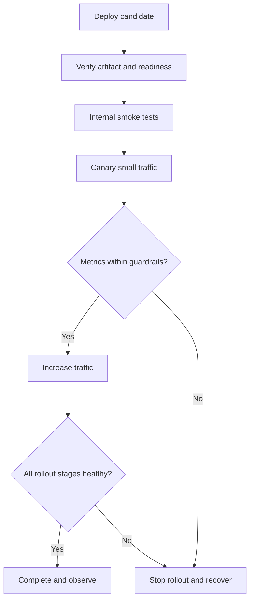

# Triển khai mà không kiểm chứng dịch vụ sau thay đổi

Một pipeline có thể báo deploy thành công trong khi người dùng vẫn không sử dụng được dịch vụ. Lệnh cập nhật workload trả mã thoát bằng 0, Kubernetes rollout hoàn tất hoặc cloud API chấp nhận cấu hình mới chỉ chứng minh một thao tác triển khai đã diễn ra theo một mức nào đó. Những tín hiệu đó chưa chứng minh request thật có thể đi qua ingress, ứng dụng đọc được cấu hình mới, dependency hoạt động, dữ liệu tương thích hoặc luồng nghiệp vụ vẫn đúng.

Đây là lỗi tư duy phổ biến: **đồng nhất trạng thái triển khai với trạng thái sức khỏe của dịch vụ**. Nhóm nhìn thấy pipeline xanh và kết luận release đã thành công mà không xác minh hệ thống sau thay đổi. Hệ quả là lỗi chỉ xuất hiện khi người dùng gửi request, worker xử lý hàng đợi, traffic tăng hoặc dữ liệu thực tế đi qua code mới.

Trong CI/CD, hoàn tất deployment chỉ là một mốc trong vòng đời phát hành. Cần xác minh trạng thái quan sát được của service sau khi thay đổi, đối chiếu với kết quả mong đợi và giữ đủ thời gian quan sát để phát hiện vấn đề có độ trễ. Việc kiểm chứng phải có tiêu chí rõ ràng, chạy trong đúng môi trường và tạo bằng chứng gắn với release cụ thể.

## 1. Vì sao deploy thành công chưa có nghĩa dịch vụ khỏe?

Một lần triển khai thường đi qua nhiều lớp:

1. Pipeline gửi yêu cầu tới deployment platform.
2. Platform chấp nhận manifest, image hoặc cấu hình.
3. Controller tạo hoặc cập nhật workload.
4. Process/container khởi động.
5. Instance được đánh dấu Ready.
6. Traffic được chuyển tới instance mới.
7. Ứng dụng giao tiếp với dependency và xử lý request.
8. Luồng nghiệp vụ tạo ra kết quả đúng.

Mỗi bước chỉ xác nhận một phần. Một deployment controller có thể báo rollout hoàn tất vì đủ replica đã Ready, nhưng readiness endpoint lại chỉ kiểm tra process còn sống. API có thể trả HTTP 200 trong khi truy vấn database bị lỗi. Một trang chủ có thể tải được nhưng thao tác tạo đơn hàng thất bại vì message broker chưa cấp quyền.

Hãy phân biệt các khái niệm:

| Trạng thái | Điều đã được xác nhận | Điều chưa chắc chắn |
|---|---|---|
| Deploy command succeeded | Lệnh hoặc API triển khai hoàn tất theo hợp đồng | Workload có phục vụ request đúng không |
| Workload started | Process/container đã khởi động | Dependency và nghiệp vụ có hoạt động không |
| Rollout complete | Controller đạt điều kiện rollout | Traffic path, dữ liệu và business flow có đúng không |
| Readiness passed | Probe trả kết quả đạt theo cấu hình | Probe có bao phủ đủ chức năng quan trọng không |
| Smoke test passed | Một số luồng đại diện hoạt động | Lỗi hiếm, tải cao hoặc xử lý nền có thể vẫn tồn tại |
| Release verified | Các điều kiện sau deploy đã đạt trong phạm vi và thời gian xác định | Rủi ro ngoài phạm vi kiểm tra vẫn cần telemetry theo dõi |

Không nên gom tất cả các trạng thái thành một chữ `success` không có ý nghĩa cụ thể. Một báo cáo tốt cho biết pipeline đã xác nhận tới đâu và còn điều gì đang được quan sát.

## 2. Những biểu hiện của lỗi tư duy này

Các dấu hiệu thường gặp:

- Job deploy trả mã 0 nên pipeline kết thúc ngay, không có bước kiểm tra sau đó.
- Chỉ nhìn trạng thái pod `Running` hoặc số replica mong muốn.
- Dùng một health endpoint quá đơn giản rồi coi đó là bằng chứng đầy đủ.
- Chạy smoke test từ CI runner nhưng không đi qua network path của người dùng.
- Kiểm tra staging rồi suy ra production sẽ hoạt động giống hệt.
- Chỉ xem log khởi động, không gửi request thực tế.
- Không kiểm tra artifact digest đang chạy có đúng artifact đã phê duyệt không.
- Không theo dõi error rate, latency và business metric sau khi chuyển traffic.
- Không có observation window; job kết thúc ngay khi rollout hoàn tất.
- Khi kiểm tra thất bại, rerun deploy nhiều lần mà không tìm hiểu trạng thái thực tế.

Một dấu hiệu khác là release report chỉ có dòng “deployment succeeded” mà không có environment, release ID, digest, health result, smoke test result hoặc thời điểm xác minh.

## 3. Tình huống thực tế: workload khỏe nhưng dịch vụ hỏng

### 3.1. Ứng dụng dùng sai cấu hình

Container khởi động thành công nhưng `PAYMENTS_API_URL` vẫn trỏ tới endpoint staging. Health probe chỉ kiểm tra process nên pod Ready. Người dùng gọi chức năng thanh toán và nhận lỗi hoặc request bị gửi nhầm môi trường.

**Bài học:** kiểm tra cấu hình runtime và endpoint quan trọng từ chính môi trường đích; không chỉ xác nhận container đã chạy.

### 3.2. Kết nối dependency thất bại

Release thêm một truy vấn database mới. Database vẫn reachable nhưng database role production chưa có quyền đọc bảng mới. Readiness endpoint không truy vấn bảng đó nên vẫn trả 200. Lỗi chỉ xuất hiện khi người dùng gọi API mới.

**Bài học:** kiểm tra dependency và quyền thao tác tối thiểu cho những chức năng thực sự cần dùng; health check không nên chỉ xác nhận TCP port.

### 3.3. API trả thành công nhưng kết quả nghiệp vụ sai

Một endpoint tạo đơn hàng trả HTTP 201, nhưng event phát sang broker không được ghi do lỗi outbox worker. Người dùng thấy đơn hàng đã tạo, còn hệ thống kho không nhận được sự kiện.

**Bài học:** smoke test cần xác minh hậu điều kiện nghiệp vụ hoặc một luồng end-to-end an toàn, không dừng ở response code.

### 3.4. Lỗi chỉ xuất hiện khi traffic tăng

Deployment hoàn tất với vài request smoke test. Sau khi traffic được chuyển toàn bộ, connection pool cạn, p95 latency tăng và request bắt đầu timeout.

**Bài học:** một lần kiểm tra tức thời không thay thế observation window và so sánh với baseline dưới tải phù hợp.

### 3.5. Kiểm tra nhầm phiên bản

Pipeline gọi health endpoint qua load balancer nhưng request vẫn được phục vụ bởi instance cũ. Endpoint trả 200 nên job đánh dấu release mới thành công dù instance mới chưa nhận traffic hoặc chưa hoạt động.

**Bài học:** xác minh release ID hoặc artifact digest thực tế trên workload/response, đồng thời kiểm tra rollout và traffic distribution.

## 4. Tư duy đúng: xác minh kết quả quan sát được

Thay vì hỏi “lệnh deploy có thành công không?”, hãy hỏi:

- Đúng service và đúng môi trường đã được cập nhật chưa?
- Artifact digest/config revision thực tế có khớp nội dung đã phê duyệt không?
- Workload mới có sẵn sàng nhận traffic không?
- Request đi qua đường truy cập thật có thành công không?
- Dependency thiết yếu có thể được sử dụng không?
- Luồng nghiệp vụ đại diện có tạo kết quả đúng không?
- Error rate, latency và saturation có thay đổi bất thường không?
- Sau khoảng quan sát đã định, các điều kiện vẫn đạt không?

Định nghĩa trước một **verification contract** cho mỗi loại release. Contract nêu rõ đối tượng cần xác minh, điều kiện pass/fail, nguồn dữ liệu, timeout, observation window và hành động khi thất bại.

Ví dụ:

| Điều kiện | Bằng chứng | Tiêu chí tham khảo |
|---|---|---|
| Đúng release | Runtime image digest/release ID | Khớp artifact đã phê duyệt |
| Workload sẵn sàng | Rollout và readiness | Đủ replica Ready, không có restart bất thường |
| API phục vụ được | Request qua ingress thật | Status/schema đúng, latency trong ngưỡng |
| Dependency thiết yếu | Health/diagnostic operation | Xác thực và thao tác tối thiểu thành công |
| Luồng nghiệp vụ | Synthetic transaction an toàn | Hậu điều kiện được xác minh |
| Ổn định sau chuyển traffic | Metrics và logs | Error/latency không vượt ngưỡng trong observation window |

Ngưỡng cần được chọn theo đặc tính dịch vụ, SLO và baseline. Không lấy các con số ví dụ làm mặc định chung cho mọi hệ thống.

## 5. Kiểm chứng theo nhiều lớp

Không một phép kiểm tra đơn lẻ nào chứng minh toàn bộ hệ thống hoạt động đúng. Kết hợp nhiều lớp giúp giảm điểm mù.

### Lớp 1: Xác minh danh tính phiên bản

Đọc release ID, commit SHA, image/package digest hoặc config revision từ workload thực tế. So sánh với nội dung đã build và phê duyệt. Nếu có nhiều replica, kiểm tra phân bố phiên bản để phát hiện rollout chưa đồng nhất.

### Lớp 2: Xác minh trạng thái workload

Kiểm tra rollout, replica, restart count, crash loop, scheduling, resource pressure và readiness. Trạng thái `Running` đơn lẻ không đủ; container có thể chạy nhưng ứng dụng chưa nhận traffic hoặc đang liên tục restart.

### Lớp 3: Xác minh đường truy cập

Gửi request qua ingress, gateway, DNS và TLS như người dùng hoặc consumer thật. Với service nội bộ, kiểm tra từ đúng namespace/network identity. Điều này phát hiện lỗi route, certificate, authentication, authorization và service discovery.

### Lớp 4: Xác minh dependency

Kiểm tra database, cache, broker, object storage, identity provider và API phụ thuộc thiết yếu. Xác minh thao tác tối thiểu cần thiết như query read-only, đọc metadata hoặc kiểm tra topic permission. Tránh tạo side effect thật chỉ để chứng minh kết nối.

### Lớp 5: Xác minh nghiệp vụ

Chọn một hoặc vài luồng quan trọng có thể kiểm tra an toàn: tìm kiếm, đọc dữ liệu đại diện, tạo đối tượng synthetic rồi cleanup, hoặc thực hiện giao dịch thử trong sandbox. Kiểm tra hậu điều kiện thay vì chỉ xem HTTP status.

### Lớp 6: Quan sát sau chuyển traffic

Theo dõi error rate, latency, saturation, dependency errors và business metrics. So sánh với baseline và canary cohort. Điều kiện pass phải được duy trì trong khoảng thời gian xác định.

## 6. Health check không thay thế smoke test

Health check thường được gọi định kỳ bởi orchestrator hoặc load balancer. Nó phải nhanh, ổn định và có mục tiêu cụ thể. Smoke test được thiết kế để xác minh một số hành vi đại diện sau release.

| Kiểm tra | Mục đích | Câu hỏi cần trả lời |
|---|---|---|
| Startup probe | Cho ứng dụng thời gian khởi động | Process đã khởi tạo xong chưa? |
| Liveness probe | Phát hiện process cần restart | Ứng dụng còn có thể tiến triển không? |
| Readiness probe | Quyết định instance nhận traffic | Instance có thể phục vụ request hiện tại không? |
| Dependency check | Xác minh dependency thiết yếu | Ứng dụng có thể dùng tài nguyên cần thiết không? |
| Smoke test | Xác minh luồng quan trọng | Hành vi đại diện có hoạt động đúng không? |
| Synthetic monitoring | Theo dõi định kỳ từ góc nhìn người dùng | Dịch vụ có tiếp tục hoạt động theo thời gian không? |

Không đưa mọi dependency bên ngoài vào liveness probe. Nếu database tạm lỗi, tất cả pod có thể bị restart liên tục dù restart không sửa được network hoặc credential. Readiness có thể phản ánh dependency thiết yếu để tránh gửi traffic tới instance không thể phục vụ; dependency tùy chọn cần có degraded mode phù hợp.

## 7. Kiểm tra từ đúng nơi và đúng danh tính

Một lệnh `curl` thành công từ CI runner không chứng minh người dùng hoặc workload production truy cập được dịch vụ. Runner có thể nằm ở network khác, dùng DNS resolver khác, có proxy khác hoặc sở hữu quyền rộng hơn.

Chọn điểm kiểm tra theo đường đi cần xác minh:

- Kiểm tra external ingress từ một điểm gần người dùng.
- Kiểm tra service-to-service từ namespace hoặc workload identity tương ứng.
- Kiểm tra database/broker từ runtime context của service.
- Kiểm tra quyền đọc secret bằng cách thực hiện authentication an toàn, không in secret.
- Kiểm tra route và TLS bằng hostname, certificate chain và trust store thực tế.

Nếu dùng diagnostic job, hãy cấp quyền tối thiểu và cấu hình network tương đương với workload. Không cấp quyền production rộng chỉ để làm cho smoke test chạy được.

## 8. Xác minh artifact và cấu hình đang thực sự chạy

Một release có thể deploy thành công nhưng chạy nhầm image tag, chart hoặc config revision. Tag có thể bị ghi đè; tên version không chứng minh nội dung bất biến.

Nên xác minh:

- Artifact digest trên runtime khớp digest đã được phê duyệt.
- Commit/source revision gắn với artifact đúng release.
- ConfigMap, chart, manifest hoặc infrastructure revision đúng bản dự kiến.
- Secret reference trỏ đúng environment và version hợp lệ.
- Feature flag/targeting đang ở trạng thái dự kiến.
- Mọi replica/region đã hội tụ về revision đúng.

Lưu lại observed state trong deployment record. Nếu có drift, phân biệt thay đổi có chủ ý với rollout chưa hoàn tất hoặc thao tác ngoài pipeline. Không đánh dấu verified chỉ vì desired manifest đã được gửi.

## 9. Đừng chỉ kiểm tra response code

HTTP 200 hoặc 201 có thể vẫn đi kèm kết quả sai:

- Response có schema cũ hoặc thiếu trường mới.
- Dữ liệu trả về thuộc tenant hoặc môi trường khác.
- API trả thành công nhưng background job không được enqueue.
- Cache trả dữ liệu cũ sau khi migration.
- Endpoint trả 200 với trạng thái degraded nhưng caller không nhận biết.
- Request được xử lý bởi instance cũ.

Smoke test cần kiểm tra điều kiện nghiệp vụ tối thiểu: trường bắt buộc, trạng thái đối tượng, correlation ID hoặc hậu điều kiện có thể quan sát. Dữ liệu test phải được cô lập, không làm phát sinh thanh toán, email hoặc giao dịch production không mong muốn.

Ví dụ một kiểm tra có thể gọi API tạo đối tượng synthetic với idempotency key riêng, đọc lại đối tượng theo ID, xác minh trạng thái và cleanup theo policy. Nếu không thể cleanup an toàn, dùng endpoint read-only hoặc sandbox.

## 10. Quan sát đủ lâu để phát hiện lỗi có độ trễ

Một số lỗi không xuất hiện ngay sau deploy:

- Cache cần thời gian hết hạn hoặc được warm.
- Background worker bắt đầu xử lý queue sau vài phút.
- Batch job chạy theo lịch.
- Token/certificate cũ chỉ hết hạn sau một khoảng thời gian.
- Connection pool hoặc memory leak tích lũy theo tải.
- Canary metric cần đủ request để có ý nghĩa.
- Replication lag tăng sau khi traffic ghi nhiều.

Vì vậy, cần xác định observation window dựa trên loại service và nhịp workload. Một API có traffic liên tục có thể cần vài phút để đánh giá; một job xử lý theo giờ có thể cần chờ chu kỳ xử lý đại diện hoặc dùng test riêng.

Trong observation window, theo dõi:

- Request success/error rate theo endpoint và status class.
- p50/p95/p99 latency.
- CPU, memory, restart, thread pool và connection pool.
- Database query latency, connection errors và lock.
- Queue lag, retry/dead-letter và worker throughput.
- Business outcomes như đơn hàng được tạo, giao dịch hoàn tất hoặc event được xử lý.

So sánh với baseline và cohort tương ứng. Một error rate 1% có thể bình thường với endpoint vốn có lỗi đầu vào, nhưng bất thường với luồng thanh toán trước đó gần 0%. Ngưỡng cần dựa trên SLO và dữ liệu lịch sử.

## 11. Progressive delivery giúp giới hạn phạm vi lỗi

Không nhất thiết chuyển 100% traffic ngay sau khi workload mới Ready. Có thể phát hành theo từng bước:

1. Deploy instance mới nhưng chưa nhận traffic.
2. Chạy internal smoke test.
3. Chuyển một tỷ lệ traffic nhỏ sang canary.
4. So sánh error rate, latency và business metrics với stable cohort.
5. Promote theo ngưỡng đã định hoặc abort nếu vi phạm.
6. Tăng dần traffic tới 100%.
7. Tiếp tục quan sát sau khi hoàn tất.



Canary cần đủ traffic và thời gian để tín hiệu có ý nghĩa. Nếu request quá ít, không nên kết luận candidate an toàn chỉ vì chưa thấy lỗi. Với hệ thống ít traffic, dùng synthetic traffic hoặc kiểm tra nghiệp vụ có kiểm soát để bổ sung bằng chứng.

## 12. Quyết định rollback dựa trên bằng chứng

Khi validation thất bại, không nên mặc định mọi lỗi đều cần rollback. Phân loại nguyên nhân:

| Phát hiện | Hành động tham khảo |
|---|---|
| Digest hoặc config revision sai | Dừng rollout, xác định artifact/config đúng và phục hồi |
| Readiness không đạt | Giữ instance ngoài traffic, điều tra startup/dependency |
| Smoke test nghiệp vụ thất bại | Dừng promote, kiểm tra dữ liệu và code; rollback nếu candidate gây lỗi |
| Error rate/latency vượt guardrail | Dừng tăng traffic, chuyển về stable hoặc rollback |
| Dependency ngoài bị gián đoạn | Xác định degraded behavior; rollback chỉ khi release làm tăng tác động |
| Metric thiếu dữ liệu | Không tự coi là pass; khôi phục quan sát hoặc giữ rollout ở trạng thái chờ |

Rollback cũng là một thay đổi cần xác minh. Sau khi chuyển về phiên bản trước, kiểm tra observed digest, health, smoke test và metric để chắc chắn dịch vụ thực sự phục hồi. Nếu database migration không tương thích ngược, có thể cần forward fix hoặc roll-forward thay vì rollback binary đơn thuần.

Không tự động rollback chỉ vì một metric nhiễu trong vài giây. Cần ngưỡng, cửa sổ đánh giá, số mẫu tối thiểu và cơ chế chống flapping. Với lỗi nghiêm trọng như mất dữ liệu hoặc rò rỉ bảo mật, policy có thể yêu cầu dừng ngay.

## 13. Kiểm chứng dữ liệu và tương thích phiên bản

Một ứng dụng có thể khởi động và trả API health 200 nhưng không đọc/ghi đúng schema mới. Đặc biệt trong rolling deployment, phiên bản cũ và mới có thể cùng hoạt động.

Sau thay đổi dữ liệu, cần xác minh:

- Migration version đã áp dụng đúng.
- Các invariant dữ liệu được bảo toàn.
- Query/command quan trọng chạy được bằng database role runtime.
- Phiên bản cũ và mới cùng tương thích trong thời gian coexistence nếu rollout cần điều đó.
- Consumer/producer message format không bị lệch.
- Backfill hoặc background migration có tiến triển và không tạo lỗi bất thường.

Không thực hiện migration phá hủy như một phần của smoke test. Migration cần có quy trình riêng, evidence riêng và phương án phục hồi. Nếu dữ liệu chưa sẵn sàng, không đánh dấu service verified chỉ vì process đang chạy.

## 14. Phân biệt no-op, deploy hoàn tất và service đã xác minh

Một pipeline có thể chạy lại manifest nhưng không có thay đổi thực tế. GitOps controller cũng có thể reconcile nhiều lần cho cùng một revision.

Nên ghi riêng:

- `no_change`: desired state không khác observed state.
- `deployment_running`: thay đổi đã được nhận và đang thực hiện.
- `deployment_completed`: controller đạt trạng thái rollout hoàn tất.
- `verification_running`: đang chạy smoke test/observation.
- `verified`: các điều kiện bắt buộc đã đạt.
- `verification_failed`: có kiểm tra bắt buộc thất bại.
- `unknown`: thiếu bằng chứng để kết luận.

Không biến `no_change` thành một deployment event mới nếu runtime không thay đổi. Không biến `deployment_completed` thành `verified` nếu các bước sau chưa chạy. Trạng thái `unknown` cần được xử lý rõ ràng; thiếu telemetry không phải là tín hiệu xanh.

## 15. Tự động hóa verification trong pipeline

Một chuỗi job có thể được thiết kế như sau:

```yaml
jobs:
  deploy:
    steps:
      - name: Deploy immutable artifact
        run: ./scripts/deploy-by-digest.sh

      - name: Wait for rollout
        run: ./scripts/wait-for-rollout.sh

      - name: Verify observed release
        run: ./scripts/verify-runtime-digest.sh

      - name: Run smoke tests
        run: ./scripts/smoke-test-production-safe.sh

      - name: Observe release signals
        run: ./scripts/check-release-guardrails.sh

      - name: Publish verification evidence
        if: always()
        run: ./scripts/publish-verification-report.sh
```

Các script là placeholder cần triển khai theo nền tảng. Bước publish report có thể chạy khi job trước thất bại để lưu evidence, nhưng không được làm trạng thái tổng thể chuyển thành success. Job cần phân biệt pass, fail, skipped, cancelled và unknown.

Verification nên có timeout tổng, retry giới hạn và nguồn dữ liệu rõ ràng. Khi metric provider không truy cập được, báo thiếu bằng chứng; không tự giả định metric tốt. Nếu validation chạy bất đồng bộ, lưu operation ID để có thể tiếp tục truy vấn sau khi runner bị ngắt.

## 16. Bằng chứng tối thiểu của một release đã xác minh

Một release record nên liên kết:

- Service, environment và deployment ID.
- Release ID, source commit và artifact digest.
- Config/manifest revision và secret references (không lưu secret value).
- Thời điểm deploy bắt đầu, rollout hoàn tất và verification hoàn tất.
- Observed version/digest trên workload.
- Readiness và dependency check result.
- Smoke test result, endpoint/flow được kiểm tra và test data reference.
- Observation window, baseline, guardrail và metric outcome.
- Người hoặc workload identity thực hiện deployment.
- Hành động recovery nếu validation thất bại.

Giữ report ở nơi có retention và quyền truy cập phù hợp. Log có thể hết hạn trước khi sự cố được điều tra; deployment record nên chứa ID/reference ổn định tới evidence đã lưu.

## 17. Những sai lầm thường gặp và cách sửa

| Sai lầm | Hậu quả | Cách sửa |
|---|---|---|
| Coi exit code deploy là kết quả cuối | Bỏ sót lỗi runtime | Thêm verification sau rollout |
| Chỉ kiểm tra pod Running | Instance có thể chưa phục vụ được | Kiểm tra readiness và request thật |
| Health endpoint chỉ kiểm tra process | Dependency/nghiệp vụ lỗi vẫn xanh | Thiết kế health group và smoke test riêng |
| Chỉ kiểm tra HTTP 200 | Response có thể sai nội dung hoặc sai instance | Kiểm tra schema, hậu điều kiện và release ID |
| Smoke test từ sai network | Không phát hiện lỗi DNS/route/auth của target | Chạy từ runtime context phù hợp |
| Không có observation window | Bỏ sót lỗi xuất hiện khi tải hoặc job nền chạy | Theo dõi metric theo thời gian |
| Không xác minh digest | Có thể đang chạy artifact khác | Đối chiếu observed digest với approved digest |
| Retry deploy khi timeout | Tạo thao tác trùng hoặc rollout cạnh tranh | Reconcile operation trước khi retry |
| Rollback nhưng không kiểm tra lại | Tưởng đã phục hồi trong khi dịch vụ vẫn lỗi | Chạy lại verification sau recovery |
| Thiếu telemetry được coi là pass | Ra quyết định dựa trên khoảng trống dữ liệu | Đánh dấu unknown và khôi phục quan sát |

## 18. Checklist tránh triển khai mà không kiểm chứng

- [ ] Định nghĩa rõ khác biệt giữa deploy command, rollout complete và release verified.
- [ ] Gắn deployment với service, environment, release ID và artifact digest.
- [ ] Xác minh observed digest/config revision trên workload thực tế.
- [ ] Kiểm tra rollout, readiness, restart và replica distribution.
- [ ] Gửi request qua đường truy cập thật với network/identity phù hợp.
- [ ] Kiểm tra dependency thiết yếu và quyền thao tác tối thiểu.
- [ ] Smoke test xác minh response và hậu điều kiện nghiệp vụ.
- [ ] Dùng dữ liệu synthetic/sandbox hoặc thao tác read-only an toàn.
- [ ] Theo dõi error rate, latency, saturation và business metrics.
- [ ] Có observation window phù hợp với nhịp hoạt động của service.
- [ ] Canary/progressive rollout có guardrail và số mẫu đủ tin cậy.
- [ ] Khi validation thiếu dữ liệu hoặc timeout, không tự đánh dấu pass.
- [ ] Rollback/roll-forward được xác minh lại sau khi thực hiện.
- [ ] Lưu report liên kết deployment ID, digest, config, test và telemetry.
- [ ] Có owner và quy trình xử lý khi release chưa thể xác minh.

Triển khai mà không kiểm chứng dịch vụ là đặt niềm tin vào thao tác của công cụ thay vì kết quả mà người dùng thực sự nhận được. Khi tách trạng thái deploy khỏi trạng thái verified, kiểm tra đúng artifact và traffic path, xác minh cả kỹ thuật lẫn nghiệp vụ rồi quan sát sau khi chuyển traffic, nhóm có thể phát hiện lỗi sớm và đưa ra quyết định promote hoặc phục hồi dựa trên bằng chứng.
