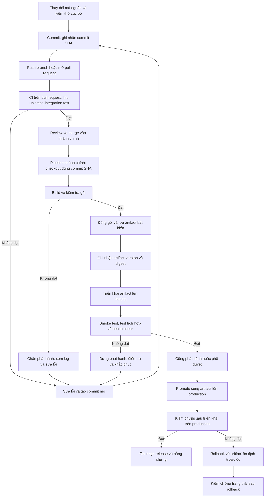

# Vẽ luồng một thay đổi từ commit đến kiểm chứng triển khai

Một pipeline CI/CD có thể chạy thành công nhưng điều đó chưa đủ để kết luận thay đổi đã hoạt động đúng trên môi trường đích. Muốn kiểm chứng một lần phát hành, ta cần lần theo được mã nguồn nào đã thay đổi, commit nào kích hoạt pipeline, pipeline tạo ra artifact nào, artifact đó được triển khai ở đâu và kết quả kiểm tra sau triển khai ra sao.

Trong bài thực hành này, bạn sẽ vẽ một sơ đồ xuyên suốt một thay đổi từ Git đến môi trường chạy. Sơ đồ phải thể hiện được các sự kiện kích hoạt, các bước tự động, những cổng chất lượng, artifact được chuyển giao và bằng chứng chứng minh triển khai đã thành công. Đây là cách biến pipeline từ một danh sách job rời rạc thành một luồng có thể giải thích, truy vết và kiểm tra.

## 1. Mục tiêu và sản phẩm cần hoàn thành

Sau bài thực hành, bạn có thể:

- Phân biệt commit, lần chạy CI, artifact, lần triển khai và lần kiểm chứng.
- Vẽ được đường đi của một thay đổi qua kiểm tra mã nguồn, build, lưu artifact, triển khai và xác nhận ứng dụng hoạt động.
- Ghi rõ sự kiện kích hoạt mỗi chặng và điều kiện để luồng được đi tiếp.
- Liên kết các chặng bằng mã định danh như commit SHA, pipeline run ID, artifact digest và deployment ID.
- Thể hiện nhánh xử lý khi kiểm thử thất bại, triển khai lỗi hoặc kiểm chứng sau triển khai không đạt.

**Sản phẩm cuối cùng** gồm một sơ đồ luồng trên một trang, một bảng bằng chứng cho từng chặng và một danh sách các cổng chất lượng. Người khác nhìn vào đó phải trả lời được: thay đổi nào đã được phát hành, bản build nào đang chạy ở môi trường nào và dựa vào đâu để kết luận nó hoạt động đúng.

## 2. Bối cảnh thực hành

Giả sử nhóm phát triển một dịch vụ web và cần bổ sung endpoint `GET /version`. Endpoint trả về phiên bản ứng dụng cùng commit SHA đã tạo ra bản build. Thay đổi nhỏ này giúp ta kiểm tra được ứng dụng sau triển khai đang chạy đúng bản mã đã phát hành.

Ví dụ phản hồi của endpoint:

```json
{
  "version": "1.4.0",
  "commit": "8e21c4f"
}
```

Đây là dữ liệu minh họa. Trong hệ thống thật, chỉ đưa thông tin build an toàn vào endpoint; không trả về token, mật khẩu, biến môi trường bí mật hoặc thông tin nội bộ nhạy cảm.

Luồng cần mô tả bắt đầu khi lập trình viên tạo commit, đi qua kiểm tra trên nhánh làm việc, được review và merge, sau đó pipeline tạo artifact, triển khai lên staging, kiểm chứng rồi mới được phát hành lên production. Cuối cùng, ta kiểm tra ứng dụng trên production và lưu bằng chứng gắn với lần triển khai đó.

## 3. Phân biệt các mốc trong luồng

Trước khi vẽ, hãy thống nhất ý nghĩa của từng mốc. Các mốc này có liên quan nhưng không thay thế cho nhau.

| Mốc | Ý nghĩa | Bằng chứng thường dùng |
|---|---|---|
| Commit | Một trạng thái mã nguồn được ghi nhận trong Git | Commit SHA, thông điệp commit, nhánh |
| Push hoặc pull request | Sự kiện đưa thay đổi lên máy chủ Git và yêu cầu tích hợp | Tên nhánh, pull request ID, commit SHA |
| CI run | Một lần pipeline thực thi các bước kiểm tra | Run ID, trạng thái job, log, báo cáo test |
| Build | Quá trình biến mã nguồn thành gói có thể triển khai | Build ID, phiên bản, log build |
| Artifact | Đầu ra đã được đóng gói và lưu để triển khai | Tên artifact, version, image digest hoặc checksum |
| Deployment | Một phiên bản artifact được đưa vào một môi trường | Deployment ID, môi trường, artifact digest, thời điểm |
| Verification | Kiểm tra ứng dụng sau khi triển khai | Kết quả smoke test, health check, test tích hợp, số liệu quan sát |

Ví dụ: CI run có trạng thái xanh chỉ chứng minh những bước trong lần chạy đó đã đạt. Nó không tự chứng minh artifact đã được triển khai lên production. Tương tự, một job deploy báo thành công chỉ chứng minh công cụ triển khai hoàn tất theo tiêu chí của nó; ứng dụng vẫn cần được kiểm tra bằng request thực tế, health check và tín hiệu vận hành.

## 4. Vẽ luồng từ commit đến kiểm chứng

Sơ đồ dưới đây là mẫu tham chiếu cho bài thực hành. Tên job và cách tổ chức stage có thể khác nhau giữa các nền tảng CI/CD, nhưng các mốc truy vết cần được giữ rõ ràng.



Khi chuyển sơ đồ mẫu thành sơ đồ của dự án, hãy kiểm tra các điểm sau:

1. **Điểm bắt đầu phải là một sự kiện có thể nhận diện.** Ví dụ: push commit lên branch hoặc mở pull request. Ghi rõ sự kiện nào kích hoạt pipeline nào.
2. **Nhánh kiểm tra pull request và pipeline sau merge phải có quan hệ rõ ràng.** Pull request thường chạy kiểm tra sớm để chặn thay đổi chưa đạt. Sau khi merge, pipeline của nhánh chính xác nhận trạng thái mã nguồn sẽ được đóng gói và phát hành.
3. **Artifact phải có danh tính ổn định.** Sau khi build, ghi version và digest hoặc checksum. Các môi trường sau đó cần tham chiếu đến artifact đã lưu này.
4. **Mỗi môi trường phải là một chặng riêng.** Staging và production có cấu hình, quyền truy cập và mục tiêu kiểm chứng khác nhau. Đừng gộp chúng thành một ô “Deploy”.
5. **Có nhánh thành công và thất bại.** Mỗi cổng cần chỉ rõ điều gì xảy ra khi đạt hoặc không đạt. Một lần kiểm tra thất bại phải làm luồng dừng ở vị trí phù hợp.
6. **Rollback cũng cần được kiểm chứng.** Sau khi quay lại phiên bản trước, cần xác nhận phiên bản ổn định thực sự đang phục vụ request.

## 5. Ghi sự kiện, đầu vào, đầu ra và bằng chứng

Một sơ đồ dễ đọc cần trả lời được bốn câu hỏi ở mỗi chặng: điều gì kích hoạt bước này, bước nhận dữ liệu gì, bước tạo ra kết quả gì và ta lưu bằng chứng ở đâu.

| Chặng | Sự kiện hoặc điều kiện vào | Đầu ra cần theo dõi | Bằng chứng cần lưu |
|---|---|---|---|
| Commit | Lập trình viên hoàn thành thay đổi | Commit SHA | Diff, commit message, branch |
| CI pull request | Push branch hoặc cập nhật pull request | Trạng thái các job kiểm tra | PR ID, CI run ID, log, báo cáo test |
| Review và merge | Review được chấp thuận, các check bắt buộc đạt | Commit được tích hợp vào nhánh chính | Người review, merge commit hoặc commit SHA, thời điểm |
| Build | Pipeline nhánh chính bắt đầu | Gói build hoặc image | Build ID, log, commit SHA đầu vào |
| Publish artifact | Build và kiểm tra gói đạt | Artifact đã lưu trong registry hoặc kho lưu trữ | Artifact version, digest/checksum, vị trí lưu |
| Deploy staging | Artifact được chọn để triển khai | Release chạy trên staging | Deployment ID, môi trường, artifact digest, log triển khai |
| Verify staging | Deployment staging hoàn tất | Kết quả smoke test và test tích hợp | URL hoặc endpoint kiểm tra, kết quả, thời điểm, commit/version quan sát được |
| Promote và deploy production | Cổng phát hành đạt, có phê duyệt nếu yêu cầu | Release chạy trên production | Approval record, deployment ID, artifact digest |
| Verify production | Deployment production hoàn tất | Trạng thái ứng dụng sau phát hành | Health check, synthetic test, log, metric, thời điểm |
| Hoàn tất hoặc rollback | Kết quả kiểm chứng đạt hoặc không đạt | Release được xác nhận hoặc phiên bản trước được khôi phục | Release record, kết quả verify, rollback record nếu có |

Không phải dự án nào cũng có đúng từng job như bảng. Hãy dùng tên bước thực tế trong pipeline của nhóm, nhưng vẫn phải giữ đủ bằng chứng để nối các chặng.

### 5.1. Nối các chặng bằng mã định danh

Để truy vết được, hãy chọn một số mã định danh làm “sợi dây” xuyên suốt luồng:

- **Commit SHA:** xác định chính xác mã nguồn đầu vào.
- **Pipeline run ID:** xác định lần thực thi CI/CD đã xử lý commit đó.
- **Artifact digest hoặc checksum:** xác định chính xác nội dung gói được tạo ra.
- **Deployment ID:** xác định lần đưa artifact vào một môi trường cụ thể.
- **Environment:** xác định deployment diễn ra ở staging, production hay môi trường khác.
- **Verification run ID:** xác định lần kiểm chứng và kết quả sau triển khai.

Ví dụ một bản ghi liên kết các mốc:

```yaml
commit_sha: 8e21c4f
pipeline_run_id: ci-1842
artifact:
  name: web-service
  version: 1.4.0
  digest: sha256:abc123-example
deployment:
  id: deploy-staging-392
  environment: staging
verification:
  id: smoke-392
  result: passed
```

Các giá trị trên chỉ minh họa cấu trúc. Trong hệ thống thật, lấy ID từ Git, CI server, artifact registry và công cụ triển khai. Không tự tạo ID để thay thế bằng chứng thực tế.

Một nguyên tắc quan trọng là **build một lần, promote cùng artifact qua các môi trường**. Nếu staging kiểm tra image digest `sha256:abc...` nhưng production lại build một image mới từ cùng nhánh, ta chưa chứng minh được production đang chạy đúng gói đã qua staging. Cùng commit SHA chưa chắc tạo ra cùng artifact nếu dependency, thời điểm build, tham số hoặc môi trường build thay đổi. Digest giúp xác nhận nội dung artifact được chuyển tiếp có đúng hay không.

## 6. Thực hành vẽ sơ đồ của nhóm

Thực hiện theo các bước sau. Có thể dùng giấy, bảng trắng hoặc công cụ vẽ sơ đồ. Nếu chưa có quyền truy cập pipeline của một dự án thật, dùng sơ đồ tham chiếu ở mục 4 và đánh dấu những chi tiết cần xác minh sau.

### Bước 1: Chọn một thay đổi cụ thể

Chọn một thay đổi nhỏ, có thể kiểm tra được, chẳng hạn bổ sung endpoint `/version`, sửa một quy tắc tính toán hoặc cập nhật một thông báo hiển thị. Ghi lại:

- Mục tiêu thay đổi là gì?
- Commit nào chứa thay đổi?
- Hành vi nào chứng minh thay đổi hoạt động đúng?
- Có dữ liệu hoặc dịch vụ phụ thuộc nào cần được kiểm tra không?

Với ví dụ `/version`, hành vi mong đợi là endpoint trả về đúng version và commit SHA của artifact đang chạy.

### Bước 2: Tìm các sự kiện kích hoạt

Lần theo thay đổi từ Git. Ghi rõ push, pull request, merge hoặc tag nào làm pipeline bắt đầu. Nếu dự án có nhiều workflow, xác định workflow kiểm tra pull request và workflow tạo bản phát hành. Đừng chỉ ghi chung chung “Git kích hoạt CI”; hãy ghi sự kiện thực tế và branch hoặc điều kiện lọc liên quan.

### Bước 3: Liệt kê các bước CI

Đọc cấu hình pipeline dưới dạng mã và xác định các bước có thật, ví dụ checkout, cài dependency, lint, unit test, integration test, build và publish report. Với mỗi bước, ghi đầu vào, kết quả và điều kiện làm pipeline thất bại. Phân biệt bước chạy song song với bước phụ thuộc kết quả của bước trước.

### Bước 4: Xác định artifact được phát hành

Ghi loại artifact mà dự án tạo ra: file JAR, package, container image hoặc gói triển khai khác. Xác định nơi lưu, cách đặt version và cách lấy digest/checksum. Tìm cách pipeline liên kết artifact với commit SHA và build run ID.

### Bước 5: Lần theo deployment

Ghi các môi trường mà artifact đi qua, thứ tự triển khai và cổng phê duyệt nếu có. Xác định deployment job nhận artifact nào, dùng cấu hình môi trường nào và tạo ra deployment ID ở đâu. Nếu có rollout theo từng nhóm instance hoặc tỷ lệ traffic, thể hiện các giai đoạn đó trên sơ đồ.

### Bước 6: Chọn kiểm chứng sau triển khai

Không dừng ở trạng thái “deploy job thành công”. Chọn các phép kiểm tra phù hợp với thay đổi:

- Health check xác nhận ứng dụng có thể phục vụ.
- Smoke test gọi một số đường đi quan trọng sau khi triển khai.
- Integration test xác nhận ứng dụng kết nối được với dependency cần thiết.
- Synthetic test kiểm tra hành vi từ góc nhìn người dùng hoặc client.
- Log và metric giúp phát hiện lỗi tăng, độ trễ cao hoặc tỷ lệ request thất bại.

Với endpoint `/version`, gửi request đến môi trường staging và production, sau đó so sánh commit SHA trả về với commit SHA đã ghi trong release. Đồng thời kiểm tra một endpoint hoặc luồng nghiệp vụ chính để tránh kết luận thành công chỉ từ endpoint thông tin phiên bản.

Ví dụ lệnh kiểm tra minh họa:

```bash
curl --fail --silent https://staging.example.test/version
```

Kết quả mong đợi có thể là:

```json
{
  "version": "1.4.0",
  "commit": "8e21c4f"
}
```

Tên miền `.test` và dữ liệu phản hồi ở đây chỉ là ví dụ. Khi thực hành trên hệ thống của nhóm, dùng URL được cấp và tuân thủ quyền truy cập môi trường.

### Bước 7: Vẽ nhánh lỗi và đường quay lui

Đánh dấu rõ các tình huống dừng luồng: test không đạt, build lỗi, không publish được artifact, deploy lỗi, smoke test thất bại hoặc metric sau phát hành vượt ngưỡng. Với mỗi tình huống, ghi người hoặc nhóm chịu trách nhiệm xử lý, hành động tiếp theo và điều kiện để chạy lại.

Nếu production không đạt sau triển khai, sơ đồ cần chỉ ra cách quay về artifact ổn định trước đó, cách xác nhận rollback và nơi ghi lại sự kiện. Với thay đổi cơ sở dữ liệu, cần thể hiện thêm cách xử lý tương thích ngược hoặc phục hồi dữ liệu nếu quy trình của hệ thống yêu cầu.

## 7. Mẫu pipeline dạng mã để đối chiếu

Đoạn dưới đây là **mã giả mô tả quan hệ phụ thuộc**, không phải cấu hình có thể chạy trực tiếp trên một nền tảng CI/CD cụ thể. Hãy dùng nó để kiểm tra xem sơ đồ đã thể hiện đủ thứ tự và cổng chất lượng hay chưa.

```yaml
triggers:
  - pull_request_to_main
  - push_to_main

stages:
  validate_pull_request:
    steps:
      - checkout
      - lint
      - unit_tests
      - integration_tests

  build_main:
    requires: [validate_pull_request, merge_to_main]
    steps:
      - checkout_exact_commit
      - run_tests
      - build_package
      - publish_immutable_artifact

  deploy_staging:
    requires: [build_main]
    environment: staging

  verify_staging:
    requires: [deploy_staging]
    steps:
      - smoke_tests
      - integration_checks
      - health_check

  deploy_production:
    requires: [verify_staging, release_approval]
    environment: production
    artifact: same_artifact_as_staging

  verify_production:
    requires: [deploy_production]
    steps:
      - health_check
      - synthetic_test
      - observe_error_rate_and_latency
```

Khi đối chiếu, hãy xác minh `same_artifact_as_staging` có nghĩa là production nhận đúng artifact đã được staging kiểm tra, được xác nhận bằng digest hoặc cơ chế định danh tương đương. Một tên version giống nhau nhưng nội dung artifact khác nhau không đủ để chứng minh tính nhất quán.

## 8. Cổng chất lượng và quyết định phát hành

Một cổng chất lượng là điều kiện cần đạt trước khi luồng được phép đi tiếp. Cổng cần có tiêu chí đo được và hành động rõ ràng khi không đạt.

| Cổng | Tiêu chí ví dụ | Khi không đạt |
|---|---|---|
| CI pull request | Lint, unit test và các check bắt buộc đều đạt | Chặn merge; sửa lỗi và chạy lại |
| Build | Build thành công, kiểm tra gói đạt | Không publish artifact; xem log build |
| Artifact | Artifact có version và digest, truy ngược được commit | Chặn deploy; kiểm tra bước publish và metadata |
| Staging | Smoke test, test tích hợp và health check đạt | Không promote production; điều tra staging |
| Phê duyệt phát hành | Đúng người phê duyệt và đủ điều kiện release | Giữ release ở trạng thái chờ |
| Production | Health check và các tín hiệu quan trọng nằm trong ngưỡng | Dừng rollout hoặc rollback theo quy trình |

Không đặt tiêu chí mơ hồ như “trông có vẻ ổn”. Ví dụ, nếu nhóm dùng tỷ lệ lỗi và độ trễ để quyết định, cần chỉ rõ cửa sổ quan sát, ngưỡng và nơi lấy số liệu. Ngưỡng cụ thể phải dựa trên SLO, đặc điểm dịch vụ và quy trình vận hành của nhóm; bài thực hành này không áp đặt một con số chung cho mọi hệ thống.

## 9. Các lỗi truy vết thường gặp

**Pipeline xanh nhưng không tìm thấy deployment.** CI có thể chỉ chạy kiểm tra và build. Hãy tìm workflow hoặc job CD, điều kiện kích hoạt deploy và môi trường đích. Đừng dùng trạng thái CI để suy ra trạng thái triển khai.

**Deployment thành công nhưng chức năng không hoạt động.** Công cụ có thể đã cập nhật workload nhưng ứng dụng lỗi khi khởi động, thiếu cấu hình hoặc không kết nối được dependency. Bổ sung smoke test, health check và kiểm tra log sau triển khai.

**Staging đạt nhưng production chạy gói khác.** Có thể pipeline build lại khi phát hành production. Đối chiếu artifact digest ở hai môi trường và điều chỉnh quy trình để promote cùng artifact đã kiểm tra.

**Không xác định được commit tạo ra bản đang chạy.** Có thể metadata build không được gắn vào artifact hoặc deployment record thiếu liên kết. Bổ sung commit SHA vào metadata an toàn của build và lưu quan hệ giữa commit, run, artifact và deployment.

**Sơ đồ chỉ có đường thành công.** Một sơ đồ không có nhánh thất bại sẽ khó dùng khi sự cố xảy ra. Bổ sung điểm dừng, người xử lý, điều kiện chạy lại và đường rollback.

**Chỉ kiểm tra health endpoint.** Health endpoint có thể trả về thành công trong khi chức năng chính bị lỗi. Kết hợp health check với smoke test hoặc synthetic test đại diện cho hành vi quan trọng của người dùng.

## 10. Bài nộp và tiêu chí tự đánh giá

Hoàn thành bài thực hành bằng cách lưu ba phần sau trong tài liệu hoặc trang làm việc của nhóm:

1. **Sơ đồ luồng:** từ commit đến kiểm chứng production, có nhãn sự kiện trên mũi tên, có các cổng chất lượng và nhánh thất bại/rollback.
2. **Bảng bằng chứng:** tối thiểu có commit SHA, CI run ID, artifact version/digest, deployment ID, môi trường và kết quả verification.
3. **Ghi chú kiểm chứng:** mô tả một phép kiểm tra cụ thể sau triển khai, kết quả mong đợi, nơi xem kết quả và điều kiện phải dừng hoặc rollback.

Dùng checklist này để tự đánh giá:

- [ ] Sơ đồ bắt đầu từ commit hoặc sự kiện Git xác định được.
- [ ] Có phân biệt kiểm tra pull request với pipeline tạo bản phát hành sau merge.
- [ ] Mỗi bước quan trọng có đầu vào, đầu ra và bằng chứng.
- [ ] Artifact có version và digest/checksum hoặc định danh bất biến tương đương.
- [ ] Có thể nối commit SHA với CI run, artifact và deployment.
- [ ] Staging và production được thể hiện thành các chặng riêng.
- [ ] Production nhận đúng artifact đã qua bước kiểm tra trước đó.
- [ ] Có phép kiểm chứng hành vi sau triển khai, không chỉ dựa vào trạng thái job deploy.
- [ ] Có điều kiện dừng khi cổng chất lượng không đạt.
- [ ] Có đường rollback và bước kiểm chứng sau rollback.

Một sơ đồ đạt yêu cầu khi một thành viên khác có thể chọn một deployment cụ thể, lần ngược về commit đã tạo ra nó, tìm được pipeline run và artifact tương ứng, rồi mở được bằng chứng kiểm tra ứng dụng sau triển khai. Nếu còn mũi tên không rõ sự kiện kích hoạt, artifact không có định danh hoặc kết luận thành công không có kết quả kiểm chứng, hãy bổ sung các thông tin đó trước khi coi sơ đồ hoàn chỉnh.

## 11. Kết luận thực hành

Luồng CI/CD có thể được xem là truy vết được khi mọi chuyển giao đều có sự kiện, đầu vào, đầu ra và bằng chứng. Commit xác định mã nguồn; pipeline run xác định lần tự động hóa; artifact digest xác định gói được phát hành; deployment ID xác định nơi gói đang chạy; verification record chứng minh hành vi sau triển khai. Vẽ đủ các mối liên kết này giúp nhóm phát hiện điểm đứt trong quy trình, điều tra sự cố nhanh hơn và đưa ra quyết định phát hành dựa trên dữ liệu.
