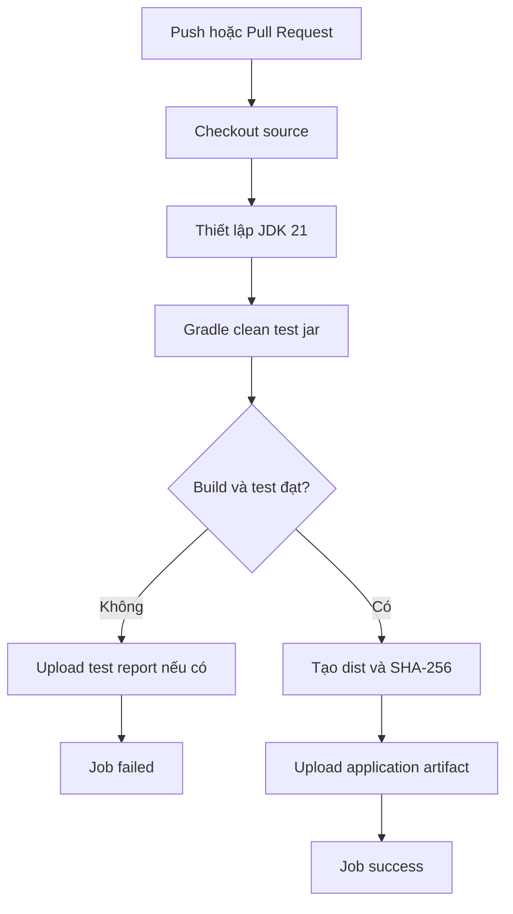

# Thiết kế pipeline tối thiểu gồm build, kiểm thử và đóng gói

Trong bài thực hành này, bạn sẽ tạo một ứng dụng Java nhỏ, đưa mã nguồn vào Git và xây dựng pipeline CI tự động cho ba việc: biên dịch/build, chạy unit test và đóng gói JAR. Pipeline sẽ chạy khi có pull request hoặc push lên nhánh chính, lưu test report kể cả khi kiểm thử thất bại và chỉ công bố artifact ứng dụng khi toàn bộ bước bắt buộc thành công.

Mục tiêu là hoàn thành một luồng CI có thể chạy lại và truy vết được. Sau lab, bạn có thể trả lời: commit nào được kiểm tra, test nào đã chạy, package nào được tạo, checksum của package là gì và pipeline phản ứng ra sao khi test thất bại.

## 1. Kết quả cần đạt

Khi hoàn thành, repository có cấu trúc tương tự:

```text
ci-cd-lab/
├── .github/
│   └── workflows/
│       └── ci.yml
├── gradle/
│   └── wrapper/
│       ├── gradle-wrapper.jar
│       └── gradle-wrapper.properties
├── src/
│   ├── main/
│   │   └── java/
│   │       └── com/example/App.java
│   └── test/
│       └── java/
│           └── com/example/AppTest.java
├── .gitattributes
├── .gitignore
├── build.gradle.kts
├── gradlew
├── gradlew.bat
└── settings.gradle.kts
```

Pipeline sẽ tạo artifact ở phía CI, không commit thư mục build hoặc dist vào Git.

**Đầu ra mong đợi**

- Pull request kích hoạt workflow tự động.
- Gradle build thành công và unit test được thực thi.
- JAR được tạo với tên `ci-cd-lab-1.0.0.jar`.
- Test report được upload để xem lại.
- JAR, checksum SHA-256 và build metadata được lưu thành một artifact có tên gắn với commit.
- Khi cố ý làm test thất bại, job chuyển sang failed và không upload artifact ứng dụng.

## 2. Thời lượng và yêu cầu chuẩn bị

*Thời lượng tham khảo: 45–75 phút, tùy tốc độ thiết lập GitHub repository.*

Bạn cần:

- JDK 21 được cài và lệnh `java -version` chạy được.
- Gradle cài sẵn để tạo Gradle Wrapper lần đầu. Sau khi wrapper được tạo, các lần build dùng `gradlew`.
- Git được cài và cấu hình tên/email commit.
- Tài khoản GitHub và quyền tạo repository.
- Một terminal như PowerShell, Git Bash hoặc shell Linux/macOS.
- Kết nối Internet để tải Gradle và dependency từ Maven repository.

Kiểm tra môi trường:

```bash
java -version
gradle --version
git --version
```

Trên Windows PowerShell, các lệnh kiểm tra giống nhau. Nếu tổ chức đã có template repository hoặc Gradle Wrapper chuẩn, hãy dùng phiên bản wrapper được dự án quy định.

## 3. Tạo project Java

Tạo thư mục lab và chuyển vào đó:

```bash
mkdir ci-cd-lab
cd ci-cd-lab
mkdir -p src/main/java/com/example
mkdir -p src/test/java/com/example
mkdir -p .github/workflows
```

Nếu dùng PowerShell, tạo thư mục project trước bằng `New-Item -ItemType Directory -Force ci-cd-lab`, sau đó chạy `Set-Location ci-cd-lab` rồi tạo các thư mục con theo ví dụ PowerShell bên dưới.

Trên Windows PowerShell có thể tạo thư mục bằng:

```powershell
New-Item -ItemType Directory -Force ci-cd-lab
Set-Location ci-cd-lab
New-Item -ItemType Directory -Force src/main/java/com/example
New-Item -ItemType Directory -Force src/test/java/com/example
New-Item -ItemType Directory -Force .github/workflows
```

Tạo file `settings.gradle.kts`:

```kotlin
rootProject.name = "ci-cd-lab"
```

Tạo file `build.gradle.kts`:

```kotlin
plugins {
    application
}

group = "com.example"
version = "1.0.0"

repositories {
    mavenCentral()
}

dependencies {
    testImplementation("org.junit.jupiter:junit-jupiter:5.11.4")
    testRuntimeOnly("org.junit.platform:junit-platform-launcher:1.11.4")
}

java {
    toolchain {
        languageVersion.set(JavaLanguageVersion.of(21))
    }
}

application {
    mainClass.set("com.example.App")
}

tasks.test {
    useJUnitPlatform()
    testLogging {
        events("passed", "skipped", "failed")
    }
}

tasks.jar {
    manifest {
        attributes["Main-Class"] = application.mainClass.get()
    }
}
```

Giải thích các phần chính:

- `application` cung cấp task chạy ứng dụng và đóng gói.
- `java.toolchain` yêu cầu Gradle dùng JDK 21 cho compile/test.
- JUnit Jupiter được dùng cho unit test.
- `useJUnitPlatform()` cấu hình Gradle chạy JUnit 5.
- Manifest ghi main class để JAR có thể chạy bằng `java -jar`.
- Version được khai báo rõ để tên artifact có thể truy vết.

## 4. Viết mã ứng dụng và unit test

Tạo `src/main/java/com/example/App.java`:

```java
package com.example;

public final class App {
    private App() {
    }

    public static String greeting(String name) {
        if (name == null || name.isBlank()) {
            throw new IllegalArgumentException("name must not be blank");
        }

        return "Hello, " + name.trim() + "!";
    }

    public static void main(String[] args) {
        String name = args.length == 0 ? "CI" : args[0];
        System.out.println(greeting(name));
    }
}
```

Tạo `src/test/java/com/example/AppTest.java`:

```java
package com.example;

import org.junit.jupiter.api.Test;

import static org.junit.jupiter.api.Assertions.assertEquals;
import static org.junit.jupiter.api.Assertions.assertThrows;

class AppTest {
    @Test
    void trimsNameBeforeBuildingGreeting() {
        assertEquals("Hello, Ada!", App.greeting(" Ada "));
    }

    @Test
    void rejectsBlankName() {
        assertThrows(
            IllegalArgumentException.class,
            () -> App.greeting(" ")
        );
    }

    @Test
    void rejectsNullName() {
        assertThrows(
            IllegalArgumentException.class,
            () -> App.greeting(null)
        );
    }
}
```

Ứng dụng có một hành vi đơn giản nhưng đủ để minh họa cả kiểm tra thành công lẫn kiểm tra dữ liệu không hợp lệ. Test kiểm tra kết quả trả về, đồng thời xác minh hàm từ chối chuỗi rỗng và `null`.

## 5. Tạo Gradle Wrapper và cấu hình Git

Tạo wrapper với Gradle 8.14.3:

```bash
gradle wrapper --gradle-version 8.14.3
```

Lệnh tạo các file `gradlew`, `gradlew.bat` và thư mục `gradle/wrapper`. Commit cả wrapper script, wrapper JAR và properties vào repository. Người dùng CI sau đó không cần cài Gradle toàn cục; wrapper tự tải đúng phiên bản đã khai báo.

Kiểm tra wrapper:

```bash
./gradlew --version
```

Trên Windows PowerShell:

```powershell
.\gradlew.bat --version
```

Tạo file `.gitignore`:

```gitignore
.gradle/
build/
dist/
.idea/
*.iml
```

Tạo file `.gitattributes` để chuẩn hóa line ending cho script và file dự án:

```text
gradlew text eol=lf
gradlew.bat text eol=crlf
*.java text eol=lf
*.kts text eol=lf
*.yml text eol=lf
```

Kiểm tra JDK và chạy build/test/package ở local trước khi đưa lên CI:

```bash
./gradlew --no-daemon clean test jar
```

Trên Windows:

```powershell
.\gradlew.bat --no-daemon clean test jar
```

Kết quả mong đợi:

- Gradle kết thúc với `BUILD SUCCESSFUL`.
- Có test report HTML tại `build/reports/tests/test/index.html`.
- Có JUnit XML tại `build/test-results/test/`.
- Có JAR tại `build/libs/ci-cd-lab-1.0.0.jar`.

Chạy thử JAR:

```bash
java -jar build/libs/ci-cd-lab-1.0.0.jar Ada
```

Output mong đợi:

```text
Hello, Ada!
```

Nếu build local chưa đạt, hãy xử lý lỗi trước khi tiếp tục. CI cần xác minh lại cùng các bước trên môi trường sạch; nó không thay thế việc kiểm tra project có thể build tại local.

## 6. Khởi tạo Git repository

Nếu project chưa có Git repository:

```bash
git init -b main
git add .
git commit -m "Create Java app and Gradle build"
```

Tạo một repository rỗng trên GitHub, ví dụ `ci-cd-lab`. Không chọn tạo README hoặc license tự động nếu bạn đã có file local và muốn tránh merge commit ban đầu.

Thêm remote và đẩy nhánh chính:

```bash
git remote add origin https://github.com/OWNER/ci-cd-lab.git
git push -u origin main
```

Thay `OWNER` bằng tài khoản hoặc tổ chức thực tế. Nếu repository đã tồn tại và có lịch sử, hãy clone repository đó rồi đặt các file lab vào đúng project; không khởi tạo một lịch sử Git độc lập trên thư mục đã có lịch sử.

## 7. Viết workflow CI

Tạo file `.github/workflows/ci.yml`:

```yaml
name: CI

on:
  pull_request:
  push:
    branches: [main]
  workflow_dispatch:

permissions:
  contents: read

concurrency:
  group: ${{ github.workflow }}-${{ github.ref }}
  cancel-in-progress: true

jobs:
  build-test-package:
    name: Build, test and package
    runs-on: ubuntu-24.04
    timeout-minutes: 15

    steps:
      - name: Checkout source
        uses: actions/checkout@v4

      - name: Set up JDK 21
        uses: actions/setup-java@v4
        with:
          distribution: temurin
          java-version: '21'
          cache: gradle

      - name: Allow Gradle wrapper to execute
        run: chmod +x gradlew

      - name: Show toolchain
        run: |
          java -version
          ./gradlew --version

      - name: Build, test and package
        run: ./gradlew --no-daemon clean test jar

      - name: Upload test reports
        if: ${{ always() }}
        uses: actions/upload-artifact@v4
        with:
          name: test-reports-${{ github.run_id }}-${{ github.run_attempt }}
          path: |
            build/reports/tests/test/
            build/test-results/test/
          if-no-files-found: ignore
          retention-days: 7

      - name: Prepare package and metadata
        if: ${{ success() }}
        run: |
          mkdir -p dist
          cp build/libs/ci-cd-lab-1.0.0.jar dist/
          (
            cd dist
            sha256sum ci-cd-lab-1.0.0.jar > SHA256SUMS
          )
          {
            printf 'checked_out_sha=%s\n' "$GITHUB_SHA"
            printf 'pull_request_head_sha=%s\n' "$PR_HEAD_SHA"
            printf 'run_id=%s\n' "$GITHUB_RUN_ID"
            printf 'run_attempt=%s\n' "$GITHUB_RUN_ATTEMPT"
            java -version 2>&1 | head -n 1 | sed 's/^/java=/'
          } > dist/build-info.txt
        env:
          PR_HEAD_SHA: ${{ github.event.pull_request.head.sha || github.sha }}

      - name: Upload application artifact
        if: ${{ success() }}
        uses: actions/upload-artifact@v4
        with:
          name: app-${{ github.sha }}
          path: dist/
          if-no-files-found: error
          retention-days: 14
```

Các expression trong workflow có ý nghĩa như sau:

- `concurrency.group` ghép tên workflow và ref để các lần chạy cùng nhánh có thể được quản lý cùng một nhóm.
- `always()` cho phép bước upload test report được đánh giá kể cả khi bước build/test thất bại.
- `success()` chỉ cho phép tạo và upload application artifact khi các bước trước thành công.
- `github.run_id` và `github.run_attempt` phân biệt các lần chạy và lần chạy lại.
- `github.sha` gắn tên artifact với commit đang được kiểm tra.

### 7.1. Hiểu luồng công việc



### 7.2. Ý nghĩa từng bước

| Bước | Mục đích |
|---|---|
| Checkout | Lấy đúng source revision của event |
| Setup JDK | Dùng toolchain được chỉ định |
| Wrapper permission | Cho phép script chạy trên Linux runner |
| Show toolchain | Lưu dấu vết phiên bản Java và Gradle trong log |
| Build/test/jar | Biên dịch, chạy unit test và tạo package |
| Upload test reports | Giữ report kể cả khi test thất bại |
| Prepare package | Copy JAR, tính checksum và ghi metadata |
| Upload artifact | Lưu package chỉ khi các bước bắt buộc thành công |

`cache: gradle` trong `setup-java` hỗ trợ cache dependency của Gradle. Nó không đồng nghĩa với việc bật Gradle build cache cho task. Lab này tập trung vào build/test/package; có thể thử build cache như một cải tiến riêng sau khi pipeline cơ bản hoạt động.

`permissions: contents: read` giới hạn quyền mặc định của token workflow ở mức đọc repository. Ví dụ không cần secret để build và upload artifact nội bộ của GitHub Actions. Không thêm quyền write hoặc secret nếu bài lab không cần.

Tên artifact ứng dụng chứa github.sha; file build-info.txt ghi SHA của revision được checkout, head SHA của pull request (nếu có) và run ID. Với sự kiện pull_request, github.sha thường là merge commit dùng để kiểm tra PR, còn pull_request_head_sha là commit tip của nhánh nguồn; với push, giá trị head SHA dùng fallback về github.sha. File SHA256SUMS cho phép phát hiện nội dung JAR bị thay đổi sau khi tải xuống. Đây là cơ chế truy vết và kiểm tra tính toàn vẹn cơ bản, chưa phải chữ ký phát hành.

## 8. Commit workflow và mở pull request

Workflow cần có trong default branch để sự kiện `pull_request` được kích hoạt ổn định. Với repository lab mới chưa bật bảo vệ nhánh, đưa workflow lên `main` trước:

```bash
git switch main
git add .github/workflows/ci.yml
git commit -m "Add build test and package workflow"
git push origin main
```

Push này kích hoạt workflow qua sự kiện `push`. Nếu `main` đã được bảo vệ, hãy tạo một bootstrap pull request để thêm workflow và merge theo quy trình của repository; chưa đặt workflow này thành required check trước khi nó có lần chạy thành công đầu tiên.

Sau khi workflow đã có trên `main`, tạo một nhánh thay đổi nhỏ để kiểm tra sự kiện pull request:

```bash
git switch -c feature/verify-ci-pipeline
```

Thêm test sau vào `AppTest`:

```java
@Test
void handlesAnotherName() {
    assertEquals("Hello, Linh!", App.greeting(" Linh "));
}
```

Commit, push và mở pull request:

```bash
git add src/test/java/com/example/AppTest.java
git commit -m "Add another greeting test"
git push -u origin feature/verify-ci-pipeline
```

Mở pull request từ `feature/verify-ci-pipeline` vào `main`.

Trong tab Actions của GitHub:

1. Chọn workflow CI vừa tạo.
2. Mở run được kích hoạt bởi pull request.
3. Theo dõi job `Build, test and package`.
4. Mở log của từng step.
5. Xác nhận build và test hoàn tất.
6. Kiểm tra phần Artifacts của run.

Nếu repository yêu cầu approval cho workflow từ fork, thực hiện theo policy của tổ chức. Không đưa token hoặc credential cá nhân vào file workflow để vượt qua bước kiểm soát đó.

## 9. Xác minh test report và artifact

Khi job thành công, run cần có hai nhóm artifact:

| Artifact | Nội dung | Điều kiện upload |
|---|---|---|
| `test-reports-...` | HTML report và JUnit XML | Luôn thử upload sau khi job kết thúc |
| `app-...` | JAR, SHA256SUMS và build-info.txt | Chỉ khi job thành công |

Tải artifact ứng dụng từ trang run. Giải nén vào một thư mục riêng tên `dist`, nơi có JAR và file `SHA256SUMS`, sau đó kiểm tra checksum.

Trên Linux hoặc Git Bash:

```bash
cd dist
sha256sum -c SHA256SUMS
```

Trên Windows PowerShell, nếu thư mục tải xuống chứa JAR và file checksum:

```powershell
$line = Get-Content .\SHA256SUMS
$expected = ($line -split '\s+')[0].ToLowerInvariant()
$actual = (Get-FileHash .\ci-cd-lab-1.0.0.jar -Algorithm SHA256).Hash.ToLowerInvariant()

if ($expected -ne $actual) {
    throw "Checksum mismatch"
}

"Checksum OK"
```

Chạy JAR đã tải:

```bash
java -jar ci-cd-lab-1.0.0.jar Linh
```

Kết quả mong đợi:

```text
Hello, Linh!
```

Mở build-info.txt và đối chiếu checked_out_sha với revision của run; với pull request, đối chiếu thêm pull_request_head_sha với commit tip của nhánh nguồn. Kiểm tra checksum chỉ xác nhận file tải xuống khớp checksum đi kèm; để xác minh nguồn gốc mạnh hơn trong release thực tế, cần chữ ký hoặc provenance được tạo và xác minh bằng identity tin cậy.

## 10. Thử nghiệm đường thất bại

Một pipeline chỉ được xác minh khi biết nó phản ứng đúng lúc kiểm thử không đạt.

Mở `src/test/java/com/example/AppTest.java` và cố ý thay expected value trong test đầu tiên:

```java
assertEquals("Hello, Grace!", App.greeting(" Ada "));
```

Trong khi output thực tế vẫn là `Hello, Ada!`, assertion này sẽ thất bại.

Commit và push thay đổi:

```bash
git add src/test/java/com/example/AppTest.java
git commit -m "Exercise failing test path"
git push
```

Quan sát workflow:

- Step build/test/package thất bại do unit test.
- Step upload test reports vẫn được đánh giá nhờ điều kiện `always()`.
- Step chuẩn bị package và upload application artifact không chạy vì điều kiện success không đạt.
- Job có trạng thái failed và pull request không đạt required check.

Mở test report để tìm tên test thất bại, expected value và actual value. Điều này kiểm tra rằng pipeline giữ được bằng chứng phục vụ điều tra ngay cả khi không tạo release artifact.

Khôi phục expected value về `Hello, Ada!`, commit và push lần nữa. Xác nhận workflow xanh và application artifact xuất hiện.

## 11. Bảo vệ required check trước khi merge

Sau khi workflow hoạt động, repository có thể cấu hình branch protection hoặc ruleset để yêu cầu job `Build, test and package` thành công trước khi merge vào `main`.

Kiểm tra:

- Required check trỏ đúng workflow/job.
- Pull request không thể merge khi job thất bại.
- Không có đường bỏ qua check ngoài policy của tổ chức.
- Workflow chạy trên đúng source revision cần merge.
- Workflow từ fork không nhận secret không cần thiết.
- Quyền GITHUB_TOKEN ở mức tối thiểu.

Tên hiển thị của check có thể thay đổi khi đổi job name hoặc workflow. Sau khi sửa tên, hãy xác minh lại required check để tránh ruleset tham chiếu một check cũ.

## 12. Troubleshooting

| Hiện tượng | Nguyên nhân thường gặp | Cách xử lý |
|---|---|---|
| `gradle: command not found` | Chưa cài Gradle để tạo wrapper | Cài Gradle hoặc dùng wrapper từ template có sẵn |
| `JAVA_HOME` sai hoặc thiếu JDK | JDK 21 chưa được cài/cấu hình | Kiểm tra `java -version` và JAVA_HOME |
| Wrapper không chạy trên Linux | Thiếu execute bit hoặc line ending sai | Chạy `chmod +x gradlew` và kiểm tra .gitattributes |
| Dependency download thất bại | Network, mirror hoặc Maven Central tạm thời lỗi | Kiểm tra log và thử lại có kiểm soát |
| Không tìm thấy test | Package/path không đúng hoặc thiếu JUnit Platform | Kiểm tra source path, dependency và `useJUnitPlatform()` |
| JAR không có Main-Class | Manifest task chưa được cấu hình | Kiểm tra `tasks.jar` |
| Test report không xuất hiện | Test chưa chạy hoặc task path khác | Kiểm tra Gradle test result và upload path |
| Không có application artifact | Job/test thất bại hoặc prepare step lỗi | Xem step đầu tiên thất bại và điều kiện upload |
| Checksum mismatch | File bị thay đổi, tải thiếu hoặc đối chiếu nhầm file | Tải lại artifact và kiểm tra đúng tên file |
| Pull request không kích hoạt | Workflow path/branch/event không khớp | Kiểm tra file nằm trong .github/workflows và event filter |
| Required check vẫn pending | Ruleset tham chiếu sai check hoặc workflow chưa chạy | Mở Checks để lấy tên check chính xác rồi cập nhật policy |

Khi điều tra, tìm lỗi đầu tiên làm job thất bại. Các lỗi xuất hiện sau đó có thể chỉ là hệ quả do bước trước không tạo output.

## 13. Tiêu chí hoàn thành lab

| Hạng mục | Bằng chứng đạt |
|---|---|
| Project | Có source Java và test JUnit |
| Wrapper | Có wrapper script, JAR và properties được commit |
| Local verification | `clean test jar` chạy thành công |
| CI trigger | Pull request kích hoạt workflow |
| Build/test | Log thể hiện Gradle chạy task và test đạt |
| Test report | Report được upload và mở được |
| Package | JAR được tạo và upload khi job thành công |
| Traceability | Artifact name hoặc build metadata liên kết commit/run |
| Integrity | SHA-256 được tạo và xác minh thành công |
| Failure path | Test cố ý thất bại làm job đỏ, report vẫn được upload |
| Artifact gate | Application artifact không được upload khi job thất bại |
| Recovery | Khôi phục test và workflow chạy xanh trở lại |

Nếu một mục chưa đạt, ghi lại lỗi và bằng chứng thay vì đánh dấu hoàn tất theo cảm tính.

## 14. Câu hỏi tự kiểm tra

1. Vì sao CI nên dùng Gradle Wrapper thay vì phụ thuộc phiên bản Gradle cài trên runner?
2. `test` và `jar` tạo ra những loại đầu ra nào?
3. Vì sao test report được upload với điều kiện `always()`?
4. Vì sao application artifact chỉ được upload khi job thành công?
5. Commit SHA, run ID và checksum hỗ trợ truy vết theo những cách nào?
6. Vì sao checksum không thay thế chữ ký hoặc provenance?
7. Nếu build xanh nhưng test thất bại, branch protection cần xử lý thế nào?
8. Dependency cache khác Gradle build cache ra sao?
9. Tại sao pull request từ fork không nên nhận secret không cần thiết?
10. Nếu đổi JDK hoặc Gradle version, bạn sẽ bổ sung kiểm tra nào?

## 15. Mở rộng sau lab

Khi pipeline cơ bản đã ổn định, có thể chọn một hướng mở rộng:

- Thêm integration test chạy cùng database test container.
- Thêm static analysis hoặc dependency vulnerability scan.
- Tách build và test thành các job phụ thuộc nhau.
- Dùng matrix để kiểm tra JDK 21 và một runtime khác nằm trong support policy.
- Thêm SBOM và provenance cho artifact.
- Pin GitHub Actions bằng commit SHA theo policy.
- Dùng remote build cache với quyền ghi/đọc tách biệt.
- Tạo release workflow promote cùng một artifact digest qua staging và production.
- Thêm smoke test sau deploy và lưu deployment evidence.

Mỗi mở rộng nên có một mục tiêu và bằng chứng riêng. Không thêm bước chỉ để workflow dài hơn.

## Kết luận

Lab đã tạo một pipeline CI tối thiểu có thể build, kiểm thử và đóng gói ứng dụng Java. Workflow được lưu cùng source, chạy theo sự kiện Git, dùng JDK/Gradle Wrapper đã xác định, giữ test report và chỉ upload JAR khi các bước bắt buộc thành công.

Khi xác minh checksum và đối chiếu build metadata, bạn có thể truy ngược package về commit và lần chạy tạo ra nó. Bài kiểm tra thất bại cũng chứng minh pipeline giữ report để điều tra và chặn artifact ứng dụng khi test không đạt. Đây là nền tảng để tiếp tục bổ sung security scan, artifact provenance, deployment và post-deploy verification.

