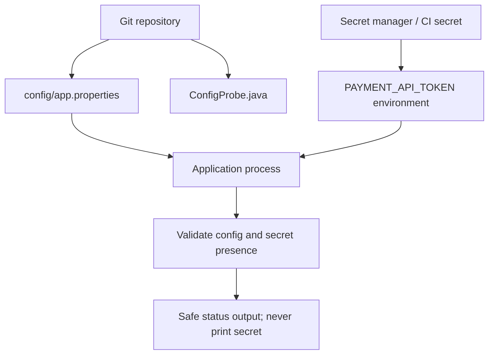

# Truyền cấu hình cùng bí mật bằng cơ chế tách biệt

Trong một pipeline CI/CD, ứng dụng cần cả cấu hình để biết cách vận hành và bí mật để xác thực với hệ thống khác. Hai loại dữ liệu này thường được truyền cùng lúc vào runtime, nhưng không nên được lưu trữ hoặc quản lý theo cùng một cách. URL dịch vụ, timeout và tên môi trường thường có thể version hóa cùng mã nguồn; API token, mật khẩu database và private key cần được lưu trong secret manager với quyền truy cập, audit và rotation riêng.

Lab này xây dựng một ứng dụng Java nhỏ đọc cấu hình không nhạy cảm từ file trong repository và đọc token từ environment variable. Sau đó, bạn chạy ứng dụng local bằng PowerShell, cấu hình GitHub Actions để kiểm tra pull request mà không cần secret, rồi chỉ cấp secret cho bước smoke test trên môi trường staging được bảo vệ. Kết quả cần chứng minh là ứng dụng nhận đủ dữ liệu để chạy, nhưng secret không xuất hiện trong Git, log hoặc artifact.

## 1. Mục tiêu và kết quả cần đạt

Sau lab, bạn có thể:

- Phân biệt configuration không nhạy cảm với secret.
- Lưu cấu hình có thể review/version hóa trong Git.
- Truyền secret qua environment hoặc secret integration ở runtime.
- Bảo đảm file local chứa secret không bị commit.
- Chạy kiểm tra CI trên pull request mà không cần cấp secret cho mã nguồn chưa tin cậy.
- Chỉ cấp secret cho job/step cần dùng và giới hạn theo environment.
- Kiểm tra ứng dụng không in secret ra stdout/stderr.
- Xử lý trường hợp thiếu secret và thu hồi giá trị lab sau khi hoàn tất.

Thời lượng gợi ý: 45–75 phút. Lab dùng token giả lập, không cần kết nối tới API thanh toán thật.

## 2. Mô hình cần xây dựng

Ta dùng một chương trình `ConfigProbe` để kiểm tra hợp đồng cấu hình. Chương trình đọc `app.env`, `payment.api.url` và `payment.timeout.seconds` từ file `config/app.properties`; token `PAYMENT_API_TOKEN` chỉ được lấy từ environment. Chương trình chỉ báo token đã được cấu hình hay chưa, tuyệt đối không in giá trị token.



| Dữ liệu | Ví dụ | Nơi lưu/nguồn cấp |
|---|---|---|
| Cấu hình không nhạy cảm | `app.env=staging` | File cấu hình trong Git hoặc CI variable |
| Cấu hình không nhạy cảm | `payment.api.url=https://payments.example.test` | File cấu hình trong Git |
| Cấu hình không nhạy cảm | `payment.timeout.seconds=5` | File cấu hình trong Git |
| Secret | `PAYMENT_API_TOKEN` | GitHub Environment Secret hoặc secret manager |

URL trong ví dụ dùng miền `.test` dành cho kiểm thử. Chương trình không gọi endpoint này; nó chỉ xác minh cấu hình có thể đọc được.

## 3. Chuẩn bị môi trường

Bạn cần:

- Git.
- JDK 17 trở lên (`java -version`, `javac -version`).
- PowerShell trên Windows hoặc shell tương đương nếu bạn tự điều chỉnh lệnh.
- Một repository GitHub có quyền tạo repository/environment secret để làm phần CI tùy chọn.

Kiểm tra JDK trong PowerShell:

```powershell
java -version
javac -version
git --version
```

Nếu `javac` không được nhận diện, hãy cài JDK và kiểm tra `JAVA_HOME`/`PATH` trước khi tiếp tục. Không cần cài database, Docker hoặc Kubernetes cho phần lab cơ bản.

## 4. Tạo cấu trúc project

Tạo một thư mục mới, ví dụ `config-secret-lab`, với cấu trúc:

```text
config-secret-lab/
├── .gitignore
├── .env.example
├── ConfigProbe.java
├── config/
│   ├── app.properties
│   └── staging.properties
└── .github/
    └── workflows/
        └── config-secret-check.yml
```

Không tạo file chứa token thật trong repository. `.env.example` chỉ ghi tên biến và giá trị rỗng để người đọc biết ứng dụng cần biến nào.

### 4.1. Tạo file cấu hình không nhạy cảm

Tạo `config/app.properties`:

```properties
# These values are non-secret and can be reviewed in Git.
app.env=local
payment.api.url=https://payments.example.test
payment.timeout.seconds=5
```

Các giá trị này mô tả môi trường và hành vi kết nối. Không thêm user/password vào URL, không nhúng token vào property và không dùng một file cấu hình chung chứa cả secret lẫn giá trị thông thường.

Tạo thêm `config/staging.properties` để staging có cấu hình không nhạy cảm riêng:

```properties
app.env=staging
payment.api.url=https://payments.example.test
payment.timeout.seconds=5
```

Hai file có cùng schema nhưng giá trị `app.env` phản ánh môi trường. Khi số môi trường tăng, có thể dùng template/overlay hoặc CI variables thay vì nhân bản quá nhiều file; secret vẫn được cấp qua secret manager riêng.

### 4.2. Khai báo biến secret cần có

Tạo `.env.example`:

```dotenv
# Copy the variable name into your local secret injection mechanism.
# Do not put a real token in this file.
PAYMENT_API_TOKEN=
```

File này là tài liệu về tên biến, không phải nơi lưu secret. Khi làm việc thật, hãy lấy secret từ secret manager hoặc cơ chế cấp phát local được tổ chức phê duyệt.

### 4.3. Bỏ qua file có thể chứa secret

Tạo `.gitignore`:

```gitignore
# Local environment files
.env
.env.*
!.env.example

# Local-only configuration and secret material
*.local.properties
secrets/
*.pem
*.key
credentials.json
```

Không bỏ qua `config/app.properties`, vì file này chỉ chứa cấu hình không nhạy cảm và cần được review cùng thay đổi ứng dụng. Quy tắc `.gitignore` chỉ ngăn file chưa được track; nó không tự gỡ một file secret đã được commit trước đó.

### 4.4. Viết chương trình đọc cấu hình và secret riêng biệt

Tạo `ConfigProbe.java`:

```java
import java.io.IOException;
import java.io.InputStream;
import java.net.URI;
import java.nio.file.Files;
import java.nio.file.Path;
import java.util.Properties;

public final class ConfigProbe {
    private static String required(Properties properties, String key) {
        String value = properties.getProperty(key);
        if (value == null || value.isBlank()) {
            throw new IllegalArgumentException("Missing configuration: " + key);
        }
        return value.trim();
    }

    public static void main(String[] args) throws IOException {
        boolean requireSecret = args.length == 0
                || !"--validate-config-only".equals(args[0]);

        String configFile = System.getenv().getOrDefault(
                "APP_CONFIG_FILE", "config/app.properties");
        Properties config = new Properties();
        try (InputStream input = Files.newInputStream(Path.of(configFile))) {
            config.load(input);
        }

        String environment = required(config, "app.env");
        URI paymentUri = URI.create(required(config, "payment.api.url"));
        if (paymentUri.getHost() == null || paymentUri.getUserInfo() != null) {
            throw new IllegalArgumentException(
                    "payment.api.url must have a host and must not contain credentials");
        }

        int timeoutSeconds = Integer.parseInt(
                required(config, "payment.timeout.seconds"));
        if (timeoutSeconds < 1 || timeoutSeconds > 120) {
            throw new IllegalArgumentException(
                    "payment.timeout.seconds must be between 1 and 120");
        }

        String token = System.getenv("PAYMENT_API_TOKEN");
        boolean tokenConfigured = token != null && !token.isBlank();
        if (requireSecret && !tokenConfigured) {
            System.err.println("Missing required secret: PAYMENT_API_TOKEN");
            System.exit(2);
            return;
        }

        System.out.println("Configuration validation: PASS");
        System.out.println("Environment: " + environment);
        System.out.println("Payment API host: " + paymentUri.getHost());
        System.out.println("Payment timeout seconds: " + timeoutSeconds);
        System.out.println("Payment API token configured: " + tokenConfigured);
    }
}
```

Chương trình có hai chế độ:

- Chạy `java ConfigProbe --validate-config-only` để kiểm tra file cấu hình, không yêu cầu secret. Chế độ này phù hợp với pull request chưa được tin cậy.
- Chạy `java ConfigProbe` để kiểm tra cấu hình và yêu cầu `PAYMENT_API_TOKEN`. Đây là bước smoke test sau khi secret được cấp ở môi trường đã bảo vệ.

Chương trình không dùng token để gọi dịch vụ thật; nó chỉ xác nhận biến có mặt. Trong ứng dụng thật, không đưa token vào exception, log, metric label, command argument hoặc URL.

## 5. Chạy thử local bằng PowerShell

Mở PowerShell tại thư mục `config-secret-lab`.

### 5.1. Kiểm tra cấu hình khi chưa có secret

```powershell
javac ConfigProbe.java
java ConfigProbe --validate-config-only
```

Kết quả mong đợi tương tự:

```text
Configuration validation: PASS
Environment: local
Payment API host: payments.example.test
Payment timeout seconds: 5
Payment API token configured: false
```

Lệnh sau phải thất bại vì secret chưa được cấp:

```powershell
java ConfigProbe
$LASTEXITCODE
```

Kết quả mong đợi: chương trình báo thiếu `PAYMENT_API_TOKEN` và exit code là `2`. Thông báo chỉ nêu tên biến, không tiết lộ giá trị secret.

### 5.2. Cấp token giả lập trong phiên PowerShell hiện tại

Đặt một giá trị giả, không phải credential đang hoạt động:

```powershell
$env:PAYMENT_API_TOKEN = 'lab-only-fake-token-not-a-real-credential'
java ConfigProbe
```

Kết quả mong đợi:

```text
Configuration validation: PASS
Environment: local
Payment API host: payments.example.test
Payment timeout seconds: 5
Payment API token configured: true
```

Xác minh output không chứa token giả:

```powershell
$output = java ConfigProbe 2>&1 | Out-String
if ($LASTEXITCODE -ne 0) {
    throw 'ConfigProbe did not complete successfully'
}
if ($output.Contains($env:PAYMENT_API_TOKEN)) {
    throw 'Secret value was exposed in application output'
}
'Secret output check: PASS'
```

Xóa biến sau khi hoàn tất:

```powershell
Remove-Item Env:PAYMENT_API_TOKEN
```

Biến môi trường chỉ tồn tại trong process/session hiện tại và process con được tạo từ đó. Không dùng lệnh trên với token thật nếu terminal history, transcript hoặc hệ thống giám sát lệnh của bạn có thể lưu giá trị đã nhập. Với local development thật, ưu tiên secret manager CLI, IDE run configuration được loại khỏi Git hoặc cơ chế workload identity phù hợp.

## 6. Kiểm tra Git không đưa secret vào repository

Khởi tạo Git và xem các file được track:

```powershell
git init
git status --short
git check-ignore -v .env
git check-ignore -v .env.local
git check-ignore -v .env.example
```

Hai file `.env` và `.env.local` phải được ignore. `.env.example` phải không bị ignore. Nếu `.env` chưa tồn tại, `git check-ignore` có thể vẫn kiểm tra quy tắc dựa trên đường dẫn; bạn có thể tạo file rỗng giả lập rồi xóa sau.

Tạo file `.env.local` để kiểm tra quy tắc ignore, chỉ chứa token giả:

```powershell
Set-Content -Path .env.local -Value 'PAYMENT_API_TOKEN=lab-only-fake-token'
git status --short
git check-ignore -v .env.local
Remove-Item .env.local
```

`git status` không được liệt kê `.env.local` như file sẽ commit. Đừng dựa vào `.gitignore` như lớp bảo vệ duy nhất: trước khi commit, vẫn cần xem `git status`, diff và secret scan. Nếu secret đã được commit, phải thu hồi/rotate ngay; xóa file ở commit mới không làm secret biến mất khỏi lịch sử Git.

## 7. Cấu hình GitHub Actions tách PR validation và staging smoke test

Mục tiêu của workflow là:

- Pull request chỉ chạy kiểm tra cấu hình không cần secret.
- Sau khi commit lên `main`, job smoke test chạy trong GitHub Environment `staging`.
- Token chỉ được map vào đúng step cần dùng.
- Workflow không in giá trị token.

### 7.1. Tạo Environment Secret

Trong GitHub repository, mở **Settings → Environments** và tạo environment tên `staging`. Thêm secret có tên `PAYMENT_API_TOKEN` với một token thử nghiệm dành riêng cho lab. Không dùng token production hoặc credential cá nhân. Nếu repository hỗ trợ protection rules, cấu hình reviewer/deployment branch phù hợp trước khi cho phép job chạy.

GitHub Actions phân biệt:

- `vars`: giá trị cấu hình không nhạy cảm.
- `secrets`: giá trị bí mật được che trong log theo cơ chế của nền tảng, nhưng workflow vẫn phải tránh chủ động in hoặc biến đổi chúng thành output dễ lộ.

### 7.2. Tạo workflow

Tạo `.github/workflows/config-secret-check.yml`:

```yaml
name: Config and secret separation

on:
  pull_request:
  push:
    branches: [main]

permissions:
  contents: read

jobs:
  validate-config:
    runs-on: ubuntu-latest
    steps:
      - uses: actions/checkout@v4
      - uses: actions/setup-java@v4
        with:
          distribution: temurin
          java-version: '17'
      - name: Compile and validate non-secret configuration
        env:
          APP_CONFIG_FILE: config/app.properties
        run: |
          javac ConfigProbe.java
          java ConfigProbe --validate-config-only

  staging-smoke:
    if: github.event_name == 'push' && github.ref == 'refs/heads/main'
    needs: validate-config
    runs-on: ubuntu-latest
    environment: staging
    steps:
      - uses: actions/checkout@v4
      - uses: actions/setup-java@v4
        with:
          distribution: temurin
          java-version: '17'
      - name: Verify runtime secret is injected
        env:
          APP_CONFIG_FILE: config/staging.properties
          PAYMENT_API_TOKEN: ${{ secrets.PAYMENT_API_TOKEN }}
        run: |
          javac ConfigProbe.java
          java ConfigProbe
```

Job `validate-config` không nhận secret và có thể chạy trên pull request. Job `staging-smoke` chỉ chạy sau push lên `main`, yêu cầu environment `staging` và map secret ở đúng step. Nếu secret không tồn tại, chương trình dừng với exit code khác 0. Không dùng `pull_request_target` để chạy mã PR không tin cậy với quyền hoặc secret nhạy cảm.

Đặt `validate-config` làm required status check trong branch protection/ruleset. Nếu phần kiểm tra cấu hình thất bại, PR không được merge theo policy. Job staging cần được giới hạn branch và reviewer theo mức độ nhạy cảm của môi trường.

### 7.3. Xác minh workflow

Tạo pull request và quan sát:

- `validate-config` chạy thành công.
- Pull request không nhận `PAYMENT_API_TOKEN`.
- `staging-smoke` bị bỏ qua trên event pull request.
- Không có giá trị secret trong log, artifact hoặc output.

Sau khi merge vào `main`, quan sát `staging-smoke`:

- Job chạy trong environment `staging`.
- Step nhận `PAYMENT_API_TOKEN`.
- Log chỉ hiển thị `Payment API token configured: true`.
- Nếu secret chưa được cấu hình, job thất bại và chỉ nêu tên biến còn thiếu.

Trong repository thật, nếu staging smoke test gọi API bên ngoài, hãy dùng endpoint sandbox và quyền token chỉ cho phép thao tác kiểm thử. Ví dụ hiện tại không gửi request mạng.

## 8. Phương án Kubernetes: ConfigMap và External Secret

Nếu workload chạy trên Kubernetes, nguyên tắc tương tự được thể hiện bằng hai resource khác nhau:

- `ConfigMap` chứa cấu hình không nhạy cảm.
- Secret được lấy từ secret manager và đồng bộ vào namespace bằng một integration như External Secrets Operator.

Ví dụ `ConfigMap`:

```yaml
apiVersion: v1
kind: ConfigMap
metadata:
  name: orders-runtime-config
  namespace: staging
data:
  APP_ENV: "staging"
  PAYMENT_API_URL: "https://payments.example.test"
  PAYMENT_TIMEOUT_SECONDS: "5"
```

Ví dụ `ExternalSecret` tham chiếu secret đã lưu trong secret manager:

```yaml
apiVersion: external-secrets.io/v1
kind: ExternalSecret
metadata:
  name: orders-runtime-secret
  namespace: staging
spec:
  refreshInterval: 1h
  secretStoreRef:
    name: staging-secret-store
    kind: SecretStore
  target:
    name: orders-runtime-secret
    creationPolicy: Owner
  data:
    - secretKey: PAYMENT_API_TOKEN
      remoteRef:
        key: staging/orders/payment-api-token
```

Ví dụ trên giả định External Secrets Operator và `SecretStore` đã được cài đặt, cấu hình đúng provider và quyền đọc secret. API version/resource schema phải khớp phiên bản CRD đang cài. Manifest `ExternalSecret` chỉ chứa tên tham chiếu trong secret manager; không đưa giá trị token vào Git.

Deployment có thể tham chiếu hai nguồn riêng:

```yaml
apiVersion: apps/v1
kind: Deployment
metadata:
  name: orders
  namespace: staging
spec:
  replicas: 1
  selector:
    matchLabels:
      app: orders
  template:
    metadata:
      labels:
        app: orders
    spec:
      containers:
        - name: orders
          image: registry.example.test/team/orders@sha256:0123456789abcdef0123456789abcdef0123456789abcdef0123456789abcdef
          envFrom:
            - configMapRef:
                name: orders-runtime-config
          env:
            - name: PAYMENT_API_TOKEN
              valueFrom:
                secretKeyRef:
                  name: orders-runtime-secret
                  key: PAYMENT_API_TOKEN
```

Kubernetes Secret object không tự động được mã hóa chỉ vì dữ liệu manifest có dạng base64. Cần cấu hình encryption at rest cho datastore, RBAC tối thiểu, audit và kiểm soát quyền đọc secret. Nếu có thể, ưu tiên workload identity hoặc CSI/provider integration để workload lấy secret trực tiếp mà không phải lưu bản sao lâu dài trong manifest hoặc repository.

## 9. Kiểm tra các lỗi cấu hình thường gặp

| Triệu chứng | Nguyên nhân có thể | Cách xử lý |
|---|---|---|
| Ứng dụng báo thiếu `PAYMENT_API_TOKEN` | Secret chưa được cấu hình hoặc chưa map vào step/job | Kiểm tra tên secret và scope repository/environment |
| Secret có trong repository nhưng workflow không đọc được | Secret được lưu sai scope hoặc environment chưa gắn vào job | Kiểm tra environment name và quyền workflow |
| Pull request từ fork không có secret | Nền tảng không cấp secret cho workflow PR không tin cậy | Chỉ kiểm tra config ở PR; chạy smoke test sau merge trong environment được bảo vệ |
| `app.properties` không tìm thấy | Working directory hoặc `APP_CONFIG_FILE` sai | Xác minh path tương đối từ thư mục làm việc của process |
| URL bị từ chối | URL chứa userinfo hoặc thiếu host | Chuyển credential sang secret riêng; giữ URL chỉ chứa endpoint |
| Local chạy được nhưng CI thất bại | Biến môi trường local không có trong runner | Khai báo biến non-secret và secret đúng scope của step |
| Secret xuất hiện trong log | Script echo env, bật shell tracing hoặc exception chứa giá trị | Dừng workflow, rotate/revoke secret và sửa log handling |
| File `.env.local` xuất hiện trong `git status` | Quy tắc ignore thiếu hoặc file đã được track trước đó | Sửa `.gitignore`; nếu đã track, gỡ khỏi index và xử lý secret như đã lộ |

Không bật `set -x`, `Write-Host $env:PAYMENT_API_TOKEN`, `env`, `printenv` hoặc lệnh dump toàn bộ process environment trong job có secret. Không truyền secret qua command-line argument nếu công cụ có thể ghi command vào log/process metadata.

## 10. Bảo vệ secret ở các giai đoạn CI/CD

| Giai đoạn | Quy tắc |
|---|---|
| Source control | Không commit secret; chỉ lưu cấu hình đã phân loại không nhạy cảm và tên biến cần thiết |
| Pull request | Không cấp production/staging secret cho mã PR không tin cậy |
| Build | Không đưa secret vào Docker `ARG`/`ENV`, source bundle hoặc image layer; dùng secret mount tạm thời khi build cần credential |
| Test | Dùng secret sandbox có quyền tối thiểu; không in request header/body chứa token |
| Artifact | Không đóng gói `.env`, credential file hoặc secret test vào JAR/image/cache |
| Deploy | Cấp secret tại runtime qua secret manager, workload identity hoặc platform secret store |
| Runtime | Hạn chế process/user được đọc, có rotation và audit |
| Logging/observability | Redact token, password, authorization header và không dùng secret làm metric label |
| Cleanup | Thu hồi token lab, xóa file local và tài nguyên tạm |

Nếu build cần đọc package registry riêng tư, secret đó là build-time secret. Dùng cơ chế secret mount/credential helper của build tool; không ghi token vào Dockerfile, build argument được lưu trong image history hoặc file cache dùng chung.

## 11. Kiểm tra hoàn thành lab

Đánh dấu từng mục sau khi có bằng chứng:

- [ ] `config/app.properties` chỉ chứa cấu hình không nhạy cảm và được Git track.
- [ ] `.env.example` chỉ chứa tên biến và placeholder rỗng.
- [ ] `.gitignore` bỏ qua `.env`, `.env.local` và file secret cục bộ.
- [ ] `ConfigProbe --validate-config-only` chạy thành công khi không có token.
- [ ] `ConfigProbe` thất bại với exit code 2 khi thiếu token.
- [ ] `ConfigProbe` chạy thành công với token giả được cấp qua environment.
- [ ] Output không chứa giá trị token.
- [ ] Pull request workflow không nhận secret và vẫn kiểm tra được cấu hình.
- [ ] Staging job chỉ nhận secret trong environment/step được bảo vệ.
- [ ] Git diff, workflow log và artifact không chứa secret.
- [ ] Đã xóa biến môi trường local và token giả sau khi thực hành.

### Tiêu chí đánh giá

| Tiêu chí | Đạt khi |
|---|---|
| Tách biệt dữ liệu | Cấu hình thường ở file có thể review; token chỉ được cấp từ secret source |
| Fail safely | Thiếu secret làm bước cần secret thất bại rõ ràng |
| Least privilege | Chỉ job/step cần dùng mới nhận secret; scope giới hạn theo environment |
| No disclosure | Không có giá trị secret trong log, Git, artifact hoặc output |
| PR isolation | Mã pull request không tin cậy không được nhận secret staging/production |
| Traceability | Biết commit, workflow run, environment và bước đã sử dụng secret |

## 12. Bài tập mở rộng

1. Thêm `PAYMENT_API_TIMEOUT` dưới dạng cấu hình không nhạy cảm, validate miền giá trị và xác minh thay đổi này không cần secret.
2. Tạo một GitHub Environment `production` riêng, chỉ cho phép deploy từ branch/tag được bảo vệ và dùng secret khác với staging.
3. Thay repository secret dài hạn bằng OIDC/workload identity để workflow lấy credential ngắn hạn từ secret manager. Giới hạn trust policy theo repository, branch, environment và audience.
4. Thêm secret scan vào required checks và tạo một fixture token giả có pattern rõ ràng để xác minh scanner hoạt động; không dùng token thật làm fixture.
5. Với Kubernetes, triển khai ConfigMap và ExternalSecret trong namespace lab, xác minh Pod chỉ nhận đúng key cần thiết, rồi thử rotation token sandbox.

## 13. Dọn dẹp sau lab

Trong PowerShell:

```powershell
Remove-Item Env:PAYMENT_API_TOKEN -ErrorAction SilentlyContinue
Remove-Item Env:APP_CONFIG_FILE -ErrorAction SilentlyContinue
```

Trong GitHub, xóa secret thử nghiệm khỏi environment `staging` sau khi hoàn tất. Nếu bạn từng dùng nhầm credential thật trong lab, hãy revoke/rotate credential đó trước, kiểm tra audit log và xử lý các bản ghi có thể đã lưu giá trị; xóa file local hoặc commit mới không thay thế việc thu hồi secret.

Lab hoàn tất khi cấu hình không nhạy cảm có thể review/version hóa, secret được cấp đúng thời điểm và đúng phạm vi, ứng dụng xác minh được secret mà không tiết lộ giá trị, và pull request không tin cậy không có quyền truy cập secret của môi trường.
