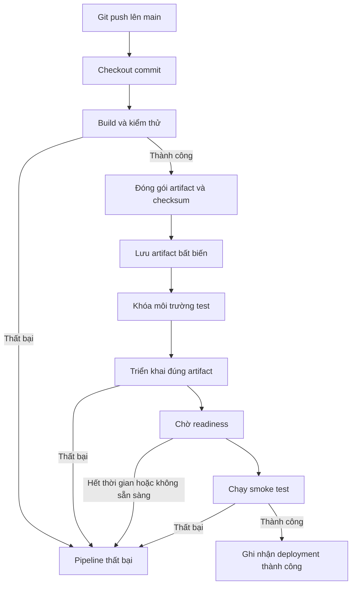

# Tự động triển khai lên môi trường thử nghiệm và chạy kiểm tra khói

Bài thực hành này thuộc chương **Thực hành** của module **DEVOPS_CI_CD_FUNDAMENTALS**. Module xây dựng tư duy CI/CD từ sự kiện Git, pipeline dưới dạng mã, build và kiểm thử tự động đến quản lý artifact, môi trường và cổng chất lượng. Trong bài này, ta nối kết quả build đã được kiểm tra với một lần triển khai có kiểm soát lên môi trường thử nghiệm, sau đó xác minh nhanh rằng phiên bản mới thực sự hoạt động.

Một pipeline chỉ build thành công chưa chứng minh ứng dụng đã được triển khai đúng. Lệnh triển khai có thể trả về mã thoát 0 trong khi tiến trình ứng dụng chưa khởi động, cấu hình sai, endpoint không truy cập được hoặc máy chủ vẫn đang phục vụ phiên bản cũ. Vì vậy, triển khai và kiểm tra sau triển khai phải là các bước có bằng chứng rõ ràng trong cùng luồng CI/CD.

## Mục tiêu học tập

Sau bài thực hành, người học có thể:

- Phân biệt bước build, đóng gói artifact, triển khai và xác minh sau triển khai.
- Thiết kế luồng tự động triển khai một artifact đã được kiểm thử lên môi trường thử nghiệm.
- Quản lý cấu hình, thông tin xác thực và quyền truy cập của môi trường triển khai.
- Ngăn các lần triển khai đồng thời gây ghi đè hoặc làm môi trường ở trạng thái không xác định.
- Thiết kế smoke test ngắn, có giới hạn thời gian và kiểm tra đúng phiên bản vừa triển khai.
- Đọc kết quả pipeline, xác định điểm lỗi và quyết định khi nào cần dừng hoặc quay lui.

## Bài toán và kết quả cần đạt

Giả sử một ứng dụng Java được lưu trong Git. Khi commit được đưa vào nhánh **main**, pipeline cần thực hiện các công việc sau:

1. Lấy đúng mã nguồn của commit.
2. Build và chạy các kiểm thử tự động.
3. Đóng gói artifact duy nhất, gắn với commit đó và tạo checksum.
4. Chỉ khi build và kiểm thử thành công, triển khai artifact lên môi trường **test**.
5. Chờ ứng dụng sẵn sàng, sau đó chạy smoke test qua URL của môi trường.
6. Chỉ đánh dấu luồng thành công khi cả triển khai lẫn smoke test đều thành công.

Kết quả mong đợi là mỗi lần triển khai có thể truy ngược về commit, artifact, môi trường và kết quả xác minh. Khi smoke test thất bại, pipeline phải báo lỗi để người vận hành điều tra; không được coi lệnh copy file hoặc restart service là bằng chứng ứng dụng đã hoạt động.

## 1. Vị trí của triển khai và smoke test trong CI/CD

Luồng cơ bản có thể biểu diễn như sau:



Mỗi bước trả lời một câu hỏi khác nhau:

| Bước | Câu hỏi cần trả lời | Bằng chứng |
|---|---|---|
| Build và kiểm thử | Mã nguồn có thể tạo ra sản phẩm và vượt qua các kiểm thử bắt buộc không? | Log build, kết quả unit/integration test |
| Đóng gói | Sản phẩm nào sẽ được triển khai? | Tên artifact, commit SHA, checksum |
| Deploy | Artifact có được cài đặt vào đúng môi trường không? | Log triển khai, release ID, trạng thái service |
| Readiness | Ứng dụng đã sẵn sàng nhận yêu cầu chưa? | Kết quả health/readiness endpoint |
| Smoke test | Một số đường đi quan trọng có hoạt động sau triển khai không? | HTTP status, nội dung phản hồi, phiên bản |

Không nên gộp tất cả thành một lệnh **deploy** rồi chỉ nhìn mã thoát của lệnh. Một công cụ triển khai có thể hoàn tất thao tác sao chép hoặc cập nhật cấu hình trước khi ứng dụng khởi động xong. Smoke test cung cấp một tín hiệu độc lập ở phía người dùng hoặc client.

### Smoke test là gì?

Smoke test là tập hợp kiểm tra nhỏ, chạy nhanh ngay sau khi triển khai để phát hiện lỗi nghiêm trọng khiến ứng dụng không thể sử dụng ở mức cơ bản. Nó thường xác minh:

- URL môi trường có thể phân giải DNS, thiết lập kết nối và trả về HTTP response.
- Endpoint readiness cho biết ứng dụng sẵn sàng.
- Ứng dụng đang phục vụ đúng phiên bản vừa triển khai.
- Một luồng đọc quan trọng hoặc một API đại diện trả về kết quả hợp lệ.

Smoke test không thay thế unit test, integration test, kiểm thử hồi quy, kiểm thử tải hay kiểm thử bảo mật. Nó cũng không chứng minh mọi chức năng đều đúng. Mục đích của nó là phát hiện sớm các lỗi lớn với chi phí và thời gian thấp.

## 2. Chuẩn bị môi trường thử nghiệm

Môi trường thử nghiệm nên có cấu hình gần với môi trường đích về runtime, cách khởi động, mạng và các dịch vụ phụ thuộc. Dữ liệu và thông tin xác thực phải thuộc môi trường thử nghiệm; không dùng tài khoản hoặc dữ liệu sản xuất cho một bài lab.

### 2.1. Xác định hợp đồng triển khai

Pipeline cần biết artifact nằm ở đâu, cách chuyển artifact đến máy đích và cách yêu cầu máy đích kích hoạt phiên bản mới. Trong ví dụ dưới đây, ta giả định:

- Build Java tạo ra **target/application.jar**.
- Máy chủ thử nghiệm có tài khoản triển khai riêng.
- Máy chủ cung cấp lệnh **/usr/local/sbin/deploy-app** để xác minh checksum, cài release và khởi động ứng dụng.
- Ứng dụng cung cấp **GET /actuator/health/readiness**, **GET /version** và **GET /api/smoke**.
- **GET /version** trả về commit SHA đang chạy; **GET /api/smoke** trả JSON có trường **status** bằng **ok**.

Các tên file, lệnh và endpoint là hợp đồng minh họa. Khi áp dụng vào một ứng dụng thực tế, thay chúng bằng đường dẫn artifact, công cụ triển khai và endpoint đã được dự án định nghĩa. Không tạo endpoint giả chỉ để làm pipeline xanh.

Lệnh deploy phía máy chủ trong ví dụ nhận các tham số:

```bash
sudo /usr/local/sbin/deploy-app \
  --environment test \
  --artifact /tmp/application.jar \
  --checksum /tmp/application.jar.sha256 \
  --version <commit-sha>
```

Lệnh này cần được đội vận hành triển khai trước trên máy chủ thử nghiệm. Nó nên xác minh checksum (chạy kiểm tra trong thư mục chứa hai file ở /tmp), tạo thư mục release riêng theo phiên bản, cài artifact, cập nhật cấu hình môi trường, chuyển phiên bản đang hoạt động theo cách nguyên tử và khởi động lại service. Nên giữ lại release trước đó để có thể quay lui khi cần. Vì runner CI không tương tác để nhập mật khẩu sudo, tài khoản triển khai chỉ nên được cấp quyền NOPASSWD cho đúng lệnh deploy này qua cấu hình sudoers; không cấp quyền quản trị toàn máy chủ.

### 2.2. Khai báo cấu hình và bí mật

Với GitHub Actions, tạo GitHub Environment tên **test**, sau đó khai báo:

| Loại | Tên | Mục đích |
|---|---|---|
| Secret | **TEST_DEPLOY_HOST** | Host SSH của máy chủ thử nghiệm |
| Secret | **TEST_DEPLOY_USER** | Tài khoản triển khai có quyền giới hạn |
| Secret | **TEST_SSH_PRIVATE_KEY** | Khóa riêng dùng cho kết nối SSH |
| Secret | **TEST_SSH_KNOWN_HOSTS** | Host key đã được xác minh của máy chủ |
| Variable | **TEST_BASE_URL** | URL gốc của ứng dụng trên môi trường thử nghiệm |

Secret nên được gắn với đúng environment để job chỉ nhận được chúng khi triển khai vào **test**. Giới hạn branch hoặc tag được phép triển khai trong cấu hình environment. Với môi trường dùng chung hoặc có dữ liệu quan trọng, có thể yêu cầu người phụ trách phê duyệt trước khi job được cấp quyền triển khai.

**TEST_SSH_KNOWN_HOSTS** phải được lấy và xác minh qua kênh tin cậy trước khi lưu. Không tắt kiểm tra host key và không chạy **ssh-keyscan** ngay trong pipeline rồi tin kết quả đó, vì như vậy pipeline không có cơ sở xác nhận đang kết nối đúng máy chủ. Không commit private key, token hoặc mật khẩu vào repository.

Nếu nền tảng đích hỗ trợ danh tính workload như OpenID Connect (OIDC), ưu tiên cơ chế cấp quyền ngắn hạn theo danh tính job thay cho khóa dài hạn. Dù dùng SSH hay OIDC, quyền của pipeline chỉ nên đủ để triển khai lên môi trường **test**.

## 3. Thiết kế các bước triển khai an toàn

### 3.1. Triển khai đúng artifact đã kiểm thử

Build job tạo artifact và lưu lại. Deploy job tải chính artifact đó xuống để triển khai. Không build lại trong deploy job, vì build lần hai có thể tạo ra binary khác với binary đã vượt qua kiểm thử.

Nên lưu ít nhất các thông tin sau:

- Commit SHA tạo ra artifact.
- Tên artifact và checksum.
- ID của lần chạy pipeline.
- Môi trường đích.
- Thời điểm bắt đầu và kết thúc triển khai.
- Kết quả deploy và smoke test.

Commit SHA giúp truy vết mã nguồn; checksum giúp phát hiện artifact bị thay đổi trong quá trình lưu trữ hoặc truyền tải. Nếu có registry hỗ trợ digest bất biến, dùng digest làm định danh triển khai thay cho tag có thể bị ghi đè.

### 3.2. Tách cấu hình khỏi artifact

Artifact nên được đóng gói một lần và dùng lại giữa các môi trường. URL cơ sở, thông tin kết nối, feature flag và secret được đưa vào khi triển khai thông qua cấu hình của environment hoặc secret manager. Không đóng cứng mật khẩu hay endpoint của môi trường thử nghiệm vào file JAR.

Nếu cùng một artifact được triển khai ở nhiều môi trường, hãy giữ nguyên checksum của artifact và ghi nhận cấu hình đã áp dụng cho từng môi trường. Khi có lỗi chỉ xuất hiện ở **test**, cách này giúp phân biệt lỗi binary với lỗi cấu hình.

### 3.3. Ngăn triển khai chồng lấn

Hai lần deploy chạy đồng thời có thể cùng ghi vào thư mục release, restart service hoặc cập nhật symlink. Điều này có thể làm smoke test của lần chạy thứ nhất kiểm tra nhầm phiên bản của lần chạy thứ hai.

Sử dụng cơ chế concurrency hoặc deployment lock theo tên môi trường. Ví dụ trong GitHub Actions dùng nhóm **test-environment**. Nếu hệ thống yêu cầu xử lý mọi commit theo đúng thứ tự, hãy dùng hàng đợi triển khai có bảo đảm thứ tự; cơ chế concurrency của GitHub Actions chỉ giữ một lần chạy và một lần chờ trong cùng nhóm, lần chờ cũ hơn có thể bị thay thế khi có lần chạy mới.

### 3.4. Làm cho thao tác deploy có thể lặp lại

Một lần chạy lại pipeline không nên làm hỏng môi trường. Lệnh triển khai nên:

- Nhận commit hoặc release ID tường minh.
- Kiểm tra artifact và checksum trước khi kích hoạt.
- Không sửa trực tiếp artifact đã được lưu.
- Tạo release mới tách biệt với release đang chạy.
- Có thể nhận biết phiên bản đã được triển khai.
- Ghi log rõ ràng và trả mã lỗi khác 0 khi thao tác thất bại.

Triển khai lặp lại cùng một release nên cho kết quả nhất quán. Nếu không thể bảo đảm điều đó, cần xác định rõ bước nào không idempotent và cách xử lý khi pipeline bị ngắt giữa chừng.

## 4. Thực hành: xây dựng pipeline deploy-test

Ví dụ sử dụng GitHub Actions, Maven, một máy chủ Linux qua SSH và ứng dụng có các endpoint như phần chuẩn bị. Nếu dự án dùng nền tảng khác, giữ nguyên thứ tự và điều kiện của các bước rồi thay cú pháp tương ứng.

### 4.1. Tạo artifact và checksum

Trong job build, chạy kiểm thử trước rồi đóng gói đúng file JAR. Ví dụ:

```bash
./mvnw -B clean verify

set -euo pipefail
test -f target/application.jar
mkdir -p dist
cp target/application.jar dist/application.jar
(cd dist && sha256sum application.jar > application.jar.sha256)
```

Lệnh **verify** chạy các phase trước đó trong lifecycle Maven, bao gồm compile, test và package theo cấu hình dự án. Dòng **test -f** làm pipeline dừng nếu artifact không tồn tại. Nếu dự án tạo tên file khác, thay **target/application.jar** bằng đúng đường dẫn đã được xác nhận; tránh dùng wildcard khi thư mục **target** có thể chứa nhiều JAR.

Checksum được tạo sau khi copy vào thư mục **dist**, vì đó là file sẽ được upload và tải xuống ở job deploy. File checksum đi cùng artifact để máy chủ có thể kiểm tra lại sau khi nhận.

### 4.2. Viết smoke test

Tạo file **scripts/smoke-test.sh**:

```bash
#!/usr/bin/env bash
set -euo pipefail

base_url="${1:?Can truyen TEST_BASE_URL}"
expected_version="${2:?Can truyen commit SHA}"
base_url="${base_url%/}"

echo "Checking readiness at ${base_url}"

for attempt in {1..12}; do
  if readiness="$(curl -fsS --connect-timeout 3 --max-time 8 \
      "${base_url}/actuator/health/readiness" 2>/dev/null)" \
    && printf '%s' "$readiness" | grep -Eq '"status"[[:space:]]*:[[:space:]]*"UP"'; then
    echo "PASS readiness"
    break
  fi

  if [[ "$attempt" -eq 12 ]]; then
    echo "FAIL readiness: application did not become ready"
    exit 1
  fi

  sleep 5
done

actual_version="$(curl -fsS --connect-timeout 3 --max-time 8 \
  "${base_url}/version")"
if [[ "$actual_version" != "$expected_version" ]]; then
  echo "FAIL version: expected $expected_version, got $actual_version"
  exit 1
fi
echo "PASS version $actual_version"

smoke_response="$(curl -fsS --connect-timeout 3 --max-time 8 \
  "${base_url}/api/smoke")"
if ! printf '%s' "$smoke_response" | grep -Eq '"status"[[:space:]]*:[[:space:]]*"ok"'; then
  echo "FAIL smoke endpoint: unexpected response"
  exit 1
fi
echo "PASS core API smoke test"
```

Script này có ba lớp xác minh:

1. **Readiness:** thử tối đa 12 lần, mỗi lần chờ không quá 8 giây và cách nhau 5 giây. Việc chờ có giới hạn giúp ứng dụng có thời gian khởi động mà pipeline không bị treo vô hạn.
2. **Phiên bản:** so sánh nội dung **/version** với commit SHA của lần chạy hiện tại. Nếu endpoint trả về phiên bản cũ, pipeline phát hiện được trường hợp deploy không thực sự kích hoạt release mới.
3. **Đường đi đại diện:** gọi API đọc **/api/smoke** và xác minh nội dung phản hồi có trạng thái **ok**.

**curl -f** làm lệnh thất bại với HTTP status từ 400 trở lên. **--connect-timeout** và **--max-time** đặt giới hạn cho kết nối và toàn bộ request. **grep** kiểm tra nội dung phản hồi thay vì chỉ kiểm tra máy chủ có trả HTTP 200.

Các endpoint trong script phải phản ánh hợp đồng thật của ứng dụng. Nếu **/version** trả JSON, hãy parse trường phiên bản bằng công cụ phù hợp như **jq** và so sánh chính xác. Nếu API cần xác thực, dùng danh tính thử nghiệm có quyền tối thiểu và secret được cấp theo environment; không ghi token ra log. Smoke test nên ưu tiên request đọc, không tạo dữ liệu hoặc gửi giao dịch có tác động khó hoàn tác.

### 4.3. Khai báo workflow GitHub Actions

Tạo workflow, ví dụ **.github/workflows/deploy-test.yml**:

```yaml
name: Deploy to test

on:
  push:
    branches:
      - main
  workflow_dispatch:

permissions:
  contents: read

jobs:
  build:
    runs-on: ubuntu-latest
    steps:
      - name: Checkout source
        uses: actions/checkout@v4

      - name: Set up Java
        uses: actions/setup-java@v4
        with:
          distribution: temurin
          java-version: '21'
          cache: maven

      - name: Build and test
        run: ./mvnw -B clean verify

      - name: Prepare immutable artifact
        shell: bash
        run: |
          set -euo pipefail
          test -f target/application.jar
          mkdir -p dist
          cp target/application.jar dist/application.jar
          (cd dist && sha256sum application.jar > application.jar.sha256)

      - name: Upload artifact
        uses: actions/upload-artifact@v4
        with:
          name: application-${{ github.sha }}-${{ github.run_id }}-${{ github.run_attempt }}
          path: dist/
          if-no-files-found: error
          retention-days: 7

  deploy-test:
    needs: build
    runs-on: ubuntu-latest
    environment: test
    concurrency:
      group: test-environment
      cancel-in-progress: false
    steps:
      - name: Checkout scripts
        uses: actions/checkout@v4

      - name: Download the artifact from this run
        uses: actions/download-artifact@v4
        with:
          name: application-${{ github.sha }}-${{ github.run_id }}-${{ github.run_attempt }}
          path: dist

      - name: Deploy to test over SSH
        shell: bash
        env:
          TEST_DEPLOY_HOST: ${{ secrets.TEST_DEPLOY_HOST }}
          TEST_DEPLOY_USER: ${{ secrets.TEST_DEPLOY_USER }}
          TEST_SSH_PRIVATE_KEY: ${{ secrets.TEST_SSH_PRIVATE_KEY }}
          TEST_SSH_KNOWN_HOSTS: ${{ secrets.TEST_SSH_KNOWN_HOSTS }}
        run: |
          set -euo pipefail
          : "${TEST_DEPLOY_HOST:?Missing TEST_DEPLOY_HOST}"
          : "${TEST_DEPLOY_USER:?Missing TEST_DEPLOY_USER}"
          : "${TEST_SSH_PRIVATE_KEY:?Missing TEST_SSH_PRIVATE_KEY}"
          : "${TEST_SSH_KNOWN_HOSTS:?Missing TEST_SSH_KNOWN_HOSTS}"

          test -s dist/application.jar
          test -s dist/application.jar.sha256
          install -d -m 700 "$HOME/.ssh"
          printf '%s\n' "$TEST_SSH_PRIVATE_KEY" > "$HOME/.ssh/id_ed25519"
          printf '%s\n' "$TEST_SSH_KNOWN_HOSTS" > "$HOME/.ssh/known_hosts"
          chmod 600 "$HOME/.ssh/id_ed25519"
          chmod 644 "$HOME/.ssh/known_hosts"
          trap 'rm -f "$HOME/.ssh/id_ed25519"' EXIT

          scp -i "$HOME/.ssh/id_ed25519" \
            -o IdentitiesOnly=yes \
            -o BatchMode=yes \
            -o StrictHostKeyChecking=yes \
            -o UserKnownHostsFile="$HOME/.ssh/known_hosts" \
            dist/application.jar dist/application.jar.sha256 \
            "${TEST_DEPLOY_USER}@${TEST_DEPLOY_HOST}:/tmp/"

          ssh -i "$HOME/.ssh/id_ed25519" \
            -o IdentitiesOnly=yes \
            -o BatchMode=yes \
            -o StrictHostKeyChecking=yes \
            -o UserKnownHostsFile="$HOME/.ssh/known_hosts" \
            "${TEST_DEPLOY_USER}@${TEST_DEPLOY_HOST}" \
            "sudo /usr/local/sbin/deploy-app --environment test --artifact /tmp/application.jar --checksum /tmp/application.jar.sha256 --version ${GITHUB_SHA}"

      - name: Run smoke tests
        shell: bash
        env:
          TEST_BASE_URL: ${{ vars.TEST_BASE_URL }}
          EXPECTED_VERSION: ${{ github.sha }}
        run: |
          set -euo pipefail
          bash scripts/smoke-test.sh "$TEST_BASE_URL" "$EXPECTED_VERSION"
```

Luồng trên có các điểm cần chú ý:

- **needs: build** bảo đảm deploy chỉ chạy sau khi build job thành công.
- Artifact được đặt tên bằng commit SHA, run ID và run attempt. Deploy job tải artifact thuộc chính lần chạy đó.
- **sha256sum** được tạo ở build job và được chuyển cùng JAR. Lệnh deploy phía máy chủ chịu trách nhiệm kiểm tra checksum trước khi kích hoạt.
- **environment: test** cung cấp đúng secrets/variables và áp dụng các quy tắc bảo vệ của môi trường.
- **concurrency** tránh hai job cùng triển khai lên môi trường **test** tại một thời điểm.
- Smoke test chạy sau lệnh deploy. Nếu script trả mã khác 0, job thất bại và trạng thái workflow không được đánh dấu thành công.

Ví dụ đang dùng tag phiên bản của GitHub Actions để dễ đọc. Repository có yêu cầu bảo mật cao nên pin từng action về commit SHA đầy đủ và cập nhật SHA qua quy trình review. Cũng cần xác nhận phiên bản Java, tên artifact, đường dẫn deploy và endpoint khớp với ứng dụng thực tế.

### 4.4. Chạy và quan sát pipeline

Sau khi cấu hình GitHub Environment và workflow:

1. Kiểm tra **target/application.jar** thực sự được tạo ra sau lệnh **./mvnw -B clean verify**.
2. Xác nhận máy chủ **test** đã cài lệnh deploy, có host key được xác minh và tài khoản CI có quyền cần thiết.
3. Xác nhận **TEST_BASE_URL** trỏ đến đúng môi trường thử nghiệm.
4. Đưa commit lên **main** hoặc chạy workflow thủ công từ branch được environment cho phép.
5. Mở log từng job, kiểm tra build, artifact upload, artifact download, deploy và smoke test.
6. Đối chiếu commit SHA trong log với endpoint **/version** và bản release đang chạy trên máy chủ.

Một lần chạy thành công cần có bằng chứng ở cả ba tầng:

- **Build:** kiểm thử đã chạy và artifact được tạo.
- **Deploy:** đúng artifact và checksum đã được chuyển, máy chủ xác nhận kích hoạt release.
- **Smoke:** readiness thành công, version trùng commit SHA và API đại diện trả phản hồi hợp lệ.

Không kết luận thành công chỉ vì job deploy có dấu tick xanh nếu smoke test chưa chạy hoặc bị bỏ qua do điều kiện workflow. Hãy kiểm tra graph phụ thuộc và trạng thái thực tế của từng step.

## 5. Thiết kế smoke test có tín hiệu tốt

### 5.1. Phân biệt liveness và readiness

Hai loại health check thường có mục tiêu khác nhau:

| Kiểm tra | Ý nghĩa | Dùng khi nào |
|---|---|---|
| Liveness | Tiến trình còn sống và không rơi vào trạng thái cần khởi động lại | Bộ điều phối quyết định có cần restart container/process |
| Readiness | Ứng dụng đã sẵn sàng nhận traffic | Bộ điều phối hoặc pipeline quyết định có thể gửi request |

Một tiến trình có thể còn sống nhưng chưa kết nối được database hoặc chưa nạp xong cấu hình. Khi đó liveness có thể thành công trong khi readiness chưa thành công. Smoke test sau deploy nên chờ readiness trước khi gọi API nghiệp vụ.

Không đưa mọi dependency vào liveness một cách máy móc. Nếu database tạm thời chậm khiến liveness thất bại, hệ thống có thể restart liên tục và làm sự cố nặng hơn. Hãy thiết kế từng health check theo cách nền tảng vận hành sử dụng nó.

### 5.2. Chọn số lượng kiểm tra vừa đủ

Một smoke suite hữu ích thường bao gồm:

| Kiểm tra | Ví dụ | Điều kiện đạt |
|---|---|---|
| Kết nối | Gọi URL gốc hoặc readiness endpoint | Kết nối thành công, HTTP status đúng |
| Sẵn sàng | GET /actuator/health/readiness | JSON có trạng thái UP |
| Đúng phiên bản | GET /version | Commit SHA bằng SHA đang triển khai |
| Luồng chính | GET /api/smoke | HTTP 2xx và response có nội dung mong đợi |
| Dependency thiết yếu | Endpoint chỉ đọc có truy cập dữ liệu thử nghiệm | Phản hồi hợp lệ, không có lỗi phụ thuộc |

Không cần gọi mọi API trong smoke test. Chọn một số luồng đại diện có khả năng phát hiện lỗi cấu hình, định tuyến, kết nối hoặc khởi động. Các kịch bản nghiệp vụ sâu hơn nên thuộc integration test hoặc regression test.

### 5.3. Đặt timeout và retry có giới hạn

Retry giúp tránh báo lỗi giả khi ứng dụng cần vài giây để khởi động. Tuy nhiên, retry vô hạn sẽ che giấu lỗi thật và giữ runner chiếm dụng không cần thiết.

Một chính sách đơn giản có thể là:

- Timeout kết nối 3 giây.
- Timeout mỗi request 8 giây.
- Tối đa 12 lần kiểm tra readiness.
- Khoảng nghỉ 5 giây giữa các lần thử.
- Khi hết số lần thử, trả mã lỗi khác 0.

Điều chỉnh các giá trị theo thời gian khởi động thực tế của ứng dụng. Nếu cần retry API sau readiness, hãy chỉ retry lỗi tạm thời có thể dự đoán; không lặp lại một thao tác ghi dữ liệu có tác dụng phụ. Với hệ thống lớn, có thể dùng exponential backoff và jitter để tránh nhiều pipeline cùng tạo tải vào một thời điểm.

### 5.4. Kiểm tra đúng phiên bản

Một endpoint trả HTTP 200 chưa chắc là phiên bản vừa deploy. Có thể reverse proxy vẫn định tuyến đến instance cũ, rollout chưa hoàn tất hoặc deployment command cập nhật nhầm service. Vì vậy, endpoint version nên trả về commit SHA hoặc image digest đang chạy.

Smoke test so sánh giá trị đó với metadata của pipeline. Nếu không trùng, báo lỗi và điều tra rollout. Đây là một kiểm tra nhỏ nhưng có giá trị lớn trong môi trường có nhiều instance hoặc nhiều lần deploy gần nhau.

### 5.5. Tránh smoke test gây tác động phụ

Ưu tiên endpoint đọc và dữ liệu thử nghiệm có thể tái tạo. Nếu cần kiểm tra một luồng ghi, hãy dùng fixture riêng, định danh duy nhất theo run ID và có bước dọn dữ liệu. Không gửi email thật, thanh toán thật, xóa dữ liệu dùng chung hoặc kích hoạt tác vụ không thể đảo ngược từ smoke test.

Smoke test phải đủ nhỏ để chạy thường xuyên. Nếu một kịch bản mất nhiều phút, phụ thuộc dữ liệu khó chuẩn bị hoặc có xác suất lỗi không ổn định, hãy tách nó thành loại kiểm thử phù hợp hơn.

## 6. Xử lý lỗi sau triển khai

Khi deploy hoặc smoke test thất bại, giữ lại bằng chứng của lần chạy: commit SHA, artifact checksum, release ID, log service, HTTP status, response body đã loại bỏ dữ liệu nhạy cảm và thời điểm kiểm tra.

| Hiện tượng | Nguyên nhân có thể | Hướng điều tra |
|---|---|---|
| Build thành công nhưng không có artifact | Sai đường dẫn, tên JAR thay đổi, bước package chưa chạy | Kiểm tra log Maven và file trong thư mục target |
| Không tải được artifact | Tên artifact giữa upload/download khác nhau hoặc job chạy khác run | So sánh tên artifact, SHA, run ID và run attempt |
| SSH bị từ chối | Sai host/user/key, quyền file key sai hoặc host key không khớp | Kiểm tra secrets của environment và known_hosts đã xác minh |
| Lệnh deploy thất bại | Tài khoản thiếu quyền, checksum sai, thiếu dung lượng hoặc script phía máy chủ lỗi | Xem log deploy trên runner và máy chủ |
| Readiness không lên | Ứng dụng khởi động lỗi, cấu hình sai, dependency chưa sẵn sàng | Xem log ứng dụng, biến môi trường và trạng thái dependency |
| Readiness lên nhưng version cũ | Rollout chưa hoàn tất, proxy trỏ nhầm instance hoặc deploy sai service | Đối chiếu release ID, routing và trạng thái từng instance |
| Version đúng nhưng API smoke lỗi | Lỗi route, cấu hình, quyền truy cập hoặc dependency nghiệp vụ | Kiểm tra status code, response và log ứng dụng |
| Smoke test timeout | Mạng, DNS, TLS, firewall hoặc ứng dụng phản hồi chậm | Kiểm tra từ runner đến URL, timeout và tình trạng môi trường |

Nếu smoke test thất bại sau khi đã chuyển phiên bản, môi trường có thể đang chạy release mới nhưng chưa đạt điều kiện sử dụng. Đánh dấu pipeline thất bại, dừng các bước phụ thuộc và thông báo cho người chịu trách nhiệm môi trường. Nếu hệ thống có cơ chế rollback đã được kiểm thử, có thể khôi phục release ổn định trước đó theo runbook. Không chạy rollback mù quáng nếu thay đổi có migration dữ liệu không tương thích hoặc thao tác không thể đảo ngược.

Một chiến lược triển khai an toàn thường chuẩn bị release mới song song, kiểm tra readiness trước khi chuyển traffic, sau đó mới chuyển phiên bản hoạt động. Giữ release cũ trong khoảng thời gian đủ để xác minh giúp giảm thời gian phục hồi. Với môi trường test dùng chung, cần thông báo rõ release nào đang hoạt động để tránh nhóm khác kiểm thử trên phiên bản bất ngờ thay đổi.

## 7. Bảo vệ môi trường và độ tin cậy của pipeline

### Quyền truy cập tối thiểu

Tài khoản triển khai không nên là tài khoản quản trị toàn máy chủ. Giới hạn quyền vào thư mục release, service cần restart và lệnh deploy được phép chạy. Nếu dùng sudo, cấu hình sudoers chỉ cho phép lệnh cần thiết với tham số được kiểm tra.

Không in secret ra log, không truyền secret trong URL và không đưa secret vào artifact. Dùng secret masking của nền tảng như một lớp bảo vệ bổ sung, không coi đó là lý do để chủ động echo giá trị bí mật.

### Phân tách môi trường

Môi trường test cần có URL, secret, dữ liệu và quyền riêng. Pipeline phải triển khai rõ ràng vào môi trường nào. Tránh lấy giá trị mặc định mơ hồ khiến một lần chạy thủ công có thể trỏ nhầm sang production. Cấu hình branch protection hoặc environment protection để giới hạn ai và nhánh nào được triển khai.

### Bằng chứng có thể truy vết

Log nên ghi commit SHA, release ID, tên môi trường, artifact checksum, thời điểm và kết quả smoke test. Không ghi token, private key, mật khẩu hoặc dữ liệu cá nhân. Khi có lỗi, thông tin này giúp liên kết một sự kiện Git với phiên bản đang chạy.

### Tránh báo thành công giả

Một smoke test chỉ kiểm tra HTTP 200 có thể bỏ sót response sai, redirect về trang đăng nhập hoặc phiên bản cũ. Hãy xác minh status code, nội dung quan trọng và version. Cũng cần bảo đảm step smoke test không bị điều kiện if vô tình bỏ qua khi deploy thành công.

### Kiểm soát thời gian và hàng đợi

Timeout của từng request, số lần retry và giới hạn thời gian tổng phải phù hợp với SLA của môi trường test. Theo dõi thời gian chờ runner và thời gian triển khai. Nếu nhiều nhóm cùng dùng một môi trường, thống nhất quy tắc đặt lịch hoặc hàng đợi để smoke test của nhóm này không chạy trong lúc nhóm khác thay phiên bản.

## 8. Bài tập mở rộng

Sau khi luồng cơ bản chạy thành công, thực hiện các thay đổi sau trên môi trường thử nghiệm:

1. Thay đổi một giá trị hiển thị phiên bản để xác nhận /version phản ánh commit mới.
2. Tạm thời cấu hình endpoint smoke trả response không hợp lệ trên một branch thử nghiệm, xác nhận pipeline chuyển sang trạng thái thất bại và log chỉ ra bước kiểm tra tương ứng.
3. Khôi phục endpoint, triển khai lại và xác nhận pipeline xanh.
4. Chạy hai workflow gần nhau để quan sát concurrency. Xác nhận không có hai deploy đồng thời; kiểm tra cách hệ thống xử lý lần chạy đang chờ.
5. Nếu ứng dụng có nhiều instance, xác minh smoke test chỉ kết luận thành công sau khi tất cả instance thuộc rollout đã sẵn sàng và phục vụ đúng phiên bản, hoặc sau khi cơ chế routing bảo đảm chỉ instance khỏe nhận traffic.

Không cố ý làm hỏng môi trường test dùng chung khi chưa thông báo cho các nhóm đang sử dụng. Có thể thực hiện bài tập lỗi trên một branch hoặc một môi trường cô lập.

## 9. Tiêu chí nghiệm thu

Đánh dấu bài thực hành hoàn thành khi đáp ứng tất cả điều kiện sau:

- [ ] Build và kiểm thử chạy trước bước deploy.
- [ ] Artifact được tạo một lần, gắn với commit SHA và có checksum.
- [ ] Deploy job chỉ chạy khi build job thành công và tải đúng artifact của lần chạy hiện tại.
- [ ] Cấu hình môi trường và thông tin xác thực được lưu ở cơ chế quản lý phù hợp; không có secret trong Git.
- [ ] Kết nối SSH xác minh host key hoặc dùng cơ chế danh tính workload tương đương.
- [ ] Các lần triển khai vào cùng môi trường được tuần tự hóa.
- [ ] Smoke test chờ readiness với timeout/retry có giới hạn.
- [ ] Smoke test xác minh đúng version và ít nhất một luồng đại diện.
- [ ] Smoke test thất bại làm pipeline thất bại và giữ lại bằng chứng để điều tra.
- [ ] Có quy trình quay lui phù hợp với cách ứng dụng quản lý release và dữ liệu.

## 10. Những điểm cần ghi nhớ

Triển khai tự động chỉ hoàn tất khi phiên bản đã được kích hoạt và vượt qua các kiểm tra sau triển khai. Build job tạo ra artifact; deploy job đưa đúng artifact đó vào môi trường; smoke test xác minh ứng dụng đang sẵn sàng và phục vụ đúng phiên bản.

Giữ artifact bất biến, tách cấu hình khỏi binary, giới hạn quyền triển khai và tuần tự hóa thao tác trên môi trường dùng chung. Smoke test nên nhanh, có timeout, có retry hữu hạn, kiểm tra nội dung phản hồi và tránh tác động phụ. Khi kiểm tra thất bại, pipeline phải báo lỗi và cung cấp bằng chứng đủ để quyết định sửa lỗi hoặc quay lui.
