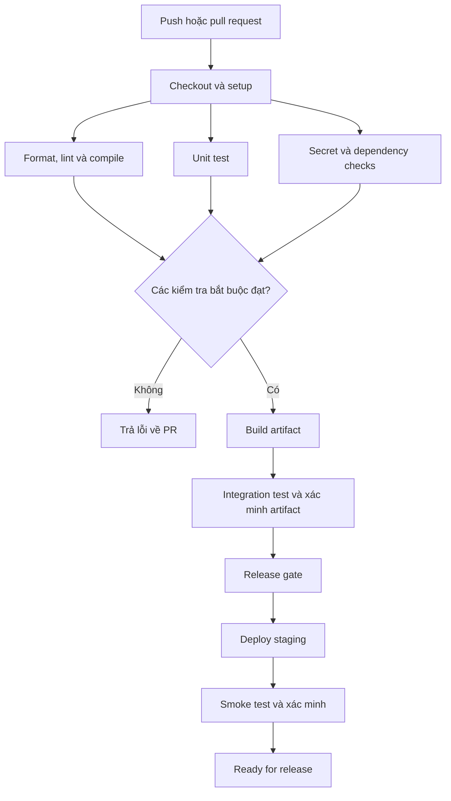

# Tự đánh giá khả năng tích hợp thường xuyên, phản hồi nhanh và phát hành an toàn

Một nhóm có thể có máy chủ CI, nhiều pipeline và nút deploy tự động nhưng vẫn mất nhiều ngày để tích hợp thay đổi, chờ lâu mới biết test thất bại hoặc không thể xác định chính xác artifact đang chạy ở production. Muốn biết quy trình CI/CD có thực sự hiệu quả hay không, cần xem bằng chứng từ lúc thay đổi được tạo ra đến khi phiên bản được triển khai và xác minh.

Bài thực hành này giúp bạn đánh giá quy trình của một repository hoặc một dịch vụ theo ba năng lực:

1. **Tích hợp thường xuyên:** thay đổi nhỏ được đưa vào nhánh chung và được xác minh trên trạng thái sẽ merge.
2. **Phản hồi nhanh:** pipeline trả kết quả đủ sớm, ổn định và chỉ rõ việc cần xử lý.
3. **Phát hành an toàn:** artifact có thể truy vết, các cổng chất lượng và quyền truy cập được kiểm soát, triển khai được xác minh và có phương án khôi phục.

Bạn sẽ thu thập bằng chứng, vẽ lại luồng hiện tại, thực hiện một bài mô phỏng phát hành và chấm điểm mức độ trưởng thành. Kết quả cuối cùng là một phiếu đánh giá có dẫn chứng và một kế hoạch cải thiện ưu tiên.

## 1. Kết quả cần đạt

Sau bài thực hành, bạn có thể:

- Phân biệt việc có công cụ CI với việc nhóm thực sự tích hợp liên tục.
- Đo thời gian từ lúc gửi thay đổi đến khi có phản hồi, tách thời gian chờ runner và thời gian thực thi.
- Kiểm tra pipeline có xác minh trạng thái merge thực tế và giữ nhánh chung ở trạng thái tốt hay không.
- Đánh giá độ ổn định của test và khả năng tái tạo build.
- Truy vết một artifact từ commit đến môi trường triển khai bằng version hoặc digest.
- Kiểm tra các cổng phát hành, bảo vệ secret, xác minh sau triển khai và khả năng rollback.
- Chấm điểm dựa trên bằng chứng thay vì cảm nhận.

## 2. Bối cảnh và phạm vi thực hành

Chọn một repository dịch vụ mà bạn có thể đọc lịch sử Git, pull request và kết quả CI. Nếu không có quyền truy cập hệ thống thật, dùng dữ liệu của một dự án học tập hoặc kịch bản minh họa trong bài.

Kịch bản xuyên suốt là dịch vụ `orders-service`:

- Developer thay đổi logic xử lý đơn hàng và tạo pull request.
- CI build ứng dụng, chạy test và kiểm tra chất lượng.
- Artifact được publish vào registry.
- Release được triển khai lên staging, sau đó có thể được phê duyệt để triển khai production.
- Sau triển khai, pipeline kiểm tra sức khỏe ứng dụng.
- Nếu phiên bản mới không đạt yêu cầu, nhóm phải khôi phục phiên bản đã biết là tốt.

Bạn có thể thay tên dịch vụ bằng repository đang làm. Bài thực hành không yêu cầu truy cập production hoặc thực hiện một lần deploy thật. Nếu không có môi trường sandbox, hãy hoàn thành phần phát hành bằng mô phỏng trên giấy và ghi rõ bằng chứng nào chưa thể xác minh.

**Thời lượng tham khảo:** 90–120 phút.

**Đầu vào cần chuẩn bị:**

- Một repository Git và nhánh chung, thường là `main` hoặc `trunk`.
- Lịch sử pull request hoặc merge request trong khoảng 2–4 tuần gần nhất.
- Kết quả pipeline của khoảng 20 lần chạy gần nhất nếu có.
- Thông tin về artifact, môi trường staging/production và quy trình rollback.
- Quyền đọc log và cấu hình pipeline. Không cần quyền quản trị production.

## 3. Phần A — Kiểm tra cách nhóm tích hợp thay đổi

Trước hết, quan sát cách thay đổi đi từ nhánh làm việc vào nhánh chung. Chạy các lệnh chỉ đọc sau tại repository:

```bash
git status --short
git log --oneline --decorate -n 30
git log --first-parent --date=short --pretty=format:"%h %ad %s" -n 20 main
git diff --stat origin/main...HEAD
```

Thay `main` bằng tên nhánh chung của dự án nếu cần. Lệnh `git diff` dùng để xem quy mô thay đổi giữa nhánh hiện tại và nhánh đích; nếu bạn đang đứng trên nhánh chung hoặc không có remote-tracking ref tương ứng, hãy chạy trên một nhánh pull request hoặc bỏ qua lệnh này.

Các lệnh Git cho biết lịch sử commit và phạm vi diff. Chúng không tự cung cấp chính xác thời gian một branch tồn tại. Hãy lấy thời điểm tạo branch, mở pull request và merge từ hệ thống quản lý Git nếu nền tảng lưu thông tin đó.

Thu thập dữ liệu:

| Câu hỏi | Bằng chứng cần tìm | Ghi nhận |
| --- | --- | --- |
| Thay đổi được merge vào nhánh chung bao nhiêu lần? | Lịch sử merge trong 2–4 tuần | Số lần và khoảng cách giữa các lần |
| Branch thường tồn tại bao lâu? | Thời điểm tạo branch và merge PR | Trung vị hoặc nhóm thời gian phổ biến |
| Pull request có kích thước ra sao? | Số file, số dòng thay đổi, phạm vi chức năng | Nhỏ, vừa hay rất lớn; nêu ví dụ |
| Có review trước khi merge không? | Approval và branch protection | Quy tắc có được thực thi tự động không |
| Pipeline kiểm tra trạng thái nào? | Commit PR, merge result hay commit sau merge | Ghi rõ cơ chế |
| Khi nhánh chung đỏ, nhóm làm gì? | Incident, chat, issue hoặc lịch sử revert | Thời gian khôi phục và người chịu trách nhiệm |

Đánh giá bằng chứng:

- Tích hợp thường xuyên khi thay đổi nhỏ được merge trong thời gian ngắn và nhóm không dồn phần lớn công việc vào một đợt tích hợp lớn.
- Branch ngắn hạn và pull request nhỏ giúp review nhanh, giảm xung đột và thu hẹp phạm vi tìm lỗi.
- Mỗi pull request xanh riêng lẻ chưa bảo đảm trạng thái kết hợp sẽ xanh. Kiểm tra merge result hoặc merge queue giúp xác minh đúng nội dung sắp vào nhánh chung.
- Nếu nhánh chung đỏ trong thời gian dài mà nhóm vẫn tiếp tục merge, quy trình chưa có cơ chế bảo vệ trạng thái tích hợp.

**Bài tập A:** Chọn ba pull request gần nhất. Với mỗi PR, ghi thời gian từ lần commit đầu đến merge, số file thay đổi, số lần pipeline chạy, kết quả cuối cùng và liệu merge result có được kiểm tra hay không. Nếu không có dữ liệu, ghi `Chưa có bằng chứng`; không tự ước lượng.

## 4. Phần B — Đánh giá pipeline và tốc độ phản hồi

Vẽ lại pipeline hiện tại từ lúc có sự kiện Git đến khi người tạo thay đổi nhận được kết quả. Ghi rõ trigger, job, quan hệ phụ thuộc, cổng bắt buộc và nơi hiển thị trạng thái.

Một luồng tham khảo:



Đây là luồng tham khảo, không phải thứ tự bắt buộc. Hãy vẽ theo pipeline thật và đánh dấu job nào chạy song song, job nào cần kết quả từ job trước.

### Đo thời gian phản hồi

Với khoảng 20 lần chạy gần nhất, nếu dữ liệu có sẵn, ghi các mốc:

- Thời điểm push hoặc tạo commit cần kiểm tra.
- Thời điểm job được xếp hàng.
- Thời điểm runner bắt đầu thực thi.
- Thời điểm các kiểm tra bắt buộc hoàn tất.
- Thời điểm trạng thái được cập nhật về pull request.

Từ đó phân tách:

```text
queue_time = runner_start - job_queued
execution_time = required_checks_completed - runner_start
feedback_time = result_published - change_submitted
```

Tính p50 và p95 của `feedback_time` nếu có đủ dữ liệu. p50 mô tả lần chạy điển hình; p95 cho thấy những lần chờ lâu mà nhóm vẫn thường gặp. Không dùng thời gian trung bình thay cho cả hai vì một vài lần chạy rất chậm có thể làm sai lệch cảm nhận.

| Chỉ số | Kết quả của repository | Mục tiêu hoặc nhận xét |
| --- | --- | --- |
| p50 feedback time |  |  |
| p95 feedback time |  |  |
| p50 queue time |  |  |
| p95 queue time |  |  |
| Job chậm nhất |  |  |
| Tỷ lệ pipeline xanh lần đầu |  |  |
| Tỷ lệ rerun do test flaky hoặc hạ tầng |  |  |

Nếu không có đủ dữ liệu để tính percentile, ghi rõ số mẫu và những mốc còn thiếu. Đừng kết luận pipeline nhanh chỉ từ một lần chạy thành công.

### Kiểm tra chất lượng phản hồi

Chọn một lần chạy thất bại và trả lời:

1. Trạng thái lỗi xuất hiện ở đâu và sau bao lâu?
2. Có thể xác định commit, job, lệnh và test thất bại từ thông báo không?
3. Log có chỉ ra nguyên nhân đủ cụ thể để người phát triển hành động không?
4. Lỗi là do mã nguồn, test, dependency, runner, quyền hay dịch vụ bên ngoài?
5. Nhóm có retry không? Nếu có, lỗi có thực sự tạm thời và thao tác có an toàn khi lặp không?
6. Sau khi sửa, nhóm có xác minh lại đúng trạng thái tích hợp không?

Một pipeline phản hồi tốt giúp người nhận biết việc tiếp theo cần làm. Chỉ hiển thị dòng `Job failed` mà không có link log, commit hoặc bước gây lỗi là chưa đủ.

## 5. Phần C — Đánh giá độ tin cậy của kiểm thử và build

CI chạy thường xuyên nhưng kết quả thiếu ổn định sẽ tạo ra nhiều lần rerun và làm giảm niềm tin của nhóm. Kiểm tra các yếu tố sau:

- Dependency có được khóa bằng lockfile hoặc phiên bản cụ thể không?
- Runtime, compiler và build tool có được cố định không?
- Test có dữ liệu riêng và dọn dẹp sau mỗi lần chạy không?
- Test song song có ghi vào cùng database, file hoặc tài khoản dùng chung không?
- Có test flaky lặp lại nhiều lần không? Nhóm có ghi nhận chủ sở hữu xử lý không?
- Pipeline có thể clean build khi cache trống không?
- Artifact có thể được tạo lại từ commit và toolchain đã ghi nhận không?

Chọn một test từng flaky hoặc một job có kết quả không ổn định. Ghi nguyên nhân đã biết, số lần thất bại, số lần retry và trạng thái xử lý. Không coi một lần retry xanh là bằng chứng test đã ổn định.

Đánh giá thêm cách nhóm xử lý build đỏ trên nhánh chung:

| Tình huống | Cách nhóm đang xử lý | Bằng chứng cần có |
| --- | --- | --- |
| Test thất bại do thay đổi mã nguồn |  | PR sửa lỗi hoặc revert |
| Runner hoặc registry tạm thời lỗi |  | Log hạ tầng và retry có giới hạn |
| Test flaky |  | Issue, người phụ trách và kế hoạch khắc phục |
| Secret hoặc quyền truy cập sai |  | Thay đổi cấu hình/quyền được review |
| Build main bị đỏ |  | Thời gian phát hiện và thời gian khôi phục |

## 6. Phần D — Truy vết artifact và cổng phát hành

Chọn một release gần đây và lần theo đường đi từ commit đến artifact đang hoặc đã chạy trong staging. Nếu không có release thật, dùng release giả lập của bài.

Ghi lại:

1. Repository và commit SHA.
2. Pipeline run đã build artifact.
3. Version và digest của artifact.
4. Kết quả build, unit test, integration test và kiểm tra bảo mật.
5. Nơi lưu artifact và quyền ai có thể publish hoặc đọc.
6. Môi trường đã triển khai và kết quả xác minh.
7. Người hoặc policy đã phê duyệt bước release tiếp theo.

Artifact cần có định danh bất biến. Tag dễ đọc như `orders-service:2.1.0` hữu ích cho quản lý phiên bản, nhưng digest mới xác định chính xác nội dung. Với container image, có thể tham chiếu dạng `registry.example/orders-service@sha256:...`.

Điền manifest minh họa sau bằng dữ liệu thật nếu có:

~~~yaml
release_id: orders-2026.11.18-rc1
source:
  repository: orders-service
  commit: 4d91a2c
  pipeline_run: ci-1842
artifact:
  reference: registry.example/orders-service@sha256:abc...
  version: 2.1.0
checks:
  build: passed
  unit_tests: passed
  integration_tests: passed
  security_scan: passed
deployment:
  environment: staging
  approval: recorded
  smoke_test: passed
rollback:
  previous_artifact: registry.example/orders-service@sha256:789...
~~~

Các giá trị trong ví dụ chỉ để minh họa cấu trúc. Khi đánh giá repository thật, không tự điền commit, digest, trạng thái test hoặc approval nếu không có bằng chứng.

Kiểm tra các câu hỏi về phát hành an toàn:

- Artifact có được build một lần và promote qua các môi trường không?
- Production có dùng đúng digest đã được kiểm thử ở staging không?
- Secret có được lấy từ secret manager hoặc cơ chế tương đương không?
- Pipeline có dùng credential tối thiểu và giới hạn theo môi trường không?
- Pull request không tin cậy có thể truy cập secret hoặc quyền deploy không?
- Các cổng bắt buộc có thể bị bỏ qua thủ công không? Nếu có, ngoại lệ có được ghi lại không?
- Có lưu metadata để truy vết commit, artifact, pipeline run và người phê duyệt không?

## 7. Phần E — Mô phỏng phát hành và khôi phục an toàn

Thực hiện bài mô phỏng bằng sơ đồ, bảng hoặc môi trường sandbox. Không chạy lệnh thay đổi production trong bài thực hành này.

**Tình huống:** `orders-service` có phiên bản hiện tại `2.0.4` đang chạy tốt. Pipeline build phiên bản `2.1.0`, tất cả test bắt buộc đều đạt và artifact được publish với digest mới. Nhóm triển khai lên staging, chạy smoke test và chuẩn bị phát hành production.

### E1. Kiểm tra trước khi triển khai

Xác nhận:

- Commit được review và merge vào nhánh được bảo vệ.
- Pipeline xác minh đúng commit hoặc merge result.
- Build và các kiểm tra bắt buộc đều đạt.
- Artifact có version, digest và nguồn gốc rõ ràng.
- Secret và credential được cấp đúng phạm vi.
- Staging đang dùng cùng artifact digest dự kiến triển khai.

Ghi kết quả:

| Điều kiện | Đạt/Không đạt/Chưa có bằng chứng | Bằng chứng |
| --- | --- | --- |
| Commit và review |  |  |
| Required checks |  |  |
| Artifact version/digest |  |  |
| Security và secret handling |  |  |
| Staging dùng đúng digest |  |  |

### E2. Xác minh sau triển khai

Giả sử staging đã nhận phiên bản mới. Xác định những tín hiệu cần kiểm tra:

- Workload đã chạy đúng artifact digest chưa?
- Readiness hoặc health check có đạt không?
- Endpoint quan trọng có trả kết quả đúng không?
- Có lỗi tăng đột biến trong log hoặc metric không?
- Smoke test có kiểm tra luồng nghiệp vụ chính không?
- Pipeline ghi lại môi trường, thời gian, digest và kết quả chưa?

Không coi lệnh deploy trả về thành công là bằng chứng duy nhất. Cần xác minh ứng dụng thực sự chạy đúng phiên bản và đáp ứng điều kiện sức khỏe đã định.

### E3. Mô phỏng thất bại và rollback

Giả sử sau khi triển khai `2.1.0`, readiness không đạt trong thời hạn cho phép và smoke test phát hiện luồng tạo đơn hàng bị lỗi. Hãy viết ra quyết định xử lý:

1. Dừng bước promote tiếp theo và ghi nhận release đang degraded hoặc failed.
2. Xác định digest thực tế đang chạy và log của lần triển khai.
3. Kiểm tra phiên bản trước `2.0.4` còn tương thích với trạng thái dữ liệu hiện tại không.
4. Nếu rollback an toàn, triển khai lại artifact cũ theo digest đã lưu.
5. Chạy lại health check và smoke test.
6. Ghi nhận release ID, digest sau rollback, thời gian và người phê duyệt.
7. Tạo issue điều tra nguyên nhân của `2.1.0` trước khi phát hành lại.

Nếu phiên bản mới đã chạy migration phá vỡ khả năng đọc của phiên bản cũ, không được mặc định rollback binary là đủ. Cần xem xét migration bù hoặc roll forward. Quyết định phải dựa trên khả năng tương thích của dữ liệu và các dịch vụ phụ thuộc.

Hoàn thành bảng:

| Mốc | Artifact digest | Trạng thái | Bằng chứng xác minh |
| --- | --- | --- | --- |
| Trước release | Digest của 2.0.4 | Healthy |  |
| Staging | Digest của 2.1.0 | Smoke test đạt/chưa đạt |  |
| Production sau deploy (mô phỏng) | Digest của 2.1.0 | Healthy/degraded |  |
| Sau rollback (nếu cần) | Digest của 2.0.4 | Healthy/degraded |  |

## 8. Phần F — Chấm điểm mức độ trưởng thành

Chấm từng tiêu chí từ 0 đến 3. Chỉ chấm điểm cao khi có bằng chứng trong Git, CI, release record hoặc quy trình được thực thi.

| Điểm | Ý nghĩa |
| --- | --- |
| 0 | Chưa có thực hành hoặc chưa có bằng chứng kiểm chứng |
| 1 | Có làm nhưng thủ công, không đều hoặc phụ thuộc cá nhân |
| 2 | Có quy trình và công cụ hỗ trợ, nhưng chưa được thực thi nhất quán |
| 3 | Được thực thi thường xuyên, có kiểm soát và có bằng chứng truy vết |

| Năng lực | 0–3 | Bằng chứng đã thu thập |
| --- | ---: | --- |
| 1. Thay đổi nhỏ và tích hợp thường xuyên vào nhánh chung |  |  |
| 2. Branch ngắn hạn, pull request dễ review và có kiểm soát |  |  |
| 3. CI xác minh trạng thái merge thực tế và required checks |  |  |
| 4. Phản hồi có thời gian đo được, log và thông báo có thể hành động |  |  |
| 5. Nhánh chung được khôi phục nhanh khi build bị hỏng |  |  |
| 6. Test ổn định, môi trường tái tạo được và clean build hoạt động |  |  |
| 7. Artifact bất biến, có digest và truy vết về commit/pipeline |  |  |
| 8. Secret, credential, approval và release gate được kiểm soát |  |  |
| 9. Triển khai có xác minh sau deploy và ghi nhận trạng thái thực tế |  |  |
| 10. Có rollback hoặc recovery đã được diễn tập và xác minh |  |  |
| **Tổng điểm** | **/30** |  |

Diễn giải tổng điểm:

| Tổng điểm | Mức hiện tại | Hướng ưu tiên |
| ---: | --- | --- |
| 0–10 | Rời rạc | Thiết lập nhánh chung, build/test tự động và quy tắc xử lý lỗi |
| 11–19 | Đang hình thành | Rút ngắn vòng tích hợp, tăng độ tin cậy và chuẩn hóa release |
| 20–25 | Có thể lặp lại | Cải thiện p95, truy vết artifact, kiểm soát ngoại lệ và diễn tập rollback |
| 26–30 | Có kỷ luật | Duy trì bằng chứng, kiểm tra drift và cải thiện liên tục |

**Điều kiện quan trọng:** tổng điểm cao không tự động chứng minh phát hành an toàn. Trước khi tuyên bố một quy trình có thể phát hành an toàn, các tiêu chí 7, 8, 9 và 10 cần đạt ít nhất 2 điểm mỗi tiêu chí. Nếu một tiêu chí trong nhóm này dưới 2, hãy ghi rõ giới hạn và không dùng tổng điểm để che khuất lỗ hổng đó.

## 9. Chọn một cải thiện ưu tiên

Từ phiếu đánh giá, chọn một vấn đề có tác động lớn và có thể xử lý trong một đến hai tuần. Không chọn nhiều mục cùng lúc nếu chưa xác định được nguyên nhân chính.

Ghi kế hoạch:

| Nội dung | Câu trả lời |
| --- | --- |
| Vấn đề quan sát được |  |
| Bằng chứng hoặc số liệu |  |
| Nguyên nhân có khả năng nhất |  |
| Thay đổi sẽ thực hiện |  |
| Người phụ trách |  |
| Thời hạn |  |
| Chỉ số trước thay đổi |  |
| Tiêu chí chấp nhận sau thay đổi |  |
| Cách hoàn tác nếu kết quả xấu |  |

Ví dụ:

- Vấn đề: p95 feedback time là 28 phút, trong đó queue time chiếm 12 phút.
- Bằng chứng: dữ liệu 20 lần chạy gần nhất cho thấy runner chờ lâu vào giờ cao điểm.
- Thay đổi: điều chỉnh concurrency và tách job kiểm tra nhanh khỏi job integration dài.
- Tiêu chí chấp nhận: p95 feedback time giảm, tỷ lệ build xanh lần đầu không giảm và chi phí runner nằm trong ngân sách.
- Cách hoàn tác: khôi phục giới hạn concurrency cũ nếu queue hoặc chi phí xấu đi.

Sau khi thực hiện, đo lại cùng loại workload và cập nhật phiếu đánh giá. Một thay đổi chỉ được xem là cải thiện khi có dữ liệu trước/sau và không làm suy yếu các cổng chất lượng.

## 10. Mẫu báo cáo kết quả thực hành

Hoàn thiện báo cáo ngắn sau khi kết thúc:

```text
Repository:
Khoảng thời gian đánh giá:
Số pull request/merge đã xem:
Số lần chạy CI đã xem:

Integration frequency:
Branch lifetime:
Merge-result validation:
Feedback p50/p95:
Queue time p50/p95:
First-pass success rate:
Main recovery time:

Artifact version/digest:
Release gates:
Post-deployment verification:
Rollback evidence:

Self-assessment score: __/30
Critical release criteria (7-10): PASS / GAP

Top 3 gaps:
1.
2.
3.

Improvement commitment:
Owner:
Due date:
Acceptance criteria:
Evidence location:
```

Nếu một mục chưa có dữ liệu, ghi `Chưa có bằng chứng` và đưa nó vào danh sách cần bổ sung. Không biến dữ liệu thiếu thành giả định tích cực.

## 11. Điều kiện hoàn thành bài thực hành

Bài thực hành được xem là hoàn thành khi bạn có:

- [ ] Bằng chứng từ ít nhất ba pull request hoặc merge gần đây.
- [ ] Sơ đồ pipeline hiện tại và danh sách các cổng kiểm tra bắt buộc.
- [ ] Số liệu phản hồi CI hoặc ghi rõ dữ liệu còn thiếu.
- [ ] Một trường hợp thất bại được phân tích theo nguyên nhân và cách khôi phục.
- [ ] Một artifact được truy vết từ commit đến môi trường, hoặc ghi rõ điểm không thể truy vết.
- [ ] Bảng mô phỏng xác minh sau triển khai và rollback.
- [ ] Phiếu tự đánh giá 10 tiêu chí cùng bằng chứng.
- [ ] Một kế hoạch cải thiện có người phụ trách, thời hạn và tiêu chí chấp nhận.

Giá trị của bài thực hành nằm ở bằng chứng và hành động tiếp theo. Một nhóm thực hành CI/CD tốt có thể giải thích thay đổi được tích hợp khi nào, kiểm tra gì, phản hồi mất bao lâu, artifact nào được phát hành, ai hoặc policy nào cho phép triển khai, ứng dụng đã được xác minh ra sao và cách khôi phục nếu release không đạt yêu cầu.
