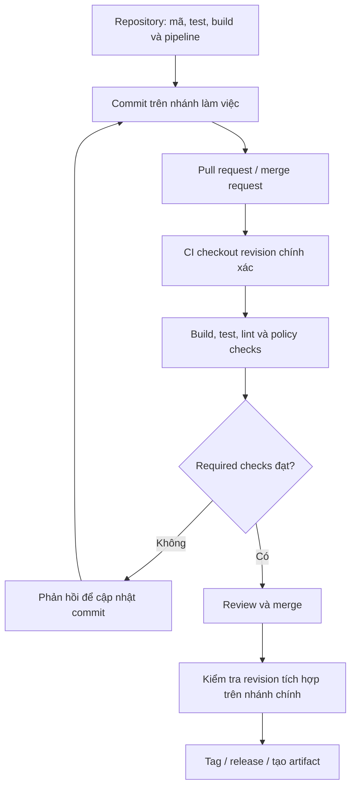

# Quản lý mã ứng dụng, kiểm thử và cấu hình pipeline bằng hệ thống phiên bản

Hệ thống quản lý phiên bản là nền tảng để nhóm phát triển phối hợp thay đổi mã nguồn và để CI/CD xác định chính xác nội dung cần kiểm tra. Repository không chỉ chứa mã ứng dụng. Nó còn lưu lịch sử thay đổi, cấu hình build, bộ kiểm thử, định nghĩa pipeline, quy tắc review và những tài liệu cần thiết để tái tạo quá trình phát triển.

Trong một luồng CI/CD có thể truy vết, mỗi lần kiểm tra phải gắn với một revision cụ thể. Nhánh, pull request hoặc merge request giúp tổ chức quá trình cộng tác; commit định danh nội dung đã thay đổi; hệ thống CI lấy đúng revision và chạy các kiểm tra; kết quả kiểm tra trở thành điều kiện để thay đổi được hợp nhất. Khi pipeline configuration cũng được quản lý bằng phiên bản, nhóm có thể review và điều tra thay đổi của chính quy trình giao phần mềm.

## 1. Vai trò của hệ thống phiên bản trong CI/CD

Git là hệ thống quản lý phiên bản phân tán thường được dùng trong phát triển phần mềm. Mỗi commit ghi lại một trạng thái của repository cùng thông tin cha, tác giả, thời điểm và thông điệp. Commit được nhận diện bằng mã băm nội dung (object ID, thường được gọi là commit SHA). Nhờ đó, nhóm có thể xác định chính xác mã nguồn đã được review, kiểm thử và dùng để tạo artifact.

Repository trở thành nguồn sự thật có lịch sử cho:

- Mã ứng dụng, thư viện dùng chung, script build và script hỗ trợ phát triển.
- Unit test, integration test, contract test, end-to-end test, fixture và dữ liệu mẫu không nhạy cảm.
- Cấu hình compiler, formatter, linter, dependency và công cụ build.
- Định nghĩa pipeline, workflow tái sử dụng, template và các quy tắc tự động hóa.
- Tài liệu kỹ thuật, hướng dẫn chạy local, quy trình release và quy ước đóng góp.

Không phải mọi dữ liệu vận hành đều nên đưa vào Git. Secret, dữ liệu cá nhân, dữ liệu production, file build sinh ra và file log thường cần được quản lý ở hệ thống chuyên biệt. Repository nên chứa cấu hình có thể chia sẻ và tham chiếu an toàn đến nguồn secret hoặc cấu hình môi trường.



Điểm quan trọng của sơ đồ là CI kiểm tra một revision xác định. Nếu pull request thay đổi sau khi kiểm tra, kết quả cũ không còn chứng minh cho nội dung mới. Hệ thống phải chạy lại kiểm tra cho commit mới hoặc cho kết quả tích hợp cuối cùng trước khi cho phép merge.

## 2. Tổ chức repository để hỗ trợ phát triển và kiểm thử

### 2.1. Chọn ranh giới repository

Có hai cách tổ chức phổ biến:

| Mô hình | Đặc điểm | Phù hợp khi |
|---|---|---|
| Monorepo | Nhiều ứng dụng, thư viện hoặc dịch vụ nằm trong một repository | Cần thay đổi đồng bộ nhiều thành phần, chia sẻ công cụ và áp dụng quy tắc chung |
| Polyrepo | Mỗi ứng dụng hoặc dịch vụ có repository riêng | Thành phần có vòng đời, quyền sở hữu, lịch phát hành hoặc quyền truy cập độc lập |

Monorepo giúp một thay đổi xuyên nhiều module được review và kiểm tra trong cùng revision. Đổi lại, pipeline cần phát hiện phần bị ảnh hưởng, quản lý dependency nội bộ và tránh chạy toàn bộ tác vụ khi không cần thiết. Polyrepo tạo ranh giới quyền và phát hành rõ hơn, nhưng thay đổi tương thích giữa nhiều repository cần được phối hợp qua version của package, API contract hoặc quy trình cập nhật dependency.

Không nên chọn mô hình chỉ theo số lượng repository. Hãy xét ranh giới sở hữu, mức độ phụ thuộc, yêu cầu bảo mật, tần suất thay đổi cùng nhau và khả năng tự phát hành của từng thành phần. Dù chọn mô hình nào, mỗi repository cần có chủ sở hữu rõ ràng và cách xác định revision được dùng để build.

### 2.2. Cấu trúc thư mục có quy ước

Một cấu trúc tham khảo cho ứng dụng có thể như sau:

```text
sample-service/
├── .github/
│   ├── workflows/
│   │   ├── ci.yml
│   │   └── release.yml
│   └── CODEOWNERS
├── src/
│   ├── main/
│   └── test/
├── integration-tests/
├── scripts/
├── config/
├── docs/
├── .editorconfig
├── .gitignore
├── build.gradle
├── gradlew
├── gradlew.bat
└── README.md
```

Đây chỉ là ví dụ. Dự án nên giữ cấu trúc quen thuộc với hệ sinh thái và tránh tạo quá nhiều tầng thư mục không có ý nghĩa. Các file cấu hình quan trọng cần được đặt ở vị trí dễ tìm, có tài liệu về cách chạy và có kiểm tra tự động để phát hiện sai lệch.

### 2.3. Phân biệt file nguồn, file sinh ra và dữ liệu cục bộ

Git nên theo dõi những file cần thiết để người khác tái tạo trạng thái dự án. File biên dịch, thư mục cache, log, file IDE cá nhân và output tạm thường không nên commit. `.gitignore` mô tả các đường dẫn Git cần bỏ qua, nhưng không tự xóa file đã được theo dõi trước đó.

Ví dụ `.gitignore` cho dự án JVM:

```gitignore
# Build output
build/
out/
*.class

# IDE and local settings
.idea/
*.iml
.vscode/

# Local environment and secrets
.env
.env.*
!.env.example
*.pem
*.key

# Logs and temporary files
*.log
tmp/
```

Không nên thêm quy tắc quá rộng đến mức che mất file cần quản lý, chẳng hạn bỏ qua toàn bộ `config/` hoặc mọi file `.yml`. Nếu một file đã được Git theo dõi, thêm nó vào `.gitignore` không khiến Git ngừng theo dõi; cần xem xét bỏ theo dõi một cách có chủ đích và kiểm tra lịch sử nếu file từng chứa secret.

File cấu hình mẫu có thể được commit với giá trị giả hoặc placeholder rõ ràng, ví dụ `.env.example`. Người dùng local sao chép thành file riêng; pipeline lấy giá trị thật từ secret manager hoặc environment được bảo vệ.

## 3. Commit nhỏ, rõ và có thể kiểm tra

### 3.1. Commit là đơn vị lịch sử

Một commit tốt mô tả một thay đổi có ý nghĩa và có thể review. Khi commit chứa quá nhiều mục tiêu không liên quan, reviewer khó đánh giá rủi ro và CI khó chỉ ra phần gây lỗi. Commit quá nhỏ nhưng không có ý nghĩa độc lập cũng làm lịch sử khó hiểu. Mục tiêu là tạo các lát cắt thay đổi đủ nhỏ để hiểu, kiểm thử và hoàn tác khi cần.

Trước khi commit, người phát triển nên xem trạng thái và diff:

```bash
git status --short
git diff
git diff --staged
```

Sau khi chọn các file phù hợp, có thể stage theo từng phần và commit:

```bash
git add src/main/java/example/DiscountService.java
git add src/test/java/example/DiscountServiceTest.java
git diff --staged
git commit -m "feat(discount): add discount validation"
```

Trước khi push, kiểm tra commit mới và đồng bộ với remote theo chính sách của nhóm:

```bash
git log --oneline --decorate -5
git fetch origin
git status -sb
```

Các lệnh đồng bộ như `git pull --rebase` hoặc merge cần tuân theo quy ước repository. Không nên tự ý rewrite lịch sử của nhánh dùng chung. Với nhánh cá nhân chưa chia sẻ, rebase có thể giúp lịch sử gọn; với nhánh đã được nhiều người sử dụng, cần phối hợp trước khi force push.

### 3.2. Thông điệp commit nhất quán

Thông điệp nên nói rõ thay đổi và phạm vi. Một quy ước thường gặp là Conventional Commits:

```text
<type>(<scope>): <mô tả ngắn>

[phần giải thích tùy chọn]
```

Ví dụ:

```text
feat(checkout): support discount codes
fix(payment): handle gateway timeout
test(order): cover invalid quantity
build(deps): update test framework
ci(pipeline): run integration checks on pull requests
docs(api): clarify error response fields
```

Các type như `feat`, `fix`, `test`, `build`, `ci`, `docs` và `refactor` giúp người đọc nhận biết mục đích. Nhóm có thể dùng quy tắc khác, nhưng cần thống nhất để lịch sử commit, changelog và quy trình release có thể tự động xử lý khi cần. Không nên biến type thành nhãn hình thức: nội dung commit vẫn cần mô tả điều gì thay đổi và vì sao.

### 3.3. Commit và dữ liệu nhạy cảm

Không commit password, access token, private key, certificate riêng, file dump production hoặc dữ liệu người dùng. Nếu secret vô tình được commit, xóa file ở commit tiếp theo không làm secret biến mất khỏi lịch sử. Cần thu hồi hoặc xoay vòng credential ngay, đánh giá phạm vi truy cập, rồi xử lý lịch sử repository theo quy trình được kiểm soát. Việc rewrite lịch sử chỉ là biện pháp bổ sung và có thể ảnh hưởng mọi clone đang tồn tại.

Secret scanning có thể chạy khi push, trên pull request hoặc định kỳ. Kết quả quét nên được xử lý như một cổng chất lượng; trường hợp ngoại lệ phải có lý do, chủ sở hữu và thời hạn. Công cụ quét không thay thế việc giới hạn quyền và luân chuyển credential.

## 4. Chiến lược nhánh và tích hợp thay đổi

### 4.1. Nhánh ngắn hạn và trunk-based development

Trong trunk-based development, nhà phát triển tích hợp thay đổi nhỏ, thường xuyên vào nhánh chính (trunk hoặc `main`). Nhánh làm việc có vòng đời ngắn, CI phản hồi nhanh và tính tương thích của các thay đổi đang phát triển được duy trì liên tục. Feature flag có thể giúp merge mã chưa muốn bật cho người dùng.

Ưu điểm là giảm thời gian nhánh bị lệch khỏi nhánh chính và giảm rủi ro tích hợp một lượng thay đổi lớn. Điều kiện để áp dụng tốt là kiểm thử đáng tin cậy, review nhanh, quy trình sửa lỗi nhánh chính rõ ràng và khả năng triển khai thay đổi chưa bật tính năng.

### 4.2. GitHub Flow

GitHub Flow là cách làm đơn giản: tạo nhánh ngắn từ nhánh chính, commit thay đổi, mở pull request, chạy kiểm tra và review, sau đó merge. Khi nhánh chính được bảo vệ và CI đủ tin cậy, nhóm có thể triển khai từ nhánh chính.

Luồng tham khảo:

```bash
git switch main
git pull --ff-only origin main
git switch -c feat/discount-validation

# chỉnh sửa mã và kiểm thử
git add src test
git commit -m "feat(discount): validate discount codes"
git push -u origin feat/discount-validation
```

Sau khi push, tạo pull request trên Git hosting. Pull request là nơi tập hợp diff, mô tả mục tiêu, thảo luận, review và trạng thái kiểm tra. Khi có góp ý, cập nhật nhánh và để CI chạy lại trên revision mới. Sau khi merge, xóa nhánh ngắn hạn nếu chính sách cho phép.

### 4.3. Gitflow và nhánh phát hành

Gitflow sử dụng các nhánh có vai trò riêng như `main`, `develop`, `feature/*`, `release/*` và `hotfix/*`. Mô hình này có thể hữu ích khi sản phẩm duy trì nhiều phiên bản, có chu kỳ release cố định hoặc cần nhánh hỗ trợ dài hạn. Tuy nhiên, nhiều nhánh sống lâu làm tăng công sức merge, backport và giữ các nhánh đồng bộ.

Không nên áp dụng Gitflow theo thói quen nếu nhóm có thể phát hành thường xuyên từ một nhánh chính ổn định. Chọn chiến lược dựa trên cách sản phẩm phát hành, số phiên bản đang hỗ trợ và năng lực tích hợp của nhóm. Dù dùng chiến lược nào, nhánh phát hành phải có chính sách sửa lỗi, kiểm thử và truy vết rõ ràng.

### 4.4. Merge, squash và rebase

| Cách tích hợp | Kết quả lịch sử | Lưu ý |
|---|---|---|
| Merge commit | Giữ các commit của nhánh và tạo commit merge | Thể hiện điểm hợp nhất và cấu trúc nhánh |
| Squash merge | Gộp thay đổi của pull request thành một commit trên nhánh đích | Lịch sử nhánh chính gọn; commit nhỏ trong nhánh không còn riêng lẻ ở nhánh đích |
| Rebase | Phát lại commit trên nền commit khác | Lịch sử tuyến tính; thay đổi SHA và không phù hợp để tùy tiện rewrite nhánh đã chia sẻ |

Nhóm cần thống nhất chính sách merge để lịch sử có thể đọc và truy vết. Merge queue hoặc cơ chế tương tự có thể xếp các pull request đã đạt kiểm tra và xác minh lại trạng thái tích hợp theo thứ tự, giảm tình trạng từng pull request riêng lẻ đều xanh nhưng kết hợp với nhau lại làm hỏng nhánh chính.

## 5. Pull request, review và quy tắc bảo vệ nhánh

### 5.1. Pull request là hợp đồng thay đổi

Một pull request tốt nên trả lời:

- Vấn đề hoặc nhu cầu nào được giải quyết?
- Những thay đổi chính nằm ở đâu và ảnh hưởng thành phần nào?
- Đã chạy những kiểm thử nào? Có kiểm tra nào chưa thể tự động hóa không?
- Có thay đổi API, schema, cấu hình, dependency hoặc hành vi vận hành không?
- Có rủi ro, bước triển khai, feature flag hay phương án khôi phục nào cần reviewer biết?

Diff cần đủ nhỏ để review trong một lần tập trung. Nếu thay đổi lớn là bắt buộc, có thể chia thành các pull request phụ thuộc nhau hoặc tách phần refactor và phần thay đổi hành vi. Không nên dùng pull request như nơi lưu toàn bộ công việc dang dở mà không đánh dấu rõ trạng thái draft.

### 5.2. Review tập trung vào rủi ro

Reviewer xem xét tính đúng đắn, thiết kế, khả năng bảo trì, bảo mật, tương thích ngược, kiểm thử và khả năng vận hành. Review không chỉ là kiểm tra định dạng mà formatter và linter có thể xử lý. Các câu hỏi hữu ích gồm: lỗi nào có thể xảy ra? dữ liệu có thể bị ghi sai không? thay đổi có tương thích với phiên bản đang chạy không? log có làm lộ thông tin không? Có thể tắt hoặc khôi phục tính năng khi cần không?

Review nên có thời gian phản hồi hợp lý và người chịu trách nhiệm rõ ràng. Quy tắc yêu cầu nhiều approval có thể phù hợp với mã nhạy cảm, nhưng nếu áp dụng cho mọi thay đổi nhỏ mà không phân biệt rủi ro, nó có thể tạo hàng đợi và làm chậm tích hợp.

### 5.3. CODEOWNERS và branch protection

CODEOWNERS khai báo người hoặc nhóm chịu trách nhiệm review các đường dẫn. Ví dụ:

```text
# .github/CODEOWNERS
*                       @team-platform
/security/              @team-security
/database/migrations/   @team-data
/.github/workflows/     @team-platform @team-security
```

Định dạng và tên nhóm phụ thuộc nền tảng Git hosting. File CODEOWNERS không tự bảo vệ nhánh; cần bật quy tắc yêu cầu review từ code owner và các điều kiện bảo vệ tương ứng trên nền tảng.

Branch protection hoặc ruleset thường có thể yêu cầu:

- Pull request thay vì push trực tiếp vào nhánh chính.
- Một hoặc nhiều approval, có thể yêu cầu code owner cho đường dẫn nhạy cảm.
- Required status checks phải thành công.
- Conversation được giải quyết trước khi merge.
- Không cho force push hoặc xóa nhánh chính.
- Kiểm tra trạng thái mới nhất của nhánh đích hoặc dùng merge queue.
- Chữ ký commit hoặc quy tắc khác nếu chính sách tổ chức yêu cầu.

Tên status check phải ổn định. Nếu workflow hoặc job bị đổi tên, ruleset có thể tiếp tục chờ một check cũ không còn được phát ra. Khi thay đổi tên job, cần cập nhật cấu hình bảo vệ nhánh cùng lúc và xác minh bằng một pull request thử nghiệm.

## 6. Quản lý mã kiểm thử trong repository

### 6.1. Kiểm thử phải đi cùng thay đổi

Test là một phần của thay đổi phần mềm và nên được review, version cùng mã ứng dụng. Khi sửa logic, cập nhật hoặc bổ sung test thể hiện hành vi mong đợi. Khi sửa lỗi, một regression test giúp chứng minh lỗi đã được tái hiện và không quay lại ở lần thay đổi sau.

Các lớp test thường có mục tiêu khác nhau:

| Loại test | Phạm vi | Cách dùng trong CI |
|---|---|---|
| Unit test | Một hàm, lớp hoặc đơn vị nhỏ với dependency được kiểm soát | Chạy thường xuyên, ưu tiên phản hồi nhanh |
| Integration test | Tương tác giữa module, database, broker hoặc dịch vụ | Chạy với dependency thật hoặc môi trường mô phỏng phù hợp |
| Contract test | Hợp đồng giữa consumer và provider | Phát hiện thay đổi API không tương thích |
| End-to-end test | Luồng nghiệp vụ qua nhiều thành phần | Chọn số lượng vừa đủ vì thường chậm và nhạy với môi trường |
| Static analysis | Quy tắc mã, kiểu, bảo mật hoặc dependency | Chạy tự động trên revision cần review |

Không phải mọi test đều cần chạy ở mọi bước. Một mô hình thường dùng là chạy formatter, lint, unit test và kiểm tra nhanh trên pull request; integration test chạy khi cần dependency; end-to-end hoặc kiểm thử dài có thể chạy theo lịch, trên nhánh chính hoặc trước release. Việc phân tầng phải dựa trên rủi ro và không được bỏ qua test bắt buộc của thay đổi.

### 6.2. Test phải ổn định và độc lập

Test flakey là test có cùng revision nhưng lúc đạt lúc thất bại do timing, trạng thái chia sẻ, mạng, dữ liệu hoặc phụ thuộc bên ngoài. Flaky test làm giảm niềm tin vào required checks và khiến nhóm có xu hướng bỏ qua cảnh báo. Cần lưu log, seed ngẫu nhiên, thời gian chạy và thông tin môi trường để tìm nguyên nhân; không biến retry vô hạn thành cách che lỗi.

Mỗi test nên chuẩn bị và dọn dẹp dữ liệu của chính nó, tránh phụ thuộc thứ tự chạy và tránh chia sẻ tài nguyên có thể xung đột. Với test song song, dùng namespace hoặc dữ liệu riêng cho từng lần chạy. Đồng hồ, random, network và external service nên được kiểm soát hoặc thay thế bằng test double khi mục tiêu của test không phải xác minh tích hợp thật.

### 6.3. Fixture và dữ liệu kiểm thử

Fixture, factory và seed data có thể được quản lý trong repository nếu chúng không chứa dữ liệu nhạy cảm. Dữ liệu cần nhỏ, dễ hiểu, có cấu trúc ổn định và thể hiện cả trường hợp hợp lệ lẫn không hợp lệ. Không sao chép database production nguyên trạng vào repository hoặc pipeline. Nếu cần dữ liệu gần thực tế, hãy dùng dữ liệu tổng hợp hoặc dữ liệu đã được ẩn danh theo quy trình có kiểm soát.

Test phải thể hiện kết quả mong đợi, không chỉ kiểm tra rằng chương trình không ném exception. Ví dụ, kiểm tra API tính giảm giá cần xác minh tổng tiền, quy tắc làm tròn, giới hạn mã, thời điểm hết hạn và các trường hợp áp dụng lặp. Những kiểm tra này giúp reviewer hiểu hợp đồng nghiệp vụ được bảo vệ như thế nào.

### 6.4. Không để test phụ thuộc trạng thái máy cá nhân

Lệnh kiểm thử cần chạy được từ hướng dẫn dự án trên môi trường sạch. Dùng wrapper và cấu hình phiên bản công cụ để giảm khác biệt giữa local và runner. Dependency nên được khóa hoặc kiểm soát theo cơ chế của hệ sinh thái. Nếu test cần service như database hoặc message broker, hãy mô tả cách khởi tạo bằng container hoặc môi trường CI đã định nghĩa, không dựa vào service đang chạy ngầm trên máy một thành viên.

## 7. Quản lý cấu hình build và pipeline bằng Git

### 7.1. Pipeline configuration là mã nguồn

Pipeline as Code lưu workflow trong repository. Thay đổi trigger, quyền, job, dependency, quality gate hoặc quy trình triển khai vì vậy cũng đi qua diff, review và lịch sử commit. Cách này giúp biết pipeline nào đã kiểm tra một revision và ai đã thay đổi điều kiện phát hành.

Ví dụ một workflow GitHub Actions tối giản:

```yaml
# .github/workflows/ci.yml
name: CI

on:
  pull_request:
    branches: [main]
  push:
    branches: [main]

permissions:
  contents: read

concurrency:
  group: ci-${{ github.workflow }}-${{ github.ref }}
  cancel-in-progress: true

jobs:
  verify:
    name: verify
    runs-on: ubuntu-latest
    steps:
      - name: Check out source
        uses: actions/checkout@v4

      - name: Set up Java
        uses: actions/setup-java@v4
        with:
          distribution: temurin
          java-version: '21'

      - name: Run verification
        run: ./gradlew check
```

Ví dụ minh họa cấu trúc cơ bản, không đại diện cho một cấu hình production hoàn chỉnh. Phiên bản action trong ví dụ cần được kiểm soát theo chính sách của tổ chức; môi trường thực tế có thể yêu cầu pin action bằng full commit SHA, cập nhật định kỳ có review và kiểm tra nguồn action. Job chỉ nhận quyền `contents: read` vì nhiệm vụ minh họa không cần ghi vào repository.

### 7.2. Trigger và phạm vi chạy

Trigger phải phù hợp với loại thay đổi. Pull request cần chạy kiểm tra để ngăn lỗi trước merge; push vào nhánh chính có thể chạy thêm các kiểm tra tích hợp; tag hoặc release có thể kích hoạt quy trình đóng gói. Với monorepo, path filter có thể tránh chạy tác vụ của module không bị ảnh hưởng, nhưng phải tính cả file dùng chung như build logic, workflow, thư viện nền và cấu hình gốc.

Một lỗi thiết kế phổ biến là lọc đường dẫn khiến thay đổi ảnh hưởng gián tiếp không kích hoạt pipeline. Nếu không thể chứng minh bộ lọc an toàn, hãy chạy kiểm tra rộng hơn hoặc tạo một job tổng hợp luôn phát ra status check bắt buộc. Required check không được biến mất chỉ vì workflow bị bỏ qua theo path filter.

### 7.3. Quyền của workflow và mã không đáng tin

Pull request từ fork có thể chứa mã do người ngoài đóng góp. Job kiểm tra mã đó nên có quyền tối thiểu và không được tiếp cận secret hoặc token ghi. Không dùng cơ chế kích hoạt có quyền cao để checkout rồi thực thi mã pull request không đáng tin. Với GitHub Actions, cần hiểu sự khác nhau giữa `pull_request` và `pull_request_target`; `pull_request_target` chạy trong ngữ cảnh base repository có thể có quyền hoặc secret cao hơn, nên tuyệt đối không checkout và chạy tùy tiện nội dung từ head của pull request.

Không truyền secret qua log hoặc artifact công khai. Khi workflow cần quyền ghi để publish, tách job phát hành khỏi job kiểm tra pull request và chỉ cấp quyền ở sự kiện, nhánh hoặc environment được bảo vệ. Dùng environment protection và approval cho thao tác có tác động lớn.

### 7.4. Tái sử dụng workflow và quản lý thay đổi

Các repository có thể dùng workflow tái sử dụng, composite action hoặc template nội bộ để thống nhất cách build, test và phát hành. Thành phần dùng chung cần có version hoặc revision được ghim; thay đổi có ảnh hưởng rộng phải có review, ghi chú tương thích và cách nâng cấp. Tránh phụ thuộc mơ hồ vào nhánh `main` của repository workflow dùng chung vì nội dung nhánh có thể thay đổi mà không có diff trong repository gọi nó.

Pipeline configuration nên được kiểm tra như mã: kiểm tra cú pháp, lint workflow, xác minh tên job/status check, kiểm tra quyền và chạy thử trên pull request. Một thay đổi pipeline làm mất required test hoặc mở rộng quyền ghi cần được xem xét với mức độ rủi ro tương đương thay đổi ứng dụng.

## 8. Quản lý dependency, phiên bản và tag

### 8.1. Khóa dependency và cập nhật có kiểm soát

Dependency ảnh hưởng trực tiếp đến kết quả build và bề mặt bảo mật. Dùng lockfile hoặc cơ chế dependency locking khi hệ sinh thái hỗ trợ; ghi nhận repository nguồn và phiên bản công cụ; cập nhật định kỳ qua pull request để có diff và kết quả kiểm tra. Không nên để build tự động lấy phiên bản mới nhất không giới hạn vì cùng một commit có thể cho kết quả khác ở hai thời điểm.

Bot cập nhật dependency có thể tạo pull request định kỳ. CI cần chạy test, kiểm tra lỗ hổng và tương thích trước khi merge. Với cập nhật lớn, cần đọc changelog, kiểm tra API bị loại bỏ và đánh giá thay đổi hành vi. Tự động merge chỉ phù hợp với nhóm dependency và chính sách rủi ro đã được xác định.

### 8.2. Tag và semantic versioning

Tag Git đặt tên cho một revision, thường dùng để đánh dấu release. Semantic Versioning có dạng `MAJOR.MINOR.PATCH`:

- Tăng `MAJOR` khi có thay đổi không tương thích theo hợp đồng công khai.
- Tăng `MINOR` khi bổ sung chức năng tương thích ngược.
- Tăng `PATCH` khi sửa lỗi tương thích ngược.

Ví dụ:

```bash
git tag -a v2.4.1 -m "Release 2.4.1"
git push origin v2.4.1
```

Tag phát hành cần trỏ đến commit đã được kiểm tra và được bảo vệ theo chính sách. Nền tảng có thể hỗ trợ tag protection hoặc release permission. Không tái sử dụng tag đã phát hành để trỏ sang commit khác; nếu release có lỗi, tạo phiên bản mới và giữ lịch sử có thể kiểm toán.

### 8.3. Submodule, subtrees và Git LFS

Git submodule tham chiếu một repository khác tại một commit cụ thể. Nó hữu ích khi cần giữ ranh giới repository nhưng yêu cầu người dùng và CI khởi tạo đúng submodule. Git subtree đưa nội dung repository phụ vào repository chính theo cách khác, thuận tiện cho một số luồng chia sẻ mã. Git LFS lưu nội dung lớn bên ngoài object database thông thường và để Git quản lý pointer. Các lựa chọn này làm tăng yêu cầu cấu hình checkout, quyền truy cập và cache của runner; chỉ dùng khi có nhu cầu cụ thể và có tài liệu vận hành.

Không nên đưa binary lớn, file build hoặc dữ liệu sinh ra vào Git chỉ vì repository cho phép. Hãy chọn artifact repository hoặc object storage cho đầu ra build và dữ liệu lớn có vòng đời riêng.

## 9. Đồng bộ local, remote và xử lý xung đột

Remote là địa chỉ repository dùng chung, thường được đặt tên `origin`. `fetch` cập nhật thông tin về remote mà không tự hợp nhất vào nhánh hiện tại; `pull` kết hợp fetch với merge hoặc rebase tùy cấu hình. Hiểu rõ khác biệt này giúp tránh tích hợp bất ngờ.

```bash
git fetch origin
git log --oneline --graph --decorate --all -15
git switch feat/discount-validation
git rebase origin/main
```

Khi rebase gặp xung đột, Git đánh dấu file cần xử lý. Người phát triển chỉnh nội dung, kiểm tra diff rồi tiếp tục hoặc hủy thao tác:

```bash
git status
# chỉnh sửa các file conflict
git add path/to/resolved-file
git rebase --continue

# nếu cần hủy rebase đang thực hiện:
git rebase --abort
```

Không giải quyết xung đột bằng cách chọn toàn bộ một phía mà không hiểu ý nghĩa. Cần xác định thay đổi nào thuộc về mỗi bên, giữ hành vi mong muốn và chạy lại test liên quan. Sau khi tích hợp, kiểm tra trạng thái repository và diff trước khi push.

Đối với nhánh đã push và có người khác sử dụng, force push có thể làm mất commit mà người khác đang dựa vào. Nếu chính sách cho phép cập nhật lịch sử nhánh cá nhân, dùng `--force-with-lease` để kiểm tra remote chưa thay đổi ngoài dự kiến; vẫn cần thông báo và phối hợp khi nhánh đang được chia sẻ.

## 10. Tình huống thực tế: thêm kiểm tra mã giảm giá

Một nhóm cần bổ sung quy tắc từ chối mã giảm giá đã hết hạn. Cách tích hợp có thể triển khai như sau:

1. Tạo nhánh ngắn từ `main` và thay đổi hàm kiểm tra thời hạn trong service.
2. Bổ sung unit test cho mã còn hạn, mã hết hạn, múi giờ biên và giá trị thời gian không hợp lệ. Test dùng Clock hoặc nguồn thời gian có thể kiểm soát để tránh phụ thuộc đồng hồ máy.
3. Chạy `./gradlew check` local, xem diff và commit mã cùng test trong một thay đổi có thông điệp rõ.
4. Push nhánh và mở pull request, mô tả quy tắc nghiệp vụ, ảnh hưởng API và cách kiểm thử.
5. CI checkout đúng commit pull request, chạy lint, unit test và các kiểm tra bắt buộc. Reviewer của module nghiệp vụ xem xét logic; code owner của workflow được yêu cầu review nếu có thay đổi pipeline.
6. Nếu reviewer yêu cầu xử lý trường hợp biên, cập nhật commit. Kết quả CI của revision cũ không được dùng thay cho revision mới; các required checks chạy lại.
7. Sau khi approval và checks đạt, merge theo chính sách repository. CI trên nhánh chính xác minh trạng thái tích hợp; tag release sau đó được tạo từ commit đã xác nhận.

Trong ví dụ này, mã ứng dụng, test, cấu hình build và workflow đều nằm trong lịch sử có thể review. Khi lỗi xuất hiện ở production, nhóm có thể lần từ release tag về commit, pull request, test và pipeline run để hiểu chính xác thay đổi đã được kiểm tra như thế nào.

## 11. Các lỗi thường gặp và cách phòng tránh

| Lỗi | Hậu quả | Cách phòng tránh |
|---|---|---|
| Nhánh sống quá lâu | Xung đột lớn và tích hợp muộn | Chia thay đổi nhỏ, tích hợp thường xuyên và dùng feature flag khi cần |
| Commit nhiều mục tiêu không liên quan | Review và rollback khó | Tách thay đổi theo mục tiêu, kiểm tra staged diff |
| Chỉ kiểm tra trên máy cá nhân | Môi trường CI có thể thất bại | Chuẩn hóa lệnh build/test và chạy trên runner sạch |
| Test flaky hoặc phụ thuộc thứ tự | Required checks mất độ tin cậy | Cô lập dữ liệu, kiểm soát thời gian và điều tra nguyên nhân |
| Workflow có quyền quá rộng | Mã không đáng tin có thể tác động repository hoặc môi trường | Quyền tối thiểu, tách job và bảo vệ environment |
| Path filter bỏ sót dependency dùng chung | Thay đổi không được kiểm tra | Xác định dependency ảnh hưởng và duy trì required check tổng hợp |
| Dùng tag hoặc dependency trôi nổi | Khó tái tạo build | Pin revision/phiên bản và quản lý release tag bất biến |
| Commit secret | Credential có thể bị lộ dù file đã bị xóa | Secret scanning, thu hồi/rotate và điều tra lịch sử |
| Merge khi check đã cũ | Nhánh chính nhận revision chưa được xác minh | Require up-to-date checks hoặc merge queue |

## 12. Checklist cho repository sẵn sàng CI/CD

- [ ] Repository có chủ sở hữu, cấu trúc và hướng dẫn phát triển rõ ràng.
- [ ] Mã ứng dụng, test, build logic và pipeline configuration được quản lý bằng phiên bản.
- [ ] File sinh ra, log, secret và dữ liệu nhạy cảm được loại khỏi lịch sử repository.
- [ ] Commit nhỏ, thông điệp nhất quán và diff được kiểm tra trước khi push.
- [ ] Chiến lược nhánh, merge và release phù hợp với vòng đời sản phẩm.
- [ ] Pull request có mô tả mục tiêu, rủi ro, test và thay đổi cấu hình liên quan.
- [ ] Branch protection yêu cầu review và status checks phù hợp; code owner được áp dụng cho đường dẫn nhạy cảm.
- [ ] CI checkout đúng revision, chạy test đáng tin cậy và cập nhật trạng thái cho commit hiện tại.
- [ ] Workflow dùng quyền tối thiểu; mã từ fork không có quyền truy cập secret hoặc ghi production.
- [ ] Dependency, toolchain, action và workflow dùng chung được ghim phiên bản và cập nhật có review.
- [ ] Tag release trỏ đến revision đã xác minh và không bị tái sử dụng.
- [ ] Có thể lần từ artifact/release về commit, pull request, kiểm thử và định nghĩa pipeline.

Khi mã ứng dụng, kiểm thử và cấu hình pipeline cùng được quản lý có kỷ luật trong hệ thống phiên bản, repository trở thành nền tảng đáng tin cậy cho tích hợp liên tục. Mỗi thay đổi có thể được review, kiểm tra trên revision xác định và nối với lịch sử phát hành. Đây là điều kiện để pipeline phản hồi nhất quán và để nhóm biết chính xác nội dung nào đã được đưa vào luồng giao phần mềm.
