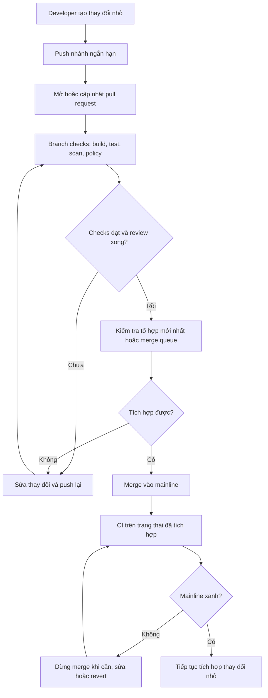

# Phân biệt kiểm tra trên nhánh với thực hành tích hợp liên tục

Kiểm tra trên nhánh (*branch checks*) và tích hợp liên tục (*Continuous Integration - CI*) thường xuất hiện trong cùng một quy trình Git, nhưng chúng trả lời hai câu hỏi khác nhau. Kiểm tra trên nhánh cho biết một revision hoặc pull request có vượt qua các điều kiện kỹ thuật và chính sách đã đặt ra hay không. CI là thực hành đưa thay đổi vào dòng phát triển chung thường xuyên, theo lô nhỏ, rồi xác minh trạng thái đã tích hợp bằng build và kiểm thử tự động.

Một pull request có thể xanh vì mọi kiểm tra trên nhánh đều đạt, nhưng nhóm vẫn chưa có CI hiệu quả nếu các nhánh tồn tại quá lâu, thay đổi chỉ được tích hợp vào cuối sprint hoặc trạng thái nhánh chính không được xác minh liên tục. Ngược lại, kiểm tra trên pull request là một cơ chế hữu ích của CI khi nó giúp nhóm tích hợp thường xuyên, phát hiện lỗi sớm và giữ nhánh chính luôn khỏe.

## 1. Hai khái niệm trả lời hai câu hỏi khác nhau

**Kiểm tra trên nhánh** là tập hợp các xác minh chạy trên một nhánh, commit hoặc pull request. Chúng có thể bao gồm biên dịch, unit test, integration test, lint, phân tích tĩnh, quét bảo mật, kiểm tra định dạng, xác thực cấu hình và các điều kiện chính sách. Kết quả thường được hiển thị dưới dạng trạng thái thành công, thất bại, đang chạy hoặc bị bỏ qua. Nền tảng Git có thể dùng các trạng thái bắt buộc này để cho phép hoặc chặn thao tác merge.

**Tích hợp liên tục** là một thực hành phát triển trong đó các thành viên đưa thay đổi nhỏ vào dòng mã nguồn chung thường xuyên, thường ít nhất mỗi ngày làm việc, và mỗi lần tích hợp đều được xác minh bằng quy trình build cùng kiểm thử tự động. Nhóm chủ động giảm thời gian tồn tại của nhánh, giữ dòng mã chính ở trạng thái hoạt động được và xử lý ngay khi tích hợp làm hệ thống mất trạng thái xanh.

| Góc nhìn | Kiểm tra trên nhánh | Thực hành CI |
|---|---|---|
| Câu hỏi chính | Revision này có vượt qua các kiểm tra đã cấu hình không? | Nhóm có tích hợp thay đổi vào dòng chung thường xuyên và giữ trạng thái tích hợp khỏe không? |
| Đối tượng | Một commit, nhánh hoặc pull request cụ thể | Dòng phát triển chung và nhịp làm việc của cả nhóm |
| Thời điểm | Thường chạy khi push, mở/cập nhật pull request hoặc yêu cầu merge | Diễn ra liên tục mỗi khi thay đổi được tích hợp vào mainline |
| Bằng chứng | Trạng thái job, test report, kết quả scan, review và policy | Lịch sử tích hợp nhỏ, build/test trên trạng thái chung, thời gian nhánh ngắn và mainline xanh |
| Cách thất bại | Một hoặc nhiều điều kiện của revision không đạt | Tích hợp làm hỏng mainline, xung đột kéo dài hoặc nhóm không thể tích hợp thường xuyên |
| Kết quả mong muốn | Ngăn thay đổi chưa đạt điều kiện được hợp nhất | Giảm rủi ro tích hợp, nhận phản hồi sớm và giữ phần mềm luôn trong trạng thái phát triển được |

Vì vậy, branch checks là một cơ chế kiểm soát có thể hỗ trợ CI, còn CI là cách tổ chức công việc và phản hồi của nhóm. Số lượng check nhiều, thời gian chạy ngắn hoặc một pull request có dấu xanh không tự chứng minh nhóm đang thực hành CI tốt.

## 2. Kiểm tra trên nhánh thường gồm những gì?

Một nền tảng quản lý Git có thể kích hoạt workflow khi developer push commit, mở pull request, cập nhật pull request hoặc đưa thay đổi vào merge queue. Mỗi job kiểm tra một khía cạnh và trả về kết quả để reviewer cùng hệ thống bảo vệ nhánh đánh giá.

Các kiểm tra phổ biến gồm:

- **Build:** xác minh mã có biên dịch hoặc đóng gói được với toolchain và dependency đã khai báo.
- **Unit test:** kiểm tra các quy tắc nhỏ trong phạm vi cô lập.
- **Integration test:** kiểm tra tương tác với database, message broker, dịch vụ hoặc thành phần thật/giả lập.
- **Contract test:** xác minh hợp đồng API, event hoặc schema không bị phá vỡ ngoài dự kiến.
- **Lint và format:** phát hiện lỗi quy ước, lỗi cú pháp tiềm ẩn và khác biệt định dạng.
- **Static analysis:** tìm lỗi chất lượng, lỗi kiểu dữ liệu hoặc mẫu mã nguy hiểm mà không cần chạy ứng dụng.
- **Security checks:** quét dependency, secret, container, mã nguồn và cấu hình theo chính sách.
- **Policy checks:** xác minh quy tắc đặt tên, cấu trúc thay đổi, giấy phép, file bắt buộc hoặc yêu cầu review.
- **Review và approval:** xác nhận người có trách nhiệm đã xem xét thay đổi theo quy định của repository.

Không phải tất cả các mục trên đều là status check tự động. Một số là kết quả từ hệ thống bên ngoài, một số là điều kiện review của nền tảng. Điểm chung là chúng cung cấp bằng chứng để quyết định một thay đổi có được phép đi tiếp hay không.

Branch checks nên được chia theo mức phản hồi. Kiểm tra nhanh như format, lint, compile và unit test thường chạy trước. Integration test, contract test hoặc security scan lớn hơn có thể chạy song song hoặc ở stage tiếp theo. Các điều kiện bắt buộc vẫn phải hoàn tất trước khi merge; tối ưu thứ tự không đồng nghĩa với bỏ qua bằng chứng cần thiết.

## 3. Branch protection và required status checks

Branch protection là chính sách bảo vệ nhánh quan trọng, thường là `main`, `master` hoặc nhánh release. Chính sách có thể yêu cầu pull request, số lượng review tối thiểu, người review thuộc nhóm phù hợp, status check thành công, giải quyết conversation, lịch sử commit tuyến tính hoặc merge thông qua queue.

Một required status check cần được gắn với đúng workflow và đúng ngữ cảnh. Nếu hai job có tên giống nhau nhưng ý nghĩa khác nhau, việc chọn sai check có thể tạo ra cổng bảo vệ không đáng tin. Nhóm cần giữ tên check ổn định, xác định chủ sở hữu và tránh để một check bắt buộc có thể bị bỏ qua do điều kiện chạy không phù hợp.

Các trạng thái thường gặp:

| Trạng thái | Ý nghĩa thực tế | Hành động phù hợp |
|---|---|---|
| Success | Check đã chạy và đạt | Có thể xét cùng các điều kiện khác |
| Failure | Check chạy nhưng phát hiện lỗi hoặc điều kiện không đạt | Sửa lỗi hoặc xử lý ngoại lệ theo chính sách |
| Pending / In progress | Check chưa có kết quả cuối | Chờ hoàn tất; không xem là đã đạt |
| Skipped / Neutral | Check không chạy hoặc không áp dụng theo điều kiện | Xác minh việc bỏ qua có được chính sách cho phép không |
| Cancelled | Lần chạy bị hủy trước khi hoàn tất | Xác định nguyên nhân và chạy lại khi cần |

Một trạng thái `success` chỉ có ý nghĩa trong phạm vi những gì check đã thực sự kiểm tra. Nếu workflow chỉ chạy unit test thì không thể suy ra migration database, tương thích API hay hành vi production đã được xác minh. Tên check, mô tả và tài liệu repository nên nói rõ phạm vi đó.

## 4. Vì sao kiểm tra xanh trên nhánh chưa đủ để chứng minh CI?

Kiểm tra trên nhánh thường đánh giá một ảnh chụp mã nguồn ở một thời điểm. Trong lúc pull request đang mở, nhánh chính có thể tiếp tục thay đổi và các pull request khác cũng có thể được hợp nhất. Vì vậy, kết quả xanh của nhánh riêng lẻ chưa chắc đại diện cho trạng thái kết hợp cuối cùng.

Ví dụ, hai developer cùng sửa một hợp đồng API. Pull request A đổi tên trường `customerId`; pull request B bổ sung consumer vẫn đọc trường cũ. Mỗi nhánh chạy test riêng và đều xanh vì test của chúng chưa bao gồm thay đổi của nhánh còn lại. Khi A và B được merge, ứng dụng có thể không còn tương thích. CI cần đưa thay đổi vào dòng chung thường xuyên và kiểm tra trạng thái đã tích hợp để phát hiện vấn đề này sớm.

Những khoảng trống phổ biến khác:

1. **Nhánh sống quá lâu:** thay đổi tích lũy nhiều ngày hoặc nhiều tuần, khiến khác biệt với mainline lớn dần và việc merge trở thành một dự án riêng.
2. **Chỉ chạy test trên pull request:** workflow không chạy hoặc không xác minh lại trạng thái sau khi merge vào nhánh chung.
3. **Kiểm tra trên base đã cũ:** nhánh chính thay đổi sau lần check cuối, nhưng pull request vẫn được merge mà không kiểm tra lại tổ hợp mới.
4. **Nhiều pull request cùng đạt nhưng không tương thích:** từng thay đổi độc lập đều xanh, song tổ hợp của chúng không xanh.
5. **Test không đại diện:** chỉ có unit test rất nhỏ, thiếu kiểm tra hợp đồng, integration hoặc build thật.
6. **Không xử lý mainline bị đỏ:** lỗi đã vào nhánh chính nhưng nhóm tiếp tục merge thay đổi khác, khiến việc xác định nguyên nhân và khôi phục khó hơn.
7. **Check không đáng tin:** test flaky, điều kiện skip quá rộng, cache sai hoặc check chạy trên revision khác với revision được merge.

Một quy trình CI tốt phải kiểm tra được trạng thái tích hợp và tạo phản hồi đủ nhanh để nhóm sửa lỗi khi thay đổi còn nhỏ, người thực hiện còn nhớ rõ ý định ban đầu.

## 5. CI là thực hành tích hợp thường xuyên, không phải chỉ là một workflow

Một nhóm có thể sở hữu hệ thống CI hiện đại nhưng vẫn chưa thực hành CI tốt nếu cách làm việc khiến thay đổi bị giữ lại quá lâu. CI đòi hỏi các thói quen phối hợp:

- Chia công việc thành lát cắt nhỏ, có thể tích hợp độc lập.
- Commit và push thường xuyên để chia sẻ tiến độ, nhận phản hồi và giảm khác biệt.
- Giữ nhánh tính năng ngắn hạn; không để nhánh riêng tồn tại đến khi hoàn thiện toàn bộ tính năng mới tích hợp.
- Tự động hóa build và kiểm thử những hành vi quan trọng.
- Duy trì nhánh chính luôn build được và có thể tiếp tục phát triển.
- Khi mainline bị lỗi, ưu tiên khôi phục trạng thái xanh trước khi tiếp tục đưa thay đổi mới vào.
- Dùng feature flag, cấu hình hoặc thiết kế tương thích để tích hợp mã chưa sẵn sàng bật cho người dùng.
- Coi lỗi tích hợp là trách nhiệm chung của nhóm, không phải vấn đề riêng của người cuối cùng merge.

CI không yêu cầu mọi commit phải được triển khai production. CI tập trung vào tích hợp và xác minh mã nguồn chung. Continuous Delivery mở rộng quy trình để phần mềm luôn ở trạng thái có thể phát hành; Continuous Deployment tự động triển khai production khi mọi điều kiện đạt. Đây là các mức và phạm vi tự động hóa khác nhau.

## 6. Nhánh ngắn hạn và trunk-based development

CI hiệu quả thường đi cùng chiến lược nhánh làm giảm thời gian thay đổi nằm ngoài mainline. *Trunk-based development* là cách làm trong đó developer tích hợp vào nhánh chính thường xuyên, trực tiếp hoặc thông qua các nhánh rất ngắn hạn. Điều này không có nghĩa mọi người phải push trực tiếp lên `main` hoặc bỏ qua review. Pull request nhỏ, review nhanh và merge queue vẫn có thể phù hợp với trunk-based development.

| Cách làm | Đặc điểm | Rủi ro hoặc lợi ích |
|---|---|---|
| Nhánh tính năng dài hạn | Giữ toàn bộ tính năng ở nhánh riêng đến khi hoàn tất | Dễ lệch mainline, xung đột lớn và phát hiện lỗi tích hợp muộn |
| Nhánh ngắn hạn | Tạo nhánh cho một thay đổi nhỏ, tích hợp trong thời gian ngắn | Giảm kích thước diff và thời gian chờ phản hồi |
| Trunk-based development | Nhiều thay đổi nhỏ được tích hợp vào trunk thường xuyên | Giảm chi phí merge, đòi hỏi test nhanh và thiết kế cho thay đổi chưa bật |
| Release branch | Tạo nhánh ổn định để chuẩn bị một phiên bản phát hành | Có thể hữu ích cho bảo trì phiên bản, nhưng cần tiếp tục đồng bộ bản sửa về trunk |

Một nhánh ngắn hạn vẫn cần đủ thời gian để review và chạy kiểm tra. Mục tiêu không phải ép merge khi chưa sẵn sàng, mà là chia thay đổi sao cho mỗi phần có thể được xem xét và tích hợp nhanh. Nếu một tính năng lớn chưa thể hoàn thiện trong một lần merge, hãy chia thành các thay đổi nền tảng tương thích và dùng feature flag để kiểm soát thời điểm bật.

### Dùng feature flag để tích hợp mã chưa bật

Giả sử nhóm xây dựng trang thanh toán mới nhưng thiết kế và nội dung chưa hoàn chỉnh. Nhóm có thể merge phần cấu trúc backend, API hoặc giao diện theo các bước nhỏ, trong khi feature flag vẫn tắt với người dùng. Nhờ đó, mã đã nằm trong mainline và được build/test cùng phần còn lại, nhưng hành vi chưa được công bố.

Feature flag cần có tên rõ ràng, giá trị mặc định an toàn, người sở hữu, điều kiện bật và kế hoạch xóa. Không nên để nhiều nhánh logic tạm thời tồn tại vô hạn vì chúng làm tăng số trạng thái cần kiểm thử và khiến hành vi ứng dụng khó hiểu.

## 7. Luồng làm việc kết hợp branch checks và CI

Một quy trình thực tế thường có hai điểm xác minh liên quan nhau:

1. Developer tạo thay đổi nhỏ và push lên nhánh ngắn hạn.
2. Pull request mở ra, kích hoạt branch checks trên revision cần xem xét.
3. Reviewer đọc diff, kiểm tra thiết kế và phản hồi trong thời gian ngắn.
4. Khi nhánh chính thay đổi, pull request được cập nhật hoặc đưa vào merge queue để xác minh tổ hợp dự kiến.
5. Nếu tất cả điều kiện bắt buộc đạt, thay đổi được tích hợp vào mainline.
6. Pipeline trên mainline xác minh trạng thái sau tích hợp, tạo bằng chứng và thông báo ngay nếu có lỗi.
7. Nếu mainline bị đỏ, nhóm dừng các merge tiếp theo khi cần, tìm revision gây lỗi và revert hoặc sửa ngay.
8. Các thay đổi nhỏ tiếp tục được tích hợp, giữ lịch sử mainline dễ hiểu và dễ truy vết.



Điểm quan trọng là nhánh chính cũng phải được xác minh. Nếu hệ thống chỉ chạy check trước merge mà không có cách phát hiện trạng thái mainline sau merge, nhóm có thể bỏ sót lỗi do tổ hợp thay đổi hoặc do khác biệt giữa revision đã kiểm tra và revision thực tế được tích hợp.

## 8. Kiểm tra pull request và kiểm tra trạng thái tích hợp

Có ba loại trạng thái cần phân biệt:

- **Head commit:** commit mới nhất của nhánh pull request. Kiểm tra trên head cho biết thay đổi riêng của nhánh có đạt điều kiện hay không.
- **Merge result / synthetic merge commit:** trạng thái giả lập khi ghép nhánh pull request với base hiện tại. Kiểm tra này giúp phát hiện một số vấn đề chỉ xuất hiện khi hai phía kết hợp.
- **Integrated mainline commit:** commit đã thực sự được đưa vào nhánh chung. Pipeline trên mainline xác minh trạng thái sau khi tích hợp.

Tên và hành vi cụ thể phụ thuộc nền tảng Git. Một số nền tảng mặc định tạo merge ref để workflow pull request kiểm tra tổ hợp; một số cấu hình có thể chỉ chạy trên head SHA. Nhóm cần đọc rõ revision mà checkout, build và test đang sử dụng, rồi so sánh với revision được merge.

Khi nhiều pull request cùng chờ vào một nhánh chính có lưu lượng thay đổi cao, *merge queue* hoặc *merge train* có thể xếp các thay đổi theo thứ tự và kiểm tra từng tổ hợp dự kiến trước khi đưa vào mainline. Nếu thay đổi đứng trước được merge, hệ thống có thể phải tính lại tổ hợp của thay đổi phía sau. Cơ chế này giảm tình trạng từng pull request xanh riêng lẻ nhưng khi ghép nối tiếp lại làm mainline hỏng.

Merge queue không thay thế CI. Nó là một cơ chế điều phối tích hợp và kiểm tra tổ hợp. Nhóm vẫn cần test phù hợp, pipeline trên mainline, quy tắc giữ main xanh và quy trình xử lý khi kiểm tra thất bại.

## 9. Ví dụ workflow kiểm tra nhánh và xác minh mainline

Ví dụ dưới đây dùng GitHub Actions cho một dự án Gradle. Workflow chạy cùng một tác vụ `verify` khi pull request hướng vào `main`, khi có push lên `main` và khi merge queue yêu cầu kiểm tra. Trong repository thực tế, cần ghim action về phiên bản hoặc commit đã được tổ chức phê duyệt và bổ sung các test/security job phù hợp với dự án.

```yaml
name: CI

on:
  pull_request:
    branches: [main]
  push:
    branches: [main]
  merge_group:
    types: [checks_requested]

permissions:
  contents: read

jobs:
  verify:
    name: verify
    runs-on: ubuntu-latest
    steps:
      - name: Checkout source
        uses: actions/checkout@v4

      - name: Set up Java
        uses: actions/setup-java@v4
        with:
          distribution: temurin
          java-version: '21'
          cache: gradle

      - name: Verify build and tests
        run: ./gradlew --no-daemon clean check
```

Trong ví dụ này:

- Sự kiện `pull_request` tạo bằng chứng cho branch checks. Có thể đặt `verify` thành required status check trong branch protection.
- Sự kiện `push` trên `main` xác minh trạng thái đã tích hợp và cung cấp tín hiệu nhanh nếu mainline bị đỏ.
- Sự kiện `merge_group` cho phép merge queue yêu cầu workflow kiểm tra tổ hợp dự kiến trước khi merge.
- `permissions: contents: read` giới hạn quyền mặc định của job ở mức đọc repository. Các job cần quyền khác phải khai báo đúng phạm vi cần thiết.
- `clean check` chỉ là ví dụ cho tác vụ Gradle. Dự án cần quyết định test nào chạy nhanh trên pull request và test nào chạy ở stage tiếp theo.

Trong môi trường thật, không nên sao chép nguyên mẫu mà không kiểm tra phiên bản action, quyền token, cách xử lý fork, cache, concurrency và yêu cầu bảo mật. Nếu workflow dùng điều kiện `paths`, `if` hoặc job phụ thuộc, hãy bảo đảm required check không bị bỏ qua theo cách khiến nhánh được merge mà thiếu bằng chứng bắt buộc.

## 10. Thiết kế bộ kiểm tra có phản hồi nhanh và đáng tin

Một pipeline CI tốt cần cân bằng giữa tốc độ, độ bao phủ và độ tin cậy. Nếu mọi pull request phải chờ hàng giờ cho một bộ end-to-end test lớn, developer có thể trì hoãn push hoặc gom nhiều thay đổi để giảm số lần chạy. Điều đó làm tăng kích thước batch và chi phí tích hợp.

Có thể tổ chức theo tầng:

| Tầng | Kiểm tra tiêu biểu | Mục tiêu thời gian tương đối | Vai trò |
|---|---|---|---|
| Rất sớm | Format, lint, compile, unit test nhanh | Vài giây đến vài phút | Phát hiện lỗi cơ bản trước khi reviewer mất thời gian |
| Pull request | Unit test đầy đủ, contract test, static analysis, dependency scan | Vài phút | Cung cấp bằng chứng chính cho quyết định merge |
| Trạng thái tích hợp | Build sạch, integration test, kiểm tra module liên quan | Vài phút đến lâu hơn tùy hệ thống | Xác minh thay đổi trong bối cảnh mainline |
| Theo lịch hoặc stage sau | End-to-end rộng, performance, kiểm thử môi trường lớn | Có thể lâu hơn | Tìm vấn đề khó tái hiện trong mỗi lần push |

Phân tầng không có nghĩa test quan trọng được tùy ý đẩy ra sau merge. Các rủi ro cần được phát hiện trước khi merge phải có gate phù hợp. Một số test dài có thể chạy sau merge nếu nhóm có khả năng dừng phát hành, khôi phục nhanh và chấp nhận rõ ràng rủi ro còn lại.

### Quản lý test flaky

Test flaky là test có thể lúc đạt lúc thất bại với cùng đầu vào do race condition, phụ thuộc môi trường, thời gian, dữ liệu dùng chung hoặc dịch vụ ngoài. Flaky test làm giảm giá trị của required checks vì developer không biết lần đỏ phản ánh lỗi sản phẩm hay nhiễu kiểm thử.

Khi test flaky xảy ra, nhóm nên lưu log, seed, thời điểm, revision và thông tin môi trường; phân loại nguyên nhân; tạo công việc sửa; theo dõi tỷ lệ flaky. Có thể tạm cách ly test khỏi gate chính nếu có biện pháp thay thế và người chịu trách nhiệm, nhưng phải công bố ngoại lệ và thời hạn. Không nên retry vô hạn đến khi có một lần xanh rồi coi thay đổi là an toàn.

### Dùng cache có kiểm soát

Cache dependency và build output giúp rút ngắn thời gian CI, nhưng cache sai key có thể khiến workflow sử dụng kết quả cũ. Key cần phản ánh các đầu vào ảnh hưởng đến kết quả như lockfile, phiên bản toolchain và cấu hình build. Với bước xác minh quan trọng, cần có khả năng chạy build sạch để phát hiện vấn đề mà cache che khuất.

## 11. Giữ mainline xanh và xử lý khi bị đỏ

Nhánh chính là điểm hội tụ của thay đổi. Nếu mainline không build được, các thành viên khác sẽ bị chặn, những check tiếp theo mất giá trị và nhóm khó biết lỗi mới đến từ đâu. Vì vậy, trạng thái xanh của mainline là trách nhiệm chung và cần được ưu tiên khôi phục.

Khi pipeline trên mainline thất bại:

1. Xác định revision và job thất bại; đọc log và test report để phân biệt lỗi sản phẩm, lỗi hạ tầng hoặc test flaky.
2. Thông báo rõ trạng thái mainline và tạm dừng merge tiếp theo nếu có nguy cơ làm tình hình khó truy vết hơn.
3. Nếu nguyên nhân rõ và sửa nhanh, tạo bản sửa nhỏ rồi chạy lại toàn bộ check liên quan.
4. Nếu chưa thể sửa nhanh hoặc thay đổi gây lỗi nghiêm trọng, revert commit hoặc revert merge để khôi phục mainline.
5. Sau khi mainline xanh, điều tra nguyên nhân gốc và cải thiện test, quy trình review hoặc cách chia thay đổi.

Revert thường là cách khôi phục nhanh vì tạo ra một thay đổi mới có thể review và truy vết. Tuy nhiên, với thay đổi dữ liệu hoặc thay đổi không tương thích, revert mã có thể không đảo ngược được dữ liệu đã ghi. Khi đó cần đánh giá tương thích schema và chọn sửa tiến hoặc quy trình phục hồi dữ liệu phù hợp.

Không nên để một nhánh chính đỏ kéo dài trong khi tiếp tục merge như bình thường. Nếu nhóm liên tục bỏ qua lỗi, tín hiệu CI trở nên vô nghĩa và chi phí tìm nguyên nhân tăng nhanh.

## 12. Đo lường sức khỏe của quy trình tích hợp

Chỉ đếm số lượng status check hoặc số lần pipeline chạy không đủ để đánh giá CI. Các chỉ số nên phản ánh cả nhịp tích hợp và chất lượng phản hồi:

- **Branch lifetime:** thời gian từ khi tạo nhánh đến khi tích hợp. Nhánh tồn tại càng lâu thường càng tích lũy khác biệt.
- **Batch size:** số commit, file hoặc phạm vi thay đổi trong một lần merge. Batch nhỏ giúp khoanh vùng lỗi và review dễ hơn.
- **Time to feedback:** thời gian từ push đến khi developer nhận kết quả kiểm tra có ích.
- **Time to merge:** thời gian từ khi pull request sẵn sàng review đến khi được tích hợp; cần phân biệt thời gian chờ review với thời gian chạy CI.
- **Mainline health:** tỷ lệ thời gian mainline ở trạng thái xanh và thời gian trung bình để khôi phục sau khi bị đỏ.
- **Integration failure rate:** tỷ lệ lần tích hợp gây lỗi trên trạng thái chung hoặc cần revert/sửa khẩn cấp.
- **Flaky test rate:** tỷ lệ test cho kết quả không ổn định với cùng đầu vào.
- **Queue time:** thời gian chờ runner hoặc merge queue trước khi check bắt đầu.

Đọc các chỉ số cùng nhau để tìm nguyên nhân. Nếu time to feedback tăng, nhóm có thể xem xét runner, cache, test quá rộng hoặc job chạy tuần tự không cần thiết. Nếu branch lifetime tăng, có thể công việc quá lớn, review bị nghẽn hoặc nhóm chưa chia tính năng thành lát cắt tích hợp được. Nếu mainline thường xuyên đỏ, cần xem lại test coverage, merge queue, quy tắc bảo vệ và trách nhiệm xử lý.

Không nên đặt mục tiêu giảm branch lifetime bằng cách ép merge khi review chưa hoàn tất hoặc bỏ test. Chỉ số là tín hiệu để cải thiện hệ thống làm việc, không phải quota để đánh giá cá nhân.

## 13. Những anti-pattern thường gặp

| Anti-pattern | Vì sao gây vấn đề | Hướng cải thiện |
|---|---|---|
| Nhánh tính năng tồn tại nhiều tuần | Khác biệt với mainline lớn, merge khó và lỗi xuất hiện muộn | Chia tính năng thành lát cắt nhỏ, tích hợp thường xuyên |
| Coi dấu xanh của PR là CI hoàn chỉnh | Chưa chứng minh trạng thái sau tích hợp luôn khỏe | Chạy pipeline trên mainline và kiểm tra tổ hợp mới nhất |
| Chỉ có một job test khổng lồ | Phản hồi chậm, khó biết loại lỗi và khó tối ưu | Tách stage theo mục tiêu và mức phản hồi |
| Required check bị skip ngoài ý muốn | Nhánh có thể merge khi thiếu bằng chứng | Kiểm tra điều kiện workflow và chính sách branch protection |
| Merge nhiều PR cùng lúc mà không kiểm tra tổ hợp | Từng PR xanh nhưng tổ hợp có thể lỗi | Dùng merge queue hoặc cập nhật và kiểm tra base mới nhất |
| Bỏ qua test flaky | Tín hiệu đỏ không còn được tin cậy | Theo dõi, sửa nguyên nhân và quản lý ngoại lệ có thời hạn |
| Mainline đỏ nhưng vẫn tiếp tục merge | Lỗi chồng lên nhau, khó xác định commit gây lỗi | Ưu tiên sửa hoặc revert để khôi phục mainline |
| Dùng feature flag không có kế hoạch xóa | Tăng số trạng thái và độ phức tạp kiểm thử | Gắn owner, ngày xem xét và điều kiện dọn dẹp |
| Dựa vào cache mà không kiểm chứng đầu vào | Có thể tái sử dụng output không còn hợp lệ | Thiết kế cache key chính xác và duy trì build sạch |

## 14. Ví dụ tình huống: hai pull request cùng thay đổi hợp đồng

Giả sử một nhóm có dịch vụ `order-service` và `billing-service`. Pull request A của nhóm order đổi response API từ `total` sang `grandTotal`. Cùng lúc, pull request B của nhóm billing sửa consumer để đọc `grandTotal`.

Nếu A và B được phát triển trên các nhánh dài hạn, cả hai có thể vượt qua unit test riêng vì mỗi nhánh chỉ kiểm tra mã của mình. Khi merge, thứ tự tích hợp có thể làm một phiên bản trung gian không tương thích: order đã bỏ `total` trong khi billing chưa được cập nhật, hoặc ngược lại.

Một cách làm CI an toàn hơn là chia thay đổi theo hướng tương thích:

1. Tích hợp thay đổi phía producer để trả cả `total` và `grandTotal`, giữ consumer cũ vẫn hoạt động.
2. Tích hợp consumer đọc trường mới, đồng thời có test contract xác minh response.
3. Theo dõi việc sử dụng trường cũ và xác minh mọi consumer đã chuyển đổi.
4. Trong một lần thay đổi riêng, loại bỏ trường cũ sau khi không còn phụ thuộc.

Mỗi bước là một thay đổi nhỏ, được kiểm tra trên pull request và xác minh trên mainline. Nếu dùng merge queue, nhóm có thể kiểm tra tổ hợp các pull request đang chờ. Cách làm này giảm thời gian hệ thống ở trạng thái không tương thích và tránh phải giữ một nhánh lớn chứa toàn bộ thay đổi.

## 15. Checklist đánh giá nhóm có thực hành CI hay chỉ có branch checks

Hãy tự đánh giá quy trình hiện tại bằng các câu hỏi sau:

- [ ] Nhánh tính năng thường được tích hợp trong thời gian ngắn và thay đổi được chia thành batch nhỏ.
- [ ] Mỗi pull request có build và test tự động với phạm vi được mô tả rõ.
- [ ] Required status checks gắn với đúng revision và không bị skip ngoài ý muốn.
- [ ] Nhóm biết pull request được kiểm tra trên head commit hay merge result.
- [ ] Có cơ chế kiểm tra trạng thái tích hợp mới nhất khi base branch thay đổi.
- [ ] Pipeline chạy trên mainline sau merge và phát hiện lỗi tích hợp.
- [ ] Mainline được giữ xanh; khi bị đỏ, nhóm ưu tiên sửa hoặc revert.
- [ ] Test flaky được đo lường, có người sửa và có thời hạn cho ngoại lệ.
- [ ] Có chiến lược cho tính năng chưa hoàn thiện như feature flag hoặc thiết kế tương thích.
- [ ] Thời gian phản hồi CI đủ ngắn để developer sửa lỗi khi ngữ cảnh còn rõ.
- [ ] Nhóm theo dõi branch lifetime, batch size, feedback time và mainline health.

Nếu nhóm chỉ có các check trên pull request nhưng nhánh dài hạn, ít merge vào mainline và không xác minh trạng thái sau tích hợp, hệ thống hiện tại chủ yếu là cổng kiểm tra trước merge. Đó là một nền tảng hữu ích, nhưng cần thay đổi nhịp tích hợp và cách giữ mainline khỏe để trở thành thực hành CI đúng nghĩa.

## 16. Kết luận

Kiểm tra trên nhánh cung cấp bằng chứng cho một revision và giúp bảo vệ nhánh chung khỏi thay đổi chưa đạt điều kiện. Tích hợp liên tục tổ chức cách nhóm làm việc để những thay đổi nhỏ được đưa vào mainline thường xuyên, xác minh ngay trên trạng thái đã tích hợp và khôi phục nhanh khi có lỗi.

Một quy trình vững chắc kết hợp cả hai: branch checks nhanh và đáng tin; review có nhịp độ phù hợp; nhánh ngắn hạn; merge queue hoặc kiểm tra base mới nhất khi cần; pipeline trên mainline; quy tắc giữ main xanh; feature flag cho thay đổi chưa bật; và dữ liệu đo lường để cải thiện. Dấu xanh của một pull request là một bằng chứng quan trọng, còn sức khỏe của dòng mã chung mới cho biết nhóm có đang tích hợp liên tục hay không.
