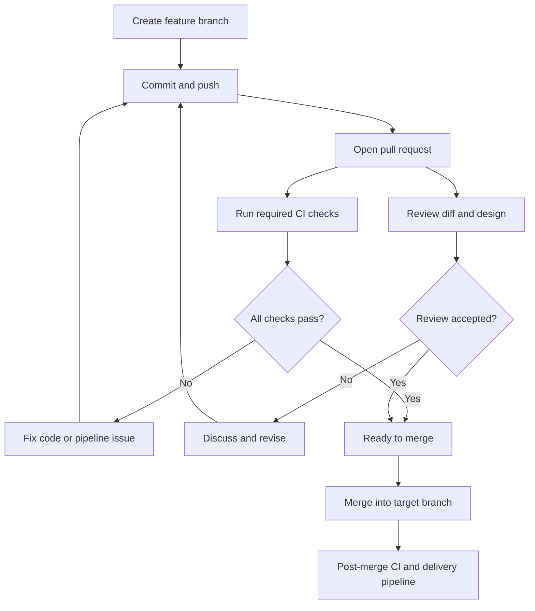

# Vai trò của pull request, rà soát mã và kiểm tra bắt buộc

Trong một dự án có CI/CD, việc đưa mã nguồn từ nhánh làm việc vào nhánh tích hợp là một điểm kiểm soát quan trọng. Một thay đổi có thể biên dịch thành công trên máy của tác giả nhưng vẫn gây lỗi khi kết hợp với phần còn lại của hệ thống, phá vỡ hợp đồng API, làm lộ bí mật hoặc khiến quy trình phát hành không thể tiếp tục. Pull request (PR) tạo ra một nơi có kiểm soát để nhóm hiểu thay đổi, thảo luận, rà soát và xác minh trước khi hợp nhất.

Pull request thường được gọi là merge request (MR) trên một số nền tảng. Dù tên gọi và giao diện khác nhau, mục tiêu cốt lõi giống nhau: yêu cầu đưa một tập commit từ nhánh nguồn vào nhánh đích, cung cấp ngữ cảnh để người khác đánh giá và gắn các kết quả kiểm tra tự động với đúng phiên bản thay đổi.

PR không tự bảo đảm mã nguồn tốt. Giá trị của nó đến từ chất lượng mô tả, việc review có trách nhiệm, các kiểm tra CI phù hợp và quy tắc bảo vệ nhánh được cấu hình đúng. Khi các phần này phối hợp, nhóm có thể phát hiện vấn đề trước khi mã vào nhánh chính, giữ lịch sử thay đổi rõ ràng và tạo điều kiện để pipeline sau merge phát hành một trạng thái mã nguồn đã được kiểm chứng.

## 1. PR nằm ở đâu trong luồng tích hợp mã nguồn?

Một nhánh làm việc thường bắt đầu từ một revision ổn định của nhánh đích. Tác giả thực hiện thay đổi, tạo commit và đẩy nhánh lên máy chủ Git. Khi mở PR, tác giả chỉ định nhánh nguồn và nhánh đích, mô tả mục tiêu, liên kết công việc liên quan và yêu cầu người có trách nhiệm xem xét.

Từ thời điểm đó, PR trở thành nơi tập hợp các bằng chứng về thay đổi:

- Diff cho biết những dòng mã và tệp nào thay đổi.
- Mô tả giải thích vấn đề, cách giải quyết, phạm vi và rủi ro.
- Bình luận review ghi lại câu hỏi, nhận xét và quyết định kỹ thuật.
- Các lần chạy CI cho biết revision nào đã vượt qua hoặc thất bại ở từng kiểm tra.
- Approval thể hiện người có thẩm quyền đã chấp nhận thay đổi theo chính sách.
- Trạng thái merge cho biết thay đổi đã được tích hợp vào nhánh đích hay chưa.

Luồng phổ biến:

1. Tạo nhánh từ nhánh đích phù hợp.
2. Thực hiện thay đổi nhỏ, có mục đích rõ ràng và tạo commit.
3. Push nhánh lên máy chủ Git.
4. Mở PR, khai báo nhánh đích, mô tả, người review và các liên kết cần thiết.
5. CI chạy các kiểm tra cho revision của PR.
6. Người review đọc diff, trao đổi và yêu cầu chỉnh sửa nếu cần.
7. Tác giả cập nhật commit; CI chạy lại cho revision mới.
8. PR chỉ được merge khi đáp ứng các điều kiện bắt buộc.
9. Sau merge, pipeline của nhánh đích tiếp tục kiểm tra, đóng gói hoặc phát hành theo chính sách của dự án.



Một PR có thể được cập nhật nhiều lần. Mỗi commit mới làm thay đổi nội dung cần review và có thể làm mất hiệu lực của kết quả CI trước đó. Vì vậy, cần xem trạng thái review và trạng thái kiểm tra gắn với revision hiện tại, không chỉ nhìn vào việc PR từng có một lần chạy xanh.

## 2. Vì sao nên tích hợp qua PR?

PR giải quyết đồng thời các vấn đề về phối hợp, chất lượng và khả năng truy vết.

**Tạo điểm kiểm soát trước khi hợp nhất.** Nhóm có thể phát hiện lỗi logic, thiếu test, thay đổi không tương thích hoặc rủi ro bảo mật trước khi mã đi vào nhánh được nhiều người sử dụng.

**Chia sẻ kiến thức.** Người review hiểu thêm về hệ thống, quy ước và quyết định thiết kế. Tác giả cũng nhận được phản hồi từ góc nhìn khác. Những cuộc trao đổi có giá trị nên được ghi lại trong PR hoặc tài liệu kiến trúc liên quan để người đến sau hiểu lý do.

**Giảm xung đột tích hợp.** Thay đổi nhỏ và được tích hợp thường xuyên giúp giảm khoảng cách giữa nhánh làm việc và nhánh chính. Khi xung đột xuất hiện, phạm vi thường dễ hiểu và xử lý hơn.

**Tạo bằng chứng có thể truy vết.** PR liên kết yêu cầu công việc, commit, người review, kết quả CI và quyết định merge. Khi có sự cố, nhóm có thể lần theo thay đổi đã đưa hành vi mới vào hệ thống.

**Chuẩn hóa chất lượng.** Các quy tắc như test bắt buộc, review của chủ sở hữu mã và quét bí mật có thể được áp dụng nhất quán bằng cấu hình bảo vệ nhánh.

PR không nên biến thành thủ tục phê duyệt hình thức. Nếu người review chỉ bấm Approve mà không đọc diff, hoặc CI chỉ chạy một lệnh build đơn giản trong khi thay đổi có rủi ro dữ liệu, điểm kiểm soát này không tạo ra bằng chứng hữu ích.

## 3. Chuẩn bị một PR dễ hiểu và dễ review

Chất lượng review phụ thuộc nhiều vào cách tác giả trình bày thay đổi. Một PR nhỏ, có mục đích rõ và có bằng chứng kiểm tra thường dễ đánh giá hơn một PR gom nhiều thay đổi không liên quan.

### 3.1. Giữ phạm vi thay đổi tập trung

Mỗi PR nên giải quyết một mục tiêu có thể mô tả trong vài câu. Ví dụ, "thêm retry có giới hạn cho lời gọi đến dịch vụ thanh toán" là mục tiêu cụ thể. Nếu cùng PR còn đổi cấu trúc thư mục, nâng cấp hàng loạt dependency, sửa giao diện và đổi cách cấu hình logging, người review phải giữ quá nhiều ngữ cảnh trong đầu.

Có thể tách thay đổi thành các PR liên tiếp khi chúng có quan hệ phụ thuộc rõ ràng. PR nền tảng có thể được merge trước, PR tiếp theo dựa trên nhánh đích đã cập nhật. Nếu cần giữ nhiều PR đang mở, mô tả nên chỉ rõ thứ tự và phần nào phụ thuộc vào phần nào.

Không có một giới hạn số dòng phù hợp cho mọi dự án. Một thay đổi lớn về sinh mã hoặc cập nhật snapshot có thể có diff dài nhưng dễ kiểm tra bằng công cụ chuyên dụng; một thay đổi vài dòng trong xử lý phân quyền có thể có rủi ro cao. Hãy tối ưu để người review hiểu được ý định và kiểm tra được những điểm quan trọng.

### 3.2. Viết mô tả trả lời các câu hỏi thiết yếu

Một mô tả tốt thường cho biết:

- **Bối cảnh:** vấn đề hoặc nhu cầu nào dẫn đến thay đổi?
- **Giải pháp:** thay đổi được thực hiện theo cách nào?
- **Phạm vi:** những thành phần hoặc luồng nghiệp vụ nào bị ảnh hưởng?
- **Bằng chứng:** đã chạy test, kiểm tra thủ công hoặc thử nghiệm nào?
- **Rủi ro:** có migration, thay đổi cấu hình, tương thích ngược hay thao tác vận hành nào cần lưu ý?
- **Liên kết:** issue, yêu cầu, tài liệu thiết kế hoặc PR phụ thuộc nào liên quan?

Ví dụ về mô tả:

```markdown
## Mục tiêu
Ngăn một yêu cầu tạo đơn hàng bị gửi lặp khi client thử lại sau timeout.

## Thay đổi
- Thêm idempotency key cho endpoint tạo đơn.
- Lưu kết quả xử lý theo khóa trong transaction.
- Trả lại kết quả cũ khi nhận cùng khóa và cùng nội dung yêu cầu.

## Kiểm tra
- Unit test cho yêu cầu đầu tiên và yêu cầu lặp.
- Integration test cho hai request đồng thời.
- Kiểm tra trường hợp cùng khóa nhưng payload khác nhau.

## Rủi ro và triển khai
- Cần migration thêm bảng lưu khóa.
- Theo dõi tỷ lệ xung đột khóa sau triển khai.

## Liên quan
Closes ISSUE-123
```

Nội dung này giúp reviewer biết cần tập trung vào tính nhất quán dữ liệu, cạnh tranh đồng thời và hành vi khi retry. Chỉ ghi "fix bug" hoặc "update code" không cung cấp đủ ngữ cảnh để đánh giá.

### 3.3. Tạo commit có ý nghĩa

Commit nên mô tả một thay đổi logic hoặc một bước hợp lý trong quá trình phát triển. Thông điệp như "fix order idempotency" hữu ích hơn "update" hoặc "changes". Commit có ý nghĩa giúp người review theo dõi cách giải quyết vấn đề và hỗ trợ truy vết sau này.

Trước khi mở PR, tác giả nên tự kiểm tra diff, loại bỏ log debug, tệp sinh ra ngoài ý muốn, thay đổi định dạng không liên quan và dữ liệu nhạy cảm. Việc tự review thường phát hiện lỗi đơn giản nhanh hơn và giảm thời gian của người khác.

## 4. Rà soát mã là hoạt động đánh giá có mục tiêu

Code review là quá trình một hoặc nhiều người kiểm tra thay đổi để đánh giá tính đúng đắn, an toàn, khả năng bảo trì và mức phù hợp với kiến trúc. Review không phải cuộc thi tìm lỗi cú pháp, cũng không phải cơ hội áp đặt sở thích cá nhân.

Người review nên bắt đầu từ mục tiêu của PR và hiểu hành vi mong đợi trước khi đọc từng dòng. Sau đó, kiểm tra các vùng có rủi ro cao:

1. **Tính đúng đắn:** mã có giải quyết đúng yêu cầu và xử lý đủ các trường hợp biên không?
2. **Luồng dữ liệu:** dữ liệu đến từ đâu, được xác thực và biến đổi như thế nào, có thể bị mất hoặc ghi sai không?
3. **Lỗi và phục hồi:** timeout, lỗi phụ thuộc, retry và trạng thái một phần được xử lý ra sao?
4. **Tương thích:** thay đổi có phá vỡ API, schema, cấu hình, dữ liệu cũ hoặc client hiện hữu không?
5. **Bảo mật:** có lộ secret, thiếu kiểm tra quyền, injection, xử lý input không an toàn hoặc mở rộng bề mặt tấn công không?
6. **Kiểm thử:** test có chứng minh hành vi mới và các hành vi quan trọng cũ vẫn đúng không?
7. **Vận hành:** log, metric, cảnh báo, migration, rollout và rollback có phù hợp không?
8. **Khả năng bảo trì:** tên gọi, cấu trúc và độ phức tạp có giúp người sau hiểu và thay đổi an toàn không?

Review cần dựa trên rủi ro. Một thay đổi tài liệu không cần quy trình phân tích giống thay đổi quyền truy cập dữ liệu khách hàng. Tuy vậy, mọi thay đổi vẫn cần tuân thủ các kiểm tra cơ bản của repository.

### 4.1. Phân biệt lỗi bắt buộc sửa và gợi ý

Bình luận review nên nói rõ mức độ và lý do:

- **Blocking:** lỗi có thể gây sai dữ liệu, lỗ hổng, hỏng hệ thống, phá vỡ hợp đồng hoặc vi phạm chính sách; cần sửa trước merge.
- **Question:** điểm chưa rõ cần tác giả giải thích hoặc cung cấp bằng chứng.
- **Suggestion:** cải thiện có ích nhưng không nhất thiết phải chặn PR.
- **Nit:** vấn đề nhỏ về trình bày hoặc cách viết; không nên biến thành vòng review kéo dài.

Một bình luận tốt nêu vị trí, hành vi có thể xảy ra, tác động và hướng xử lý gợi ý. Ví dụ: "Nếu hai request có cùng idempotency key đến đồng thời, cả hai có thể vượt qua bước kiểm tra trước khi bản ghi được tạo. Cần ràng buộc duy nhất ở cơ sở dữ liệu và xử lý xung đột để chỉ một request tạo đơn."

Bình luận "code này sai" hoặc "viết lại cho đẹp" không giúp tác giả xác định vấn đề. Nếu đó là lựa chọn phong cách, nên dựa vào formatter, linter hoặc quy ước đã thống nhất thay vì tranh luận cá nhân.

### 4.2. Trách nhiệm của tác giả và reviewer

Tác giả chịu trách nhiệm về tính đúng đắn của thay đổi, test, mô tả, việc phản hồi nhận xét và cập nhật PR. Approval không chuyển toàn bộ trách nhiệm chất lượng từ tác giả sang reviewer.

Reviewer chịu trách nhiệm đọc phần thay đổi được giao, kiểm tra những rủi ro quan trọng, đặt câu hỏi khi thiếu thông tin và nêu rõ điều kiện chưa đạt. Reviewer không nên phê duyệt khi chưa hiểu thay đổi hoặc chưa xem kết quả của revision hiện tại.

Khi có bất đồng, hai bên nên quay lại yêu cầu, bằng chứng, quy ước và tác động vận hành. Nếu quyết định ảnh hưởng kiến trúc hoặc có hệ quả lâu dài, có thể cần người phụ trách kiến trúc hoặc chủ sở hữu miền nghiệp vụ tham gia.

## 5. Approval và quyền sở hữu mã nguồn

Nhiều nền tảng Git hỗ trợ yêu cầu một hoặc nhiều approval trước khi merge. Một số dự án còn yêu cầu chủ sở hữu của các tệp bị thay đổi phải review. Cơ chế này thường được cấu hình bằng file khai báo ownership hoặc chính sách tương đương.

Approval thể hiện người review chấp nhận thay đổi theo phạm vi và chính sách của dự án tại thời điểm review. Nó không thay thế CI và không chứng minh mọi trường hợp chạy đều đúng.

Các chính sách có thể bao gồm:

- Số lượng approval tối thiểu.
- Yêu cầu ít nhất một approval từ code owner của vùng mã bị ảnh hưởng.
- Không cho tác giả tự phê duyệt thay đổi của mình.
- Hủy hoặc yêu cầu review lại approval cũ khi có commit mới.
- Không cho phép merge khi còn thread blocking chưa được giải quyết.
- Giới hạn người có quyền bỏ qua quy tắc bảo vệ nhánh.

Yêu cầu nhiều approval không tự động làm review tốt hơn. Nếu PR nhỏ phải chờ quá nhiều người, thời gian tích hợp tăng mà chất lượng có thể không tăng tương ứng. Số lượng và loại reviewer nên phù hợp với mức rủi ro, phạm vi ownership và năng lực của nhóm.

Code ownership đặc biệt hữu ích cho các vùng nhạy cảm như xác thực, phân quyền, thanh toán, hạ tầng triển khai, schema dữ liệu hoặc cấu hình bảo mật. Khi thay đổi chạm vào vùng đó, hệ thống có thể yêu cầu người sở hữu chuyên môn tham gia.

## 6. Required checks là gì?

Required check là một kết quả kiểm tra tự động mà nền tảng quản lý repository dùng làm điều kiện bắt buộc trước khi cho phép merge. Check thường được báo về từ CI hoặc một ứng dụng tích hợp. Tùy nền tảng, nó có thể xuất hiện dưới tên status check, pipeline status, job, policy check hoặc tên tương tự.

Một check thường có trạng thái như:

- **Pending/running:** chưa có kết quả cuối cùng.
- **Success/passed:** kiểm tra đã hoàn tất và đạt.
- **Failure/failed:** kiểm tra đã chạy và không đạt.
- **Cancelled/skipped/neutral:** không tạo ra kết quả đạt theo cách thông thường; cách nền tảng xử lý phụ thuộc cấu hình.

Nếu check là bắt buộc, trạng thái pending hoặc failure thường ngăn merge. Nhóm cần hiểu chính xác cách nền tảng xử lý trạng thái skipped, cancelled và check không được gửi về. Không nên giả định rằng một job bị bỏ qua đồng nghĩa với kiểm tra đã đạt.

Required check biến chính sách chất lượng thành điều kiện có thể thực thi. Người dùng có thể đọc kết quả và biết PR chưa được merge vì test thất bại, thiếu approval hay thiếu một kiểm tra bắt buộc.

## 7. Chọn các kiểm tra bắt buộc phù hợp

Không nên biến mọi bước pipeline thành required check. Một check bắt buộc cần đáng tin cậy, có mục đích rõ và liên quan đến rủi ro của thay đổi. Nếu quá nhiều check chậm hoặc nhiễu, PR bị tắc và nhóm có xu hướng tìm cách bỏ qua chúng.

Một bộ kiểm tra PR thường có các nhóm sau:

| Nhóm kiểm tra | Ví dụ | Mục đích |
|---|---|---|
| Kiểu dáng và cấu trúc | Formatter, lint, kiểm tra cú pháp, type check | Phát hiện lỗi đơn giản và giữ quy ước thống nhất |
| Build | Compile, package, kiểm tra cấu hình build | Xác nhận mã có thể tạo đầu ra |
| Unit test | Kiểm thử hàm, lớp và quy tắc nghiệp vụ | Phản hồi nhanh về logic thay đổi |
| Integration/contract test | Kết nối cơ sở dữ liệu, API, message contract | Phát hiện lỗi khi các thành phần phối hợp |
| Kiểm tra bảo mật | Secret scan, SAST, dependency scan | Phát hiện bí mật bị lộ và rủi ro đã biết |
| Kiểm tra dữ liệu và migration | Validate migration, schema compatibility | Hạn chế hỏng dữ liệu hoặc gián đoạn nâng cấp |
| Kiểm tra hạ tầng | IaC validation, policy scan | Phát hiện cấu hình triển khai nguy hiểm |
| Kiểm tra giấy phép | License policy cho dependency | Đảm bảo dependency phù hợp chính sách |

Một PR không nhất thiết phải chạy toàn bộ integration test hoặc test end-to-end nếu chi phí quá lớn. Nhóm có thể chia kiểm tra thành nhiều lớp: kiểm tra nhanh trên mọi PR, kiểm tra rộng hơn theo thành phần bị ảnh hưởng, và kiểm tra toàn hệ thống trước release hoặc theo lịch. Tuy nhiên, các rủi ro nghiêm trọng không được bỏ qua chỉ vì muốn pipeline nhanh.

### 7.1. Kiểm tra phải gắn với đúng revision

Kết quả CI chỉ có giá trị cho revision mà nó đã kiểm tra. Nếu tác giả push commit mới sau khi test thành công, kết quả cũ không chứng minh commit mới vẫn đạt.

Nền tảng và cấu hình CI cần liên kết check với commit SHA hoặc revision cụ thể. Trước merge, cần bảo đảm các check bắt buộc tương ứng với trạng thái PR đang được merge. Nếu nhánh đích thay đổi, kết quả cũ có thể không còn phản ánh việc tích hợp với nền mới.

Một số nền tảng có chế độ yêu cầu nhánh nguồn cập nhật với nhánh đích trước khi merge. Nền tảng khác hỗ trợ merge queue hoặc merge train để kiểm tra tổ hợp thay đổi dự kiến trước khi đưa vào nhánh chính. Những cơ chế này hữu ích khi nhiều PR cùng chờ merge và mỗi PR riêng lẻ đều xanh nhưng khi kết hợp có thể xung đột.

### 7.2. Kiểm tra phải có danh tính và nguồn đáng tin

Tên check có thể giống nhau nhưng được gửi từ workflow hoặc ứng dụng khác nhau. Với các nền tảng hỗ trợ chọn nguồn check, nhóm nên xác định rõ ứng dụng hoặc workflow đáng tin cậy được phép cung cấp kết quả bắt buộc.

Nếu workflow chạy mã chưa tin cậy có thể ghi trạng thái thành công cho một check có cùng tên, chính sách required check có thể bị đánh lừa. Cần giới hạn token, quyền ghi trạng thái và nguồn tạo check. Quyền quản trị repository cũng cần được bảo vệ vì người có quyền thay đổi branch rule có thể làm suy yếu điều kiện merge.

## 8. Thiết kế CI cho PR: nhanh, ổn định và dễ chẩn đoán

CI của PR là vòng phản hồi gần nhất với người viết mã. Nếu kết quả chỉ xuất hiện sau nhiều giờ, tác giả phải chuyển ngữ cảnh hoặc quên chi tiết thay đổi. Nếu pipeline thất bại ngẫu nhiên, nhóm mất niềm tin vào required check.

Một số nguyên tắc thiết kế:

**Ưu tiên kiểm tra nhanh.** Chạy formatter, lint, type check và unit test sớm. Những bước có thể chạy song song nên được tổ chức song song sau khi các dependency cần thiết đã sẵn sàng.

**Chia lớp kiểm tra.** Dùng kiểm tra nhanh làm gate cho mọi PR; chạy integration test theo thành phần hoặc trong môi trường cô lập; chạy bộ kiểm thử dài hơn ở các mốc phù hợp. Nếu một kiểm tra quan trọng là điều kiện merge, cần có kết quả trước khi merge.

**Giữ môi trường ổn định.** Khóa dependency, cố định toolchain, tạo dữ liệu test riêng và tránh phụ thuộc dịch vụ bên ngoài không kiểm soát. Cùng một commit nên có kết quả nhất quán trong cùng điều kiện.

**Làm rõ kết quả.** Mỗi job nên có tên dễ hiểu, log đủ để điều tra, test report và liên kết đến artifact chẩn đoán khi phù hợp. Thông báo "CI failed" mà không chỉ ra test hoặc bước lỗi làm tăng thời gian tìm nguyên nhân.

**Đặt timeout và retry hợp lý.** Timeout bảo vệ runner khỏi job treo. Retry chỉ phù hợp với lỗi tạm thời đã nhận diện; không retry vô hạn lỗi test, lỗi cấu hình hoặc lỗi logic. Nếu test không ổn định, cần theo dõi và xử lý nguyên nhân.

**Tái sử dụng cấu hình chuẩn.** Các repository có cùng công nghệ nên dùng workflow hoặc script dùng chung khi phù hợp. Tuy nhiên, thay đổi workflow dùng chung cần được review kỹ vì có thể ảnh hưởng đến nhiều dự án.

**Không để CI thay đổi mã nguồn một cách khó dự đoán.** Formatter tự động có thể được dùng, nhưng tốt hơn là kiểm tra định dạng và yêu cầu tác giả commit thay đổi. Nếu job sinh mã hoặc cập nhật snapshot, đầu ra cần được kiểm soát và review.

## 9. Bảo vệ CI khi chạy mã từ pull request

PR thường chứa mã do tác giả viết và CI sẽ thực thi mã đó. Điều này tạo ra ranh giới tin cậy quan trọng. Mã trong pull request có thể thay đổi script build, test hoặc dependency; khi pipeline chạy các script này, chúng có thể thực thi lệnh tùy ý trong runner.

Rủi ro đặc biệt cao với PR từ fork hoặc người đóng góp chưa được tin cậy. Pipeline không nên cấp token có quyền ghi repository, secret phát hành hoặc credential production cho job chạy mã chưa được review.

Các biện pháp cần xem xét:

- Dùng quyền token tối thiểu và chỉ cấp quyền đọc cho job kiểm tra thông thường.
- Không cung cấp secret production hoặc credential phát hành cho PR từ fork.
- Tách workflow kiểm tra mã chưa tin cậy khỏi workflow triển khai hoặc phát hành.
- Dùng runner tạm thời hoặc môi trường cô lập; không để runner chia sẻ quyền truy cập nhạy cảm giữa các job không tin cậy.
- Kiểm soát artifact, cache và dữ liệu được truyền giữa workflow; không coi đầu ra từ PR chưa tin cậy là dữ liệu đáng tin.
- Review các thay đổi vào workflow CI, script build và dependency vì chúng có thể thay đổi chính cách pipeline thực thi.
- Giới hạn người có quyền thay đổi required check, branch protection và quyền bypass.

Một số nền tảng có cơ chế trigger đặc biệt cho workflow chạy khi PR được mở hoặc cập nhật. Cần đọc kỹ mô hình quyền và ngữ cảnh thực thi của nền tảng. Ví dụ, một trigger có thể chạy workflow theo ngữ cảnh của nhánh đích nhưng checkout mã từ PR; nếu workflow đó có secret hoặc quyền ghi, nó có thể tạo ra rủi ro nghiêm trọng. Không nên dùng trigger đặc quyền để chạy script tùy ý từ PR chưa tin cậy.

Secret scanning là một lớp bảo vệ bổ sung, không thay thế việc ngăn bí mật xuất hiện trong môi trường CI. Nếu một token đã bị commit, cần thu hồi hoặc xoay vòng token và điều tra phạm vi sử dụng; chỉ xóa token khỏi diff không làm token cũ mất hiệu lực.

## 10. Quy tắc bảo vệ nhánh và điều kiện merge

Branch protection hoặc quy tắc tương đương cho phép nhóm xác định điều kiện để cập nhật nhánh quan trọng như main, master hoặc release. Tùy nền tảng, chính sách có thể được cấu hình theo tên nhánh, pattern, repository hoặc ruleset.

Một chính sách thường gặp gồm:

- Chỉ cho phép thay đổi nhánh qua PR.
- Yêu cầu số lượng approval tối thiểu.
- Yêu cầu review từ code owner đối với vùng mã được bảo vệ.
- Yêu cầu tất cả required checks đạt.
- Yêu cầu nhánh nguồn cập nhật với nhánh đích hoặc đi qua merge queue.
- Chặn force push và xóa nhánh chính.
- Yêu cầu giải quyết conversation hoặc thread blocking.
- Giới hạn người có quyền bypass quy tắc.

Cấu hình cần được kiểm tra sau khi áp dụng. Một branch rule có thể trông đúng nhưng không khớp tên nhánh thực tế, không áp dụng cho nhánh release hoặc cho phép một nhóm người bypass rộng hơn dự kiến. Nên thử bằng một PR kiểm tra để xác nhận hành vi của nền tảng.

Quyền bypass là ngoại lệ có tác động lớn. Nếu cần dùng cho tình huống khẩn cấp, cần giới hạn người có quyền, ghi lại lý do và lưu dấu vết sau sự kiện. Không nên dùng bypass thường xuyên để bù cho required check chậm hoặc không ổn định; điều đó cho thấy chính sách cần được cải thiện.

## 11. Cập nhật PR, xử lý xung đột và giữ hiệu lực của review

Trong thời gian PR mở, nhánh đích có thể tiếp tục nhận commit. Khi đó, thay đổi của PR có thể xung đột hoặc không còn tương thích với trạng thái mới nhất.

Tác giả cần cập nhật nhánh theo quy trình của dự án, xử lý conflict và kiểm tra lại các phần bị ảnh hưởng. Sau khi cập nhật, CI phải xác minh revision mới. Người review cũng cần xem phần diff mới phát sinh thay vì giả định approval cũ vẫn bao phủ toàn bộ nội dung.

Một số chính sách tự động hủy approval khi có commit mới. Chính sách này phù hợp với thay đổi có rủi ro cao hoặc khi commit mới có thể làm thay đổi logic đã được duyệt. Với thay đổi nhỏ và có cơ chế xác định phạm vi, dự án có thể chọn cách nhẹ hơn. Dù lựa chọn nào, tác giả và reviewer phải biết approval đang áp dụng cho revision nào.

Khi xử lý conflict, không nên chỉ chọn một phía để làm CI xanh. Cần hiểu ý nghĩa của cả hai thay đổi và xác minh hành vi sau khi kết hợp. Nếu conflict liên quan đến migration, cấu hình, API hoặc logic đồng thời, có thể cần test bổ sung.

## 12. Chọn chiến lược merge phù hợp

Các nền tảng Git thường hỗ trợ một số cách merge phổ biến:

| Chiến lược | Kết quả | Khi phù hợp | Điểm cần cân nhắc |
|---|---|---|---|
| Merge commit | Tạo commit merge, giữ lịch sử nhánh và quan hệ tích hợp | Muốn giữ cấu trúc nhánh và dấu mốc merge | Lịch sử có thể nhiều merge commit |
| Squash merge | Gộp các commit của PR thành một commit trên nhánh đích | Muốn lịch sử nhánh chính gọn, mỗi PR là một đơn vị thay đổi | Lịch sử commit chi tiết trong nhánh bị lược khỏi nhánh đích |
| Rebase and merge | Đặt các commit của PR lên đầu nhánh đích, tạo lịch sử tuyến tính | Muốn giữ từng commit nhưng không có merge commit | Có thể đổi commit SHA và cần hiểu quy tắc xử lý nhánh đã chia sẻ |

Không có chiến lược tốt nhất cho mọi nhóm. Điều quan trọng là thống nhất cách đặt commit, liên kết PR với issue và khả năng truy vết sau merge. Nếu dùng squash merge, mô tả PR và tiêu đề commit cuối cần đủ thông tin để hiểu thay đổi. Nếu giữ nhiều commit, mỗi commit nên có nội dung có ý nghĩa.

Merge strategy cũng ảnh hưởng đến cách pipeline sau merge xác định revision phát hành. Hệ thống cần ghi nhận commit thực tế trên nhánh đích và liên kết nó với artifact được tạo ra.

## 13. Sau merge: PR đã đóng, trách nhiệm tích hợp vẫn tiếp tục

Merge không phải lúc nào cũng đồng nghĩa thay đổi đã sẵn sàng phát hành. Pipeline của nhánh đích thường chạy lại một số kiểm tra trên trạng thái tích hợp thực tế, tạo artifact, chạy test rộng hơn hoặc chờ điều kiện phát hành.

Cần phân biệt:

- **PR checks:** xác minh thay đổi trong ngữ cảnh review và nhánh đích tại thời điểm merge.
- **Post-merge CI:** xác minh commit hoặc trạng thái mới trên nhánh đích.
- **Release pipeline:** đóng gói và phát hành artifact theo chính sách.
- **Deployment verification:** xác minh dịch vụ sau khi triển khai.

Một PR có thể xanh nhưng pipeline sau merge vẫn thất bại vì tương tác với thay đổi khác, khác biệt cấu hình hoặc môi trường. Nhóm nên theo dõi trạng thái mainline và ưu tiên phục hồi khi nhánh chính bị hỏng. Nếu cần revert một PR, thao tác revert cũng phải qua quy trình kiểm tra và truy vết phù hợp.

PR là hồ sơ tích hợp, còn CI/CD là chuỗi thực thi liên tục sau đó. Việc đóng PR không kết thúc trách nhiệm theo dõi tác động của thay đổi.

## 14. Ví dụ về chính sách PR dưới dạng cấu hình khái niệm

Đoạn YAML sau mô tả ý tưởng của một chính sách repository. Đây là cấu hình minh họa trung lập, không phải cú pháp có thể sao chép trực tiếp vào GitHub, GitLab hay nhà cung cấp cụ thể.

```yaml
repository_policy:
  target_branches:
    - main
    - release/*

  pull_request:
    require_description: true
    require_linked_work_item: true
    require_conversation_resolution: true
    allow_author_approval: false

  approvals:
    minimum: 1
    dismiss_stale_approvals_after_new_commit: true
    require_code_owner_review_for_owned_paths: true

  required_checks:
    - lint
    - compile
    - unit-tests
    - dependency-policy
    - secret-scan

  merge:
    require_checks_for_current_revision: true
    require_branch_up_to_date_or_merge_queue: true
    block_force_push: true
    block_branch_deletion: true

  permissions:
    pull_request_ci:
      repository_read: true
      production_secrets: false
      production_deploy: false
    release_pipeline:
      production_deploy: approval_required

  bypass:
    allowed_roles:
      - repository_admin
    require_reason: true
    audit_event: true
```

Khi triển khai chính sách thực tế, cần ánh xạ từng điều kiện sang chức năng được nền tảng hỗ trợ. Cần xác minh check name, nguồn check, phạm vi nhánh, quyền token và hành vi khi job bị skip. Cấu hình minh họa không thay thế việc kiểm thử branch rule trên repository.

## 15. Tình huống thực tế: CI xanh nhưng thay đổi vẫn cần bị chặn

Giả sử một PR thay đổi cách lưu trạng thái đơn hàng. Unit test mới đều đạt và build thành công. Tuy nhiên, diff cho thấy migration đổi tên một cột đang được phiên bản ứng dụng cũ sử dụng. Nếu production có nhiều instance được triển khai dần dần, phiên bản cũ và mới có thể cùng truy cập cơ sở dữ liệu trong một khoảng thời gian.

Một review có trách nhiệm sẽ hỏi:

- Migration có tương thích với phiên bản ứng dụng đang chạy không?
- Có thể triển khai theo nhiều bước để giữ tương thích không?
- Rollback ứng dụng có còn hoạt động sau migration không?
- Integration test có kiểm tra schema mới và luồng truy cập thực tế không?
- Có cần code owner của miền dữ liệu phê duyệt không?

CI xanh chỉ chứng minh các kiểm tra đã định nghĩa đạt. Nếu pipeline chưa có kiểm tra tương thích migration, reviewer có thể yêu cầu bổ sung test hoặc thay đổi kế hoạch triển khai. Sau khi tác giả sửa, CI phải chạy lại trên revision mới và reviewer xác nhận phần thay đổi liên quan. Khi đó, PR mới có đủ bằng chứng để merge.

Tình huống này cho thấy review và CI bổ sung cho nhau. Máy có thể kiểm tra những điều đã được mã hóa thành quy tắc; con người đánh giá ngữ cảnh, giả định và tác động mà kiểm tra hiện tại chưa bao phủ. Các phát hiện lặp lại từ review nên được chuyển thành lint, test hoặc policy khi có thể.

## 16. Các anti-pattern thường gặp

| Anti-pattern | Hệ quả | Cách cải thiện |
|---|---|---|
| PR quá lớn và nhiều mục tiêu | Reviewer bỏ sót chi tiết, thời gian review dài | Chia theo thay đổi độc lập và mô tả rõ phụ thuộc |
| Mô tả chỉ có một dòng chung chung | Người review thiếu bối cảnh và không biết kiểm tra gì | Nêu vấn đề, giải pháp, test và rủi ro |
| Approval chỉ để hoàn tất thủ tục | PR có vẻ được kiểm soát nhưng không có đánh giá thực chất | Giao reviewer phù hợp và nêu rõ phạm vi review |
| Chỉ yêu cầu build xanh | Logic sai hoặc lỗi tích hợp vẫn có thể merge | Chọn test và gate theo rủi ro |
| Required check không ổn định | PR bị chặn ngẫu nhiên, nhóm tìm cách bypass | Sửa flaky test, môi trường và điều kiện retry |
| Approval cũ còn hiệu lực sau thay đổi lớn | Reviewer có thể chưa xem nội dung cuối cùng | Hủy approval cũ hoặc yêu cầu review lại theo chính sách |
| PR từ fork nhận secret phát hành | Mã chưa tin cậy có thể lấy credential | Tách quyền và workflow theo mức tin cậy |
| Cho phép force push lên nhánh chính | Lịch sử và trạng thái tích hợp có thể bị viết lại | Bảo vệ nhánh và giới hạn quyền |
| Bypass trở thành cách làm bình thường | Quality gate mất tác dụng | Cải thiện CI và audit mọi ngoại lệ |
| Merge xong không theo dõi mainline | Lỗi tích hợp tồn tại lâu và ảnh hưởng nhiều người | Theo dõi post-merge CI và có quy trình phục hồi |

## 17. Đo hiệu quả của quy trình PR

Số lượng PR hoặc số comment không phản ánh trực tiếp chất lượng review. Nhóm nên quan sát một số chỉ số để tìm điểm nghẽn và cải thiện luồng tích hợp:

- Thời gian từ lúc mở PR đến review đầu tiên.
- Thời gian từ lúc mở PR đến khi merge.
- Thời gian chờ CI và thời gian chạy thực tế.
- Tỷ lệ required check thất bại do lỗi sản phẩm so với lỗi hạ tầng.
- Tỷ lệ test không ổn định và số lần retry.
- Tỷ lệ PR phải mở lại hoặc revert sau merge.
- Tỷ lệ thay đổi được review bởi đúng code owner.
- Số lần bypass và lý do bypass.

Không nên tối ưu chỉ số bằng cách yêu cầu reviewer bấm approve nhanh, giảm số test hoặc chia PR một cách máy móc. Mục tiêu là giảm thời gian chờ không tạo giá trị, tăng phản hồi hữu ích và giữ khả năng phát hiện lỗi trước khi tích hợp.

Nếu thời gian review dài, hãy xem PR có quá lớn không, mô tả có đủ thông tin không, người review có bị phân tán không và quy tắc approval có phù hợp không. Nếu CI chậm, hãy phân tích thời gian từng job, cache, mức song song và phạm vi test. Nếu tỷ lệ revert cao, cần xem lại chất lượng test, review rủi ro và xác minh sau merge.

## 18. Checklist cho tác giả, reviewer và người quản trị repository

### Tác giả PR

- [ ] PR có một mục tiêu rõ và phạm vi thay đổi tập trung.
- [ ] Mô tả giải thích bối cảnh, giải pháp, test và rủi ro.
- [ ] Diff không chứa log debug, tệp thừa hoặc secret.
- [ ] Đã tự review thay đổi trước khi yêu cầu review.
- [ ] Test phù hợp đã chạy và kết quả được cung cấp.
- [ ] Các nhận xét blocking đã được xử lý hoặc thảo luận đến quyết định rõ ràng.
- [ ] Sau commit mới, đã xác nhận required checks chạy trên revision hiện tại.

### Reviewer

- [ ] Hiểu mục tiêu và hành vi mong đợi của PR.
- [ ] Kiểm tra logic, trường hợp biên, dữ liệu, bảo mật và tương thích.
- [ ] Xem xét test có chứng minh hành vi quan trọng không.
- [ ] Phân biệt blocking issue với suggestion.
- [ ] Bình luận nêu rõ tác động và lý do.
- [ ] Chỉ approve khi đã xem revision hiện tại và có đủ bằng chứng.

### Người quản trị repository

- [ ] Nhánh chính và nhánh release có quy tắc bảo vệ phù hợp.
- [ ] Required checks được chọn theo rủi ro và có nguồn đáng tin.
- [ ] Approval và code ownership được cấu hình đúng phạm vi.
- [ ] Approval cũ được xử lý khi có thay đổi mới theo chính sách.
- [ ] CI cho mã chưa tin cậy không có secret hoặc quyền phát hành.
- [ ] Quyền bypass được giới hạn và có audit.
- [ ] Post-merge CI được theo dõi và có cách phục hồi khi mainline lỗi.

## Kết luận

Pull request là điểm phối hợp giữa tác giả, reviewer và hệ thống CI trước khi thay đổi được tích hợp vào nhánh dùng chung. Review đánh giá ý định, thiết kế và rủi ro; required checks xác minh những điều kiện đã được tự động hóa; branch protection bảo đảm các điều kiện đó được thực thi nhất quán.

Một quy trình PR hiệu quả cần thay đổi vừa đủ nhỏ để review, mô tả có ngữ cảnh, reviewer phù hợp, CI ổn định và quyền merge được kiểm soát. Sau khi merge, post-merge CI và pipeline phát hành tiếp tục xác minh trạng thái tích hợp. Nhờ vậy, nhóm có thể tích hợp thường xuyên, giữ lịch sử rõ ràng và phát hiện vấn đề ở thời điểm chi phí sửa chữa còn thấp.

