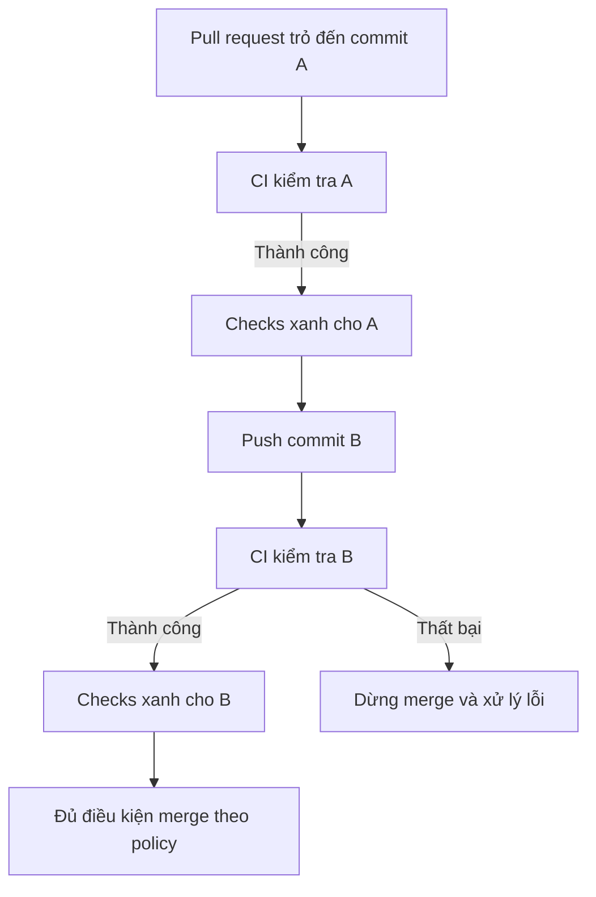

# Xử lý thay đổi mới làm kết quả kiểm tra trước đó mất hiệu lực

Trong quy trình CI/CD, kết quả kiểm tra chỉ có ý nghĩa đối với đúng nội dung đã được kiểm tra và những điều kiện đầu vào liên quan. Khi một commit mới được đẩy lên nhánh, nhánh đích thay đổi, cấu hình pipeline được cập nhật hoặc dependency bị thay thế, kết quả trước đó có thể không còn chứng minh được rằng thay đổi hiện tại an toàn để tích hợp.

Tình huống này thường xuất hiện khi một pull request đã xanh nhưng tác giả tiếp tục push commit mới; pipeline cũ vẫn đang chạy; nhánh chính nhận thay đổi trong lúc pull request chờ merge; hoặc một bản build đã được tạo từ revision cũ. Nếu hệ thống vẫn dùng trạng thái thành công cũ để cho phép merge hay triển khai, nhóm có thể đưa mã chưa được kiểm tra vào nhánh chính hoặc production.

Nguyên tắc cần áp dụng là: **mỗi quyết định tích hợp hoặc phát hành phải dựa trên bằng chứng gắn với đúng revision và đúng ngữ cảnh tích hợp đang được chấp nhận**. Bài này giải thích cách nhận biết kết quả đã cũ, quyết định phạm vi kiểm tra lại và thiết kế pipeline để tránh race condition.

## 1. Kết quả kiểm tra chứng minh điều gì?

Một lần chạy CI không chỉ trả về `success` hoặc `failure`. Nó tạo ra bằng chứng về một tập đầu vào cụ thể. Tùy loại kiểm tra, tập đầu vào có thể gồm:

- Commit SHA của mã nguồn được checkout.
- Commit đích và merge base được dùng khi đánh giá pull request.
- Nội dung workflow, script build, cấu hình test và các file cấu hình liên quan.
- Phiên bản dependency, lockfile, compiler, build tool, base image và runner.
- Dữ liệu test, dịch vụ phụ trợ, môi trường và các biến cấu hình không bí mật.
- Phiên bản cơ sở dữ liệu lỗ hổng hoặc bộ quy tắc được dùng trong security scan.

Ví dụ, unit test thành công ở commit `a12bc34` chỉ chứng minh các test đó đã chạy thành công với cây mã nguồn tương ứng và môi trường đã ghi nhận. Nếu pull request sau đó nhận commit `d56ef78`, trạng thái xanh của `a12bc34` không tự động chứng minh `d56ef78` cũng đạt.

Một bản ghi kiểm tra có thể được mô hình hóa bằng các thuộc tính sau:

| Thuộc tính | Ý nghĩa |
|---|---|
| `head_sha` | Commit chứa thay đổi đang được đánh giá |
| `base_sha` | Commit của nhánh đích tại thời điểm tích hợp hoặc kiểm tra |
| `tested_revision` | Revision thực tế được checkout hoặc merge để chạy kiểm tra |
| `workflow_revision` | Phiên bản pipeline và script kiểm tra |
| `inputs_fingerprint` | Dấu vân tay của dependency, toolchain và đầu vào liên quan |
| `run_id` và thời điểm | Định danh lần chạy và thời gian tạo bằng chứng |
| `result` | Kết quả cùng báo cáo, log và artifact liên quan |

Không phải nền tảng nào cũng lưu mọi trường dưới dạng riêng biệt. Dù vậy, thiết kế pipeline cần bảo đảm có thể xác định revision đã kiểm tra, điều kiện quan trọng đã dùng và lần chạy tạo ra kết quả.

## 2. Những thay đổi nào có thể làm kết quả cũ mất hiệu lực?

Một thay đổi mới làm mất hiệu lực kết quả cũ khi nó có thể ảnh hưởng đến kết luận mà lần kiểm tra trước đã đưa ra. Các trường hợp thường gặp gồm:

| Thay đổi | Bằng chứng có thể bị ảnh hưởng | Hành động thường cần thiết |
|---|---|---|
| Push commit mới lên pull request | Unit test, integration test, build, lint và scan gắn với mã nguồn | Chạy lại các check bắt buộc cho commit mới |
| Nhánh đích nhận commit mới | Kết quả tích hợp với base cũ, xung đột và kiểm thử tương thích | Cập nhật base hoặc tạo merge candidate mới rồi kiểm tra |
| Sửa workflow, build script hoặc test script | Bằng chứng được tạo bởi quy trình cũ | Chạy lại check dùng workflow hoặc script đã đổi |
| Thay lockfile, dependency, submodule hoặc base image | Build, test tương thích và kết quả quét thành phần | Build lại và chạy các kiểm tra liên quan |
| Sửa cấu hình, schema hoặc migration | Kiểm thử tích hợp, contract và kiểm tra dữ liệu | Chạy lại kiểm tra theo phạm vi bị tác động |
| Thay đổi quyền, secret hoặc cấu hình môi trường | Kết quả kiểm tra phụ thuộc môi trường và danh tính | Xác minh cấu hình mới và chạy lại các bước phụ thuộc |
| Cơ sở dữ liệu lỗ hổng hoặc chính sách scan cập nhật | Kết luận bảo mật theo dữ liệu/chính sách mới | Quét lại theo yêu cầu freshness của chính sách |

Không phải mọi thay đổi đều làm mọi kết quả cũ vô giá trị. Chỉnh sửa tài liệu độc lập có thể không ảnh hưởng đến unit test của module khác. Tuy nhiên, việc bỏ qua kiểm tra phải dựa trên quy tắc xác định phạm vi tác động đã được kiểm chứng. Nếu không thể chứng minh phạm vi an toàn, chạy lại bộ kiểm tra bắt buộc là lựa chọn đáng tin cậy hơn.

## 3. Commit mới trên pull request: trạng thái xanh cũ không đủ

Giả sử pull request bắt đầu từ commit `A`. CI chạy unit test và integration test, sau đó báo thành công. Tác giả push commit `B` lên cùng nhánh. Nhánh pull request lúc này trỏ đến `B`, trong khi bằng chứng thành công trước đó được tạo từ `A`.



Hệ thống quản lý mã nguồn nên liên kết status check với commit SHA hoặc revision chính xác. Khi head SHA thay đổi từ `A` sang `B`, các check bắt buộc phải được xác nhận cho `B`. Kết quả của `A` vẫn có ích để điều tra lịch sử, nhưng không được dùng thay cho kết quả của `B`.

Điều này cũng áp dụng cho commit được tạo bởi amend, rebase hoặc force push. Dù nội dung thay đổi có vẻ nhỏ, SHA mới đại diện cho một revision mới. Pipeline phải đánh giá revision đang được yêu cầu merge, không suy ra hiệu lực từ tên nhánh hoặc số thứ tự commit.

Nếu có nhiều commit được push liên tiếp, pipeline có thể hủy hoặc bỏ qua các lần chạy cũ để tiết kiệm tài nguyên. Dù chọn cách nào, kết quả của lần chạy cũ không được ghi đè trạng thái của commit mới. Mỗi check cần gắn với revision của lần chạy và hệ thống chỉ chấp nhận kết quả phù hợp với head hiện tại.

## 4. Nhánh đích thay đổi: cần kiểm tra lại nội dung tích hợp

Một pull request có thể không thay đổi trong vài giờ hoặc vài ngày, nhưng nhánh đích vẫn tiếp tục nhận commit từ những pull request khác. Khi base thay đổi, kết quả kiểm tra trên base cũ có thể không phản ánh cách thay đổi sẽ hoạt động sau khi tích hợp.

Ví dụ:

1. Pull request `feature/cart` được kiểm tra khi `main` đang ở commit `M1`.
2. Một pull request khác được merge, khiến `main` chuyển sang `M2`.
3. `feature/cart` chưa đổi, nhưng mã của nó sẽ được tích hợp với nền tảng mới `M2`.
4. Một API, interface hoặc dependency đã thay đổi trong `M2`, làm test từng thành công ở `M1` thất bại khi kết hợp với `M2`.

Do đó cần phân biệt hai kiểu kiểm tra:

- **Kiểm tra head commit:** đánh giá riêng cây mã nguồn của pull request.
- **Kiểm tra revision tích hợp:** đánh giá kết quả kết hợp pull request với base hiện tại hoặc với commit tổng hợp mà hệ thống sẽ merge.

Nếu chính sách chỉ yêu cầu kiểm tra head commit, việc base đổi có thể không tự động làm mọi check mất hiệu lực. Nhưng nếu mục tiêu là bảo đảm merge không phá vỡ nhánh đích, pipeline cần kiểm tra lại revision tích hợp mới nhất. Cơ chế có thể là cập nhật nhánh feature bằng merge/rebase, tạo merge commit tạm hoặc dùng merge queue.

### Merge queue và merge candidate

Merge queue xếp các thay đổi đã qua kiểm tra vào hàng đợi và tạo revision tích hợp dự kiến để kiểm tra trước khi cập nhật nhánh đích. Revision được kiểm tra có thể là merge commit hoặc một commit tổng hợp đại diện cho thứ tự thay đổi trong hàng đợi.

Nếu một thay đổi đứng trước được merge hoặc bị loại khỏi hàng đợi, nội dung tích hợp dự kiến của thay đổi phía sau có thể đổi. Khi đó, kết quả của merge candidate cũ có thể không còn phù hợp; hệ thống cần tạo candidate mới và chạy lại các check bắt buộc. Điều này giúp tránh tình trạng mỗi pull request đều xanh riêng lẻ nhưng tổ hợp cuối cùng lại thất bại.

## 5. Phê duyệt và review cũng có thể trở nên cũ

Kết quả kiểm thử không phải bằng chứng duy nhất dùng để cho phép merge. Review approval cũng gắn với nội dung được xem xét. Nếu tác giả push thêm commit sau khi được phê duyệt, người review có thể chưa xem thay đổi mới.

Repository có thể áp dụng các chính sách như:

- Yêu cầu phê duyệt lại sau khi có commit mới.
- Yêu cầu một reviewer khác phê duyệt lần push cuối.
- Hủy approval cũ khi có thay đổi đáng kể hoặc khi thay đổi thuộc khu vực nhạy cảm.
- Giữ approval với thay đổi nhỏ nhưng yêu cầu review bổ sung theo quy tắc CODEOWNERS hoặc chính sách nhóm.

Hành vi cụ thể phụ thuộc nền tảng quản lý Git và cấu hình bảo vệ nhánh. Điều quan trọng là quy tắc phải nói rõ approval nào còn hiệu lực sau khi head thay đổi. Không nên xem một dấu `approved` không gắn với revision được review là bằng chứng đầy đủ.

## 6. Quyết định chạy lại những gì?

Chạy lại toàn bộ pipeline sau mọi thay đổi có thể tốn thời gian. Chỉ chạy các test bị ảnh hưởng có thể nhanh hơn, nhưng cần có cơ sở để xác định chính xác phạm vi. Một chiến lược thực tế là phân loại check theo đầu vào và mức độ rủi ro:

| Nhóm check | Điều kiện cần xem xét chạy lại |
|---|---|
| Format, lint, static analysis | File nguồn, rule, cấu hình hoặc phiên bản công cụ thay đổi |
| Unit test | Mã module, mã dùng chung hoặc dependency liên quan thay đổi |
| Integration/contract test | API, schema, adapter, cấu hình hoặc dịch vụ phụ trợ thay đổi |
| Build/package | Source, lockfile, build script, compiler, base image hoặc tham số đóng gói thay đổi |
| Security/dependency scan | Artifact, dependency, scanner, advisory database hoặc policy thay đổi theo yêu cầu freshness |
| End-to-end test | Luồng người dùng, tích hợp hoặc cấu hình môi trường liên quan thay đổi |
| Kiểm tra revision tích hợp | Head commit hoặc base commit làm thay đổi merge candidate |

Có thể áp dụng ba mức:

1. **Kiểm tra nhanh:** chạy cho mỗi push, gồm format, lint, unit test và các check có thời gian phản hồi ngắn.
2. **Kiểm tra theo tác động:** chạy integration, contract hoặc test chuyên biệt dựa trên dependency graph và file thay đổi.
3. **Kiểm tra đầy đủ trước cổng quan trọng:** chạy bộ bắt buộc trên revision tích hợp cuối cùng trước merge hoặc trên artifact trước production.

Selective testing chỉ đáng tin khi hệ thống xác định được quan hệ phụ thuộc đủ chính xác. Nếu một thay đổi chạm thư viện dùng chung, build plugin, schema hoặc cấu hình gốc, phạm vi ảnh hưởng có thể rộng hơn thư mục chứa file được sửa. Khi dependency graph không đầy đủ, chọn chạy rộng hơn hoặc toàn bộ test phù hợp.

## 7. Phân biệt kết quả kiểm tra, cache và artifact

Ba khái niệm này thường bị nhầm lẫn:

- **Kết quả kiểm tra** là bằng chứng một check đã chạy trên revision và đầu vào cụ thể.
- **Cache** là dữ liệu trung gian được tái sử dụng để tăng tốc, ví dụ dependency cache hoặc build cache.
- **Artifact** là đầu ra được lưu để sử dụng tiếp, ví dụ JAR hoặc image container.

Cache hit không có nghĩa test đã chạy và thành công trên commit mới. Một số build cache có thể tái sử dụng kết quả biên dịch khi đầu vào không đổi; điều đó không thay thế các test cần xác minh hành vi tích hợp hoặc môi trường. Tương tự, artifact từ commit cũ không thể được xem là artifact của commit mới chỉ vì hai commit có nhiều file giống nhau.

Nếu tái sử dụng kết quả test hoặc artifact, pipeline cần chứng minh các đầu vào liên quan giống nhau theo chính sách. Tối thiểu cần ghi nhận revision, dependency, toolchain, cấu hình và định danh nội dung. Với bước có rủi ro cao, chạy lại kiểm tra trên revision cuối cùng thường dễ giải thích và kiểm toán hơn việc suy luận từ cache.

## 8. Ngăn pipeline cũ ghi đè trạng thái mới

Một lỗi tinh vi xảy ra khi hai lần chạy CI đồng thời trên cùng pull request:

1. Run `R1` bắt đầu trên commit `A` và chạy lâu.
2. Tác giả push commit `B`; run `R2` bắt đầu và hoàn tất nhanh hơn.
3. `R2` báo thành công cho `B`.
4. Sau đó `R1` hoàn tất và gửi trạng thái thất bại hoặc thành công muộn.

Nếu hệ thống cập nhật check chỉ theo tên job hoặc tên nhánh mà không ràng buộc với SHA, kết quả muộn của `R1` có thể gây nhầm lẫn hoặc che khuất trạng thái mới. Cần thiết kế concurrency và cập nhật trạng thái để kết quả luôn thuộc đúng revision.

Các biện pháp hữu ích gồm:

- Gắn check và artifact với commit SHA; khi kiểm tra merge candidate, lưu cả định danh candidate và base SHA.
- Dùng concurrency group theo pull request hoặc branch để hủy các lần chạy cũ khi có push mới, nếu nền tảng hỗ trợ.
- Kiểm tra head SHA hiện tại trước khi publish kết quả tổng hợp hoặc thực hiện hành động tiếp theo.
- Không cho run cũ triển khai sau khi một revision mới hơn đã được chấp nhận.
- Dùng cơ chế merge queue hoặc khóa cập nhật nhánh đích khi cần tuần tự hóa tích hợp.
- Lưu run ID và trạng thái hủy để phân biệt `cancelled`, `skipped`, `success` và `failure`.

Ví dụ mã giả cho pipeline:

```yaml
on:
  pull_request:
    types: [opened, synchronize, reopened]

concurrency:
  group: pr-${pull_request_number}
  cancel-in-progress: true

jobs:
  verify:
    steps:
      - checkout_exact_event_revision
      - record_head_and_base_sha
      - run_required_checks
      - publish_result_for_tested_revision

  merge_candidate:
    needs: verify
    steps:
      - ensure_candidate_matches_current_head_and_base
      - run_integration_checks_on_candidate
      - allow_merge_only_if_required_checks_match_candidate
```

Đây là mã giả minh họa, không phải cú pháp dùng trực tiếp cho mọi nền tảng. Trong triển khai thực tế, cần dùng cú pháp event, concurrency và check API tương ứng. Việc hủy run cũ giúp tiết kiệm tài nguyên; điều kiện gắn kết quả với đúng revision mới là hàng rào bảo đảm tính đúng đắn.

## 9. Ví dụ: một pull request thay đổi liên tục

Một nhóm phát triển chức năng thanh toán. Pull request ban đầu có commit `C1`; unit test, integration test và security scan đều đạt. Trước khi merge, tác giả bổ sung xử lý timeout và push `C2`.

Pipeline cần xử lý như sau:

1. Ghi nhận head hiện tại là `C2` và khởi chạy các check bắt buộc cho revision này.
2. Hủy hoặc đánh dấu run cũ của `C1` là không còn dùng cho quyết định merge.
3. Chạy unit test liên quan đến timeout, integration test với payment gateway giả lập và các check bắt buộc khác.
4. Nếu nhánh `main` đã đổi kể từ lần kiểm tra trước, tạo merge candidate mới hoặc đưa pull request qua merge queue.
5. Chạy check tích hợp trên candidate mới và yêu cầu approval còn hiệu lực theo chính sách review.
6. Chỉ merge khi tất cả check bắt buộc báo thành công cho đúng revision được merge.
7. Artifact được build từ commit tích hợp đã chấp nhận, lưu cùng digest và bằng chứng để dùng ở các bước tiếp theo.

Nếu `C2` chỉ thay đổi tài liệu không liên quan, chính sách có thể cho phép bỏ qua một số test tốn kém. Nhưng pipeline vẫn cần có check bắt buộc xác nhận phạm vi thay đổi và ghi lại lý do skip. Một check bị skip theo chính sách không giống một check thành công; trạng thái tổng hợp phải phản ánh đúng điều đó.

## 10. Điều kiện để cho phép merge hoặc phát hành

Trước khi merge, pipeline nên xác minh:

- Head SHA hiện tại trùng với revision mà các check bắt buộc đã kiểm tra.
- Nếu chính sách yêu cầu kiểm tra tích hợp, base SHA hoặc merge candidate vẫn là candidate đã được kiểm tra.
- Không còn check bắt buộc ở trạng thái pending, cancelled hoặc stale.
- Approval và review bắt buộc còn hiệu lực đối với thay đổi hiện tại.
- Artifact hoặc kết quả build được dùng tiếp có nguồn gốc từ revision được chấp nhận.

Trước khi triển khai production, cần kiểm tra thêm rằng artifact được triển khai đúng là artifact đã qua cổng chất lượng; digest, chữ ký hoặc provenance phù hợp; và không có thay đổi mới làm mất hiệu lực quyết định phát hành. Nếu có commit mới sau khi artifact được tạo, pipeline phải xác định đó là một release candidate mới hay artifact cũ vẫn là mục tiêu được phê duyệt.

Không nên gộp mọi check thành một dấu xanh chung mà không giữ bằng chứng chi tiết. Dashboard tổng hợp hữu ích cho người dùng, nhưng mỗi check cần có liên kết đến revision, lần chạy, log và lý do được chạy hoặc bỏ qua.

## 11. Checklist thiết kế xử lý kết quả cũ

- [ ] Mỗi lần chạy ghi nhận commit SHA và các revision nền liên quan.
- [ ] Check bắt buộc được gắn với đúng commit hoặc merge candidate.
- [ ] Push commit mới làm các check cần thiết chạy lại hoặc bị đánh dấu stale.
- [ ] Base branch thay đổi được xử lý theo chính sách kiểm tra tích hợp.
- [ ] Approval sau commit mới tuân theo quy tắc review rõ ràng.
- [ ] Các run cũ được hủy hoặc cô lập, không thể ghi đè trạng thái của revision mới.
- [ ] Selective testing dựa trên dependency graph có thể kiểm chứng và có phương án chạy rộng hơn khi không chắc chắn.
- [ ] Cache không bị xem là bằng chứng test đã chạy trên commit mới.
- [ ] Artifact, test report và security scan được liên kết với revision/digest tương ứng.
- [ ] Merge và deploy chỉ tiếp tục khi bằng chứng bắt buộc còn hiệu lực.

Kết quả CI chỉ đáng tin khi nó mô tả đúng thứ đang được đưa vào nhánh hoặc môi trường tiếp theo. Bằng cách ràng buộc check với revision, xem xét thay đổi của base branch, xử lý run đồng thời và xác định rõ phạm vi tái kiểm tra, nhóm tránh được việc dùng một kết quả xanh cũ để hợp thức hóa thay đổi mới chưa được xác minh.
