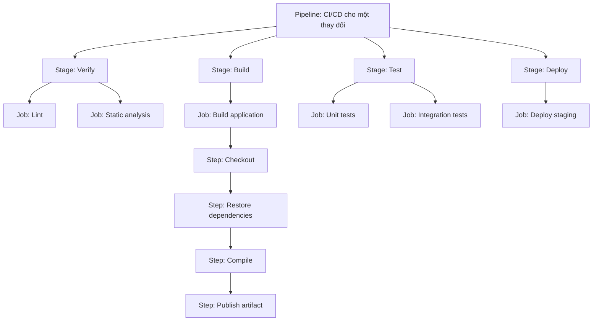
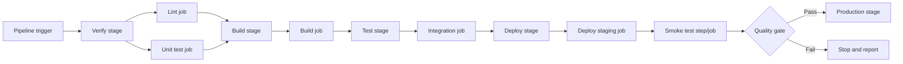
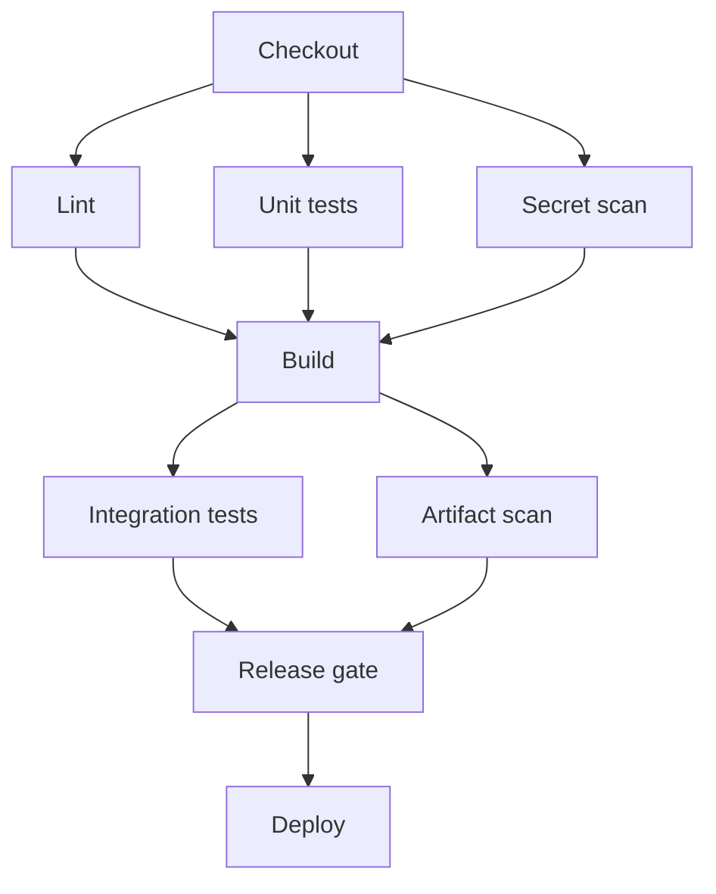
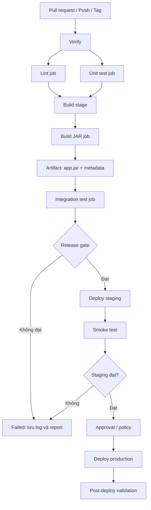

# Phân biệt pipeline, giai đoạn, công việc và bước thực thi

## 1. Vì sao cần hiểu cấu trúc pipeline?

Khi xây dựng CI/CD, một quy trình thường gồm nhiều hoạt động: lấy mã nguồn, cài dependency, kiểm tra chất lượng, build, kiểm thử, đóng gói artifact, triển khai và xác minh sau triển khai. Nếu viết tất cả hoạt động thành một khối lệnh dài, quy trình sẽ khó đọc, khó tái sử dụng, khó chạy song song và khó xác định lỗi nằm ở đâu.

Các nền tảng CI/CD cung cấp một mô hình cấu trúc để tổ chức những hoạt động đó. Bốn khái niệm thường gặp là:

- **Pipeline:** toàn bộ luồng tự động được kích hoạt bởi một sự kiện hoặc yêu cầu, điều phối các hoạt động từ đầu đến cuối.
- **Stage (giai đoạn):** nhóm logic các công việc có cùng mục đích hoặc cùng mốc trong vòng đời, chẳng hạn Verify, Build, Test, Package hay Deploy.
- **Job (công việc):** một đơn vị thực thi được lập lịch trên runner/agent hoặc môi trường thực thi; job thường gồm nhiều step và có thể chạy song song với job khác khi không phụ thuộc nhau.
- **Step (bước):** một thao tác cụ thể bên trong job, thường là chạy lệnh, gọi action/task, khôi phục cache hoặc tải artifact.

Hiểu đúng quan hệ giữa bốn khái niệm giúp thiết kế pipeline rõ ràng, kiểm soát thứ tự, tối ưu thời gian, giới hạn quyền và truy vết kết quả. Đây là nền tảng để xây dựng pipeline dưới dạng mã có thể bảo trì trong module CI/CD.

## 2. Mô hình phân cấp tổng quát

Có thể hình dung một pipeline như một bản đồ điều phối. Pipeline xác định khi nào quy trình bắt đầu và những phần việc nào cần hoàn thành. Stage chia bản đồ thành các chặng logic. Trong mỗi stage có thể có một hoặc nhiều job. Mỗi job chứa các step được thực thi trong cùng một ngữ cảnh công việc.



Đây là mô hình khái niệm. Không phải nền tảng nào cũng bắt buộc có đủ bốn cấp hoặc dùng đúng tên gọi này. Có công cụ tổ chức workflow trực tiếp thành job và step, có công cụ dùng stage làm cấp chính, có công cụ gọi job là task hoặc action. Một số nền tảng còn có workflow, pipeline template, task group, deployment job hay matrix. Khi đọc tài liệu một công cụ cụ thể, cần xác định ngữ nghĩa thực tế của từng cấp thay vì suy luận chỉ từ tên.

## 3. Pipeline: đơn vị điều phối từ sự kiện đến kết quả

Pipeline là phạm vi điều phối tổng thể của một lần tự động hóa. Nó thường xác định:

- **Trigger:** sự kiện khởi chạy, ví dụ push, pull request, tạo tag, lịch chạy hoặc thao tác thủ công.
- **Nguồn đầu vào:** repository, commit/ref, tham số, biến cấu hình và thông tin liên quan.
- **Luồng thực thi:** các stage/job cần chạy, thứ tự và quan hệ phụ thuộc giữa chúng.
- **Chính sách:** điều kiện chạy, cổng chất lượng, phê duyệt, quyền truy cập và giới hạn môi trường.
- **Đầu ra:** trạng thái, log, báo cáo, artifact, metadata và lịch sử triển khai.

Ví dụ, một push vào nhánh `main` có thể kích hoạt pipeline CI để kiểm tra và tạo artifact. Một tag phiên bản có thể kích hoạt pipeline release để triển khai artifact đã được tạo và xác minh. Tùy thiết kế, đây có thể là hai pipeline riêng hoặc hai nhánh điều kiện trong cùng một định nghĩa pipeline.

Pipeline có vòng đời riêng: được tạo bởi trigger, xếp hàng, thực thi, hoàn tất hoặc thất bại. Mỗi lần chạy nên có định danh để liên kết với commit, log, báo cáo test và artifact. Khi điều tra lỗi, cần biết pipeline run nào đã xử lý revision nào và vì sao một job được chạy hoặc bị bỏ qua.

Không nên đồng nhất pipeline với một file YAML. File YAML hoặc mã cấu hình là cách mô tả pipeline dưới dạng mã; pipeline là quy trình thực tế được nền tảng diễn giải và thực thi từ cấu hình đó. Một pipeline có thể được tạo từ nhiều file/template hoặc gọi workflow tái sử dụng, tùy công cụ.

## 4. Stage: chia luồng thành các chặng logic

Stage nhóm các công việc theo mục đích hoặc điểm chuyển tiếp trong quy trình. Ví dụ:

| Stage | Mục tiêu | Đầu ra thường gặp |
|---|---|---|
| Verify | Kiểm tra nhanh và xác minh điều kiện đầu vào | Kết quả lint, type check, static analysis |
| Build | Tạo sản phẩm từ revision đã chọn | Binary, package hoặc container image |
| Test | Xác minh hành vi và tương tác | Test report, coverage, kết quả contract/integration test |
| Package/Publish | Đóng gói và lưu trữ sản phẩm | Artifact có phiên bản/digest và metadata |
| Deploy | Đưa artifact vào môi trường đích | Deployment record, phiên bản đang chạy |
| Validate/Observe | Xác minh sau triển khai và theo dõi rollout | Smoke test, health check, canary metrics |

Stage giúp người đọc hiểu pipeline đang ở chặng nào và có thể biểu diễn các cổng chuyển tiếp. Ví dụ, stage Deploy chỉ bắt đầu sau khi Build và Test đạt; stage Production có thể yêu cầu phê duyệt sau khi staging validation thành công.

Trong nhiều hệ thống, stage chạy tuần tự theo thứ tự khai báo hoặc quan hệ phụ thuộc. Tuy nhiên, không nên giả định mọi stage luôn phải chạy nối tiếp. Một số nền tảng cho phép stage chạy song song, bỏ qua theo điều kiện hoặc tạo luồng phụ thuộc dạng DAG (directed acyclic graph). Cấu trúc thực thi thực tế phụ thuộc cách khai báo dependency.

Stage không nhất thiết tương ứng với một môi trường. “Test” có thể là một stage chạy trên runner mà không triển khai ứng dụng vào môi trường test; ngược lại, “Deploy to Staging” có thể là một stage riêng. Hãy đặt tên stage theo mục tiêu và quyết định cần đạt, tránh tên quá chung như `Step1` hoặc `Other`.

## 5. Job: đơn vị được lập lịch và thực thi

Job là một đơn vị công việc mà nền tảng có thể giao cho runner, agent hoặc môi trường thực thi. Job thường có:

- Một môi trường chạy, hệ điều hành hoặc image/container cụ thể.
- Các step thực hiện tuần tự trong phạm vi job.
- Biến môi trường, quyền và thông tin xác thực cần thiết.
- Tài nguyên được cấp như CPU, bộ nhớ, workspace và thời gian tối đa.
- Điều kiện chạy, timeout, retry hoặc chính sách xử lý thất bại nếu nền tảng hỗ trợ.
- Đầu ra như log, report, artifact hoặc output dùng cho job khác.

Ví dụ, trong stage Test có thể có ba job độc lập: UnitTests, ContractTests và SecurityScan. Chúng có thể chạy đồng thời trên ba runner khác nhau. Nếu một job thất bại, pipeline sẽ tổng hợp trạng thái theo chính sách đã cấu hình; các job còn lại có thể tiếp tục để thu thập thêm kết quả hoặc bị hủy tùy chiến lược.

Job thường là ranh giới quan trọng về workspace. Một job có thể chạy trên máy ảo hoặc container riêng; file được tạo trong job này không tự động tồn tại ở job khác. Nếu job sau cần file đó, pipeline phải truyền qua artifact, cache hoặc cơ chế chia sẻ được nền tảng hỗ trợ. Không nên giả định hai job dùng chung thư mục làm việc.

Job cũng là nơi thích hợp để xác định môi trường thực thi và quyền tối thiểu. Job chỉ chạy unit test không cần credential production. Job triển khai staging cần quyền staging; job triển khai production cần quyền và chính sách production riêng. Tách job theo quyền và mục đích giúp giới hạn phạm vi ảnh hưởng khi có lỗi hoặc cấu hình bị lạm dụng.

## 6. Step: thao tác cụ thể bên trong một job

Step là một hành động trong job. Các step thường chạy tuần tự và dùng chung workspace của job, do đó step sau có thể sử dụng file mà step trước đã tạo trong cùng job.

Một job build ứng dụng có thể gồm:

1. Checkout đúng commit.
2. Thiết lập phiên bản runtime và công cụ build.
3. Khôi phục dependency hoặc cache.
4. Chạy formatter/lint nếu được đặt trong job này.
5. Biên dịch mã nguồn.
6. Chạy unit test hoặc thu thập báo cáo build.
7. Đóng gói và upload artifact.

Một step có thể là lệnh shell, action, task tích hợp, script nội bộ hoặc thao tác do plugin của nền tảng cung cấp. Mỗi nền tảng có cách khai báo step và cách xử lý mã thoát khác nhau. Về nguyên tắc, step cần có mục đích rõ, đầu vào xác định và đầu ra có thể kiểm tra.

Ví dụ một job minh họa bằng mã giả:

```yaml
jobs:
  build_application:
    steps:
      - name: Checkout source
        run: git checkout $SOURCE_REVISION
      - name: Restore dependencies
        run: ./build-tool restore
      - name: Compile
        run: ./build-tool compile
      - name: Run unit tests
        run: ./build-tool test
      - name: Publish artifact
        run: ./build-tool package
```

Đây là YAML minh họa cấu trúc, không phải cấu hình có thể chạy trực tiếp trên mọi nền tảng. Cú pháp `jobs`, `steps`, `run` và cách truy cập biến thay đổi theo sản phẩm CI/CD. Trong pipeline thực tế, cần khai báo checkout, quyền truy cập và cách upload artifact theo tài liệu của nền tảng.

## 7. Quan hệ giữa các cấp: chứa, thực thi và phụ thuộc

Mô hình thường gặp là pipeline chứa stage, stage chứa job, job chứa step. Tuy nhiên, đây là quan hệ tổ chức. Quan hệ thực thi được xác định bởi dependency, điều kiện và chính sách.



Trong ví dụ, Lint và Unit test không phụ thuộc nhau nên có thể chạy song song. Build chỉ bắt đầu sau khi cả hai đạt. Integration test cần artifact từ Build nên phụ thuộc vào đầu ra đó. Deploy staging cần artifact đã xác minh. Production chỉ được phép chạy sau quality gate và phê duyệt theo chính sách.

Một số thuật ngữ cần phân biệt:

- **Containment (chứa):** job nằm trong stage; step nằm trong job.
- **Ordering (thứ tự):** một hoạt động phải hoàn tất trước hoạt động khác.
- **Dependency (phụ thuộc):** hoạt động sau cần trạng thái hoặc đầu ra của hoạt động trước.
- **Condition (điều kiện):** quy tắc quyết định hoạt động có được chạy hay không.
- **Artifact flow (luồng artifact):** cách sản phẩm được truyền từ job tạo ra sang job tiêu thụ.

Hai job ở cùng stage không nhất thiết phụ thuộc nhau. Hai stage khác nhau cũng có thể chạy song song nếu nền tảng và định nghĩa pipeline cho phép. Tương tự, thứ tự khai báo trong file không phải lúc nào cũng là thứ tự thực thi; dependency graph mới là cơ sở cần đọc.

## 8. DAG và chạy song song

DAG (Directed Acyclic Graph – đồ thị có hướng không chu trình) mô tả các hoạt động và quan hệ phụ thuộc giữa chúng. Mỗi nút là một job hoặc tác vụ; cạnh chỉ ra một hoạt động cần hoàn thành trước hoạt động khác. Không có chu trình nghĩa là không tồn tại đường phụ thuộc quay lại chính nó.

Ví dụ, sau checkout có thể chạy lint, unit test và secret scan song song. Khi tất cả kiểm tra bắt buộc đạt, pipeline mới build. Sau build, có thể chạy integration test và scan artifact song song nếu cả hai cùng cần artifact. Khi hoàn thành, pipeline mới cho phép triển khai.



Chạy song song có thể giảm thời gian tổng, nhưng không miễn phí. Nhiều job đồng thời cần nhiều runner, CPU, bộ nhớ, kết nối và có thể làm tăng hàng đợi của những pipeline khác. Job dùng chung tài nguyên có thể gây xung đột dữ liệu hoặc test không ổn định. Vì vậy cần:

- Chỉ chạy song song khi các job độc lập về dữ liệu và đầu ra.
- Khai báo rõ job nào cần artifact hoặc output của job nào.
- Giới hạn concurrency theo năng lực runner và chính sách hệ thống.
- Tránh để nhiều job cùng ghi vào một môi trường hoặc tài nguyên dùng chung mà không có khóa/điều phối.
- Đo thời gian thực tế và hàng đợi để xác định mức song song có lợi.

## 9. Truyền dữ liệu giữa job: output, artifact và cache

Job có thể tạo ra nhiều loại dữ liệu, nhưng không phải dữ liệu nào cũng được truyền theo cùng cách.

| Cơ chế | Mục đích | Ví dụ | Lưu ý |
|---|---|---|---|
| Job output | Truyền giá trị nhỏ để điều khiển job sau | Phiên bản build, cờ có cần deploy hay không | Không dùng để truyền file lớn hoặc bí mật nếu nền tảng không thiết kế cho việc đó |
| Artifact | Lưu và chuyển file đầu ra của một lần chạy | JAR, container metadata, test report, package | Cần định danh, quyền truy cập và thời hạn lưu trữ phù hợp |
| Cache | Tăng tốc bằng cách tái sử dụng dữ liệu có thể tạo lại | Dependency cache, build cache | Cache không phải nguồn chân lý; cần khóa theo đầu vào và có thể xóa/tạo lại |
| Workspace/shared volume | Chia sẻ file trong phạm vi môi trường được cấu hình | File tạm giữa các bước hoặc job trên runner dùng chung | Phụ thuộc nền tảng; cần tránh giả định workspace được chia sẻ mặc định |

Ví dụ: Job Build tạo `app.jar` và upload artifact có tên `application-build`. Job IntegrationTest tải artifact đó về và kiểm thử đúng gói đã build. Job DeployStaging tiếp tục tải cùng artifact để triển khai. Nếu mỗi job tự build lại, kết quả có thể khác nhau do dependency, cấu hình hoặc thời điểm build.

Với container image, nên truyền định danh bất biến như digest thay vì chỉ dựa vào tag có thể bị di chuyển. Metadata nên liên kết artifact với commit, lần chạy pipeline và các kết quả kiểm tra. Cách này hỗ trợ nguyên tắc build một lần, promote cùng artifact qua các môi trường.

## 10. Điều kiện chạy, trạng thái và xử lý lỗi

Pipeline cần xác định rõ khi nào một job hoặc step được thực thi. Một số điều kiện phổ biến:

- Chỉ chạy khi sự kiện là pull request hoặc push vào nhánh cụ thể.
- Chỉ chạy bước publish khi build và test bắt buộc thành công.
- Chỉ triển khai production khi có tag/release hợp lệ và phê duyệt.
- Chỉ chạy job migration khi artifact có thay đổi schema.
- Luôn chạy bước thu thập log/report dù job kiểm thử trước đó thất bại.
- Bỏ qua job không liên quan khi một nhóm file không thay đổi, nếu quy tắc lựa chọn đủ tin cậy.

Các trạng thái thường gặp gồm pending/queued, running, succeeded, failed, canceled và skipped. Tên trạng thái cụ thể phụ thuộc nền tảng. Khi đọc trạng thái tổng thể, cần phân biệt job bị bỏ qua do điều kiện với job đã chạy và thất bại; cả hai có ý nghĩa khác nhau.

Xử lý lỗi cũng cần được thiết kế theo mục đích:

- **Fail fast:** dừng luồng phụ thuộc khi một điều kiện bắt buộc thất bại.
- **Continue/allow failure:** cho phép một job không bắt buộc thất bại mà pipeline vẫn tiếp tục, nhưng phải hiển thị rõ trạng thái và lý do.
- **Retry:** thử lại thao tác có thể gặp lỗi tạm thời, với giới hạn và backoff phù hợp.
- **Always/finally step:** thu thập báo cáo, log hoặc dọn dẹp kể cả khi bước trước thất bại.
- **Cancel in progress:** hủy pipeline cũ khi có revision mới, nếu pipeline cũ không còn giá trị và việc hủy an toàn.

Không nên dùng retry để che lỗi logic hoặc test chập chờn. Retry phù hợp hơn với lỗi hạ tầng tạm thời có thể nhận diện, ví dụ một lần gọi dịch vụ registry bị timeout. Với test thất bại, cần lưu lần thất bại đầu tiên và điều tra nguyên nhân trước khi quyết định retry.

## 11. Matrix job và tái sử dụng cấu hình

Khi cần kiểm tra cùng một thao tác trên nhiều phiên bản runtime, hệ điều hành hoặc cấu hình, matrix strategy có thể tạo nhiều job từ một định nghĩa. Ví dụ kiểm thử thư viện trên Java 17 và Java 21, hoặc trên Windows và Linux.

Mã giả:

```yaml
jobs:
  test:
    strategy:
      matrix:
        java: [17, 21]
        os: [linux, windows]
    steps:
      - name: Set up runtime
        run: setup-java $JAVA_VERSION
      - name: Run tests
        run: ./build-tool test
```

Định nghĩa trên chỉ minh họa ý tưởng. Cú pháp matrix và tên biến thực tế tùy nền tảng. Với hai phiên bản Java và hai hệ điều hành, chiến lược này có thể tạo bốn tổ hợp job. Matrix giúp tránh sao chép cấu hình, nhưng số tổ hợp tăng nhanh khi thêm chiều kiểm tra. Cần chọn các tổ hợp đại diện theo ma trận hỗ trợ thực tế, không mở rộng mọi kết hợp nếu không có giá trị.

Tái sử dụng cấu hình có thể được thực hiện bằng template, reusable workflow, composite action, task group hoặc script dùng chung. Khi tái sử dụng, cần quản lý phiên bản và thay đổi có kiểm soát để một cập nhật template không bất ngờ ảnh hưởng hàng loạt repository.

## 12. Ranh giới bảo mật và quyền thực thi

Mỗi cấp trong pipeline có thể là nơi áp dụng chính sách khác nhau. Cần đặc biệt chú ý:

- Trigger từ pull request bên ngoài có thể chạy mã không đáng tin cậy; không cấp secret nhạy cảm hoặc quyền ghi registry/production cho job đó.
- Job triển khai production nên tách khỏi job kiểm thử mã nguồn và chỉ nhận artifact đã được xác minh.
- Cấp quyền tối thiểu theo job; không dùng một credential toàn quyền cho mọi stage.
- Bảo vệ biến môi trường và log; không in token hoặc nội dung secret trong step.
- Dùng môi trường có bảo vệ, phê duyệt và giới hạn người được phép triển khai khi chính sách yêu cầu.
- Kiểm soát phiên bản action, plugin, image runner và script dùng trong pipeline.
- Ghi nhận ai/điều kiện nào khởi chạy pipeline, job nào dùng quyền gì và artifact nào đã được triển khai.

Việc tách job theo ranh giới bảo mật giúp giảm phạm vi quyền cần thiết. Ví dụ, job Build có thể chỉ cần đọc repository và dependency; job Publish cần quyền ghi registry; job DeployStaging cần credential staging; job DeployProduction cần quyền riêng cùng approval. Nếu một step trong job có quyền rộng, mọi mã lệnh chạy trong job đó có thể thừa hưởng quyền tương ứng.

## 13. Ví dụ xuyên suốt: pipeline cho dịch vụ Java

Giả sử nhóm phát triển một dịch vụ Java, dùng Git để quản lý mã nguồn và tạo JAR làm artifact. Pipeline được tổ chức như sau:

| Cấp | Tên | Nhiệm vụ |
|---|---|---|
| Pipeline | `service-ci-cd` | Kích hoạt theo pull request, push vào `main` hoặc tag release; liên kết run với commit. |
| Stage | `Verify` | Tổ chức các kiểm tra nhanh trước khi build. |
| Job | `lint` | Chạy formatter check và static analysis. |
| Job | `unit-tests` | Chạy unit test và xuất báo cáo. |
| Stage | `Build` | Tạo gói ứng dụng. |
| Job | `build-jar` | Checkout, thiết lập JDK, khôi phục dependency, compile và upload JAR. |
| Stage | `Integration` | Kiểm tra tương tác trên artifact đã tạo. |
| Job | `integration-tests` | Tải JAR, khởi tạo dependency kiểm thử và chạy integration test. |
| Stage | `Staging` | Triển khai thử nghiệm. |
| Job | `deploy-staging` | Tải artifact theo định danh, lấy credential staging và triển khai. |
| Job | `smoke-test` | Kiểm tra endpoint, health và luồng cơ bản sau triển khai. |
| Stage | `Production` | Phát hành có kiểm soát. |
| Job | `deploy-production` | Chỉ chạy khi release hợp lệ, gate đạt và có phê duyệt theo chính sách. |
| Job | `post-deploy-check` | Xác minh health, metric và trạng thái rollout. |

Luồng phụ thuộc:



Ở pipeline này, lint và unit test có thể chạy song song vì cùng sử dụng revision đã checkout và không phụ thuộc đầu ra của nhau. Build chờ hai job bắt buộc đạt. Integration test tải JAR đã tạo, bảo đảm kiểm thử đúng artifact dự kiến triển khai. Staging và production dùng cùng artifact, nhưng cấu hình và credential khác nhau. Nếu staging smoke test thất bại, pipeline dừng trước production và lưu bằng chứng để điều tra.

## 14. Cách đọc và thiết kế một pipeline dễ bảo trì

Khi đọc một file pipeline mới, hãy lần lượt tìm:

1. **Trigger:** pipeline chạy khi nào, trên branch/tag/event nào?
2. **Revision:** mã nguồn nào được checkout, có cố định commit không?
3. **Stages/jobs:** các phần việc được chia theo mục tiêu nào?
4. **Dependency graph:** job nào chạy trước, job nào song song, điều kiện chuyển tiếp là gì?
5. **Runner/environment:** mỗi job chạy trên hệ điều hành, image hoặc môi trường nào?
6. **Steps:** từng job thực hiện những thao tác gì và đầu ra nào được tạo?
7. **Data flow:** artifact, output, cache và report được truyền giữa các job ra sao?
8. **Conditions/failure:** điều kiện skip, fail, retry, approval và cleanup được khai báo thế nào?
9. **Permissions/secrets:** job nào có quyền gì và secret được cấp ở đâu?
10. **Observability:** log, report, run ID và deployment record được lưu ở đâu?

Khi thiết kế, nên đặt tên theo hành động hoặc mục tiêu như `unit-tests`, `build-image`, `publish-artifact`, `deploy-staging`. Tên rõ giúp đọc log và tìm job thất bại nhanh hơn. Mỗi job nên có phạm vi trách nhiệm vừa đủ; tránh một job làm từ lint, build, deploy đến migration nếu các hoạt động đó cần quyền, môi trường hoặc điều kiện khác nhau.

Không nên chia nhỏ mọi lệnh thành một job riêng. Việc tạo job có chi phí khởi tạo, chuyển workspace, truyền artifact và điều phối. Nếu hai thao tác cần cùng workspace, cùng quyền và luôn phải chạy tuần tự, chúng có thể phù hợp ở các step trong một job. Nếu chúng cần môi trường, quyền, lịch chạy hoặc khả năng song song khác nhau, tách thành job thường rõ ràng hơn.

## 15. Những nhầm lẫn thường gặp

| Nhầm lẫn | Cách hiểu đúng |
|---|---|
| Pipeline và stage là một | Pipeline điều phối toàn bộ lần chạy; stage là nhóm logic bên trong hoặc cấp phân đoạn do nền tảng định nghĩa. |
| Mọi stage phải chạy tuần tự | Thứ tự thực thi do dependency và tính năng nền tảng quyết định; có thể có stage song song hoặc điều kiện. |
| Job và step có thể thay thế nhau | Job là đơn vị được lập lịch; step là thao tác bên trong job và thường chia sẻ workspace của job. |
| Hai job mặc định chia sẻ file | Job có thể chạy trên runner riêng; cần artifact/cache/workspace được cấu hình để truyền dữ liệu. |
| Một stage luôn là một môi trường | Stage là chặng logic; môi trường là đích hoặc ngữ cảnh triển khai, có thể được dùng ở một hay nhiều stage. |
| Chỉ cần nhìn thứ tự trong YAML | Phải đọc dependency, condition và ngữ nghĩa của nền tảng; thứ tự khai báo không luôn quyết định thứ tự chạy. |
| Càng nhiều job càng nhanh | Job song song cần tài nguyên và có chi phí điều phối; cần đo và giới hạn concurrency. |
| Cache giống artifact | Cache nhằm tăng tốc và có thể tạo lại; artifact là đầu ra cần định danh, lưu giữ và chuyển giao. |
| Job test và job deploy dùng chung credential | Nên tách quyền theo mục đích và môi trường, áp dụng nguyên tắc quyền tối thiểu. |

## 16. Nguyên tắc thực hành cốt lõi

1. Dùng pipeline để mô tả và điều phối toàn bộ luồng từ trigger đến kết quả.
2. Nhóm stage theo mục tiêu và cổng chuyển tiếp có ý nghĩa.
3. Dùng job làm đơn vị thực thi có runner, workspace, quyền và đầu ra rõ ràng.
4. Dùng step cho các thao tác cụ thể, tuần tự trong cùng một job.
5. Mô hình hóa thứ tự bằng dependency graph; chỉ chạy song song các công việc độc lập.
6. Truyền dữ liệu giữa job bằng output, artifact hoặc cache đúng mục đích; không giả định workspace được chia sẻ.
7. Thiết kế điều kiện, trạng thái, retry và xử lý lỗi minh bạch.
8. Tách job theo ranh giới bảo mật, môi trường và quyền truy cập.
9. Đặt tên rõ, quản lý template có phiên bản và lưu bằng chứng cho mỗi lần chạy.

Khi phân biệt được pipeline, stage, job và step, người thiết kế có thể chia quy trình CI/CD thành những đơn vị dễ hiểu và kiểm soát. Một kiến trúc tốt cho biết việc gì cần xảy ra, phụ thuộc vào đâu, chạy ở môi trường nào, dùng quyền gì, tạo ra đầu ra nào và điều kiện nào cho phép chuyển sang bước tiếp theo. Những thông tin đó làm cho pipeline có thể bảo trì, tối ưu và truy vết trong suốt vòng đời phát triển phần mềm.
