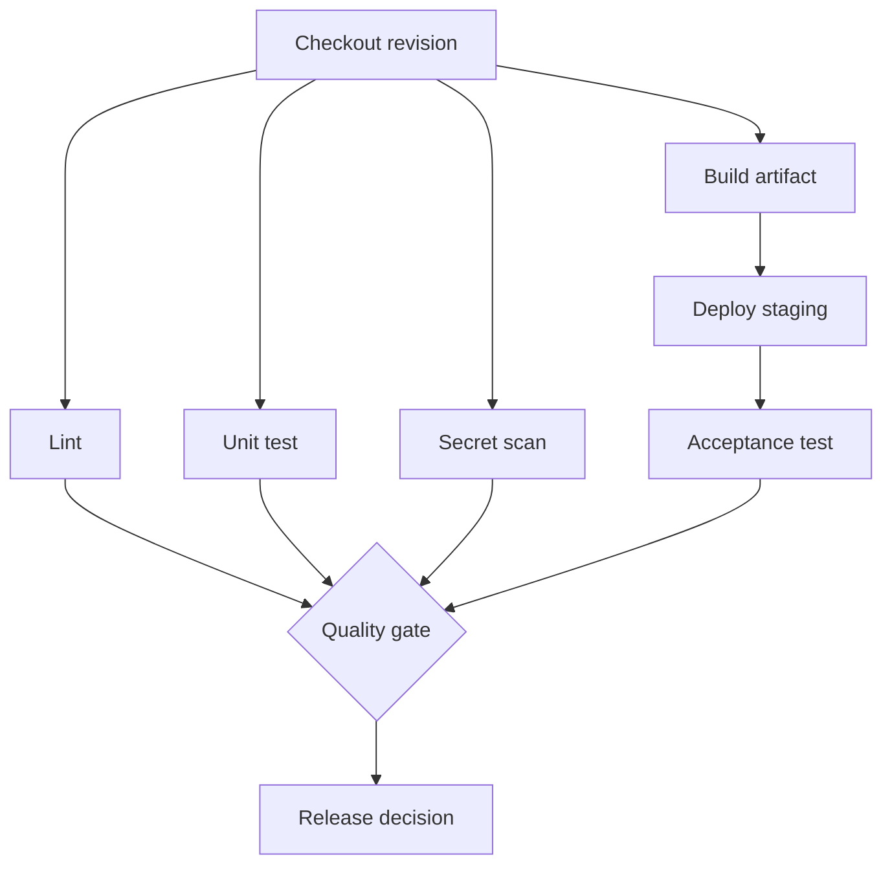
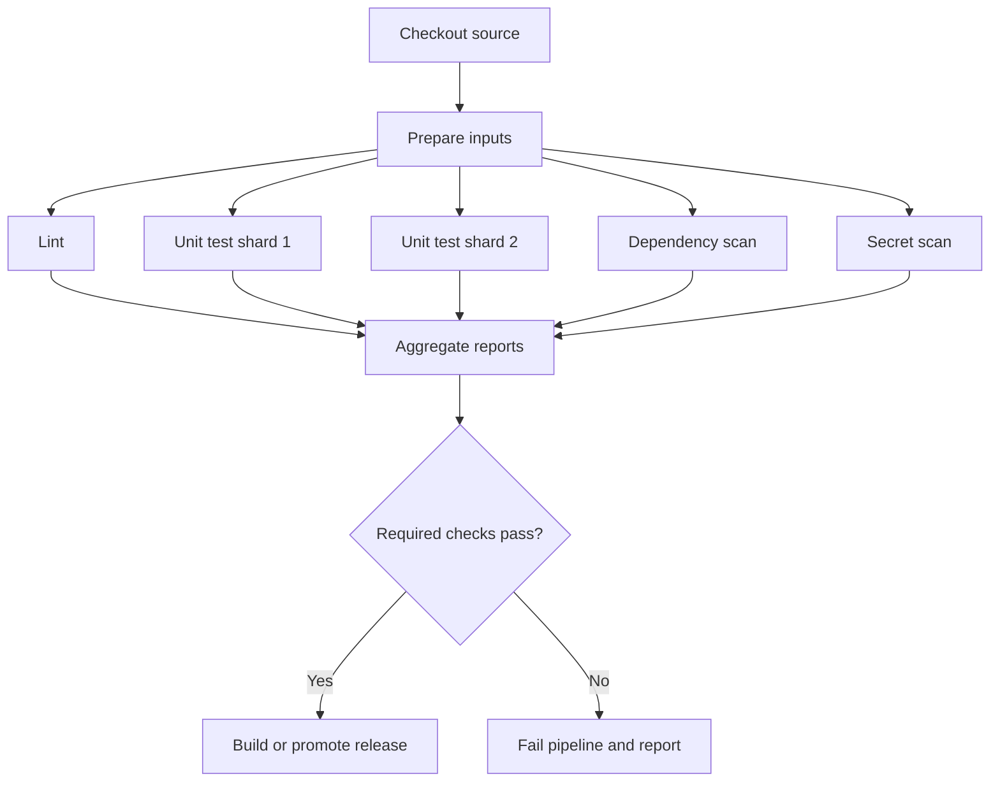
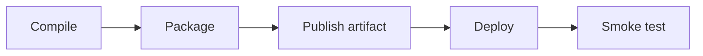
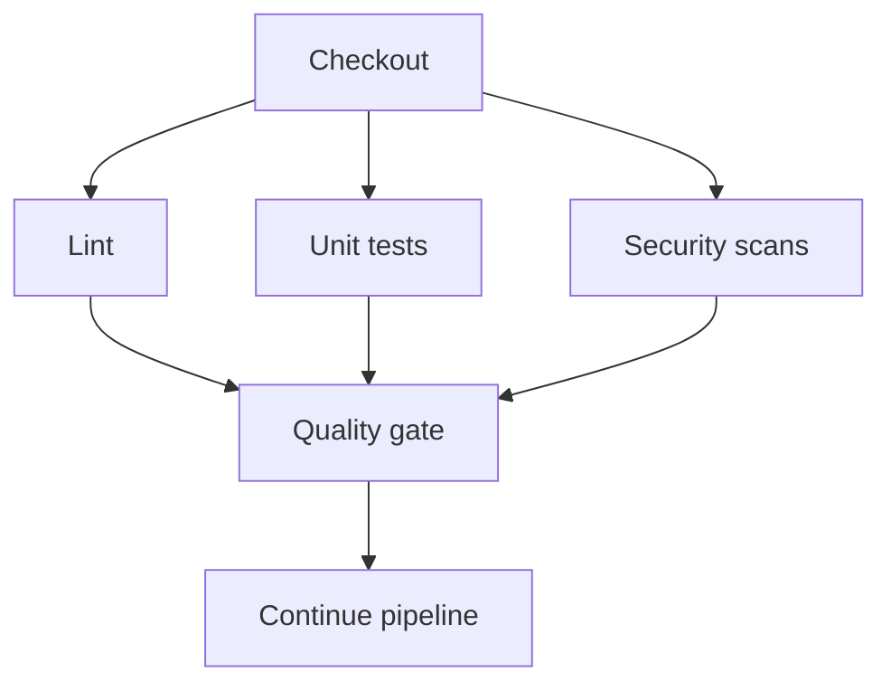
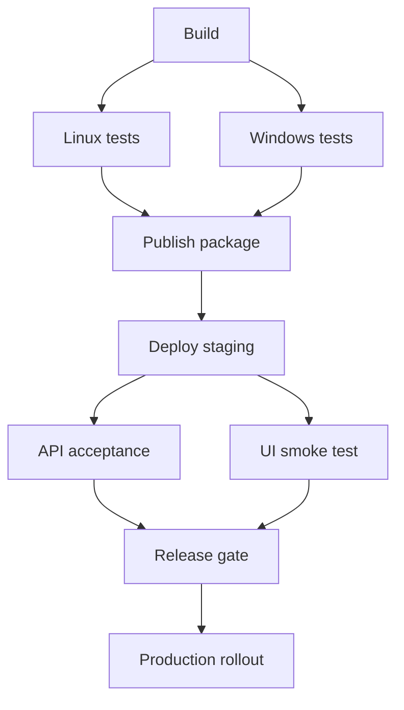

# Chọn công việc tuần tự và công việc có thể chạy song song

Một pipeline CI/CD có thể gồm nhiều công việc: lấy mã nguồn, kiểm tra định dạng, phân tích tĩnh, chạy unit test, build ứng dụng, quét dependency, tạo artifact, kiểm thử tích hợp và triển khai. Nếu mọi công việc đều chạy lần lượt, pipeline dễ hiểu nhưng có thể mất nhiều thời gian chờ. Nếu cố chạy tất cả cùng lúc, một job có thể bắt đầu trước khi dữ liệu nó cần sẵn sàng, nhiều job có thể ghi đè cùng tài nguyên hoặc kết quả kiểm thử trở nên không ổn định.

Thiết kế pipeline tốt cần xác định **công việc nào thực sự phụ thuộc vào công việc khác, công việc nào độc lập và tài nguyên nào có thể được sử dụng đồng thời**. Những công việc có quan hệ phụ thuộc phải chạy theo thứ tự phù hợp. Những công việc độc lập có thể chạy song song để rút ngắn thời gian phản hồi. Mục tiêu là đạt tốc độ tốt mà vẫn giữ kết quả đúng, có thể lặp lại và dễ điều tra.

Trong CI/CD, cách tổ chức này thường được mô tả bằng một đồ thị phụ thuộc có hướng không chu trình (Directed Acyclic Graph — DAG). Pipeline engine dùng quan hệ phụ thuộc để xác định job nào đã sẵn sàng, job nào phải chờ và job nào cần dừng khi một điều kiện bắt buộc thất bại.

## 1. Hiểu quan hệ phụ thuộc trước khi chọn thứ tự chạy

Một pipeline gồm các node và các cạnh phụ thuộc. Node có thể là một step, job hoặc stage tùy nền tảng. Một cạnh từ A đến B có nghĩa B chỉ được bắt đầu khi điều kiện phụ thuộc vào A đã được đáp ứng, thường là A hoàn tất thành công và cung cấp đủ đầu ra.

Ví dụ, job triển khai staging cần artifact đã được tạo. Vì vậy, `build_artifact` phải hoàn tất trước `deploy_staging`. Trong khi đó, `lint`, `unit_test` và `secret_scan` có thể độc lập nếu chúng chỉ đọc cùng một revision Git và không sửa đổi trạng thái dùng chung. Chúng có thể chạy đồng thời.



Sơ đồ cho thấy một số công việc có thể chạy đồng thời sau khi checkout, còn các công việc triển khai phải chờ artifact. Quality gate tổng hợp các kết quả bắt buộc trước khi đưa ra quyết định tiếp theo.

### DAG và thứ tự thực thi

DAG có hai đặc điểm:

- **Có hướng:** quan hệ phụ thuộc xác định công việc trước và công việc sau.
- **Không có chu trình:** không tồn tại chuỗi phụ thuộc quay trở lại node ban đầu.

Pipeline engine có thể chọn bất kỳ node nào đang sẵn sàng, miễn là mọi dependency của node đó đã hoàn tất theo chính sách. Vì vậy, một DAG thường có nhiều thứ tự thực thi hợp lệ. Các job độc lập có thể bắt đầu gần như cùng lúc nếu có đủ runner và tài nguyên.

Ví dụ, nếu `lint`, `unit_test` và `dependency_scan` đều phụ thuộc vào `checkout`, không có lý do về dữ liệu để buộc `lint` chờ `unit_test`. Việc chúng thực sự chạy cùng lúc còn phụ thuộc số runner, giới hạn concurrency, hàng đợi và cấu hình nền tảng.

Một DAG hợp lệ không đảm bảo mọi job đều được chạy đồng thời. Nó chỉ mô tả những ràng buộc cần tuân thủ; scheduler quyết định thời điểm thực tế dựa trên năng lực thực thi và chính sách.

## 2. Khi nào công việc phải chạy tuần tự?

Hai công việc cần chạy tuần tự khi công việc sau cần kết quả, trạng thái hoặc điều kiện do công việc trước tạo ra. Trước khi thêm dependency, hãy xác định chính xác mối quan hệ đó.

### 2.1. Có phụ thuộc dữ liệu đầu ra

Nếu job B cần file, package, image hoặc metadata do job A tạo, B phải chờ A publish đầu ra thành công. Ví dụ:

1. Compile mã nguồn tạo file JAR.
2. Đóng gói image container chứa file JAR.
3. Publish image lên registry và lấy digest.
4. Triển khai đúng digest đó lên staging.

Không thể triển khai image trước khi image được tạo và publish. Đây là phụ thuộc thực sự, nên phải được khai báo trong pipeline thay vì dựa vào thời gian chờ hoặc giả định job A thường chạy nhanh.

### 2.2. Cùng thay đổi một trạng thái dùng chung

Hai job có thể không phụ thuộc dữ liệu nhưng vẫn xung đột nếu cùng ghi vào một tài nguyên. Ví dụ, hai job cùng chạy migration trên một database kiểm thử, cùng thay đổi một namespace Kubernetes hoặc cùng ghi vào một thư mục đầu ra dùng chung.

Nếu không thể cô lập tài nguyên, cần tuần tự hóa hoặc dùng cơ chế khóa. Tuy nhiên, trước khi thêm khóa, nên xem xét cấp database, namespace, thư mục hoặc dữ liệu riêng cho từng job. Cô lập thường cho phép chạy song song an toàn và tăng thông lượng.

### 2.3. Có thứ tự nghiệp vụ hoặc thứ tự chuyển trạng thái

Một số bước phải tuân theo trình tự vì chúng làm thay đổi trạng thái hệ thống:

- Tạo schema mới trước khi phiên bản ứng dụng bắt đầu sử dụng schema đó.
- Triển khai thành phần nền tảng trước thành phần ứng dụng phụ thuộc vào nó.
- Xác minh staging trước khi cho phép promote artifact lên production.
- Dừng nhận traffic trước khi thực hiện thao tác bảo trì có gián đoạn.
- Hoàn tất bước xác nhận hoặc phê duyệt trước hành động phát hành bị kiểm soát.

Thứ tự này thường phản ánh yêu cầu tương thích và an toàn, không phải giới hạn của công cụ CI/CD.

### 2.4. Có quality gate hoặc quyết định của con người

Một job triển khai production có thể cần chờ các kiểm tra bảo mật, kiểm thử chấp nhận và approval. Trong trường hợp này, dependency biểu diễn một cổng quyết định: chỉ khi mọi điều kiện bắt buộc đạt thì pipeline mới được chuyển tiếp.

Không nên đặt approval ở trước những công việc chỉ tạo bằng chứng cho người duyệt. Người duyệt cần nhìn thấy artifact, kết quả test, scan report, release note và kế hoạch phục hồi. Một approval có ý nghĩa phải gắn với đúng phiên bản sẽ được triển khai.

### 2.5. Cần giới hạn tác động hoặc tần suất truy cập

Một số hệ thống kiểm thử dùng chung không chịu được nhiều job đồng thời. API sandbox có giới hạn rate, môi trường phần cứng chỉ có một thiết bị, hoặc một tài khoản kiểm thử không cho phép nhiều phiên đăng nhập. Khi không thể tạo tài nguyên độc lập, các job cần được xếp hàng hoặc giới hạn concurrency.

Đây là ràng buộc tài nguyên hoặc chính sách. Cần ghi rõ lý do và phạm vi khóa để tránh tuần tự hóa toàn bộ pipeline chỉ vì một tài nguyên nhỏ đang bị giới hạn.

## 3. Khi nào công việc có thể chạy song song?

Các công việc có thể chạy song song khi chúng không cần đầu ra của nhau, không gây xung đột trạng thái và có thể thực thi an toàn trên các tài nguyên được cấp.

### 3.1. Các kiểm tra độc lập trên cùng revision

Sau khi checkout một revision xác định, nhiều loại kiểm tra thường có thể chạy độc lập:

- Lint và format check.
- Static analysis và type check.
- Unit test của các module độc lập.
- Secret scan và dependency scan.
- Kiểm tra license hoặc chính sách package.

Mỗi job đọc cùng commit nhưng tạo report riêng. Một job không cần chờ job khác vì không tiêu thụ đầu ra của job kia. Sau khi tất cả hoàn tất, quality gate tổng hợp kết quả.

### 3.2. Chạy nhiều cấu hình bằng matrix

Matrix cho phép chạy cùng một nhóm kiểm thử trên nhiều giá trị cấu hình. Ví dụ, một thư viện cần kiểm tra trên nhiều phiên bản JDK hoặc nhiều hệ điều hành. Thay vì viết một job riêng cho từng cấu hình, pipeline tạo nhiều instance từ một định nghĩa.

```yaml
# YAML minh họa khái niệm matrix, không gắn với cú pháp nền tảng cụ thể
test_matrix:
  job: unit_test
  matrix:
    java: [17, 21]
    os: [linux, windows]
  run:
    - setup_java: ${matrix.java}
    - run_tests
```

Ví dụ trên có bốn tổ hợp: JDK 17/Linux, JDK 17/Windows, JDK 21/Linux và JDK 21/Windows. Các instance có thể chạy đồng thời nếu runner phù hợp sẵn sàng. Nếu một cấu hình không được hỗ trợ, nên loại trừ rõ ràng thay vì để job thất bại vì cấu hình không hợp lệ.

Matrix phù hợp với kiểm thử tương thích, nhiều phiên bản runtime, nhiều kiến trúc CPU, nhiều trình duyệt hoặc nhiều cấu hình build. Số tổ hợp tăng theo tích các chiều; vì vậy cần kiểm soát kích thước matrix để tránh tạo hàng trăm job không cần thiết.

### 3.3. Chia nhỏ bộ kiểm thử (test sharding)

Một bộ kiểm thử lớn có thể được chia thành nhiều shard. Mỗi shard chạy một tập test riêng trên runner độc lập. Khi tất cả shard hoàn tất, pipeline tổng hợp report và quyết định pass/fail.

Ví dụ, 800 test có thể chia thành bốn nhóm, mỗi nhóm khoảng 200 test. Nếu thời gian chạy mỗi nhóm tương đương và không có tranh chấp tài nguyên, tổng thời gian có thể gần bằng thời gian của nhóm chậm nhất thay vì tổng thời gian của cả bốn nhóm.

Việc chia shard cần bảo đảm:

- Mỗi test được thực thi đúng số lần dự kiến, tránh bỏ sót hoặc chạy trùng ngoài ý muốn.
- Dữ liệu và tài nguyên test được cô lập hoặc có cơ chế đồng bộ.
- Kết quả của mọi shard được tổng hợp; thiếu một shard bắt buộc phải làm quality gate thất bại hoặc chuyển sang trạng thái chưa đầy đủ.
- Các shard có thời lượng tương đối cân bằng để tránh một runner kéo dài toàn bộ pipeline.

### 3.4. Kiểm tra nhiều thành phần độc lập

Trong repository dạng monorepo, một thay đổi có thể ảnh hưởng đến nhiều service hoặc package độc lập. Pipeline có thể xác định vùng thay đổi rồi chạy kiểm tra tương ứng song song. Ví dụ, thay đổi thư viện dùng chung có thể kích hoạt test của nhiều service tiêu thụ thư viện đó.

Điều kiện quan trọng là phải xác định đúng phạm vi ảnh hưởng. Nếu service B phụ thuộc vào package A vừa thay đổi, test của B có thể cần chờ artifact A hoặc dùng workspace đã được cập nhật. Việc chạy song song chỉ hợp lệ khi dependency giữa các thành phần đã được giải quyết.

### 3.5. Fan-out và fan-in

Một mẫu phổ biến là **fan-out**: một công việc đầu vào phân nhánh thành nhiều công việc độc lập; sau đó **fan-in**: một công việc tổng hợp chờ các nhánh bắt buộc hoàn tất.



Fan-out giúp khai thác concurrency. Fan-in bảo đảm pipeline không coi một nhánh thành công là đủ khi các nhánh bắt buộc khác chưa chạy xong.

## 4. Mô hình hóa pipeline thành đồ thị phụ thuộc

Một số mẫu DAG thường gặp giúp thiết kế pipeline rõ ràng.

### 4.1. Chuỗi tuần tự



Chuỗi phù hợp khi mỗi bước cần đầu ra hoặc trạng thái do bước trước tạo ra. Không nên thêm bước chờ cố định như `sleep 30` để thay thế dependency. Job phải chờ điều kiện thực tế, chẳng hạn artifact đã được publish hoặc deployment đã sẵn sàng.

### 4.2. Nhiều nhánh song song rồi hợp nhất



Mẫu này phù hợp khi nhiều kiểm tra cùng đánh giá một revision. Quality gate chỉ chạy khi có đủ kết quả cần thiết.

### 4.3. Kim cương: phân nhánh, hợp nhất rồi phân nhánh tiếp



Mẫu kim cương xuất hiện khi một artifact hoặc kết quả chung được tạo từ nhiều nhánh, rồi lại được dùng bởi nhiều kiểm tra khác. Nó giúp biểu diễn rõ các điểm hội tụ và phân tách của luồng.

### 4.4. Nhánh có điều kiện

Không phải mọi job đều cần chạy trong mọi trường hợp. Ví dụ, kiểm tra tài liệu có thể chỉ chạy khi file tài liệu thay đổi; triển khai production chỉ chạy trên nhánh hoặc tag được phép; kiểm thử hiệu năng nặng có thể chạy theo lịch hoặc khi có nhãn yêu cầu.

Điều kiện cần dựa trên dữ liệu có thể kiểm chứng như loại sự kiện Git, đường dẫn thay đổi, branch, tag, input đã được xác thực hoặc trạng thái quality gate. Không nên dùng điều kiện mơ hồ khiến một job bắt buộc bị bỏ qua mà pipeline vẫn báo thành công.

Khi một nhánh bị bỏ qua có chủ đích, job tổng hợp cần hiểu trạng thái `skipped` theo chính sách. Một kiểm tra không áp dụng có thể được xem là hợp lệ; một kiểm tra bắt buộc chưa chạy không thể tự động được coi là pass.

## 5. Khai báo dependency rõ ràng trong Pipeline as Code

Pipeline as Code cho phép lưu đồ thị công việc trong repository. Tên trường và cú pháp phụ thuộc nền tảng, nhưng ý tưởng chung là khai báo trigger, job, dependency, điều kiện và đầu ra.

Ví dụ sau là **YAML minh họa độc lập với nền tảng**, không thể chạy trực tiếp nếu chưa chuyển sang cú pháp của GitHub Actions, GitLab CI, Jenkins hoặc công cụ đang sử dụng:

```yaml
pipeline:
  trigger:
    - pull_request
    - merge_to_main

  jobs:
    prepare:
      steps:
        - checkout_revision
        - resolve_build_inputs

    lint:
      needs: [prepare]
      steps:
        - run_linter

    unit_tests:
      needs: [prepare]
      steps:
        - run_unit_tests
        - publish_test_report

    security_scan:
      needs: [prepare]
      steps:
        - scan_dependencies
        - scan_secrets

    quality_gate:
      needs: [lint, unit_tests, security_scan]
      condition: all_required_checks_pass

    build_artifact:
      needs: [quality_gate]
      outputs:
        - artifact_digest
        - provenance

    deploy_staging:
      needs: [build_artifact]
      input: artifact_digest

    acceptance_tests:
      needs: [deploy_staging]
      steps:
        - run_api_acceptance
        - run_smoke_tests

    release:
      needs: [acceptance_tests]
      condition: release_policy_approved
      steps:
        - promote_same_artifact
```

Trong ví dụ này, `lint`, `unit_tests` và `security_scan` cùng phụ thuộc vào `prepare` nên có thể chạy song song. `quality_gate` chờ tất cả kết quả bắt buộc. Build chỉ bắt đầu khi gate đạt; staging nhận digest từ build; acceptance test chờ staging hoàn tất; release chờ kết quả acceptance và chính sách phê duyệt.

Khi chuyển sang nền tảng cụ thể, cần kiểm tra ngữ nghĩa thực tế của dependency và điều kiện. Một số công cụ mặc định bỏ qua job phụ thuộc khi upstream thất bại; một số có cú pháp cho phép thu thập kết quả dù một nhánh thất bại. Không nên giả định `needs`, `depends_on` hoặc `stage` hoạt động giống nhau giữa các công cụ.

### Dependency tối thiểu và dependency thừa

Chỉ khai báo dependency khi công việc sau thật sự cần kết quả, trạng thái hoặc điều kiện từ công việc trước. Nếu mọi job đều phụ thuộc vào một job tổng hợp lớn chỉ vì tiện viết cấu hình, pipeline có thể vô tình biến thành chuỗi tuần tự.

Ví dụ, `lint` không cần chờ `unit_tests` nếu cả hai chỉ đọc cùng revision. Nếu khai báo `lint needs unit_tests`, pipeline buộc phải chờ dù không có quan hệ dữ liệu. Dependency thừa làm tăng thời gian chờ và che khuất cấu trúc thực của pipeline.

Ngược lại, thiếu dependency cũng nguy hiểm. Nếu `deploy_staging` không khai báo rằng nó cần `build_artifact`, scheduler có thể khởi chạy deploy trước khi artifact sẵn sàng hoặc dùng một artifact cũ còn tồn tại trong workspace.

## 6. Truyền dữ liệu giữa các job mà vẫn an toàn

Chạy song song thường có nghĩa mỗi job chạy trong workspace hoặc runner riêng. Không nên giả định file tạo trong filesystem của job A tự xuất hiện trong job B. Dữ liệu cần được truyền qua cơ chế artifact, cache hoặc output được nền tảng hỗ trợ.

### 6.1. Dùng artifact cho đầu ra cần giữ nguyên

Artifact là đầu ra được lưu để job khác hoặc bước phát hành sử dụng, ví dụ JAR, container image, test report, coverage report hoặc manifest. Artifact nên có định danh rõ ràng và gắn với revision cùng pipeline run.

Với artifact triển khai, nên build một lần rồi promote cùng một nội dung qua các môi trường. Job staging và production cần nhận cùng version bất biến hoặc digest, không tự build lại. Nhờ vậy, kết quả test có thể gắn với chính xác nội dung đang được triển khai.

### 6.2. Dùng output cho dữ liệu nhỏ và metadata

Output phù hợp với giá trị nhỏ như image digest, package version, đường dẫn artifact hoặc kết quả quyết định. Output nên có tên rõ ràng và được kiểm tra trước khi dùng. Không truyền bí mật qua output hiển thị rộng hoặc log.

### 6.3. Dùng cache để tăng tốc, không làm nguồn dữ liệu chuẩn

Cache lưu dependency hoặc dữ liệu có thể tái tạo để giảm thời gian tải và build. Cache có thể bị xóa, hết hạn hoặc không được chia sẻ giữa các runner. Vì vậy, pipeline phải vẫn đúng khi cache miss.

Không dùng cache thay artifact cần phát hành. Một cache key quá rộng có thể khiến job dùng dependency hoặc kết quả build không tương ứng với revision hiện tại. Cache key nên phản ánh các đầu vào ảnh hưởng đến nội dung được cache, chẳng hạn lockfile, runtime hoặc cấu hình build.

### 6.4. Không chia sẻ workspace ghi đồng thời

Nếu nhiều job ghi vào cùng thư mục, chúng có thể ghi đè file hoặc đọc trạng thái chưa hoàn chỉnh. Nên dùng workspace riêng, tên file và thư mục đầu ra riêng, rồi tổng hợp kết quả ở một job sau. Khi buộc phải dùng tài nguyên chung, cần có giao thức đồng bộ hoặc khóa được thiết kế rõ ràng.

## 7. Quản lý tài nguyên và giới hạn concurrency

Dependency chỉ là một phần của quyết định chạy song song. Một DAG có thể có mười job sẵn sàng nhưng chỉ có hai runner. Khi đó scheduler phải xếp hàng; các job còn lại không thể bắt đầu ngay.

Các tài nguyên cần xem xét gồm:

- **Runner hoặc executor:** số lượng, CPU, bộ nhớ, hệ điều hành và kiến trúc có sẵn.
- **Database và dịch vụ phụ thuộc:** số connection, quota, dữ liệu dùng chung và giới hạn tải.
- **Registry và dịch vụ bên ngoài:** rate limit, băng thông và giới hạn số request.
- **Môi trường triển khai:** namespace, cluster, tài khoản, địa chỉ mạng và khả năng cô lập.
- **Tài nguyên phần cứng đặc biệt:** thiết bị di động, GPU, thiết bị nhúng hoặc license dùng chung.

### Giới hạn số job chạy đồng thời

Concurrency limit giúp bảo vệ tài nguyên và tránh tạo tải đột biến. Ví dụ, pipeline có thể cho phép tối đa bốn integration test cùng chạy vì database kiểm thử chỉ chịu được mức đó. Các job còn lại chờ slot.

Giới hạn nên đặt ở phạm vi cần thiết: theo repository, nhóm job, môi trường hoặc tài nguyên cụ thể. Nếu chỉ một job triển khai production cần khóa môi trường, không nên khóa toàn bộ pipeline build và unit test của mọi nhánh.

### Khóa tài nguyên và nhóm triển khai

Hai release cùng deploy một môi trường có thể ghi đè trạng thái của nhau. Có thể dùng concurrency group hoặc lock theo môi trường để bảo đảm chỉ một thao tác thay đổi trạng thái quan trọng diễn ra tại một thời điểm.

Khóa cần có phạm vi và thời hạn hợp lý. Một job bị treo không nên giữ lock vô hạn. Pipeline cần timeout, cơ chế giải phóng khi job kết thúc hoặc bị hủy và cách xử lý khi lease hết hạn.

### Cô lập để tăng song song

Nếu test cần cùng một database nhưng có thể dùng schema riêng, hãy tạo schema theo pipeline run hoặc shard. Nếu mỗi job cần một namespace Kubernetes, hãy cấp namespace tạm thời và thu hồi sau khi xong. Nếu job ghi report, hãy ghi vào thư mục riêng rồi tổng hợp.

Cô lập làm tăng chi phí tạo và dọn tài nguyên, nhưng thường giảm thời gian chờ và lỗi do tranh chấp. Cần cân bằng chi phí môi trường tạm thời với giá trị của phản hồi nhanh.

## 8. Xử lý lỗi trong pipeline song song

Khi nhiều job chạy đồng thời, có thể một job thất bại trong khi các job khác vẫn đang thực thi. Chính sách thất bại cần được thiết kế rõ để pipeline không kết luận sai hoặc tiêu tốn tài nguyên không cần thiết.

### Fail-fast

Fail-fast dừng sớm các nhánh còn lại khi một kiểm tra quan trọng thất bại. Cách này tiết kiệm runner và giảm thời gian chờ khi kết quả đã chắc chắn không thể đạt. Ví dụ, nếu compile thất bại thì các job cần binary đã compile không có lý do để tiếp tục.

Tuy nhiên, không phải lúc nào cũng nên hủy mọi nhánh. Khi cần thu thập đầy đủ scan report hoặc kết quả của nhiều test shard để điều tra, pipeline có thể cho các nhánh độc lập chạy đến hết rồi tổng hợp trạng thái thất bại.

### Continue-on-error và kiểm tra không chặn

Một số kiểm tra có thể được đặt ở chế độ cảnh báo trong giai đoạn thử nghiệm, ví dụ một rule lint mới hoặc benchmark chưa có baseline ổn định. Khi đó pipeline cần phân biệt rõ `warning`, `allowed failure` và `required pass`.

Không nên biến một kiểm tra bảo mật bắt buộc thành không chặn chỉ để pipeline xanh. Ngoại lệ phải có chủ sở hữu, lý do, phạm vi và thời hạn. Quality gate cuối cùng cần đánh giá theo chính sách đã công bố.

### Retry và tính idempotent

Retry phù hợp với lỗi tạm thời như kết nối registry gián đoạn hoặc API trả lỗi giới hạn tốc độ. Job có side effect cần được thiết kế idempotent: chạy lại không tạo thêm tài nguyên trùng lặp, không ghi dữ liệu sai hoặc phát hành hai lần.

Không retry vô hạn và không dùng retry để che giấu lỗi logic. Nên đặt số lần thử, khoảng chờ có backoff và jitter khi phù hợp, đồng thời ghi nhận số lần retry. Với job deploy, cần xác định cách nhận biết lần triển khai trước đã thành công một phần hay chưa trước khi chạy lại.

### Hủy job phụ thuộc và xử lý trạng thái bỏ qua

Khi upstream thất bại, các downstream cần đầu ra đó thường phải bị bỏ qua. Job tổng hợp có thể vẫn cần chạy để thu thập report và tạo thông tin chẩn đoán. Vì vậy, cần tách job “tổng hợp kết quả” khỏi job “cho phép phát hành”.

Pipeline phải coi trạng thái skipped theo đúng ngữ cảnh. Một nhánh tùy chọn không áp dụng có thể được bỏ qua hợp lệ; một nhánh bắt buộc bị bỏ qua do lỗi upstream phải khiến gate không đạt.

## 9. Tối ưu thời gian pipeline bằng critical path

Chạy song song có thể giảm thời gian pipeline, nhưng mức cải thiện bị giới hạn bởi đường phụ thuộc dài nhất và tài nguyên thực tế. Đường đi có tổng thời lượng lớn nhất từ node đầu đến node cuối được gọi là **critical path** (đường găng). Nếu một công việc trên đường găng chậm, các công việc khác hoàn tất sớm vẫn phải chờ.

Giả sử pipeline có các thời lượng minh họa sau:

| Công việc | Thời gian | Phụ thuộc |
|---|---:|---|
| Checkout | 1 phút | Không |
| Lint | 2 phút | Checkout |
| Unit test | 6 phút | Checkout |
| Security scan | 4 phút | Checkout |
| Build artifact | 5 phút | Unit test và lint |
| Deploy staging | 3 phút | Build artifact |
| Acceptance test | 4 phút | Deploy staging |

Lint, unit test và security scan có thể chạy song song. Nếu đủ runner, thời gian chờ cho nhánh đầu vào là thời gian của job dài nhất, tức 6 phút. Sau đó build, deploy staging và acceptance test cần thêm 12 phút. Cộng checkout 1 phút, tổng thời gian theo đường găng xấp xỉ 19 phút, chưa tính thời gian xếp hàng, tải artifact hoặc overhead của scheduler.

Nếu chạy tất cả tuần tự, thời gian sẽ là tổng thời lượng của các job: 25 phút. Song song hóa giúp giảm khoảng 6 phút trong ví dụ này. Tăng số runner thêm nữa không giúp giảm thời gian của đường găng nếu thời lượng các job trên đường đó không đổi.

### Cách tìm và cải thiện đường găng

1. Thu thập thời gian thực tế của từng job, bao gồm queue time và execution time.
2. Xem DAG để xác định chuỗi phụ thuộc có tổng thời lượng lớn nhất.
3. Xác định job nào đang chờ dữ liệu, runner, lock hoặc môi trường.
4. Chia nhỏ job dài nếu các phần có thể chạy độc lập và có đầu ra tổng hợp được.
5. Tối ưu công việc trên critical path trước, chẳng hạn giảm thời gian test, cải thiện cache hoặc loại bỏ dependency thừa.
6. Đo lại sau thay đổi để xác nhận thời gian toàn pipeline thực sự giảm.

Đừng chia một job thành nhiều job nhỏ nếu chi phí khởi tạo runner, checkout, cài dependency và truyền artifact lớn hơn phần thời gian tiết kiệm. Song song hóa có overhead; nó chỉ có lợi khi phần việc đủ lớn hoặc có thể dùng lại môi trường hiệu quả.

### Cân bằng thời lượng giữa các nhánh

Trong fan-out/fan-in, thời gian hội tụ bị quyết định bởi nhánh chậm nhất. Nếu bốn shard test lần lượt chạy 2, 2, 3 và 12 phút, ba shard đầu gần như không ảnh hưởng đến thời điểm gate hoàn tất; shard cuối là nút thắt.

Có thể chia lại test theo thời lượng lịch sử, chạy test dài trước hoặc dùng cơ chế phân phối động. Mục tiêu là làm các nhánh có khối lượng gần nhau và tránh một shard luôn kéo dài pipeline.

## 10. Những rủi ro khi song song hóa

Song song hóa không đúng có thể khiến pipeline nhanh hơn nhưng kết quả sai hoặc không ổn định.

### Race condition

Race condition xảy ra khi kết quả phụ thuộc vào thứ tự hoặc thời điểm các job truy cập trạng thái chung. Ví dụ, hai job cùng cập nhật một tag `latest`; job deploy có thể lấy image được publish bởi nhánh khác. Giải pháp là dùng version hoặc digest bất biến, đầu ra riêng và dependency rõ ràng.

### Test dùng chung dữ liệu

Hai test cùng tạo user có email cố định hoặc cùng xóa bảng dữ liệu có thể làm nhau thất bại. Nên dùng dữ liệu có định danh theo run/shard, transaction hoặc fixture độc lập; dọn dữ liệu trong phạm vi mà job sở hữu.

### Chạy lặp side effect

Một job được retry hoặc chạy đồng thời từ nhiều trigger có thể tạo release trùng, gửi thông báo trùng hoặc chạy migration hai lần. Cần idempotency key, lock, kiểm tra trạng thái trước hành động và quyền thực thi có giới hạn.

### Kết quả tổng hợp không đầy đủ

Nếu job tổng hợp chỉ nhận report của những shard đã hoàn tất nhưng không kiểm tra số shard dự kiến, pipeline có thể báo pass dù một phần test chưa chạy. Cần xác minh manifest hoặc danh sách kết quả bắt buộc trước khi gate thành công.

### Cạn tài nguyên và tăng chi phí

Matrix quá lớn có thể tạo hàng trăm runner, tăng chi phí và gây quá tải dịch vụ phụ thuộc. Hãy giới hạn concurrency, chọn ma trận có giá trị, dùng test selection hợp lý và theo dõi queue time. Thời gian job riêng lẻ giảm không có nghĩa thời gian toàn hệ thống giảm nếu hàng đợi trở nên dài hơn.

## 11. Bảo mật khi thực thi nhiều job cùng lúc

Mỗi job nên có quyền tối thiểu cần cho nhiệm vụ của nó. Việc chạy song song không phải lý do để chia sẻ một credential rộng quyền cho mọi job.

- Job lint hoặc unit test thường chỉ cần đọc mã nguồn và ghi report; không cần quyền deploy.
- Job publish artifact chỉ cần quyền ghi registry cho repository hoặc package được phép.
- Job triển khai nhận danh tính và quyền riêng cho môi trường đích, ưu tiên credential ngắn hạn.
- Job chạy trên pull request từ fork hoặc nguồn chưa tin cậy không được tiếp cận secret production.
- Artifact từ job không tin cậy cần được xác minh nguồn gốc và chính sách trước khi dùng trong bước phát hành.
- Log và output không được chứa token, mật khẩu hoặc dữ liệu nhạy cảm.

Runner dùng chung cần được cô lập workspace và credential giữa các job. Nếu runner giữ trạng thái từ lần chạy trước, một job có thể vô tình đọc file hoặc thông tin xác thực còn sót lại. Runner ephemeral hoặc cơ chế dọn sạch sau job giúp giảm rủi ro.

## 12. Quan sát và vận hành một DAG

Pipeline cần hiển thị được trạng thái của từng node và quan hệ phụ thuộc. Người vận hành cần biết job nào đang chờ dependency, job nào đang chờ runner, job nào đang chạy, job nào thất bại và downstream nào bị bỏ qua.

Các dữ liệu hữu ích gồm:

| Dữ liệu | Ý nghĩa |
|---|---|
| Queue time | Thời gian job chờ runner hoặc slot concurrency |
| Execution time | Thời gian thực thi thực tế của job |
| Critical path duration | Thời gian của đường phụ thuộc dài nhất |
| Retry count | Số lần chạy lại và mức độ lỗi tạm thời |
| Cache hit/miss | Mức độ tận dụng cache và tác động đến build |
| Runner utilization | Mức sử dụng CPU, memory và số runner bận |
| Failure/skip reason | Nguyên nhân job thất bại hoặc bị bỏ qua |
| Artifact lineage | Liên kết commit, job tạo artifact, digest và job triển khai |

Một pipeline có tổng thời gian dài chưa chắc do job chạy chậm. Có thể runner thiếu, lock giữ lâu hoặc một dependency thừa khiến các job phải chờ. Phân biệt queue time và execution time giúp chọn đúng biện pháp.

Log cần có pipeline run ID, job ID, commit SHA và artifact digest khi phù hợp. Với các job chạy song song, correlation ID giúp liên kết report và log thuộc cùng một lần chạy. Không nên dựa vào việc đọc log theo thứ tự thời gian để suy ra dependency; hãy dùng DAG và trạng thái job.

## 13. Ví dụ xuyên suốt: pipeline cho dịch vụ web

Giả sử nhóm phát triển một dịch vụ web gồm backend API và frontend. Khi có pull request, pipeline cần phản hồi nhanh và kiểm tra các thành phần bị ảnh hưởng. Sau khi merge, pipeline tạo artifact và triển khai staging.

**Giai đoạn pull request:** sau checkout, pipeline chạy lint backend, lint frontend, unit test backend, unit test frontend, secret scan và dependency scan song song. Nếu thay đổi ảnh hưởng đến API contract, contract test được kích hoạt. Quality gate chờ tất cả kiểm tra bắt buộc áp dụng cho thay đổi.

**Giai đoạn build:** sau khi gate đạt, backend và frontend có thể build song song nếu chúng độc lập. Mỗi job publish artifact riêng với version gắn commit SHA. Một job manifest tổng hợp lưu các digest để xác định bộ phiên bản tương thích.

**Giai đoạn staging:** pipeline triển khai database migration tương thích trước, sau đó deploy backend và frontend theo thứ tự phụ thuộc thực tế. Nếu frontend cần API mới, backend phải sẵn sàng trước khi chuyển traffic frontend sang phiên bản mới. Nếu hai thành phần hỗ trợ tương thích ngược và có thể triển khai độc lập, thứ tự có thể được nới lỏng theo thiết kế.

**Giai đoạn xác minh:** API acceptance test và UI smoke test có thể chạy song song sau khi cả hai thành phần đã sẵn sàng. Job tổng hợp chờ cả hai report. Nếu một nhánh thất bại, release gate không đạt; pipeline giữ lại artifact và log để điều tra.

**Giai đoạn production:** sau approval nếu chính sách yêu cầu, pipeline triển khai đúng digest đã được kiểm thử. Các bước thay đổi trạng thái production được khóa theo môi trường để tránh hai release chồng lấn. Sau deploy, health check và smoke test chạy; rollout chỉ tiếp tục khi telemetry đạt ngưỡng.

Luồng này dùng song song ở những phần có thể độc lập và dùng thứ tự ở các điểm có phụ thuộc dữ liệu hoặc trạng thái. Nếu sau này backend và frontend được thiết kế tương thích độc lập, DAG có thể thay đổi để tăng concurrency mà không làm giảm độ an toàn.

## 14. Anti-pattern khi thiết kế tuần tự và song song

| Anti-pattern | Vì sao gây vấn đề | Cách cải thiện |
|---|---|---|
| Mọi job chạy trong một stage tuần tự | Tạo thời gian chờ dù nhiều kiểm tra độc lập | Tách các nhánh độc lập và dùng fan-out/fan-in |
| Mọi job đều chạy song song | Bỏ qua dependency dữ liệu và trạng thái | Xác định đầu vào/đầu ra và khai báo DAG đúng |
| Dependency thừa | Job chờ nhau dù không có quan hệ thực | Chỉ khai báo dependency cần thiết |
| Thiếu dependency | Job chạy trước khi artifact hoặc trạng thái sẵn sàng | Khai báo rõ quan hệ và kiểm tra output |
| Dùng sleep thay dependency | Thời gian chờ không bảo đảm điều kiện đã đạt | Chờ trạng thái hoặc tín hiệu thực tế |
| Chia sẻ workspace ghi đồng thời | Ghi đè file và race condition | Workspace riêng, artifact và output rõ ràng |
| Dùng tag mutable cho artifact | Job có thể nhận nội dung khác nhau tùy thời điểm | Dùng version bất biến hoặc digest |
| Matrix không giới hạn | Tăng queue time, chi phí và tải dịch vụ | Chọn tổ hợp có giá trị, đặt concurrency limit |
| Retry vô hạn | Che lỗi và giữ runner không cần thiết | Giới hạn retry, backoff và idempotency |
| Gate bỏ qua shard bị thiếu | Có thể báo pass khi chưa đủ bằng chứng | Tổng hợp manifest và xác minh đủ kết quả |
| Tối ưu job nhanh nhất | Không cải thiện critical path | Tập trung vào nhánh chậm nhất và queue time |
| Khóa toàn bộ pipeline để bảo vệ một môi trường | Làm chậm các công việc không liên quan | Khóa ở đúng tài nguyên và phạm vi cần thiết |

## 15. Checklist chọn công việc tuần tự và song song

Trước khi hoàn thiện DAG, nhóm có thể rà soát:

- [ ] Mỗi job có đầu vào, đầu ra và mục đích rõ ràng.
- [ ] Dependency phản ánh quan hệ dữ liệu, trạng thái hoặc chính sách thực tế.
- [ ] Không có chu trình trong đồ thị phụ thuộc.
- [ ] Các kiểm tra độc lập trên cùng revision được cân nhắc chạy song song.
- [ ] Các bước build, publish, deploy và xác minh có thứ tự rõ ràng.
- [ ] Matrix và test sharding có số lượng tổ hợp phù hợp, không bỏ sót kiểm tra bắt buộc.
- [ ] Fan-in xác minh mọi kết quả bắt buộc đã có trước khi quality gate đạt.
- [ ] Artifact và output được truyền qua cơ chế tường minh; cache không được dùng thay artifact phát hành.
- [ ] Job không ghi đồng thời vào workspace hoặc dữ liệu dùng chung nếu chưa có cơ chế cô lập/đồng bộ.
- [ ] Concurrency limit và lock được đặt đúng phạm vi tài nguyên.
- [ ] Retry có giới hạn và job có side effect được thiết kế idempotent.
- [ ] Chính sách fail-fast, continue-on-error và skipped được định nghĩa rõ.
- [ ] Job từ nguồn chưa tin cậy không nhận secret hoặc quyền triển khai nhạy cảm.
- [ ] Có thể phân biệt queue time, execution time và critical path.
- [ ] Các nhánh chậm, flaky hoặc thường xuyên tranh chấp tài nguyên được theo dõi và cải thiện.

## 16. Kết luận

Chọn công việc tuần tự và công việc song song là bài toán thiết kế quan hệ phụ thuộc, trạng thái và tài nguyên trong pipeline. Công việc cần đầu ra hoặc điều kiện từ bước khác phải chờ đúng bước đó. Công việc độc lập có thể chạy song song nếu dữ liệu và tài nguyên được cô lập, kết quả được tổng hợp đầy đủ và quyền thực thi được giới hạn.

Một DAG rõ ràng giúp pipeline tận dụng concurrency mà vẫn giữ tính đúng đắn. Khi kết hợp dependency tối thiểu, artifact bất biến, fan-out/fan-in, giới hạn tài nguyên, chính sách xử lý lỗi và quan sát critical path, nhóm có thể rút ngắn thời gian phản hồi mà vẫn duy trì khả năng truy vết và độ tin cậy của quy trình CI/CD.
