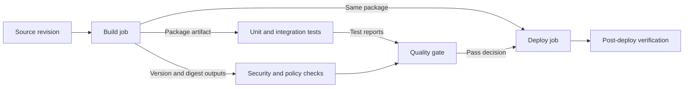

# Truyền đầu ra giữa các công việc bằng cơ chế rõ ràng

Một pipeline thường được chia thành nhiều công việc (*job*) để chạy song song, cô lập môi trường hoặc tách trách nhiệm build, kiểm thử, đóng gói và triển khai. Khi một job hoàn tất, job tiếp theo có thể cần sử dụng phiên bản, file, báo cáo hoặc gói triển khai mà job trước tạo ra. Cách truyền dữ liệu giữa các job quyết định pipeline có tái lập được hay không, có chạy đúng thứ tự hay không và có thể truy vết chính xác đầu ra đã được sử dụng hay không.

Không nên giả định các job dùng chung thư mục làm việc hoặc cùng một máy. Runner có thể được cấp mới cho mỗi job, chạy trên máy khác, trong container khác hoặc ở thời điểm khác. Vì vậy, mọi dữ liệu cần vượt qua ranh giới job phải được công bố bằng một cơ chế có hợp đồng rõ ràng: job tạo dữ liệu, tên và kiểu dữ liệu, cách job nhận dữ liệu, thời hạn lưu giữ và cách xác minh tính toàn vẹn.

## 1. Ranh giới job và nhu cầu bàn giao dữ liệu

Pipeline là đồ thị các công việc và quan hệ phụ thuộc. Một job có thể chứa nhiều step chạy tuần tự trong cùng môi trường thực thi; các job khác nhau có thể chạy song song và không chia sẻ filesystem. Có nền tảng giữ workspace giữa các step của cùng job, nhưng không bảo đảm workspace đó xuất hiện ở job khác.

Ví dụ, pipeline của một ứng dụng có thể gồm:

1. `build` lấy mã nguồn và tạo package.
2. `unit-test` chạy kiểm thử nhanh trên mã hoặc package.
3. `integration-test` tải package đã build và kiểm tra tương tác với dependency.
4. `security-scan` phân tích package, dependency và metadata.
5. `deploy-staging` triển khai đúng package đã được xác minh.
6. `post-deploy-verify` kiểm tra phiên bản đang chạy và các chỉ số sau triển khai.

Job kiểm thử cần biết package nào được build; job triển khai cần biết package nào đã vượt qua gate; bước xác minh cần biết môi trường đang chạy phiên bản nào. Nếu mỗi job tự build lại hoặc tự tìm file bằng một đường dẫn ngầm định, pipeline có thể tạo ra nhiều đầu ra khác nhau và mất mối liên hệ giữa kiểm thử với phát hành.



Sơ đồ thể hiện ba loại thông tin khác nhau: package là file cần tải xuống; version hoặc digest là metadata nhỏ; kết quả gate là điều kiện điều khiển luồng. Chúng có thể liên quan nhưng không nên dùng một cơ chế duy nhất cho tất cả.

## 2. Phân biệt outputs, artifacts, caches và workspace

Các nền tảng CI/CD có tên gọi và cú pháp khác nhau, nhưng phần lớn cơ chế bàn giao thuộc bốn nhóm:

| Cơ chế | Dữ liệu phù hợp | Phạm vi và đặc tính | Có nên dùng làm nguồn sự thật? |
|---|---|---|---|
| Job outputs | Giá trị nhỏ như version, digest, tên artifact, URL, cờ kết quả | Metadata được job công bố cho job phụ thuộc | Có, nếu giá trị gắn với đúng lần chạy và có nguồn rõ ràng |
| Artifacts | Package, binary, test report, manifest, SBOM, file sinh ra | File được lưu và tải qua ranh giới job hoặc stage; thường có thời hạn lưu | Có, nếu artifact được định danh, bảo vệ và kiểm tra tính toàn vẹn |
| Cache | Dependency đã tải, object build có thể tái tạo, dữ liệu trung gian tốn thời gian tạo | Tối ưu tốc độ; có thể bị xóa, hết hạn hoặc không được khôi phục | Không; pipeline phải vẫn đúng khi cache miss |
| Workspace | File tạm trong quá trình một job thực thi | Thường chỉ được bảo đảm trong cùng job hoặc cùng runner theo quy định nền tảng | Chỉ trong phạm vi được nền tảng bảo đảm |

Một cách ghi nhớ hữu ích là: output truyền thông tin về một kết quả; artifact truyền nội dung file; cache giúp tái tạo kết quả nhanh hơn; workspace là nơi job đang làm việc. Không nên lưu package phát hành duy nhất trong cache hoặc dựa vào thư mục còn sót lại trên một self-hosted runner để truyền dữ liệu.

### Job outputs: truyền metadata nhỏ

Output thích hợp cho các giá trị ngắn, có thể biểu diễn dưới dạng chuỗi: phiên bản ứng dụng, commit SHA, artifact ID, image digest, tên file report hoặc một URL nội bộ. Job tạo output phải công bố giá trị theo cơ chế của nền tảng; job tiêu thụ phải khai báo quan hệ phụ thuộc và đọc đúng output từ job nguồn.

Không nên truyền nội dung binary, file JSON lớn hoặc toàn bộ log qua output. Các giá trị output thường được lưu trong metadata của lần chạy, có giới hạn kích thước và có thể hiển thị trong giao diện hoặc log. Không đưa mật khẩu, token, private key hay dữ liệu cá nhân vào output.

### Artifacts: truyền file được tạo ra

Artifact phù hợp khi job sau cần sử dụng đúng file do job trước tạo: package, binary, bundle frontend, test report, coverage report, SBOM, manifest hoặc file cấu hình đã render. Nền tảng thường cung cấp thao tác upload và download artifact theo tên hoặc ID.

Tên artifact cần gắn với lần chạy và mục đích, chẳng hạn `app-package-<run-id>-<attempt>`. Khi nhiều job tạo file cùng tên, hãy dùng tên riêng theo shard, nền tảng, kiến trúc hoặc ma trận kiểm thử để tránh ghi đè. Job tiêu thụ nên tải đúng artifact đã được job nguồn công bố thay vì tìm file mới nhất trong kho.

### Cache: tăng tốc nhưng không bảo đảm dữ liệu

Cache thích hợp cho dependency đã tải, package manager cache hoặc kết quả trung gian có thể tái tạo. Cache có thể không tồn tại khi job chạy, bị thu hồi hoặc không khớp key. Vì vậy, cache miss phải làm job tải hoặc build lại theo cách bình thường.

Key cache nên phản ánh các đầu vào ảnh hưởng đến kết quả, chẳng hạn hệ điều hành, kiến trúc, phiên bản toolchain và lockfile. Có thể dùng restore key rộng hơn để khôi phục cache gần đúng, nhưng không được xem nội dung cache là bằng chứng rằng package đã qua kiểm thử. Artifact phát hành cần được lưu bằng cơ chế artifact hoặc registry có định danh rõ ràng.

## 3. Thiết kế hợp đồng bàn giao

Trước khi chọn cú pháp của GitHub Actions, GitLab CI, Jenkins hay nền tảng khác, hãy mô tả hợp đồng dữ liệu giữa producer và consumer. Một hợp đồng tốt trả lời được các câu hỏi:

- **Producer:** job nào tạo dữ liệu và ở revision nào?
- **Tên và kiểu:** dữ liệu là chuỗi metadata, file đơn, thư mục, package hay tập báo cáo?
- **Ý nghĩa:** phiên bản, schema và mục đích sử dụng của dữ liệu là gì?
- **Consumer:** job nào được phép đọc và cần dữ liệu ở bước nào?
- **Định danh:** cách liên kết dữ liệu với pipeline run, commit, build và lần thử là gì?
- **Tính toàn vẹn:** có checksum, digest, chữ ký hoặc provenance nào cần xác minh?
- **Vòng đời:** lưu trong bao lâu, ai có quyền đọc/xóa và khi nào được phép hết hạn?
- **Xử lý lỗi:** điều gì xảy ra khi producer thất bại, artifact thiếu, output rỗng hoặc dữ liệu không tương thích?

Ví dụ, hợp đồng package có thể được mô tả như sau:

```yaml
artifact:
  name: app-package-<run-id>-<attempt>
  path: dist/app.tar.gz
  format: tar.gz
  version: <git-sha>
  producer: build
  consumers:
    - integration-test
    - deploy-staging
  integrity:
    algorithm: sha256
    digest: <computed-digest>
  retention: 14 days
```

Đây là ví dụ về cấu trúc tài liệu hóa, không phải schema bắt buộc của một nền tảng cụ thể. Giá trị thật phải được tạo từ lần chạy pipeline; không chép nguyên chuỗi placeholder vào manifest phát hành.

### Tạo dependency rõ ràng trong đồ thị pipeline

Job tiêu thụ phải khai báo phụ thuộc vào job tạo dữ liệu. Quan hệ này vừa điều khiển thứ tự chạy, vừa giúp người đọc biết nguồn dữ liệu. Một job chỉ cần chờ job khác hoàn tất nhưng không dùng output của nó vẫn có thể cần dependency để bảo đảm gate đã chạy. Ngược lại, chỉ đặt tên stage hoặc giả định job trước hoàn tất trước job sau không phải lúc nào cũng tạo ra quan hệ dữ liệu đủ rõ.

Nếu một job cần nhiều producer, hãy khai báo tất cả nguồn cần thiết. Nếu một producer thất bại, job downstream thường phải bị chặn hoặc chuyển sang nhánh xử lý lỗi được thiết kế trước. Không nên đặt điều kiện cho phép deploy khi job kiểm thử bắt buộc bị skip mà không có chính sách ngoại lệ rõ ràng.

## 4. Ví dụ: truyền output và artifact trong GitHub Actions

Ví dụ dưới đây tạo package một lần, công bố tên artifact và version qua job outputs, sau đó dùng đúng package đó trong job kiểm thử và triển khai. Các action được minh họa bằng phiên bản phổ biến; repository thực tế cần ghim và cập nhật phiên bản theo chính sách chuỗi cung ứng của tổ chức.

```yaml
name: Build, verify and deploy

on:
  push:
    branches: [main]

permissions:
  contents: read

jobs:
  build:
    runs-on: ubuntu-latest
    outputs:
      package_name: ${{ steps.metadata.outputs.package_name }}
      version: ${{ steps.metadata.outputs.version }}
    steps:
      - uses: actions/checkout@v4

      - name: Create package
        run: |
          ./gradlew --no-daemon clean assemble
          mkdir -p dist
          tar -czf dist/app.tar.gz -C build/libs .

      - name: Publish job metadata
        id: metadata
        shell: bash
        run: |
          echo "package_name=app-${GITHUB_RUN_ID}-${GITHUB_RUN_ATTEMPT}" >> "$GITHUB_OUTPUT"
          echo "version=${GITHUB_SHA}" >> "$GITHUB_OUTPUT"

      - name: Upload package
        uses: actions/upload-artifact@v4
        with:
          name: ${{ steps.metadata.outputs.package_name }}
          path: dist/app.tar.gz
          if-no-files-found: error
          retention-days: 14

  verify:
    needs: build
    runs-on: ubuntu-latest
    steps:
      - uses: actions/checkout@v4

      - name: Download package from build
        uses: actions/download-artifact@v4
        with:
          name: ${{ needs.build.outputs.package_name }}
          path: input

      - name: Verify package
        run: |
          test -s input/app.tar.gz
          mkdir extracted
          tar -xzf input/app.tar.gz -C extracted
          ./scripts/verify-package.sh extracted

  deploy-staging:
    needs: [build, verify]
    runs-on: ubuntu-latest
    environment: staging
    steps:
      - uses: actions/checkout@v4

      - name: Download the verified package
        uses: actions/download-artifact@v4
        with:
          name: ${{ needs.build.outputs.package_name }}
          path: input

      - name: Deploy exact build
        env:
          APP_VERSION: ${{ needs.build.outputs.version }}
        run: ./scripts/deploy-staging.sh input/app.tar.gz "$APP_VERSION"
```

Điểm cần chú ý:

1. `build` tạo package và công bố hai metadata outputs. `GITHUB_OUTPUT` là cơ chế ghi output của step; phần `jobs.build.outputs` đưa chúng lên phạm vi job.
2. `upload-artifact` lưu file để job khác có thể tải. Output `package_name` chỉ truyền tên; nó không chứa bytes của package.
3. `verify` khai báo `needs: build`, tải đúng artifact có tên từ job build và kiểm tra file trước khi sử dụng.
4. `deploy-staging` phụ thuộc cả `build` và `verify`. Nó tải lại cùng artifact đã tạo, không build một bản khác.
5. `version` được truyền qua môi trường của step triển khai. Giá trị này là metadata, không phải bí mật.

Trong một pipeline thực tế, `verify-package.sh` phải được cung cấp từ repository hoặc một action đã được quản lý. Nếu cần xác minh chữ ký hoặc digest, hãy thêm bước tính và so sánh digest trước khi giải nén hoặc triển khai. Mẫu trên tập trung minh họa cơ chế bàn giao; chưa thay thế các bước xác thực bảo mật của môi trường thật.

## 5. Ví dụ: artifact và dependency trong GitLab CI

GitLab CI hỗ trợ truyền file qua `artifacts` và khai báo quan hệ job bằng `needs`. Có thể chỉ định job downstream tải artifact từ producer để tránh phụ thuộc ngầm vào thứ tự stage.

```yaml
stages:
  - build
  - verify
  - deploy

build:
  stage: build
  script:
    - ./gradlew --no-daemon clean assemble
    - mkdir -p dist
    - tar -czf dist/app.tar.gz -C build/libs .
    - echo "APP_VERSION=$CI_COMMIT_SHA" > dist/build.env
  artifacts:
    name: "app-$CI_PIPELINE_ID-$CI_JOB_ID"
    paths:
      - dist/app.tar.gz
    reports:
      dotenv: dist/build.env
    expire_in: 14 days

verify:
  stage: verify
  needs:
    - job: build
      artifacts: true
  script:
    - test -s dist/app.tar.gz
    - mkdir extracted
    - tar -xzf dist/app.tar.gz -C extracted
    - ./scripts/verify-package.sh extracted

deploy-staging:
  stage: deploy
  needs:
    - job: build
      artifacts: true
    - job: verify
      artifacts: false
  script:
    - test -s dist/app.tar.gz
    - ./scripts/deploy-staging.sh dist/app.tar.gz "$APP_VERSION"
  environment:
    name: staging
```

Ở ví dụ này, `artifacts.paths` lưu package; `reports.dotenv` công bố biến môi trường từ file dotenv cho các job phù hợp; `needs` chỉ rõ job nào cung cấp artifact. `verify` cần file nên tải artifact từ `build`. `deploy-staging` cần package từ `build` và cần chờ `verify` đạt, nhưng không cần tải artifact của job `verify`, vì vậy `artifacts: false` được khai báo rõ.

Khi dùng `needs`, cần đọc đúng quy tắc tải artifact của phiên bản GitLab và cấu hình dự án. Tránh khai báo vừa `needs` vừa `dependencies` theo cách chồng chéo hoặc mâu thuẫn. Với file dotenv, chỉ đưa metadata không nhạy cảm vào đó; không dùng nó để vận chuyển secret.

## 6. Dùng registry cho artifact lớn hoặc cần tồn tại qua nhiều lần chạy

Artifact nội bộ của một pipeline thường phù hợp cho việc bàn giao giữa các job trong cùng lần chạy. Với package lớn, image container, package cần promote qua nhiều môi trường hoặc đầu ra cần được giữ lâu hơn thời hạn artifact của CI, nên publish vào registry hoặc kho artifact chuyên dụng.

Luồng phổ biến:

1. Build package hoặc container image từ commit xác định.
2. Publish vào registry bằng tag dễ đọc, chẳng hạn tag theo commit hoặc release.
3. Lấy digest do registry trả về và ghi vào job output hoặc manifest phát hành.
4. Kiểm thử và triển khai bằng digest bất biến, chẳng hạn `registry.example/team/app@sha256:...`.
5. Lưu provenance, SBOM, chữ ký và kết quả gate gắn với cùng digest.

Tag hỗ trợ con người tìm phiên bản, còn digest xác định nội dung chính xác. Không nên dùng tag thay đổi như `latest` làm định danh duy nhất cho lần triển khai. Nếu pipeline retry hoặc một lần chạy mới publish cùng tag, tag có thể trỏ đến nội dung khác; job downstream có thể vô tình tải sai package.

Với container image, job build có thể push image lên registry rồi công bố image reference theo digest. Job scan và deploy đọc đúng reference đó. Nếu image được build lại ở mỗi job, các job có thể đánh giá và triển khai những bytes khác nhau dù cùng tên tag.

## 7. Fan-out và fan-in: truyền dữ liệu qua nhiều nhánh song song

Pipeline có thể chia một đầu ra thành nhiều công việc song song (*fan-out*), sau đó tổng hợp kết quả ở một công việc (*fan-in*). Ví dụ, một package được kiểm thử trên nhiều phiên bản Java, hệ điều hành hoặc kiến trúc CPU. Mỗi job ma trận tạo report riêng; job tổng hợp cần tải tất cả report và biết report nào thuộc shard nào.

Khi thiết kế fan-out/fan-in:

- Đặt tên artifact duy nhất theo shard, matrix value hoặc job ID.
- Ghi metadata của mỗi shard: revision, runtime, platform, test suite và trạng thái.
- Không để nhiều job ghi đè cùng một đường dẫn artifact hoặc cùng một cache key có nội dung khác nhau.
- Job tổng hợp phải biết tập kết quả mong đợi và phát hiện shard bị thiếu.
- Phân biệt test thất bại với job không chạy, bị hủy hoặc mất report.
- Chỉ cho phép quality gate đạt khi tất cả shard bắt buộc đã có kết quả hợp lệ.

Ví dụ, các artifact có thể có tên `test-report-java-17`, `test-report-java-21`, `test-report-linux-arm64`. Job tổng hợp tải từng artifact, kiểm tra manifest và tạo báo cáo cuối. Nếu một shard không tạo artifact, pipeline phải báo lỗi hoặc xử lý theo chính sách ngoại lệ đã định nghĩa; không được âm thầm xem shard thiếu là thành công.

## 8. Truyền dữ liệu giữa các workflow hoặc lần chạy khác nhau

Job outputs và artifacts gắn với một lần chạy pipeline cụ thể. Khi một workflow khác cần dùng đầu ra, không nên dựa vào một tên artifact chung hoặc truy vấn “bản mới nhất” mà không xác minh nguồn. Hãy dùng một hợp đồng liên workflow:

- Workflow producer publish package vào registry hoặc kho artifact có quyền truy cập rõ ràng.
- Producer tạo manifest gồm commit SHA, version, digest, thời điểm build và nguồn pipeline.
- Workflow consumer nhận định danh phát hành qua trigger, release record hoặc API có xác thực.
- Consumer xác minh manifest, digest, chữ ký và policy trước khi triển khai.
- Kết quả triển khai được liên kết ngược với digest và lần chạy producer.

Nếu nền tảng hỗ trợ tải artifact từ một workflow run khác, cần truyền run ID hoặc artifact ID rõ ràng và kiểm tra repository, branch, commit, quyền truy cập cùng trạng thái workflow nguồn. Không chọn artifact chỉ dựa vào tên vì nhiều lần chạy có thể cùng tạo ra tên đó.

Với các hệ thống cần chia sẻ dữ liệu qua thời gian dài, registry, package repository hoặc object storage có versioning thường phù hợp hơn artifact tạm của một job. Quyền đọc, quyền ghi, retention và quy trình xóa phải được thiết kế như một phần của hệ thống phát hành.

## 9. Bảo vệ dữ liệu được bàn giao

Artifact và cache là dữ liệu đầu vào của job tiếp theo. Nếu producer chạy trên mã không đáng tin cậy, dữ liệu tạo ra có thể chứa file thực thi độc hại, đường dẫn bất thường hoặc nội dung được thiết kế để khai thác consumer. Vì vậy, không nên coi artifact tải về là đáng tin chỉ vì nó nằm trong cùng nền tảng CI.

Các nguyên tắc cần áp dụng:

- Không đưa token, mật khẩu, private key hoặc secret vào output, artifact, cache, report hay manifest.
- Phân quyền đọc/ghi artifact theo repository, project, pipeline và môi trường; không để workflow từ fork ghi đè artifact được production tin cậy.
- Kiểm tra nguồn producer, revision và trạng thái workflow trước khi sử dụng dữ liệu.
- Xác minh digest để phát hiện nội dung bị thay đổi; dùng chữ ký và provenance khi cần xác thực nguồn gốc.
- Kiểm tra đường dẫn và cấu trúc archive trước khi giải nén; tránh path traversal hoặc ghi file ra ngoài thư mục dự kiến.
- Không thực thi script lấy từ artifact chưa được xác minh hoặc do workflow không đáng tin tạo ra.
- Giới hạn quyền của job tiêu thụ; job kiểm thử không cần quyền deploy production.
- Thiết lập retention và kiểm soát truy cập để dữ liệu nhạy cảm không tồn tại lâu hơn mục đích sử dụng.

Checksum xác nhận bytes khớp với digest đã biết, nhưng tự nó không chứng minh ai tạo ra artifact. Chữ ký và provenance giúp xác minh nguồn tạo, danh tính workflow và đầu vào build theo chính sách. Với package có tác động đến production, nên gắn các bằng chứng này vào cùng định danh artifact.

## 10. Xử lý lỗi và tính nhất quán của dữ liệu

Một pipeline đáng tin phải xác định hành vi khi dữ liệu bàn giao không có hoặc không hợp lệ. Một số trường hợp thường gặp:

| Tình huống | Hành vi nên có |
|---|---|
| Producer thất bại | Chặn consumer bắt buộc; lưu log và trạng thái lỗi |
| Output rỗng hoặc sai định dạng | Kiểm tra schema/định dạng và dừng trước khi dùng |
| Artifact không tồn tại | Báo lỗi rõ tên producer, artifact và run ID |
| Digest không khớp | Từ chối sử dụng; điều tra tính toàn vẹn và nguồn gốc |
| Artifact hết hạn | Tạo lại từ revision xác định hoặc lấy từ registry theo digest đã lưu |
| Một shard không có report | Đánh dấu thiếu kết quả; không tự suy diễn là pass |
| Consumer chạy lại | Dùng cùng đầu vào đã xác định hoặc tạo một lần triển khai mới có định danh riêng |
| Hai pipeline cùng publish một tag | Dùng version/digest duy nhất và cơ chế concurrency hoặc promotion có kiểm soát |

Job tiêu thụ nên xác minh dữ liệu ngay khi bắt đầu: file tồn tại, kích thước hợp lý, manifest parse được, revision phù hợp và digest khớp. Kiểm tra sớm giúp lỗi bàn giao được báo tại đúng ranh giới thay vì xuất hiện như một lỗi khó hiểu trong bước triển khai.

Nếu cần retry, phải phân biệt thao tác đọc dữ liệu với thao tác tạo hoặc publish dữ liệu. Tải artifact có thể retry khi lỗi mạng tạm thời; publish hoặc deploy cần idempotency và định danh để tránh tạo phiên bản trùng hoặc ghi đè ngoài ý muốn.

## 11. Quản lý retention và khả năng tái lập

Không phải dữ liệu nào cũng cần lưu cùng thời gian. Cache có thể hết hạn nhanh vì có thể tạo lại; test report có thể cần lưu đủ lâu để điều tra lỗi; artifact phát hành production có thể phải được giữ theo chính sách vận hành hoặc kiểm toán.

Chính sách retention nên xét:

- Giá trị của dữ liệu đối với debug, kiểm toán và phục hồi.
- Dung lượng và chi phí lưu trữ.
- Yêu cầu tuân thủ, quyền riêng tư và phân loại dữ liệu.
- Khả năng tái tạo artifact từ commit, dependency và toolchain đã xác định.
- Mối liên kết giữa artifact, digest, provenance và release record.
- Khả năng khôi phục phiên bản cũ trong thời gian cam kết.

Artifact hết hạn không nên làm mất khả năng xác định phiên bản đã chạy. Release record cần giữ metadata quan trọng như commit, digest, môi trường, thời điểm và kết quả gate theo thời hạn phù hợp. Nếu cần rollback, package tương ứng phải còn trong registry hoặc kho lưu trữ có chính sách retention đủ dài.

Cache không phải bản lưu trữ. Nếu cache bị xóa, pipeline phải vẫn có thể tải dependency và build lại. Để build tái lập, hãy quản lý lockfile, toolchain, dependency source và cấu hình build; không dựa vào việc một runner tình cờ còn giữ thư mục cũ.

## 12. Những lỗi thiết kế thường gặp

| Lỗi | Hậu quả | Cách cải thiện |
|---|---|---|
| Giả định workspace được chia sẻ giữa các job | Job downstream không tìm thấy file hoặc dùng file cũ | Upload/download artifact hoặc publish vào registry |
| Truyền package qua output | Vượt giới hạn metadata, khó kiểm soát nội dung | Output chỉ mang tên, ID, version hoặc digest; file dùng artifact |
| Dùng cache làm kho package phát hành | Cache miss hoặc eviction làm pipeline không thể triển khai | Lưu package bằng artifact/registry có retention |
| Job tự build lại cùng revision | Nội dung có thể khác với package đã kiểm thử | Build một lần, promote đúng artifact/digest |
| Chọn artifact mới nhất theo tên | Có thể lấy nhầm lần chạy hoặc nhánh | Dùng run ID, artifact ID và commit cụ thể |
| Không khai báo dependency giữa producer và consumer | Thứ tự chạy không được bảo đảm, khó hiểu nguồn dữ liệu | Khai báo `needs` hoặc cơ chế phụ thuộc tương ứng |
| Nhiều shard ghi cùng tên artifact | Nội dung ghi đè hoặc bị trộn | Tạo tên duy nhất và manifest theo shard |
| Lưu secret trong dotenv hoặc report | Bí mật có thể lộ qua giao diện và log | Dùng secret manager hoặc cơ chế cấp danh tính |
| Không kiểm tra file tải về | Package hỏng hoặc không đúng nguồn vẫn được sử dụng | Kiểm tra schema, revision, digest và chữ ký |
| Retention quá ngắn | Không còn package để điều tra hoặc rollback | Đặt chính sách lưu theo vòng đời phát hành |

Một anti-pattern khác là dùng self-hosted runner như một kho dữ liệu lâu dài. Nếu job sau tìm file còn sót trên ổ đĩa, kết quả có thể phụ thuộc job nào đã chạy trước đó, máy nào được chọn và lần chạy nào đã ghi file. Điều này làm pipeline khó tái lập và có nguy cơ rò rỉ dữ liệu giữa các dự án. Runner nên được xem là môi trường thực thi; dữ liệu cần bàn giao phải đi qua cơ chế được quản lý.

## 13. Ví dụ thực tế: build một lần, kiểm thử và triển khai cùng package

Giả sử nhóm phát triển `order-service`. Một commit trên `main` kích hoạt pipeline. Job build biên dịch ứng dụng, tạo `order-service.tar.gz`, tính SHA-256 và công bố version cùng tên artifact. Hai job kiểm thử đơn vị và tích hợp chạy song song nhưng đều tải cùng package. Job quality-gate tổng hợp test report và security result. Chỉ khi mọi điều kiện bắt buộc đạt, job deploy mới được chạy.

Luồng dữ liệu có thể được mô tả như sau:

1. `build` nhận commit SHA, tạo package và manifest; upload package như artifact của run.
2. `unit-test` và `integration-test` khai báo phụ thuộc `build`, tải package bằng artifact name/ID đã công bố và xác minh digest trước khi chạy.
3. `security-scan` kiểm tra package và dependency, xuất report gắn với cùng digest.
4. `quality-gate` nhận trạng thái từ các job, kiểm tra đủ kết quả bắt buộc và công bố quyết định pass/fail.
5. `publish` hoặc `deploy` chỉ chạy khi gate đạt; package được đưa vào registry hoặc tải từ artifact đúng run.
6. Môi trường staging và production sử dụng cùng digest. Cấu hình và secret được cung cấp riêng cho môi trường, không nhúng vào package.
7. `post-deploy-verify` nhận version/digest dự kiến, truy vấn dịch vụ đang chạy và ghi kết quả xác minh vào release record.

Nếu integration test thất bại, job deploy bị chặn. Nếu artifact không tải được, pipeline báo lỗi tại bước download. Nếu digest không khớp, consumer từ chối sử dụng package. Nếu deploy staging thành công nhưng post-deploy verification thất bại, pipeline không đánh dấu phát hành là hoàn tất và chuyển sang quy trình phục hồi đã định nghĩa.

## 14. Checklist thiết kế cơ chế truyền đầu ra

Trước khi đưa pipeline vào sử dụng rộng rãi, hãy kiểm tra:

- [ ] Mỗi job có đầu vào và đầu ra được mô tả rõ.
- [ ] Job tiêu thụ khai báo dependency tới đúng producer.
- [ ] Metadata nhỏ được truyền bằng outputs; file được truyền bằng artifacts; cache chỉ phục vụ tăng tốc.
- [ ] Package phát hành có định danh theo run/commit và không bị chọn nhầm từ lần chạy khác.
- [ ] Các job kiểm thử và triển khai dùng cùng một artifact hoặc digest.
- [ ] Fan-out/fan-in có tên artifact duy nhất và phát hiện kết quả bị thiếu.
- [ ] Dữ liệu qua workflow khác có run ID hoặc release reference xác định và quyền truy cập phù hợp.
- [ ] Manifest có version/schema, producer, revision và thông tin toàn vẹn cần thiết.
- [ ] Không có secret trong output, artifact, cache, report hoặc log.
- [ ] Artifact được kiểm tra nguồn, digest và chữ ký theo yêu cầu bảo mật.
- [ ] Retention đáp ứng nhu cầu debug, kiểm toán và rollback.
- [ ] Pipeline vẫn chạy đúng khi cache trống, runner mới hoặc job được chạy lại.
- [ ] Lỗi thiếu file, output rỗng, shard thất bại và digest sai đều có hành vi xác định.

## 15. Kết luận

Truyền đầu ra giữa các job là một phần của kiến trúc pipeline, không phải chi tiết phụ thuộc vào việc runner có giữ lại file hay không. Job outputs phù hợp cho metadata nhỏ; artifacts dành cho file cần được bàn giao; cache chỉ tối ưu tốc độ; registry phù hợp cho package cần định danh và tồn tại qua nhiều lần chạy. Dependency tường minh giúp điều khiển thứ tự và thể hiện nguồn dữ liệu.

Khi hợp đồng bàn giao bao gồm producer, consumer, kiểu dữ liệu, revision, tính toàn vẹn, quyền truy cập và retention, pipeline có thể chạy trên runner cô lập mà vẫn tái lập được. Quan trọng hơn, nhóm có thể chứng minh package nào đã được build, kiểm thử và triển khai, từ đó bảo đảm mỗi bước phát hành sử dụng đúng đầu ra đã được xác minh.
