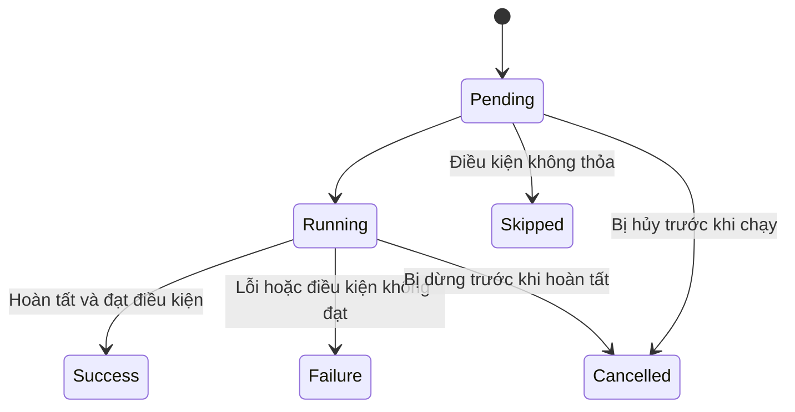
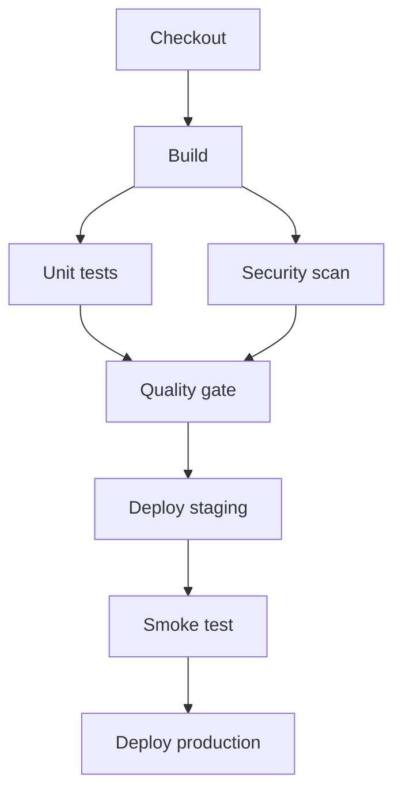

# Phân biệt trạng thái thành công, thất bại, bỏ qua và hủy

Trong CI/CD, một pipeline có thể kết thúc với nhiều trạng thái khác nhau. Bốn trạng thái thường gặp là **success (thành công), failure (thất bại), skipped (bỏ qua) và cancelled (hủy)**. Chúng không chỉ là bốn màu trên giao diện. Mỗi trạng thái mô tả một điều khác nhau về việc công việc đã được thực thi đến đâu và nhóm có thể tin cậy kết quả ở mức nào.

Ví dụ, một job kiểm thử trả về thành công nghĩa là các bước kiểm tra của job đã chạy và đạt điều kiện đặt ra. Một job bị bỏ qua vì pull request chỉ sửa tài liệu nghĩa là job không chạy; điều đó không chứng minh kiểm thử đã đạt. Một job bị hủy khi người dùng push commit mới cũng chưa có kết luận về chất lượng của revision đang chạy.

Với module CI/CD, hiểu đúng trạng thái giúp thiết kế pipeline dưới dạng mã, điều phối các job phụ thuộc, xử lý lỗi, kiểm soát cổng chất lượng và quyết định có được merge, triển khai hay phát hành hay không. Bài này phân biệt trạng thái ở cấp step, job và toàn pipeline; giải thích cách chúng lan truyền trong đồ thị phụ thuộc; đồng thời đưa ra quy tắc để không nhầm “không chạy” với “đã kiểm tra thành công”.

## 1. Trạng thái mô tả kết quả của một đơn vị công việc

Pipeline thường gồm nhiều tầng:

- **Step:** một thao tác cụ thể như checkout mã nguồn, cài dependency, chạy unit test hoặc đóng gói artifact.
- **Job:** một nhóm step chạy trong cùng ngữ cảnh thực thi hoặc runner, ví dụ `unit_test`, `build_image` hay `deploy_staging`.
- **Workflow/pipeline run:** toàn bộ lần chạy được kích hoạt bởi một sự kiện Git hoặc thao tác thủ công, gồm nhiều job có quan hệ phụ thuộc.

Một step có thể thành công trong khi step tiếp theo thất bại. Một job có thể thất bại nhưng job thu thập log vẫn chạy để lưu bằng chứng. Một số job có thể bị bỏ qua theo điều kiện trong khi các job bắt buộc khác hoàn tất thành công. Vì vậy cần xác định trạng thái đang được nói đến thuộc cấp nào.

Thông thường, một đơn vị công việc có thể đi qua trạng thái chờ, đang chạy rồi đến một trạng thái kết thúc:



Tên gọi và chi tiết chuyển trạng thái có thể khác nhau giữa các nền tảng. Một số nền tảng còn có `neutral`, `timed_out`, `stale`, `warning` hoặc `action_required`. Bốn trạng thái trong bài là mô hình nền tảng để hiểu cách điều phối; khi cấu hình công cụ cụ thể, cần đọc đúng quy tắc ánh xạ trạng thái của công cụ đó.

## 2. Success: công việc đã chạy và đạt điều kiện

`success` cho biết đơn vị công việc đã hoàn tất theo các điều kiện thành công được cấu hình. Với một step chạy lệnh shell, điều kiện phổ biến là tiến trình trả về exit code `0`. Với một job, các step bắt buộc đã hoàn tất và không có lỗi làm job thất bại. Với pipeline, tất cả cổng bắt buộc đã đạt theo chính sách tổng hợp.

Ví dụ:

```bash
./gradlew test
```

Nếu lệnh kết thúc với exit code `0`, step có thể được đánh dấu thành công. Tuy nhiên, exit code `0` chỉ có ý nghĩa khi chương trình thực sự trả về mã đúng theo hợp đồng của nó. Một script luôn trả `0` dù test thất bại sẽ tạo tín hiệu thành công sai.

Thành công cũng có phạm vi. `unit_test = success` chứng minh bộ unit test đã chạy và đạt trong điều kiện đã ghi nhận; nó không tự chứng minh integration test, security scan hay deployment đã thành công. Tương tự, job build thành công chỉ cho biết artifact đã được tạo theo điều kiện build, không khẳng định artifact đã được triển khai hoặc phát hành.

Khi tổng hợp trạng thái pipeline, nên phân biệt:

- **Thành công của job:** job đó hoàn tất theo điều kiện riêng.
- **Thành công của pipeline:** tất cả job và cổng được đánh dấu bắt buộc đã đạt, các nhánh tùy chọn được xử lý đúng chính sách.
- **Thành công của lần phát hành:** các điều kiện bổ sung như phê duyệt, triển khai, xác minh sau triển khai và theo dõi đã đạt.

Một pipeline có thể được xem là thành công dù một job tùy chọn bị skip, nếu chính sách định nghĩa job đó không cần thiết cho lần chạy hiện tại. Vì vậy, success không có nghĩa mọi job được khai báo đều phải chạy; nó có nghĩa mọi yêu cầu bắt buộc của lần chạy đã được đáp ứng và mọi ngoại lệ được chấp nhận có chủ đích.

## 3. Failure: công việc đã chạy nhưng không đạt

`failure` cho biết một thao tác đã được thực thi nhưng không hoàn tất theo điều kiện thành công. Nguyên nhân thường gặp gồm:

- Lệnh trả về exit code khác `0`.
- Unit test, integration test hoặc assertion thất bại.
- Lỗi biên dịch, đóng gói hoặc tải dependency.
- Static analysis hoặc security scan vượt ngưỡng chặn.
- Không tạo được artifact cần thiết hoặc không đẩy được artifact lên registry.
- Deployment thất bại do quyền, cấu hình, kết nối hoặc tài nguyên.
- Một điều kiện chất lượng được đánh giá là không đạt.

Failure là tín hiệu cần điều tra. Nó không nhất thiết có nghĩa ứng dụng có lỗi logic: pipeline cũng có thể thất bại do runner hết dung lượng, dịch vụ phụ trợ tạm thời không khả dụng hoặc cấu hình credential sai. Báo cáo cần lưu log, exit code, test report và ngữ cảnh để phân biệt lỗi sản phẩm với lỗi hạ tầng CI.

Nếu một job bắt buộc thất bại, các job phụ thuộc thường không được chạy hoặc cũng chuyển sang trạng thái bỏ qua. Một số pipeline áp dụng `fail-fast` để dừng các job song song còn lại khi có lỗi đầu tiên. Khi đó, lần chạy tổng thể vẫn thất bại; các job bị dừng do fail-fast có thể được ghi nhận là cancelled hoặc skipped tùy công cụ.

Không nên sửa một failure thành success chỉ bằng cách bỏ qua exit code hoặc dùng lệnh kiểu `|| true` cho một bước bắt buộc. Nếu một lỗi được chấp nhận, hãy thể hiện nó bằng điều kiện rõ ràng, phân loại cảnh báo hoặc chính sách ngoại lệ có người chịu trách nhiệm và có thời hạn.

## 4. Skipped: công việc không được thực thi

`skipped` có nghĩa step hoặc job không chạy. Điều kiện có thể không thỏa, nhánh điều khiển không được chọn, hoặc dependency trước đó không đạt nên job không được kích hoạt. Skipped không phải là một kết quả kiểm thử thành công hay thất bại; đơn giản là không có kết quả thực thi của job đó.

Các trường hợp phổ biến:

- Job deploy production chỉ chạy khi push vào nhánh chính hoặc khi có phê duyệt.
- Job kiểm tra tài liệu chỉ chạy khi file trong thư mục tài liệu thay đổi.
- Job kiểm thử frontend được bỏ qua khi pull request chỉ sửa backend và quy tắc xác định tác động đã xác nhận điều đó.
- Job phụ thuộc vào job build thất bại nên không thể chạy.
- Một nhánh `if/else` chọn một trong hai job, khiến nhánh còn lại bị skip.

Ví dụ mã giả:

```yaml
jobs:
  docs_check:
    if: changed_files_include_docs
    steps:
      - run_documentation_lint

  deploy_production:
    if: event_is_release_tag
    needs: [build, test]
    steps:
      - deploy_release_artifact
```

Trong ví dụ, `docs_check` có thể bị skip nếu không có tài liệu thay đổi; `deploy_production` có thể bị skip khi sự kiện không phải release tag. Hai trạng thái này là kết quả điều khiển có chủ đích, không phải lỗi.

Tuy nhiên, skipped do điều kiện hợp lệ phải được phân biệt với skipped do dependency thất bại. Cả hai đều có thể hiển thị cùng nhãn, nhưng lý do khác nhau:

| Nguyên nhân | Ý nghĩa | Cách xử lý |
|---|---|---|
| Điều kiện không áp dụng | Công việc không cần chạy trong lần này | Ghi lý do và xác nhận chính sách cho phép bỏ qua |
| Job phụ thuộc thất bại | Không đủ điều kiện để chạy tiếp | Xử lý failure ở job nguồn; không coi nhánh phụ thuộc là đạt |
| Nhánh điều khiển khác được chọn | Một nhánh thay thế đã được thực thi | Kiểm tra nhánh được chọn có đáp ứng cùng yêu cầu hay không |
| Cấu hình điều kiện sai | Job cần chạy nhưng bị loại nhầm | Sửa điều kiện và chạy lại pipeline |

Một job bắt buộc bị skip ngoài dự kiến cần chặn cổng chất lượng. Đặc biệt, đừng để một job `quality_gate` thành công chỉ vì các job kiểm thử bị skip và không có điều kiện kiểm tra trạng thái thực tế.

## 5. Cancelled: công việc bị dừng trước khi hoàn tất

`cancelled` cho biết một step, job hoặc toàn bộ lần chạy đã bị dừng trước khi hoàn tất bình thường. Việc hủy có thể do:

- Người dùng chủ động bấm Cancel.
- Một commit mới đến và chính sách concurrency hủy lần chạy cũ.
- Một lần chạy mới thay thế lần chạy trước trên cùng nhánh hoặc pull request.
- Quản trị viên hoặc hệ thống dừng runner, workflow hay môi trường.
- Pipeline bị dừng khi đã đạt điều kiện hủy theo chính sách.

Khác với skipped, một job cancelled có thể đã bắt đầu chạy và đã thực hiện một phần công việc. Ví dụ, deployment đã cập nhật hai trong năm instance rồi bị hủy. Hệ thống có thể đang ở trạng thái trung gian và cần bước kiểm tra hoặc khôi phục.

Cancelled không có nghĩa công việc thất bại về mặt chất lượng, nhưng cũng không có bằng chứng rằng công việc đã đạt. Nếu job bắt buộc bị hủy, cổng merge hoặc phát hành thường phải chờ một lần chạy hợp lệ khác. Nếu hủy job tùy chọn, pipeline chỉ có thể tiếp tục khi chính sách cho phép và không phụ thuộc kết quả của job đó.

**Timeout cần được phân biệt với cancellation.** Nhiều công cụ phân loại timeout là failure vì công việc đã vượt giới hạn thời gian mà không đạt điều kiện; một số nền tảng có thể biểu diễn theo trạng thái riêng. Không nên mặc định timeout luôn là cancelled. Hãy kiểm tra trạng thái và lý do kết thúc mà công cụ cung cấp.

Khi job bị hủy, nên có cơ chế cleanup hoặc khôi phục phù hợp. Tuy nhiên, cleanup chạy thành công không biến job triển khai đã bị hủy thành success. Kết quả gốc và kết quả dọn dẹp cần được lưu riêng.

## 6. So sánh bốn trạng thái

| Trạng thái | Công việc đã chạy? | Có kết luận đạt chất lượng? | Ý nghĩa khi xét cổng bắt buộc |
|---|---|---|---|
| `success` | Có | Có, trong phạm vi check | Có thể đáp ứng cổng nếu revision và đầu vào đúng |
| `failure` | Có | Không | Chặn cổng và cần điều tra hoặc sửa lỗi |
| `skipped` | Không | Không có kết luận từ lần chạy này | Chỉ chấp nhận nếu job thực sự tùy chọn hoặc điều kiện skip được cho phép |
| `cancelled` | Có thể đã chạy một phần hoặc chưa bắt đầu | Không có kết luận hoàn tất | Chặn cổng bắt buộc cho đến khi có kết quả hợp lệ |

Điểm quan trọng là không gộp `skipped` và `cancelled` vào `success`. Cả hai có thể là trạng thái hợp lệ trong luồng điều khiển, nhưng chúng không cung cấp bằng chứng kiểm tra hoàn tất.

## 7. Cách trạng thái lan truyền trong đồ thị phụ thuộc

Pipeline thường là một đồ thị có hướng không chu trình (DAG). Một job chỉ bắt đầu khi các dependency và điều kiện của nó thỏa mãn. Ví dụ:



Nếu `Build` thất bại, `Unit tests` và `Security scan` có thể bị skip vì dependency không đạt. `Quality gate` cũng không thể kết luận đạt. Pipeline phải giữ nguyên nguyên nhân gốc là build failure, đồng thời ghi nhận các job phụ thuộc không chạy.

Nếu `Security scan` được cấu hình là tùy chọn cho một loại thay đổi và bị skip có chủ đích, `Quality gate` có thể tiếp tục khi chính sách xác nhận scan đó không bắt buộc trong trường hợp này. Nếu scan là bắt buộc, skipped phải khiến gate không đạt hoặc ở trạng thái chờ xử lý; không được tự động xem như pass.

Quy tắc tổng hợp cần xác định rõ:

1. Những job nào là bắt buộc trong lần chạy hiện tại.
2. Điều kiện nào cho phép job bị skip.
3. Failure nào chặn các job downstream.
4. Khi nào được phép chạy cleanup dù upstream failure hoặc cancellation.
5. Điều kiện để pipeline run được xem là success.

Một pipeline run có thể có job success, job skipped và vẫn success tổng thể. Ngược lại, một job failure bắt buộc hoặc job bắt buộc bị cancelled thường làm pipeline không đạt. Quy tắc cụ thể phụ thuộc công cụ và cấu hình; không nên suy ra kết luận tổng thể chỉ từ số lượng job xanh.

## 8. Thiết kế quality gate không bỏ lọt trạng thái

Một quality gate nên kiểm tra trạng thái thực của từng check bắt buộc thay vì chỉ kiểm tra xem job có được tạo ra hay không. Mã giả dưới đây minh họa cách biểu đạt:

```yaml
pipeline:
  unit_test:
    required: true
    run: ./gradlew test

  integration_test:
    required_when: changes_include_service_or_api
    run: ./gradlew integrationTest

  docs_check:
    required_when: changes_include_docs
    run: ./gradlew docsCheck

  quality_gate:
    evaluate:
      - unit_test must_be success
      - integration_test must_be success when required
      - docs_check must_be success when required
      - required_job_skipped_without_valid_reason is failure
      - required_job_cancelled is failure_for_gate
```

Đây là mã giả, không phải cú pháp của một nền tảng cụ thể. Trong pipeline thật, có thể dùng job tổng hợp, điều kiện `if`, dependency, biểu thức kiểm tra kết quả hoặc API trạng thái của nền tảng. Mục tiêu là làm rõ sự khác nhau giữa “không cần chạy” và “đáng lẽ phải chạy nhưng không có kết quả”.

Với job tùy chọn, nên ghi lại lý do skip, ví dụ `not_applicable: no_frontend_files_changed`. Lý do có thể được lưu dưới dạng output, annotation hoặc log. Tránh dùng một điều kiện chung khiến người xem không biết job bị skip do không áp dụng, do dependency lỗi hay do cấu hình sai.

Nếu cần chạy bước tổng hợp sau khi job khác kết thúc dù thành công hay thất bại, dùng cơ chế always/finally tương ứng của nền tảng. Bước này phù hợp để thu thập test report, log, thông tin trạng thái và dọn tài nguyên. Cần giữ nguyên failure hoặc cancellation ban đầu khi tính kết quả cuối cùng.

## 9. Fail-fast, retry và cancellation

### Fail-fast

Fail-fast dừng sớm các công việc còn lại khi phát hiện một lỗi đủ nghiêm trọng. Ví dụ, nếu một ma trận kiểm thử có 12 cấu hình và một cấu hình phát hiện lỗi biên dịch chung, hệ thống có thể hủy 11 cấu hình chưa cần chạy tiếp. Điều này tiết kiệm runner và thời gian, nhưng log cần thể hiện rõ job nào failure và job nào bị dừng theo fail-fast.

Không nên bật fail-fast một cách máy móc cho mọi nhóm job. Nếu cần thu thập nhiều lỗi độc lập trong một lần chạy, có thể để các job song song hoàn tất rồi tổng hợp. Với deployment hoặc thao tác có tác động đến môi trường, cần quy tắc dừng và khôi phục được thiết kế riêng.

### Retry

Retry tạo một lần thử khác sau lỗi tạm thời, ví dụ runner mất kết nối hoặc dịch vụ test không sẵn sàng. Cần phân biệt trạng thái của từng attempt với kết quả cuối cùng của job. Nếu attempt đầu failure nhưng attempt sau success, hệ thống có thể báo job cuối cùng success kèm lịch sử retry; báo cáo vẫn nên giữ lần thất bại đầu tiên để nhận diện flaky test hoặc hạ tầng thiếu ổn định.

Không dùng retry vô hạn để che giấu lỗi lặp lại. Đặt số lần thử tối đa, backoff khi phù hợp và ghi nhận nguyên nhân retry. Với lỗi xác định như assertion sai hoặc compile error, retry thường không giúp ích.

### Cancellation và concurrency

Khi có commit mới, nhóm có thể hủy run cũ để dành tài nguyên cho revision mới. Việc này hợp lý với kiểm thử pull request, nhưng phải bảo đảm run cũ không được tính là pass và không tiếp tục triển khai. Với job có tác động bên ngoài, cancellation cần xử lý trạng thái trung gian, khóa tài nguyên và cleanup.

## 10. Ánh xạ trạng thái sang cổng Git và phát hành

Nền tảng quản lý Git có thể hiển thị check status, conclusion hoặc trạng thái bảo vệ nhánh khác với nhãn job trong CI. Một số hệ thống coi check bị skip là trung tính; một số cấu hình bảo vệ nhánh có thể vẫn yêu cầu check bắt buộc phải xuất hiện và hoàn tất. Vì vậy, phải xác minh hành vi của nền tảng thực tế thay vì giả định mọi `skipped` đều được chấp nhận.

Đối với cổng merge, nên yêu cầu:

- Các check bắt buộc có kết quả success cho đúng commit hoặc merge candidate.
- Check không còn pending, cancelled hoặc failure.
- Job bị skip có lý do hợp lệ và được chính sách cho phép.
- Approval và các điều kiện bảo vệ nhánh khác còn hiệu lực.

Đối với cổng triển khai/phát hành, cần thêm:

- Artifact được build và kiểm tra từ revision đã được chấp nhận.
- Job triển khai không bị skip ngoài dự kiến hoặc cancelled giữa chừng.
- Xác minh sau triển khai đạt và hệ thống quan sát không vượt ngưỡng dừng.
- Nếu rollout bị hủy, trạng thái môi trường được xác định và có kế hoạch tiếp tục hoặc khôi phục.

Một job `deploy_production` bị skip vì pipeline chạy trên pull request là bình thường. Cùng job đó bị skip trong một lần chạy release tag dự kiến phát hành có thể là lỗi cấu hình nghiêm trọng. Trạng thái phải được đánh giá cùng event, branch, tag và mục tiêu của lần chạy.

## 11. Ví dụ đọc kết quả một lần chạy

Giả sử pipeline của pull request có kết quả:

| Job | Trạng thái | Diễn giải |
|---|---|---|
| `build` | `success` | Artifact đã được tạo |
| `unit_test` | `success` | Unit test đã chạy và đạt |
| `integration_test` | `failure` | Có kiểm thử tích hợp không đạt |
| `security_scan` | `success` | Scan đã chạy và đạt chính sách |
| `deploy_staging` | `skipped` | Không chạy vì quality gate chưa đạt |
| `upload_diagnostics` | `success` | Log và báo cáo đã được lưu |

Kết luận đúng là pipeline thất bại do `integration_test`. `deploy_staging` bị skip là hệ quả ngăn triển khai khi chất lượng chưa đạt; nó không phải một failure độc lập và cũng không phải một success. `upload_diagnostics` thành công chỉ cho biết báo cáo đã được lưu, không thay đổi kết quả kiểm thử.

Một ví dụ khác: pull request chỉ sửa tài liệu, `docs_check` success, `unit_test` skipped theo quy tắc thay đổi file, còn `deploy_production` skipped vì event không phải release. Pipeline có thể success nếu chính sách xác nhận unit test không bắt buộc cho loại thay đổi đó và tất cả cổng cần thiết đã đạt. Nếu chính sách luôn yêu cầu unit test, trạng thái skipped phải làm quality gate không đạt.

## 12. Checklist thiết kế và vận hành

- [ ] Phân biệt rõ trạng thái ở cấp step, job và toàn pipeline.
- [ ] Success chỉ được gán khi các điều kiện thực thi và kiểm tra đã đạt.
- [ ] Failure giữ nguyên nguyên nhân gốc, exit code và bằng chứng liên quan.
- [ ] Skipped có lý do và điều kiện áp dụng rõ ràng.
- [ ] Job bắt buộc bị skipped ngoài dự kiến không được coi là pass.
- [ ] Cancelled được phân biệt với skipped và không dùng làm bằng chứng thành công.
- [ ] Timeout, retry và fail-fast được ánh xạ theo hành vi thực tế của nền tảng.
- [ ] Job cleanup/diagnostics vẫn có thể chạy khi cần nhưng không xóa trạng thái lỗi gốc.
- [ ] Quality gate tổng hợp trạng thái theo danh sách job bắt buộc và điều kiện skip.
- [ ] Cổng Git, merge và release yêu cầu kết quả hợp lệ cho đúng revision.
- [ ] Deployment bị hủy có quy trình xác định trạng thái môi trường và khôi phục.

Khi mỗi trạng thái được hiểu đúng và có quy tắc tổng hợp minh bạch, pipeline trở nên dễ đọc và đáng tin cậy hơn. Nhóm biết một công việc đã đạt, đã thất bại, không áp dụng hay bị dừng; từ đó quyết định đúng việc nào được tiếp tục, việc nào cần chạy lại và khi nào có thể cho phép merge hoặc phát hành.
