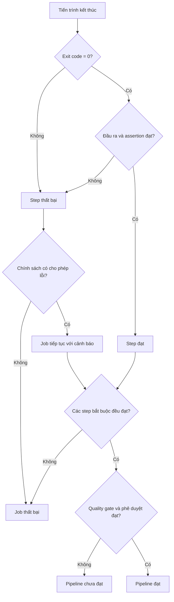

# Xác định mã thoát và điều kiện để một bước được coi là đạt

Trong CI/CD, một bước chỉ được coi là đạt khi hệ thống có bằng chứng rõ ràng rằng công việc bắt buộc đã hoàn tất và các điều kiện chất lượng liên quan đều thỏa mãn. Dấu hiệu phổ biến nhất là **mã thoát (exit code)** của tiến trình: mã `0` thường biểu thị thành công, còn mã khác `0` biểu thị lỗi theo hợp đồng của chương trình. Tuy nhiên, mã thoát chỉ là một phần của kết luận. Pipeline còn phải xem xét điều kiện chạy, kết quả kiểm tra, đầu ra bắt buộc, timeout, trạng thái hủy và chính sách cho phép lỗi.

Nếu một lệnh kiểm thử trả về `0` nhưng không tìm thấy test nào, hoặc bước build trả về `0` nhưng không tạo ra artifact cần thiết, việc đánh dấu bước đó là đạt sẽ tạo ra tín hiệu sai. Ngược lại, một bước tùy chọn có thể thất bại mà không chặn toàn bộ pipeline nếu chính sách đã cho phép rõ ràng. Vì vậy, kiến trúc pipeline cần phân biệt mã thoát của tiến trình, trạng thái của step/job và kết quả tổng thể của pipeline.

## 1. Phân biệt kết quả ở từng tầng

Một pipeline thường có nhiều tầng kết quả:

1. **Process/command:** chương trình kết thúc với mã thoát nào?
2. **Step/task:** lệnh có được thực thi không, có hoàn tất đúng yêu cầu và tạo đủ đầu ra không?
3. **Job:** tất cả step bắt buộc có đạt không, có bị timeout hoặc hủy không?
4. **Pipeline/workflow:** mọi job bắt buộc, quality gate và điều kiện phát hành có đạt không?



Sơ đồ là mô hình khái niệm. Mỗi nền tảng CI/CD có tên trạng thái và quy tắc tổng hợp khác nhau. Điều quan trọng là không đồng nhất `exit code = 0` với `pipeline = success`.

## 2. Mã thoát là hợp đồng giữa chương trình và hệ điều hành

Khi một tiến trình kết thúc, nó trả về một mã trạng thái cho tiến trình gọi. Shell hoặc runner đọc mã này để quyết định lệnh vừa chạy có thành công theo quy ước hay không.

Trong môi trường Unix/Linux, quy ước phổ biến là:

- `0`: chương trình hoàn tất thành công.
- Khác `0`: chương trình báo lỗi, không hoàn tất hoặc gặp một trạng thái đặc biệt theo tài liệu của nó.

Mã khác `0` không có một ý nghĩa chung duy nhất. Ý nghĩa cụ thể phụ thuộc vào chương trình. Ví dụ, một công cụ tìm kiếm có thể dùng mã `1` để nói rằng không tìm thấy kết quả; một công cụ kiểm thử có thể dùng mã riêng cho trường hợp không có test; một lệnh kiểm tra thay đổi có thể dùng mã khác `0` để biểu thị “có khác biệt” thay vì lỗi vận hành.

Một số mã thường gặp trong shell trên Unix/Linux:

| Mã | Ý nghĩa thường gặp | Lưu ý |
|---:|---|---|
| `0` | Thành công | Chỉ có nghĩa theo hợp đồng của chương trình |
| `1` | Lỗi chung hoặc điều kiện không đạt | Phải đọc tài liệu của lệnh |
| `2` | Sai cách dùng hoặc tham số không hợp lệ | Không phải chương trình nào cũng dùng giống nhau |
| `126` | Tìm thấy lệnh nhưng không thể thực thi | Có thể do quyền hoặc định dạng thực thi |
| `127` | Không tìm thấy lệnh | Thường là sai tên hoặc PATH thiếu |
| `128 + N` | Quy ước thường dùng khi tiến trình kết thúc bởi signal N | Cách biểu diễn phụ thuộc shell và hệ thống |
| `130` | Thường tương ứng SIGINT (ngắt bằng Ctrl+C) | Không nên coi là một lần chạy thành công |

Trên Windows, tiến trình cũng trả về exit code, thường được biểu diễn bằng giá trị 32-bit. Không nên áp dụng máy móc các mã quy ước của Unix cho mọi chương trình Windows. Với công cụ đa nền tảng, hãy xem tài liệu của công cụ và kiểm tra cách runner chuyển mã thoát về trạng thái job.

### Thiết kế mã thoát cho script của nhóm

Script tự viết nên có hợp đồng mã thoát nhất quán, dễ hiểu và được tài liệu hóa. Một quy ước đơn giản có thể là:

| Mã do script quy định | Ý nghĩa ví dụ |
|---:|---|
| `0` | Hoàn tất đúng yêu cầu |
| `1` | Kiểm tra nghiệp vụ hoặc quality gate không đạt |
| `2` | Tham số hoặc cấu hình đầu vào không hợp lệ |
| `3` | Không thể truy cập dependency hoặc dịch vụ cần thiết |
| `4` | Đầu ra bắt buộc bị thiếu hoặc không hợp lệ |

Đây chỉ là ví dụ về hợp đồng nội bộ, không phải chuẩn chung. Chọn mã phù hợp với nhu cầu và tránh xung đột với mã mà công cụ con sử dụng. Nếu script gọi một chương trình khác, cần quyết định rõ sẽ truyền nguyên mã thoát của chương trình con hay ánh xạ sang mã riêng. Dù chọn cách nào, log phải ghi đủ thông tin để người vận hành biết lệnh nào thất bại và vì sao.

## 3. Shell quyết định mã thoát của tổ hợp lệnh như thế nào?

Một nguyên nhân phổ biến khiến pipeline báo sai là hiểu nhầm cách shell tổng hợp mã thoát khi một step chạy nhiều lệnh.

### Lệnh nối bằng dấu chấm phẩy

```bash
./gradlew test
echo "Tests finished"
```

Trong shell, lệnh thứ hai vẫn chạy sau khi lệnh đầu thất bại. Mã thoát của cả danh sách thông thường là mã của lệnh cuối cùng. Vì `echo` thường trả về `0`, step có thể thành công dù `./gradlew test` đã thất bại.

Nếu cần dừng khi lệnh trước lỗi, có thể dùng `&&`:

```bash
./gradlew test && echo "Tests passed"
```

Khi lệnh test trả về khác `0`, phần sau `&&` không chạy và mã thoát của danh sách phản ánh thất bại đó.

### Dùng nhánh dự phòng với `||`

```bash
./scripts/check-cache.sh || ./scripts/rebuild-cache.sh
```

Lệnh sau `||` chạy khi lệnh trước thất bại. Mã cuối cùng thường là mã của lệnh cuối được thực thi. Cách này phù hợp khi có phương án dự phòng thật sự, nhưng có thể che giấu lỗi nếu lệnh dự phòng luôn trả về `0` dù không khôi phục được điều kiện cần thiết.

Không dùng `|| true` để làm xanh một bước bắt buộc:

```bash
# Không phù hợp cho test bắt buộc vì đã bỏ qua mã lỗi
./gradlew test || true
```

Nếu muốn cho phép một lỗi cụ thể, hãy kiểm tra mã đó và ghi nhận rõ lý do, thay vì bỏ qua mọi lỗi.

### Pipeline qua ký tự `|`

```bash
./scripts/generate-report.sh | tee report.log
```

Trong Bash, theo mặc định, mã thoát của pipeline là mã của lệnh cuối cùng. Nếu `generate-report.sh` thất bại nhưng `tee` ghi file thành công, pipeline có thể trả về `0`. Có thể bật `pipefail` để pipeline trả về mã khác `0` khi một lệnh trong chuỗi thất bại:

```bash
set -o pipefail
./scripts/generate-report.sh | tee report.log
```

Khi cần cả `errexit`, `nounset` và `pipefail`, script Bash thường bắt đầu bằng:

```bash
set -Eeuo pipefail
```

Các tùy chọn này giúp phát hiện nhiều lỗi thường gặp, nhưng không thay thế việc thiết kế xử lý lỗi. `set -e` có ngoại lệ tùy vị trí lệnh trong `if`, `while`, `&&`, `||`, pipeline và function. Không nên giả định rằng cứ có `set -e` thì mọi lệnh lỗi đều làm script dừng theo cách mong muốn. Với bước quan trọng, hãy kiểm tra và xử lý mã thoát tường minh.

### Lưu mã thoát đúng thời điểm

Trong Bash, `$?` chứa mã thoát của lệnh vừa thực thi gần nhất. Nếu chạy một lệnh khác trước khi lưu, giá trị đã bị thay thế:

```bash
./gradlew test
test_rc=$?

if [ "$test_rc" -ne 0 ]; then
  echo "Gradle tests failed with exit code $test_rc" >&2
  exit "$test_rc"
fi
```

Với trường hợp muốn ghi log lỗi nhưng vẫn giữ mã ban đầu, hãy lưu mã ngay trong nhánh `else`:

```bash
if ./gradlew test; then
  echo "Unit tests passed"
else
  test_rc=$?
  echo "Unit tests failed with exit code $test_rc" >&2
  exit "$test_rc"
fi
```

Không viết `if ! command; then rc=$?` để lấy mã gốc: toán tử `!` đảo trạng thái, nên `$?` bên trong nhánh có thể là `0`. Dùng cấu trúc `if command; then ... else rc=$?; ... fi` như ví dụ trên để giữ mã thực tế.

## 4. Xử lý lỗi tường minh trong script

Một script CI nên dừng khi công việc bắt buộc thất bại, giữ lại mã thoát có ý nghĩa và in thông báo đủ để chẩn đoán. Ví dụ Bash:

```bash
#!/usr/bin/env bash
set -Eeuo pipefail

run_required_step() {
  local step_name="$1"
  shift

  echo "==> ${step_name}"
  if "$@"; then
    echo "PASS: ${step_name}"
  else
    local rc=$?
    echo "FAIL: ${step_name} (exit code ${rc})" >&2
    return "$rc"
  fi
}

run_required_step "unit tests" ./gradlew test --no-daemon
run_required_step "package application" ./gradlew assemble --no-daemon

test -s build/libs/app.jar || {
  echo "FAIL: build/libs/app.jar is missing or empty" >&2
  exit 4
}

echo "All required steps passed"
```

Trong ví dụ, mỗi lệnh bắt buộc được gọi như một tiến trình riêng; function trả về mã lỗi của lệnh con. Sau build, script còn xác minh artifact tồn tại và không rỗng. Nhờ đó, một tiến trình build trả về `0` nhưng không tạo file cần thiết vẫn không làm bước tổng thể thành công.

Không phải script nào cũng cần bọc từng lệnh trong function. Với script ngắn, có thể dùng `set -Eeuo pipefail` và thêm các assertion sau lệnh quan trọng. Mục tiêu là giữ hợp đồng kết quả dễ đọc, không tạo thêm lớp trừu tượng khó bảo trì.

### Tiến trình nền và lệnh bất đồng bộ

Nếu script khởi chạy tiến trình nền, mã thoát của lệnh khởi chạy chỉ cho biết tiến trình đã được tạo thành công, không cho biết công việc nền đã hoàn tất. Cần `wait` và kiểm tra mã của tiến trình:

```bash
./scripts/build-index.sh &
worker_pid=$!

if wait "$worker_pid"; then
  echo "Index build passed"
else
  rc=$?
  echo "Index build failed with exit code $rc" >&2
  exit "$rc"
fi
```

Tương tự, nếu step gửi một yêu cầu tới hệ thống bên ngoài rồi nhận mã HTTP `202 Accepted`, điều đó chỉ cho biết công việc đã được tiếp nhận. Step phải đợi trạng thái công việc cuối cùng hoặc kiểm tra điều kiện hoàn tất trước khi báo đạt.

## 5. Kiểm tra mã thoát của chương trình native trên Windows PowerShell

Trên PowerShell, cần phân biệt lỗi của cmdlet PowerShell với mã thoát của chương trình native như `gradlew.bat`, `dotnet.exe` hoặc `npm.cmd`.

- `$?` phản ánh trạng thái thành công của thao tác PowerShell gần nhất.
- `$LASTEXITCODE` chứa mã thoát của chương trình native được chạy gần nhất.
- `$ErrorActionPreference = 'Stop'` giúp chuyển nhiều non-terminating error của cmdlet thành lỗi dừng, nhưng không nên dựa vào nó để thay thế việc kiểm tra `$LASTEXITCODE` của mọi chương trình native.

Ví dụ:

```powershell
$ErrorActionPreference = 'Stop'

& .\gradlew.bat test --no-daemon
$testExitCode = $LASTEXITCODE

if ($testExitCode -ne 0) {
    [Console]::Error.WriteLine("Gradle tests failed with exit code $testExitCode")
    exit $testExitCode
}

Write-Output 'Unit tests passed'
```

Hãy đọc `$LASTEXITCODE` ngay sau chương trình native, trước khi chạy một chương trình native khác có thể ghi đè nó. Nếu script có nhiều lệnh native, kiểm tra từng lệnh tại chỗ. Khi có exception PowerShell, dùng `try/catch` cho lỗi cmdlet và vẫn kiểm tra mã thoát của chương trình native riêng.

## 6. Exit code không phải toàn bộ điều kiện đạt

Một step có thể trả về `0` nhưng chưa đáp ứng mục tiêu. Ví dụ:

- Test runner chạy thành công về mặt tiến trình nhưng không phát hiện test nào.
- Lệnh scan hoàn tất nhưng báo cáo cho thấy có lỗ hổng vượt ngưỡng cho phép.
- Lệnh build trả về `0` nhưng artifact dự kiến không tồn tại hoặc có kích thước bằng 0.
- Lệnh upload trả về `0` nhưng đối tượng được tải lên sai repository hoặc sai digest.
- Script deploy gửi yêu cầu thành công nhưng rollout ở môi trường đích chưa hoàn tất.

Do đó, một điều kiện đạt nên kết hợp ít nhất các nhóm kiểm tra sau:

| Nhóm | Điều kiện ví dụ | Bằng chứng |
|---|---|---|
| Thực thi | Process kết thúc với mã thoát được chấp nhận | Exit code và log |
| Kết quả chức năng | Test và assertion đạt | Test report, assertion summary |
| Đầu ra | Artifact, báo cáo hoặc metadata bắt buộc tồn tại và hợp lệ | File, checksum, digest, schema validation |
| Chất lượng | Coverage, lint, scan hoặc policy trong ngưỡng | Báo cáo và ngưỡng policy |
| Triển khai | Rollout hoàn tất ở đúng environment | Deployment ID, revision, trạng thái workload |
| Xác minh | Health check, smoke test hoặc SLO đạt | Kết quả probe và metrics |

### Trường hợp không có test

Một test runner có thể phân biệt “tất cả test đạt” với “không tìm thấy test”. Chẳng hạn, pytest dùng mã thoát `5` khi không thu thập được test nào. Nếu dự án yêu cầu phải có test, trường hợp này phải làm job thất bại hoặc bị quality gate chặn. Nếu một thư mục test được phép rỗng theo thiết kế, hãy thể hiện ngoại lệ đó rõ ràng theo phạm vi, không tự động coi mọi trường hợp không có test là đạt.

### Ngưỡng chất lượng cần được kiểm tra riêng

Một công cụ coverage có thể tạo báo cáo và kết thúc với mã `0`, trong khi coverage thấp hơn ngưỡng mà nhóm đặt ra. Tương tự, công cụ quét bảo mật có thể hoàn tất phân tích nhưng phát hiện lỗ hổng nghiêm trọng. Cần có bước đánh giá báo cáo theo policy:

```bash
./gradlew test jacocoTestReport
./scripts/check-coverage-threshold.sh --minimum 80
./scripts/check-security-policy.sh --fail-on critical
```

Ví dụ trên giả định hai script kiểm tra trả về mã khác `0` khi ngưỡng không đạt. Không nên chỉ kiểm tra xem file báo cáo đã được tạo hay chưa; phải kiểm tra nội dung và quy tắc áp dụng. Nếu parser không đọc được báo cáo, dữ liệu thiếu hoặc schema không hợp lệ, quality gate nên báo lỗi rõ ràng thay vì mặc định thành công.

## 7. Điều kiện chạy, bỏ qua và cho phép lỗi

Một step có thể không được thực thi vì điều kiện không phù hợp. Trạng thái `skipped` khác với `passed`: skipped nghĩa là không chạy; passed nghĩa là đã chạy và đạt điều kiện. Ví dụ, job deploy production chỉ chạy trên tag release, nên các pipeline trên pull request có thể bỏ qua job đó theo đúng thiết kế.

Khi thiết kế điều kiện, hãy xác định rõ:

- Step có bắt buộc trong mọi pipeline hay chỉ trong một số loại sự kiện?
- Nếu điều kiện không thỏa mãn, step được bỏ qua hợp lệ hay phải làm pipeline thất bại?
- Job phụ thuộc có được phép chạy khi job trước bị bỏ qua không?
- Một step thủ công đang chờ phê duyệt có làm pipeline ở trạng thái chờ không?
- Bằng chứng nào chứng minh điều kiện được đánh giá đúng?

### Lỗi tùy chọn và `continue-on-error`

Có những bước mang tính thông tin, ví dụ thu thập benchmark bổ sung hoặc tạo báo cáo không bắt buộc. Tổ chức có thể cho phép các bước này thất bại mà pipeline vẫn tiếp tục. Nhưng cần phân loại chúng là tùy chọn và lưu trạng thái cảnh báo để không nhầm với thành công hoàn toàn.

Trong GitHub Actions, `continue-on-error: true` có thể cho phép một step/job thất bại mà workflow tiếp tục. Với step có `id`, có thể kiểm tra `steps.<id>.outcome` để biết kết quả thực thi ban đầu; `conclusion` phản ánh kết quả sau khi áp dụng `continue-on-error`. Không nên chỉ nhìn trạng thái tổng thể của workflow để kết luận mọi bước đều đạt.

Ví dụ:

```yaml
steps:
  - name: Run optional benchmark
    id: benchmark
    continue-on-error: true
    run: ./scripts/benchmark.sh

  - name: Report benchmark status
    if: always()
    env:
      BENCHMARK_OUTCOME: ${{ steps.benchmark.outcome }}
    run: echo "Benchmark outcome: $BENCHMARK_OUTCOME"
```

Trong GitLab CI, `allow_failure: true` cho phép job thất bại mà không chặn pipeline theo cách thông thường; giao diện có thể thể hiện trạng thái cảnh báo hoặc cho biết job được phép thất bại. Có thể giới hạn trường hợp được phép lỗi theo `exit_codes` khi cần, nhưng phải lựa chọn đúng mã của công cụ và tài liệu hóa ý nghĩa.

Không đặt test bắt buộc, kiểm tra bảo mật quan trọng hoặc xác minh deployment thành bước tùy chọn chỉ để giữ pipeline xanh. Nếu một ngoại lệ được chấp nhận, hãy lưu lý do, người phê duyệt, phạm vi và thời hạn của ngoại lệ.

### Điều kiện phụ thuộc và trạng thái skipped

Job phụ thuộc vào job trước cần xác định cách xử lý khi job trước bị skipped, canceled hoặc allowed failure. Ví dụ, bước publish không nên tự chạy chỉ vì bước test bị bỏ qua do điều kiện cấu hình sai. Với từng dependency, cần phân biệt “đã đạt”, “được bỏ qua hợp lệ”, “được phép lỗi” và “không có kết quả”. Không coi việc thiếu kết quả như một kết quả đạt.

## 8. Timeout, hủy, retry và lỗi hạ tầng

Không phải mọi lần chạy không hoàn tất đều có exit code ứng dụng rõ ràng. Runner có thể giết tiến trình khi timeout, người dùng có thể hủy job, máy chạy có thể mất kết nối hoặc container có thể bị dừng. Hệ thống có thể biểu diễn các tình huống này bằng trạng thái `timed_out`, `canceled`, `cancelled`, `stuck` hoặc trạng thái hạ tầng tương đương.

Các nguyên tắc cần áp dụng:

- **Timeout:** nếu bước bắt buộc chưa hoàn tất trong thời gian cho phép, kết quả là không đạt hoặc chưa xác định, không được xem là thành công.
- **Canceled:** không có kết quả đầy đủ. Pipeline cần thể hiện bị hủy hoặc không hoàn tất theo chính sách.
- **Runner/infrastructure failure:** phân loại riêng với lỗi logic của ứng dụng để tránh quy kết sai, nhưng job bắt buộc vẫn chưa đạt cho tới khi được chạy lại thành công.
- **Retry:** chỉ nên dùng cho lỗi tạm thời đã xác định, ví dụ lỗi mạng hoặc dịch vụ phụ thuộc gián đoạn. Lưu số lần thử, kết quả từng lần và kết quả cuối cùng.
- **Flaky test:** không che giấu bằng cách retry vô hạn. Theo dõi tỷ lệ flaky, lưu lần thất bại đầu tiên và xử lý nguyên nhân.

Một lần retry thành công có thể cho phép job cuối cùng đạt theo chính sách, nhưng lịch sử lần thất bại trước vẫn cần được giữ. Với các bước có side effect như tạo release, gửi thông báo hoặc triển khai, cần thiết kế idempotency hoặc khóa chống thực thi trùng trước khi tự động retry.

## 9. Ví dụ thiết kế điều kiện đạt trong GitLab CI

Ví dụ sau tách kiểm thử, kiểm tra artifact và quality gate thành các job riêng. Nó minh họa cách mã thoát và đầu ra cùng tham gia quyết định trạng thái. Đường dẫn JAR cần điều chỉnh theo dự án thực tế.

```yaml
stages:
  - test
  - package
  - quality

unit_tests:
  stage: test
  script:
    - ./gradlew test --no-daemon
    - |
      report="$(find build/test-results/test -type f -name 'TEST-*.xml' -print -quit)"
      if [ -z "$report" ]; then
        echo "No JUnit test report was produced" >&2
        exit 1
      fi
  artifacts:
    when: always
    reports:
      junit: build/test-results/test/*.xml

package_app:
  stage: package
  script:
    - ./gradlew assemble --no-daemon
    - test -s build/libs/app.jar
  artifacts:
    paths:
      - build/libs/app.jar

quality_gate:
  stage: quality
  needs:
    - job: unit_tests
    - job: package_app
      artifacts: true
  script:
    - ./scripts/check-coverage-threshold.sh --minimum 80
    - ./scripts/check-artifact-metadata.sh build/libs/app.jar
```

Trong ví dụ, đoạn shell tìm ít nhất một báo cáo JUnit có tên theo mẫu `TEST-*.xml`; nếu thư mục không tồn tại hoặc không có report, step trả về mã khác `0`. Dự án thực tế cần điều chỉnh đường dẫn và mẫu tên theo cấu hình test runner. `quality_gate` chỉ chạy sau khi các job cần thiết đạt và artifact được chuyển giao. Nếu script kiểm tra coverage hoặc metadata trả về mã khác `0`, job quality gate thất bại.

Nếu cần cho phép một job không bắt buộc thất bại, hãy khai báo `allow_failure` có chủ đích và ghi nhận cảnh báo. Không áp dụng `allow_failure` cho job test hoặc gate bắt buộc trong ví dụ này.

## 10. Ví dụ thiết kế điều kiện đạt trong GitHub Actions

GitHub Actions biểu diễn từng step trong workflow. Một step `run` thường được xem là thành công khi tiến trình shell kết thúc với mã `0`; mã khác `0` khiến step thất bại trừ khi có cấu hình cho phép tiếp tục. Job phụ thuộc và điều kiện `if` quyết định các bước tiếp theo có được thực thi hay không.

```yaml
name: CI

on:
  pull_request:
  push:
    branches: [main]

jobs:
  verify:
    runs-on: ubuntu-latest
    steps:
      - uses: actions/checkout@v4

      - name: Run tests
        run: ./gradlew test --no-daemon

      - name: Build application
        if: success()
        run: ./gradlew assemble --no-daemon

      - name: Verify package exists
        if: success()
        run: test -s build/libs/app.jar

      - name: Verify test report exists
        if: success()
        run: test -n "$(find build/test-results/test -name 'TEST-*.xml' -type f -print -quit)"

      - name: Check quality policy
        if: success()
        run: ./scripts/check-quality-gate.sh

      - name: Upload verified package
        if: success()
        uses: actions/upload-artifact@v4
        with:
          name: app-package
          path: build/libs/app.jar

  publish:
    needs: verify
    if: github.event_name == 'push' && github.ref == 'refs/heads/main'
    runs-on: ubuntu-latest
    steps:
      - uses: actions/checkout@v4

      - name: Download verified package
        uses: actions/download-artifact@v4
        with:
          name: app-package
          path: dist

      - name: Publish release artifact
        run: ./scripts/publish.sh dist/app.jar
```

`publish` phụ thuộc vào job `verify`, đồng thời chỉ được chạy trên sự kiện push vào `main`. Với pull request, job publish bị bỏ qua theo điều kiện; điều đó không có nghĩa job verify đã bỏ qua kiểm thử. Trong hệ thống thực tế, bước publish còn cần tải artifact đã được build ở job verify, xác minh digest và dùng quyền/secret phù hợp.

Ví dụ sử dụng `find` chỉ để minh họa kiểm tra có ít nhất một file report. Nếu dự án có quy ước report khác, cần thay đổi điều kiện cho đúng. Một bước kiểm tra report không thay thế việc phân tích nội dung report để biết test có đạt hay không.

## 11. Xây dựng quality gate rõ ràng và có thể kiểm toán

Một quality gate tốt cần có các đặc tính sau:

**Rõ điều kiện.** Mỗi gate nêu được tiêu chí, ngưỡng, phạm vi áp dụng và loại lỗi khiến gate thất bại. Ví dụ: tất cả unit test bắt buộc phải đạt; không có lỗ hổng critical chưa được miễn trừ; coverage không thấp hơn ngưỡng của dự án.

**Có bằng chứng.** Gate lưu exit code, log, báo cáo, digest artifact, phiên bản policy và thời điểm đánh giá. Người khác có thể xem lại tại sao gate đạt hoặc thất bại.

**Xử lý dữ liệu thiếu theo chính sách.** Nếu báo cáo bắt buộc bị thiếu, không đọc được hoặc không gắn được với artifact, gate nên thất bại hoặc chuyển sang trạng thái cần xử lý rõ ràng. Không tự suy diễn rằng không có cảnh báo nghĩa là không có lỗi.

**Phân biệt lỗi sản phẩm và lỗi hạ tầng.** Test thất bại do assertion khác với runner không tải được dependency. Hai tình huống cần log và quy trình xử lý khác nhau, dù job bắt buộc chưa thể được đánh dấu đạt.

**Ngoại lệ có kiểm soát.** Nếu cho phép một lỗi, cần có lý do, người phê duyệt, phạm vi, thời hạn và cách theo dõi. Ngoại lệ hết hạn phải tự động quay về chính sách mặc định.

**Kết quả nhất quán.** Cùng đầu vào và cùng phiên bản policy nên cho kết quả có thể giải thích và tái lập. Tránh phụ thuộc vào trạng thái ngoài không được ghi nhận như tag mutable, file tạm trên runner hoặc dữ liệu cache không xác định.

## 12. Checklist điều tra một bước bị đánh dấu sai

Khi pipeline báo xanh nhưng nghi ngờ một bước chưa thực sự đạt, hoặc pipeline báo đỏ dù chương trình có vẻ đã hoàn tất, hãy lần lượt kiểm tra:

1. Lệnh thực tế runner đã thực thi là gì? Có command nào chạy sau lệnh chính và ghi đè `$?` không?
2. Mã thoát cuối cùng là bao nhiêu? Công cụ định nghĩa mã đó như thế nào?
3. Step dùng `;`, `&&`, `||` hay pipe? Nếu dùng pipe trong Bash, `pipefail` đã được bật chưa?
4. Script có `|| true`, `continue-on-error`, `allow_failure` hoặc wrapper bỏ qua mã lỗi không?
5. Tiến trình có bị timeout, hủy, signal hoặc mất kết nối runner không?
6. Điều kiện chạy có khiến step bị skipped? Job phụ thuộc xử lý trạng thái đó ra sao?
7. Test có thực sự được thu thập và chạy không? Báo cáo có đầy đủ, đọc được và gắn với đúng commit/artifact không?
8. Artifact hoặc output bắt buộc có tồn tại, không rỗng và đúng digest không?
9. Quality gate đang áp dụng policy và ngưỡng nào? Có ngoại lệ nào còn hiệu lực không?
10. Deployment đã hoàn tất và health check ở đúng environment đã đạt chưa?

Một bước chỉ nên được đánh dấu đạt khi tiến trình hoàn tất theo hợp đồng, các assertion và đầu ra bắt buộc được xác minh, điều kiện chạy được thỏa mãn và không có trạng thái timeout/hủy chưa xử lý. Job và pipeline sau đó tổng hợp kết quả theo chính sách đã khai báo. Cách làm này giúp trạng thái CI/CD phản ánh đúng chất lượng công việc, hỗ trợ chẩn đoán và ngăn một mã thoát thành công đơn lẻ che giấu lỗi trong toàn bộ luồng phát hành.
