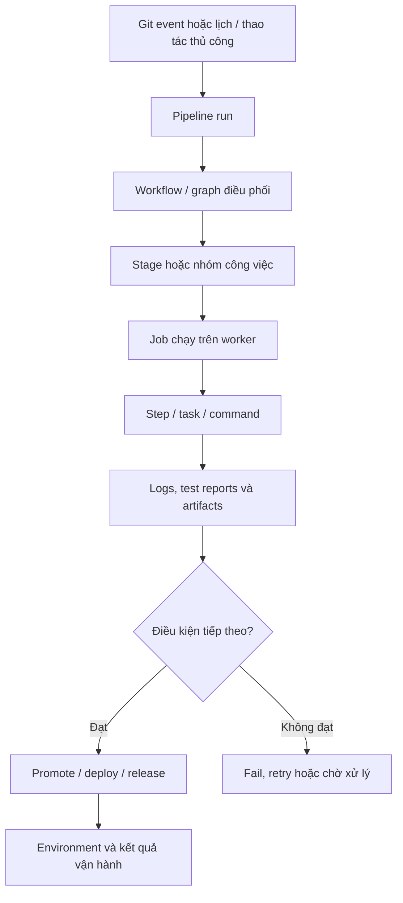

# Nhận diện khác biệt thuật ngữ giữa các nền tảng CI/CD

Các nền tảng CI/CD cùng giải quyết một bài toán: tiếp nhận thay đổi, điều phối công việc tự động, tạo bằng chứng kiểm tra và hỗ trợ đưa phần mềm đến môi trường đích. Tuy nhiên, mỗi nền tảng đặt tên cho các thành phần theo cách riêng. Một khái niệm như `job`, `step`, `stage`, `workflow`, `runner` hay `environment` có thể mang phạm vi khác nhau tùy sản phẩm.

Khi đọc tài liệu, thiết kế pipeline hoặc chuyển đổi giữa các nền tảng, cần hiểu vai trò và ranh giới thực thi của thành phần trước khi ghép các tên gọi. Nếu chỉ dịch từ khóa theo nghĩa đen, ta dễ chuyển sai quan hệ phụ thuộc, chạy sai mức song song, cấp quyền quá rộng hoặc làm mất điều kiện phê duyệt. Bài này xây dựng một từ điển đối chiếu giữa GitHub Actions, GitLab CI/CD, Jenkins, Azure Pipelines và CircleCI, đồng thời chỉ ra những điểm không thể quy đổi một-một.

## 1. Bắt đầu từ mô hình chung

Một pipeline có thể được nhìn như một đồ thị công việc. Sự kiện khởi chạy tạo một lần chạy; bộ điều phối xác định các đơn vị công việc, quan hệ phụ thuộc và điều kiện thực thi; worker nhận việc; từng đơn vị chạy các lệnh hoặc tác vụ; kết quả được lưu lại và có thể mở đường cho bước tiếp theo.



Đây là mô hình khái niệm, không phải cấu trúc bắt buộc của mọi sản phẩm. Có nền tảng có một đối tượng `pipeline` chứa `stages`, `jobs` và `steps`; nền tảng khác dùng `workflow` làm bộ điều phối ở cấp cao; Jenkins có thể mô tả gần như toàn bộ luồng bằng một Jenkinsfile; một số hệ thống không có đối tượng `stage` riêng.

Khi so sánh, hãy hỏi sáu câu:

1. Đối tượng nào nhận sự kiện và tạo một lần chạy?
2. Đối tượng nào mô tả đồ thị phụ thuộc hoặc thứ tự thực thi?
3. Đơn vị nào được lập lịch cho một máy/worker?
4. Thành phần nhỏ nhất nào thực thi lệnh hoặc plugin?
5. Đầu ra, cache và trạng thái chia sẻ được lưu ở đâu?
6. Điều kiện phê duyệt, quyền truy cập và môi trường triển khai được gắn vào đối tượng nào?

## 2. Bảng thuật ngữ tổng quan giữa các nền tảng

Bảng sau là điểm bắt đầu để đọc tài liệu. Các ô ghi nhiều tên có nghĩa là những thành phần có vai trò gần nhau, không khẳng định chúng có hành vi giống hệt nhau.

| Vai trò khái niệm | GitHub Actions | GitLab CI/CD | Jenkins | Azure Pipelines | CircleCI |
|---|---|---|---|---|---|
| Định nghĩa luồng | Workflow | Pipeline (`.gitlab-ci.yml`) | Pipeline/Jenkinsfile | Pipeline (`azure-pipelines.yml`) | Config + workflow |
| Điều phối nhóm công việc | Jobs và dependency trong workflow | Stages, `needs`, jobs và downstream pipelines | Stages, parallel branches, `post` và logic Pipeline | Stages, jobs, dependencies | Workflow và job dependencies |
| Đơn vị được lập lịch | Job | Job | Agent/node thực thi Pipeline hoặc phần việc; executor là năng lực chạy | Job | Job |
| Đơn vị lệnh nhỏ | Step; step có thể `run` hoặc `uses` action | `script`, `before_script`, `after_script` trong job; một số từ khóa tạo hành vi phụ trợ | Step trong Pipeline DSL | Step: script hoặc task | Step: command hoặc action |
| Thành phần tái sử dụng | Action, reusable workflow | `include`, component, child pipeline | Shared Library, plugin, function | Template, task, task group, deployment job | Orb, reusable command/job/executor |
| Worker | Runner | Runner | Agent/node; executor quyết định cách cấp môi trường | Agent trong agent pool | Executor/resource class và môi trường thực thi |
| Nhóm tài nguyên triển khai | Environment và deployment | Environment, deployment và protected environment | Thường mô hình hóa bằng stage, agent, plugin và cấu hình ngoài | Environment và resource | Context, job/executor và cấu hình deploy |

Đừng dùng bảng như công cụ thay thế máy móc. Ví dụ, `GitHub Actions step` và `GitLab CI job` không tương đương: step nằm bên trong job, còn job GitLab là đơn vị được runner nhận và thực thi. So sánh đúng cấp độ là điều kiện đầu tiên khi chuyển pipeline.

## 3. Workflow, pipeline và lần chạy

### 3.1. Workflow trong GitHub Actions

GitHub Actions lưu workflow dưới dạng YAML trong `.github/workflows/`. Một workflow có tên, một hoặc nhiều trigger trong `on`, và các `jobs`. Mỗi job có thể khai báo runner bằng `runs-on`, các bước trong `steps`, dependency qua `needs`, điều kiện qua `if` và quyền qua `permissions`.

```yaml
name: Verify pull request

on:
  pull_request:
    branches: [main]

permissions:
  contents: read

jobs:
  test:
    runs-on: ubuntu-latest
    steps:
      - uses: actions/checkout@v4
      - name: Run tests
        run: ./gradlew check
```

Một lần workflow được kích hoạt tạo workflow run. Trong workflow run có các job run; job chứa các step. Một workflow có thể chạy song song nhiều job nếu không có dependency ngăn cản. `needs` mô tả job nào phải hoàn tất trước job khác.

### 3.2. Pipeline trong GitLab CI/CD

GitLab thường gọi toàn bộ lần thực thi CI/CD là pipeline. Cấu hình được khai báo trong `.gitlab-ci.yml`. Pipeline chứa jobs; jobs có thể được nhóm theo `stages`, hoặc điều phối theo dependency rõ ràng bằng `needs`. Một stage truyền thống chạy sau stage trước; các job trong cùng stage có thể chạy song song nếu runner sẵn sàng.

```yaml
stages:
  - verify
  - package

unit_tests:
  stage: verify
  image: gradle:8-jdk21
  script:
    - gradle test

package_app:
  stage: package
  image: gradle:8-jdk21
  script:
    - gradle assemble
  needs:
    - unit_tests
```

GitLab cũng có thể tạo parent-child pipeline hoặc multi-project downstream pipeline. Những pipeline con này mở rộng cấu trúc thành nhiều đồ thị liên kết nhau. `include` dùng để nạp và hợp nhất cấu hình; `trigger` có thể khởi chạy child hoặc downstream pipeline; `needs:pipeline` biểu diễn quan hệ phụ thuộc vào trạng thái pipeline của project khác, còn `needs:pipeline:job` có thể lấy artifact từ job của pipeline liên quan. Không nên coi các từ khóa này là những cách viết khác nhau của một job thông thường.

### 3.3. Pipeline trong Jenkins

Jenkins Pipeline thường được định nghĩa bằng `Jenkinsfile`, viết theo Declarative Pipeline hoặc Scripted Pipeline. Với Declarative Pipeline, cấu trúc phổ biến gồm `pipeline`, `agent`, `stages`, `stage`, `steps` và các khối như `post`, `environment`, `options`, `parameters`.

```groovy
pipeline {
    agent any

    stages {
        stage('Verify') {
            steps {
                sh './gradlew check'
            }
        }
        stage('Package') {
            steps {
                sh './gradlew assemble'
            }
        }
    }

    post {
        always {
            archiveArtifacts artifacts: 'build/libs/*.jar', fingerprint: true
        }
    }
}
```

Jenkins Pipeline là mô tả luồng điều phối và các bước thực thi. Trong Jenkins, từ `node` trong Scripted Pipeline hoặc `agent` trong Declarative Pipeline gắn phần việc với môi trường thực thi. Một Jenkins stage thường là nhóm logic để quan sát và tổ chức; nó không nhất thiết là một máy riêng hoặc một job độc lập như trong nền tảng khác.

### 3.4. Pipeline trong Azure Pipelines

Azure Pipelines dùng `pipeline` làm cấu trúc cấp cao, thường khai báo trong `azure-pipelines.yml`. Một pipeline có thể chứa `stages`, mỗi stage chứa `jobs`, mỗi job chứa `steps`. Step có thể là script hoặc một task được cung cấp bởi nền tảng/extension.

```yaml
trigger:
  branches:
    include:
      - main

pool:
  vmImage: ubuntu-latest

stages:
  - stage: Verify
    jobs:
      - job: Tests
        steps:
          - script: ./gradlew check
            displayName: Run tests

  - stage: Package
    dependsOn: Verify
    jobs:
      - job: Build
        steps:
          - script: ./gradlew assemble
            displayName: Build application
```

Azure phân biệt `stage`, `job`, `step` và `task` khá rõ. `task` là một loại step đóng gói logic có đầu vào, phiên bản và giao diện cấu hình; script step chạy lệnh trực tiếp. Một deployment job có thể nhắm đến environment và hỗ trợ lịch sử deployment, approval hoặc checks tùy cấu hình.

### 3.5. Workflow trong CircleCI

CircleCI lưu cấu hình trong `.circleci/config.yml`. `jobs` mô tả công việc cần thực hiện; `workflows` điều phối thứ tự, điều kiện và quan hệ giữa các job. Job có `steps`; mỗi step có thể là command, checkout hoặc lệnh tái sử dụng. Executor mô tả môi trường chạy, chẳng hạn Docker, machine hoặc môi trường khác được hỗ trợ.

```yaml
version: 2.1

jobs:
  verify:
    docker:
      - image: cimg/openjdk:21.0
    steps:
      - checkout
      - run: ./gradlew check

  package:
    docker:
      - image: cimg/openjdk:21.0
    steps:
      - checkout
      - run: ./gradlew assemble

workflows:
  build_and_test:
    jobs:
      - verify
      - package:
          requires:
            - verify
```

Trong CircleCI, `workflow` là bộ điều phối job, còn `job` là đơn vị thực thi. Điều này có thể khiến người quen với GitHub Actions nghĩ `workflow` của hai nền tảng giống nhau hoàn toàn. Vai trò ở cấp cao tương đối gần nhau, nhưng cấu trúc cấu hình, trigger, điều kiện và cơ chế tái sử dụng khác nhau.

## 4. Stage, job, step và task: khác nhau ở đâu?

Đây là nhóm từ dễ gây nhầm nhất vì nhiều nền tảng dùng cùng một từ nhưng đặt nó ở cấp độ khác nhau.

### 4.1. Stage là nhóm hoặc pha điều phối

Stage thường biểu diễn một pha lớn như Verify, Build, Test, Deploy to Staging hoặc Release. Nó giúp tổ chức pipeline, thể hiện thứ tự và có thể là điểm gắn điều kiện, approval hoặc giới hạn concurrency.

- GitLab có `stages` là thứ tự stage mặc định của pipeline. Job được gắn vào stage bằng thuộc tính `stage`.
- Azure Pipelines có `stages` là cấp cao chứa jobs, có `dependsOn`, `condition` và nhiều cơ chế kiểm soát.
- Jenkins Declarative Pipeline có `stages` chứa các `stage`; stage có thể có agent, when, parallel hoặc options riêng.
- GitHub Actions không có đối tượng `stage` tích hợp ở cấp workflow. Có thể mô phỏng các pha bằng job, tên job, `needs` và reusable workflow.
- CircleCI không có stage tổng quát tương đương trong cấu trúc workflow; job được sắp xếp bằng workflow graph. Có thể dùng tên job hoặc reusable component để thể hiện pha.

Vì vậy, khi chuyển một GitLab stage sang GitHub Actions, thường phải chuyển các job của stage thành jobs riêng và khai báo `needs` giữa các nhóm. Không thể chỉ đổi `stage:` thành một khóa YAML có tên tương tự.

### 4.2. Job là đơn vị được lập lịch

Job thường là một đơn vị mà bộ điều phối xếp lịch cho worker, với môi trường, timeout, biến và trạng thái riêng. Các job độc lập có thể chạy song song; job phụ thuộc phải chờ đầu vào hoặc kết quả từ job khác.

Tuy nhiên, trong Jenkins, một Jenkins Pipeline có thể được thực thi trên agent và chia thành nhiều stage; các stage không tự động tương đương với nhiều job độc lập trên một hệ thống khác. Khi so sánh Jenkins với GitHub Actions, đôi khi một Jenkins stage là phần tương ứng về mặt mục đích với một GitHub job, nhưng về mặt tài nguyên và vòng đời thực thi thì cần kiểm tra `agent`, `node`, `parallel` và cách chia Pipeline.

### 4.3. Step là thao tác bên trong job

Step thường là lệnh hoặc hành động nhỏ trong job: checkout mã, cài công cụ, chạy test, upload artifact hoặc gửi thông báo. Các step trong cùng job thường chia sẻ cùng workspace và môi trường thực thi, trừ khi nền tảng hoặc cấu hình thay đổi điều đó.

GitHub Actions và CircleCI có khái niệm step tường minh. Azure Pipelines cũng có step. Jenkins Declarative Pipeline có khối `steps`, chứa các lệnh Pipeline DSL. GitLab CI/CD không dùng một lớp `steps` tương đương trong định nghĩa job thông thường: `script` chứa một hoặc nhiều lệnh shell được runner thực thi theo cách của GitLab.

Do đó, một danh sách GitLab `script` không nên được chuyển thành nhiều GitHub job chỉ vì mỗi dòng lệnh trông giống một bước. Thường chúng nên trở thành các `steps` trong cùng một job để giữ workspace và trạng thái build.

### 4.4. Task và action là thành phần đóng gói

`Task` trong Azure Pipelines là thành phần thực thi có giao diện đầu vào/đầu ra, thường được cung cấp bởi built-in task hoặc extension. `Action` trong GitHub Actions là đơn vị tái sử dụng có thể được gọi trong một step qua `uses`; action có thể là JavaScript, Docker hoặc composite action. CircleCI có command, orb và các thành phần tái sử dụng; Jenkins có Pipeline steps từ core hoặc plugin, cùng Shared Library.

Các thành phần này gần nhau về mục đích đóng gói logic, nhưng khác giao diện, cơ chế version, môi trường thực thi và mô hình phân phối. Ví dụ, `uses: actions/checkout@v4` là một action được gọi trong step; nó không phải một job. Azure `task: PublishBuildArtifacts@1` là một task được cấu hình như step; nó cũng không phải một stage.

## 5. Runner, agent, node, executor và pool

Các từ này đều liên quan đến nơi công việc chạy, nhưng có thể chỉ một máy, một tiến trình worker, một cấu hình môi trường hoặc một nhóm tài nguyên.

| Nền tảng | Thuật ngữ | Ý nghĩa thực tế |
|---|---|---|
| GitHub Actions | Runner | Máy hoặc môi trường nhận và chạy job; có hosted runner và self-hosted runner |
| GitLab CI/CD | Runner | Agent dịch vụ nhận job từ GitLab và thực thi bằng executor như shell, Docker hoặc Kubernetes |
| Jenkins | Controller, agent/node, executor | Controller điều phối; agent/node cung cấp máy thực thi; executor là slot có thể chạy tác vụ trên node |
| Azure Pipelines | Agent, agent pool | Agent chạy job; pool là nhóm agent được tổ chức và phân quyền |
| CircleCI | Executor, resource class | Executor xác định loại môi trường chạy job; resource class chọn mức tài nguyên trong các môi trường hỗ trợ |

### 5.1. Không đồng nhất runner với executor

Trong GitHub Actions, `runs-on` chọn loại runner hoặc label của self-hosted runner. Trong GitLab, runner là thành phần nhận job; cấu hình runner xác định executor dùng để tạo môi trường chạy. Trong CircleCI, `docker`, `machine` hoặc executor tùy chỉnh mô tả môi trường job. Vì thế, khi chuyển `runs-on: ubuntu-latest` sang CircleCI, cần chọn image/executor phù hợp; không tìm một khóa có tên `runner` tương đương.

### 5.2. Controller và worker trong Jenkins

Jenkins Controller chịu trách nhiệm giao diện, cấu hình, lập lịch và điều phối. Agent thực thi công việc. Mỗi node có thể có một hoặc nhiều executor, tùy cấu hình tài nguyên. Nếu controller đồng thời chạy build, tải công việc có thể ảnh hưởng khả năng điều phối và bảo trì. Thiết kế hiện đại thường tách controller khỏi agent thực thi khi quy mô và hạ tầng cho phép.

### 5.3. Self-hosted runner và agent pool

Self-hosted runner hoặc agent riêng giúp truy cập mạng nội bộ, phần cứng đặc thù và công cụ riêng. Đổi lại, nhóm phải quản lý cập nhật, cô lập job, xóa workspace, credential, network egress và vòng đời máy. Không nên để job không đáng tin chạy trên worker có quyền truy cập tài nguyên nhạy cảm. Cần phân pool/label theo mức tin cậy và nhiệm vụ.

## 6. Artifact, cache và workspace

Ba khái niệm này thường bị gọi chung là “file pipeline”, nhưng có mục tiêu và vòng đời khác nhau.

### 6.1. Artifact là đầu ra cần lưu hoặc chuyển giao

Artifact là kết quả được tạo ra từ job hoặc pipeline và có ý nghĩa cho bước tiếp theo hay cho người dùng: binary, package, container image, test report, coverage report hoặc file phát hành. Artifact thường cần thời hạn lưu giữ, quyền truy cập và định danh rõ ràng.

| Nền tảng | Cơ chế thường gặp |
|---|---|
| GitHub Actions | `upload-artifact` / `download-artifact`; package và container image thường được lưu ở registry |
| GitLab CI/CD | `artifacts` của job; package/container registry cho đầu ra phát hành |
| Jenkins | `archiveArtifacts`, fingerprint hoặc plugin lưu trữ; registry ngoài cho image/package |
| Azure Pipelines | Pipeline artifacts hoặc build artifacts; package feed và container registry |
| CircleCI | `store_artifacts` để lưu đầu ra có thể tải; registry hoặc dịch vụ ngoài cho package/image |

Artifact của job không nhất thiết là artifact phát hành production. Ví dụ, báo cáo test là artifact phục vụ kiểm tra; JAR hoặc image có digest là đầu ra có thể được promote. Cần giữ liên kết từ artifact phát hành đến commit và lần chạy đã tạo nó.

### 6.2. Cache nhằm tăng tốc

Cache giữ dữ liệu có thể tạo lại, như dependency đã tải hoặc kết quả trung gian, để giảm thời gian chạy. Cache không nên là nguồn sự thật duy nhất cho artifact hoặc dữ liệu cần phát hành. Cache miss phải không làm pipeline sai; cache hit không được khiến pipeline dùng nhầm dữ liệu của revision hoặc môi trường khác.

Các nền tảng có cách khai báo key, restore key, phạm vi chia sẻ và eviction khác nhau. Khi chuyển đổi, phải kiểm tra cache có được chia sẻ giữa branch, job hoặc project hay không; khóa cache có bao gồm phiên bản toolchain và lockfile hay không; và cache có chứa dữ liệu nhạy cảm hay không.

### 6.3. Workspace và dữ liệu giữa các job

Workspace là thư mục làm việc mà job dùng để checkout mã và tạo file. Nhiều nền tảng tạo workspace riêng cho mỗi job, vì vậy file tạo ở job A không tự động có mặt trong job B. Muốn truyền file cần dùng artifact, cache hoặc cơ chế workspace/dependency được nền tảng cung cấp.

CircleCI có `persist_to_workspace` và `attach_workspace` để chia sẻ dữ liệu giữa các job trong workflow. Jenkins có thể giữ workspace trên agent hoặc dùng `stash`/`unstash` cho dữ liệu giữa các stage/agent trong phạm vi Pipeline. GitHub Actions thường dùng artifact để chuyển file giữa các job; GitLab có thể dùng artifacts và `needs` để lấy đầu ra. Azure có pipeline artifacts và các cơ chế liên quan. Cần chọn đúng công cụ theo mục tiêu, không mặc định workspace của hai job là cùng một thư mục.

## 7. Environment, deployment và approval

Từ `environment` không có cùng phạm vi trên mọi nền tảng.

- **GitHub Actions:** environment là đối tượng repository có thể gắn secret, protection rules, reviewer và deployment history. Job khai báo `environment` để triển khai đến đó.
- **GitLab:** environment biểu diễn đích triển khai như staging hoặc production; deployment được ghi nhận theo environment. Protected environments và deployment approvals tùy tier/cấu hình hỗ trợ.
- **Azure Pipelines:** environment là tập hợp tài nguyên đích như Kubernetes cluster, VM hoặc resource khác, có lịch sử deployment và có thể gắn approvals/checks ở phía resource/environment.
- **Jenkins:** không có một đối tượng environment lõi duy nhất giống các nền tảng trên. Environment thường được biểu diễn bằng stage, tham số, credentials, agent, plugin hoặc hệ thống triển khai ngoài.
- **CircleCI:** context thường dùng để cấp biến/secret cho job theo quyền; job/executor và cấu hình triển khai xác định nơi chạy. Khái niệm environment deployment có thể được tích hợp qua công cụ bên ngoài hoặc mô hình cấu hình riêng.

Phê duyệt có thể nằm trong giao diện quản lý môi trường, resource check, manual job hoặc input step. Khi chuyển đổi, cần xác định rõ ai có quyền phê duyệt, điều kiện nào phải đạt, phê duyệt có gắn với đúng artifact/revision không và việc từ chối sẽ dừng ở đâu.

Một biến `ENVIRONMENT=production` trong YAML không tự tạo ra một môi trường được bảo vệ. Tên biến chỉ là dữ liệu cấu hình; bảo vệ thực sự cần chính sách quyền, secret scope, approval và kiểm soát deployment ở nền tảng hoặc hệ thống đích.

## 8. Trigger, điều kiện và quan hệ phụ thuộc

Các nền tảng đều có cách kích hoạt theo Git event, lịch, thao tác thủ công hoặc sự kiện từ hệ thống khác, nhưng cú pháp và ngữ nghĩa bộ lọc khác nhau.

| Nền tảng | Ví dụ trigger/điều kiện |
|---|---|
| GitHub Actions | `on: push`, `pull_request`, `workflow_dispatch`, `schedule`; điều kiện job/step bằng `if` |
| GitLab CI/CD | Pipeline source, `rules`, `workflow: rules`, `only/except` ở cấu hình cũ; downstream trigger |
| Jenkins | Webhook, SCM polling, cron trong `triggers`, tham số và điều kiện Pipeline/plugin |
| Azure Pipelines | `trigger`, `pr` tùy loại repository, `schedules`, pipeline completion và `condition` |
| CircleCI | `workflows` filters theo branch/tag, schedule trigger và pipeline parameters/conditions |

Không nên chuyển cú pháp lọc branch bằng cách thay tên trường. Ví dụ, GitHub Actions có `pull_request.branches` để lọc nhánh đích của pull request; `push.branches` lọc nhánh nhận push. GitLab `rules` đánh giá biểu thức và thay đổi việc thêm job vào pipeline; `workflow: rules` có thể quyết định có tạo pipeline hay không. Hai cấp quyết định này khác nhau.

Tương tự, `needs` của GitHub Actions xác định job phụ thuộc; GitLab `needs` có thể điều chỉnh đồ thị thực thi và tải artifacts từ job được nêu; Azure `dependsOn` điều phối stage/job; CircleCI `requires` khai báo quan hệ job trong workflow; Jenkins thường thể hiện thứ tự qua cấu trúc stage, `parallel`, `when` hoặc logic Scripted Pipeline. Hãy chuyển cả đồ thị phụ thuộc, không chỉ chuyển tên khóa.

## 9. Biến, secret và danh tính

Biến pipeline thường được dùng để cấu hình build, chọn môi trường hoặc truyền metadata. Secret là dữ liệu xác thực cần được bảo vệ. Các nền tảng có mô hình scope khác nhau:

| Nền tảng | Cơ chế thường gặp | Câu hỏi cần kiểm tra |
|---|---|---|
| GitHub Actions | `env`, `vars`, `secrets`, environment secrets, `GITHUB_TOKEN`, OIDC | Secret thuộc repository, organization hay environment? Token có quyền gì? |
| GitLab CI/CD | CI/CD variables, masked/protected variables, file variables, OIDC ID tokens | Biến có protected theo branch/tag không? Có bị expose cho fork pipeline không? |
| Jenkins | `environment`, Credentials Binding, credential store, plugin | Credential scope nào? Log có thể in giá trị không? Agent có được truy cập credential không? |
| Azure Pipelines | Variables, secret variables, variable groups, secure files, service connections | Variable group/service connection có approval và authorization scope không? |
| CircleCI | Environment variables, project settings, contexts, OIDC tokens | Context nào được job dùng? Ai được phép dùng context đó? |

Tên `secret`, `context`, `variable group` hoặc `credentials` không bảo đảm mức bảo vệ tương đương. Khi chuyển đổi, cần lập danh sách secret theo mục đích, môi trường, người dùng và job; sau đó tạo scope mới theo nguyên tắc quyền tối thiểu. Không sao chép tất cả secret cấp project vào mọi job.

Ưu tiên danh tính ngắn hạn hoặc liên kết danh tính như OIDC khi nhà cung cấp đích hỗ trợ. Cần giới hạn audience, subject, repository, branch, environment và quyền của role ở phía cloud. Không xem OIDC là tự động an toàn nếu trust policy cho phép mọi repository hoặc mọi nhánh.

## 10. Thành phần tái sử dụng: action, include, library, template và orb

Mỗi nền tảng có cách đóng gói logic dùng chung:

- **GitHub Actions:** action là đơn vị được gọi trong step; reusable workflow cho phép tái sử dụng một workflow/job graph theo cơ chế `workflow_call`. Hai khái niệm này khác cấp độ.
- **GitLab CI/CD:** `include` ghép cấu hình từ file/project/template; `extends` kế thừa cấu hình; CI/CD components và child pipelines hỗ trợ tổ chức pipeline mô-đun. Cần pin ref khi dùng cấu hình từ project khác.
- **Jenkins:** plugin bổ sung khả năng cho Jenkins; Shared Library cung cấp hàm và bước dùng lại trong Jenkinsfile. Plugin và Shared Library không phải một khái niệm.
- **Azure Pipelines:** YAML template tái sử dụng cấu trúc; task đóng gói hành động; task group là cách tổ chức một số nhóm tác vụ trong giao diện/classic pipeline. Template có thể tham số hóa stage, job hoặc step.
- **CircleCI:** orb đóng gói commands, jobs và executors để chia sẻ; command là chuỗi step tái sử dụng. Orb version và namespace cần được quản lý.

Khi tái sử dụng, kiểm tra nguồn, phiên bản, quyền, đầu vào, đầu ra và chính sách cập nhật. Tham chiếu một nhánh trôi nổi như `main` làm thay đổi hành vi pipeline mà không có thay đổi tương ứng trong repository sử dụng. Với thành phần có ảnh hưởng đến production, nên pin version/revision và cập nhật qua pull request có review.

## 11. Những cặp thuật ngữ dễ nhầm

### 11.1. Pipeline và workflow

Trong GitLab và Azure, `pipeline` thường là đối tượng cấp cao của lần chạy và cấu hình. Trong GitHub Actions, `workflow` là định nghĩa luồng chạy được trigger; trong CircleCI, `workflow` là bộ điều phối jobs trong config. Jenkins thường gọi toàn bộ định nghĩa và lần chạy là Pipeline. Vì thế, khi một tài liệu nói “workflow”, hãy xác định nó đang nói về file cấu hình, đồ thị điều phối hay một lần chạy.

### 11.2. Stage và job

GitLab stage là pha chứa nhiều jobs; Azure stage chứa jobs; Jenkins stage nhóm các steps; GitHub Actions không có stage built-in; CircleCI điều phối jobs trực tiếp trong workflow. Cùng từ `stage` nhưng ranh giới tài nguyên và thực thi có thể khác nhau.

### 11.3. Job và step

Job thường được lập lịch và có môi trường riêng. Step chạy bên trong job. Nếu chuyển từng step thành job, pipeline có thể tạo nhiều runner, checkout lặp, mất workspace và tăng thời gian. Nếu gộp các job độc lập thành step, pipeline có thể mất khả năng song song và cô lập lỗi.

### 11.4. Runner và agent

GitHub và GitLab gọi worker là runner; Jenkins gọi agent/node; Azure gọi agent; CircleCI mô tả executor. Cần phân biệt máy thực thi, tiến trình worker, pool và cấu hình container. Một runner có thể chạy nhiều job theo chính sách nền tảng; không suy ra rằng một job tương ứng một máy vật lý riêng.

### 11.5. Artifact và cache

Artifact là đầu ra có ý nghĩa và có thể cần lưu giữ/truy vết. Cache chỉ là tối ưu hiệu năng có thể tái tạo. Dùng cache thay artifact có thể khiến một lần chạy phụ thuộc vào trạng thái cũ hoặc không có bằng chứng đầu ra rõ ràng.

### 11.6. Environment và biến môi trường

Environment có thể là đối tượng triển khai được bảo vệ, có lịch sử và approval. Environment variable chỉ là cặp tên/giá trị được cung cấp cho tiến trình. Đặt `DEPLOY_ENV=prod` không đồng nghĩa đã cấu hình production environment an toàn.

## 12. Phương pháp chuyển đổi pipeline giữa các nền tảng

Không bắt đầu bằng việc dịch YAML từng dòng. Hãy lập bản đồ hành vi hiện tại và chuyển từng lớp.

### Bước 1: Thu thập hợp đồng pipeline hiện tại

Ghi lại trigger, branch/tag filters, điều kiện, stage/job graph, runner/agent, biến, secret, artifacts, cache, approvals, deployment environments, retry, timeout và notifications. Với mỗi job, xác định đầu vào, đầu ra, quyền cần có và tác dụng phụ.

### Bước 2: Vẽ đồ thị phụ thuộc

Xác định job nào chạy song song, job nào phải chờ, artifact nào được truyền, job nào có thể bỏ qua và điều kiện nào làm cả pipeline thất bại. Đặc biệt kiểm tra các đường đi khi test fail, approval bị từ chối, deploy lỗi hoặc trigger đến từ fork.

### Bước 3: Ánh xạ theo vai trò

Lập bảng tương ứng cho orchestration, unit of execution, worker, reusable component, artifact, cache, environment, secret và approval. Nếu nền tảng đích không có khái niệm tương ứng trực tiếp, chọn cách mô hình hóa bằng các thành phần của nó và ghi rõ sự khác biệt.

### Bước 4: Chuyển quyền và secret riêng

Thiết kế lại scope của token, credential, OIDC trust, service connection và environment protection. Không mang nguyên quyền rộng từ hệ thống cũ sang hệ thống mới. Job kiểm tra mã không đáng tin không được kế thừa quyền publish hoặc deploy.

### Bước 5: Xác minh tính tương đương hành vi

Chạy song song hai pipeline trên một số revision đại diện nếu có thể. So sánh trạng thái test, nội dung artifact, digest, thời gian, đường đi khi fail, điều kiện approval và log/audit. Không chỉ so sánh trạng thái xanh cuối cùng.

### Bước 6: Chuyển nguồn kích hoạt và đóng luồng cũ

Tránh để hai pipeline cùng publish hoặc deploy production ngoài ý muốn. Chuyển trigger theo từng phạm vi, xác nhận pipeline mới là nguồn phát hành được phép, rồi tắt trigger cũ theo kế hoạch rollback. Giữ bằng chứng và lịch sử cũ theo chính sách lưu trữ.

## 13. Ví dụ ánh xạ một luồng đơn giản

Giả sử yêu cầu là: khi có pull request, chạy kiểm tra; khi thay đổi được tích hợp vào `main`, build package; chỉ triển khai staging sau khi build thành công. Bảng sau thể hiện cách tư duy theo vai trò:

| Ý định | GitHub Actions | GitLab CI/CD | Azure Pipelines |
|---|---|---|---|
| Chạy khi pull request | `on.pull_request` | Merge request pipeline và `rules` phù hợp | `pr` trigger tùy loại repository |
| Kiểm tra mã | Job `verify` với `steps` | Job `verify` trong stage | Job trong stage Verify, có steps/tasks |
| Build sau tích hợp | Job có `if` và `needs` | Job stage package, `rules` và `needs` | Stage/job phụ thuộc stage Verify |
| Chuyển package | Upload/download artifact hoặc registry | `artifacts` hoặc registry | Pipeline artifacts hoặc feed/registry |
| Deploy staging | Job gắn `environment: staging` | Job khai báo `environment` | Deployment job nhắm `environment` |
| Phê duyệt deploy | Environment protection rules | Protected environment/approval nếu được hỗ trợ | Approvals/checks trên environment/resource |

Các ô chỉ là gợi ý cấu trúc. Cú pháp trigger pull request khác nhau đáng kể giữa GitHub, GitLab và Azure; Azure còn có khác biệt theo GitHub repository hay Azure Repos. Trước khi triển khai, cần kiểm tra đúng loại repository và phiên bản/tier của nền tảng đang dùng.

## 14. Checklist đọc và review cấu hình đa nền tảng

- [ ] Đã xác định đúng đối tượng cấp cao: workflow, pipeline hay Jenkins Pipeline.
- [ ] Đã xác định đơn vị nào thực sự được lập lịch: job, agent/node hay cấu trúc Pipeline.
- [ ] Đã phân biệt stage, job, step, task và action theo đúng cấp độ.
- [ ] Đã hiểu worker, executor, agent pool và cách cô lập môi trường.
- [ ] Đã phân biệt artifact, cache và workspace; biết dữ liệu được truyền giữa job bằng cơ chế nào.
- [ ] Đã xác định environment là đối tượng deployment hay chỉ là biến cấu hình.
- [ ] Đã hiểu trigger, branch filter, condition và dependency graph của nền tảng.
- [ ] Đã lập bản đồ secret, credential, variable group/context và quyền của token.
- [ ] Đã xác định cơ chế approval, protected environment và audit trail.
- [ ] Đã pin và review thành phần tái sử dụng như action, orb, include, template, plugin hoặc Shared Library.
- [ ] Đã kiểm tra hành vi khi fail, retry, cancel, timeout và chạy đồng thời.
- [ ] Đã xác minh artifact và kết quả triển khai có thể truy ngược đến commit và lần chạy.

Khi đọc cấu hình CI/CD của một nền tảng mới, hãy bắt đầu từ vai trò của từng thành phần và đồ thị thực thi mà nó tạo ra. Từ vựng có thể khác nhau, nhưng các câu hỏi về trigger, điều phối, worker, lệnh, đầu ra, quyền và môi trường luôn cần được trả lời. Cách tiếp cận này giúp chuyển đổi pipeline dựa trên hành vi thực tế, giảm lỗi do hiểu nhầm tên gọi và giữ được khả năng truy vết từ thay đổi Git đến kết quả phát hành.
