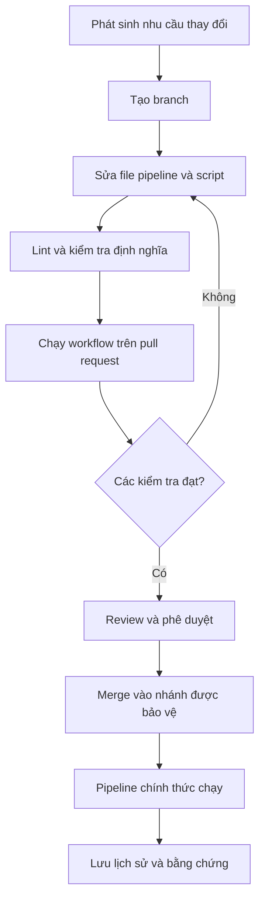

# Lưu định nghĩa pipeline cùng lịch sử thay đổi

Pipeline CI/CD là một phần của hệ thống giao phần mềm. Nó quyết định khi nào công việc tự động được kích hoạt, mã nguồn nào được kiểm tra, công cụ nào được sử dụng, artifact được tạo ra ra sao và ai có quyền đưa phiên bản đến môi trường tiếp theo. Vì vậy, định nghĩa pipeline cũng cần được quản lý như mã nguồn ứng dụng.

**Pipeline as code** là cách mô tả quy trình CI/CD bằng các file có cấu trúc, thường là YAML hoặc ngôn ngữ cấu hình của nền tảng, rồi lưu các file đó trong hệ thống quản lý phiên bản. Mỗi thay đổi pipeline đi qua lịch sử commit, pull request, review và các chính sách bảo vệ nhánh. Nhờ vậy, nhóm có thể biết quy trình đã thay đổi thế nào, ai thay đổi, lý do thay đổi và có thể khôi phục phiên bản trước khi cần.

## 1. Pipeline as code là gì?

Thay vì cấu hình từng job bằng thao tác trên giao diện của máy chủ CI, nhóm khai báo workflow trong repository. File định nghĩa thường mô tả:

- **Trigger:** sự kiện nào khởi chạy pipeline, ví dụ push, pull request, tag hoặc lịch chạy.
- **Job và stage:** các nhóm công việc cần thực hiện và quan hệ phụ thuộc giữa chúng.
- **Step:** lệnh, action hoặc tác vụ cụ thể bên trong job.
- **Môi trường thực thi:** runner, container, phiên bản runtime và công cụ.
- **Điều kiện:** điều kiện chạy, điều kiện bỏ qua, điều kiện thành công và xử lý lỗi.
- **Dữ liệu trao đổi:** biến, cache, artifact và kết quả đầu ra.
- **Quyền và bí mật:** quyền truy cập repository, registry, cloud và secret cần thiết.
- **Quy tắc phát hành:** môi trường đích, yêu cầu phê duyệt và điều kiện promotion.

Ví dụ, repository có thể chứa cấu trúc như sau:

```text
repository/
├── .github/
│   └── workflows/
│       ├── ci.yml
│       └── release.yml
├── scripts/
│   ├── verify.sh
│   └── package.sh
├── .ci/
│   ├── config/
│   └── templates/
├── src/
└── README.md
```

Đây chỉ là một cách tổ chức tham khảo. GitLab CI, Jenkins, Azure Pipelines và các nền tảng khác có quy ước tên file và thư mục riêng. Điều quan trọng là định nghĩa pipeline được lưu ở vị trí dễ tìm, có thể review và gắn với phiên bản mã nguồn mà nó xử lý.

Pipeline as code không có nghĩa mọi cấu hình đều phải nằm trong một file duy nhất. Một workflow có thể gọi script trong repository, tái sử dụng template hoặc tham chiếu cấu hình môi trường. Tuy nhiên, các thành phần ảnh hưởng đến hành vi phát hành phải có nguồn gốc và phiên bản xác định.

## 2. Vì sao cần lưu pipeline trong hệ thống quản lý phiên bản?

Khi pipeline chỉ tồn tại trong giao diện của một công cụ CI, cấu hình có thể thay đổi mà không tạo ra dấu vết tương ứng trong lịch sử mã nguồn. Một người có thể chỉnh điều kiện chạy, thay phiên bản công cụ hoặc thêm quyền triển khai mà người review mã ứng dụng không nhìn thấy. Khi pipeline hỏng, nhóm cũng khó xác định thay đổi nào đã gây ra lỗi.

Lưu định nghĩa pipeline trong Git mang lại các lợi ích sau:

| Lợi ích | Ý nghĩa trong thực tế |
|---|---|
| Lịch sử thay đổi | Biết ai sửa pipeline, sửa phần nào, thời điểm và commit liên quan |
| Code review | Người có trách nhiệm xem thay đổi trước khi merge |
| Khả năng tái lập | Có thể lấy lại định nghĩa pipeline tại một commit cụ thể |
| Khôi phục | Revert thay đổi lỗi bằng cơ chế quản lý phiên bản quen thuộc |
| Đồng bộ nhóm | Thành viên làm việc trên cùng một định nghĩa đã được review |
| Kiểm toán | Liên kết thay đổi pipeline với yêu cầu, pull request và lần phát hành |
| Tự động hóa kiểm tra | Có thể lint, validate và kiểm thử định nghĩa pipeline trong CI |

Ví dụ, một thay đổi làm cho job deploy chạy trên mọi pull request có thể được phát hiện trong diff trước khi merge. Reviewer nhìn thấy trigger và quyền của job ngay trong cùng quy trình review mã nguồn.

Lịch sử Git cũng cho phép đối chiếu pipeline tại thời điểm một artifact được tạo. Điều này hữu ích khi cần điều tra vì sao cùng một commit nhưng hai lần build lại có kết quả khác nhau: nhóm có thể so sánh định nghĩa pipeline, script, dependency và phiên bản công cụ được dùng trong từng lần chạy.

## 3. Tổ chức file pipeline để dễ đọc và bảo trì

Cách chia file nên phản ánh ranh giới trách nhiệm. Với repository nhỏ, một workflow CI có thể đủ. Khi có nhiều loại trigger hoặc nhiều luồng phát hành, có thể tách thành các workflow độc lập.

Một cách phân chia thường gặp:

| File hoặc thư mục | Trách nhiệm |
|---|---|
| `.github/workflows/ci.yml` | Kiểm tra pull request và commit trên nhánh chính |
| `.github/workflows/release.yml` | Tạo bản phát hành từ tag hoặc yêu cầu phát hành |
| `.github/workflows/deploy-staging.yml` | Triển khai staging nếu cần workflow riêng |
| `scripts/` | Script kiểm tra, đóng gói hoặc triển khai có thể chạy lại |
| `.ci/templates/` | Template dùng chung giữa nhiều workflow |
| `docs/ci-cd.md` | Giải thích luồng chạy, điều kiện và cách xử lý lỗi |

Không nên tách file chỉ vì một workflow có nhiều dòng. Nếu việc tách khiến người đọc phải mở quá nhiều file để hiểu một luồng đơn giản, cấu trúc đó làm tăng chi phí bảo trì. Ngược lại, khi CI, release và deploy có trigger, quyền hoặc người sở hữu khác nhau, tách riêng giúp review và kiểm soát tốt hơn.

Các quy ước nên thống nhất trong repository:

- Tên workflow và job nói rõ mục đích, chẳng hạn `validate`, `test`, `build`, `publish`.
- Tên biến thể hiện phạm vi và đơn vị, ví dụ `JAVA_VERSION`, `IMAGE_NAME`.
- Script có thể chạy cục bộ khi phù hợp, để lập trình viên tái hiện lỗi mà không cần chờ máy chủ CI.
- Cấu hình mặc định được đặt gần nơi sử dụng; giá trị theo môi trường được quản lý ở đúng lớp cấu hình.
- Comment giải thích lý do của quyết định đặc biệt, không lặp lại điều mà tên job hoặc câu lệnh đã nói rõ.

## 4. Ví dụ: định nghĩa CI bằng GitHub Actions

Ví dụ dưới đây dùng GitHub Actions để minh họa một workflow CI cho dự án Java Maven. Workflow chạy khi có pull request và khi push lên nhánh `main`. Nó chỉ cấp quyền đọc repository, cài Java 21 và chạy Maven Wrapper để kiểm tra dự án.

```yaml
name: CI

on:
  pull_request:
    branches:
      - main
  push:
    branches:
      - main

permissions:
  contents: read

concurrency:
  group: ci-${{ github.workflow }}-${{ github.ref }}
  cancel-in-progress: true

jobs:
  verify:
    name: Verify source
    runs-on: ubuntu-latest

    steps:
      - name: Check out source
        uses: actions/checkout@v4

      - name: Set up Java
        uses: actions/setup-java@v4
        with:
          distribution: temurin
          java-version: '21'
          cache: maven

      - name: Run verification
        run: ./mvnw --batch-mode verify
```

Đọc workflow theo thứ tự:

1. `name` đặt tên dễ nhận diện cho workflow.
2. `on` khai báo hai loại sự kiện. Pull request hướng đến `main` sẽ được kiểm tra; push lên `main` cũng chạy kiểm tra.
3. `permissions` giới hạn token mặc định ở quyền đọc nội dung repository.
4. `concurrency` gom các lần chạy cùng workflow và cùng ref vào một nhóm. Khi có lần chạy mới trong nhóm, lần cũ có thể bị hủy theo cấu hình.
5. `jobs.verify` khai báo job chạy trên runner Ubuntu.
6. Các step checkout mã nguồn, thiết lập JDK và chạy lệnh verify.

Ví dụ này là workflow kiểm tra mã nguồn tối giản. Nó chưa publish artifact hoặc triển khai production. Khi bổ sung các hành động đó, cần xác định rõ trigger phát hành, quyền ghi registry, môi trường đích, secret và approval. Không nên cấp quyền ghi hoặc bí mật production cho workflow pull request chỉ vì muốn dùng chung một file cấu hình.

Phiên bản action trong ví dụ được ghi rõ bằng tag major để dễ đọc. Với yêu cầu kiểm soát chuỗi cung ứng nghiêm ngặt, tổ chức có thể pin action về commit SHA đầy đủ và cập nhật SHA qua pull request có review. Cần có quy trình định kỳ để cập nhật các action và runner image đã pin, tránh giữ phiên bản cũ quá lâu.

## 5. Thay đổi pipeline qua pull request

Một thay đổi pipeline có thể ảnh hưởng đến mọi commit hoặc mọi bản phát hành sau đó. Vì thế, nên dùng quy trình thay đổi có review tương tự thay đổi mã ứng dụng.

Luồng cơ bản:



Khi tạo pull request, mô tả nên trả lời:

- Vấn đề nào cần giải quyết?
- Trigger, job, quyền hoặc môi trường nào thay đổi?
- Thay đổi ảnh hưởng đến pull request, nhánh chính hay release?
- Có thêm secret, permission hoặc quyền ghi nào không?
- Kiểm tra nào đã chạy và kết quả ra sao?
- Nếu thay đổi gây lỗi, có thể revert bằng cách nào?

Reviewer nên tập trung vào hành vi của pipeline, không chỉ cú pháp YAML. Một file hợp lệ về cú pháp vẫn có thể tạo ra hành vi nguy hiểm, chẳng hạn job deploy chạy quá rộng, bỏ qua test hoặc dùng credential có quyền vượt nhu cầu.

## 6. Kiểm tra định nghĩa pipeline trước khi merge

Định nghĩa pipeline cũng là mã và có thể mắc lỗi. Một quy trình tốt nên kiểm tra nó trước khi thay đổi được đưa vào nhánh chính.

Các lớp kiểm tra thường dùng:

| Lớp kiểm tra | Mục tiêu | Ví dụ |
|---|---|---|
| Syntax validation | Phát hiện YAML hoặc cấu trúc sai | YAML parser, schema validator |
| Linter | Phát hiện cấu hình không hợp lệ hoặc cách dùng đáng ngờ | actionlint cho GitHub Actions |
| Static policy check | Kiểm tra quyền, trigger, pin version và quy tắc tổ chức | Quy tắc cấm quyền write mặc định |
| Script test | Kiểm tra script mà pipeline gọi | ShellCheck, unit test cho script |
| Workflow test | Kiểm tra logic nhánh điều kiện và đầu ra | Công cụ mô phỏng hoặc test trong môi trường thử nghiệm |
| Integration test | Xác minh tương tác với registry hoặc môi trường test | Publish thử vào registry sandbox |

Không phải dự án nào cũng cần tất cả công cụ. Hãy chọn các kiểm tra tương ứng với mức độ phức tạp và tác động của pipeline. Tối thiểu cần xác minh cú pháp, lint các quy tắc quan trọng và chạy workflow trên pull request trước khi merge.

Cũng cần kiểm tra những đường đi ít được chạy: job bị skip, nhánh lỗi, trigger từ tag, lịch chạy, lần chạy thủ công và tình huống thiếu biến cấu hình. Một workflow chỉ được kiểm tra ở đường chạy thành công có thể thất bại khi phát hành thật.

## 7. Bảo vệ lịch sử thay đổi và quyền sửa pipeline

Vì pipeline có thể được dùng để truy cập registry, cloud và production, quyền sửa pipeline cần được kiểm soát phù hợp với quyền sở hữu hệ thống.

Các biện pháp thường dùng:

**Bảo vệ nhánh chính.** Yêu cầu pull request, kiểm tra bắt buộc và review trước khi merge. Hạn chế push trực tiếp hoặc force push vào nhánh phát hành.

**CODEOWNERS hoặc cơ chế sở hữu tương đương.** Chỉ định người hoặc nhóm review các file pipeline, script phát hành và cấu hình hạ tầng quan trọng. Ví dụ:

```text
# .github/CODEOWNERS
/.github/workflows/ @platform-team
/scripts/release/ @release-engineering
```

Đường dẫn và tên nhóm cần được thay bằng cấu trúc, nhóm thực tế của repository. Quy tắc sở hữu chỉ có tác dụng khi branch protection yêu cầu review từ code owner.

**Bắt buộc kiểm tra trước merge.** Những job lint, policy và test cần thiết phải được khai báo là required checks. Tránh cho phép merge khi kiểm tra bắt buộc bị bỏ qua hoặc chưa có kết quả.

**Giới hạn quyền token.** Cấp quyền ở mức thấp nhất có thể cho từng workflow hoặc job. Job đọc mã nguồn không cần quyền ghi package; job test pull request không cần credential production.

**Ghi nhận phê duyệt.** Thay đổi quyền, secret, môi trường production hoặc quy trình release cần reviewer có thẩm quyền phù hợp. Lưu lại lý do và bằng chứng phê duyệt theo chính sách tổ chức.

**Bảo vệ nhánh và tag phát hành.** Tag phát hành nên được bảo vệ theo khả năng của nền tảng. Không để một workflow không đáng tin cậy có thể tự sửa tag hoặc thay artifact đã phát hành.

## 8. Quản lý biến, cấu hình và secret

Pipeline cần dữ liệu để hoạt động, nhưng không phải dữ liệu nào cũng nên lưu trong file định nghĩa.

Có thể chia thành ba nhóm:

| Nhóm | Ví dụ | Cách quản lý |
|---|---|---|
| Giá trị công khai, ít thay đổi | Tên job, phiên bản runtime, đường dẫn script | Lưu trong file pipeline hoặc file cấu hình versioned |
| Cấu hình theo môi trường | URL endpoint, tên namespace, region | Environment variable hoặc cấu hình môi trường được kiểm soát |
| Bí mật | Token registry, cloud credential, signing key | Secret store của nền tảng hoặc secret manager |

Không commit password, private key, access token hoặc credential vào repository. Nếu secret bị lộ, cần thu hồi hoặc xoay vòng credential; xóa dòng khỏi commit mới không làm bí mật biến mất khỏi lịch sử Git.

Khi có thể, hãy dùng credential ngắn hạn, OIDC hoặc workload identity để job nhận quyền có thời hạn và đúng phạm vi. Nếu phải dùng secret tĩnh, giới hạn repository, environment và job được phép truy cập. Không in secret ra log; tránh truyền bí mật qua command line hoặc artifact có thể bị lưu lại.

Với pull request từ fork hoặc nguồn chưa tin cậy, cần coi mã và script trong pull request là dữ liệu có thể gây hại. Không cấp secret hoặc quyền ghi nhạy cảm cho workflow xử lý loại sự kiện này. Nếu cần kiểm tra sâu hơn, chạy trong môi trường cô lập và chỉ cung cấp quyền tối thiểu.

## 9. Tái sử dụng pipeline mà vẫn giữ được khả năng hiểu

Khi nhiều repository có cùng quy trình, nhóm có thể tái sử dụng workflow, template, action hoặc script. Điều này giúp chuẩn hóa cách build, test, scan và phát hành.

Có ba mức tái sử dụng thường gặp:

- **Script dùng chung:** gom các lệnh lặp lại thành script có kiểm thử và gọi từ nhiều workflow.
- **Template hoặc reusable workflow:** đóng gói một nhóm job hoặc quy trình chuẩn để repository khác gọi lại.
- **Action hoặc plugin nội bộ:** đóng gói một thao tác có đầu vào, đầu ra và hợp đồng rõ ràng.

Ví dụ, nhiều dịch vụ có thể dùng cùng quy trình kiểm tra Java, nhưng truyền vào phiên bản JDK hoặc loại build khác nhau. Template cần công bố đầu vào, mặc định, đầu ra, quyền cần thiết và cách xử lý lỗi.

Tái sử dụng cũng tạo ra phụ thuộc. Nếu workflow dùng chung thay đổi, nhiều repository có thể bị ảnh hưởng. Vì vậy:

- Pin phiên bản hoặc ref của thành phần dùng chung.
- Ghi changelog và công bố thay đổi có thể gây mất tương thích.
- Kiểm thử template trước khi phát hành phiên bản mới.
- Cập nhật repository tiêu thụ qua pull request để có lịch sử và review.
- Tránh tạo quá nhiều lớp wrapper khiến người đọc không còn thấy job thực sự chạy gì.

Không nên trừu tượng hóa quá sớm một đoạn YAML chỉ xuất hiện hai lần và còn thay đổi liên tục. Chỉ nên tạo thành phần dùng chung khi hành vi đã ổn định và có ít nhất một hợp đồng rõ ràng.

## 10. Liên kết thay đổi pipeline với lần chạy và bản phát hành

Lưu file pipeline trong Git mới chỉ là một phần của truy vết. Khi một lần chạy bắt đầu, hệ thống cần lưu lại phiên bản định nghĩa đã được sử dụng cùng với mã nguồn và sản phẩm đầu ra.

Một bản ghi phát hành nên liên kết được các thông tin:

```text
Pipeline definition commit
    -> workflow / pipeline run ID
    -> source repository + source commit SHA
    -> test and scan reports
    -> build metadata
    -> artifact name + immutable digest
    -> environment + deployment revision
    -> approval record
    -> post-deployment verification
```

Cần phân biệt commit chứa định nghĩa pipeline với commit mã nguồn đang được build. Trong một số nền tảng, workflow được lấy từ nhánh hoặc commit của sự kiện; trong trường hợp khác, pipeline có thể gọi template từ repository riêng. Hãy ghi nhận cả hai khi chúng khác nhau.

Với workflow dùng template bên ngoài, nên pin về tag bất biến hoặc commit SHA thay vì tham chiếu một nhánh có thể thay đổi. Nếu chỉ lưu tên template mà không lưu phiên bản, việc tái dựng quy trình cũ sẽ khó chính xác.

Artifact nên được triển khai theo digest hoặc định danh bất biến. Khi phát hành, ghi lại pipeline run ID, commit định nghĩa pipeline, commit mã nguồn, digest artifact và deployment revision. Các thông tin này giúp nhóm chứng minh phiên bản production được tạo ra theo quy trình nào.

## 11. Khôi phục khi một thay đổi pipeline gây lỗi

Quản lý phiên bản giúp phục hồi nhanh, nhưng cần hiểu phạm vi của thao tác khôi phục.

**Revert commit** tạo một commit mới đảo ngược thay đổi trước đó. Đây thường là lựa chọn phù hợp trên nhánh dùng chung vì lịch sử vẫn được giữ và các thành viên nhìn thấy rõ quyết định khôi phục.

**Revert pull request** có thể đảo ngược toàn bộ thay đổi của một nhóm commit nếu pull request đã được merge. Cần kiểm tra các thay đổi khác đã được đưa vào sau đó để tránh đảo nhầm nội dung.

**Khôi phục tag hoặc phiên bản template** phù hợp khi lỗi đến từ thành phần dùng chung. Trước khi khôi phục, xác minh phiên bản cũ còn tương thích với các repository đang sử dụng.

**Chạy lại pipeline** chỉ phù hợp khi đầu vào và điều kiện có thể xác định. Nếu workflow hiện tại đã thay đổi, chạy lại một lần phát hành cũ có thể không tái tạo đúng hành vi cũ. Khi cần tái lập, phải xác định commit định nghĩa pipeline, commit mã nguồn, phiên bản template, runner và dependency liên quan.

Revert định nghĩa pipeline không tự động hoàn tác deployment đã xảy ra. Nếu thay đổi đã triển khai ứng dụng hoặc hạ tầng, cần thực hiện quy trình rollback hoặc roll-forward riêng cho tài nguyên đó. Hãy lưu log và artifact của lần chạy lỗi để việc điều tra không mất bằng chứng.

## 12. Những lỗi thường gặp khi áp dụng pipeline as code

| Lỗi | Hệ quả | Cách xử lý |
|---|---|---|
| Chỉ quản lý một phần pipeline trong Git | Cấu hình trên giao diện có thể lệch với file trong repository | Xác định nguồn cấu hình chuẩn, hạn chế thay đổi ngoài quy trình |
| Workflow quá lớn và khó đọc | Review khó phát hiện điều kiện hoặc quyền nguy hiểm | Tách theo trách nhiệm, dùng script và reusable workflow có kiểm soát |
| Dùng tag động cho action/template | Hành vi có thể đổi mà không có commit tương ứng trong repository | Pin phiên bản hoặc commit SHA và cập nhật có review |
| Cấp quyền rộng ở cấp workflow | Một job ít tin cậy có thể dùng quyền không cần thiết | Dùng permission tối thiểu và tách job theo quyền |
| Đưa secret vào YAML hoặc log | Bí mật có thể lộ trong lịch sử và artifact | Dùng secret manager, xoay vòng khi lộ và giới hạn quyền |
| Không kiểm tra pipeline trước merge | Lỗi cấu hình chỉ xuất hiện khi phát hành | Thêm lint, policy check và workflow test |
| Dùng template dùng chung không pin version | Thay đổi upstream làm nhiều repository đổi hành vi | Pin version, changelog và nâng cấp qua pull request |
| Chỉ lưu kết quả xanh/đỏ | Khó tìm nguyên nhân khi sự cố | Lưu run ID, log, report, commit và artifact digest |

## 13. Checklist cho một thay đổi pipeline

Trước khi merge một thay đổi định nghĩa CI/CD, hãy tự kiểm tra:

- [ ] File pipeline nằm trong repository và đúng vị trí quy ước.
- [ ] Trigger chỉ chạy trên các sự kiện và nhánh cần thiết.
- [ ] Job, step và quan hệ phụ thuộc có tên rõ ràng.
- [ ] Runner, runtime, action và template có phiên bản được kiểm soát.
- [ ] Cú pháp và linter đã chạy thành công.
- [ ] Script được pipeline gọi có thể kiểm tra hoặc tái hiện khi cần.
- [ ] Quyền token và credential được giới hạn theo job.
- [ ] Secret không nằm trong file, log, cache hoặc artifact.
- [ ] Pull request từ nguồn chưa tin cậy không nhận quyền nhạy cảm.
- [ ] Thay đổi được review bởi người sở hữu pipeline.
- [ ] Các required checks và branch protection đang được áp dụng.
- [ ] Có cách revert định nghĩa nếu thay đổi gây lỗi.
- [ ] Lần chạy lưu được commit pipeline, commit nguồn và run ID.
- [ ] Thay đổi ảnh hưởng phát hành đã được thử trong môi trường phù hợp.

Khi định nghĩa pipeline được lưu cùng lịch sử Git, mỗi thay đổi quy trình đều có thể đọc, review, kiểm tra và khôi phục. Nhóm có thể giải thích vì sao một job chạy, nó sử dụng quyền nào, được thay đổi qua commit nào và đã tạo ra bản phát hành nào. Đó là nền tảng để CI/CD phát triển có kiểm soát khi số lượng dịch vụ, repository và thành viên tăng lên.

