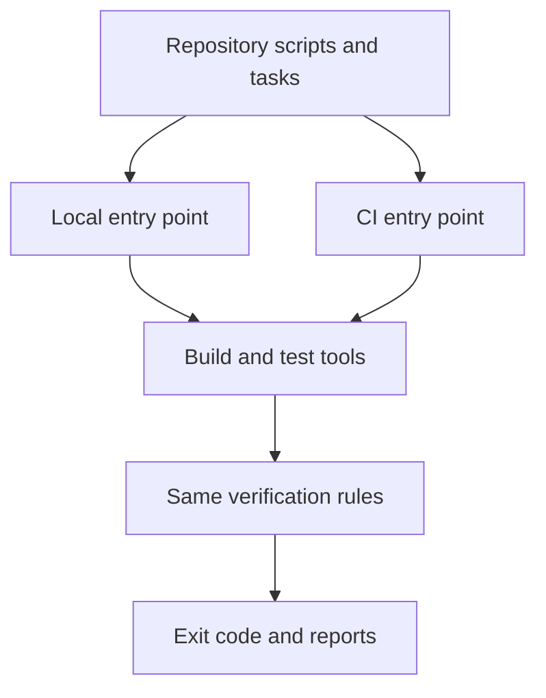

# Tổ chức script có thể chạy cả cục bộ và trong CI

Một quy trình CI/CD đáng tin cậy cần cho kết quả nhất quán dù được chạy trên máy của lập trình viên hay trên runner của hệ thống CI. Nếu lập trình viên phải nhớ một nhóm lệnh riêng, còn pipeline lại có một nhóm lệnh khác, hai môi trường rất dễ kiểm tra những điều không giống nhau. Mã có thể vượt qua kiểm tra ở máy cá nhân nhưng thất bại trên CI, hoặc CI phát hiện lỗi mà lập trình viên không thể tái hiện.

Cách giải quyết là tổ chức các thao tác build, kiểm thử và kiểm tra chất lượng thành những script hoặc task có giao diện rõ ràng, được quản lý cùng mã nguồn và có thể gọi từ nhiều môi trường. Script dùng chung trở thành điểm vào chuẩn cho công việc; pipeline chỉ chuẩn bị môi trường, cung cấp cấu hình và gọi điểm vào đó.

Trong module CI/CD, nguyên lý này giúp giảm khác biệt giữa local và CI, rút ngắn thời gian chẩn đoán, làm cho quy trình dễ onboarding và tạo nền tảng để tự động hóa có thể lặp lại.

## 1. Nguyên tắc: một định nghĩa công việc, nhiều nơi thực thi

Giả sử để kiểm tra một thay đổi, lập trình viên phải chạy lần lượt formatter, linter, unit test và build. Nếu pipeline chỉ chạy build và unit test, hai môi trường đang áp dụng hai tiêu chuẩn khác nhau. Một thay đổi có thể được xem là hoàn tất ở local nhưng bị chặn khi mở pull request.

Thay vì duy trì hai danh sách lệnh, repository nên định nghĩa một task chuẩn, chẳng hạn **verify**. Người phát triển chạy task đó trên máy của mình; pipeline cũng gọi chính task đó sau khi chuẩn bị runner.

Có thể hình dung mối quan hệ như sau:



Điều cần dùng chung là định nghĩa công việc và các quy tắc kiểm tra. Môi trường thực thi có thể khác nhau về hệ điều hành, đường dẫn, quyền truy cập hoặc cách cấp credential, nhưng khác biệt đó cần được quản lý rõ.

Một script dùng chung không có nghĩa local và CI phải có cùng mọi biến môi trường hoặc cùng tài nguyên. Ví dụ, CI có thể lấy credential từ secret manager, còn lập trình viên dùng credential phát triển cục bộ. Hai môi trường vẫn có thể thực hiện cùng một kiểm tra nếu chúng cung cấp các đầu vào hợp lệ theo cùng hợp đồng.

## 2. Phân biệt task, script và pipeline

Ba thành phần này có vai trò khác nhau:

| Thành phần | Trách nhiệm | Ví dụ |
|---|---|---|
| Task | Mô tả một công việc có ý nghĩa trong dự án | verify, test, package, formatCheck |
| Script | Điều phối lệnh, kiểm tra điều kiện và chuẩn hóa cách gọi task | scripts/verify.sh, scripts/release.ps1 |
| Pipeline | Quy định khi nào chạy, trên runner nào, theo thứ tự nào và với quyền gì | Job chạy khi có pull request |

Task nên tập trung vào công việc của dự án. Script nên làm nhiệm vụ điều phối và tạo giao diện dễ dùng. Pipeline nên quản lý trigger, runner, dependency giữa các job, quyền, secret và artifact.

Không nên sao chép toàn bộ logic kiểm thử vào YAML của pipeline nếu logic đó cũng cần chạy trên máy cá nhân. Khi logic bị nhân bản, mỗi bản có thể thay đổi theo thời gian và tạo ra kết quả khác nhau.

Cũng không nên biến một script duy nhất thành nơi chứa mọi logic của ứng dụng, quản lý môi trường và phát hành. Script nên gọi các công cụ hoặc task chuyên trách. Logic nghiệp vụ thuộc về mã ứng dụng; logic build thuộc về build tool; logic điều phối thuộc về script và pipeline.

## 3. Tổ chức cấu trúc script trong repository

Cấu trúc cần giúp người mới tìm được điểm vào và biết script nào dùng cho công việc nào. Một repository Java dùng Gradle có thể tổ chức như sau:

```text
repository/
├── gradlew
├── gradlew.bat
├── settings.gradle.kts
├── build.gradle.kts
├── gradle/
│   └── wrapper/
├── scripts/
│   ├── verify.sh
│   ├── verify.ps1
│   ├── format.sh
│   ├── format.ps1
│   └── release/
│       ├── package.sh
│       └── package.ps1
├── config/
│   └── quality/
└── ci/ hoặc cấu hình CI của nền tảng đang dùng
```

Đây là một ví dụ, không phải cấu trúc bắt buộc. Repository nhỏ có thể chỉ cần Gradle wrapper và một vài task. Khi số lượng script tăng, nên nhóm theo mục đích như kiểm tra, phát hành, migration hoặc quản trị môi trường.

Một số quy tắc đặt tên hữu ích:

- Dùng tên thể hiện hành động và kết quả, ví dụ verify, format-check, package.
- Dùng cùng tên cho task tương đương trên các hệ điều hành.
- Tránh tên quá chung như run.sh, common.ps1 nếu không mô tả được mục đích.
- Giữ script dùng chung ở vị trí dễ tìm, không sao chép vào từng thư mục con.
- Mỗi script cần có mô tả ngắn về đầu vào, đầu ra, yêu cầu môi trường và cách chạy.

Nếu script chỉ là một dòng gọi task chuẩn, hãy cân nhắc gọi trực tiếp task từ Gradle hoặc công cụ tương đương. Một lớp script chỉ có ích khi nó chuẩn hóa đường dẫn, tham số, kiểm tra điều kiện, cách báo lỗi hoặc tương thích môi trường.

## 4. Tạo một điểm vào chuẩn cho công việc

Trước khi viết script, nhóm cần xác định những công việc thường xuyên và tên task chuẩn. Ví dụ:

| Lệnh chuẩn | Mục đích | Khi sử dụng |
|---|---|---|
| verify | Chạy các kiểm tra cần thiết trước khi tích hợp | Local và mọi PR |
| test | Chạy bộ kiểm thử | Khi phát triển hoặc điều tra lỗi test |
| format | Tự động định dạng mã nguồn | Khi lập trình viên chủ động sửa định dạng |
| formatCheck | Kiểm tra định dạng mà không sửa file | CI và trước khi commit |
| build | Tạo đầu ra build | Khi cần tạo artifact |
| clean | Xóa đầu ra build đã sinh | Khi cần kiểm tra build sạch hoặc xử lý trạng thái cũ |

Không nên để verify vừa kiểm tra vừa âm thầm sửa mã nguồn. Một task kiểm tra nên có tính quan sát: nó báo trạng thái đạt hoặc không đạt. Task sửa định dạng nên được đặt tên riêng để lập trình viên chủ động chạy và review diff.

Với Gradle, có thể gom các bước kiểm tra vào task vòng đời check, sau đó tạo task verify làm giao diện thống nhất:

```kotlin
tasks.register("verify") {
    group = "verification"
    description = "Run the checks required before integrating changes."
    dependsOn("check")
}
```

Plugin Java của Gradle cung cấp task check để tổng hợp các kiểm tra được cấu hình cho dự án, thường bao gồm test. Các plugin chất lượng như formatter, static analysis hoặc kiểm tra kiến trúc có thể được gắn vào check theo nhu cầu dự án.

Khi đó, local và CI đều gọi verify. Nếu dự án dùng Maven, có thể chuẩn hóa qua Maven Wrapper và các lifecycle phase hoặc profile phù hợp. Với Node.js, có thể định nghĩa script trong package.json; với Python, có thể dùng task runner hoặc module CLI. Nguyên tắc không phụ thuộc vào một công cụ cụ thể: task chuẩn phải có tên, hợp đồng và hành vi ổn định.

## 5. Script phải tự xác định vị trí repository

Một lỗi phổ biến là script giả định lệnh luôn được gọi từ thư mục gốc. Khi người dùng chạy script từ thư mục khác, các đường dẫn tương đối bị sai và script không tìm thấy build file hoặc dữ liệu cần thiết.

Script nên xác định thư mục của chính nó, tìm root theo quy ước của repository và chuyển đến đúng thư mục trước khi chạy task. Với cấu trúc scripts/verify.sh, ví dụ Bash sau xác định root dựa trên vị trí script:

```bash
#!/usr/bin/env bash
set -Eeuo pipefail

SCRIPT_DIR="$(cd -- "$(dirname -- "$0")" && pwd)"
ROOT_DIR="$(cd -- "$SCRIPT_DIR/.." && pwd)"

cd "$ROOT_DIR"

if [[ ! -x "$ROOT_DIR/gradlew" ]]; then
  printf '%s\n' "Gradle wrapper is missing or not executable." >&2
  exit 2
fi

exec "$ROOT_DIR/gradlew" --no-daemon verify "$@"
```

Script không phụ thuộc vào thư mục hiện tại của người gọi. Lệnh exec thay tiến trình shell bằng Gradle wrapper, nhờ đó exit code của Gradle được trả về trực tiếp cho người gọi. "$@" chuyển tiếp từng tham số mà không ghép chúng thành một chuỗi lệnh.

Tệp Bash cần có quyền thực thi trong Git. Trên hệ điều hành Unix, có thể đặt quyền này bằng chmod +x scripts/verify.sh và commit thay đổi mode vào repository. Nếu quyền thực thi bị mất sau khi checkout, CI có thể báo permission denied dù nội dung script đúng.

Đối với Windows, có thể cung cấp script PowerShell tương đương:

```powershell
$ErrorActionPreference = "Stop"

$Root = Split-Path -Parent $PSScriptRoot
$Wrapper = Join-Path $Root "gradlew.bat"

if (-not (Test-Path -LiteralPath $Wrapper)) {
    [Console]::Error.WriteLine("Gradle wrapper was not found.")
    exit 2
}

Push-Location $Root
try {
    & $Wrapper --no-daemon verify @args
    $Result = $LASTEXITCODE
}
finally {
    Pop-Location
}

exit $Result
```

Hai script có cú pháp khác nhau nhưng gọi cùng task verify, vì vậy quy tắc build và kiểm thử vẫn nằm ở một nơi. Nếu dự án có thể chuẩn hóa môi trường bằng container hoặc dùng một runtime đa nền tảng, nhóm có thể giảm số script hệ điều hành cần duy trì.

Không nên tự suy đoán root bằng cách tìm một tên thư mục chung có thể xuất hiện ở nhiều cấp. Nếu repository có marker rõ như settings.gradle.kts, .git hoặc file cấu hình dự án, có thể dùng marker đó để xác định root và báo lỗi nếu không tìm thấy.

## 6. Xác định hợp đồng đầu vào của script

Một script dễ tái sử dụng cần nói rõ nó nhận đầu vào nào. Có ba cách phổ biến:

**Tham số dòng lệnh** phù hợp với lựa chọn do người gọi chủ động cung cấp, ví dụ profile staging, skip-integration hoặc thư mục output.

**Biến môi trường** phù hợp với cấu hình của môi trường chạy, ví dụ CI, JAVA_HOME, APP_ENV hoặc endpoint của dịch vụ kiểm thử.

**Tệp cấu hình** phù hợp với tập cấu hình có cấu trúc, được review và quản lý bằng version control, ví dụ cấu hình lint hoặc test.

Cần tránh dùng nhiều nguồn cho cùng một giá trị mà không có quy tắc ưu tiên. Nếu tham số dòng lệnh ghi đè biến môi trường, tài liệu phải nói rõ điều đó. Nếu một giá trị bắt buộc chưa được cung cấp, script nên báo tên biến hoặc tham số còn thiếu và thoát với mã lỗi phù hợp.

Ví dụ, script kiểm tra cấu hình có thể yêu cầu biến APP_ENV:

```bash
if ! printenv APP_ENV >/dev/null 2>&1; then
  printf '%s\n' "APP_ENV must be set before running this task." >&2
  exit 2
fi
```

Biến môi trường không nên được dùng làm nơi truyền một danh sách lệnh tùy ý. Không dùng eval để thực thi chuỗi lấy từ biến môi trường hoặc tham số đầu vào. Hãy phân tích tham số theo danh sách cho phép và truyền chúng dưới dạng đối số riêng.

Với giá trị có thể chứa dấu cách, luôn quote đúng cách. Trong Bash, dùng "$OUTPUT_DIR"; trong PowerShell, dùng biến và tham số theo cách giữ nguyên ranh giới đối số. Tránh nối chuỗi đường dẫn hoặc lệnh bằng thao tác chuỗi không kiểm soát.

## 7. Quy ước mã thoát và truyền lỗi

CI cần biết một script thành công hay thất bại. Quy ước phổ biến là:

- Mã 0: công việc hoàn tất thành công.
- Mã khác 0: có lỗi hoặc điều kiện không đạt.
- Mã lỗi riêng có thể được dùng để phân biệt thiếu cấu hình, thiếu công cụ hoặc lỗi kiểm tra, nếu nhóm có tài liệu hóa.

Không nên bắt script luôn trả về 0 chỉ để pipeline tiếp tục. Nếu một test thất bại, script phải truyền thất bại đó về CI. Ngược lại, không nên dùng mã lỗi cho một cảnh báo không ngăn công việc hoàn tất nếu chính sách không yêu cầu chặn.

Trong Bash, set -e giúp dừng khi một lệnh đơn giản thất bại, set -u phát hiện tham chiếu biến chưa khai báo và set -o pipefail làm cho pipeline lệnh trả về lỗi nếu một thành phần trong pipe thất bại. Tuy nhiên, set -e có ngoại lệ trong một số cấu trúc điều kiện, vòng lặp và danh sách lệnh. Vì vậy, không nên xem nó là cơ chế xử lý lỗi đầy đủ. Với bước quan trọng, hãy kiểm tra trạng thái một cách tường minh.

Ví dụ, nếu cần phân biệt lỗi test với lỗi thiếu cấu hình, có thể gọi công cụ và lưu exit code:

```bash
set +e
./gradlew verify
RESULT=$?
set -e

if [[ "$RESULT" -ne 0 ]]; then
  printf 'Verification failed with exit code %s\n' "$RESULT" >&2
  exit "$RESULT"
fi
```

Ví dụ trên chỉ cần thiết khi script thực sự phải xử lý mã lỗi trước khi kết thúc. Nếu không có xử lý bổ sung, hãy để lệnh cuối cùng trả mã lỗi trực tiếp hoặc dùng exec.

Trong PowerShell, khi gọi chương trình native như gradlew.bat, cần đọc $LASTEXITCODE. $ErrorActionPreference = "Stop" xử lý lỗi của lệnh PowerShell, nhưng không thay thế việc kiểm tra exit code của chương trình native.

Một lỗi ở bước chuẩn bị cũng phải làm pipeline thất bại. Ví dụ, nếu script không tìm thấy Java hoặc không đọc được cấu hình bắt buộc, không được tiếp tục chạy một lệnh build khác rồi báo thành công.

## 8. Giữ hành vi nhất quán giữa local và CI

Sự khác biệt giữa local và CI có thể đến từ nhiều nguồn. Một script dùng chung chỉ giải quyết được phần định nghĩa công việc; nhóm vẫn phải kiểm soát toolchain, dependency, cấu hình và dữ liệu.

| Khía cạnh | Rủi ro thường gặp | Cách chuẩn hóa |
|---|---|---|
| Phiên bản công cụ | Local dùng Java mới hơn runner | Khai báo phiên bản JDK và dùng wrapper |
| Dependency | Local có cache hoặc dependency chưa khóa | Dùng lockfile và repository dependency xác định |
| Thư mục làm việc | Đường dẫn tương đối phụ thuộc vị trí gọi | Script tự xác định repository root |
| Hệ điều hành | Path separator, quyền thực thi, line ending khác nhau | Dùng wrapper phù hợp, kiểm thử đa nền tảng khi cần |
| Locale và timezone | Test phụ thuộc định dạng ngày hoặc ngôn ngữ | Thiết lập rõ locale và timezone cho test |
| Biến môi trường | Local có biến ngầm định, CI không có | Khai báo đầu vào và kiểm tra biến bắt buộc |
| Dữ liệu test | Máy cá nhân có dữ liệu cũ | Tạo dữ liệu test riêng và có thể khởi tạo lại |
| Network | Local truy cập được dịch vụ mà CI không truy cập được | Mock, service container hoặc môi trường test được quản lý |
| Quyền truy cập | Local có quyền rộng, CI có quyền hạn chế | Dùng quyền tối thiểu và tài liệu hóa credential cần thiết |

Một cách thực tế là tạo môi trường phát triển có phiên bản công cụ rõ ràng, chẳng hạn dùng Gradle Wrapper, khai báo toolchain Java trong build và cung cấp file mẫu cho biến môi trường. CI chuẩn bị cùng phiên bản JDK, sau đó gọi script chuẩn.

Không nên để script âm thầm bỏ qua test khi phát hiện đang chạy trong CI hoặc local. Ví dụ, nếu CI=true làm script bỏ qua một kiểm tra quan trọng, local và CI đang có hành vi khác nhau. Nếu một bước chỉ có thể chạy trong CI do cần dịch vụ hoặc quyền riêng, hãy tách rõ thành task riêng và ghi lý do.

## 9. Quản lý dependency và phiên bản công cụ

Một script phụ thuộc vào công cụ bên ngoài cần kiểm tra công cụ đó có sẵn và phiên bản có đáp ứng yêu cầu hay không. Nếu thiếu công cụ, lỗi cần chỉ ra cách cài đặt hoặc phiên bản cần dùng.

Với dự án Java:

- Commit Gradle Wrapper và các tệp cấu hình wrapper cần thiết.
- Khai báo phiên bản Java toolchain trong build khi phù hợp.
- Dùng dependency locking hoặc cơ chế khóa phiên bản cho dependency quan trọng.
- Không yêu cầu lập trình viên cài một phiên bản Gradle tùy ý trên máy.
- Dùng cùng task graph cho local và CI.

Gradle Wrapper giúp dự án tải và chạy phiên bản Gradle đã được khai báo. Nó không tự khóa phiên bản JDK, dependency bên ngoài hoặc mọi công cụ khác; các đầu vào đó vẫn cần được quản lý riêng.

Với script gọi CLI bên ngoài, nên kiểm tra lệnh tồn tại trước khi chạy. Không nên tự động tải và thực thi một binary không xác minh từ URL không cố định. Nếu cần cài công cụ trong CI, hãy dùng bước setup được quản lý, phiên bản rõ ràng và nguồn cung cấp đáng tin cậy.

Tài liệu onboarding nên ghi rõ công cụ tối thiểu, phiên bản, lệnh chuẩn và cách xử lý lỗi cài đặt. Người mới có thể chạy một lệnh kiểm tra để biết máy đã sẵn sàng hay chưa.

## 10. Quản lý cấu hình và bí mật

Cấu hình không nhạy cảm có thể lưu trong repository nếu nó là một phần của định nghĩa dự án và được review. Ví dụ, ngưỡng lint, cấu hình test hoặc tên profile mặc định có thể được version hóa.

Bí mật như password, token, private key và connection string có credential không được ghi trong script, tệp .env được commit hoặc log. Hãy lấy chúng từ secret manager, biến môi trường được bảo vệ hoặc cơ chế cấp credential của nền tảng.

Có thể cung cấp .env.example chỉ chứa tên biến và giá trị giả để người phát triển biết cần chuẩn bị gì. Tệp .env thật cần được loại khỏi version control. Không dùng giá trị giả giống credential thật để tránh nhầm lẫn khi triển khai.

Script nên kiểm tra bí mật có tồn tại nhưng không in giá trị. Ví dụ:

```bash
if ! printenv TEST_DATABASE_URL >/dev/null 2>&1; then
  printf '%s\n' "TEST_DATABASE_URL is required." >&2
  exit 2
fi
```

Không truyền bí mật trong đối số dòng lệnh nếu công cụ có thể hiển thị danh sách tiến trình hoặc ghi lại lệnh vào log. Không bật chế độ debug in toàn bộ biến môi trường khi xử lý secret. Nếu bí mật bị lộ trong log hoặc commit, cần thu hồi hoặc xoay vòng nó; xóa dòng khỏi file không làm credential cũ mất hiệu lực.

Local và CI có thể lấy credential từ hai nguồn khác nhau nhưng phải tuân theo cùng hợp đồng đầu vào. Ví dụ, local dùng tài khoản test cá nhân, CI dùng credential ngắn hạn do hệ thống cấp. Cả hai chỉ cần quyền đối với môi trường test.

## 11. Log rõ ràng và báo cáo có cấu trúc

Script cần cho người dùng biết đang làm gì và bước nào thất bại. Một log hữu ích thường có:

- Tên task và phiên bản công cụ.
- Các bước đang chạy.
- Kết quả thành công hoặc thất bại.
- Vị trí báo cáo test, coverage hoặc artifact.
- Hướng xử lý khi thiếu đầu vào.

Không nên ghi mọi biến môi trường hoặc dump toàn bộ cấu hình vào log. Những thông tin này có thể chứa secret hoặc dữ liệu nhạy cảm.

Nên phân biệt thông tin bình thường và lỗi. Trong shell, thông báo tiến trình có thể ghi ra stdout, còn lỗi và hướng dẫn khắc phục ghi ra stderr. CI có thể thu thập cả hai nhưng người đọc vẫn nhận biết được thông báo lỗi.

Nếu script chạy nhiều bước, hãy đặt tên bước rõ ràng. Ví dụ, Checking formatting, Running unit tests, Validating migration dễ chẩn đoán hơn Step 1, Step 2.

Với pipeline dài, nên xuất báo cáo theo định dạng mà CI có thể thu thập, chẳng hạn JUnit XML cho test hoặc báo cáo coverage. Script không nên tự phân tích log dạng tự do nếu công cụ đã cung cấp báo cáo máy đọc được.

## 12. Giữ script an toàn khi chạy lại

Người dùng có thể chạy script nhiều lần, CI có thể retry job và runner có thể bị gián đoạn. Script cần xác định rõ trạng thái nó tạo ra và cách xử lý khi chạy lại.

Một số nguyên tắc:

- Tạo thư mục đầu ra nếu chưa tồn tại.
- Dùng đường dẫn đầu ra riêng theo task hoặc run khi cần.
- Không ghi đè dữ liệu người dùng mà không có chủ đích.
- Chỉ xóa tài nguyên do chính script tạo ra và có phạm vi xác định.
- Kiểm tra trạng thái trước khi tạo tài nguyên bên ngoài.
- Dùng transaction hoặc khóa idempotency cho thao tác có tác dụng phụ.
- Dọn dẹp tài nguyên tạm khi kết thúc, kể cả khi có lỗi hoặc bị ngắt nếu nền tảng hỗ trợ.

Ví dụ, script tạo thư mục tạm nên đặt tên trong một vùng do dự án quản lý và xóa đúng thư mục đó. Tránh lệnh xóa với biến rỗng hoặc wildcard quá rộng. Trước thao tác phá hủy, kiểm tra đường dẫn đã được xác định và nằm trong root mong đợi.

Không nên coi retry là cách xử lý mọi lỗi. Lỗi do cấu hình sai, test thất bại hoặc thiếu quyền cần được sửa nguyên nhân. Chỉ retry lỗi tạm thời có khả năng hồi phục và cần giới hạn số lần cùng khoảng chờ.

## 13. Quản lý đầu ra và artifact

Script kiểm tra thường tạo log, test report, coverage report hoặc file build. Các đầu ra cần có vị trí ổn định để người phát triển và CI tìm thấy.

Nên phân biệt:

- **Tệp nguồn:** được quản lý trong Git.
- **Tệp tạm:** chỉ phục vụ một lần chạy, có thể xóa sau khi hoàn tất.
- **Báo cáo kiểm tra:** được CI thu thập để review hoặc lưu giữ.
- **Artifact build:** đầu ra được đóng gói và chuyển sang bước phát hành.

Không nên commit log, thư mục build hoặc report sinh tự động trừ khi dự án có lý do rõ ràng. Đầu ra cần được đặt trong thư mục đã quy ước, ví dụ build/reports hoặc build/libs đối với Gradle.

CI nên thu thập báo cáo ngay cả khi một bước test thất bại nếu nền tảng hỗ trợ cơ chế chạy bước thu thập sau lỗi. Điều này giúp nhóm có bằng chứng chẩn đoán. Tuy nhiên, việc thu thập report không được làm thay đổi trạng thái cuối cùng của job thành thành công khi kiểm tra bắt buộc đã thất bại.

Artifact cần có tên và version có thể truy vết. Nếu artifact được dùng để triển khai, pipeline nên lưu digest và liên kết nó với commit hoặc revision đã tạo ra artifact.

## 14. Gọi script từ pipeline

Pipeline nên chuẩn bị môi trường, checkout mã nguồn, cài đặt toolchain, cấp các biến môi trường cần thiết rồi gọi script chuẩn. Ví dụ dưới đây là cấu hình khái niệm, không phụ thuộc một nền tảng CI cụ thể:

```yaml
jobs:
  verify:
    steps:
      - name: Checkout source
        run: checkout repository

      - name: Prepare Java toolchain
        run: install configured JDK

      - name: Run shared verification
        run: ./scripts/verify.sh
```

Với runner Windows, pipeline có thể gọi scripts/verify.ps1. Cả hai entry point đều gọi cùng task verify trong build. Nếu nền tảng CI hỗ trợ nhiều hệ điều hành, có thể chạy cùng bộ kiểm tra trên Linux và Windows để phát hiện lỗi về path, line ending hoặc hành vi shell.

CI không nên chép lại các lệnh lint, test, build bên cạnh script dùng chung nếu chúng đã nằm trong task chuẩn. Nếu cần tách job để chạy song song, hãy tạo task chuyên biệt có tên rõ ràng và giữ một task tổng hợp để xác minh tất cả điều kiện bắt buộc.

Ví dụ, pipeline có thể chạy formatCheck, unitTest và integrationTest thành các job riêng để phản hồi nhanh. Task verify vẫn nên tổng hợp các kiểm tra cần thiết để lập trình viên có một lệnh duy nhất chạy trước khi mở PR. Cần tránh tình trạng task tổng hợp và các job CI có danh sách kiểm tra khác nhau.

## 15. Chia task theo trách nhiệm và thời gian phản hồi

Một task quá lớn có thể mất nhiều thời gian và khó biết lỗi ở đâu. Một task quá nhỏ lại khiến người dùng phải gọi hàng chục lệnh và hiểu thứ tự phụ thuộc.

Có thể chia theo lớp:

| Lớp | Ví dụ | Đặc điểm |
|---|---|---|
| Nhanh | Format check, lint, compile | Phản hồi sớm, chạy thường xuyên |
| Kiểm thử đơn vị | Unit test | Cô lập, ít phụ thuộc môi trường |
| Tích hợp | Integration test, contract test | Cần dịch vụ hoặc tài nguyên test |
| Đóng gói | Package, assemble | Tạo đầu ra build |
| Phát hành | Publish, deploy | Có quyền và điều kiện riêng |

Task tổng hợp như verify gọi các task cần thiết cho mục tiêu kiểm tra trước tích hợp. Task release hoặc deploy nên có điều kiện, quyền và xác nhận riêng vì chúng có tác dụng bên ngoài repository.

Các task độc lập có thể chạy song song nếu không ghi vào cùng đầu ra hoặc tranh chấp tài nguyên. Nếu hai task cùng sửa một tệp, dùng chung database hoặc cập nhật cùng một môi trường, cần điều phối rõ để tránh race condition.

Không nên để một task kiểm tra phụ thuộc vào task deploy. Công việc kiểm tra mã cần có thể chạy mà không cần quyền phát hành production.

## 16. Kiểm thử chính script và kiểm tra khả năng tái sử dụng

Script là mã thực thi và cần được kiểm tra như các thành phần khác. Một script chạy được trên máy tác giả chưa chứng minh nó hoạt động trong mọi ngữ cảnh.

Các tình huống cần thử:

1. Gọi từ thư mục gốc repository.
2. Gọi từ một thư mục con hoặc thư mục khác.
3. Repository nằm trong đường dẫn có dấu cách.
4. Thiếu toolchain hoặc wrapper.
5. Thiếu biến môi trường bắt buộc.
6. Task con thất bại và exit code được truyền đúng.
7. Thư mục đầu ra chưa tồn tại.
8. Chạy lại sau một lần thành công hoặc thất bại.
9. Chạy trên các hệ điều hành được hỗ trợ.
10. Log không chứa secret hoặc thông tin nhạy cảm.

Nếu script hỗ trợ tham số, cần thử tham số hợp lệ, không hợp lệ, giá trị có dấu cách và trường hợp thiếu giá trị. Nếu script tạo hoặc xóa tài nguyên, cần kiểm tra rằng nó chỉ tác động trong phạm vi được cho phép.

Một cách hữu ích là chạy script trên một checkout sạch trong CI. Điều này phát hiện phụ thuộc ngầm vào file chưa commit, cache cục bộ hoặc biến môi trường riêng trên máy tác giả.

## 17. Tránh các lỗi tổ chức phổ biến

| Cách làm chưa tốt | Hệ quả | Cách cải thiện |
|---|---|---|
| Local và CI có hai danh sách lệnh khác nhau | Hai môi trường kiểm tra khác nhau | Tạo task chuẩn và gọi từ cả hai nơi |
| Script phụ thuộc thư mục hiện tại | Chạy từ vị trí khác sẽ lỗi | Tự xác định repository root |
| Dùng Gradle cài sẵn tùy ý | Phiên bản build khác nhau | Dùng Gradle Wrapper |
| Script nuốt exit code | CI báo xanh dù test thất bại | Truyền exit code của lệnh con |
| Dùng eval với đầu vào động | Có thể thực thi lệnh ngoài dự kiến | Phân tích tham số và truyền đối số riêng |
| Ghi secret ra log | Rò rỉ credential | Chỉ kiểm tra sự tồn tại, che hoặc loại khỏi log |
| Script vừa kiểm tra vừa sửa mã | Diff thay đổi khó dự đoán | Tách format và formatCheck |
| Retry vô hạn | Che giấu lỗi và kéo dài pipeline | Giới hạn retry theo loại lỗi |
| Cache được xem là nguồn dữ liệu chuẩn | Kết quả phụ thuộc trạng thái cũ | Cache chỉ là tối ưu, có thể tạo lại từ đầu vào chuẩn |
| Script quá lớn, nhiều trách nhiệm | Khó đọc và kiểm tra | Tách task theo trách nhiệm |
| CI chạy trực tiếp các lệnh đã có trong script | Logic bị nhân đôi | Pipeline gọi entry point dùng chung |
| Chỉ thử trên máy tác giả | Lỗi môi trường chỉ xuất hiện trên CI | Kiểm tra trên checkout sạch và hệ điều hành hỗ trợ |

## 18. Quy trình đưa script dùng chung vào dự án

Có thể áp dụng theo từng bước:

1. **Kiểm kê thao tác hiện tại:** liệt kê các lệnh lập trình viên thường chạy và các bước CI đang thực hiện.
2. **Tìm phần trùng lặp:** xác định lệnh nào có cùng mục tiêu nhưng khác cách gọi hoặc tham số.
3. **Định nghĩa task chuẩn:** thống nhất tên, đầu vào, đầu ra và điều kiện thành công.
4. **Đưa logic về công cụ phù hợp:** dùng Gradle/Maven cho build, test và dependency; dùng script cho điều phối hoặc chuẩn hóa môi trường.
5. **Tạo entry point cho từng hệ điều hành cần hỗ trợ:** giữ chúng mỏng và gọi cùng task chuẩn.
6. **Chạy thử local:** kiểm tra từ nhiều thư mục, với đường dẫn có dấu cách và môi trường sạch.
7. **Cập nhật pipeline:** thay danh sách lệnh lặp lại bằng entry point dùng chung.
8. **Kiểm tra quyền và secret:** bảo đảm script PR không nhận credential phát hành.
9. **Thêm tài liệu:** ghi lệnh chuẩn, yêu cầu môi trường, tham số và cách đọc lỗi.
10. **Theo dõi sau áp dụng:** quan sát thời gian CI, tỷ lệ lỗi do môi trường và khả năng tái hiện lỗi ở local.

Nên chuyển từng nhóm công việc thay vì thay toàn bộ pipeline trong một lần. Khi đã có task chuẩn, các job cũ có thể được chuyển dần sang gọi task đó và loại bỏ phần logic trùng lặp sau khi xác minh.

## 19. Đo hiệu quả của script dùng chung

Mục tiêu của việc chuẩn hóa không chỉ là giảm số dòng YAML. Nhóm cần xem liệu lập trình viên có thể tự chạy kiểm tra, lỗi có dễ tái hiện và CI có ít khác biệt môi trường hơn hay không.

Một số chỉ số hữu ích:

- Tỷ lệ lỗi CI có thể tái hiện bằng lệnh local chuẩn.
- Thời gian từ khi chạy kiểm tra đến khi nhận được phản hồi.
- Tỷ lệ job thất bại do thiếu toolchain hoặc cấu hình.
- Tỷ lệ retry do lỗi môi trường.
- Số lệnh riêng mà lập trình viên cần nhớ để kiểm tra một thay đổi.
- Số nơi định nghĩa trùng lặp cùng một quy tắc kiểm tra.
- Thời gian onboarding để một thành viên mới chạy được bộ kiểm tra.

Không nên tối ưu bằng cách bỏ các kiểm tra chậm nhưng quan trọng hoặc để script báo thành công khi bỏ qua bước lỗi. Hãy tối ưu thứ tự, cache, mức song song và cách chuẩn bị môi trường trong khi vẫn giữ nguyên các điều kiện chất lượng cần thiết.

## 20. Checklist đánh giá

Trước khi xem một bộ script là sẵn sàng dùng chung, hãy kiểm tra:

- [ ] Có một task chuẩn cho các thao tác kiểm tra trước tích hợp.
- [ ] Local và CI gọi cùng task hoặc cùng entry point đã thống nhất.
- [ ] Script tự xác định repository root và không phụ thuộc thư mục gọi.
- [ ] Đầu vào, tham số, biến môi trường và giá trị mặc định được mô tả.
- [ ] Thiếu cấu hình hoặc công cụ sẽ báo lỗi rõ ràng.
- [ ] Exit code của lệnh con được truyền chính xác.
- [ ] Script xử lý đường dẫn có dấu cách và đối số an toàn.
- [ ] Phiên bản runtime, build tool và dependency được kiểm soát.
- [ ] Secret được cấp qua cơ chế an toàn và không xuất hiện trong log.
- [ ] Đầu ra và báo cáo nằm ở vị trí đã quy ước.
- [ ] Chạy lại không tạo tác dụng phụ ngoài dự kiến.
- [ ] Script được kiểm tra trên checkout sạch và hệ điều hành cần hỗ trợ.
- [ ] CI có thể thu thập báo cáo kể cả khi kiểm tra thất bại.
- [ ] Tài liệu hướng dẫn người mới chạy đúng lệnh chuẩn.

## Kết luận

Script dùng chung giúp repository có một cách thực hiện công việc nhất quán ở local và CI. Task cần có tên và hợp đồng rõ ràng; script cần chuẩn hóa đường dẫn, đầu vào, mã thoát và cách báo lỗi; pipeline cần chuẩn bị môi trường rồi gọi đúng điểm vào đó.

Với dự án Java, Gradle Wrapper và các task vòng đời như check là nền tảng phù hợp để tạo một lệnh kiểm tra chuẩn. Khi script được tổ chức gọn, có thể chạy lại, quản lý đầu vào và truyền lỗi chính xác, lập trình viên có thể tái hiện phần lớn vấn đề trước khi push, còn CI trở thành lớp xác minh tự động nhất quán cho mọi thay đổi.

