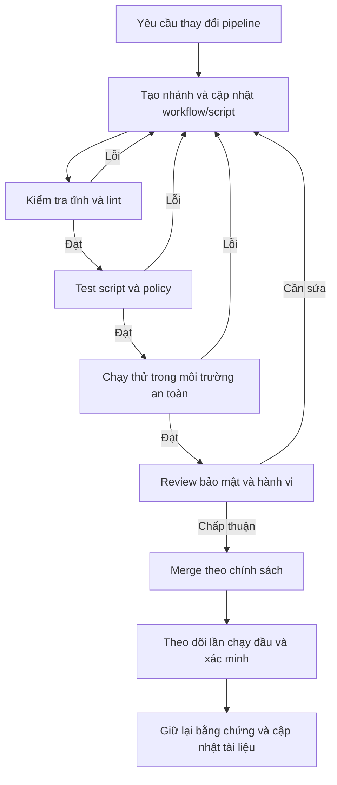

# Rà soát thay đổi pipeline như thay đổi mã ứng dụng

Pipeline CI/CD là phần mềm điều khiển cách mã nguồn được kiểm tra, đóng gói, lưu trữ và đưa tới các môi trường. Một thay đổi trong workflow có thể quyết định lệnh nào được chạy, runner nào được sử dụng, secret nào được truy cập, artifact nào được phát hành và ai có quyền triển khai. Vì vậy, thay đổi pipeline cần được review, kiểm thử, quản lý phiên bản và truy vết với mức kỷ luật tương đương mã ứng dụng.

Khi sửa mã ứng dụng, nhóm thường xem xét hành vi, độ an toàn, khả năng tương thích và kiểm thử hồi quy. Những câu hỏi tương tự cũng phải được đặt ra với mã pipeline. Một thay đổi vài dòng YAML có thể mở rộng quyền của workflow, làm lộ thông tin xác thực, bỏ qua cổng chất lượng hoặc khiến mọi lần phát hành dừng lại. Ngược lại, một pipeline được review cẩn thận giúp quy trình build và phát hành có thể lặp lại, giải thích được và khôi phục được.

Trong module CI/CD, pipeline được xem là mã cấu hình có khả năng thực thi. Nó là một phần của hệ thống phân phối phần mềm, cùng với script build, Dockerfile, cấu hình runner, policy, reusable workflow và các công cụ kiểm thử. Do đó, mọi thay đổi có thể tác động tới luồng phát hành đều cần có chủ đích, bằng chứng kiểm tra và người chịu trách nhiệm.

## 1. Vì sao thay đổi pipeline phải được review?

Pipeline có thể thực hiện những hành động quan trọng hơn một lệnh build thông thường: đọc repository, tải dependency, truy cập registry, cấp quyền cloud, ký artifact, thay đổi hạ tầng hoặc triển khai ứng dụng. Nếu workflow sai, tác động có thể lan rộng tới nhiều repository và môi trường.

Một số ví dụ về rủi ro do thay đổi pipeline:

- Thay đổi trigger khiến workflow phát hành chạy trên nhánh hoặc tag không mong muốn.
- Cấp `write` permission cho toàn bộ job trong khi chỉ một bước cần quyền ghi package.
- Đưa secret vào môi trường của pull request đến từ fork, tạo cơ hội để mã không tin cậy đọc hoặc gửi secret ra ngoài.
- Dùng một action bên thứ ba không được kiểm soát phiên bản, khiến hành vi workflow thay đổi khi action được cập nhật.
- Bỏ qua bước test hoặc đặt `continue-on-error` sai chỗ, làm pipeline báo thành công dù kiểm tra bắt buộc thất bại.
- Thay đổi điều kiện `if` khiến bước deploy chạy khi job trước đó chưa đạt yêu cầu.
- Hủy nhầm job đang tạo artifact hoặc triển khai do cấu hình concurrency không phù hợp.
- Sửa cache key hoặc phạm vi cache khiến dữ liệu cũ, dữ liệu sai hoặc dữ liệu do job không tin cậy tạo ra được tái sử dụng.

Những lỗi này không nhất thiết làm ứng dụng biên dịch thất bại. Pipeline vẫn có thể hiển thị màu xanh trong khi đã bỏ qua kiểm tra hoặc mở rộng quyền truy cập. Vì thế, review pipeline phải đánh giá cả kết quả mong muốn lẫn tác động phụ tới bảo mật, độ tin cậy, chi phí và khả năng vận hành.

### Pipeline là một phần của chuỗi cung ứng phần mềm

Một pipeline thường nhận mã nguồn từ Git, tải action hoặc plugin, lấy dependency, chạy script, tạo artifact rồi lưu vào registry. Mỗi thành phần đều có thể ảnh hưởng tới đầu ra cuối cùng. Nếu một bước trong chuỗi bị thay đổi mà không có kiểm soát, nhóm có thể không biết artifact được tạo ra bằng mã hoặc công cụ nào.

Để duy trì khả năng truy vết, một lần chạy nên liên kết được với commit SHA, phiên bản workflow, phiên bản công cụ, runner, dependency và artifact được tạo. Với hệ thống yêu cầu mức bảo đảm cao, có thể bổ sung checksum, chữ ký và attestation/provenance để chứng minh artifact được tạo từ nguồn và quy trình đã khai báo.

## 2. Những câu hỏi cần trả lời khi review một thay đổi pipeline

Reviewer cần hiểu mục đích của thay đổi trước khi đọc từng dòng YAML. Hãy yêu cầu tác giả giải thích vấn đề hiện tại, hành vi mong muốn, phạm vi ảnh hưởng và cách xác minh. Sau đó đánh giá thay đổi theo các nhóm sau.

| Nhóm review | Câu hỏi trọng tâm | Bằng chứng cần xem |
|---|---|---|
| Trigger và phạm vi | Workflow chạy khi nào, trên nhánh/tag/sự kiện nào? | Cấu hình `on`, điều kiện `if`, ví dụ sự kiện kích hoạt |
| Hành vi và thứ tự | Job nào chạy trước, phụ thuộc nào bắt buộc, khi lỗi thì luồng dừng ra sao? | `needs`, `if`, `continue-on-error`, kết quả test |
| Quyền và danh tính | Job cần quyền đọc/ghi gì, dùng danh tính nào để truy cập dịch vụ? | `permissions`, role cloud, token scope, OIDC trust policy |
| Bí mật và dữ liệu | Secret đi vào đâu, log và artifact có thể chứa dữ liệu gì? | `secrets`, `env`, output, upload artifact, masking và quyền tải |
| Dependency và action | Action, image, plugin và dependency có được kiểm soát phiên bản không? | Phiên bản hoặc commit SHA, lockfile, checksum, nguồn tải |
| Runner và cách ly | Mã không tin cậy chạy trên loại runner nào, có dùng chung workspace không? | Runner label, ephemeral runner, quyền hệ thống và network |
| Artifact và truy vết | Đầu ra nào được tạo, đặt tên và gắn với revision ra sao? | Artifact path, checksum, metadata, provenance |
| Độ tin cậy và hiệu năng | Có timeout, retry, cache, concurrency và xử lý hủy phù hợp không? | Thời gian chạy, log, cache key, cancellation behavior |
| Khả năng bảo trì | Tên job, reusable workflow, tài liệu và ownership có rõ không? | Cấu trúc file, tài liệu, CODEOWNERS, lịch sử thay đổi |

Không phải thay đổi nào cũng cần trả lời dài cho mọi nhóm. Tuy nhiên, các nhóm có liên quan phải được xem xét trước khi merge. Ví dụ, đổi tên một job có thể ảnh hưởng tới required status check; thay đổi permission có thể ảnh hưởng tới toàn bộ bước chạy; thay đổi đường dẫn artifact có thể làm hỏng bước deploy ở workflow khác.

## 3. Quy trình review pipeline từ yêu cầu tới triển khai

Một quy trình review hiệu quả cần có cả kiểm tra tự động và đánh giá của con người. Công cụ có thể phát hiện lỗi cú pháp, biểu thức không hợp lệ hoặc cấu hình rủi ro phổ biến. Reviewer vẫn cần hiểu tác động thực tế và xác nhận rằng thay đổi đáp ứng yêu cầu.



### Bước 1: Mô tả mục đích và phạm vi

Pull request nên nói rõ vì sao cần thay đổi pipeline và hành vi nào sẽ khác sau khi merge. Nếu sửa trigger, hãy nêu các sự kiện sẽ kích hoạt workflow. Nếu thêm quyền, hãy chỉ ra bước nào cần quyền đó và tài nguyên nào được truy cập. Nếu thay đổi artifact, hãy mô tả nơi tạo, nơi lưu và workflow tiêu thụ.

Một pull request tốt nên chỉ ra:

- Vấn đề hoặc yêu cầu vận hành đang được giải quyết.
- File, job, action, script hoặc policy bị ảnh hưởng.
- Hành vi trước và sau thay đổi.
- Các rủi ro đã xem xét, đặc biệt là quyền, secret và mã không tin cậy.
- Kiểm tra đã chạy và kết quả tương ứng.
- Kế hoạch khôi phục nếu thay đổi làm pipeline hoặc luồng phát hành bị hỏng.

Chia thay đổi lớn thành các pull request có mục đích rõ ràng. Ví dụ, cập nhật phiên bản action, thay đổi quyền workflow và chuyển đổi cấu trúc artifact có thể là ba thay đổi riêng. Việc này giúp reviewer hiểu nguyên nhân khi một kiểm tra thất bại và giảm khó khăn khi cần revert.

### Bước 2: Kiểm tra cú pháp và cấu trúc

YAML hợp lệ về cú pháp chưa chắc là workflow hợp lệ. Một file có thể parse được nhưng dùng sai tên key, sai kiểu dữ liệu, tham chiếu context không tồn tại hoặc khai báo dependency không hợp lệ.

Với GitHub Actions, `actionlint` có thể kiểm tra cấu trúc workflow, biểu thức và một số lỗi thường gặp. Với shell script, dùng ShellCheck để tìm lỗi và cách viết nguy hiểm. Với Dockerfile, có thể dùng Hadolint. Các nền tảng khác có công cụ lint hoặc schema validation tương ứng.

Kiểm tra cấu trúc nên chạy tự động trong pull request. Công cụ kiểm tra cần được cố định phiên bản hoặc chạy trong môi trường đã được quản lý để kết quả không thay đổi bất ngờ giữa các lần chạy.

Ví dụ lệnh kiểm tra trong môi trường đã cài sẵn công cụ:

```bash
# Kiểm tra workflow GitHub Actions trong .github/workflows
actionlint

# Kiểm tra shell script được pipeline sử dụng
shellcheck scripts/ci/*.sh

# Kiểm tra thay đổi whitespace và patch cơ bản
git diff --check
```

Không phải repository nào cũng có cả file `.yml` lẫn `.yaml` hoặc shell script. Cần điều chỉnh đường dẫn theo cấu trúc thực tế và bảo đảm runner có các công cụ tương ứng. Nếu không tìm thấy file theo glob, job cần xử lý trường hợp đó rõ ràng thay vì vô tình bỏ qua toàn bộ bước kiểm tra.

### Bước 3: Kiểm thử script và logic điều kiện

Workflow thường gọi script để build, scan, đóng gói hoặc triển khai. Các script này là mã có thể kiểm thử độc lập. Hãy viết unit test cho phần xử lý dữ liệu, kiểm tra tham số đầu vào và kiểm tra trường hợp lỗi.

Với logic điều kiện của workflow, cần kiểm tra các nhánh quan trọng:

- Pull request từ nhánh nội bộ và từ fork.
- Push vào nhánh chính và tag phát hành.
- Job phụ thuộc thất bại, bị hủy hoặc bị bỏ qua.
- Không có file thay đổi thuộc phạm vi filter.
- Secret hoặc biến cấu hình không tồn tại.
- Artifact rỗng, sai định dạng hoặc không gắn với revision dự kiến.
- Người dùng không có quyền triển khai hoặc môi trường chưa được phê duyệt.

Có thể dùng fixture hoặc dữ liệu giả để kiểm tra script mà không truy cập tài nguyên thật. Với các bước deploy, ưu tiên chế độ plan/dry-run hoặc môi trường thử nghiệm. Không dùng production làm nơi thử một thay đổi workflow chưa được xác minh.

### Bước 4: Chạy thử tích hợp trong môi trường an toàn

Một số lỗi chỉ xuất hiện khi workflow thực thi trên runner thật: thiếu binary, sai đường dẫn, khác biệt shell, thiếu quyền file, timeout, network policy hoặc sự khác nhau giữa runner image. Vì vậy, lint không thay thế chạy thử.

Có thể dùng runner riêng, repository thử nghiệm, môi trường ephemeral hoặc workflow dispatch có tham số giới hạn để kiểm tra. Với thay đổi triển khai, dùng môi trường staging hoặc một target thử nghiệm có dữ liệu không nhạy cảm. Cần bảo đảm thử nghiệm không tự động kích hoạt deploy production.

Các công cụ mô phỏng workflow cục bộ có thể giúp kiểm tra nhanh một số job, nhưng không phải lúc nào cũng mô phỏng đầy đủ permission, OIDC, GitHub context, hosted runner hoặc dịch vụ của nền tảng. Kết quả mô phỏng đạt chỉ là một lớp bằng chứng; vẫn cần chạy thử trên nền tảng CI thật trong phạm vi an toàn.

### Bước 5: Review bảo mật và quyền truy cập

Đây là bước cần chú ý đặc biệt với thay đổi pipeline vì workflow thường chạy mã do người dùng hoặc contributor gửi lên. Reviewer phải xác định nguồn của mã, danh tính thực thi, quyền được cấp và tài nguyên có thể bị truy cập.

Không chấp thuận quyền rộng chỉ vì một job cần thực hiện một thao tác ghi. Hãy giới hạn quyền theo job và theo tài nguyên. Kiểm tra mọi đường truyền secret, output, log và artifact. Với workflow triển khai cloud, ưu tiên danh tính ngắn hạn qua OIDC và trust policy giới hạn theo repository, branch, tag hoặc environment.

### Bước 6: Merge, theo dõi và xác minh

Sau khi review và các check bắt buộc đạt, merge theo chính sách của repository. Theo dõi lần chạy đầu tiên sau merge, kiểm tra log và xác minh artifact hoặc kết quả được tạo đúng. Nếu thay đổi ảnh hưởng tới luồng phát hành, nên triển khai theo phạm vi nhỏ hoặc bật dần khi nền tảng hỗ trợ.

Ghi lại phiên bản workflow, commit đã merge, lần chạy xác minh và người chịu trách nhiệm. Nếu phát hiện lỗi, revert hoặc khôi phục phiên bản workflow trước theo quy trình đã chuẩn bị.

## 4. Bảo mật khi review pipeline

### Cấp quyền tối thiểu

Mỗi job chỉ nên nhận quyền cần thiết để hoàn thành nhiệm vụ. Trong GitHub Actions, có thể khai báo `permissions` ở cấp workflow rồi thu hẹp hoặc mở quyền cụ thể ở cấp job. Khi khai báo quyền, các quyền không được nêu có thể mặc định về `none`; cần kiểm tra tài liệu nền tảng và tác động của cấu hình thực tế.

Ví dụ, job chỉ đọc source code có thể dùng:

```yaml
permissions:
  contents: read
```

Một job cần xuất bản package có thể cần thêm quyền ghi package. Quyền này nên nằm ở job xuất bản, thay vì cấp cho toàn bộ workflow gồm cả job chạy test trên mã không tin cậy.

Review cần kiểm tra token mặc định, quyền của action bên thứ ba, quyền trên cloud và quyền của runner. Việc một bước không trực tiếp gọi API không có nghĩa là nó không thể sử dụng token có sẵn trong môi trường.

### Xử lý pull request từ fork và mã không tin cậy

Pull request từ fork có thể chứa mã tùy ý do contributor cung cấp. Khi workflow checkout và chạy test trên mã này, script build, test hoặc package có thể thực thi lệnh độc hại. Vì vậy, không cấp secret có giá trị hoặc quyền ghi repository cho job chạy mã không tin cậy nếu không có một thiết kế cách ly và kiểm soát phù hợp.

Đặc biệt cẩn trọng với `pull_request_target`. Sự kiện này chạy workflow theo ngữ cảnh của nhánh đích và có thể có quyền hoặc secret của repository. Nếu workflow checkout mã từ pull request rồi chạy script của mã đó, attacker có thể biến bước kiểm tra thành đường thực thi mã trong ngữ cảnh có đặc quyền.

Các nguyên tắc cần áp dụng:

- Dùng `pull_request` cho các kiểm tra thông thường trên mã pull request khi phù hợp.
- Không checkout rồi thực thi mã không tin cậy trong workflow có secret hoặc quyền ghi.
- Nếu cần dùng `pull_request_target` để gắn nhãn hoặc quản lý metadata, không chạy script hay binary từ head của pull request trong ngữ cảnh đặc quyền.
- Tách job không tin cậy và job cần secret; truyền dữ liệu qua artifact đã kiểm tra, không truyền quyền thực thi tùy ý.
- Dùng runner ephemeral hoặc môi trường cách ly để giảm khả năng mã độc còn tồn tại sau job.

### Tránh command injection qua biểu thức

Một lỗi phổ biến là chèn trực tiếp dữ liệu từ GitHub event vào lệnh shell. Tiêu đề pull request, tên branch hoặc nội dung commit có thể do người gửi kiểm soát. Nếu nội dung được nội suy vào script, ký tự đặc biệt có thể thay đổi câu lệnh được thực thi.

Ví dụ không an toàn:

```yaml
- name: Print pull request title
  run: echo "${{ github.event.pull_request.title }}"
```

Nên chuyển dữ liệu vào biến môi trường và xử lý như dữ liệu đầu vào:

```yaml
- name: Print pull request title
  env:
    PR_TITLE: ${{ github.event.pull_request.title }}
  run: printf '%s\n' "$PR_TITLE"
```

Không dùng `eval` hoặc ghép chuỗi để biến dữ liệu đầu vào thành lệnh. Nếu cần truyền dữ liệu qua file hoặc tham số, phải dùng cách quote và kiểm tra định dạng phù hợp với shell đang chạy.

### Bảo vệ secret và thông tin xác thực

Secret nên được lưu trong secret manager của nền tảng hoặc hệ thống quản lý bí mật chuyên dụng. Không commit secret vào YAML, script, Dockerfile, log hoặc artifact. Masking trong log chỉ là biện pháp giảm lộ vô tình; nó không ngăn script độc hại gửi secret ra network hoặc biến đổi secret để tránh bộ lọc.

Khi review, hãy hỏi:

- Secret có thực sự cần trong job này không?
- Secret có bị đưa vào môi trường của bước chạy mã không tin cậy không?
- Có thể thay secret dài hạn bằng OIDC và token ngắn hạn không?
- Quyền của token có giới hạn theo repository, branch, environment và thời gian không?
- Log, debug output, cache hoặc artifact có thể chứa secret không?
- Có quy trình thu hồi và xoay vòng khi nghi ngờ bị lộ không?

Không bật debug logging một cách tùy tiện trong job có secret. Nếu cần điều tra, giới hạn thời gian, quyền truy cập log và dữ liệu được ghi.

### Kiểm soát action, image và dependency bên ngoài

Một action hoặc image bên ngoài là mã được thực thi trong pipeline. Dùng tag có thể thay đổi như `@main` hoặc tag phiên bản không cố định làm hành vi workflow thay đổi theo thời gian mà không có pull request trong repository của mình.

Với GitHub Actions, pin action bên thứ ba theo full commit SHA giúp cố định nội dung được gọi. Khi cập nhật, tạo pull request rõ ràng, kiểm tra release note, diff và thay đổi quyền. Có thể dùng Dependabot hoặc công cụ quản lý phiên bản để đề xuất cập nhật định kỳ, nhưng mọi cập nhật vẫn cần review.

Với container image, ưu tiên tag phiên bản rõ ràng và digest khi cần tính bất biến. Kiểm tra nguồn image, chữ ký hoặc provenance nếu hệ thống hỗ trợ. Tránh tải và chạy script từ URL không cố định trong bước build hoặc deploy.

## 5. Review trigger, điều kiện và luồng điều khiển

Trigger quyết định khi nào pipeline bắt đầu. Điều kiện quyết định job hoặc step có chạy hay không. Một thay đổi nhỏ ở hai phần này có thể làm workflow không chạy, chạy quá nhiều lần hoặc chạy trong ngữ cảnh không an toàn.

### Xác minh trigger

Khi sửa `on`, hãy lập danh sách sự kiện mong muốn và kiểm tra từng trường hợp:

| Sự kiện | Câu hỏi cần xác minh |
|---|---|
| `push` | Nhánh nào được phép kích hoạt? Có bao gồm tag ngoài ý muốn không? |
| `pull_request` | Có chạy cho các loại hoạt động cần thiết như mở, đồng bộ và reopen không? |
| `workflow_dispatch` | Ai được phép chạy thủ công, input nào được chấp nhận và có giới hạn môi trường không? |
| `schedule` | Múi giờ và thời điểm chạy có phù hợp? Có xử lý lần chạy bị trễ hoặc chồng lấn không? |
| `release` hoặc tag | Workflow có xác minh tag, phiên bản và nguồn commit không? |
| `workflow_call` | Workflow tái sử dụng có khai báo input, secret và permission rõ ràng không? |

Filter `branches`, `tags`, `paths` và `paths-ignore` cần được review cùng nhau. Ví dụ, nếu workflow chỉ chạy khi file trong thư mục `src/` thay đổi, một thay đổi ở build script hoặc workflow có thể không kích hoạt kiểm tra dù nó ảnh hưởng trực tiếp tới build.

Đặc biệt, path filter ở cấp workflow có thể khiến toàn bộ workflow không chạy. Nếu workflow đó là required check, pull request có thể bị kẹt do check không được tạo. Hãy cân nhắc một workflow kiểm tra luôn chạy và điều phối job nội bộ, hoặc thiết kế check tổng hợp để luôn trả kết quả rõ ràng.

### Xác minh dependency và điều kiện `if`

Các job dùng `needs` tạo thành đồ thị phụ thuộc. Khi một job thất bại, các job phụ thuộc thường bị bỏ qua trừ khi có điều kiện cho phép tiếp tục. Reviewer phải hiểu rõ bước nào cần dừng, bước nào cần chạy để thu thập báo cáo và bước nào tuyệt đối không được chạy khi điều kiện trước chưa đạt.

`if: always()` có thể hữu ích để upload log hoặc báo cáo sau khi test thất bại. Nhưng nếu dùng ở job deploy mà không kiểm tra kết quả của các job bắt buộc, pipeline có thể triển khai dù build chưa đạt. Cần xác định rõ điều kiện thành công và trạng thái mà bước sau được phép tiếp tục.

Tương tự, `continue-on-error` có thể phù hợp với một kiểm tra thử nghiệm không chặn, nhưng không nên đặt trên test hoặc scan bắt buộc. Tên job và trạng thái cuối cùng phải phản ánh đúng mức độ đạt của cổng chất lượng.

### Kiểm soát retry, timeout và cancellation

Retry có thể giúp vượt qua lỗi tạm thời của network hoặc dịch vụ bên ngoài. Tuy nhiên, retry không nên che giấu lỗi logic hoặc test flaky. Hãy giới hạn số lần thử, khoảng chờ và loại lỗi được retry; log từng lần thất bại và giữ trạng thái cuối cùng trung thực.

Timeout bảo vệ runner khỏi job treo. Thời gian timeout nên dựa trên dữ liệu vận hành và khác nhau theo loại job. Một unit test vài phút và một integration test chạy migration không nhất thiết có cùng giới hạn.

Concurrency và cancellation giúp tránh nhiều workflow cùng làm một việc hoặc dùng tài nguyên trùng lặp. Trước khi bật hủy lần chạy cũ, xác minh job đó có an toàn để hủy hay không. Job tạo artifact, ký image, thay đổi hạ tầng hoặc triển khai có thể cần cơ chế khóa và tuần tự hóa riêng.

## 6. Kiểm thử pipeline như kiểm thử mã ứng dụng

Không có một loại test duy nhất đủ để xác minh toàn bộ pipeline. Nên dùng nhiều lớp bằng chứng theo mức độ chi phí và phạm vi.

| Lớp kiểm tra | Mục tiêu | Ví dụ |
|---|---|---|
| Parse và schema validation | File có cấu trúc hợp lệ | YAML parser, JSON Schema hoặc validator của nền tảng |
| Lint và static analysis | Phát hiện sai key, biểu thức lỗi, cấu hình rủi ro | actionlint, ShellCheck, Hadolint, policy scanner |
| Unit test script | Kiểm tra logic trong script build/deploy | Test hàm parse version, tạo metadata, xử lý tham số |
| Policy test | Bảo đảm các quy tắc quyền và nguồn được tuân thủ | Kiểm tra không dùng action tag trôi nổi, không cấp permission rộng |
| Integration test | Kiểm tra job phối hợp trên runner và dịch vụ thật | Build, upload/download artifact, đọc registry thử nghiệm |
| End-to-end hoặc staging test | Xác minh toàn bộ luồng phát hành | Tạo artifact, triển khai staging, smoke test, xác minh rollback |

### Kiểm tra cấu hình bằng công cụ phù hợp

Mỗi định dạng có công cụ kiểm tra riêng. Không nên dựa vào YAML parser chung để kết luận workflow hợp lệ, vì parser không biết các key hoặc context mà nền tảng hỗ trợ. Kết hợp validator chuyên biệt với lint script và policy scanner để có phạm vi kiểm tra phù hợp.

Ví dụ, một job validation đơn giản cho repository dùng GitHub Actions có thể như sau. Giả sử runner đã được chuẩn bị sẵn `actionlint` và `shellcheck` với phiên bản được quản lý:

```yaml
name: Validate pipeline code

on:
  pull_request:
    paths:
      - '.github/workflows/**'
      - '.github/actions/**'
      - 'scripts/ci/**'
      - 'Dockerfile*'

permissions:
  contents: read

jobs:
  validate:
    runs-on: ubuntu-latest
    timeout-minutes: 10
    steps:
      - name: Checkout
        uses: actions/checkout@v4
        with:
          fetch-depth: 0

      - name: Lint workflow definitions
        run: actionlint

      - name: Lint CI shell scripts
        shell: bash
        run: |
          shopt -s nullglob
          files=(scripts/ci/*.sh)
          if ((${#files[@]})); then
            shellcheck "${files[@]}"
          fi

      - name: Check patch formatting
        if: github.event_name == 'pull_request'
        run: git diff --check "${{ github.event.pull_request.base.sha }}"...HEAD
```

Đây là ví dụ minh họa, cần điều chỉnh theo cấu trúc repository và cách cung cấp công cụ trên runner. Nếu thư mục không có file khớp glob, cần xử lý trường hợp đó trong script hoặc dùng lệnh kiểm tra phù hợp để không tạo lỗi giả.

Ví dụ dùng `paths` để tránh chạy job trên mọi thay đổi. Nếu `validate` là required check trực tiếp, cần đánh giá hành vi khi workflow bị bỏ qua vì không có file khớp filter. Một cách phổ biến là để workflow điều phối luôn được kích hoạt, rồi cho job lint kiểm tra file thay đổi; check tổng hợp vẫn hoàn tất với trạng thái rõ ràng.

### Kiểm thử script với dữ liệu giả

Giả sử pipeline gọi script tạo tag từ biến môi trường. Có thể kiểm tra script với đầu vào hợp lệ, thiếu biến, định dạng sai và ký tự bất thường mà không tạo tag thật hoặc gọi registry.

```bash
#!/usr/bin/env bash
set -euo pipefail

if [[ -z "${RELEASE_VERSION:-}" ]]; then
  echo "RELEASE_VERSION is required" >&2
  exit 2
fi

if [[ ! "$RELEASE_VERSION" =~ ^[0-9]+\.[0-9]+\.[0-9]+$ ]]; then
  echo "Invalid release version" >&2
  exit 2
fi

printf 'release-%s\n' "$RELEASE_VERSION"
```

Khi test, đặt biến đầu vào bằng dữ liệu giả và kiểm tra cả exit code lẫn output. Script thực tế có thể cần hỗ trợ prerelease hoặc build metadata theo SemVer; quy tắc hợp lệ phải được thống nhất trước khi viết test. Ví dụ trên chỉ chấp nhận dạng `major.minor.patch` đơn giản.

### Kiểm thử hành vi lỗi

Pipeline cần được kiểm tra khi một bước thất bại. Ví dụ:

- Build thất bại thì bước upload artifact không được báo thành công.
- Test thất bại thì job deploy không được chạy.
- Thiếu secret thì job dừng với thông báo hữu ích và không in giá trị secret.
- Không có quyền ghi registry thì pipeline báo lỗi rõ, không retry vô hạn.
- Smoke test sau deploy thất bại thì bước xác minh hoặc rollback được kích hoạt theo chính sách.
- Người không có quyền phê duyệt không thể vượt qua environment protection.

Kiểm tra đường đi thất bại thường có giá trị cao vì nhiều lỗi pipeline nằm ở điều kiện chuyển trạng thái, chứ không nằm trong lệnh build thành công.

## 7. Quản lý reusable workflow và script dùng chung

Khi nhiều repository sử dụng cùng một quy trình, reusable workflow hoặc action nội bộ giúp giảm trùng lặp và thống nhất chính sách. Nhưng một thay đổi ở workflow dùng chung có thể ảnh hưởng tới hàng chục repository.

Vì vậy, reusable workflow cần được quản lý như một API:

- Khai báo rõ input, output, secret và permission cần thiết.
- Đặt tên và kiểu dữ liệu ổn định; thay đổi không tương thích cần có kế hoạch chuyển đổi.
- Có phiên bản hoặc ref phát hành rõ ràng để repository tiêu thụ chọn thời điểm nâng cấp.
- Có test cho trường hợp đầu vào hợp lệ, thiếu hoặc sai kiểu.
- Có tài liệu mô tả hành vi, quyền và trách nhiệm của bên gọi.
- Theo dõi repository đang sử dụng để đánh giá tác động trước khi loại bỏ input hoặc output cũ.

Không nên để workflow dùng chung tự động thay đổi hành vi ở tất cả repository mà không có cơ chế kiểm soát phiên bản. Repository tiêu thụ cần biết mình đang dùng phiên bản nào và có thể nâng cấp theo pull request.

### Thay đổi tương thích ngược

Khi đổi tên input hoặc output, có thể giữ trường cũ trong một giai đoạn chuyển tiếp và đánh dấu deprecated. Khi đổi quyền, phải đánh giá xem bên gọi có đang dựa vào permission được kế thừa hay không. Khi đổi tên artifact hoặc thư mục output, cần tìm các workflow tiêu thụ artifact đó và cập nhật theo cùng một kế hoạch.

Với thay đổi lớn, có thể phát hành phiên bản mới song song. Sau khi các repository chuyển đổi và xác nhận, mới loại bỏ phiên bản cũ theo thời hạn đã thông báo.

## 8. Quản lý runner, cache và dữ liệu giữa các job

Runner là môi trường thực thi pipeline. Thay đổi runner image, label, quyền hệ điều hành hoặc network có thể làm thay đổi kết quả build ngay cả khi mã ứng dụng không đổi.

Khi review thay đổi runner, cần xem:

- Image hoặc hệ điều hành có phiên bản được kiểm soát không?
- JDK, Gradle, Node, Docker và công cụ khác có được cố định phiên bản không?
- Runner có được tái sử dụng giữa các job hoặc repository không?
- Workspace, credential và process có được dọn sau khi job hoàn tất không?
- Network có thể truy cập những registry hoặc dịch vụ nào?
- Job chạy mã không tin cậy có được cách ly khỏi runner chứa secret hoặc dữ liệu nội bộ không?

Với self-hosted runner, cần đặc biệt cẩn trọng vì runner có thể giữ lại trạng thái hoặc quyền truy cập ngoài phạm vi một job. Runner ephemeral, tạo mới cho mỗi lần chạy và hủy sau khi hoàn tất, giúp giảm nguy cơ tồn tại mã độc hoặc credential từ lần chạy trước.

### Cache không phải nguồn dữ liệu đáng tin cậy

Cache giúp giảm thời gian tải dependency hoặc build, nhưng cache là dữ liệu có thể cũ hoặc bị đầu độc nếu phạm vi chia sẻ không được thiết kế đúng. Cache key nên bao gồm những yếu tố ảnh hưởng tới nội dung cache như hệ điều hành, phiên bản runtime và lockfile. Không chia sẻ cache nhạy cảm giữa job tin cậy và job chạy mã không tin cậy nếu không có cách cách ly.

Khi review thay đổi cache, hãy kiểm tra:

- Cache chứa dependency tải về hay chứa đầu ra build có thể thực thi?
- Job nào được phép ghi và job nào được phép đọc?
- Cache key có đủ phân biệt phiên bản và môi trường không?
- Có fallback key nào có thể lấy nhầm dữ liệu cũ không?
- Pipeline có thể chạy sạch khi cache miss hoặc cache bị xóa không?

Artifact giữa các job nên được dùng cho đầu ra cần chuyển tiếp và cần truy vết. Artifact phải có tên, revision và retention phù hợp. Không dùng cache thay cho artifact phát hành đã được xác minh.

## 9. Quản lý thay đổi rủi ro cao và khả năng rollback

Một số thay đổi pipeline có phạm vi ảnh hưởng lớn: sửa reusable workflow, thay đổi quyền cloud, đổi runner image, chuyển registry, sửa signing step hoặc đổi logic deploy. Các thay đổi này nên có kế hoạch triển khai và khôi phục rõ ràng.

### Phân loại mức rủi ro

| Mức độ | Ví dụ | Cách kiểm soát phù hợp |
|---|---|---|
| Thấp | Sửa tên hiển thị, bổ sung log không nhạy cảm | Review thông thường và lint |
| Trung bình | Thêm test, đổi cache key, đổi điều kiện chạy một job | Lint, test hành vi và chạy thử trên pull request |
| Cao | Thay đổi trigger phát hành, quyền ghi registry, runner dùng chung | Review bởi owner, test staging và theo dõi lần chạy đầu |
| Rất cao | Thay đổi OIDC trust, secret access, signing, deploy production hoặc workflow dùng chung nhiều repository | Phê duyệt chuyên trách, thử nghiệm theo giai đoạn, bằng chứng truy vết và kế hoạch rollback đã kiểm tra |

Mức rủi ro phụ thuộc vào kiến trúc và quyền thực tế. Một thay đổi một dòng trong trust policy có thể rủi ro hơn một thay đổi lớn về format log.

### Chuẩn bị rollback trước khi merge

Kế hoạch rollback cần trả lời:

1. Phiên bản workflow hoặc cấu hình nào đang hoạt động tốt gần nhất?
2. Có thể revert commit hay chuyển reusable workflow về ref trước không?
3. Secret, permission, runner hoặc trust policy có cần khôi phục đồng bộ không?
4. Các artifact đã tạo trong thời gian thay đổi có cần giữ, đánh dấu hoặc loại bỏ không?
5. Dấu hiệu nào cho biết rollback thành công?
6. Ai có quyền quyết định rollback và ai xác minh sau khôi phục?

Không phải mọi thay đổi đều có thể rollback chỉ bằng revert YAML. Nếu thay đổi đã tạo resource cloud, thay đổi schema hoặc phát hành artifact, cần có bước khôi phục tài nguyên và dữ liệu tương ứng. Với thay đổi permission, cần xác minh cả quyền cũ lẫn quyền mới sau khi rollback.

### Rollout theo giai đoạn

Với reusable workflow hoặc runner image dùng chung, có thể triển khai theo nhóm repository đại diện trước. Theo dõi thời gian chạy, tỷ lệ thất bại, permission error và artifact output. Sau khi nhóm thử nghiệm ổn định, mở rộng sang các repository còn lại.

Nếu nền tảng hỗ trợ phiên bản song song, hãy để repository chọn phiên bản mới qua pull request. Cách này giúp phát hiện lỗi tương thích ở phạm vi nhỏ và cho phép quay về phiên bản cũ nhanh hơn.

## 10. Truy vết, tài liệu và quyền sở hữu

Review tốt cần để lại dấu vết có thể kiểm tra sau này. Mỗi thay đổi pipeline nên có liên kết tới yêu cầu, pull request, review, kết quả test và commit được merge. Với thay đổi ảnh hưởng tới phát hành, lưu lại lần chạy xác minh và artifact liên quan.

Tài liệu cần mô tả những điều người vận hành cần biết:

- Workflow được kích hoạt bởi sự kiện nào và chịu trách nhiệm cho phần nào của luồng CI/CD.
- Job nào là required check, job nào chỉ cung cấp cảnh báo.
- Secret, permission, environment và runner nào được sử dụng.
- Artifact được tạo ở đâu, có tên và thời hạn lưu thế nào.
- Cách chạy kiểm tra cục bộ và cách tái hiện lỗi CI.
- Chủ sở hữu workflow, cách liên hệ và quy trình khôi phục.

Có thể dùng `CODEOWNERS` để tự động yêu cầu reviewer phù hợp khi thay đổi các file pipeline. Ví dụ:

```text
# Các file workflow cần owner của CI/CD review
/.github/workflows/ @platform-ci
/.github/actions/   @platform-ci
/scripts/ci/        @platform-ci
/Dockerfile*        @platform-ci
```

Tên team và cú pháp cần điều chỉnh theo repository. CODEOWNERS chỉ hỗ trợ chỉ định người review; branch protection phải được cấu hình để yêu cầu review của code owner nếu đó là điều kiện bắt buộc.

Không nên để một cá nhân duy nhất là người hiểu mọi workflow quan trọng. Chia sẻ kiến thức, tài liệu hóa quyết định và luân phiên review giúp giảm rủi ro khi người sở hữu vắng mặt.

## 11. Ví dụ: review một thay đổi mở rộng quyền deploy

Giả sử một pull request thay đổi workflow để triển khai ứng dụng lên cloud. Trước đó, job chỉ build và lưu artifact. Sau thay đổi, job cần lấy thông tin xác thực và gọi API cloud.

Reviewer không nên chỉ kiểm tra xem lệnh deploy có chạy được không. Cần lần theo toàn bộ luồng:

1. Trigger có giới hạn ở nhánh hoặc tag phát hành được phép không?
2. Job deploy có chạy trên pull request từ fork không?
3. Có dùng OIDC hoặc token ngắn hạn thay cho secret dài hạn không?
4. Trust policy có giới hạn repository, ref và environment không?
5. Job có chỉ nhận `id-token: write` và quyền cần thiết cho bước deploy không?
6. Environment production có yêu cầu phê duyệt và rule bảo vệ phù hợp không?
7. Artifact có được lấy từ lần build đã xác minh, gắn với commit SHA và checksum không?
8. Nếu deploy thất bại, pipeline có giữ lại log an toàn và cách khôi phục phiên bản trước không?

Ví dụ minh họa job có quyền OIDC ở phạm vi hẹp:

```yaml
jobs:
  deploy-production:
    if: github.event_name == 'push' && startsWith(github.ref, 'refs/tags/v')
    runs-on: ubuntu-latest
    environment: production
    permissions:
      contents: read
      id-token: write
    steps:
      - name: Checkout deployment definitions
        uses: actions/checkout@v4

      - name: Authenticate to cloud using OIDC
        run: ./scripts/ci/authenticate-cloud.sh

      - name: Deploy verified artifact
        run: ./scripts/ci/deploy.sh
```

Đây chỉ là khung minh họa. `authenticate-cloud.sh` cần dùng SDK hoặc công cụ cloud phù hợp để trao đổi OIDC token theo cấu hình trust đã thiết lập. Workflow phải lấy artifact từ nguồn đã xác minh và cần xác nhận tag thực sự trỏ tới revision được phép phát hành. Quyền `id-token: write` chỉ cho phép yêu cầu token OIDC; nó không tự giới hạn quyền cloud. Trust policy phía cloud vẫn phải kiểm tra issuer, audience, subject và điều kiện repository/ref/environment.

Nếu trigger hoặc điều kiện `if` không đúng, job có thể không chạy hoặc chạy ngoài dự kiến. Nếu environment không có protection rule, khai báo `environment: production` tự nó không đồng nghĩa đã có phê duyệt thủ công. Những điều kiện này phải được cấu hình và kiểm tra trên nền tảng thực tế.

## 12. Checklist review thay đổi pipeline

Trước khi merge, tác giả và reviewer có thể dùng checklist sau:

- [ ] Mục đích, hành vi trước/sau và phạm vi ảnh hưởng được mô tả rõ trong pull request.
- [ ] Trigger, branch/tag filter và điều kiện chạy đã được kiểm tra với các sự kiện liên quan.
- [ ] Thay đổi không làm required check bị bỏ qua hoặc treo do workflow không được kích hoạt.
- [ ] Dependency giữa job và hành vi khi job thất bại, bị hủy hoặc bị bỏ qua đã rõ.
- [ ] Không dùng `continue-on-error` hoặc `if: always()` theo cách làm mất tín hiệu của cổng bắt buộc.
- [ ] Permission được giới hạn theo job và theo tài nguyên cần thiết.
- [ ] Mã từ pull request không tin cậy không được thực thi trong ngữ cảnh có secret hoặc quyền ghi.
- [ ] Dữ liệu event không được nội suy trực tiếp vào lệnh shell có thể gây command injection.
- [ ] Secret không xuất hiện trong YAML, log, cache hoặc artifact; OIDC được dùng khi phù hợp.
- [ ] Action, image và dependency bên ngoài được cố định phiên bản và có quy trình cập nhật.
- [ ] Runner, cache và workspace có phạm vi cách ly phù hợp với mức độ tin cậy của job.
- [ ] Artifact gắn với commit SHA, có thể xác minh và có chính sách lưu trữ rõ ràng.
- [ ] Lint, static analysis, unit test và kiểm thử tích hợp phù hợp đã chạy.
- [ ] Các đường đi thất bại, timeout, retry, cancellation và rollback đã được xem xét.
- [ ] Thay đổi rủi ro cao có owner, phê duyệt và kế hoạch triển khai theo giai đoạn.
- [ ] Tài liệu, CODEOWNERS và hướng dẫn vận hành được cập nhật khi cần.
- [ ] Lần chạy đầu sau merge được theo dõi và có bằng chứng xác minh.

Rà soát pipeline như mã ứng dụng giúp nhóm kiểm soát hành vi của chính hệ thống build và phát hành. Khi mỗi thay đổi có mục đích rõ, được kiểm tra tự động, review đúng rủi ro và có cách khôi phục, pipeline trở thành một phần đáng tin cậy của chuỗi cung ứng phần mềm. Điều đó giúp các quyết định về build, artifact, môi trường, secret và triển khai luôn có thể giải thích và truy vết.
