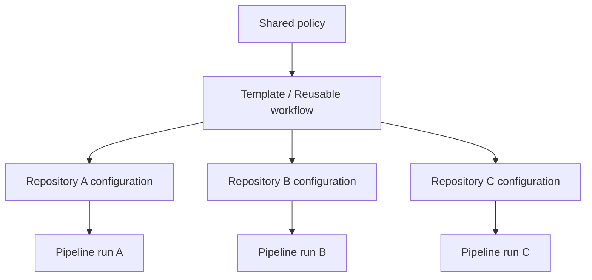

# Tái sử dụng cấu hình có kiểm soát và tránh sao chép khó bảo trì

## 1. Vì sao cần tái sử dụng cấu hình pipeline?

Khi một nhóm chỉ có một repository, file pipeline có thể còn ngắn và dễ hiểu. Nhưng khi số dịch vụ tăng lên, nhiều repository thường lặp lại các hoạt động giống nhau: checkout mã nguồn, thiết lập runtime, khôi phục dependency, lint, build, chạy test, đóng gói artifact, quét bảo mật và phát hành. Nếu mỗi nhóm tự sao chép một file pipeline rồi chỉnh sửa riêng, cấu hình sẽ dần phân kỳ.

Một repository có thể cập nhật phiên bản JDK nhưng repository khác vẫn dùng phiên bản cũ. Quy tắc quét secret có thể bị thiếu ở một pipeline. Một lỗi trong cách publish artifact phải được sửa thủ công ở hàng chục nơi. Khi quy trình release thay đổi, nhóm phải tìm và cập nhật nhiều bản sao, đồng thời khó biết bản nào đã được cập nhật đầy đủ.

Tái sử dụng cấu hình (configuration reuse) giúp chuẩn hóa những phần có cùng mục đích, giảm thao tác lặp và giúp cải tiến một lần có thể lan tới nhiều dự án. Tuy nhiên, tái sử dụng chỉ có lợi khi phần dùng chung có ranh giới và hợp đồng rõ ràng. Một template quá tổng quát, có nhiều tham số khó hiểu hoặc che giấu hành vi có thể khó bảo trì hơn các cấu hình độc lập.

Mục tiêu là tìm mức tái sử dụng phù hợp: chia sẻ những quy tắc ổn định, cho phép tùy biến có chủ đích, kiểm soát phiên bản và quyền, đồng thời giữ cho mỗi pipeline vẫn dễ đọc và có thể truy vết.

## 2. Hiểu đúng chi phí của sao chép cấu hình

Sao chép một đoạn YAML không tạo ra vấn đề ngay lập tức. Vấn đề xuất hiện khi nhiều bản sao phải cùng thay đổi nhưng không có cơ chế đồng bộ.

Ví dụ, năm repository có cùng job build Java. Mỗi repository tự khai báo phiên bản JDK, cache dependency, lệnh test và cách upload artifact. Sau một thời gian:

- Một repository đã chuyển sang JDK mới, các repository còn lại chưa chuyển.
- Một bản sao vẫn dùng cache key cũ khiến kết quả khó tái lập.
- Một bản sao thiếu bước thu thập test report khi thất bại.
- Các nhóm sửa lỗi publish artifact theo cách khác nhau.
- Người vận hành không biết cấu hình nào là chuẩn đang được khuyến nghị.

Đây là hiện tượng configuration drift – cấu hình cùng xuất phát từ một mẫu nhưng dần khác nhau. Khi có thay đổi bảo mật hoặc yêu cầu phát hành, drift làm tăng khả năng bỏ sót.

Tái sử dụng không có nghĩa loại bỏ mọi sự khác nhau. Một dịch vụ web, thư viện dùng chung và ứng dụng mobile có thể cần pipeline khác nhau. Cần phân biệt:

| Loại nội dung | Cách xử lý phù hợp |
|---|---|
| Quy tắc ổn định, dùng chung rộng rãi | Đưa vào template, reusable workflow hoặc thư viện dùng chung có phiên bản |
| Giá trị thay đổi theo repository | Truyền qua input, biến hoặc cấu hình riêng |
| Quyết định đặc thù nghiệp vụ của dịch vụ | Giữ ở pipeline của dịch vụ hoặc một extension rõ ràng |
| Chính sách bắt buộc về bảo mật/phát hành | Quản lý tập trung, có kiểm soát quyền thay đổi và cơ chế thực thi |
| Lệnh chuyên biệt cho một thành phần | Giữ ở repository nếu chưa có nhu cầu tái sử dụng thực sự |

## 3. Các mức tái sử dụng thường gặp

Không có một cơ chế duy nhất phù hợp cho mọi trường hợp. Nền tảng CI/CD có thể cung cấp một hoặc nhiều cách sau:

| Cơ chế | Phạm vi tái sử dụng | Phù hợp khi | Điểm cần lưu ý |
|---|---|---|---|
| Hàm/anchor/alias trong cùng file | Chia sẻ đoạn cấu hình nhỏ trong một file | Nhiều job trong cùng pipeline lặp lại một cấu hình ngắn | Hỗ trợ và cú pháp tùy định dạng/nền tảng; thường không tạo interface mạnh |
| Template/include/extends | Chia sẻ một phần hoặc toàn bộ cấu trúc pipeline giữa nhiều file/repository | Nhiều pipeline có cấu trúc tương tự và cần tùy biến qua tham số | Cần quản lý thứ tự kế thừa, giá trị ghi đè và phiên bản template |
| Reusable workflow/pipeline | Gọi một luồng hoàn chỉnh từ pipeline khác | Một quy trình nhiều job có đầu vào, đầu ra và mục đích ổn định | Cần kiểm soát quyền, trigger, secrets và cách gọi workflow |
| Composite action/task group | Đóng gói một nhóm step thành đơn vị dùng lại | Nhiều job lặp cùng một chuỗi thao tác ở mức step | Phụ thuộc nền tảng; cần khai báo input/output và môi trường thực thi |
| Script hoặc thư viện dùng chung | Chia sẻ logic bằng shell, Python, Java hoặc công cụ nội bộ | Logic phức tạp cần test, lint, debug và dùng ngoài CI | Cần quản lý runtime, dependency, phát hành và quyền thực thi |
| Pipeline generator | Sinh cấu hình từ metadata hoặc quy ước | Có nhiều repository tương tự và cần khởi tạo nhất quán | Cấu hình sinh ra cần kiểm tra, có thể đọc và truy nguyên nguồn tạo |

Tên gọi và ngữ nghĩa khác nhau giữa các nhà cung cấp. Ví dụ, reusable workflow có thể tái sử dụng một workflow nhiều job; composite action thường gói các step để được gọi bên trong một job. Một template có thể chèn YAML vào pipeline ở thời điểm biên dịch cấu hình. Cần đọc tài liệu nền tảng trước khi chọn cơ chế, tránh xem các thuật ngữ này là tương đương hoàn toàn.

## 4. Chọn đúng mức trừu tượng

Một quy tắc thực tế là tái sử dụng ở cấp thấp nhất vẫn thể hiện đúng ý nghĩa chung và tạo ra giá trị bảo trì.

- Nếu chỉ lặp vài dòng cấu hình đơn giản trong một file, anchor hoặc biến dùng chung có thể đủ.
- Nếu nhiều repository lặp lại cấu trúc job/stage, template có thể phù hợp.
- Nếu nhiều repository cần cùng một quy trình hoàn chỉnh gồm nhiều job, reusable workflow/pipeline thường rõ ràng hơn.
- Nếu chỉ lặp một chuỗi thao tác trong job, composite action hoặc task group có thể phù hợp.
- Nếu logic có điều kiện, xử lý lỗi hoặc kiểm thử phức tạp, đưa vào script/thư viện có phiên bản thường dễ bảo trì hơn nhồi nhiều biểu thức vào YAML.

Không nên tạo một abstraction chỉ vì hai đoạn mã hiện tại giống nhau. Hãy hỏi liệu chúng có cùng lý do thay đổi trong tương lai hay không. Hai đoạn lệnh trông giống nhau nhưng phục vụ chính sách khác nhau có thể cần tách riêng. Ngược lại, hai pipeline có cùng hợp đồng và cùng quy tắc có thể dùng chung một template.

Một dấu hiệu tốt của abstraction là người sử dụng hiểu được nó làm gì qua tên, mô tả, input và output. Một dấu hiệu xấu là người sử dụng phải đọc nhiều lớp template lồng nhau để biết lệnh nào thực sự chạy.

## 5. Thiết kế interface rõ ràng cho cấu hình dùng chung

Template hoặc workflow dùng lại là một thành phần phần mềm. Nó cần có interface như một API: đầu vào, đầu ra, giá trị mặc định, điều kiện và hành vi khi lỗi.

Một interface nên xác định:

- **Tên và mục đích:** thành phần giải quyết vấn đề gì, dùng cho loại repository hoặc pipeline nào.
- **Inputs:** tham số nào bắt buộc, kiểu dữ liệu, định dạng, giá trị mặc định và giới hạn hợp lệ.
- **Outputs:** giá trị hoặc artifact nào được tạo ra, tên và cách sử dụng.
- **Secrets/permissions:** cần quyền gì, secret nào được truyền và job nào có thể truy cập.
- **Execution environment:** runner, hệ điều hành, runtime và dependency cần thiết.
- **Failure behavior:** điều kiện thất bại, mã thoát, retry, timeout và cách báo lỗi.
- **Compatibility:** phiên bản được hỗ trợ và chính sách thay đổi interface.

Ví dụ một interface ở mức khái niệm:

```yaml
uses: shared/java-build
with:
  java-version: "21"
  build-command: "./gradlew clean build"
  publish-artifact: true
  artifact-name: "service-package"
```

Các tên khóa trên chỉ minh họa ý tưởng. Cú pháp thật phụ thuộc công cụ. Tài liệu của thành phần dùng chung cần giải thích `java-version` hỗ trợ giá trị nào, `build-command` có được chạy trong shell nào, `publish-artifact` tạo ra file gì và pipeline gọi sẽ nhận artifact bằng cách nào.

Không nên phơi bày quá nhiều tham số. Nếu template có hàng chục boolean như `skip_lint`, `skip_tests`, `skip_security`, `skip_upload`, `force_deploy`, người dùng có thể tạo ra vô số tổ hợp khó kiểm thử. Hãy ưu tiên một số tùy chọn phản ánh nhu cầu thực sự, dùng profile có tên rõ ràng khi có các chế độ phổ biến và giữ chính sách bắt buộc ngoài quyền tùy biến tùy tiện.

## 6. Quy tắc đặt giá trị mặc định và xác thực đầu vào

Giá trị mặc định giúp người dùng bắt đầu nhanh, nhưng mặc định phải an toàn và dễ đoán. Ví dụ, một workflow build có thể mặc định bật unit test và không tự triển khai production. Việc triển khai production nên yêu cầu trigger, quyền và phê duyệt rõ ràng theo chính sách.

Các nguyên tắc nên áp dụng:

1. Chỉ đặt mặc định khi có lựa chọn phù hợp với phần lớn người dùng và ít gây bất ngờ.
2. Tham số có ảnh hưởng đến bảo mật hoặc phát hành nên có mặc định an toàn.
3. Kiểm tra đầu vào sớm, trước khi chạy các bước tốn tài nguyên.
4. Báo lỗi với tên tham số, giá trị không hợp lệ và tập giá trị được hỗ trợ; không in secret.
5. Không dùng chuỗi rỗng hoặc giá trị ma thuật để biểu diễn nhiều trạng thái khác nhau nếu có thể dùng enum/boolean rõ ràng.
6. Phân biệt tham số bắt buộc với tham số tùy chọn và nêu rõ khi nào bỏ qua một bước.

Ví dụ kiểm tra phiên bản runtime trong script:

```bash
case "$JAVA_VERSION" in
  17|21) ;;
  *)
    echo "Unsupported Java version: $JAVA_VERSION" >&2
    exit 2
    ;;
esac
```

Đây là ví dụ shell đơn giản. Trong môi trường thực tế, cần kiểm tra input theo cách an toàn với shell, tránh ghép chuỗi đầu vào không tin cậy thành lệnh tùy ý. Nếu tham số chỉ nhận một tập giá trị cố định, xác thực theo allowlist tốt hơn nhận mọi chuỗi rồi cố lọc các trường hợp nguy hiểm.

## 7. Quản lý phiên bản của template và workflow dùng chung

Khi một pipeline tham chiếu cấu hình dùng chung, phiên bản của cấu hình đó trở thành một phần đầu vào của lần chạy. Nếu tham chiếu một nhánh luôn thay đổi như `main` hoặc một tag có thể bị di chuyển, cùng một commit ứng dụng có thể thực thi với logic pipeline khác nhau ở hai thời điểm.

Các cách tham chiếu thường gặp:

| Cách tham chiếu | Ưu điểm | Rủi ro/giới hạn |
|---|---|---|
| Nhánh di động như `main` | Nhận cập nhật nhanh | Kết quả có thể thay đổi mà không sửa repository gọi |
| Tag phiên bản như `v2.3.1` | Dễ đọc, thuận tiện nâng cấp có chủ đích | Tag có thể bị di chuyển nếu kho không bảo vệ bất biến |
| Commit SHA bất biến | Xác định chính xác nội dung được gọi | Khó đọc hơn; cần quy trình nâng cấp và ghi chú phiên bản |
| Phiên bản package bất biến | Có thể quản lý như dependency thông thường | Cần registry, quy trình phát hành và hỗ trợ phiên bản |

Với thành phần ảnh hưởng đến bảo mật hoặc triển khai production, nên ưu tiên tham chiếu bất biến hoặc cơ chế bảo vệ tag/phiên bản tương đương. Nếu nền tảng yêu cầu tham chiếu theo tag, hãy bảo vệ quyền tạo và di chuyển tag, đồng thời lưu commit tương ứng trong metadata lần chạy.

Quy trình nâng cấp nên có chủ đích:

1. Đọc release notes và thay đổi interface.
2. Kiểm tra phiên bản mới trên repository thử nghiệm hoặc pipeline mẫu.
3. Cập nhật tham chiếu ở repository gọi qua pull request.
4. Chạy các kiểm tra bắt buộc và xác minh artifact/deployment.
5. Theo dõi lỗi sau khi nâng cấp và có phương án quay lại phiên bản trước.

Không nên để cập nhật template tự động thay đổi hành vi production mà không có kiểm soát tương xứng với rủi ro.

## 8. Tương thích ngược và thay đổi interface

Thành phần dùng chung có thể được gọi bởi nhiều repository ở các thời điểm khác nhau. Một thay đổi interface có thể phá vỡ các pipeline chưa nâng cấp.

Ví dụ, phiên bản đầu dùng input `artifact-name`. Phiên bản sau đổi thành `package-id`. Nếu xóa input cũ ngay lập tức, mọi repository vẫn gọi tên cũ sẽ thất bại.

Một cách nâng cấp an toàn:

- Thêm input mới và tạm thời hỗ trợ input cũ.
- Nếu input mới được truyền, dùng nó; nếu không, chuyển đổi từ input cũ theo quy tắc rõ ràng.
- Phát cảnh báo deprecation có tên input và phiên bản dự kiến ngừng hỗ trợ.
- Cập nhật các repository gọi và theo dõi mức sử dụng.
- Chỉ loại bỏ input cũ ở phiên bản major mới hoặc sau thời hạn đã công bố.

| Loại thay đổi | Ví dụ | Cách quản lý thường phù hợp |
|---|---|---|
| Patch | Sửa lỗi không đổi interface hoặc hành vi dự kiến | Phát hành patch và ghi release notes |
| Minor | Thêm input/output tùy chọn, bổ sung khả năng tương thích | Giữ mặc định cũ, kiểm thử cả đường đi cũ và mới |
| Major | Xóa/đổi tên input, đổi output hoặc thay đổi hành vi mặc định có ảnh hưởng | Phiên bản major mới, hướng dẫn migration và thời gian chuyển đổi |

Quy ước SemVer có thể hữu ích với template/package, nhưng không phải nền tảng nào cũng hỗ trợ đầy đủ. Điều quan trọng là có chính sách phiên bản được công bố và không âm thầm phá vỡ consumer.

## 9. Phân tách cấu hình chung và phần tùy biến của repository

Một cấu trúc dễ bảo trì thường có ba lớp:

1. **Core/shared policy:** các bước và quy tắc được áp dụng rộng rãi như kiểm tra bảo mật bắt buộc, thu thập báo cáo, cách định danh artifact và quy tắc phát hành.
2. **Reusable workflow/template:** luồng chuẩn cho một nhóm ứng dụng, ví dụ Java service, containerized service hoặc thư viện.
3. **Repository-specific configuration:** giá trị và thao tác đặc thù như tên module, lệnh kiểm thử riêng, đường dẫn build hoặc bước tích hợp chỉ dịch vụ đó cần.



Lớp dùng chung nên giữ những điều thật sự có thể chuẩn hóa. Repository gọi vẫn cần thể hiện các quyết định đặc thù đủ rõ để người review biết dịch vụ này được build, test và phát hành như thế nào.

Tránh tạo một template duy nhất cho mọi loại dự án nếu nó phải chứa nhiều nhánh điều kiện theo ngôn ngữ, framework, hệ điều hành và môi trường. Có thể tách template theo nhóm công nghệ hoặc mục đích, rồi chia sẻ các thành phần nhỏ hơn ở nơi thực sự giống nhau.

## 10. Quản lý bí mật và quyền trong thành phần tái sử dụng

Reusable workflow hoặc action có thể thực thi mã với quyền mà pipeline gọi cấp cho nó. Vì vậy, việc dùng chung không làm giảm yêu cầu bảo mật; nó có thể mở rộng ảnh hưởng của một lỗi hoặc một thay đổi độc hại tới nhiều repository.

Các nguyên tắc cần tuân thủ:

- Chỉ yêu cầu quyền tối thiểu và nêu rõ quyền đó trong tài liệu.
- Tránh truyền toàn bộ secrets của caller nếu thành phần chỉ cần một credential cụ thể.
- Không ghi secret vào output, artifact, log hoặc tham số dễ bị lưu lại.
- Không để workflow xử lý pull request từ fork nhận secret triển khai nhạy cảm.
- Tách thành phần build/test khỏi thành phần deploy production nếu chúng cần ranh giới quyền khác nhau.
- Kiểm soát ai có quyền sửa repository/template dùng chung và ai có quyền phát hành phiên bản mới.
- Review thay đổi script/action bên ngoài, pin dependency/action theo phiên bản hoặc commit đáng tin cậy.
- Ghi nhận phiên bản thành phần dùng chung trong log hoặc metadata phát hành.

Nếu một reusable workflow có quyền production, mọi thay đổi trong workflow và dependency của nó cần được xem xét như thay đổi có thể tác động production. Một job kiểm thử không nên nhận quyền production chỉ vì workflow dùng chung đang khai báo quyền rộng cho toàn bộ luồng.

## 11. Kiểm thử và quan sát thành phần dùng chung

Template hoặc workflow dùng chung cần được kiểm thử như một sản phẩm. Chỉ kiểm tra file YAML có cú pháp hợp lệ là chưa đủ; cần xác minh hành vi khi được gọi với các input khác nhau.

Một chiến lược kiểm thử có thể gồm:

- **Static validation:** kiểm tra cú pháp, schema, kiểu input, tham chiếu và quy tắc lint.
- **Unit test cho script:** kiểm tra logic chuyển đổi, xác thực input và xử lý lỗi.
- **Contract test:** xác minh input/output và hành vi công khai không bị thay đổi ngoài dự kiến.
- **Integration test:** chạy workflow mẫu trên repository thử nghiệm để kiểm tra runner, artifact, permissions và secrets.
- **Compatibility test:** xác minh các phiên bản consumer được hỗ trợ vẫn gọi thành công.
- **Security review:** kiểm tra quyền, nguồn dependency, luồng secret và hành vi với pull request không đáng tin cậy.

Nên duy trì một hoặc vài repository mẫu đại diện cho nhóm consumer. Trước khi phát hành phiên bản mới, chạy thử trên các trường hợp phổ biến và trường hợp biên: input mặc định, input tùy chỉnh, không có artifact, test thất bại, runner bị hủy hoặc thiếu quyền.

Khi workflow thất bại, log cần cho biết phiên bản template/action được dùng, input không nhạy cảm, job/step nào lỗi và liên kết đến run tương ứng. Không ghi giá trị secret để phục vụ debug. Nếu một phiên bản mới làm nhiều repository lỗi cùng lúc, thông tin phiên bản giúp xác định phạm vi tác động nhanh hơn.

## 12. Ownership, phát hành và quản trị thay đổi

Một thành phần dùng chung cần có người hoặc nhóm chịu trách nhiệm. Nếu không có ownership, lỗi có thể bị chuyển qua lại giữa nhóm nền tảng và nhóm ứng dụng.

Quy trình quản trị nên làm rõ:

- Ai sở hữu template, workflow, action hoặc script dùng chung.
- Ai được review và merge thay đổi.
- Ai được phát hành tag/package và bảo vệ phiên bản ổn định.
- Kênh thông báo thay đổi, release notes và cảnh báo deprecation.
- Thời gian hỗ trợ các phiên bản cũ và quy trình xử lý lỗ hổng khẩn cấp.
- Cách consumer yêu cầu tính năng hoặc báo lỗi.
- Cách theo dõi repository nào đang dùng phiên bản nào nếu cần quản trị tập trung.

Không phải mọi thay đổi đều cần quy trình phức tạp. Một script nhỏ chỉ dùng trong một nhóm có thể dùng review thông thường. Một workflow có quyền triển khai production cho hàng chục dịch vụ cần quy trình kiểm soát nghiêm ngặt hơn. Mức quản trị nên tương xứng với số consumer, quyền được cấp và hậu quả nếu lỗi.

## 13. Ví dụ: chuẩn hóa pipeline cho nhiều dịch vụ Java

Giả sử tổ chức có nhiều dịch vụ Java dùng Gradle. Mỗi repository có cấu trúc gần giống nhau nhưng khác tên artifact và có một số test đặc thù.

Nhóm nền tảng tạo reusable workflow `java-service-ci` với các input:

| Input | Bắt buộc | Mục đích |
|---|---|---|
| `java-version` | Có | Phiên bản JDK được hỗ trợ |
| `build-command` | Có hoặc có mặc định được công bố | Lệnh build chuẩn |
| `artifact-path` | Có | Đường dẫn gói cần upload |
| `run-integration-tests` | Không | Bật phần kiểm thử tích hợp nếu repository cần |
| `artifact-name` | Không | Tên artifact, mặc định theo repository/run |

Workflow chuẩn thực hiện checkout revision, thiết lập JDK, khôi phục dependency, lint, build, unit test, thu thập report và upload artifact. Các quy tắc bảo mật bắt buộc và metadata commit được quản lý trong phần dùng chung. Repository gọi chỉ truyền giá trị cần thiết và có thể thêm job kiểm thử đặc thù trước gate phát hành.

Ví dụ caller ở mức khái niệm:

```yaml
name: service-ci

on:
  pull_request:
  push:
    branches: [main]

jobs:
  standard-ci:
    uses: platform-pipelines/java-service-ci@v2
    with:
      java-version: "21"
      build-command: "./gradlew clean build"
      artifact-path: "build/libs/*.jar"
      run-integration-tests: true
```

Đây là ví dụ giả định về cú pháp gọi reusable workflow, không phải file chạy được trên mọi nền tảng. Cú pháp `uses`, `with`, trigger và cách truyền secrets cần được điều chỉnh theo nhà cung cấp. Trong thiết kế thực tế, phiên bản tham chiếu cần được bảo vệ hoặc pin bất biến theo chính sách của tổ chức.

Khi một dịch vụ cần kiểm tra đặc thù, repository có thể khai báo job riêng phụ thuộc vào job chuẩn, miễn là nó không làm mất các gate bắt buộc. Khi nhóm nền tảng cập nhật cách tạo artifact hoặc bổ sung kiểm tra bảo mật, các repository có thể nâng phiên bản dùng chung theo pull request, xem release notes và chạy thử trước khi áp dụng rộng.

## 14. Cách chuyển từ sao chép sang tái sử dụng

Không cần tái cấu trúc toàn bộ pipeline cùng lúc. Có thể chuyển từng phần theo quy trình sau:

1. **Kiểm kê:** tìm các đoạn cấu hình lặp lại và xác định nhóm repository thực sự có cùng nhu cầu.
2. **So sánh khác biệt:** phân loại phần giống nhau, giá trị riêng và khác biệt do chính sách hoặc công nghệ.
3. **Chọn một trường hợp đại diện:** chọn repository ít rủi ro hoặc môi trường thử nghiệm để tạo thành phần dùng chung đầu tiên.
4. **Thiết kế interface tối thiểu:** xác định input/output, quyền, runner, artifact, điều kiện và hành vi lỗi.
5. **Kiểm thử:** xác minh cấu hình chuẩn và trường hợp biên trên repository mẫu.
6. **Phát hành phiên bản:** ghi release notes, đánh dấu phiên bản và quy định hỗ trợ.
7. **Di chuyển từng repository:** thay phần sao chép bằng lời gọi thành phần dùng chung qua pull request.
8. **Theo dõi:** quan sát lỗi, thời gian chạy, mức sử dụng và các override mà consumer phải thêm.
9. **Loại bỏ bản sao cũ:** chỉ xóa sau khi xác minh repository đã dùng phiên bản mới và không còn phụ thuộc.

Nếu các repository có khác biệt lớn, có thể phát hiện rằng một template chung không phải lựa chọn tốt. Khi đó hãy tách thành các nhóm pipeline hoặc tái sử dụng ở cấp thấp hơn như script kiểm tra, thay vì cố ép mọi trường hợp vào một interface.

## 15. Những anti-pattern cần tránh

| Anti-pattern | Hệ quả | Cách cải thiện |
|---|---|---|
| Sao chép template rồi không đồng bộ | Cấu hình phân kỳ, lỗi được sửa không đồng đều | Dùng thành phần dùng chung có phiên bản và lộ trình nâng cấp |
| Một template khổng lồ cho mọi loại dự án | Nhiều điều kiện, tham số và nhánh khó hiểu | Tách theo nhóm công nghệ/mục tiêu, chia sẻ phần ổn định |
| Lồng template quá nhiều tầng | Khó truy ra cấu hình cuối cùng và lệnh thực thi | Giới hạn tầng kế thừa, tài liệu hóa nguồn cấu hình và cách override |
| Tham chiếu nhánh di động cho release quan trọng | Hành vi thay đổi mà không có pull request nâng cấp ở consumer | Pin phiên bản bất biến hoặc bảo vệ tag theo chính sách |
| Thay đổi input/output không thông báo | Consumer cũ bị hỏng | Có versioning, deprecation và hướng dẫn migration |
| Quá nhiều tham số tùy chọn | Tổ hợp cấu hình tăng, khó kiểm thử | Giữ interface nhỏ, dùng profile có tên khi cần |
| Dùng `skip` để vượt qua mọi gate | Chính sách chất lượng bị vô hiệu hóa | Tách kiểm tra bắt buộc khỏi tùy chọn, quản lý ngoại lệ có thời hạn |
| Workflow dùng chung có quyền quá rộng | Lỗi hoặc mã độc có thể ảnh hưởng nhiều repository | Tách job theo quyền, áp dụng least privilege và kiểm soát nguồn gọi |
| Không có owner cho template | Không ai chịu trách nhiệm khi consumer gặp lỗi | Chỉ định owner, kênh hỗ trợ và quy trình phát hành |
| Chỉ kiểm tra cú pháp YAML | Lỗi chỉ xuất hiện khi workflow thực thi thật | Có repository mẫu, integration test và contract test |

## 16. Checklist trước khi dùng thành phần pipeline chung

Trước khi tạo hoặc nâng cấp một template/workflow/action, hãy kiểm tra:

- [ ] Có ít nhất một nhóm consumer thực sự có cùng nhu cầu và lý do thay đổi.
- [ ] Phạm vi tái sử dụng được chọn đúng cấp: template, workflow, action/task hay script.
- [ ] Tên, mục đích, input, output, giá trị mặc định và lỗi được mô tả rõ.
- [ ] Input được xác thực và mặc định an toàn.
- [ ] Quyền, secret và runner được giới hạn theo nhu cầu tối thiểu.
- [ ] Phiên bản được quản lý; thay đổi phá vỡ tương thích có lộ trình.
- [ ] Có kiểm thử cấu hình, script, contract và tích hợp trên repository mẫu.
- [ ] Log và metadata cho phép truy vết phiên bản thành phần đã chạy.
- [ ] Có owner, release notes, kênh báo lỗi và thời hạn hỗ trợ.
- [ ] Repository gọi vẫn có thể hiểu pipeline thực thi và các phần tùy biến của mình.

## 17. Nguyên tắc thực hành cốt lõi

1. Tái sử dụng phần cấu hình có cùng mục đích và cùng lý do thay đổi; không trừu tượng hóa chỉ vì vài dòng trông giống nhau.
2. Chọn đúng cơ chế theo phạm vi: template, reusable workflow, action/task, script hoặc thư viện.
3. Thiết kế interface nhỏ, có input/output, mặc định an toàn và xác thực rõ ràng.
4. Quản lý phiên bản bất biến hoặc được bảo vệ; nâng cấp theo quy trình có kiểm thử.
5. Duy trì tương thích ngược và công bố deprecation trước khi loại bỏ interface cũ.
6. Tách chính sách chung, luồng chuẩn và phần đặc thù của repository.
7. Giới hạn quyền, kiểm soát secret và xem thành phần dùng chung là mã có thể tác động nhiều hệ thống.
8. Kiểm thử trên consumer đại diện, theo dõi lỗi và chỉ định owner chịu trách nhiệm.

Tái sử dụng cấu hình có kiểm soát giúp nhiều repository chia sẻ một nền tảng CI/CD nhất quán mà vẫn giữ được nhu cầu riêng. Giá trị lớn nhất đến từ việc quy trình chung có thể được cải tiến, kiểm thử, phát hành và truy vết như một sản phẩm có vòng đời rõ ràng.
