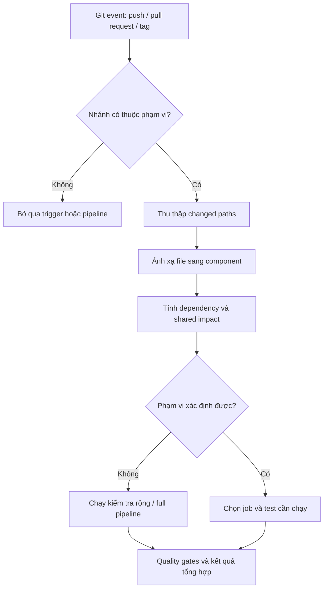
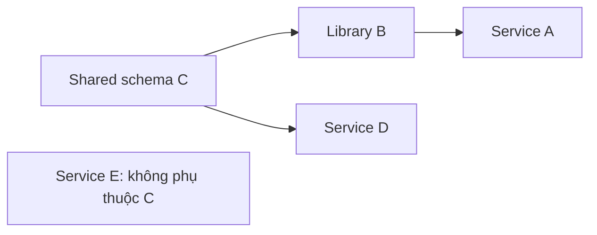

# Chọn nhánh, đường dẫn và phạm vi thay đổi cần xử lý

Một repository có thể chứa nhiều ứng dụng, thư viện, tài liệu và cấu hình dùng chung. Không phải thay đổi nào cũng cần chạy toàn bộ pipeline, nhưng bỏ sót một file có ảnh hưởng gián tiếp có thể khiến mã chưa được kiểm tra đi vào nhánh chính hoặc production. Thiết kế bộ lọc CI/CD vì vậy phải cân bằng hai mục tiêu: phản hồi nhanh cho thay đổi không liên quan và bảo đảm mọi thành phần chịu ảnh hưởng đều được kiểm tra.

Branch filter xác định nhánh hoặc loại nhánh nào được phép kích hoạt luồng. Path filter xác định những đường dẫn thay đổi nào có liên quan. Scope selection xác định tập job, test, build hoặc service cần chạy sau khi biết phạm vi thay đổi. Ba lớp này liên quan nhưng không giống nhau: chọn đúng nhánh chưa có nghĩa đã chọn đúng module; lọc đúng đường dẫn cũng chưa chắc đã bao phủ dependency của module đó.

## 1. Ba câu hỏi trước khi viết bộ lọc

Trước khi thêm `branches`, `paths`, `rules:changes` hay `when { changeset ... }`, hãy trả lời:

1. **Sự kiện nào cần xử lý?** Push vào nhánh chính, pull request, tag release, lịch định kỳ hay thao tác thủ công?
2. **Thay đổi ở đâu?** Nhánh nguồn, nhánh đích, file được thêm/sửa/xóa/đổi tên và các cấu hình dùng chung nào bị ảnh hưởng?
3. **Cần chạy những gì?** Toàn bộ pipeline, một nhóm module, một tập test, kiểm tra tài liệu hay chỉ một bước xác minh?

Ví dụ một monorepo có `services/orders`, `services/catalog`, `libs/contracts`, `build-logic` và `docs`. Khi thay đổi `services/orders/**`, nhóm có thể chạy test của orders. Khi thay đổi `libs/contracts/**`, cả orders và catalog có thể phải kiểm tra vì cùng sử dụng hợp đồng. Khi thay đổi `build-logic/**` hoặc lockfile ở root, mọi module có thể bị ảnh hưởng và cần chạy pipeline rộng hơn.



## 2. Phân biệt nhánh nguồn, nhánh đích và nhánh nhận push

Tên `branch` trong một cấu hình không phải lúc nào cũng nói về cùng một nhánh.

- Với sự kiện **push**, branch thường là nhánh nhận commit mới.
- Với **pull request/merge request**, bộ lọc branch phổ biến thường xét nhánh đích (base/target), tức nơi thay đổi muốn được hợp nhất.
- Nhánh nguồn (head/source) là nhánh chứa commit đề xuất. Muốn lọc theo nhánh nguồn, thường phải dùng biến hoặc điều kiện riêng của nền tảng.
- Với **tag**, ref là tên tag, không phải branch. Cần cấu hình tag filter riêng nếu muốn chạy release pipeline.

Ví dụ: pull request từ `feature/new-checkout` vào `main`. Nếu cấu hình chỉ định `branches: [main]` cho sự kiện pull request của GitHub Actions, điều kiện này xét nhánh đích `main`; nó không có nghĩa chỉ cho phép nhánh nguồn `main`.

| Nhu cầu | Thông tin cần kiểm tra |
|---|---|
| Chỉ kiểm tra khi push vào `main` | Tên nhánh nhận push |
| Chỉ nhận pull request hướng vào `main` | Nhánh đích/base/target |
| Chỉ nhận pull request từ nhánh `release/*` | Nhánh nguồn/head/source; dùng biến hoặc điều kiện phù hợp nền tảng |
| Chạy khi tạo tag `v*` | Ref loại tag và mẫu tag |
| Chạy release từ nhánh chính sau merge | Sự kiện push vào nhánh chính hoặc sự kiện release được chọn |

Không nên suy ra nhánh nguồn từ chuỗi tên PR hiển thị trên giao diện. Mỗi nền tảng có thể checkout merge ref tổng hợp, source ref hoặc revision khác nhau. Hãy dùng biến được tài liệu nền tảng quy định cho source và target.

## 3. Branch filter và path filter làm việc ở cấp nào?

Branch filter thường quyết định pipeline hoặc workflow có được khởi chạy hay không. Path filter cũng có thể ngăn toàn bộ workflow được tạo nếu thay đổi không khớp. Một số nền tảng còn cho phép điều kiện ở cấp job hoặc stage; khi đó pipeline vẫn tồn tại nhưng một số công việc được bỏ qua.

| Lớp lọc | Câu hỏi trả lời | Ví dụ |
|---|---|---|
| Pipeline/workflow trigger | Có tạo lần chạy hay không? | Chỉ push vào `main`, chỉ thay đổi dưới `services/orders/**` |
| Job/stage condition | Trong lần chạy này, job hoặc stage nào được thực thi? | Chỉ chạy integration test nếu `libs/contracts/**` thay đổi |
| Lệnh chọn scope bên trong job | Job cần kiểm tra những module/file nào? | Dùng dependency graph để tính module bị ảnh hưởng |

Lọc càng sớm càng tiết kiệm tài nguyên, nhưng nếu lọc ở cấp toàn workflow thì có thể không còn status check để bảo vệ pull request. Lọc ở cấp job cho phép giữ một workflow tổng hợp luôn xuất hiện, sau đó quyết định job nào chạy. Cần chọn cấp lọc phù hợp với cách repository bảo vệ nhánh.

## 4. Mẫu và quy tắc đường dẫn

### 4.1. Đường dẫn được tính từ đâu?

Hầu hết path filter so sánh đường dẫn tương đối với root của repository, nhưng cú pháp và cách xử lý chữ hoa/chữ thường phụ thuộc nền tảng. Một số mẫu thường gặp:

| Mẫu | Ý định thường gặp |
|---|---|
| `services/orders/**` | File trong module orders và các thư mục con |
| `services/orders/**/*` | File ở mọi cấp bên dưới orders trong cú pháp hỗ trợ glob kiểu này |
| `*.md` | File Markdown ở root trong nhiều bộ glob |
| `**/*.md` | File Markdown ở nhiều cấp thư mục; kiểm tra quy tắc root của từng nền tảng |
| `build.gradle*` | File build Gradle ở root với các hậu tố phù hợp |
| `.github/workflows/**` | Workflow CI của GitHub Actions |
| `libs/contracts/**` | Hợp đồng hoặc thư viện dùng chung |

Không giả định `*`, `**`, `?`, `!` hoặc biểu thức chính quy có ý nghĩa giống nhau giữa mọi công cụ. GitHub Actions và Azure Pipelines có cú pháp glob riêng; GitLab dùng quy tắc path matching của `rules:changes`; Jenkins thường dùng pattern kiểu Ant cho `changeset`; CircleCI path filtering thường được triển khai bằng regex trong mapping của orb. Khi chuyển nền tảng, hãy thử pattern trên các đường dẫn đại diện.

### 4.2. Phân biệt `*` và `**`

Trong nhiều cú pháp glob:

- `*` khớp một phần tên trong một cấp đường dẫn và thường không đi qua dấu `/`.
- `**` khớp qua nhiều cấp thư mục.
- `?` khớp một ký tự.
- Một số công cụ hỗ trợ phủ định bằng `!`, một số dùng danh sách `exclude` hoặc biểu thức điều kiện.

Ví dụ, `services/orders/*.java` thường chỉ nhắm file Java ngay dưới `services/orders`, còn `services/orders/**/*.java` nhắm file Java trong các thư mục con. Nếu module có cấu trúc `src/main/java` và `src/test/java`, dùng pattern chỉ có một `*` có thể bỏ sót thay đổi sâu bên trong.

### 4.3. Phân biệt include và exclude

Một bộ lọc cần định nghĩa rõ danh sách được đưa vào và danh sách loại trừ. Nếu nền tảng hỗ trợ negative pattern, thứ tự có thể quan trọng: mẫu phủ định sau mẫu bao gồm sẽ loại đường dẫn; mẫu bao gồm xuất hiện sau có thể đưa đường dẫn trở lại. Nền tảng khác có khóa `include` và `exclude`, hoặc dùng `rules` theo thứ tự ưu tiên.

Tránh tạo danh sách loại trừ quá rộng như bỏ qua toàn bộ `*.yml`, `config/**` hoặc `scripts/**`. Những file này có thể thay đổi cách build, quyền của pipeline hoặc cấu hình runtime dù mã ứng dụng không đổi.

## 5. GitHub Actions: lọc branch và path trong event

GitHub Actions hỗ trợ lọc branch, tag và path ngay trong trigger `push` hoặc `pull_request`. Ví dụ:

```yaml
name: Orders CI

on:
  push:
    branches:
      - main
      - 'release/**'
    paths:
      - 'services/orders/**'
      - 'libs/contracts/**'
      - 'build-logic/**'
      - 'gradle/**'
      - 'settings.gradle*'
      - 'gradle/libs.versions.toml'

  pull_request:
    branches:
      - main
    paths:
      - 'services/orders/**'
      - 'libs/contracts/**'
      - 'build-logic/**'
      - 'gradle/**'
      - 'settings.gradle*'
      - 'gradle/libs.versions.toml'

permissions:
  contents: read

jobs:
  verify:
    runs-on: ubuntu-latest
    steps:
      - uses: actions/checkout@v4
      - run: ./gradlew :services:orders:check
```

Trong ví dụ:

- Với `push`, `branches` xét nhánh nhận push.
- Với `pull_request`, `branches` xét nhánh đích của pull request.
- Khi khai báo cả `branches` và `paths`, cả điều kiện nhánh lẫn điều kiện đường dẫn đều phải khớp.
- Các file dùng chung được thêm vào danh sách vì có thể ảnh hưởng đến module orders.

### 5.1. `branches` và `branches-ignore`

Với cùng một event, không khai báo đồng thời `branches` và `branches-ignore`. Nếu cần mẫu phủ định và mẫu cho phép trong cùng danh sách, dùng negative pattern trong `branches`; phải có ít nhất một mẫu dương. Thứ tự mẫu ảnh hưởng kết quả khi một mẫu sau phủ định hoặc đưa nhánh trở lại.

```yaml
on:
  push:
    branches:
      - 'releases/**'
      - '!releases/**-alpha'
      - 'releases/2026-alpha-hotfix'
```

Ở ví dụ này, nhánh `releases/**` được nhận, nhánh khớp `releases/**-alpha` bị loại, và một nhánh alpha hotfix cụ thể được đưa trở lại bởi mẫu dương cuối. Hãy dùng tên nhánh dễ đọc và kiểm thử các trường hợp biên để tránh quy tắc khó bảo trì.

### 5.2. `paths` và `paths-ignore`

`paths` cho phép workflow chạy nếu ít nhất một file thay đổi khớp mẫu. `paths-ignore` bỏ qua workflow khi tất cả file thay đổi đều khớp danh sách loại trừ. Không dùng đồng thời `paths` và `paths-ignore` cho cùng một event; nếu cần include và exclude phức tạp, dùng negative pattern trong `paths` theo quy tắc thứ tự của GitHub.

```yaml
on:
  pull_request:
    branches: [main]
    paths:
      - 'services/orders/**'
      - '!services/orders/docs/**'
      - 'services/orders/docs/api-contract.md'
```

Mẫu phủ định phải được đặt sau mẫu dương mà nó loại. Mẫu dương phía sau có thể đưa một đường dẫn cụ thể trở lại. Các giá trị có `!`, `*` hoặc ký tự đặc biệt nên được đặt trong dấu nháy YAML để tránh bị parser hiểu theo cú pháp khác.

### 5.3. Diff được dùng để đánh giá path filter

GitHub Actions không chỉ nhìn tên nhánh. Path filter được tính trên diff:

- Với pull request, diff được tính từ merge base của nhánh nguồn và nhánh đích đến commit đầu nhánh nguồn (three-dot comparison).
- Với push vào nhánh hiện có, diff so sánh trước và sau push (two-dot comparison).
- Bộ lọc path không được đánh giá cho sự kiện push tag.

Điều này có ý nghĩa khi nhánh đích đã tiến xa: file thay đổi từ trước merge base không nhất thiết được xem là thay đổi của pull request hiện tại. Với thay đổi lớn, cần chú ý giới hạn danh sách file mà GitHub dùng để đánh giá path filter; khi diff có quá nhiều file hoặc không thể tạo diff, nên có phương án chạy kiểm tra rộng thay vì dựa hoàn toàn vào lọc đường dẫn.

### 5.4. Workflow bị bỏ qua và required checks

Nếu workflow bị bỏ qua do branch filter, path filter hoặc skip directive trong commit message, check tương ứng có thể ở trạng thái Pending. Nếu branch protection yêu cầu check đó, pull request có thể không merge được dù workflow không chạy vì thay đổi không liên quan.

Với repository dùng required status checks, hãy cân nhắc giữ một workflow kiểm tra tổng hợp luôn chạy trên pull request rồi chỉ bỏ qua các job không liên quan. Workflow tổng hợp phải báo trạng thái cuối cùng rõ ràng và không được đánh dấu đạt khi một job bắt buộc đã bị bỏ qua sai cách.

## 6. GitLab CI/CD: `rules:changes` và phạm vi pipeline

GitLab thường dùng `rules:changes` để thêm job vào pipeline khi file phù hợp thay đổi. `workflow: rules` có thể quyết định có tạo pipeline hay không; `job rules` quyết định job nào được đưa vào pipeline. Hai cấp này nên được thiết kế riêng.

```yaml
stages:
  - verify

orders_tests:
  stage: verify
  image: gradle:8-jdk21
  script:
    - gradle :services:orders:check
  rules:
    - if: '$CI_PIPELINE_SOURCE == "merge_request_event"'
      changes:
        paths:
          - services/orders/**/*
          - libs/contracts/**/*
          - build-logic/**/*
          - gradle/**/*
          - settings.gradle*
    - if: '$CI_PIPELINE_SOURCE == "push" && $CI_COMMIT_BRANCH'
      changes:
        paths:
          - services/orders/**/*
          - libs/contracts/**/*
          - build-logic/**/*
          - gradle/**/*
          - settings.gradle*
```

Các rule được xét theo thứ tự. Khi một rule khớp, GitLab dùng cấu hình của rule đó và không tiếp tục xét các rule sau. Nếu muốn loại một trường hợp, có thể dùng `when: never` trong rule phù hợp; cần đặt rule loại trừ trước rule tổng quát có thể nhận nó.

### 6.1. `workflow: rules` khác `job rules`

`workflow: rules` điều khiển việc tạo pipeline. Ví dụ, nhóm có thể muốn tạo pipeline cho merge request và branch push nhưng không tạo hai pipeline trùng nhau cho cùng một commit khi branch đã có merge request. Trong khi đó, `rules` của job điều khiển job cụ thể có xuất hiện hay không.

Nếu lọc toàn bộ pipeline bằng `workflow: rules`, các job tổng hợp và status check cũng có thể không tồn tại. Nếu mục tiêu chỉ là tiết kiệm thời gian cho một module, thường nên giữ pipeline và lọc job theo phạm vi.

### 6.2. Ngữ nghĩa mặc định của `rules:changes`

Trong merge request pipeline, GitLab so sánh thay đổi với nhánh đích. Trong branch pipeline, mặc định thường so sánh với commit trước đó trên nhánh. Với pipeline chạy theo lịch, thủ công hoặc nguồn không có một push/merge request tương ứng, `rules:changes` có thể được xem là đúng vì không có baseline diff mặc định phù hợp.

Khi cần so sánh với một baseline cụ thể, dùng `compare_to`:

```yaml
docs_check:
  stage: verify
  script:
    - ./scripts/check-docs.sh
  rules:
    - if: '$CI_PIPELINE_SOURCE == "schedule"'
      changes:
        compare_to: 'refs/heads/main'
        paths:
          - docs/**/*
```

`compare_to` giúp xác định rõ revision tham chiếu cho việc đánh giá thay đổi. Hãy chọn baseline đúng với mục tiêu: nhánh chính, nhánh release hoặc một ref cụ thể. Nếu so sánh sai baseline, job có thể luôn chạy hoặc luôn bị bỏ qua.

### 6.3. Tránh duplicate pipeline

Một commit có thể tạo branch pipeline và merge request pipeline tùy cấu hình. Nếu cả hai đều chạy cùng bộ job đắt tiền, chi phí tăng và kết quả khó đọc. Dùng `workflow: rules` để xác định nguồn pipeline được phép, hoặc cấu hình job theo `$CI_PIPELINE_SOURCE`, đồng thời giữ required checks cho merge request. Không nên tắt branch pipeline một cách mù quáng nếu nhánh không có merge request vẫn cần CI.

## 7. Azure Pipelines: branch và path filters

Azure Pipelines hỗ trợ branch và path filter trong `trigger`; YAML `pr` trigger có thể lọc pull request trên những loại repository được hỗ trợ.

```yaml
trigger:
  branches:
    include:
      - main
      - releases/*
    exclude:
      - releases/experimental/*
  paths:
    include:
      - services/orders/**
      - libs/contracts/**
      - build-logic/**
      - gradle/**
      - settings.gradle*
    exclude:
      - services/orders/docs/**

pr:
  branches:
    include:
      - main
  paths:
    include:
      - services/orders/**
      - libs/contracts/**
      - build-logic/**
      - gradle/**
      - settings.gradle*

pool:
  vmImage: ubuntu-latest

steps:
  - script: ./gradlew :services:orders:check
    displayName: Verify orders service
```

Trong ví dụ, branch và path filters cùng được áp dụng. Azure path filter phân biệt chữ hoa/chữ thường; `include` và `exclude` phải khớp chính xác cách viết đường dẫn trong repository. Kiểm tra các mẫu trên agent và repository thực tế, đặc biệt khi dự án có tên thư mục viết hoa hoặc chạy trên hệ điều hành khác nhau.

### 7.1. Pull request trên Azure Repos và GitHub

YAML `pr` trigger không áp dụng cho Azure Repos Git theo cách giống GitHub/Bitbucket Cloud. Với Azure Repos Git, validation build cho pull request thường được cấu hình qua branch policy của repository. Đây là khác biệt quan trọng khi chuyển cùng một `azure-pipelines.yml` giữa các loại Git provider.

### 7.2. Exclude và default trigger

Khi dùng include/exclude, hãy xác nhận chính sách mặc định của cấu hình nếu không có danh sách include. Đừng giả định thiếu `trigger` đồng nghĩa với không chạy: hành vi CI mặc định có thể phụ thuộc cấu hình tổ chức/dự án. Nếu muốn tắt CI trigger tự động, khai báo rõ `trigger: none` và chỉ thêm nguồn chạy cần thiết.

## 8. CircleCI: branch filters và path filtering

CircleCI có branch/tag filters ở cấp job trong `workflows`. Ví dụ:

```yaml
version: 2.1

jobs:
  verify:
    docker:
      - image: cimg/openjdk:21.0
    steps:
      - checkout
      - run: ./gradlew check

workflows:
  verify_main_and_release:
    jobs:
      - verify:
          filters:
            branches:
              only:
                - main
                - /release\/.*/
```

Các job có dependency trong workflow cần có filter tương thích. Nếu job upstream bị lọc bỏ nhưng downstream vẫn yêu cầu nó, workflow có thể không chạy như mong đợi. Hãy kiểm tra toàn bộ chuỗi `requires`, branch filters và tag filters.

### 8.1. Path filtering bằng dynamic configuration

CircleCI thường dùng path-filtering orb và dynamic configuration để chọn pipeline con hoặc bật các parameter theo file thay đổi. Đây là cơ chế bổ sung, không phải một khóa `paths:` đơn giản có cùng ngữ nghĩa với GitHub Actions.

Ví dụ phần setup config:

```yaml
version: 2.1
setup: true

orbs:
  path-filtering: circleci/path-filtering@1.0.0

workflows:
  detect_changes:
    jobs:
      - path-filtering/filter:
          base-revision: main
          config-path: .circleci/continue_config.yml
          mapping: |
            services/orders/.* run_orders true
            services/catalog/.* run_catalog true
            libs/contracts/.* run_orders true
            libs/contracts/.* run_catalog true
```

File continuation config có thể khai báo parameter `run_orders` và `run_catalog`, rồi điều kiện hóa job tương ứng. Ví dụ mapping dùng regex và tên parameter; cần kiểm tra cú pháp, quyền và cách continuation hoạt động theo phiên bản orb đang dùng. Hãy ghim phiên bản orb và review thay đổi như dependency của pipeline.

### 8.2. Chọn baseline cho path filtering

Path filtering phải biết revision nào là baseline. Nếu chọn `main` trong khi pipeline đang xử lý nhánh release hoặc merge request với lịch sử khác, kết quả changed paths có thể không phản ánh đúng phạm vi mong muốn. Chọn base revision theo loại pipeline và thử với nhánh mới, nhánh đã tồn tại lâu, merge commit và thay đổi được merge gần đây.

## 9. Jenkins: branch discovery và điều kiện `when`

Jenkins Multibranch Pipeline có thể khám phá branch và pull request thông qua Branch Source plugin. Quy tắc include/exclude branch, pull request discovery và build strategy thường được cấu hình ở nguồn SCM hoặc job. Bên trong Jenkinsfile, Declarative Pipeline có `when` condition để bỏ qua stage dựa trên branch, change request hoặc changeset.

```groovy
pipeline {
    agent none

    stages {
        stage('Verify orders') {
            agent any
            when {
                beforeAgent true
                allOf {
                    anyOf {
                        branch 'main'
                        changeRequest target: 'main'
                    }
                    changeset 'services/orders/**'
                }
            }
            steps {
                sh './gradlew :services:orders:check'
            }
        }

        stage('Verify catalog') {
            agent any
            when {
                beforeAgent true
                changeset 'services/catalog/**'
            }
            steps {
                sh './gradlew :services:catalog:check'
            }
        }
    }
}
```

`branch` condition thường có ý nghĩa trong Multibranch Pipeline. Với pull request, điều kiện `changeRequest` có thể lọc theo thuộc tính như target branch. `changeset` kiểm tra file thay đổi được ghi nhận trong changelog của build. Các điều kiện này thường bỏ qua stage; pipeline vẫn có thể được tạo và khởi chạy trước khi stage được đánh giá. `beforeAgent true` cho phép đánh giá điều kiện trước khi cấp agent cho stage, giúp tránh cấp tài nguyên không cần thiết khi stage bị bỏ qua.

Nếu muốn không tạo build ngay từ đầu cho một nhánh hoặc PR, cần cấu hình branch source traits/build strategies hoặc cơ chế webhook/plugin phù hợp. Không coi `when { changeset ... }` là bộ lọc pipeline-level.

## 10. Lựa chọn phạm vi thay đổi trong monorepo

### 10.1. Từ file thay đổi đến component bị ảnh hưởng

Một path filter chỉ biết file nào đổi; nó không tự hiểu quan hệ phụ thuộc trong mã. Cần một bản đồ ownership và dependency để tính tập component cần kiểm tra.

Ví dụ:

| Đường dẫn thay đổi | Component trực tiếp | Phạm vi kiểm tra đề xuất |
|---|---|---|
| `services/orders/**` | Orders | Unit và integration test của orders |
| `services/catalog/**` | Catalog | Unit và integration test của catalog |
| `libs/contracts/**` | Shared contracts | Orders, catalog và contract tests của consumer |
| `build-logic/**` | Build system | Build/test tất cả module chịu ảnh hưởng |
| `gradle/libs.versions.toml` | Dependency catalog | Tối thiểu kiểm tra compile/test các module dùng dependency được cập nhật; có thể full build |
| `settings.gradle*` | Project topology | Full configuration/build validation |
| `.github/workflows/**` hoặc `.gitlab-ci.yml` | CI configuration | Pipeline lint và kiểm tra workflow liên quan; không bỏ qua required CI |
| `docs/**` | Documentation | Link, spelling, formatting hoặc docs tests |
| `Dockerfile`, build image scripts | Build/runtime image | Build image và kiểm tra module dùng image đó |

Nếu một file dùng chung ảnh hưởng nhiều component, hãy chạy toàn bộ tập consumer bị ảnh hưởng. Nếu không thể tính dependency chắc chắn, chạy full pipeline là lựa chọn an toàn hơn việc đoán thiếu.

### 10.2. Phân loại file theo mức ảnh hưởng

Một cách thực tế là chia đường dẫn thành bốn nhóm:

1. **Component-specific:** chỉ ảnh hưởng một module; chạy job của module đó.
2. **Shared library/contract:** ảnh hưởng các consumer; chạy test của thư viện và các consumer liên quan.
3. **Build/CI/platform configuration:** có thể thay đổi cách mọi module được build hoặc kiểm tra; chạy pipeline rộng.
4. **Documentation/non-executable assets:** chạy kiểm tra tài liệu; có thể bỏ qua build ứng dụng nếu không có liên hệ với generated docs hoặc API.

Danh sách này cần được duy trì cùng cấu trúc repository. Khi thêm module hoặc thay đổi dependency, cập nhật mapping và test cho mapping đó. Không để một file mới rơi vào trạng thái “không thuộc nhóm nào” rồi âm thầm bị bỏ qua.

### 10.3. Tính dependency closure

Giả sử component A phụ thuộc thư viện B, B phụ thuộc schema C. Khi C thay đổi, không chỉ chạy test của C; cần xác định cả A và những consumer khác của C. Tập kiểm tra là phần đóng theo quan hệ phụ thuộc (dependency closure) của thay đổi.



Nếu schema C thay đổi, kiểm tra C, B, A và D. Service E có thể được bỏ qua nếu dependency graph chứng minh không liên quan. Với dependency động hoặc được nạp qua plugin, cần có fallback kiểm tra rộng.

### 10.4. Các file gốc cần được xem là shared impact

Những đường dẫn thường bị quên khi viết path filter:

- Root build files: `settings.gradle`, `build.gradle`, `pom.xml`, `package.json`, `Makefile`.
- Dependency lock/catalog: Gradle lockfiles, version catalog, npm/yarn/pnpm lockfiles, Maven parent POM.
- Build logic và plugin: `buildSrc`, `build-logic`, custom Gradle plugin, compiler config.
- Container/build image: `Dockerfile`, `.dockerignore`, scripts tạo build image.
- CI configuration: `.github/workflows/**`, `.gitlab-ci.yml`, `Jenkinsfile`, `azure-pipelines.yml`, `.circleci/**`.
- Shared contracts: OpenAPI, protobuf, GraphQL schema, database migration conventions và code generation templates.
- Scripts và toolchain: `scripts/**`, `.tool-versions`, `.java-version`, `.nvmrc`, tool configuration.

Một thay đổi chỉ ở file workflow có thể làm mất test hoặc cấp quyền deploy sai. Do đó, pipeline configuration phải luôn được kiểm tra theo một đường đi bảo vệ nhánh rõ ràng.

## 11. Ví dụ chọn job theo phạm vi thay đổi

Giả sử monorepo có hai module `orders` và `catalog`, cùng dùng `libs/contracts`. Với GitHub Actions, có thể giữ workflow chạy cho mọi pull request vào `main`, sau đó xác định job cần chạy theo changed paths. Ví dụ đơn giản:

```yaml
name: Monorepo CI

on:
  pull_request:
    branches: [main]
  push:
    branches: [main]

permissions:
  contents: read
  pull-requests: read

jobs:
  changes:
    runs-on: ubuntu-latest
    outputs:
      orders: ${{ steps.filter.outputs.orders }}
      catalog: ${{ steps.filter.outputs.catalog }}
      shared: ${{ steps.filter.outputs.shared }}
    steps:
      - uses: actions/checkout@v4
        with:
          fetch-depth: 0
      - uses: dorny/paths-filter@v3
        id: filter
        with:
          filters: |
            orders:
              - 'services/orders/**'
            catalog:
              - 'services/catalog/**'
            shared:
              - 'libs/contracts/**'
              - 'build-logic/**'
              - 'gradle/**'
              - 'settings.gradle*'

  orders:
    needs: changes
    if: needs.changes.outputs.orders == 'true' || needs.changes.outputs.shared == 'true'
    runs-on: ubuntu-latest
    steps:
      - uses: actions/checkout@v4
      - run: ./gradlew :services:orders:check

  catalog:
    needs: changes
    if: needs.changes.outputs.catalog == 'true' || needs.changes.outputs.shared == 'true'
    runs-on: ubuntu-latest
    steps:
      - uses: actions/checkout@v4
      - run: ./gradlew :services:catalog:check
```

Đây là ví dụ minh họa cách phân loại file bằng action bên thứ ba; nó không phải tính năng path filter native của GitHub Actions. Cần pin action theo full commit SHA theo chính sách tổ chức, cấp quyền `pull-requests: read` để action đọc danh sách file của pull request, và bảo đảm `shared` bao phủ đủ file gốc. Job `changes` chỉ phát hiện phạm vi; nó không phải quality gate cuối cùng vì không tổng hợp kết quả test của các module. Repository thực tế cần một job tổng hợp bắt buộc để xác nhận job phát hiện thay đổi thành công, mọi module được chọn đều đạt và các job bị skip đều được bỏ qua có lý do.

Ví dụ job tổng hợp có thể kiểm tra kết quả của các job phụ thuộc:

```yaml
  required:
    if: always()
    needs: [changes, orders, catalog]
    runs-on: ubuntu-latest
    steps:
      - name: Check selected jobs
        env:
          CHANGES_RESULT: ${{ needs.changes.result }}
          ORDERS_RESULT: ${{ needs.orders.result }}
          CATALOG_RESULT: ${{ needs.catalog.result }}
        run: |
          test "$CHANGES_RESULT" = "success"
          for result in "$ORDERS_RESULT" "$CATALOG_RESULT"; do
            case "$result" in
              success|skipped) ;;
              *) exit 1 ;;
            esac
          done
```

Đặt tên job tổng hợp ổn định và cấu hình chính job đó thành required status check. Trong workflow thật, nếu một module bắt buộc phải chạy theo loại event hoặc chính sách khác, hãy đưa điều kiện đó vào logic tổng hợp; không chấp nhận `skipped` một cách vô điều kiện cho mọi job.

Một phương án khác là dùng script nội bộ để lấy changed paths và tính dependency closure. Cách này linh hoạt hơn nhưng cần test cho script, xử lý merge base đúng với event và fallback full build khi script không thể xác định phạm vi.

## 12. Các tình huống biên cần xử lý

### 12.1. Thay đổi nhiều file hoặc vượt ngưỡng diff

Pull request lớn có thể thay đổi hàng trăm hoặc hàng nghìn file. Một số nền tảng giới hạn số đường dẫn dùng để đánh giá filter hoặc có giới hạn thời gian tạo diff. Nếu bộ lọc không nhìn thấy toàn bộ thay đổi, một module có thể bị bỏ sót. Với PR lớn, thay đổi generated code hoặc migration lớn, nên chạy kiểm tra rộng hơn và không dựa duy nhất vào path filter.

### 12.2. Rename và delete

Đổi tên file có thể được Git hiển thị như cặp delete/add tùy cách phát hiện rename. Khi tính scope, cần xem cả đường dẫn cũ và mới. Xóa file cấu hình hoặc module cũng có thể ảnh hưởng consumer, build include hoặc deployment manifest. Không chỉ kiểm tra file còn tồn tại ở revision mới.

### 12.3. Branch mới, tag, schedule và manual run

Các event không có baseline diff giống push thông thường. Ví dụ pipeline chạy theo lịch có thể không có một commit trước đó tương ứng; branch mới có thể không có cùng cách so sánh với nhánh đã tồn tại. Hãy chọn baseline rõ ràng, như default branch hoặc tag phát hành trước, rồi xác định phạm vi thay đổi theo mục đích của lịch chạy.

Với manual run, nên có input để chọn component hoặc chế độ full run, nhưng giá trị đầu vào không được cho phép vượt qua quality gate hoặc tự cấp quyền production. Manual trigger chỉ quyết định công việc nào được đề nghị chạy; quyền và approval vẫn phải được kiểm tra độc lập.

### 12.4. Submodule và repository ngoài

Thay đổi commit pointer của Git submodule có thể ảnh hưởng nội dung bên ngoài thư mục repository chính. Path filter chỉ thấy pointer hoặc file tham chiếu; nó không tự biết toàn bộ diff trong repository con. Nếu pipeline phụ thuộc submodule, cần checkout đúng revision và có kiểm tra riêng khi pointer thay đổi. Với dependency được tải từ repository khác, cập nhật version hoặc digest cần được xem như thay đổi dependency.

### 12.5. File sinh tự động

Generated source có thể thay đổi hàng loạt khi schema hoặc generator đổi. Không nên chỉ lọc generated output nếu nguồn thực sự là schema, template hoặc generator. Mapping phải bao gồm cả nguồn và output, hoặc xác định rõ file nào là nguồn chuẩn.

### 12.6. Chữ hoa/chữ thường và đường dẫn nền tảng

Repository có thể được checkout trên Linux và Windows với khác biệt về chữ hoa/chữ thường, dấu phân cách hoặc ký tự đặc biệt. Một path filter chạy đúng trên máy cá nhân chưa chắc khớp trên nền tảng CI. Hãy dùng tên đường dẫn nhất quán, tránh tên file chỉ khác chữ hoa/chữ thường và thử filter trên runner tương ứng.

## 13. Required checks và cách tránh bỏ sót kiểm thử

Path filtering tối ưu tài nguyên nhưng cũng tạo rủi ro false negative: một thay đổi có ảnh hưởng mà bộ lọc không nhận ra. Có thể giảm rủi ro bằng các nguyên tắc:

- Duy trì một job tổng hợp có trạng thái rõ ràng, được dùng làm required check.
- Đưa root build files, lockfiles, shared libraries, schema, CI config và script chung vào shared impact.
- Khi có đường dẫn chưa được phân loại, chạy full pipeline hoặc báo lỗi để bổ sung mapping.
- Kiểm thử bộ lọc bằng danh sách đường dẫn mẫu: file trong module, file ở root, file sâu, file bị xóa/đổi tên và file shared.
- Kiểm tra cả PR target, source branch, push vào nhánh mới, tag, schedule và manual run.
- Ghi lại lý do job bị bỏ qua để reviewer hiểu rằng đó là quyết định có chủ đích.

Một job bị skip hợp lệ không nên bị xem như một test đã chạy thành công nếu chính sách cần bằng chứng thực thi. Job tổng hợp phải phân biệt `passed`, `failed`, `skipped by scope` và `not evaluated`; chính sách có thể chấp nhận skip có lý do nhưng phải bảo đảm module liên quan đã được chọn.

## 14. Checklist thiết kế branch/path filters

- [ ] Đã xác định event và loại ref: push branch, PR/MR, tag, schedule hay manual.
- [ ] Đã phân biệt nhánh nguồn và nhánh đích cho pull request/merge request.
- [ ] Đã xác định filter chạy ở cấp workflow/pipeline, job/stage hay script chọn module.
- [ ] Pattern bao phủ file ở đúng cấp thư mục và phù hợp cú pháp của nền tảng.
- [ ] Include/exclude có thứ tự và phạm vi dễ hiểu; không bỏ qua cấu hình quan trọng.
- [ ] Đã đưa shared library, build logic, lockfile, root config, schema và CI config vào mapping.
- [ ] Đã tính dependency closure từ component thay đổi đến consumer cần kiểm tra.
- [ ] Có fallback full pipeline khi không xác định được phạm vi hoặc diff quá lớn.
- [ ] Đã kiểm tra rename, delete, branch mới, tag, schedule và manual run.
- [ ] Required status check luôn có kết quả cuối cùng rõ ràng và không bị pending do workflow bị lọc bỏ.
- [ ] Có test cho mapping path-to-component và cập nhật mapping khi thêm module.
- [ ] Đã kiểm tra log/audit cho biết job nào chạy, job nào skip và lý do.

Một bộ lọc tốt giúp pipeline chạy đúng phần việc cần thiết mà vẫn giữ độ tin cậy của quality gates. Hãy bắt đầu từ semantics của event, xác định rõ baseline diff, ánh xạ đường dẫn sang component và tính các dependency chịu ảnh hưởng. Khi có bất kỳ sự mơ hồ nào về phạm vi, chạy kiểm tra rộng hơn là để một thay đổi quan trọng lọt qua mà không được xác minh.
