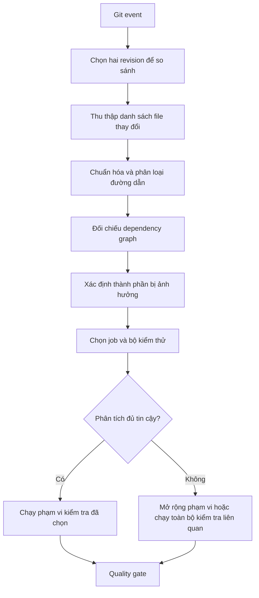
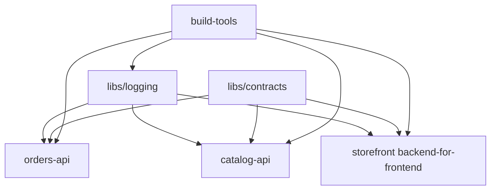
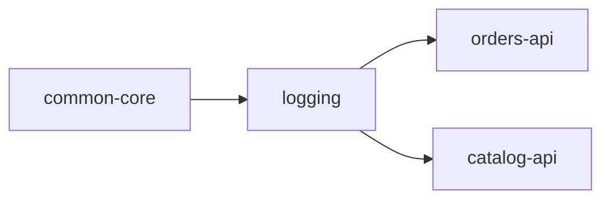
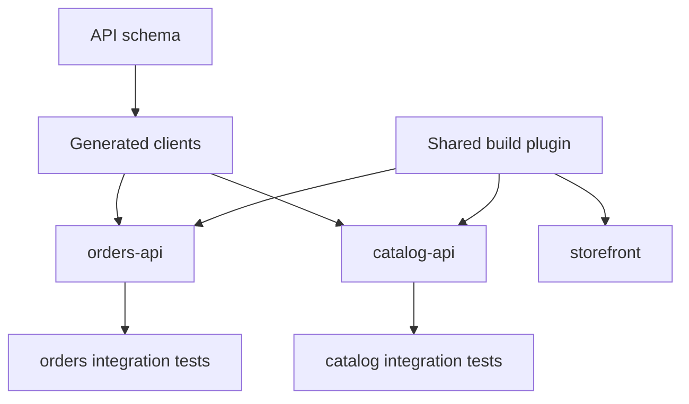

# Hiểu giới hạn của bộ lọc thay đổi với phụ thuộc dùng chung

Trong một repository chứa nhiều service, package hoặc ứng dụng, không phải thay đổi nào cũng cần chạy toàn bộ pipeline. Một thay đổi chỉ nằm trong thư mục tài liệu có thể không cần build backend; một thay đổi chỉ ảnh hưởng đến frontend có thể không cần chạy toàn bộ integration test của các service khác. Bộ lọc thay đổi (path filter hoặc changed-file filter) giúp chọn pipeline hay job dựa trên những file được thêm, sửa, đổi tên hoặc xóa.

Tuy nhiên, **đường dẫn của file thay đổi không đồng nghĩa với phạm vi ảnh hưởng của thay đổi đó**. Một thư viện dùng chung có thể được nhiều service sử dụng; một schema API có thể tạo mã cho nhiều ứng dụng; một file build chung có thể thay đổi cách đóng gói của cả repository. Nếu bộ lọc chỉ nhìn thư mục trực tiếp chứa file, pipeline có thể bỏ qua những kiểm tra cần thiết của consumer và để lỗi lọt đến giai đoạn phát hành.

Vì vậy, bộ lọc thay đổi nên được xem là tín hiệu để xác định phạm vi công việc ban đầu. Muốn quyết định kiểm thử nào cần chạy, pipeline phải kết hợp đường dẫn với đồ thị phụ thuộc, loại thay đổi, quy tắc build và mức rủi ro. Khi không xác định được tác động một cách đáng tin cậy, lựa chọn an toàn là mở rộng phạm vi kiểm tra hoặc chạy toàn bộ bộ kiểm thử liên quan.

## 1. Bộ lọc thay đổi hoạt động như thế nào?

Một bộ lọc thay đổi thường nhận danh sách file khác nhau giữa hai revision Git rồi so khớp đường dẫn với các mẫu đã khai báo. Kết quả có thể quyết định:

- Có khởi chạy workflow hoặc pipeline hay không.
- Job nào trong workflow cần chạy.
- Module, package hoặc service nào cần build và kiểm thử.
- Có cần tạo môi trường tạm thời hoặc triển khai một thành phần hay không.
- Có cần chạy một bộ kiểm tra chuyên biệt, chẳng hạn kiểm tra schema hoặc tài liệu.

Ví dụ repository có cấu trúc:

```text
repo/
  services/
    orders-api/
    catalog-api/
  apps/
    storefront/
  libs/
    logging/
    contracts/
  build-tools/
  infra/
  docs/
```

Một cấu hình đơn giản có thể đặt quy tắc như sau:

| Mẫu đường dẫn thay đổi | Phạm vi job dự kiến |
|---|---|
| `services/orders-api/**` | Build và test `orders-api` |
| `services/catalog-api/**` | Build và test `catalog-api` |
| `apps/storefront/**` | Build và test storefront |
| `libs/logging/**` | Test các consumer sử dụng logging |
| `libs/contracts/**` | Test các service và ứng dụng dùng contract |
| `build-tools/**` | Mở rộng kiểm tra cho các thành phần chịu ảnh hưởng bởi công cụ build |
| `infra/**` | Chạy kiểm tra cấu hình hạ tầng và đánh giá tác động triển khai |
| `docs/**` | Chạy kiểm tra tài liệu nếu thay đổi chỉ thuộc phạm vi này |

Điểm quan trọng nằm ở hai dòng thư viện dùng chung. Nếu chỉ chạy job của thư mục `libs/logging`, pipeline có thể bỏ sót `orders-api` và `catalog-api` dù cả hai đều đóng gói thư viện này. Quy tắc cần phản ánh quan hệ sử dụng, không chỉ vị trí file.

### Bộ lọc đường dẫn và phân tích tác động là hai bước khác nhau

Path filter trả lời câu hỏi: **những đường dẫn nào đã thay đổi?** Phân tích tác động trả lời câu hỏi: **những thành phần nào có thể bị ảnh hưởng bởi thay đổi đó?**

Hai câu hỏi có liên quan nhưng không giống nhau. Có thể mô tả luồng xử lý như sau:



Một pipeline trưởng thành có thể dùng path filter để giảm số thành phần cần phân tích, nhưng vẫn cần dependency graph hoặc quy tắc phụ thuộc rõ ràng để chọn đúng consumer.

## 2. Vì sao phụ thuộc dùng chung làm bộ lọc đơn giản không đủ?

Trong repository nhiều module, một thành phần thường phụ thuộc vào thành phần khác. Thư viện dùng chung có thể nằm ở một thư mục riêng, nhưng hành vi của nó được đưa vào nhiều binary hoặc artifact khác nhau.

Ví dụ:



Nếu file `libs/logging/src/Logger.java` thay đổi, các consumer có thể bị ảnh hưởng dù không có file nào trong thư mục `services/` được sửa. Nếu pipeline chỉ chạy `orders-api` khi đường dẫn bắt đầu bằng `services/orders-api/`, job của `orders-api` sẽ không được chọn.

### 2.1. Phụ thuộc trực tiếp

Phụ thuộc trực tiếp xảy ra khi một thành phần khai báo sử dụng package, module, schema hoặc công cụ của thành phần khác. Ví dụ `orders-api` khai báo dependency vào `libs/logging` trong file build. Khi thư viện thay đổi, ít nhất các kiểm tra tương thích của `orders-api` cần được xem xét.

### 2.2. Phụ thuộc bắc cầu

Phụ thuộc bắc cầu xảy ra khi A sử dụng B, còn B sử dụng C. Thay đổi trong C có thể ảnh hưởng đến A dù A không khai báo C trực tiếp.



Nếu `common-core` thay đổi, chỉ tìm consumer trực tiếp của `common-core` có thể chưa đủ nếu dependency graph không phản ánh đầy đủ quan hệ runtime, generated code hoặc plugin build.

### 2.3. Phụ thuộc theo quy ước, không được khai báo rõ

Một số quan hệ không xuất hiện trong manifest package:

- Nhiều service dùng chung một file cấu hình hoặc pipeline template.
- Nhiều ứng dụng sinh client từ cùng API schema.
- Các module dùng chung database migration hoặc event definition.
- Một script trong `build-tools` thay đổi cách compile, test hoặc đóng gói tất cả module.
- Một file Terraform module được nhiều môi trường hoặc stack tham chiếu.
- Một workflow reusable hoặc action nội bộ được nhiều repository gọi.

Nếu hệ thống chỉ dựa vào package manifest, các quan hệ này có thể bị bỏ sót. Nhóm cần khai báo chúng trong metadata phụ thuộc, quy ước cấu trúc hoặc bộ quy tắc tác động có thể kiểm tra.

### 2.4. Thay đổi ở nền tảng hoặc công cụ chung

Một file root như `gradle.properties`, `settings.gradle`, lockfile, compiler configuration, Docker base image reference hoặc pipeline template có thể ảnh hưởng rộng hơn thư mục chứa file đó. Bộ lọc chỉ nhìn đường dẫn `build-tools/**` có thể không bắt được thay đổi ở root hoặc file cấu hình dùng chung.

Nhóm nên có danh sách các file nền tảng có phạm vi tác động rộng, chẳng hạn:

- Build configuration ở root và plugin build dùng chung.
- Dependency lockfile và version catalog.
- Container base image hoặc script tạo image.
- Workflow template, reusable pipeline và runner configuration.
- Schema, code generator và compiler options.
- Policy bảo mật, license và quality gate dùng chung.

Khi những file này thay đổi, pipeline thường cần mở rộng kiểm tra sang mọi consumer liên quan hoặc ít nhất chạy một bộ kiểm tra tích hợp đại diện.

## 3. Những giới hạn thường gặp của path filter

### 3.1. Khớp đường dẫn không hiểu ý nghĩa mã nguồn

Mẫu `services/orders-api/**` chỉ biết file nằm trong thư mục đó. Nó không biết `orders-api` đang dùng `libs/contracts`, không biết một class được import ở đâu và cũng không biết thay đổi trong thư viện có phá vỡ hành vi consumer hay không.

Hai file cùng nằm trong một thư mục có thể có mức ảnh hưởng rất khác nhau. Thay đổi README có thể chỉ cần kiểm tra tài liệu; thay đổi interface public hoặc migration có thể cần chạy nhiều test. Ngược lại, một file ở thư mục dùng chung có thể ảnh hưởng hàng chục thành phần.

### 3.2. Mẫu glob có ngữ nghĩa phụ thuộc công cụ

Các nền tảng CI/CD có thể khác nhau về cách hiểu `*`, `**`, ký tự phủ định, dấu `/`, chữ hoa/chữ thường và đường dẫn đổi tên. Không nên giả định một mẫu glob có hành vi giống hệt ở mọi công cụ.

Ví dụ, mẫu `libs/**` có thể khớp các file ở nhiều cấp; mẫu `libs/*` có thể chỉ khớp một cấp tùy bộ so khớp. Thứ tự include/exclude và cách xử lý mẫu phủ định cũng có thể khác nhau.

Hãy kiểm tra cú pháp của nền tảng đang dùng và viết test cho bộ phân loại đường dẫn. Một thay đổi cấu hình glob cần được review như thay đổi logic pipeline vì nó có thể làm job quan trọng bị bỏ qua.

### 3.3. Phụ thuộc vào cặp revision được so sánh

Để biết file nào thay đổi, pipeline phải xác định đúng base và head commit. Cặp revision khác nhau có thể tạo ra danh sách file khác nhau.

| Loại sự kiện | Cặp revision thường cần xem xét | Rủi ro nếu chọn sai |
|---|---|---|
| Pull request | Merge base của nhánh đích và head của nhánh nguồn, hoặc cặp do nền tảng cung cấp | So sánh với commit gần nhất thay vì điểm chung có thể bỏ sót thay đổi tích lũy |
| Push lên nhánh | Commit trước push và commit mới, hoặc khoảng commit mà sự kiện đại diện | Chỉ so sánh commit cuối có thể bỏ qua file thay đổi ở commit trước trong cùng push |
| Tag/release | Revision được tag với revision chuẩn đã quy định | Không rõ phạm vi thay đổi kể từ release trước |
| Manual hoặc scheduled run | Base/head cần được chọn rõ trong input hoặc chính sách | Không có event diff đáng tin cậy nhưng pipeline vẫn áp dụng bộ lọc như thể có |

Một số sự kiện không cung cấp cùng loại metadata. Pipeline cần xác định cặp revision theo loại trigger, kiểm tra giá trị rỗng và ghi lại cặp SHA đã dùng. Không nên mặc định mọi event đều có `before`, `after`, `base` hoặc `head` theo cùng một cấu trúc.

### 3.4. Shallow checkout và thiếu lịch sử Git

Nếu checkout chỉ lấy một commit, pipeline có thể không có merge base hoặc commit trước cần thiết để tính diff. Một lệnh `git diff` thất bại hoặc trả danh sách rỗng không có nghĩa là không có thay đổi.

Pipeline cần bảo đảm lịch sử đủ sâu cho phép so sánh. Khi không lấy được base commit, merge base hoặc metadata của event, bộ phân tích phải trả trạng thái không xác định và kích hoạt phương án dự phòng. Không được diễn giải lỗi tính diff thành “không có file thay đổi”.

### 3.5. Rename, delete và file được tạo sinh

Thay đổi file không chỉ gồm sửa nội dung. File có thể được thêm, xóa, đổi tên hoặc sao chép. Khi file được đổi tên, công cụ diff có thể biểu diễn thành rename hoặc delete cộng add tùy thuật toán và ngưỡng nhận diện. Bộ phân loại cần xử lý cả đường dẫn cũ lẫn mới nếu việc chuyển vị trí làm thay đổi phạm vi sở hữu.

File được tạo sinh cũng cần được hiểu theo nguồn gốc. Nếu một schema thay đổi và code generated được cập nhật, pipeline có thể thấy file generated thay đổi nhưng bỏ sót schema nguồn nếu chỉ kiểm tra output. Ngược lại, nếu generated output được commit, một thay đổi output trực tiếp có thể không phản ánh thay đổi nguồn thực sự.

Nên xác định file nguồn là tín hiệu chính, đồng thời kiểm tra tính nhất quán của generated output theo quy trình của dự án. Với file bị xóa, cần chạy kiểm tra để xác nhận không còn consumer hoặc tham chiếu đến file đó.

### 3.6. Bộ lọc có thể không nhìn thấy thay đổi ngoài repository

Một service có thể phụ thuộc vào package được publish ở repository khác, image base được cập nhật ngoài luồng hoặc API bên thứ ba thay đổi. Path filter trong repository hiện tại không thấy những thay đổi này.

Các phụ thuộc bên ngoài cần cơ chế riêng như version pinning, dependency update event, lịch kiểm tra tương thích, contract test hoặc thông báo phát hành từ upstream. Một pipeline chỉ chạy khi file nội bộ thay đổi không thể bảo đảm tương thích với mọi dependency ngoài repository.

### 3.7. File filter không thể đánh giá rủi ro ngữ nghĩa

Một dòng thay đổi trong file policy bảo mật có thể ảnh hưởng toàn hệ thống; một thay đổi lớn trong tài liệu có thể không ảnh hưởng runtime. Path filter không biết mức độ nghiêm trọng hoặc ý nghĩa nghiệp vụ của nội dung.

Với thay đổi nhạy cảm, cần kiểm tra theo loại file và nội dung, chẳng hạn schema migration, IAM policy, authentication, deployment manifest hoặc secret handling. Có thể kết hợp path filter với CODEOWNERS, static analysis, policy-as-code và review chuyên môn.

## 4. False negative và false positive

Thiết kế bộ lọc cần cân bằng hai loại sai lệch.

**False negative** xảy ra khi một thành phần bị ảnh hưởng nhưng bộ lọc không chọn job cần thiết. Đây là rủi ro nghiêm trọng vì pipeline có thể báo xanh dù chưa kiểm tra consumer.

**False positive** xảy ra khi bộ lọc chọn thêm job không thực sự cần thiết. Hệ quả thường là tốn runner, thời gian và chi phí, nhưng nhìn chung an toàn hơn false negative.

| Tình huống | Loại sai lệch | Ví dụ | Hướng xử lý |
|---|---|---|---|
| Thư viện chung đổi nhưng consumer không được test | False negative | `libs/logging` đổi, `orders-api` bị bỏ qua | Tra dependency graph và chọn consumer |
| Base/head diff không đầy đủ | False negative | Push nhiều commit nhưng chỉ so commit cuối | Dùng đúng khoảng commit của event |
| Glob không khớp file ở thư mục lồng nhau | False negative | `libs/*` không bắt `libs/contracts/v2/schema.yml` | Kiểm thử mẫu và ngữ nghĩa glob |
| Lỗi tính diff bị hiểu là danh sách rỗng | False negative | Checkout thiếu lịch sử | Trả trạng thái unknown và chạy fallback |
| Mọi thay đổi root đều kích hoạt toàn bộ test | False positive | Chỉnh một file tài liệu root làm mọi service build | Phân loại file root theo tác động thực tế |
| Dependency graph quá rộng | False positive | Một thư viện nhỏ kích hoạt tất cả module dù chỉ một nhóm dùng | Duy trì cạnh phụ thuộc chính xác và có kiểm chứng |

Trong CI/CD, nên ưu tiên giảm false negative ở các cổng có ảnh hưởng đến bảo mật, dữ liệu và production. Có thể chấp nhận một mức false positive có kiểm soát để giữ độ tin cậy, sau đó tối ưu dần khi có dữ liệu về thời gian và tác động.

## 5. Phân tích tác động bằng dependency graph

Một cách tiếp cận vững chắc là duy trì đồ thị phụ thuộc giữa module, package, service, schema, workflow và tài nguyên dùng chung. Mỗi node đại diện cho một thành phần; cạnh biểu diễn quan hệ sử dụng hoặc ảnh hưởng.

Ví dụ:



Khi `API schema` thay đổi, pipeline chọn `Generated clients`, sau đó chọn các consumer có thể bị ảnh hưởng và test tương ứng. Khi `Shared build plugin` thay đổi, pipeline mở rộng sang mọi module dùng plugin đó.

### 5.1. Chọn consumer trực tiếp và bắc cầu

Với node thay đổi, pipeline có thể tìm tất cả node phụ thuộc trực tiếp. Nếu một node trung gian thay đổi hành vi public, cần đi tiếp theo các cạnh để tìm consumer bắc cầu. Việc duyệt đồ thị phải có hướng và có quy tắc rõ ràng: cạnh `A -> B` có thể có nghĩa B phụ thuộc A, vì vậy thay đổi A cần xem xét B.

Không nên nhầm chiều cạnh. Một sơ đồ dependency cần thống nhất ý nghĩa cạnh, nếu không thuật toán có thể chọn dependency của thành phần thay đổi thay vì consumer bị ảnh hưởng.

### 5.2. Phân biệt loại cạnh phụ thuộc

Không phải mọi dependency đều cần cùng một mức kiểm tra. Có thể phân loại:

| Loại cạnh | Ví dụ | Kiểm tra cần cân nhắc |
|---|---|---|
| Compile/build dependency | Package A được import bởi service B | Compile và unit test của B |
| Runtime dependency | Service B gọi service A | Contract và integration test |
| Schema/code generation | Client sinh từ OpenAPI hoặc protobuf | Kiểm tra schema, generated output và consumer |
| Build tooling | Plugin build được nhiều module dùng | Build/test các module có dùng plugin |
| Deployment dependency | Service cần database hoặc nền tảng trước khi chạy | Kiểm tra thứ tự triển khai và tương thích |
| Policy/configuration | Workflow hoặc policy chung áp dụng nhiều module | Kiểm tra policy và pipeline consumer |

Phân loại cạnh giúp chọn bộ kiểm thử phù hợp thay vì chạy mọi thứ chỉ vì có một quan hệ phụ thuộc.

### 5.3. Duy trì đồ thị có nguồn gốc đáng tin cậy

Dependency graph có thể được tạo từ build system, package manifest, service catalog, schema registry hoặc metadata do nhóm khai báo. Nguồn nào cũng cần được kiểm tra và cập nhật khi dependency thay đổi.

Nếu đồ thị không đầy đủ, pipeline phải biết điều đó. Một module chưa có metadata phụ thuộc không nên được xem là không có consumer. Có thể đánh dấu node là `unknown` và áp dụng phạm vi kiểm tra rộng hơn cho đến khi quan hệ được khai báo.

Với monorepo, build system thường đã có dependency graph cho compile task. Tuy nhiên, graph build chưa chắc bao phủ dependency runtime, migration, deploy hoặc policy. Cần bổ sung thông tin ở lớp mà build graph không mô tả.

## 6. Chiến lược chọn phạm vi kiểm thử

Thay vì một quy tắc “file đổi thì chạy folder tương ứng”, có thể tổ chức phạm vi kiểm thử theo nhiều tầng.

### Tầng 1: Kiểm tra luôn chạy

Một số kiểm tra nên chạy cho mọi thay đổi hoặc mọi pipeline đáng tin cậy, ví dụ xác minh cấu hình pipeline, kiểm tra định dạng metadata, kiểm tra tính hợp lệ của bộ phân tích thay đổi và các chính sách bảo mật tối thiểu. Các kiểm tra bảo vệ chuỗi cung ứng hoặc xác thực nguồn workflow không nên bị bỏ qua chỉ vì file ứng dụng không thay đổi.

### Tầng 2: Kiểm tra theo file trực tiếp

Chọn kiểm tra gần với file thay đổi: tài liệu, frontend, backend, hạ tầng, schema hoặc build script. Đây là nơi path filter có ích nhất.

### Tầng 3: Kiểm tra consumer

Dựa trên dependency graph để chọn module phụ thuộc vào thư viện, schema hoặc công cụ đã thay đổi. Chạy compile, contract, integration hoặc test phù hợp cho consumer.

### Tầng 4: Kiểm tra tích hợp và phát hành

Với thay đổi ảnh hưởng nhiều service, API, dữ liệu hoặc cách triển khai, chạy test xuyên thành phần, staging verification hoặc rollout rehearsal. Đây là các kiểm tra có chi phí cao nhưng cần thiết với thay đổi rủi ro lớn.

### Ma trận ví dụ

| Loại thay đổi | Kiểm tra trực tiếp | Kiểm tra mở rộng |
|---|---|---|
| Chỉ tài liệu | Markdown/link check | Không cần build runtime nếu xác nhận không ảnh hưởng mã hoặc pipeline |
| Mã của một service | Unit, lint, build service | Contract/integration của consumer liên quan nếu public behavior đổi |
| Thư viện dùng chung | Test thư viện | Compile/test consumer trực tiếp và bắc cầu theo loại dependency |
| API schema hoặc event schema | Validate schema, code generation | Contract test và integration test của producer/consumer |
| Build plugin hoặc version catalog | Kiểm tra plugin và dependency resolution | Build các module sử dụng cấu hình chung |
| Pipeline template hoặc runner image | Lint và validate pipeline | Kiểm tra workflow consumer, quyền và môi trường chạy |
| Database migration | Migration validation và compatibility test | Test service dùng schema, backup/restore hoặc rehearsal khi cần |
| Hạ tầng hoặc policy dùng chung | Validate cấu hình và policy | Đánh giá các môi trường, stack và service bị ảnh hưởng |

## 7. Thiết kế fallback khi không xác định được phạm vi

Một bộ lọc đáng tin cậy phải có kết quả thứ ba ngoài “có thay đổi” và “không có thay đổi”: **không xác định được**.

Các nguyên nhân có thể gồm:

- Không tìm thấy base commit hoặc merge base.
- Git command thất bại hoặc repository checkout không đủ lịch sử.
- Event không cung cấp danh sách file hay cặp revision cần thiết.
- Bộ phân tích không hiểu trạng thái rename, submodule hoặc file đặc biệt.
- Dependency graph không tải được hoặc có node chưa được mô tả.
- Quy tắc glob bị lỗi hoặc cấu hình filter không hợp lệ.
- File thay đổi thuộc nhóm nền tảng nhưng chưa có quy tắc tác động.

Trong các trường hợp này, không được tự kết luận “không cần chạy job”. Có thể chọn một trong các phương án:

1. Chạy toàn bộ bộ kiểm thử của repository hoặc phạm vi liên quan.
2. Chạy tất cả consumer của nhóm dependency chưa xác định.
3. Dừng pipeline và yêu cầu sửa metadata hoặc cấu hình filter nếu hành động tiếp theo có rủi ro cao.
4. Cho phép tiếp tục ở nhánh không phát hành, nhưng không cho phép promote production khi thiếu bằng chứng bắt buộc.

Mức fallback phụ thuộc chi phí và rủi ro. Với pull request thông thường, chạy toàn bộ test liên quan có thể là lựa chọn thực tế. Với production, nếu không xác định được artifact hoặc phạm vi ảnh hưởng, nên dừng release cho đến khi có bằng chứng đáng tin cậy.

### Phân biệt `no changes`, `not applicable` và `unknown`

| Trạng thái | Ý nghĩa | Hành động |
|---|---|---|
| `changed` | Có file hoặc thành phần thuộc phạm vi | Chọn job liên quan |
| `no_changes` | Diff thành công và không có thay đổi trong phạm vi | Có thể bỏ qua job tùy chọn |
| `not_applicable` | Job không áp dụng theo chính sách đã xác định | Đánh dấu skip có lý do |
| `unknown` | Không đủ dữ liệu để kết luận | Fallback hoặc fail theo mức rủi ro |
| `analysis_error` | Bộ phân tích lỗi hoặc metadata không hợp lệ | Không coi là không có thay đổi; kích hoạt fallback hoặc dừng |

Việc biểu diễn trạng thái tường minh giúp quality gate không nhầm một job bị bỏ qua do lỗi thành job đã đạt.

## 8. Ví dụ YAML minh họa bộ lọc và dependency dùng chung

Ví dụ dưới đây mô tả logic ở mức khái niệm, không phải cú pháp trực tiếp của một nền tảng CI/CD cụ thể:

```yaml
change_detection:
  compare:
    base: event_base_revision
    head: event_head_revision
  on_error: unknown

  path_rules:
    orders_api:
      - "services/orders-api/**"
    catalog_api:
      - "services/catalog-api/**"
    shared_logging:
      - "libs/logging/**"
    shared_contracts:
      - "libs/contracts/**"
    build_system:
      - "build-tools/**"
      - "settings.gradle"
      - "gradle/**"

  dependency_graph:
    libs/logging:
      consumers: [orders_api, catalog_api]
    libs/contracts:
      consumers: [orders_api, catalog_api]
    build_system:
      consumers: [orders_api, catalog_api, storefront]

  selection:
    include_directly_changed: true
    include_transitive_consumers: true
    unknown_scope: run_all_affected

jobs:
  detect_changes:
    steps:
      - calculate_changed_paths
      - validate_diff_and_graph
      - publish_affected_components

  test_orders:
    needs: [detect_changes]
    if: affected(orders_api)
    steps: [lint, unit_test, integration_test]

  test_catalog:
    needs: [detect_changes]
    if: affected(catalog_api)
    steps: [lint, unit_test, integration_test]

  test_storefront:
    needs: [detect_changes]
    if: affected(storefront)
    steps: [lint, unit_test, ui_test]

  required_gate:
    needs: [test_orders, test_catalog, test_storefront]
    validate_all_required_results: true
```

Điểm quan trọng của ví dụ là `detect_changes` không dừng ở danh sách đường dẫn. Nó xác minh diff, kiểm tra dependency graph, tính tập thành phần bị ảnh hưởng và xuất kết quả cho các job sau. Các job test chỉ chạy khi thành phần thuộc phạm vi, còn gate phải biết job nào được yêu cầu, job nào không áp dụng và job nào chưa có kết quả.

Trong triển khai thật, `affected(component)` cần được thay bằng cơ chế output, job condition hoặc dynamic matrix mà nền tảng hỗ trợ. Cần xác minh hành vi khi job bị skipped và cách gate đánh giá trạng thái đó.

## 9. Bộ lọc ở cấp workflow và bộ lọc ở cấp job

Nhiều nền tảng cho phép lọc sự kiện ở hai cấp:

- **Workflow-level filter:** quyết định toàn bộ workflow có được khởi chạy hay không.
- **Job-level condition:** workflow đã chạy, nhưng từng job được chọn hoặc bỏ qua theo dữ liệu thay đổi.

Hai cách có tác động khác nhau đến khả năng truy vết và required checks. Nếu workflow-level filter loại một pull request, nền tảng có thể không tạo trạng thái check mà branch protection đang chờ; hành vi cụ thể phụ thuộc nền tảng và cấu hình. Nếu workflow luôn chạy nhưng một job bị skip, nền tảng có thể hiển thị trạng thái skipped hoặc success theo ngữ nghĩa riêng.

Với các check bắt buộc, cần kiểm tra chính xác cách nền tảng báo trạng thái khi filter không khớp. Có thể giữ một job gate nhỏ luôn chạy để xác nhận kết quả phân tích thay đổi và tổng hợp các job bắt buộc. Điều này giúp tránh trạng thái mơ hồ khi một workflow hoàn toàn không khởi chạy.

Một chiến lược thường hữu ích là:

1. Khởi chạy một workflow kiểm tra nhẹ cho mọi pull request cần bảo vệ.
2. Tính diff và phạm vi ảnh hưởng trong job riêng.
3. Chạy các job chuyên biệt theo kết quả phân tích.
4. Để một gate cuối xác nhận mọi kiểm tra bắt buộc đã pass hoặc được đánh dấu not applicable hợp lệ.

Với repository rất lớn, workflow-level filter có thể tiết kiệm chi phí đáng kể. Tuy nhiên, các check bắt buộc và policy bảo mật cần có cách bảo đảm trạng thái rõ ràng, không phụ thuộc vào một workflow bị bỏ qua mà không có dấu vết.

## 10. Bảo mật và độ tin cậy của logic change detection

Bộ lọc thay đổi là một phần của đường kiểm soát chất lượng. Nếu người đóng góp có thể khiến bộ lọc bỏ qua test hoặc scan quan trọng bằng cách thay đổi đường dẫn, cấu hình hoặc metadata, pipeline có thể bị lợi dụng.

Một số nguyên tắc cần áp dụng:

- Bảo vệ file định nghĩa filter, dependency graph và script phân tích bằng review phù hợp.
- Không lấy input từ pull request rồi thực thi như mã tin cậy mà không kiểm tra.
- Không để pull request từ nguồn chưa tin cậy thay đổi điều kiện để cấp secret hoặc quyền deploy production.
- Giữ các kiểm tra bảo mật bắt buộc độc lập với bộ lọc tối ưu test nếu việc bỏ qua có thể tạo lỗ hổng.
- Ghi lại base SHA, head SHA, danh sách đường dẫn, phiên bản dependency graph và tập job đã chọn.
- Kiểm tra tính hợp lệ của output trước khi dùng nó làm điều kiện phát hành.
- Nếu metadata không đáng tin cậy hoặc phân tích lỗi, chọn fallback an toàn.

Script phát hiện thay đổi nên chạy với quyền tối thiểu, không cần secret production và không có quyền tự thay đổi policy của chính nó. Việc xác định phạm vi test phải tách khỏi quyết định cấp credential và quyền triển khai.

## 11. Kiểm thử chính bộ lọc thay đổi

Vì filter có thể khiến một job không chạy, việc kiểm thử logic filter cũng quan trọng như kiểm thử ứng dụng. Nhóm nên tạo bộ test cho các tình huống thay đổi điển hình và các trường hợp biên.

### Bộ tình huống nên có

| Tình huống | Kết quả mong đợi |
|---|---|
| Sửa file trong `services/orders-api/` | Chọn `orders-api` và kiểm tra chung bắt buộc |
| Sửa `libs/logging/` | Chọn thư viện và mọi consumer được khai báo |
| Sửa schema dùng chung | Chọn code generation, producer và consumer liên quan |
| Sửa root build config | Mở rộng đến các module dùng cấu hình đó |
| Xóa hoặc đổi tên file | Xét cả đường dẫn cũ và mới, chọn consumer phù hợp |
| Chỉ sửa tài liệu | Chọn kiểm tra tài liệu; bỏ qua runtime test khi chính sách cho phép |
| Thay đổi nhiều commit trong một push | Diff bao phủ toàn bộ khoảng commit của event |
| Không có merge base hoặc thiếu lịch sử | Trả `unknown`, kích hoạt fallback |
| Dependency graph thiếu node | Không kết luận không có consumer; mở rộng hoặc dừng |
| File path có khoảng trắng hoặc ký tự đặc biệt | Phân tích và truyền dữ liệu không bị tách sai |
| Có file ở thư mục lồng sâu | Glob khớp đúng theo cú pháp đã chọn |
| Một job bắt buộc bị skipped | Gate không được coi là pass nếu chưa có lý do hợp lệ |

Nên dùng fixture Git nhỏ với các commit và cây thư mục đại diện để kiểm tra script. Có thể thêm kiểm tra hồi quy khi một bug filter từng làm bỏ sót consumer. Những test này chạy nhanh và giúp bảo vệ logic trigger khi repository được tái cấu trúc.

### Kiểm tra đối chiếu định kỳ

Trong giai đoạn đầu áp dụng tối ưu theo thay đổi, có thể chạy bộ test rộng hơn ở chế độ quan sát để so sánh:

- Tập thành phần mà bộ lọc chọn.
- Tập thành phần mà build system hoặc dependency graph xác định.
- Những test phát hiện lỗi khi chạy phạm vi rộng.
- Những job bị bỏ qua nhưng thực tế có liên quan.

Nếu hai tập kết quả khác nhau, cần điều tra nguyên nhân trước khi tin hoàn toàn vào filter. Khi độ tin cậy đủ cao, vẫn nên duy trì một số lần chạy toàn diện theo lịch hoặc trước release lớn để phát hiện các quan hệ bị thiếu.

## 12. Theo dõi hiệu quả và độ chính xác

Không nên chỉ đo số job được bỏ qua. Một filter tốt cần giảm chi phí mà vẫn giữ xác suất bỏ sót thấp.

| Chỉ số | Ý nghĩa | Cách sử dụng |
|---|---|---|
| Pipeline duration | Thời gian từ trigger đến kết quả | Đánh giá mức cải thiện thời gian phản hồi |
| Jobs avoided | Số job được bỏ qua hợp lệ | Ước lượng lượng công việc tiết kiệm |
| Full-scope fallback rate | Tỷ lệ lần chạy phải mở rộng vì không xác định | Phát hiện vấn đề về metadata hoặc diff |
| Filter analysis failure rate | Tỷ lệ lỗi trong tính diff hoặc phân tích graph | Theo dõi độ tin cậy của bộ lọc |
| Missed-impact incidents | Sự cố do consumer không được kiểm tra | Đánh giá false negative |
| Unnecessary job rate | Job chạy nhưng không thuộc phạm vi cần thiết | Tìm cơ hội giảm false positive |
| Dependency graph coverage | Tỷ lệ thành phần có metadata phụ thuộc hợp lệ | Đo mức đầy đủ của dữ liệu tác động |

Không nên đặt mục tiêu `Jobs avoided` càng cao càng tốt. Nếu số job bỏ qua tăng nhưng sự cố do thiếu kiểm thử cũng tăng, tối ưu đã làm giảm chất lượng. Nên đọc các chỉ số cùng change failure rate, lỗi production và thời gian khôi phục.

## 13. Ví dụ xuyên suốt: thay đổi thư viện contract trong monorepo

Giả sử monorepo có `orders-api`, `catalog-api` và `storefront`. Cả ba sử dụng schema trong `libs/contracts`; client code được sinh ra từ schema trước khi build.

Một pull request đổi field `deliveryWindow` trong schema. Bộ lọc đơn giản chỉ thấy đường dẫn bắt đầu bằng `libs/contracts/` và chọn job kiểm tra thư viện. Nếu dừng ở đây, pipeline chưa xác minh các consumer có xử lý field mới đúng hay không.

Một luồng đúng hơn sẽ thực hiện:

**Bước 1 — Xác định diff.** Pipeline lấy base và head theo loại event, tính danh sách file và xác nhận diff thành công. Nó ghi lại hai SHA để kết quả có thể tái hiện.

**Bước 2 — Phân loại thay đổi.** File thuộc `libs/contracts/` được nhận diện là schema dùng chung. Bộ phân tích không chỉ chọn thư viện mà còn truy vấn dependency graph để tìm các consumer.

**Bước 3 — Tính phạm vi tác động.** Pipeline chọn code generation, contract validation và các job kiểm thử của `orders-api`, `catalog-api`, `storefront`. Nếu graph thiếu một consumer hoặc không thể tải metadata, pipeline chuyển sang kiểm tra toàn bộ module liên quan.

**Bước 4 — Chạy job.** Các consumer độc lập có thể test song song, mỗi job dùng artifact generated và dữ liệu test riêng. Quality gate chờ mọi job bắt buộc hoàn tất.

**Bước 5 — Phát hành.** Nếu thay đổi đạt gate, pipeline tạo artifact bất biến, lưu provenance và tiếp tục qua staging. Smoke test xác minh các luồng sử dụng contract trước khi release được phê duyệt.

**Bước 6 — Lưu dấu vết.** Pipeline lưu commit, danh sách file, dependency graph revision, tập consumer được chọn, test report và artifact digest. Khi có lỗi sau deploy, nhóm có thể xác định tại sao từng consumer đã được hoặc không được kiểm tra.

Nhờ vậy, bộ lọc vẫn giúp tránh chạy những module không liên quan, nhưng không bỏ qua consumer chỉ vì mã nguồn của chúng không nằm trong thư mục thay đổi.

## 14. Những anti-pattern thường gặp

| Anti-pattern | Hệ quả | Cách cải thiện |
|---|---|---|
| Chỉ ánh xạ folder thành job | Bỏ sót consumer của thư viện chung | Kết hợp path filter với dependency graph |
| Coi diff rỗng sau lỗi là không có thay đổi | Bỏ qua toàn bộ test cần thiết | Phân biệt `no_changes` và `unknown`; fallback khi lỗi |
| Chỉ so commit cuối của một push nhiều commit | Bỏ sót thay đổi ở commit trước | Dùng đúng khoảng revision của event |
| Không lấy đủ lịch sử Git | Không tính được merge base | Checkout đủ lịch sử hoặc dùng metadata đáng tin cậy |
| Bỏ qua rename/delete | Không nhận diện consumer hoặc đường dẫn cũ | Xử lý status và cả hai đường dẫn |
| Dựa vào glob chưa được kiểm thử | Mẫu không khớp file lồng sâu hoặc ký tự đặc biệt | Viết fixture test cho filter |
| Dependency graph thiếu nhưng coi là rỗng | False negative có hệ thống | Đánh dấu unknown và bổ sung metadata |
| Chỉ kiểm tra file generated | Bỏ sót schema nguồn hoặc generator | Theo dõi cả nguồn và quy trình sinh mã |
| Workflow-level filter làm mất required check | Pull request thiếu trạng thái check cần thiết | Giữ gate luôn chạy hoặc xác minh semantics nền tảng |
| Cho phép PR sửa filter để tự bỏ qua kiểm tra | Giảm khả năng bảo vệ pipeline | Review và bảo vệ policy, tách quyền không tin cậy |
| Không chạy kiểm tra rộng định kỳ | Quan hệ phụ thuộc bị thiếu kéo dài | Đối chiếu và chạy full suite theo lịch hoặc trước release |

## 15. Checklist thiết kế bộ lọc thay đổi an toàn

Trước khi dùng changed-file filter để giảm phạm vi pipeline, nhóm có thể rà soát:

- [ ] Xác định rõ loại Git event và cặp base/head revision cần so sánh.
- [ ] Kiểm tra checkout có đủ lịch sử và merge base để tính diff.
- [ ] Phân biệt file thêm, sửa, xóa, đổi tên và generated output.
- [ ] Kiểm thử glob theo cú pháp của nền tảng đang sử dụng.
- [ ] Liệt kê file cấu hình root, build tooling, schema và workflow có tác động rộng.
- [ ] Duy trì dependency graph bao gồm phụ thuộc trực tiếp, bắc cầu và quan hệ không thể suy ra từ package manifest.
- [ ] Thống nhất chiều cạnh trong dependency graph và kiểm tra consumer được chọn.
- [ ] Kết hợp path filter với phân tích tác động để chọn job.
- [ ] Phân biệt `changed`, `no_changes`, `not_applicable`, `unknown` và `analysis_error`.
- [ ] Có fallback khi diff, metadata hoặc dependency graph không đáng tin cậy.
- [ ] Bảo đảm kiểm tra bảo mật và các check bắt buộc không bị bỏ qua ngoài chính sách.
- [ ] Xác minh hành vi workflow-level filter, job-level skip và required checks trên nền tảng thực tế.
- [ ] Bảo vệ script, metadata và policy change detection khỏi thay đổi không được review.
- [ ] Có test cho filter và các trường hợp rename, delete, multi-commit, shallow clone, file lồng sâu.
- [ ] Đối chiếu định kỳ với full suite hoặc dependency analysis rộng hơn.
- [ ] Theo dõi false negative, false positive, fallback rate và thời gian pipeline.

## 16. Kết luận

Bộ lọc thay đổi giúp CI/CD tập trung công việc vào phần repository có liên quan, nhưng đường dẫn file chỉ là tín hiệu ban đầu. Trong hệ thống có thư viện, schema, build tooling và cấu hình dùng chung, tác động có thể lan qua nhiều consumer và nhiều cấp phụ thuộc mà path filter đơn giản không nhìn thấy.

Một thiết kế đáng tin cậy kết hợp diff đúng theo Git event, bộ lọc đường dẫn được kiểm thử, dependency graph đầy đủ, phân tích consumer trực tiếp và bắc cầu, trạng thái `unknown` rõ ràng cùng phương án fallback an toàn. Khi logic này được bảo vệ và quan sát như một phần của pipeline, nhóm có thể giảm công việc không cần thiết mà vẫn duy trì bằng chứng chất lượng, khả năng truy vết và độ an toàn của luồng phát hành CI/CD.
