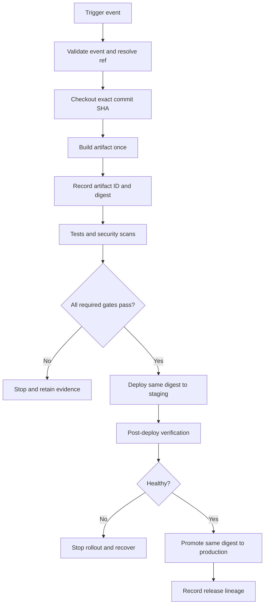

# Liên kết sự kiện kích hoạt với đúng commit hoặc artifact

Một pipeline có thể được kích hoạt bởi push, pull request, tag, lịch chạy, thao tác thủ công hoặc một workflow khác. Sự kiện cho biết vì sao pipeline chạy và cung cấp ngữ cảnh ban đầu, nhưng bản thân tên sự kiện hay tên nhánh chưa đủ để xác định chính xác mã nguồn và gói phần mềm cần xử lý. Nhánh có thể di chuyển, tag có thể bị thay đổi, pull request có thể được cập nhật trong lúc job đang chờ, và một workflow downstream có thể chạy trong ngữ cảnh khác với workflow đã tạo artifact.

Thiết kế CI/CD đáng tin cậy cần giữ được mối liên kết xuyên suốt: **sự kiện nào đã xảy ra → revision nào được kiểm tra → artifact nào được tạo → artifact nào được triển khai**. Mỗi bước phải dùng định danh bất biến phù hợp, lưu bằng chứng và xác minh nguồn trước khi tiếp tục. Điều này giúp tránh build nhầm commit, tải nhầm artifact từ lần chạy khác hoặc triển khai một phiên bản chưa qua quality gate.

## 1. Phân biệt sự kiện, revision và artifact

Ba khái niệm thường bị gộp làm một nhưng có vai trò khác nhau:

| Thành phần | Câu hỏi được trả lời | Ví dụ định danh |
|---|---|---|
| Sự kiện kích hoạt (*trigger event*) | Vì sao và khi nào pipeline bắt đầu? | `push`, `pull_request`, `schedule`, `release`, `workflow_run` |
| Revision nguồn (*source revision*) | Pipeline đang kiểm tra chính xác trạng thái mã nguồn nào? | Git commit SHA đầy đủ |
| Artifact đầu ra (*build artifact*) | Những bytes nào được tạo ra và sẽ được kiểm thử hoặc triển khai? | Artifact ID, package version, container image digest SHA-256 |

Sự kiện có thể chứa nhiều tham chiếu Git như branch, tag, base SHA, head SHA hoặc merge SHA. Pipeline phải chọn đúng revision theo mục tiêu kiểm tra. Sau khi build, commit SHA vẫn chưa xác định đầy đủ package nếu đầu ra có thể thay đổi theo toolchain, dependency hoặc cấu hình; vì vậy cần lưu thêm artifact digest và nguồn gốc build.

Ví dụ, một pull request có head commit `H` và base commit `B`. Nền tảng có thể tạo merge result `M` để kiểm tra tổ hợp `B + H`. Pipeline kiểm tra `M` có thể báo xanh, nhưng nếu base thay đổi thành `B2`, kết quả cũ không chứng minh tổ hợp `B2 + H` vẫn đạt. Khi merge, commit thực tế trên mainline có thể là `M2` hoặc một commit mới. Vì thế, hồ sơ cần ghi riêng head, base và revision thực sự được checkout.

Một chuỗi truy vết tối thiểu có dạng:

```text
Trigger:
  event = push
  repository = acme/order-service
  ref = refs/heads/main
  delivery_or_run_id = 1842

Source:
  commit_sha = 9f4c...e81a

Build:
  workflow_run = 1842
  attempt = 1

Artifact:
  image = registry.example/order-service@sha256:abc...

Deployment:
  environment = staging
  deployed_digest = sha256:abc...
```

Các giá trị trên chỉ minh họa cấu trúc. Trong hệ thống thật, phải lấy ID và digest từ nền tảng Git, pipeline và registry.

## 2. Mỗi loại sự kiện có ngữ nghĩa revision riêng

Không nên giả định mọi trigger đều checkout cùng một loại revision. Cùng một biến như `GITHUB_SHA` có thể mang ý nghĩa khác nhau tùy event.

| Sự kiện | Ngữ cảnh thường gặp | Revision cần xác định |
|---|---|---|
| Push branch | Một hoặc nhiều commit được đẩy lên nhánh | Commit tip của ref tại sự kiện |
| Push tag | Một tag được tạo hoặc cập nhật | Commit mà tag trỏ tới sau khi xác minh tag |
| Pull request | Thay đổi từ head branch đề xuất vào base branch | Head SHA, base SHA và/hoặc merge-result SHA tùy mục tiêu test |
| Merge queue | Một tổ hợp thay đổi được xếp hàng để tích hợp | Merge-group revision do nền tảng tạo |
| Schedule | Lịch chạy đến thời điểm đã định | Commit của default branch tại thời điểm pipeline bắt đầu theo quy tắc nền tảng |
| Manual dispatch | Người dùng chọn ref hoặc tham số chạy | Ref được chọn và commit SHA thực tế được resolve |
| Release | Một release gắn với tag | Tag name và commit mà tag trỏ tới |
| Workflow completion | Một workflow khác kết thúc | Run ID, repository, event, head branch và head SHA của workflow nguồn |
| External dispatch | Hệ thống ngoài gửi yêu cầu chạy | Payload đã xác thực và revision được resolve từ nguồn tin cậy |

Tên trường và cách resolve phụ thuộc nền tảng. Pipeline phải đọc tài liệu của event cụ thể, lưu giá trị thô cần thiết và xác minh revision sau checkout bằng lệnh như `git rev-parse HEAD`. Không suy luận revision chỉ từ tên branch hoặc tên workflow.

## 3. Push: khóa revision thay vì chạy theo tên nhánh thay đổi

Khi có push, webhook hoặc CI event thường mang ref và commit SHA của lần cập nhật. Branch như `main` là con trỏ có thể thay đổi: trong lúc runner chờ được cấp, một commit mới có thể tiếp tục được push. Nếu job checkout `main` ở thời điểm chạy thay vì checkout SHA của event, mã nguồn được build có thể khác với revision đã kích hoạt pipeline.

Quy tắc an toàn là resolve revision tại thời điểm nhận sự kiện, sau đó checkout đúng commit SHA đó. Có thể ghi cả branch để dễ đọc, nhưng branch chỉ là metadata mô tả vị trí lúc trigger; SHA mới là định danh revision cần kiểm tra.

```bash
# Giá trị SOURCE_SHA phải được lấy từ payload của event hoặc context CI.
git fetch origin "$SOURCE_REF"
git checkout --detach "$SOURCE_SHA"

ACTUAL_SHA="$(git rev-parse HEAD)"
test "$ACTUAL_SHA" = "$SOURCE_SHA"
```

Đoạn lệnh là mẫu khái niệm; cách fetch ref và biến môi trường phụ thuộc nền tảng. Một số nền tảng đã checkout đúng SHA theo mặc định. Bước kiểm tra `rev-parse` giúp phát hiện workflow hoặc script vô tình chuyển sang branch khác.

Nếu push event chứa nhiều commit, cần phân biệt commit tip với danh sách commit trong payload. Build thông thường nên gắn với tip SHA của sự kiện. Nếu pipeline chạy phân tích từng commit trong dải, mỗi commit phải được ghi nhận riêng và không được gắn nhầm artifact của commit trước với trạng thái cuối của branch.

## 4. Pull request: phân biệt head, base và merge result

Pull request có ít nhất hai phía: head là thay đổi được đề xuất; base là nhánh đích. Tùy nền tảng và chế độ pipeline, runner có thể kiểm tra head commit riêng hoặc một merge commit tạm được tạo từ head và base.

Với GitHub Actions, trong workflow `pull_request`, `GITHUB_REF` thường là ref dạng `refs/pull/<number>/merge` và `GITHUB_SHA` là commit merge của pull request. Head commit riêng được cung cấp trong payload tại `github.event.pull_request.head.sha`; base commit nằm ở `github.event.pull_request.base.sha`. Cần chọn theo mục đích:

- Kiểm tra thay đổi độc lập của contributor: dùng head SHA và ghi nhận base SHA để biết bối cảnh.
- Kiểm tra khả năng tích hợp với base hiện tại: dùng merge result do nền tảng tạo và ghi nhận cả hai SHA thành phần.
- Sau khi merge: chạy pipeline trên commit thực tế của mainline để xác minh trạng thái đã tích hợp.

Nếu base branch thay đổi trong khi pull request đang mở, kết quả cũ có thể không còn đại diện cho merge result mới. Có thể yêu cầu cập nhật branch, dùng merge queue hoặc tạo lại merge result trước khi cho phép merge. Required status check phải gắn với đúng revision và ngữ cảnh check.

### Bảo vệ workflow trước mã pull request không đáng tin cậy

Pull request từ fork có thể chứa thay đổi tùy ý trong mã nguồn, script build và file workflow. Workflow chạy mã đó không nên nhận secret production hoặc quyền ghi repository. Trên GitHub Actions, `pull_request_target` chạy trong ngữ cảnh base repository và có thể có quyền cao hơn; không checkout rồi thực thi mã từ head không đáng tin cậy trong workflow này khi secret hoặc token đặc quyền đang sẵn có.

Nếu cần một workflow đặc quyền tiếp tục sau khi kiểm tra pull request hoàn tất, hãy truyền run ID hoặc artifact ID cụ thể, xác minh repository nguồn, event, branch, head SHA và conclusion. Artifact do workflow không đáng tin cậy tạo ra phải được xem là dữ liệu chưa tin cậy: kiểm tra cấu trúc, digest, nội dung và không thực thi script bên trong chỉ vì artifact đã được upload thành công.

## 5. Tag và release: xác minh tag trỏ đến commit nào

Tag thường dùng để đánh dấu phiên bản như `v2.4.0`. Tag name dễ đọc nhưng không tự bảo đảm bất biến. Tag có thể bị xóa và tạo lại hoặc bị di chuyển nếu repository không bảo vệ. Với annotated tag, Git còn có tag object trỏ đến một object khác; cần resolve đến commit cuối cùng.

Khi trigger từ tag:

1. Lưu tag name và ref đầy đủ, ví dụ `refs/tags/v2.4.0`.
2. Fetch tag từ repository đúng nguồn.
3. Resolve tag đến commit SHA và ghi nhận kết quả.
4. Nếu chính sách yêu cầu, xác minh chữ ký tag và quyền tạo release.
5. Build từ commit SHA đã resolve, không checkout tag name lần nữa ở một thời điểm khác.
6. Publish artifact với version dễ đọc và digest bất biến.

Tag bảo vệ hoặc quy tắc release giúp giảm nguy cơ tag bị thay đổi. Tuy nhiên, hồ sơ phát hành vẫn phải lưu commit SHA và digest; không chỉ lưu chuỗi `v2.4.0`.

Một release event có thể được phát ra ở các trạng thái khác nhau như draft, prerelease hoặc published. Pipeline cần lọc đúng loại sự kiện và kiểm tra tag cùng trạng thái release trước khi publish hoặc deploy. Việc có release object không đồng nghĩa mọi artifact gắn với release đó đã qua kiểm thử.

## 6. Schedule và manual dispatch

Schedule thường có nghĩa “chạy với trạng thái nguồn được chọn tại thời điểm chạy”, không phải “chạy lại commit đã có khi lịch được tạo”. Trên GitHub Actions, scheduled workflow chạy trên default branch và sử dụng trạng thái mới nhất của default branch tại lúc workflow bắt đầu. Vì vậy, cần lưu `GITHUB_SHA`, ref và thời điểm bắt đầu của từng lần chạy.

Manual dispatch thường cho phép người vận hành chọn branch hoặc tag cùng một số tham số. Giá trị người dùng nhập là yêu cầu đầu vào, chưa phải bằng chứng rằng revision đó được phép triển khai. Pipeline nên:

- Xác thực ref thuộc repository và nhánh/tag được phép.
- Resolve ref thành commit SHA một lần.
- Ghi người khởi chạy, lý do, tham số và SHA đã resolve.
- Áp dụng quality gate như pipeline tự động.
- Dùng quyền môi trường hoặc approval phù hợp cho production.

Không nên cho phép nhập một URL artifact tùy ý rồi tải và triển khai trực tiếp. Nếu cần chọn artifact cũ để rollback, hãy chọn từ danh mục phát hành tin cậy, kiểm tra digest và chính sách tương thích.

## 7. Workflow downstream: lấy artifact từ đúng lần chạy upstream

Một lỗi phổ biến là workflow B được kích hoạt khi workflow A hoàn tất, nhưng workflow B lại dùng `github.sha` của chính lần chạy B để tìm mã nguồn hoặc artifact. Hai giá trị đó không nhất thiết giống nhau. Context của downstream có thể phản ánh default branch hoặc ref của workflow downstream, còn artifact thuộc run upstream.

Với GitHub Actions `workflow_run`, payload cung cấp thông tin workflow nguồn, bao gồm `workflow_run.id`, `workflow_run.head_sha`, `workflow_run.head_branch`, `workflow_run.event` và `workflow_run.conclusion`. Job downstream cần dùng `workflow_run.id` để tải artifact từ đúng run nguồn; `head_sha` để xác minh revision đã tạo artifact. Với workflow upstream cùng repository, có thể dùng `github.repository` làm repository đích khi tải artifact.

Ví dụ workflow downstream:

```yaml
name: Consume verified build

on:
  workflow_run:
    workflows: [Build]
    types: [completed]

permissions:
  actions: read
  contents: read

jobs:
  consume:
    if: >-
      github.event.workflow_run.conclusion == 'success' &&
      github.event.workflow_run.event == 'push' &&
      github.event.workflow_run.head_branch == 'main'
    runs-on: ubuntu-latest
    steps:
      - uses: actions/checkout@v4
        with:
          ref: ${{ github.event.workflow_run.head_sha }}

      - name: Download artifact from the triggering run
        uses: actions/download-artifact@v4
        with:
          run-id: ${{ github.event.workflow_run.id }}
          github-token: ${{ secrets.GITHUB_TOKEN }}
          repository: ${{ github.repository }}
          name: application-package
          path: input

      - name: Verify source metadata
        env:
          EXPECTED_SHA: ${{ github.event.workflow_run.head_sha }}
        run: |
          test -s input/app.tar.gz
          test "$(git rev-parse HEAD)" = "$EXPECTED_SHA"
```

Ví dụ giả định workflow `Build` upload artifact tên `application-package` và package nằm tại `app.tar.gz`. Trong môi trường thực tế, cần kiểm tra thêm repository ID, workflow ID/path, branch được phép, event nguồn, run attempt, artifact ID và digest. Nếu cần quyền ghi hoặc deploy, hãy tách job đặc quyền, dùng environment protection và chỉ cấp quyền sau khi nguồn cùng artifact đã được xác minh.

`workflow_run` có thể tạo ranh giới quyền giữa workflow build và workflow triển khai, nhưng ranh giới này không tự làm artifact trở nên đáng tin. Một workflow nguồn từ pull request hoặc fork có thể tạo file độc hại. Không tự động chạy script từ artifact đó trong downstream có secret production.

## 8. External dispatch và dữ liệu từ hệ thống ngoài

Webhook từ hệ thống quản lý ticket, release coordinator hoặc một dịch vụ nội bộ có thể kích hoạt pipeline bằng `repository_dispatch`, API trigger hoặc cơ chế tương đương. Payload có thể chứa issue ID, release ID, branch, commit SHA hoặc artifact digest.

Payload bên ngoài phải được xem là đầu vào cần xác thực:

- Xác minh chữ ký webhook hoặc credential của caller theo nền tảng.
- Kiểm tra event type và schema payload; từ chối field thiếu hoặc sai kiểu.
- Kiểm tra repository, ref và commit thuộc nguồn được phép.
- Resolve ref thành SHA cụ thể; không checkout chuỗi branch tùy ý từ payload.
- Nếu payload chỉ định artifact, xác minh registry, repository, digest và provenance.
- Ghi caller identity, event ID, payload đã chuẩn hóa và quyết định chấp nhận/từ chối.

Không đưa payload thô trực tiếp vào shell command hoặc biểu thức tạo đường dẫn. Giá trị cần được kiểm tra và truyền qua biến môi trường hoặc cơ chế tham số an toàn. Không dùng event ID của caller làm bằng chứng duy nhất cho artifact; cần liên kết nó với revision và digest thực tế.

## 9. Liên kết commit với artifact sau khi build

Commit SHA xác định mã nguồn, nhưng artifact còn phụ thuộc toolchain, dependency, build arguments và môi trường build. Hai lần build cùng commit có thể tạo bytes khác nhau nếu build không tái lập. Do đó, pipeline nên tạo một manifest hoặc provenance liên kết:

| Trường | Ý nghĩa |
|---|---|
| Repository identity | Repository nguồn chính xác, tốt nhất có ID ổn định ngoài tên hiển thị |
| Event | Loại trigger và event/delivery/run ID |
| Ref | Branch hoặc tag tại thời điểm trigger |
| Source SHA | Commit đã được checkout và xác minh |
| Base/head SHA | Thông tin hai phía của pull request khi áp dụng |
| Workflow identity | Workflow path, workflow ID, run ID và run attempt |
| Builder identity | Runner/toolchain hoặc danh tính build service |
| Dependencies | Lockfile, dependency snapshot hoặc SBOM |
| Artifact identity | Tên package, version, registry location và digest |
| Verification | Test, scan, policy gate và chữ ký/provenance |

Định danh image nên dùng digest, ví dụ `registry.example/team/app@sha256:...`. Tag như `2.4.0` hoặc `9f4c...` hỗ trợ tìm kiếm nhưng không thay thế digest. Nếu build lại, hãy tạo artifact identity mới và không ghi đè artifact đã được dùng trong một lần phát hành trước.

## 10. Từ artifact đến triển khai: giữ nguyên chuỗi bằng chứng

Sau khi artifact được kiểm thử, các môi trường tiếp theo cần promote đúng artifact đó. Không build lại từ branch hoặc tag trong job deploy vì ref có thể đã di chuyển và kết quả build có thể khác.

Luồng đề xuất:

1. Trigger được nhận và xác thực; resolve source SHA.
2. Build job checkout SHA, xác minh `HEAD`, tạo artifact và digest.
3. Test và security scan tải artifact theo ID hoặc digest, rồi ghi kết quả gắn với định danh đó.
4. Quality gate tổng hợp bằng chứng và quyết định có cho phép promote hay không.
5. Staging triển khai cùng artifact digest; post-deploy validation xác nhận version đang chạy.
6. Production promote cùng digest, chỉ thay cấu hình môi trường và secret theo chính sách.
7. Release record lưu trigger, source SHA, artifact digest, environment, thời điểm, kết quả xác minh và hành động phục hồi nếu có.



Một lệnh deploy thành công không đủ chứng minh production đang chạy đúng artifact. Bước xác minh sau deploy nên đọc version hoặc digest từ dịch vụ/nền tảng, so sánh với giá trị dự kiến và lưu kết quả. Nếu sai digest, rollout cần dừng để điều tra.

## 11. GitLab CI và các nguồn pipeline

GitLab cung cấp biến predefined để phân biệt nguồn pipeline và revision. Một số biến thường dùng:

| Biến | Ý nghĩa sử dụng |
|---|---|
| `CI_PIPELINE_SOURCE` | Nguồn tạo pipeline, ví dụ `push`, `web`, `schedule`, `api`, `trigger`, `pipeline`, `parent_pipeline`, `merge_request_event` |
| `CI_COMMIT_SHA` | Commit SHA gắn với pipeline hiện tại |
| `CI_COMMIT_REF_NAME` | Tên branch hoặc tag được pipeline xử lý |
| `CI_COMMIT_BRANCH` | Tên branch; không được đặt trong pipeline tag-only |
| `CI_COMMIT_TAG` | Tên tag khi pipeline chạy cho tag |
| `CI_MERGE_REQUEST_IID` | Số định danh nội bộ của merge request |
| `CI_MERGE_REQUEST_SOURCE_BRANCH_SHA` | SHA của source branch trong các ngữ cảnh pipeline có cung cấp biến này |
| `CI_MERGE_REQUEST_TARGET_BRANCH_SHA` | SHA của target branch trong các ngữ cảnh pipeline có cung cấp biến này |

Các biến merge request có điều kiện xuất hiện tùy loại pipeline và cấu hình GitLab; không giả định chúng luôn có giá trị. Cần kiểm tra biến có tồn tại trước khi sử dụng và ghi `CI_COMMIT_SHA` cùng `CI_PIPELINE_SOURCE` vào metadata build.

Ví dụ rules tách pipeline theo nguồn:

```yaml
workflow:
  rules:
    - if: '$CI_PIPELINE_SOURCE == "merge_request_event"'
    - if: '$CI_PIPELINE_SOURCE == "push" && $CI_COMMIT_BRANCH == $CI_DEFAULT_BRANCH'
    - if: '$CI_PIPELINE_SOURCE == "push" && $CI_COMMIT_TAG'
    - if: '$CI_PIPELINE_SOURCE == "schedule"'
    - when: never

build:
  script:
    - test -n "$CI_COMMIT_SHA"
    - test "$(git rev-parse HEAD)" = "$CI_COMMIT_SHA"
    - ./gradlew --no-daemon clean assemble
```

Pipeline merge request có thể là detached pipeline hoặc merged results pipeline. Mỗi kiểu kiểm tra revision khác nhau; hãy đọc rõ cấu hình và loại pipeline thay vì mặc định `CI_COMMIT_SHA` luôn bằng source branch SHA. Với pipeline downstream hoặc multi-project, cần truyền pipeline ID, project identity và artifact reference cụ thể để job tiêu thụ lấy đúng đầu ra.

## 12. Jenkins và các hệ thống webhook khác

Trong Jenkins, Git plugin và webhook provider thường cung cấp branch, change request hoặc commit được phát hiện. Pipeline cần checkout SCM revision đã được webhook/polling xác định và ghi SHA thực tế bằng `git rev-parse HEAD`. Tránh `git checkout main` ở một stage muộn nếu mục tiêu là build đúng revision của lần trigger ban đầu.

Với multibranch pipeline, change request và tag discovery có thể tạo nhiều job với ngữ cảnh khác nhau. Nên lưu build cause, repository URL đã chuẩn hóa, branch/tag, commit SHA, build number và artifact digest trong metadata. Khi downstream job được kích hoạt, truyền build number hoặc artifact reference cụ thể từ upstream; không chỉ truyền tên job rồi lấy “last successful build” vì build mới hơn có thể đã xuất hiện.

Nguyên tắc này áp dụng cho mọi nền tảng: webhook là tín hiệu để bắt đầu; payload và API của nền tảng cung cấp revision; checkout phải xác minh revision; artifact phải gắn với build identity; consumer phải lấy đúng artifact identity.

## 13. Chống chạy trùng, race condition và retry sai

Một event có thể được gửi lại do retry mạng, webhook delivery lặp hoặc người dùng bấm chạy nhiều lần. Nhiều event gần nhau cũng có thể kích hoạt pipeline đồng thời. Nếu không có định danh và chính sách điều phối, pipeline có thể publish trùng tag, deploy sai thứ tự hoặc để phiên bản cũ ghi đè phiên bản mới.

Các biện pháp cần xem xét:

- Dùng event delivery ID, pipeline run ID hoặc khóa idempotency phù hợp để nhận diện lần xử lý.
- Lưu source SHA và artifact digest trong mọi thao tác publish/deploy.
- Đặt concurrency group theo repository, environment hoặc release channel tùy phạm vi khóa.
- Xác định rõ job mới sẽ chờ, hủy job cũ hay chạy song song; không dùng `cancel-in-progress` nếu thao tác cũ đã gây thay đổi không thể đảo ngược mà chưa có xử lý an toàn.
- Kiểm tra version/digest trước khi ghi đè trạng thái môi trường.
- Thiết kế deploy idempotent và retry có giới hạn cho lỗi tạm thời.
- Dùng lock hoặc cơ chế tuần tự hóa khi nhiều pipeline cùng thay đổi một môi trường hay schema dữ liệu.

Ví dụ, hai push liên tiếp tạo pipeline A cho commit `C1` và pipeline B cho `C2`. Nếu A chạy lâu hơn B và deploy sau B, production có thể bị quay lùi về `C1`. Có thể hủy rollout cũ, serialize deploy hoặc kiểm tra rằng revision đang triển khai vẫn là revision được phép theo thứ tự release. Chính sách cần phù hợp với việc có cho phép deploy commit cũ để rollback hay không; rollback phải là hành động có chủ đích và có hồ sơ riêng.

## 14. Những anti-pattern thường gặp

| Anti-pattern | Rủi ro | Cách xử lý |
|---|---|---|
| Checkout branch thay vì SHA của event | Build một commit mới hơn hoặc khác với commit đã trigger | Checkout và xác minh SHA cụ thể |
| Xem tag name là bất biến | Tag bị di chuyển, artifact không còn khớp release | Lưu tag, resolved commit và artifact digest; bảo vệ tag |
| Không phân biệt PR head và merge result | Test sai revision hoặc hiểu nhầm phạm vi bằng chứng | Lưu head/base/merge SHA và mô tả rõ mục tiêu test |
| Downstream dùng `github.sha` của chính nó để tìm artifact upstream | Lấy nhầm revision hoặc artifact | Dùng upstream run ID, head SHA và artifact ID |
| Tải artifact “mới nhất” | Nhầm branch, run hoặc lần retry | Chỉ định run ID/artifact ID và xác minh metadata |
| Build lại trong job deploy | Artifact production khác artifact đã test | Promote cùng digest |
| Tin payload bên ngoài ngay lập tức | Có thể checkout hoặc deploy ref không được phép | Xác thực caller, schema, repository, ref và SHA |
| Workflow PR nhận secret đặc quyền | Mã không tin cậy có thể lấy secret hoặc quyền ghi | Giới hạn permission và tách workflow đặc quyền |
| Bỏ qua run attempt | Lấy nhầm artifact từ lần thử khác | Ghi run ID, attempt và artifact ID |
| Không chống event lặp | Publish/deploy trùng hoặc đảo thứ tự | Idempotency, concurrency và release record |
| Chỉ ghi version, không ghi digest | Không xác định được bytes đã triển khai | Lưu digest và provenance |

## 15. Ví dụ tình huống: phát hành phiên bản từ tag

Giả sử nhóm phát hành `order-service` phiên bản `v2.4.0`. Người có quyền tạo tag trên commit `9f4c...e81a`, tag push kích hoạt workflow.

1. Workflow xác nhận ref bắt đầu bằng `refs/tags/v` và tag đúng quy ước phiên bản.
2. Runner fetch tag, resolve tag đến commit và xác minh commit đó thuộc repository nguồn được phép. Nếu chính sách yêu cầu, workflow xác minh chữ ký tag.
3. Runner checkout detached tại commit SHA đã resolve; `git rev-parse HEAD` phải khớp giá trị đã ghi.
4. Build tạo package và container image. Pipeline ghi tag `v2.4.0`, source SHA, workflow run ID và image digest.
5. Test và security scan kiểm tra artifact theo digest. Kết quả được lưu gắn với cùng digest.
6. Quality gate xác nhận tất cả điều kiện bắt buộc. Nếu không đạt, workflow dừng và không publish release candidate sang production.
7. Staging triển khai image theo digest và xác minh version đang chạy. Production promote chính digest đã được kiểm tra.
8. Release record lưu tag, resolved commit, digest, pipeline run, kết quả gate, môi trường và thời điểm triển khai.

Nếu tag `v2.4.0` bị di chuyển sau khi build, artifact đã phát hành vẫn được xác định bằng digest và commit SHA đã ghi trong release record. Pipeline không âm thầm build lại từ tag name mới rồi coi đó là cùng một artifact.

## 16. Checklist liên kết trigger, commit và artifact

Trước khi bật pipeline phát hành, hãy xác minh:

- [ ] Mỗi trigger có quy tắc rõ về ref và revision nguồn.
- [ ] Pipeline lưu event type, event/run ID, repository, ref và thời điểm nhận event.
- [ ] Checkout dùng commit SHA đã resolve và xác minh `HEAD` khớp SHA đó.
- [ ] Pull request ghi nhận head SHA, base SHA và merge-result SHA khi áp dụng.
- [ ] Tag/release được resolve đến commit; tag được bảo vệ hoặc xác minh theo chính sách.
- [ ] Manual dispatch và external dispatch xác thực ref, caller và tham số trước khi chạy.
- [ ] Workflow downstream dùng run ID/artifact ID của upstream, không suy luận từ context của chính nó.
- [ ] Artifact có tên/ID, version và digest; không chỉ dựa vào tag có thể thay đổi.
- [ ] Test, scan và deploy sử dụng cùng artifact identity.
- [ ] Provenance liên kết repository, revision, workflow, builder và digest.
- [ ] Workflow chạy trên mã PR không đáng tin không nhận secret hoặc quyền production.
- [ ] Event lặp, retry và pipeline đồng thời có chính sách idempotency/concurrency.
- [ ] Post-deploy verification xác nhận digest/version đang chạy và ghi kết quả vào release record.
- [ ] Có thể truy ngược từ production đến artifact, pipeline run, commit và trigger ban đầu.

## 17. Kết luận

Sự kiện kích hoạt chỉ mở đầu một lần chạy. Muốn pipeline có thể tin cậy, nhóm phải resolve đúng revision theo ngữ nghĩa của event, checkout và xác minh commit SHA, tạo artifact có định danh bất biến, rồi truyền đúng artifact đó qua kiểm thử và triển khai. Với pull request cần phân biệt head, base và merge result; với tag cần xác minh tag trỏ đến commit nào; với workflow downstream cần dùng run ID và artifact ID của upstream; với dispatch bên ngoài cần xác thực payload.

Khi trigger, commit, artifact và deployment được liên kết bằng ID cùng digest và được lưu trong release record, nhóm có thể trả lời chính xác thay đổi nào đã tạo ra phiên bản đang chạy, bằng chứng nào cho phép phát hành và cần quay lui về artifact nào khi có sự cố.
